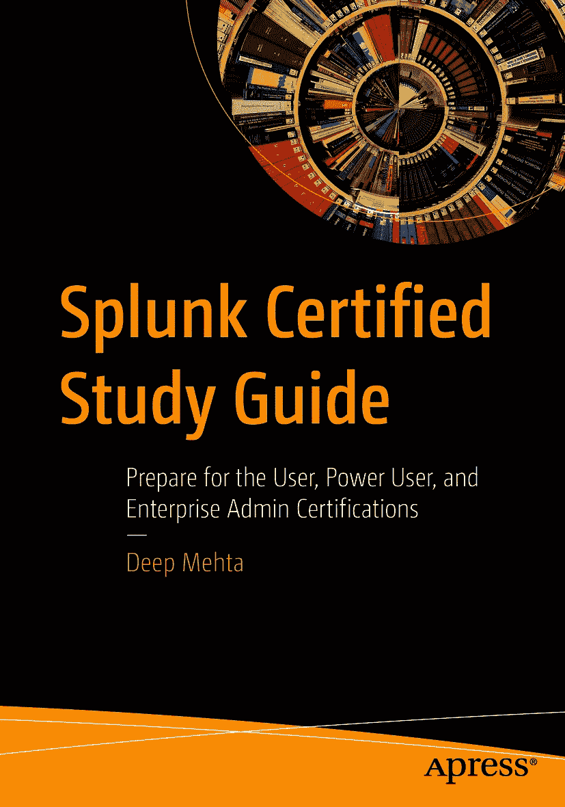

ISBN 978-1-4842-6668-7 电子版 ISBN 978-1-4842-6669-4 [`doi.org/10.1007/978-1-4842-6669-4`](https://doi.org/10.1007/978-1-4842-6669-4) © Deep Mehta 2021 标准 Apress 版 本书中可能出现商标名称、徽标和图片。对于每次出现的商标名称、徽标或图片，我们并未使用商标符号，而是仅以编辑方式使用这些名称、徽标和图片，以维护商标所有者的利益，且无意侵犯商标权。在本书中使用商业名称、商标、服务标志和类似术语，即使未明确标识，也不应被视为对其是否受所有权保护的意见表达。出版商、作者和编辑可以合理假设，本书中的建议和信息在出版时是真实准确的。出版商、作者或编辑均不对本书所含内容或可能存在的任何错误或遗漏提供明示或暗示的担保。出版商对已出版地图中的管辖权主张及机构归属保持中立。本书由施普林格科学与商业媒体纽约公司（`Springer Science+Business Media New York`）在全球图书贸易中发行，地址：1 New York Plaza, New York, NY 10004。电话：1-800-SPRINGER，传真：(201) 348-4505，电子邮件：orders-ny@springer-sbm.com，或访问 www.springeronline.com。`Apress Media, LLC` 是一家加州有限责任公司，其唯一成员（所有者）是施普林格科学与商业媒体金融公司（`SSBM Finance Inc`）。`SSBM Finance Inc` 是一家特拉华州的公司。

谨以此书献给已故的 Amit Mahendra Mehta 先生。没有他的祝福，本书不可能问世。我今天的成就皆源于他。

## 引言

`Splunk` 是一种用于实时监控、搜索、分析和可视化机器生成数据的软件技术。本书探讨了 `Splunk` 管理员的角色，并解释了如何高效部署和管理 `Splunk` 架构。它涵盖了通过 `Splunk` 考试所需的一切知识。本书旨在以交互方式使用，并在每章末尾提供练习数据集和测试题。

本书分为四个模块，其中三个模块专注于考试。

第一个模块包含六章，致力于通过 `Splunk Core Certified User` 考试和 `Splunk Core Certified Power User` 考试。它涵盖了安装 `Splunk`、`Splunk` 搜索处理语言 (`SPL`)、字段提取、`Splunk` 中的字段别名和宏、创建 `Splunk` 标签、`Splunk` 查找以及触发警报。您将学习如何在 `Splunk` 中创建数据模型和准备高级仪表板。

第二个模块专注于 `Splunk Enterprise Certified Admin` 考试，包含四章。它涵盖了 `Splunk` 许可证和用户角色管理、`Splunk` 转发器配置、索引器集群、`Splunk` 安全策略以及高级数据输入选项。

第三个模块也聚焦于 `Splunk Enterprise Certified Admin` 考试，但其章节教导管理员如何排查和管理 `Splunk` 基础设施。

在第四个模块中，您将学习如何在 `AWS` 平台上设置 `Splunk Enterprise`，并了解 `Splunk` 的一些最佳实践。

每章末尾都有一个多项选择题测试，以帮助考生熟悉考试。

## 致谢

我感谢所有选择本书的读者。我也感谢我的父母 Paresh 和 Rupa Mehta，以及我的家人和朋友们的支持。

我要感谢 `Elixia Tech.` 的 Sanket Sheth 提供了数据集，并特别感谢 Neha Doshi 提供的支持和指导。

## 关于作者

## 关于技术审校