# 第一部分：Splunk 架构、Splunk SPL（搜索处理语言）和 Splunk 知识对象

## 1. Splunk 概述

Splunk 是一种用于实时监控、搜索、分析和可视化机器生成数据的软件技术。该工具可以监控和读取多种类型的日志文件，并将数据作为事件存储在索引器中。它使用仪表板以各种形式可视化数据。

本章讨论 Splunk 的基础知识，包括其历史和架构，并深入探讨如何在本地机器上安装该软件。您将了解 Splunk Enterprise Certified Admin 考试的布局。此外，您还将学习如何添加用户数据和 `props.conf` 文件，并学习编辑时间戳的过程，这在后续章节中十分有用。本章末尾提供了一些示例问题。

总结来说，本章涵盖以下主题。

- Splunk Enterprise Certified Admin 考试概述
- Splunk 简介
- Splunk 架构
- 在 macOS 和 Windows 上安装 Splunk
- 向 Splunk 添加数据

### Splunk 管理员考试概述

Splunk Enterprise Certified Admin 负责 Splunk Enterprise 的日常管理，包括性能监控、安全增强、许可证管理、索引器和搜索头、配置以及向 Splunk 添加数据。以下是考试测试的专业领域。

- Splunk 部署
- 许可证管理
- Splunk 应用程序
- Splunk 配置文件
- 用户、角色和身份验证
- 添加数据
- 分布式搜索
- Splunk 集群
- 通过转发器管理部署转发器
- 配置通用 Splunk 数据输入
- 自定义输入解析过程

下一节，您将了解管理员考试的结构。

### 结构

Splunk Enterprise Certified Admin 考试采用多项选择题形式。您有 57 分钟时间回答 63 个问题，外加 3 分钟时间审阅考试协议，总计 60 分钟。此考试的及格分数为 75%。考试注册费为 120 美元（USD）。更多信息请参考[`www.splunk.com/pdfs/training/Splunk-Test-Blueprint-Admin-v.1.1.pdf`](http://www.splunk.com/pdfs/training/Splunk-Test-Blueprint-Admin-v.1.1.pdf)。

考试问题有三种格式。

- **单项选择**：您必须选择最能回答某个问题或完成某个陈述的选项。
- **多项选择**：您必须选择最能回答某个问题或完成某个陈述的选项。
- **示例说明**：您阅读一个陈述或问题，并仅选择最能代表最理想或最正确答案的选项。

### 报考要求

Splunk Enterprise 认证管理员考试有两个先决条件。你必须先通过以下考试。

- Splunk Core Certified Power User 考试
- Enterprise System Administration 和 Splunk Data Administration 课程

有四门课程为这些考试提供支持。学习流程如图 1-1 所示。

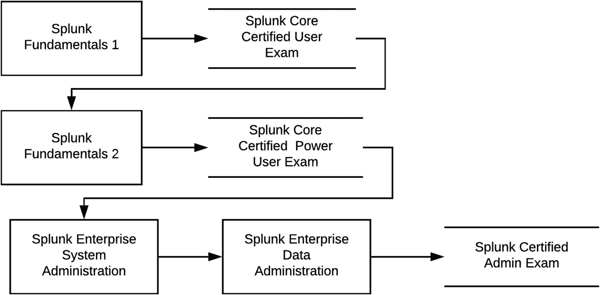

图 1-1 Splunk 考试先决条件

- `Splunk Fundamentals 1` 以两种方式向学员提供：在线学习或讲师指导。本课程将向你介绍 Splunk 平台。
- `Splunk Core Certified User 考试` 测试你在搜索、使用字段、创建警报、使用查找以及创建基本统计报表和仪表板方面的知识和技能。
- `Splunk Fundamentals 2` 是一门讲师指导课程，内容涵盖搜索和报告命令以及创建知识对象。
- `Splunk Core Certified Power User 考试` 测试使用 SPL 搜索和报告命令、构建知识对象、使用字段别名和计算字段、创建标签和事件类型、使用宏、创建工作流操作和数据模型，以及使用通用信息模型标准化数据所需的知识和技能。
- `Splunk Enterprise System Administration` 采用讲师指导形式，专为负责管理 Splunk Enterprise 环境的系统管理员设计。该课程教授有关 Splunk 许可证管理器、索引器和搜索头的基础知识。
- `Splunk Enterprise Data Administration` 采用讲师指导形式，专为负责将远程数据添加到 Splunk 索引器的系统管理员设计。该课程提供有关 Splunk 转发器和方法的基础知识。
- `Splunk Enterprise Certified Admin 考试` 测试你在管理 Splunk Enterprise 各个组件（包括许可证管理、索引器与搜索头、配置、监控以及向 Splunk 添加数据）方面的知识和技能。

本书的第 2 章和第 3 章重点介绍 Splunk Enterprise 系统管理和数据管理考试。

### 考试大纲

Splunk Enterprise 认证管理员考试包含 17 个部分，描述如下。

- **第 1 部分：Splunk 管理基础 (5%)** 本部分重点在于识别 Splunk 组件。
- **第 2 部分：许可证管理 (5%)** 本部分重点在于识别许可证类型和理解许可证违规情况。
- **第 3 部分：Splunk 配置文件 (5%)** 本部分重点在于配置分层、配置优先级，以及使用 `Btool` 命令行工具检查配置设置。
- **第 4 部分：Splunk 索引 (10%)** 本部分重点在于基本索引结构、索引桶的类型、检查索引数据完整性、`indexes.conf` 文件的工作原理、鱼桶以及数据保留策略。
- **第 5 部分：Splunk 用户管理 (5%)** 本部分重点在于用户角色、创建自定义角色以及添加 Splunk 用户。
- **第 6 部分：Splunk 身份验证管理 (5%)** 本部分重点在于 LDAP、用户身份验证选项以及多因素身份验证。
- **第 7 部分：数据接入 (5%)** 本部分重点在于基本输入设置、Splunk 转发器类型、配置转发器以及使用 CLI 添加 UF 输入。
- **第 8 部分：分布式搜索 (10%)** 本部分重点在于分布式搜索、搜索头和搜索对等节点的角色、配置分布式搜索组以及搜索头扩展选项。
- **第 9 部分：数据接入——暂存 (5%)** 本部分重点在于 Splunk 索引过程的三个阶段以及 Splunk 输入选项。
- **第 10 部分：配置转发器 (5%)** 本部分重点在于配置转发器以及识别其他转发器选项。
- **第 11 部分：转发器管理 (10%)** 本部分重点在于部署管理、部署服务器、使用部署应用管理转发器、配置部署客户端、配置客户端组以及监控转发器管理活动。
- **第 12 部分：监控输入 (5%)** 本部分考察你对文件和目录监控输入、监控输入的可选设置以及部署远程监控输入的知识。
- **第 13 部分：网络和脚本化输入 (5%)** 本部分考察你对网络（TCP 和 UDP）输入、网络输入的可选设置以及基本脚本化输入的知识。
- **第 14 部分：无代理输入 (5%)** 本部分考察你对 Windows 输入类型和 HTTP 事件收集器的知识。
- **第 15 部分：微调输入 (5%)** 本部分考察你对输入阶段默认处理过程以及配置输入阶段选项（例如源类型微调和字符集编码）的知识。
- **第 16 部分：解析阶段与数据 (5%)** 本部分考察你对解析过程中的默认处理、优化和配置事件分行、从事件中提取时间戳和时区，以及使用数据预览验证解析阶段创建的事件的知识。
- **第 17 部分：操作原始数据 (5%)** 本部分考察你对如何定义和调用数据转换，以及如何使用 `props.conf`、`transforms.conf` 和 `SEDCMD` 进行转换来修改原始数据的知识。

## Splunk 简介

*Splunk* 一词源自 *spelunking*，意为探索洞穴。Splunk 能够分析几乎所有已知的数据类型，包括机器数据、结构化数据和非结构化数据。Splunk 实时提供整个基础设施中发生的运营反馈——有助于快速决策。

Splunk 通常被认为是“日志文件的谷歌”，因为和谷歌一样，你可以使用 Splunk 来确定网络的状态以及网络内发生的活动。它是一个**集中式日志管理工具**，但它也能很好地处理结构化和非结构化数据。Splunk **监控、报告和分析实时机器数据**，并根据时间戳对数据进行索引。

### Splunk 的历史

Splunk 由 Rob Das、Erik Swan 和 Michael Baum 于 2003 年 10 月创立。它从一家小型初创公司发展成为安全信息和事件管理 (`SIEM`) 工具领域最大的跨国公司之一。在 Splunk 出现之前，需要对环境进行故障排除的企业必须依赖 IT 部门，由程序员编写脚本来满足需求。该脚本在一个平台上运行以生成报告。

因此，公司无法精确地发现其基础设施深处的问题。Splunk 就是为了解决这个问题而创建的。最初，Splunk 侧重于分析和理解问题，了解组织在出现问题时采取的措施，并追溯踪迹。

Splunk 的第一个版本于 2004 年在 Unix 市场发布，并开始获得关注。

理解开发此软件的原因很重要。下一节将讨论 Splunk 的许多有用优势。

### Splunk 的优势

Splunk 提供了多种优势，包括以下内容。

-   将复杂的日志分析报告转换为图表
-   支持结构化数据以及非结构化数据
-   提供一个简单且可扩展的平台
-   为最复杂的架构提供简单的架构
-   理解机器数据
-   为运营智能提供数据洞察
-   持续监控 IT 数据

### Splunk 架构

`Splunk 索引器`在特定架构中按照指定方式工作（见图 1-2）。

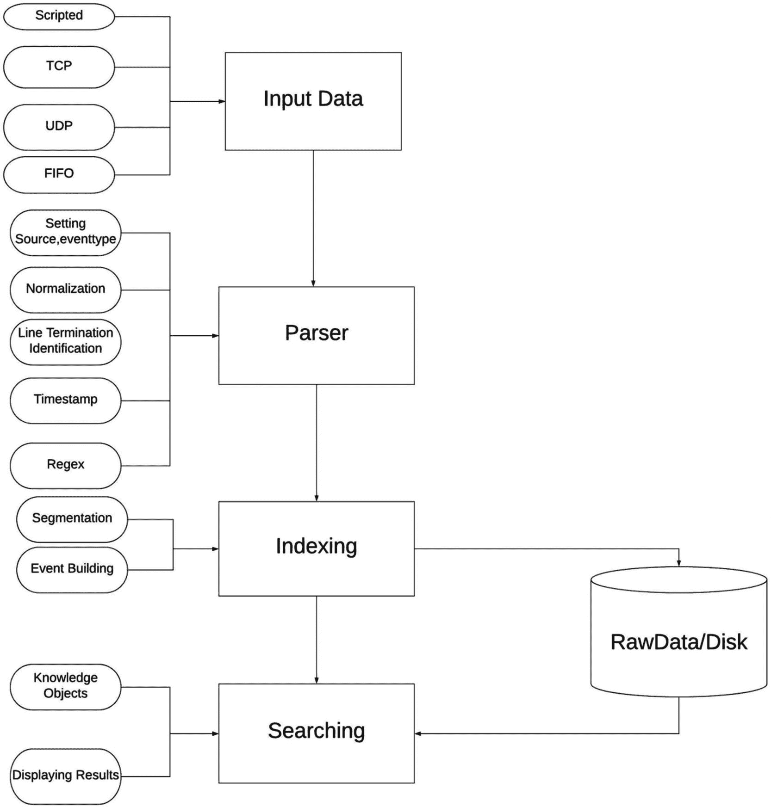

图 1-2 Splunk 架构图

我们来解析上图并介绍其组成部分。

-   **输入数据**：这是数据接入的第一阶段。将数据导入 `Splunk` 有多种方法：它可以监听你的端口、`REST API` 端点、传输控制协议（`TCP`）、用户数据报协议（`UDP`）等，或者使用脚本化输入。
-   **解析器**：第二阶段是解析输入数据，将数据块分解为不同的事件。解析管道中数据的最大大小为 128 MB。在解析阶段，你可以提取默认字段，例如源类型。你还可以从数据中提取时间戳、识别行终止符，并执行其他类似操作。你也可以对敏感但有用的数据进行脱敏。例如，如果数据来自银行且包含客户账号，那么数据脱敏至关重要。在解析阶段，如果需要，你可以应用自定义元数据。
-   **索引**：在此阶段，事件被分解为可以在其中进行搜索的段。数据被写入磁盘，你可以设计索引数据结构。
-   **搜索**：在此阶段，在索引数据之上执行搜索操作，你可以创建知识对象并执行任何任务；例如，制作月度销售报告。

输入数据、解析器和索引器都位于同一台独立机器上。与此相反，在分布式环境中，输入数据通过通用转发器 (`UF`) 被解析到索引器或重型转发器。`UF` 是一个轻量级程序，用于在 `Splunk` 中获取数据。在 `UF` 中，你无法搜索数据或执行任何操作。你将在本章后续内容中了解这一点。

图 1-3 展示了 `Splunk` 的架构。

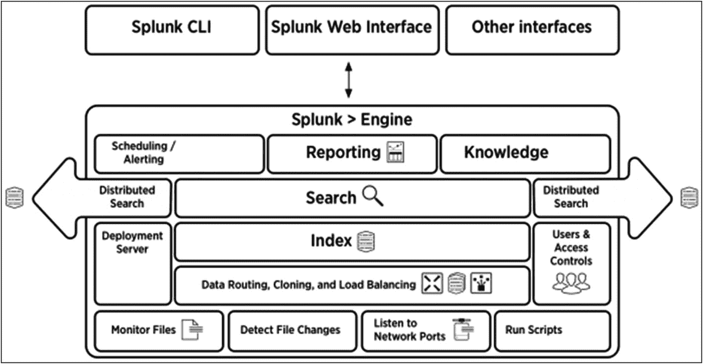

图 1-3 Splunk 架构

在 `Splunk` 架构中可以执行以下任务。

-   你可以通过网络端口接收数据，并实时检测文件变化。
-   你可以实时监控文件和检测文件。
-   你可以运行脚本以获取自定义数据。
-   分布式环境中支持数据路由、克隆和负载均衡，你将在后续章节中了解这些内容。
-   用户访问控制保障了安全性。有不同级别的安全权限：普通用户、高级用户和管理员。用户可以根据其权限写入或读取索引。
-   部署服务器管理整个技术栈的部署。你可以使用部署服务器来部署新的应用程序。
-   当索引器从解析器接收数据时，它会对其进行索引，你可以将事件分解为多个片段。
-   数据一旦存储在索引器中，你就可以执行搜索操作。
-   你可以对索引数据进行计划搜索。
-   你可以通过设置参数来生成数据警报；例如，当特定事务的事务时间超过 15 分钟时。
-   你可以通过计划执行、保存搜索或创建宏来生成报告。有多种方式可以生成报告。
-   知识对象对于从用户定义的数据、非结构化数据等创建专业报告非常有用。
-   你可以通过 `Splunk` 网页界面（最常用的选项）或 `Splunk CLI` 来访问 `Splunk` 实例。

现在，我们继续学习如何快速安装 `Splunk`。

## 安装 Splunk

你可以免费下载并安装 `Splunk Enterprise` 的 60 天试用版，该版本每天可索引 500 MB 数据。你只需在 [`www.splunk.com/en_us/download/splunk-enterprise.html`](http://www.splunk.com/en_us/download/splunk-enterprise.html) 创建一个帐户即可。

60 天后，你可以转换为永久免费许可证，或购买 `Splunk Enterprise` 许可证以继续使用专为企业级规模部署设计的扩展功能。（第 8 章将详细讨论 `Splunk` 许可证）。

表 1-1 展示了在安装过程中，几个 `Splunk` 属性与其默认端口之间的关系。每个属性的重要性将在本书后续章节讨论。

表 1-1 Splunk 属性与默认端口值

| 属性 | 默认端口 |
| --- | --- |
| Splunk 默认端口 | 8000 |
| Splunk 管理端口 | 8089 |
| Splunk KV 存储 | 8191 |

### 在 macOS 上安装 Splunk

macOS 用户应按照以下步骤安装 `Splunk`。

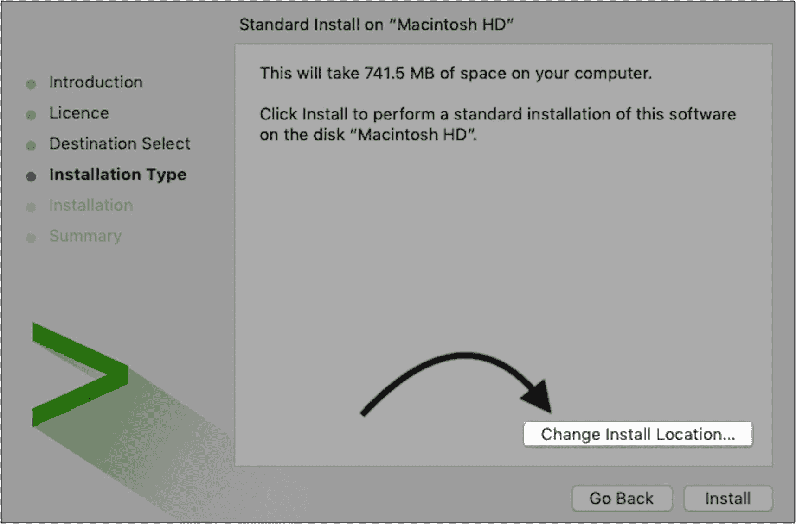

图 1-4 安装 Splunk

1.  登录你的 `Splunk` 帐户。
2.  在 [`www.splunk.com/en_us/download/splunk-enterprise.html#tabs/macos`](http://www.splunk.com/en_us/download/splunk-enterprise.html%2523tabs/macos) 下载 `Splunk` 文件。
3.  打开下载的文件。
4.  点击安装按钮。
5.  在下一步点击继续按钮。
6.  持续点击继续按钮，直到系统提示你点击安装按钮。
7.  如果你希望先更改安装位置，可以点击更改安装位置来进行操作（见图 1-4）。

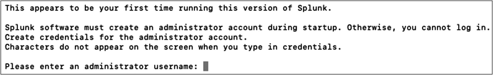

图 1-5 创建管理员用户

8.  在选择好要安装 `Splunk` 的路径后，点击安装按钮。
9.  在管理员用户名处输入 `admin`（见图 1-5）。

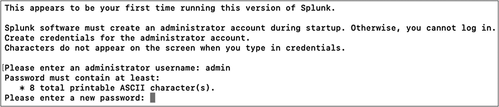

图 1-6 为管理员用户创建密码

10. 输入你的新密码，如图 1-6 所示。


图 1-7 Splunk 用户界面

11. 在 `http://localhost:8000` 启动 `Splunk`。输入你刚刚创建的用户名和密码（图 1-7）。

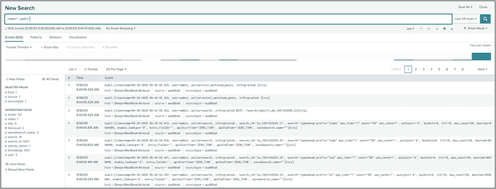

图 1-8 用于审计索引的 Splunk 事件

12. 登录后，进入搜索和报告应用程序，并输入以下 `Splunk` 处理命令进行测试。

    ```
    index = "_audit"
    ```

    如果你得到了响应，说明你已经成功完成了安装。你应该会看到一个类似于图 1-8 的屏幕。

请注意，`host`、`index`、`linecount`、`punct`、`source`、`sourcetype`、`splunk_server` 和 `timestamp` 是在索引数据源时添加到 `Splunk` 中的一些默认字段。

至此，在 macOS 上安装 `Splunk` 的整个过程就结束了。

接下来，我们来讨论如何在 Windows 操作系统上进行安装。

### 在 Windows 系统上安装 Splunk

Windows 用户应按照以下步骤安装 Splunk。

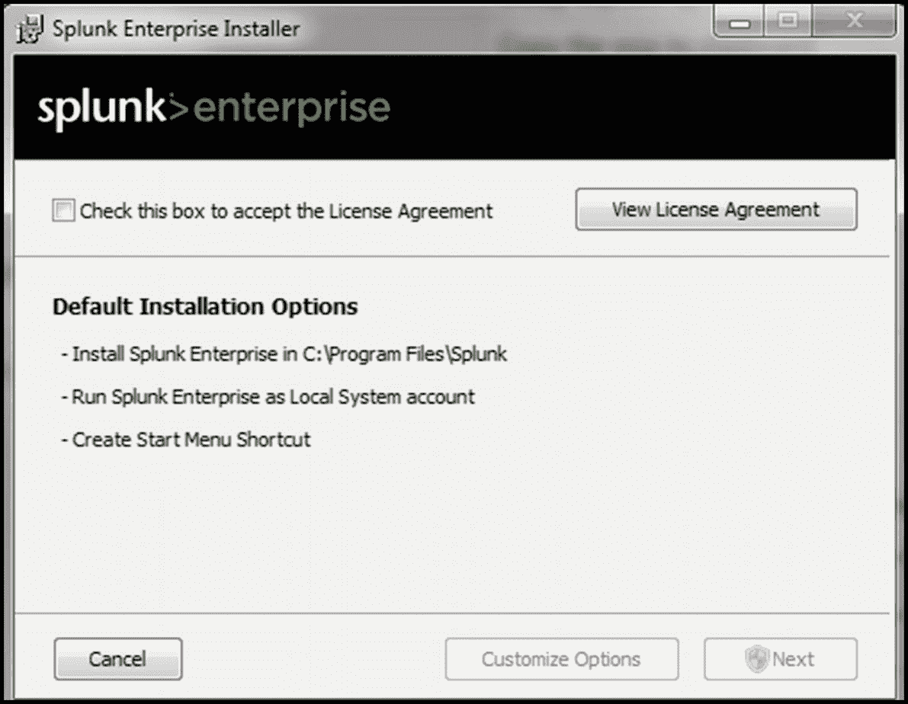

`图 1-9` 安装 Splunk

1.  登录您的 Splunk 帐户。

2.  从 [`www.splunk.com/en_us/download/splunk-enterprise.html`](http://www.splunk.com/en_us/download/splunk-enterprise.html) 下载 Splunk 文件。

3.  打开下载的文件。您的屏幕应与图 1-9 类似。

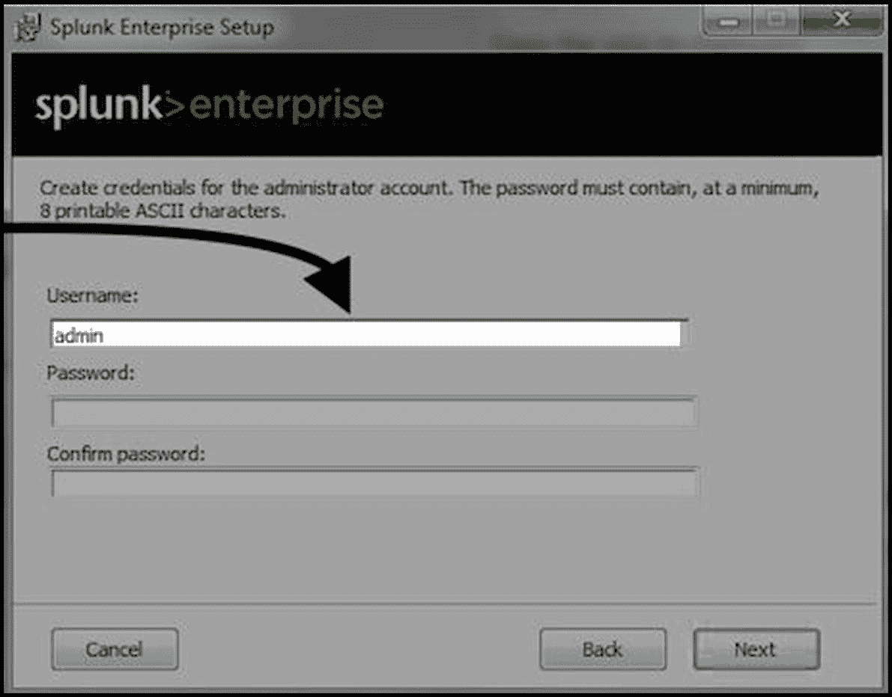

**图 1-10** 创建管理员用户

4.  单击复选框以接受许可协议。

5.  输入 `admin` 作为用户名，如图 1-10 所示。

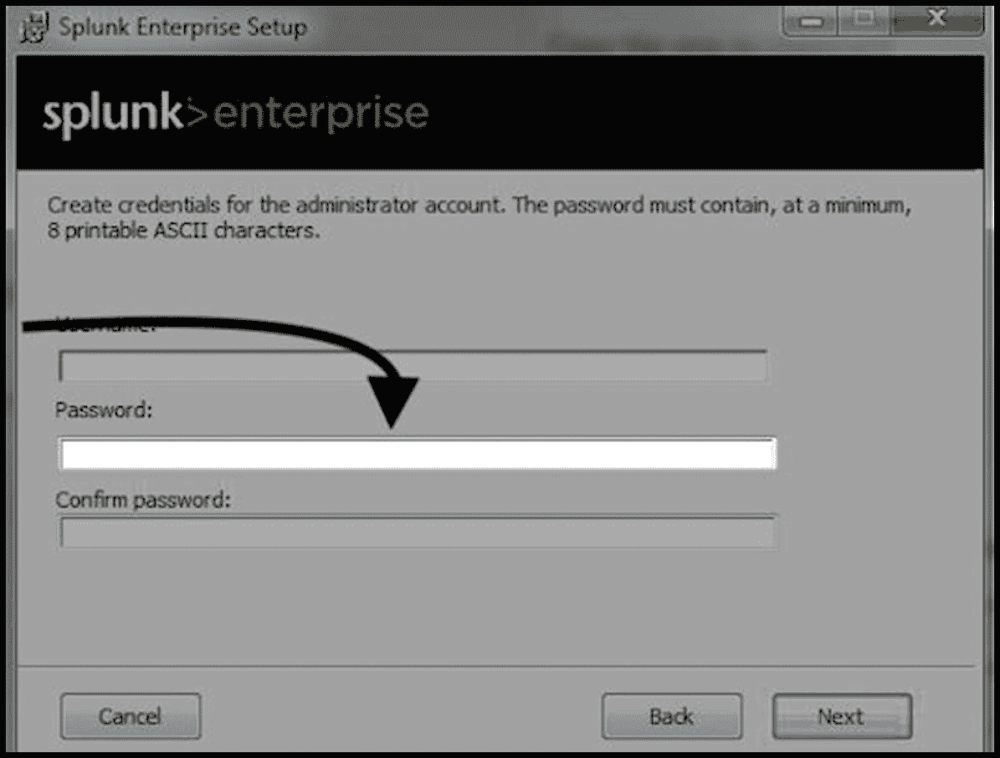

**图 1-11** 为管理员用户创建密码

6.  输入密码并确认。然后，点击“下一步”继续（见图 1-11）。

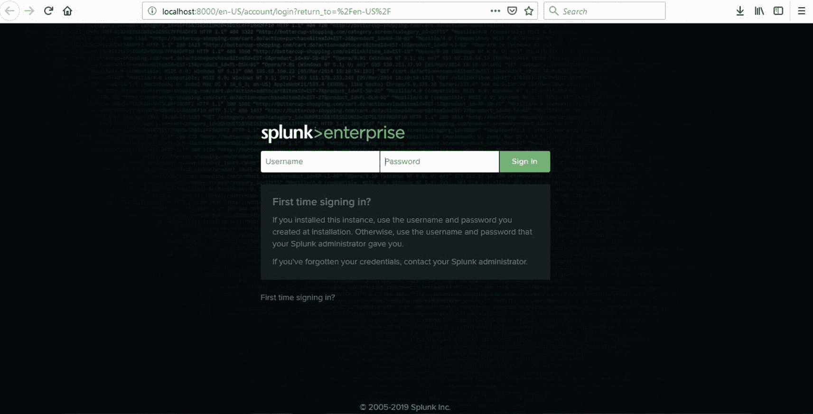

**图 1-12** Splunk 用户界面

7.  点击“安装”按钮，在本地机器上安装 Splunk。

8.  转到 `http://localhost:8000`。在 Splunk 登录界面（见图 1-12），输入您在步骤 5 和步骤 6 中设置的用户名和密码。

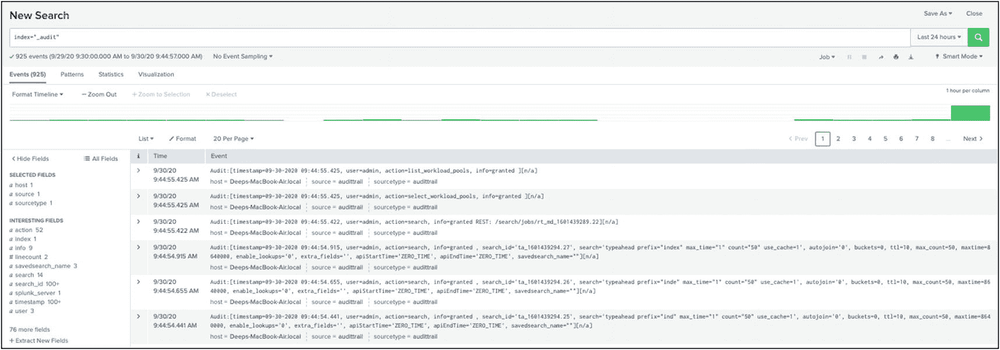

**图 1-13** 用于索引审计的 Splunk 事件

9.  登录后，转到“搜索和分析”应用程序，并输入以下 Splunk 处理命令进行测试。

    ```
    index="_audit"
    ```

    如果收到响应，则表示安装成功。您应看到与图 1-13 类似的界面。

请注意，`host`、`index`、`linecount`、`punct`、`source`、`sourcetype`、`splunk_server` 和 `timestamp` 是在索引数据源时添加到 Splunk 的一些默认字段。

至此，您已学会如何在 macOS 和 Windows 系统上安装 Splunk。您还了解了 Splunk 及其架构，以及 Splunk Enterprise 认证管理员考试。在本章的最后一节，您将学习如何在 Splunk 中添加数据。

## 在 Splunk 中添加数据

在本地机器上安装好 Splunk 后，下一步就是接入数据。为此，您需要创建一个名为 `test` 的新应用程序来执行操作。

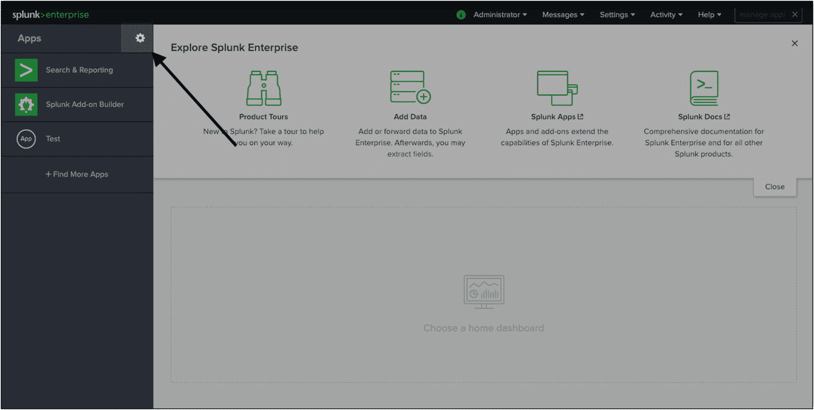

**图 1-14** Splunk 测试应用程序

1.  要在 Splunk 中创建新应用程序，请点击“应用程序”旁边的齿轮图标，如图 1-14 所示。

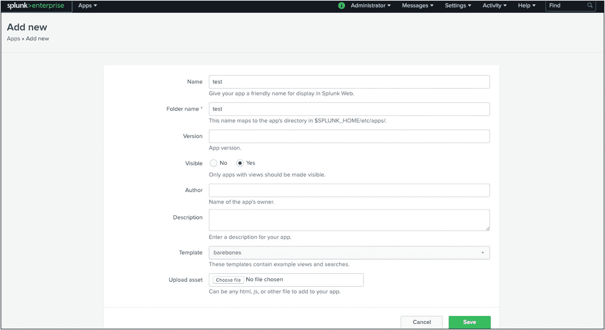

**图 1-15** 创建应用程序 Test:Splunk Web

2.  点击“创建”。在此例中，应用程序的名称为 `test`，文件夹的名称也是 `test`（见图 1-15）。此文件夹位于 `$SPLUNK_HOME/etc/apps/test`。

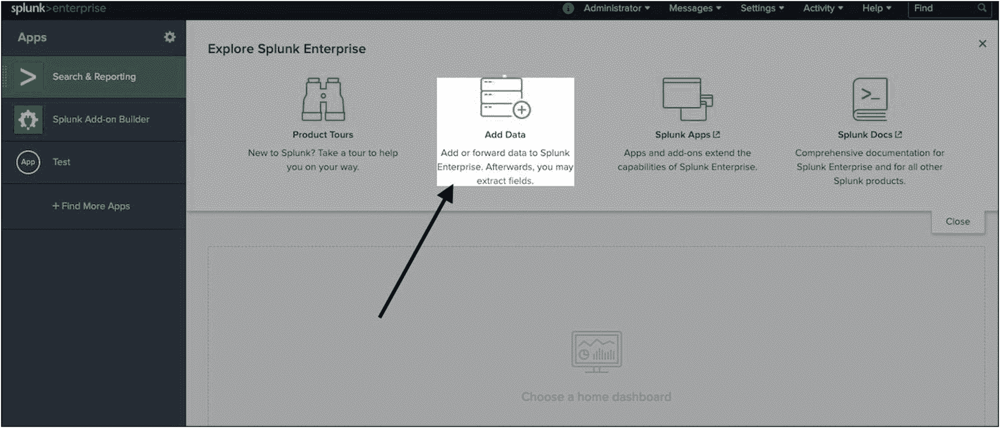

**图 1-16** 添加数据：Splunk Web

3.  Splunk 应用程序创建完成后，打开任意文本编辑器，在 `$SPLUNK_HOME/etc/apps/test/local` 目录下创建一个 `props.conf` 文件。如果该文件已存在，则通过添加以下内容进行修改（编写 `props.conf` 文件将在第 11 章介绍）。

    ```
    Props.conf
    [Test9]
    TIME_PREFIX=\d{1,3}\.\d{1,3}\.\d{1,3}\.\d{1,3}\s\-\s\d{5}\s+
    TIME_FORMAT = %m/%d/%Y %k:%M
    MAX_TIMESTAMP_LOOKAHEAD = 15
    LINE_BREAKER = ([\r\n]+)\d+\s+\"\$EIT\,
    SHOULD_LINEMERGE = false
    TRUNCATE = 99999
    ```

4.  从 [`https://github.com/deeppmehta/splunk-certification-guide/blob/main/ch1/Test.txt`](https://github.com/deeppmehta/splunk-certification-guide/blob/main/ch1/Test.txt) 下载 `test.txt` 文件。

5.  点击“添加数据”，如图 1-16 所示。

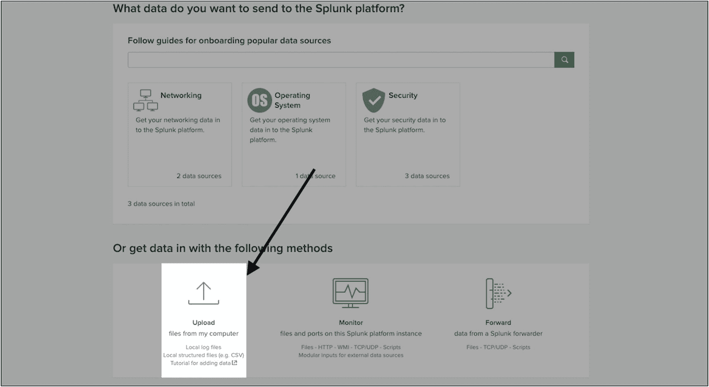

**图 1-17** 上传数据：Splunk Web

6.  点击“上传”，如图 1-17 所示。

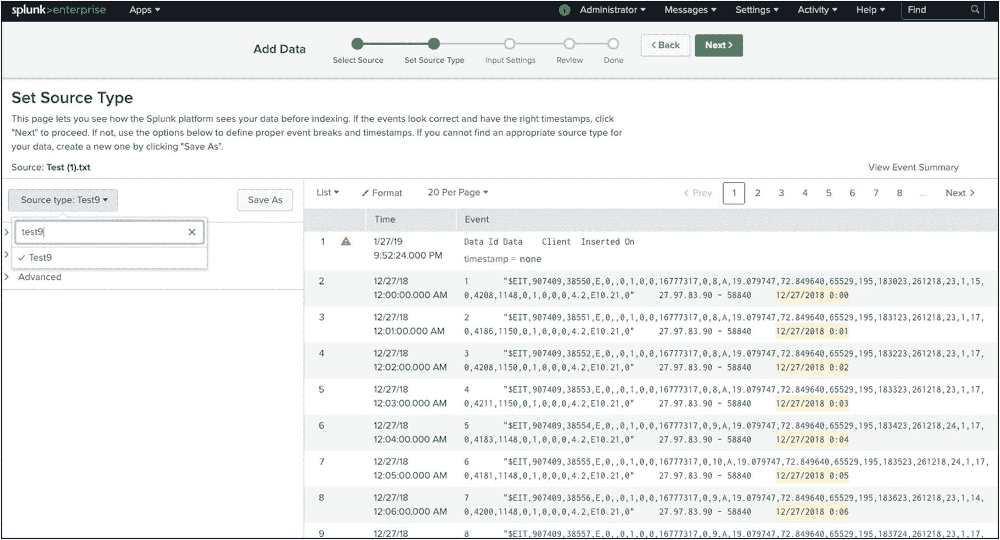

**图 1-19** test.txt 事件：已提取的时间戳

7.  选择源文件，然后点击“下一步”。

8.  在“设置源类型”界面，请注意显示的是当前时间，而非事件发生的时间。为了更好地理解，请查看图 1-18。

    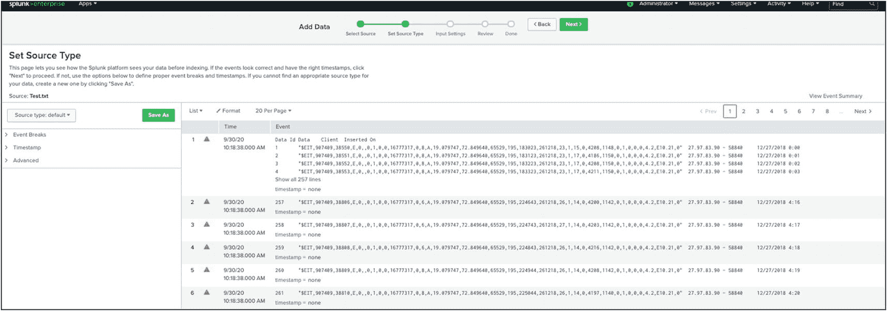

    **图 1-18** test.txt 事件：不正确的时间戳

9.  在“源类型”框中，输入 `test9` 并选择 Test9 作为源类型。在“事件分行”中，为传入的每行数据选择“每行”。现在，数据可以转换了。时间戳是从事件中已有的“时间”字段中选出的，这是由于您编辑的 `props.conf` 文件所致。图 1-19 显示了“源类型”框。

10. 在“输入设置”中，创建一个名为 Test 的新索引。Test 索引将存储来自 `test.txt` 文件的所有事件。图 1-20 展示了如何创建索引器。您只需输入名称即可。

    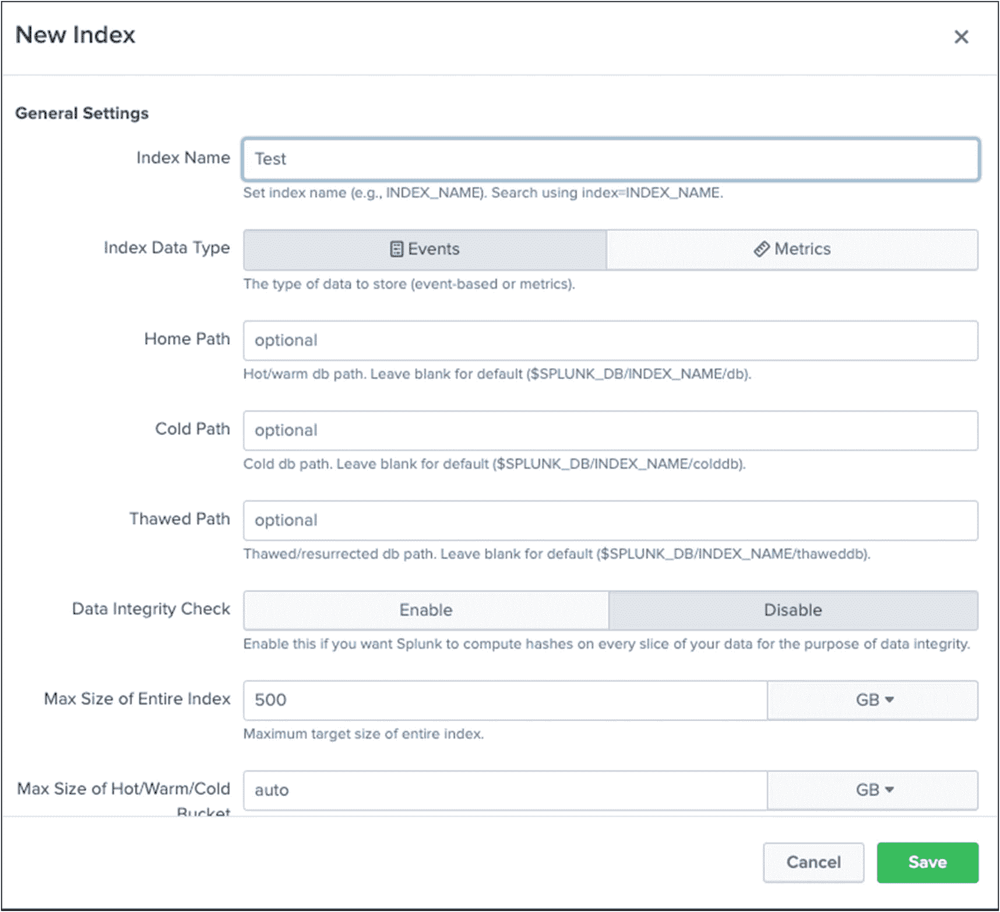

    **图 1-20** Test 索引：Splunk Web

11. 确认所有字段无误后，点击“保存”按钮。

12. 转到 test 应用程序，在搜索框中输入 Splunk 处理命令 `index="Test"`。在搜索框旁边的“时间范围”选择器中，选择“全部时间”范围。您将看到 Splunk 中的所有事件。

您现在对 Splunk 软件有了更深入的了解，并学习了如何输入数据。至此，您已成功完成第 1 章的学习。

## 总结

本章通过讨论 Splunk 的历史、起源和突出特点，着重介绍了其基本概念。它提供了管理考试的路线图，解释了基础架构以及如何在 macOS 和 Windows 上安装 Splunk。在最后一节中，您学习了如何在 Splunk 中操作数据，包括数据接入、修改源文件（例如添加时间戳）和行分隔符。

您将在第 11 章中了解更多关于 `.conf` 文件的内容。在此之前，请尝试接入各种类型的数据，并在 Splunk 中对它们进行操作。

在下一章中，您将学习 Splunk 的搜索处理语言及其各种命令。

## 多选题

1.  Splunk 的默认管理端口是什么？

    1.  8000

    2.  8089

    3.  8056

    4.  9997

2.  索引数据源时，默认元数据会被添加到 Splunk。

    1.  正确

    2.  错误

3.  Splunk 的各个阶段是什么？（请选择所有适用项。）

    1.  解析

## 答案

*   a. 1
*   b. 1
*   c. 1、2 和 4
*   d. 1
*   e. 2

## 延伸阅读

更多关于索引工作原理的信息，请访问[`https://docs.splunk.com/Documentation/Splunk/7.2.3/Indexer/Howindexingworks`](https://docs.splunk.com/Documentation/Splunk/7.2.3/Indexer/Howindexingworks)。

您可以在此处查看 Splunk 的架构：[`https://docs.splunk.com/File:Architecture-new.png`](https://docs.splunk.com/File:Architecture-new.png)。

您可以在此处阅读 Splunk 如何处理您的数据：[`https://docs.splunk.com/Documentation/Splunk/7.2.3/Data/WhatSplunkdoeswithyourdata`](https://docs.splunk.com/Documentation/Splunk/7.2.3/Data/WhatSplunkdoeswithyourdata)。