# 3. 宏、字段提取和字段别名

第 2 章概述了 Splunk 搜索处理语言 (SPL)、时间修饰符和管道运算符。本章讨论 Splunk 中的字段提取、宏和字段别名，并通过使用各种查询来探索 SPL。Splunk 中的字段提取是一个从原始数据中提取字段的过程。Splunk 可以在索引和搜索期间提取数据字段。Splunk 中的宏是可重用的代码块（可以保存以备将来使用的内容），您可以在其中为数据集的不同部分或值动态设置相同的逻辑。当您想频繁运行搜索命令时，宏非常有用，因为它可以省去您重写整个命令的麻烦。Splunk 中的字段别名为字段提供了替代名称。字段别名与具有相似字段值的各种事件相关联。

在处理小数据和大数据时，Splunk 搜索查询提供了灵活性。SPL 查询可帮助您理解如何使用 SPL 并熟悉 SPL 语法。

本章涵盖以下主题。

*   字段提取
*   宏
*   字段别名
*   示例 SPL 查询

在本章结束时，您将能够使用正则表达式和分隔符在 Splunk 中执行字段提取，创建宏和字段别名，并在 SPL 中触发查询。换句话说，您将完成 Splunk Power User 考试蓝图高达 30% 的内容。

让我们从字段提取开始。

## Splunk 中的字段提取

字段提取是关于创建新字段的。Splunk 为其索引的每个事件提取默认字段，例如 `host`（主机）、`source`（来源）和 `source type`（来源类型）。字段提取在索引和搜索期间提取数据字段。它提供了两种提取数据的方法：正则表达式和分隔符。


### 正则表达式

正则表达式主要用于处理**非结构化**的事件数据。它们是用于匹配字符串中字符组合的模式。在 Splunk Web 中，你只需选择正则表达式字段和对应的值，它就会自动生成能够匹配其他事件中字段的正则表达式。如果正则表达式无法自动映射字段，你还可以手动编辑表达式，并相应丢弃不匹配的事件。

在第一章中，你在 Splunk 中导入了数据。你可以对该数据使用正则表达式来查找 IP（互联网协议）地址和端口。

接下来将介绍使用正则表达式的各种方法。

#### 使用字段提取的正则表达式

在本节中，你将使用字段提取来从 `index = "Test"` 中提取端口字段。其值不与端口值匹配的事件将使用黑名单移除。

以下步骤展示了如何使用正则表达式提取端口值。

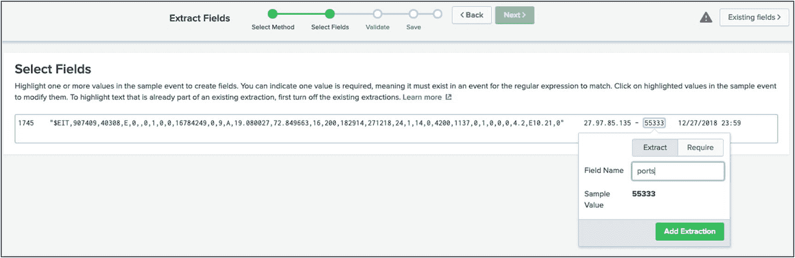

图 3-1 正则表达式字段提取

1.  单击 Splunk，然后进入屏幕顶部的 Enterprise。
2.  进入第一章创建的 Test 应用。
3.  搜索事件 `index="Test"`，并将时间范围选择为“所有时间”。
4.  展开该事件，然后单击“提取字段”。
5.  单击“正则表达式”，然后单击“下一步”。
6.  从事件中选择端口号，如图 3-1 所示。在“字段名称”中，输入 **ports**。

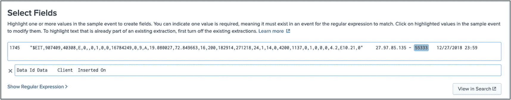

图 3-2 正则表达式黑名单

7.  单击“下一步”，你将看到所有事件、匹配项和不匹配项。
8.  选择不匹配的事件。它会被列入黑名单（黑名单是一种过滤规则，用于将某个事件排除在集合之外），并且你可以找到你的正则表达式。此时“选择字段”屏幕与图 3-2 类似。
9.  单击“下一步”，然后单击“保存”。

接下来，让我们看一下内联正则表达式，它可以将值与端口值不匹配的事件列入黑名单。

#### 使用字段提取的内联正则表达式

在本节中，你将使用内联正则表达式从 `index = "Test"` 中提取端口字段，并屏蔽所有值与端口值不匹配的事件。

以下步骤展示了如何在内联正则表达式中提取端口。

1.  单击 Splunk，然后进入屏幕顶部的 Enterprise。
2.  进入 Test 应用，搜索事件 `index="Test"`，并将时间范围选择为“所有时间”。
3.  展开该事件，然后单击“提取字段”。
4.  单击“正则表达式”，然后单击“下一步”。
5.  选择 IP 地址。
6.  在“字段名称”中，输入 **scrip**。
7.  单击“必需”按钮，并选择一些事件。

图 3-3 展示了一个“选择字段”的示例截图。

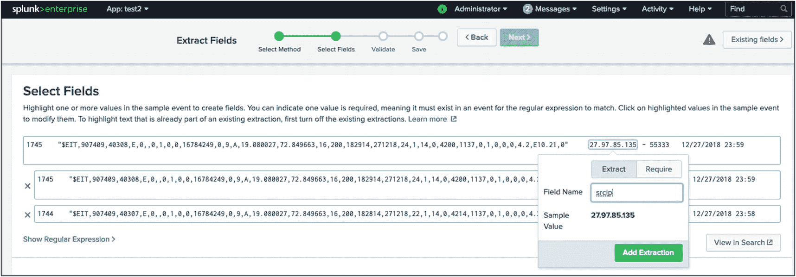

图 3-3 内联正则表达式

8.  单击“下一步”，然后单击“显示正则表达式”，再单击“编辑”。
9.  将正则表达式内容替换为以下内容。
10. 按照上一个示例中的方法移除黑名单内容，单击“下一步”，然后单击“请保存”。
11. 单击“下一步”，并将报告名称保存为 Test1。

```
(?=[^-]*(?:-|-.*-))^(?:[^\t\n]*\t){2}(?P[^ ]+)
```

一旦正则表达式被编辑，你将无法返回字段提取器用户界面。

接下来，我们将讨论另一种字段提取方法：分隔符。

### 分隔符

分隔符用于结构化数据。字段由常见的分隔符分隔，例如逗号、空格、制表符等。分隔符常用于 CSV 数据及类似格式。

分隔符仅通过字段提取来使用。

#### 使用字段提取的分隔符

在本节中，你将使用分隔符从 `index = "Test"` 中提取字段，并使用制表符将字段彼此分隔。

以下是使用分隔符的步骤。

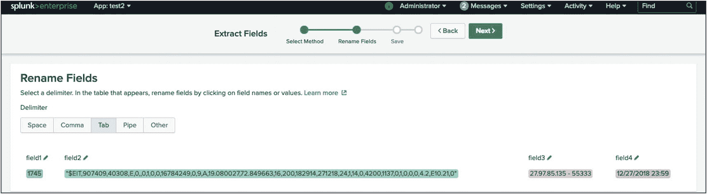

图 3-4 分隔符字段提取

1.  单击 Splunk，然后进入屏幕顶部的 Enterprise。
2.  进入 Test 应用，搜索事件 `index="Test"`，并将时间范围选择为“所有时间”。
3.  展开该事件，然后单击“提取字段”。
4.  单击“分隔符”，然后单击“下一步”。
5.  通过选择“制表符”来指定分隔符。图 3-4 展示了分隔符屏幕。
6.  将所有字段重命名如下：
    *   `field1=id`
    *   `field2=lat_long`
    *   `field3=ip_port`
    *   `field4=timestamp`

图 3-5 展示了重命名过程。

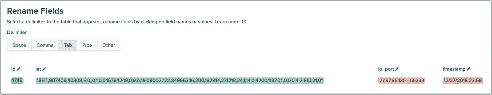

图 3-5 在分隔符中重命名字段

7.  单击“下一步”，并将报告名称保存为 Test2。
8.  单击“完成”。

当你的事件包含结构化数据（例如 JSON 文件、CSV 文件等）时，请使用分隔符。

下一节，我们将讨论搜索命令宏。

## 宏

Splunk 中的宏可以是 SPL 中的完整搜索命令，也可以是搜索命令的一部分。当你需要频繁运行某个搜索命令时，宏非常有用，因为你无需重写整个命令。

在 Splunk 中创建宏有两种方法。

*   使用 Splunk Web

*   使用 `.conf` 文件

宏是可重用的知识对象，因为多个用户和多个应用都可以使用它们。

### 使用 Splunk Web 创建宏

Splunk 中的宏是一个可重用块，你可以在数据集的不同部分或值上动态应用相同的逻辑。使用 Splunk Web 为 test 应用创建一个宏，并为最大暂停时间为 20 分钟的事务创建一个宏。

按照以下步骤使用 Splunk Web 创建宏。

1.  单击“设置”，然后进入“高级搜索”。
2.  选择“搜索宏”，然后单击“新建宏”。
3.  在“目标应用”中，输入 **test**。
4.  在“名称”中，输入 **session**。
5.  在“定义”中，输入 **transaction maxpause=20m**。
6.  单击“保存”。

图 3-6 显示了执行这些步骤时的“添加新”页面。

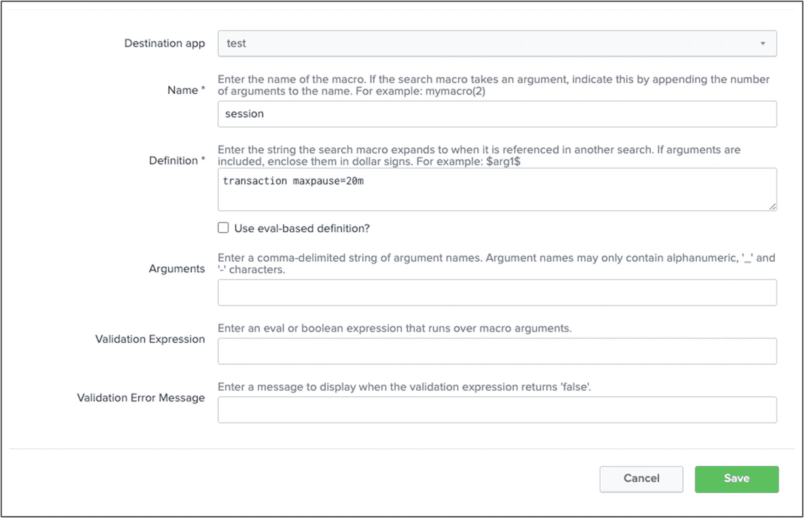

图 3-6 创建宏

7.  要测试该宏，请进入搜索栏并输入以下命令。

```
index="test"|`session`|timechart span=1d sum(eventcount)| as sessions
```

图 3-7 展示了输出。

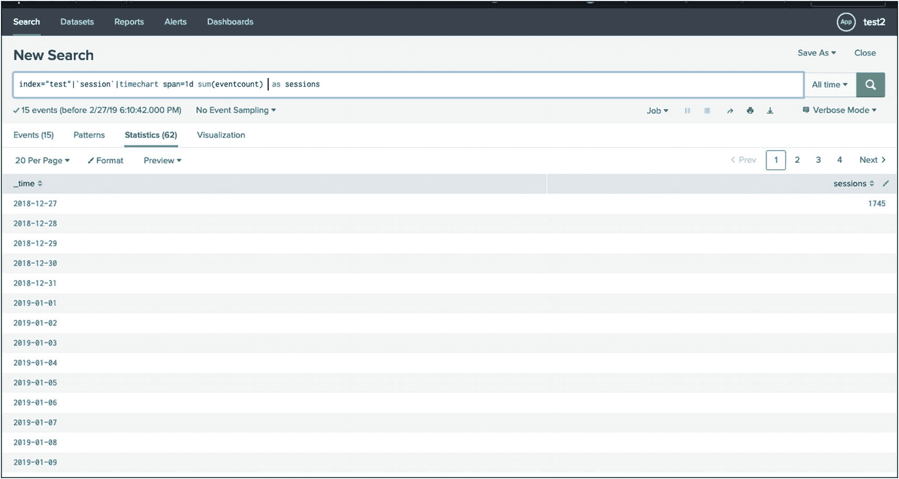

图 3-7 宏的输出

注意

要在 SPL 中运行宏，你必须使用 `` `macro_name` ``。

接下来，让我们看看创建宏的另一种方法。


### 使用 `.conf` 文件创建宏

要在 Splunk 中使用 `.conf` 文件创建宏，请转到 `$Splunk_Home/etc/apps/<app_name>/local/macros.conf`。如果该文件不存在，请创建它；如果存在，请编辑它。

在本节中，您将使用 `.conf` 文件为测试应用程序创建一个宏。该宏将是一个事务，其最大暂停时间为 20 分钟。转到 `$Splunk_Home/etc/apps/Test/local/`。如果 `macros.conf` 存在，请编辑它；否则，您需要创建它。

`macros.conf` 文件准备就绪后，请按照以下步骤操作：

1.  添加以下代码块。
    ```
    [Test9]
    definition = index="test"|transaction maxpause=20m|timechart span=1d sum(eventcount) as sessions
    ```
2.  重启 Splunk。
3.  转到“设置”。
4.  转到“高级搜索”。
5.  搜索“宏”。
6.  转到使用 `.conf` 添加的宏 `Test9`。

可用的“搜索宏”页面如图 3-8 所示。

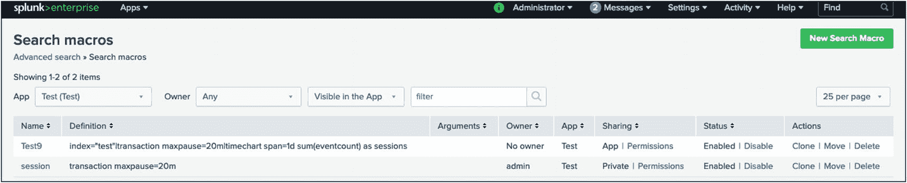

**图 3-8** 图示宏：测试应用

1.  要测试此宏，请转到搜索栏并输入以下命令。
    ```
    index="test"|`session`|timechart span=1d sum(eventcount) as sessions
    ```

图 3-9 显示了输出结果。

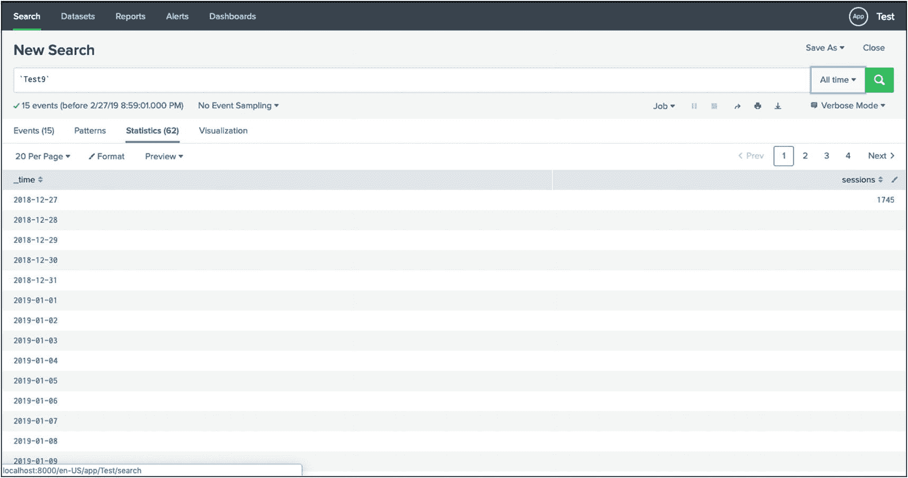

**图 3-9** 宏 `Test9`

接下来，让我们讨论字段别名。

## Splunk 中的字段别名

字段别名用于关联 Splunk 中具有相似字段值的各种事件。为了更深入地洞察这些事件，您可以使用字段别名对两个或多个具有相似字段值的字段进行分组。

让我们来看看如何在 Splunk 环境中设置字段别名。

### 设置字段别名

在本节中，您将上传两个数据源：`Test2.txt` 和 `Test3.csv`。在 `Test2.txt` 中，您有 `unit_id`，而在 `Test3.csv` 中，您有 `id`。您将为 `unit_id` 和 `id` 创建字段别名。

您可以从 [`https://github.com/deeppmehta/splunk-certification-guide/blob/main/ch3/Test2.txt`](https://github.com/deeppmehta/splunk-certification-guide/blob/main/ch3/Test2.txt) 下载 `Test2.txt`。

要设置字段别名，请按照以下步骤操作：

1.  转到“添加数据”并上传 `Test2.txt`。
2.  将“源类型”设置为“默认”，将“事件中断”设置为“每行”。

图 3-10 显示了“设置源类型”页面。

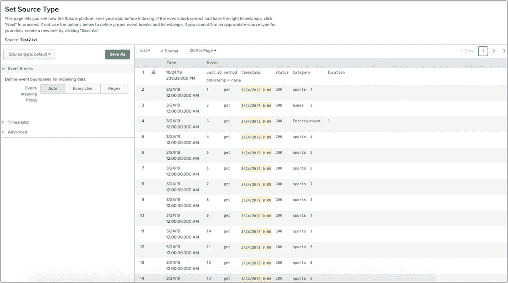

**图 3-10** 源类型：`test89`

1.  单击“下一步”，并将新索引创建为 `tes22`，将应用程序名称设置为 `test`，将源类型设置为 `test89`。

您可以从 [`https://github.com/deeppmehta/splunk-certification-guide/blob/main/ch3/Test3.csv`](https://github.com/deeppmehta/splunk-certification-guide/blob/main/ch3/Test3.csv) 下载 `Test3.csv`。

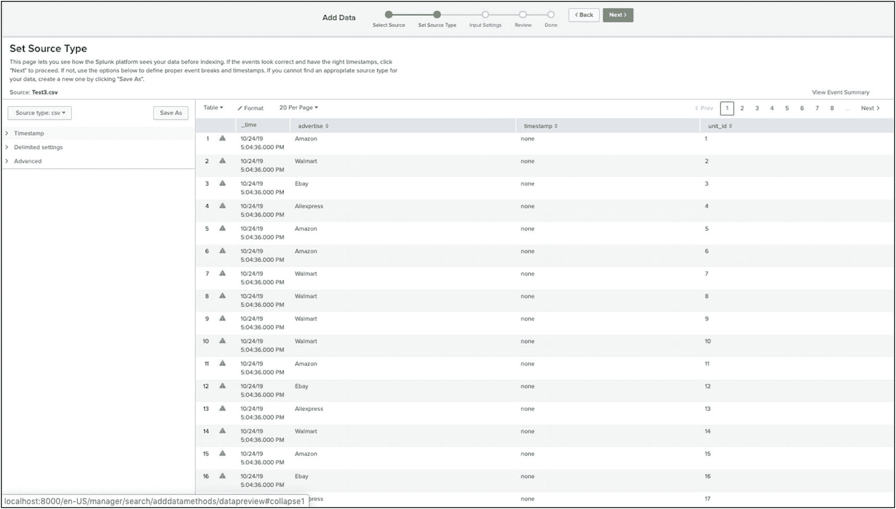

**图 3-11** 源类型：`test2`

1.  转到“添加数据”并上传数据。
2.  选择 `test3.csv`。
3.  将“源类型”设置为“默认”，将“事件中断”设置为“每行”。“设置源类型”页面如图 3-11 所示。
4.  单击“下一步”，并将新索引创建为 `tes22`，将应用程序名称设置为 `test`。

对于 `Test2.txt` 的字段提取，请执行以下操作：

1.  导航到测试应用程序的搜索命令。索引是 `tes22`，源是 `test2`。
2.  在“字段名称”中，使用“分隔符提取字段”为 `Test2.txt` 提取字段，然后提供以下字段名称并将制表符设置为分隔符。
    ```
    field1=unit_id
    field2=method
    field3=timestamp
    field4=status
    field5=category
    field6=location
    ```

对于 `Test3.txt` 的字段提取，请执行以下操作：

1.  使用 Splunk Web 导航到测试应用程序，进入搜索命令并在其中输入 `index = "tes22" source = "Test3.csv"`。
2.  在“字段名称”中，使用“分隔符提取字段”为 `Test3` 提取字段，然后提供以下字段名称并将分隔符设置为逗号。
    ```
    field1=id
    field2=url
    ```

在 `Test2.txt` 中，`unit_id` 是一个公共字段，在 `Test3.csv` 中，`id` 是一个公共字段，因此您可以使用字段别名来关联事件。

输入凭据后，请按照以下步骤操作：

1.  转到“设置”。
2.  选择“添加字段”。
3.  转到“字段别名”。
4.  单击“新增”。
5.  在“目标应用程序”中，输入 `test`。
6.  在“名称”中，输入 `tes11_test`。
7.  在“应用于”中，选择“源”。
8.  在“命名”中，输入 `test3.csv`。
9.  在“字段别名”中，输入 `id=ptestid`。

“新增”屏幕如图 3-12 所示。


**图 3-12** 字段别名 `tes11_test:test3.csv`

与前面的示例类似，添加另一个具有相似字段值的字段别名。

1.  在“目标应用程序”中，输入 `test`。
2.  在“名称”中，输入 `tes11_test`。
3.  在“应用于”中，选择“源”，并在“命名”中，输入 `Test3.csv`。
4.  在“字段别名”中，输入 `unit_id=ptestid`。

运行中的屏幕如图 3-13 所示。

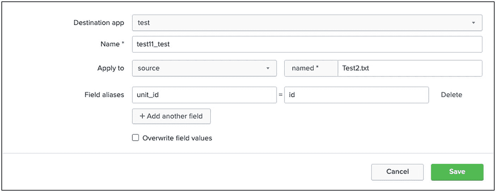

**图 3-13** 字段别名 `tes11_test:Test3.csv`

要检查命令是否成功执行，请参考以下步骤：

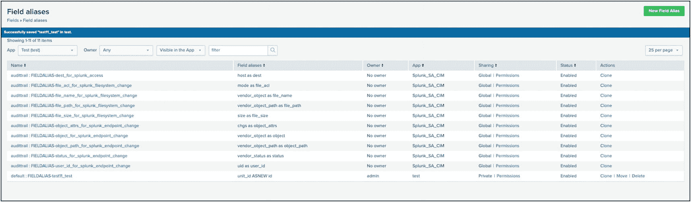

**图 3-14** 图示字段别名：测试应用

1.  转到“设置”，然后转到“字段”。
2.  在“字段别名”页面上，您会发现在图 3-14 中添加了两个字段别名。

要测试您添加的字段别名，请在搜索栏中输入以下 SPL 命令：

```
index="tes22" unit_id=1
```

用于测试字段别名的页面如图 3-15 所示。

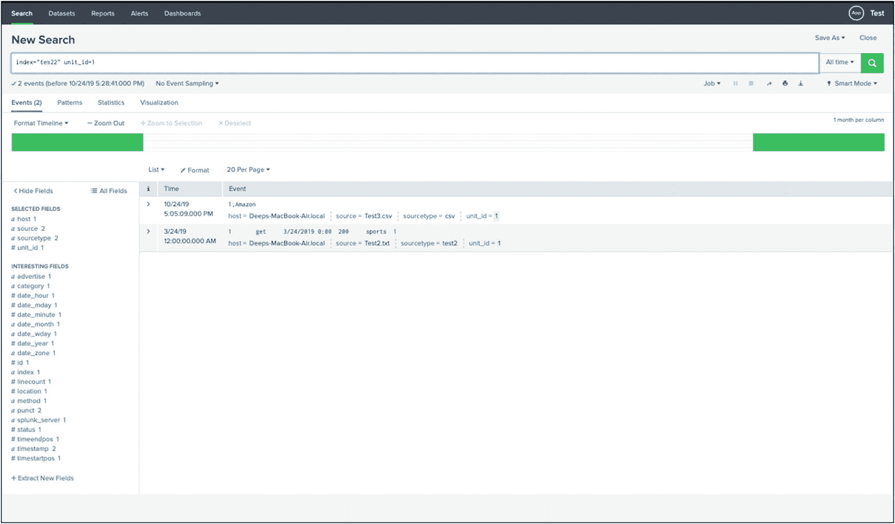

**图 3-15** 字段别名 `unit_id=1`

字段别名可以对任何字段（主机、源或源类型）进行规范化。

接下来，让我们介绍一个有助于关联数据的 Splunk 搜索查询。


### Splunk 搜索查询

Splunk 搜索查询用于关联数据，并广泛应用于数据搜索、过滤、修改、操作、丰富、插入和删除。无论处理小数据还是大数据，它们都能提供灵活性。您还可以在 Splunk 中分析和可视化数据。

1. 编写一个 `index="test89"` 查询，用户希望知道在 1 小时时间跨度内，事件总数何时超过 150。显示总计数以及事件超过限制的时间。

以下是解决方案。

```
index="test89" | bin span=1h _time | stats count by _time | where count > 150
```

解决方案如图 3-16 所示。

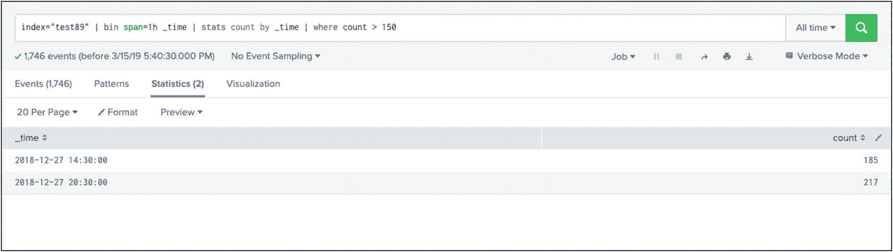

图 3-16

1. 显示 `index="test89"` 上的事务事件，并且事务中的最大暂停时间不超过 10 分钟。

以下是解决方案。

```
index="test89" | transaction maxpause=10m
```

解决方案界面如图 3-17 所示。

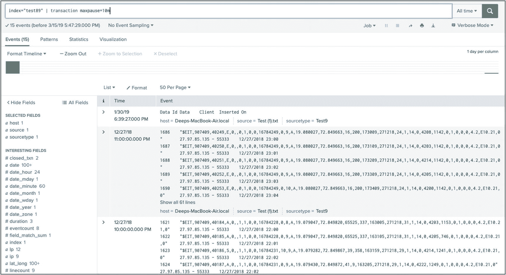

图 3-17

1. 编写一个针对 `index="test89"` 的 Splunk 查询，以获取每个端口的事件计数。

以下是解决方案。

```
index="test89" |stats count by port
```

解决方案如图 3-18 所示。

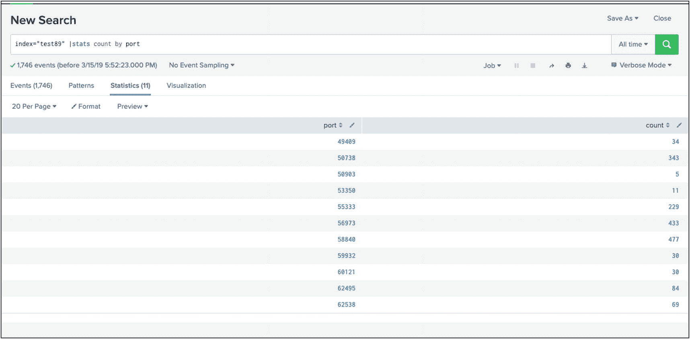

图 3-18

1. 编写一个针对 `index="test89"` 的 Splunk 查询，以获取时间跨度为 1 小时的会话。

以下是解决方案。

```
index="test89"|`session`|timechart span=1h sum(eventcount) as sessions
```

解决方案如图 3-19 所示。

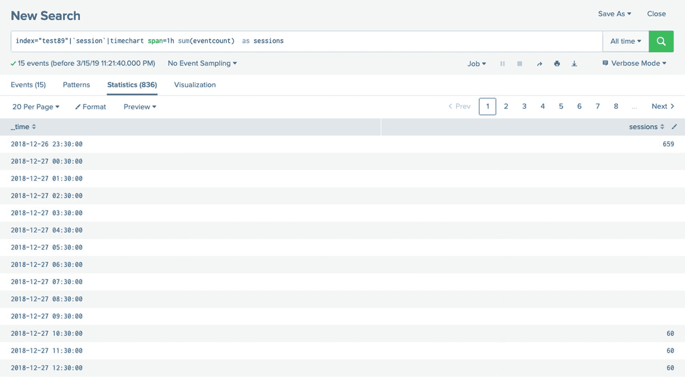

图 3-19

请祝贺自己，因为你已经成功学会了如何使用正则表达式和分隔符在 Splunk 中创建宏和字段别名。

## 总结

本章涵盖了 Splunk 中的字段提取，用于在索引化和搜索期间提取数据字段。你了解到，当需要频繁运行搜索命令时，宏非常有用，因为它避免了重写整个命令。你还了解了字段别名，它用于关联具有相似字段值的不同事件。此外，Splunk 搜索查询在处理小数据和大数据时提供了灵活性。

根据 Splunk Power User 考试蓝图，字段提取占 4%–10%，宏占 7%–10%，字段别名占 5%–10%。

在下一章中，你将学习 Splunk 标签和查找，并创建和设置警报。

## 选择题测试题

1. 如果字段出现在至少 _____ 的事件中，则这两个字段都会出现在“所有字段”和“有趣字段”列表中。
   1. 10%
   2. 80%
   3. 40%
   4. 20%

1. 字段别名规范了哪些默认字段上的数据？（选择所有适用项。）
   1. 主机
   2. 来源
   3. 来源类型
   4. 事件

1. 分隔符主要用于结构化数据吗？
   1. 是
   2. 否

1. 编辑正则表达式后，能否返回字段提取器用户界面？
   1. 是
   2. 否

1. Splunk 中哪个父目录包含配置文件？
   1. `SPLUNK_HOME/etc`
   2. `SPLUNK_HOME/var`
   3. `SPLUNK_HOME/conf`
   4. `SPLUNK_HOME/default`

1. 如果白名单和黑名单输入设置之间存在冲突，会使用哪一个？
   1. 黑名单
   2. 白名单
   3. 两者相互抵消
   4. 以上皆非

**答案**

* A: 1
* B: 1
* C: 1
* D: 2
* E: 1、2 和 4
* F: 4

