# 4. 标签、查找和关联事件

在上一章中，你学习了如何使用分隔符和正则表达式从 Splunk 中提取字段，以创建宏和字段别名。你还执行了一些搜索处理语言命令来提高留存率。在本章中，你将处理 Splunk 标签和查找，并创建各种报告和警报。Splunk 标签是添加了命名约定的值对，用于为特定字段及其值组合分配名称。Splunk 查找通过从任何外部数据源添加字段-值组合来增强数据。报告是保存的搜索结果，显示相关的统计数据和可视化图表。同时，当搜索结果满足任何条件时，会触发警报。

以下是本章涵盖的主题。

* Splunk 查找
* Splunk 标签
* 在 Splunk 中创建报告
* 在 Splunk 中创建警报

到本章结束时，你将至少覆盖 Splunk Power User 考试蓝图的 10% 和 Splunk User 考试蓝图的 21%。

## Splunk 查找

**查找** 是通过**向现有数据添加字段-值**来增强数据的命令。将来自多个源的数据添加到现有源中，通过另一个数据源中事件的相关字段，使用查找映射值来增强数据。例如，您可以使用查找来匹配浏览器中的错误代码，并返回一个包含错误代码详细描述的新字段。Splunk 中有 4 种类型的查找，如图 4-1 所示。

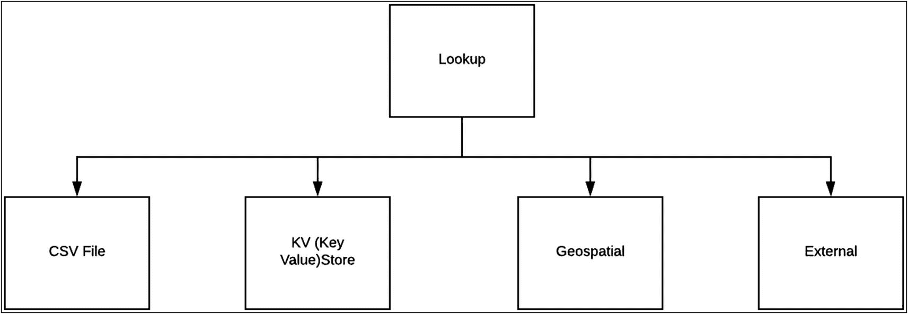

图 4-1 Splunk 查找类型

每种查找类型说明如下。

* **CSV 查找** 从 CSV 文件中提取键值对。它们从包含字段的事件中添加数据，并代表一个静态数据表。因此，它们也被称为**静态查找**。CSV 表中的每一列都被解释为一个潜在的字段值。
* **KV 存储查找** 从已定义的应用中提取键值对，并添加来自应用键值存储集合的事件数据及其字段。
* **地理空间查找** 创建返回结果的查询，Splunk 软件可以使用这些结果生成等值区域地图可视化效果。在此类查找中，数据源是一个 **KMZ**（压缩密钥标记语言）文件，该文件定义了地图区域的边界。
* **外部查找** 从外部源填充事件数据。它们可以是**Python 脚本**或**二进制可执行文件**，用于从外部源获取字段值。它们也被称为**脚本化查找**。

在 Splunk 中创建查找有三种不同的方法。

* 查找表文件
* 查找定义
* 自动查找

默认情况下，字段值区分大小写。

### 查找表文件

在 Splunk 中，当您需要使用 CSV 文件或 GZ 文件来定义查找时，可以使用查找表文件，具体取决于这些文件的可用性。在本节中，您将定义一个名为 `Location.csv` 的示例查找表。您可以在已有的查找表文件中定义自己的文件。

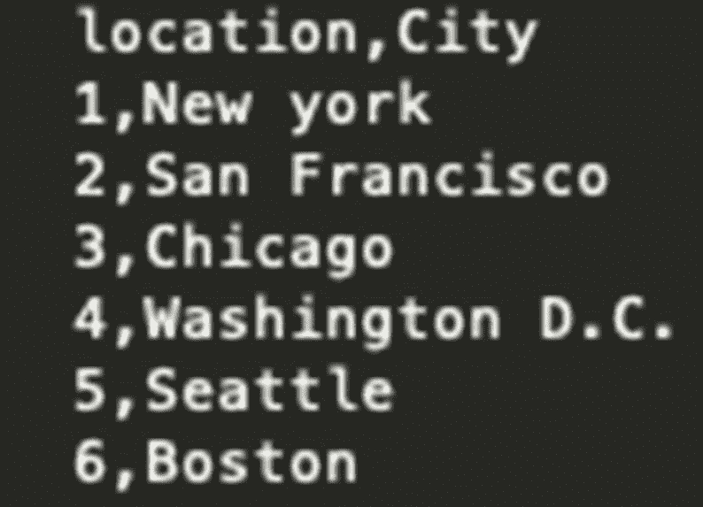

图 4-2 – 查找表

1. 从 [`https://github.com/deeppmehta/splunk-certification-guide/blob/main/ch4/Location.csv`](https://github.com/deeppmehta/splunk-certification-guide/blob/main/ch4/Location.csv) 下载 `Location.csv` 文件。`Location.csv` 包含两列：`location` 和 `state`，如图 4-2 所示。

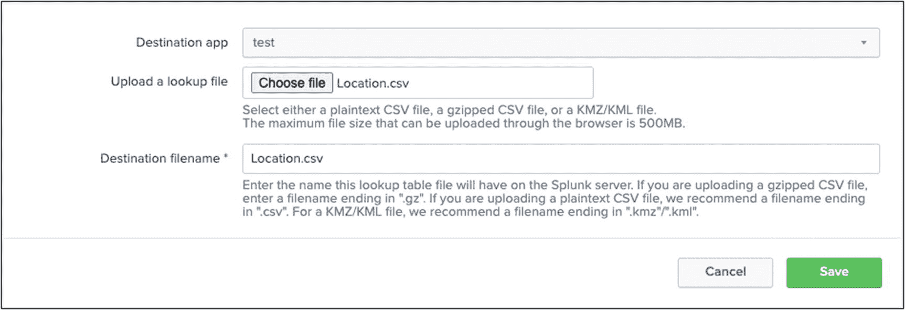

图 4-3 – Splunk 查找表文件

2. 转到 Splunk Web 上的“设置”，然后转到“查找”。
3. 转到“查找表文件”，然后单击“新建”。
4. 在“目标应用”中，选择测试应用。
5. 上传 `Location.csv` 文件。供您参考，示例图片如图 4-3 所示。
6. 创建查找后，转到“查找表过滤”，您可以在其中找到 `Location.csv`。
7. 单击 `Location.csv` 文件上的“权限”。您可以选择编辑各种角色。选择**允许所有人读取和写入**选项。（第 6 章将介绍知识对象权限。）

CSV 文件和 GZ 文件仅用于查找表。

### 查找定义

查找定义定义了用于比较 Splunk 中事件字段的数据类型和连接参数。查找定义需要一个查找表。在本节中，您将为在查找表文件中定义的 `Location.csv` 查找文件创建一个名为 `countries` 的查找。

按照以下步骤创建查找定义。

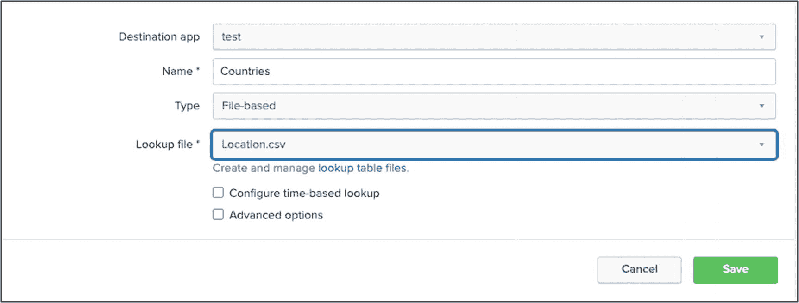

图 4-4 – 查找定义

1. 转到“设置”并选择“查找”。
2. 转到“查找定义”，然后单击“新建”。
3. 在“目标应用”中，选择测试应用。将其命名为 `Countries`。在“类型”中，选择“基于文件”。在“查找文件”中，选择 `Location.csv`。为了更好地理解，请参考图 4-4。
4. 单击“保存”按钮，并编辑 `countries` 文件的权限，以允许所有人读取和写入。

在下一节中，您将把查找输入字段映射到查找输出字段。

### 自动查找

在自动查找中，表文件需要将查找输入字段与查找输出字段映射。在本节中，您将把来自 `Test2.txt` 来源类型的事件中的 `location` 字段与 `Location.csv` 中的 `States` 列关联起来。

以下步骤用于创建自动查找。

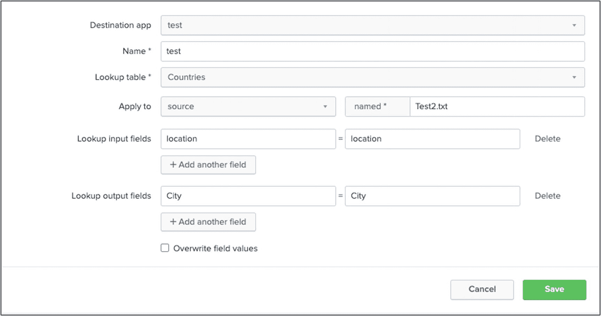

图 4-5 – Splunk 自动查找

1. 转到“设置”并单击“查找”。
2. 选择“自动查找”，然后选择“新建”。
3. 在“目标应用”中，选择 `test`。在“名称”中，输入 `test`。在“查找表”中，选择您在查找定义中创建的 `countries`。在“应用于”中，选择名为 `Test2.txt` 的源类型。在“查找输入字段”中，输入 `location` = `location`。在“查找输出字段”中，输入 `City` = `City`。参考图 4-5。
4. 在 `test` 应用的搜索栏中，输入以下命令。

```
index="tes22" source="Test2.txt"|lookup Location.csv location output City
```

您可以在一个包含已映射事件的字段中找到州信息（见图 4-6）。

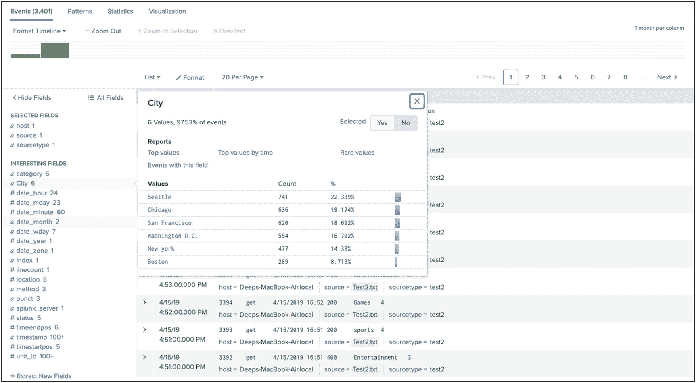

图 4-6 – Splunk 查找

在 Splunk 中，管理员可以在 `transforms.conf` 中将 `case_sensitive_match` 选项更改为 `false`。

## Splunk 标签

标签也是 Splunk 中的知识对象。它们允许**用户通过特定的字段值来搜索对象**。标签使数据更容易理解。可以为特定的字段-值组合创建多个标签。标签还负责为字段值分配区分大小写的名称。

### 使用 Splunk Web 在 Splunk 中创建标签

Splunk Web 界面可以方便地创建标签。在本节中，您将在 `Test2.txt` 来源中为 `location=3` 创建一个名为 `privileged` 的标签。按照以下步骤创建标签。

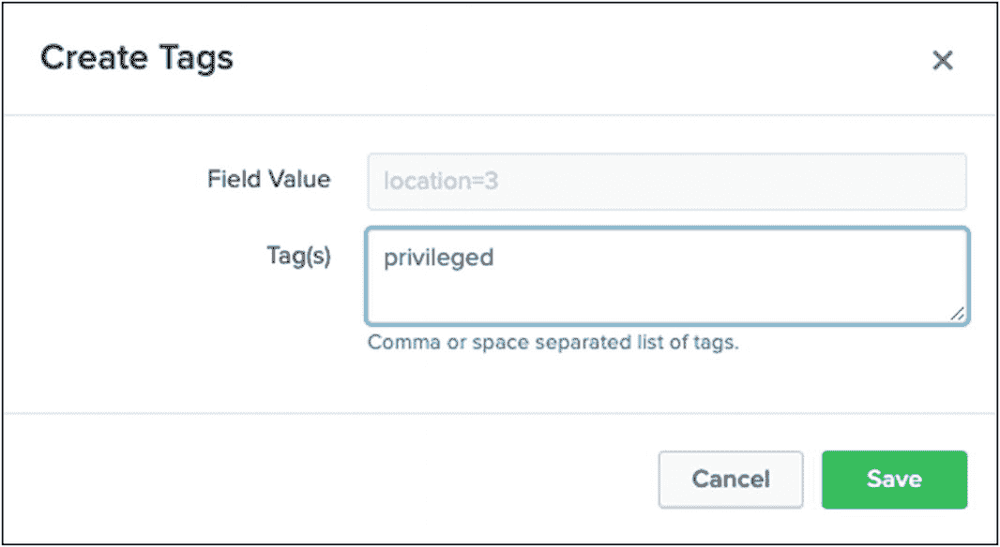

图 4-7 – Splunk 标签

1. 进入 `test` 应用。在搜索栏中，输入 `Type` 后跟以下命令：`index="Test" source="Test2.txt"`
2. 浏览事件并转到名为 `Location` 的字段。
3. 在“操作”中，单击下拉箭头并选择“编辑标签”。
4. 在“标签”中，输入 `privileged`。字段值为 `location=3`，如图 4-7 所示。
5. 您已成功创建了一个标签。您可以使用以下搜索命令进行验证。

```
(index="test" source="Test2.txt") "tag::location"=privileged
```

您可以在通配符和与字段值 `tag::tag_name=tag_value` 关联的标签中使用 `*`。

## 在 Splunk Web 中标记事件类型

在 Splunk 中标记事件类型可以为事件添加额外信息。在本节中，名为 `privileged` 的标记事件类型位于 `Test2.txt` 来源中。

按照以下步骤创建此内容。

1.  转到“设置”，然后选择“事件类型”。
2.  创建一个新的事件类型。
3.  在“目标应用”中，选择 `test`。在“名称”中，输入 `test0102`。在“标签”中，输入 `privileged`。在“颜色”中，选择红色。在“优先级”中，选择 1。在“搜索字符串”中，输入如下搜索查询。

```
(index="test" source="Test2.txt") "tag::location"=privileged
```

图 4-8 展示了工作页面。

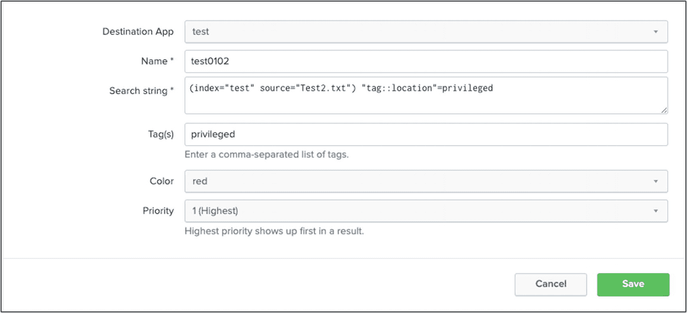

图 4-8 – 使用事件类型的 Splunk 标签

4.  单击“保存”。
5.  如果您在搜索栏中调用了所有带有 `privileged` 标签的事件，您会发现所有优先级为 1、颜色为红色的事件。

```
(index="test" location=3) "tag::location"=privileged
```

如图 4-9 所示，所有符合搜索查询中所述的优先级为 1、颜色为红色的事件都会被显示。

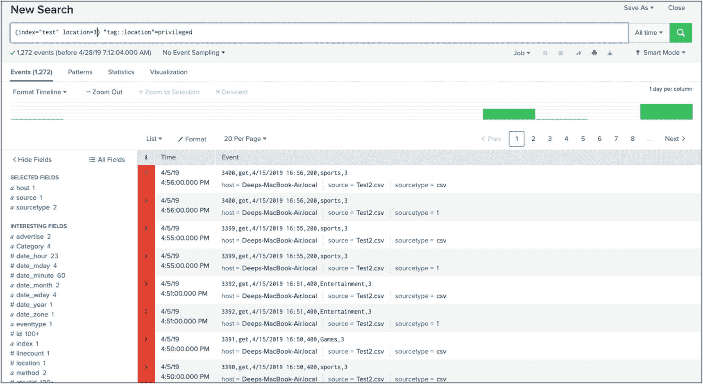

图 4-9 – 使用事件类型的 Splunk 标签

根据特定事件的重要性设置优先级和颜色。如果您发现某个特定事件更重要，则为其分配更高的优先级（对于低优先级的事件则相反）。

下一节将介绍 Splunk 中的报告流程。

## Splunk 报告

报告是包含通过表格、图表等表示的已定义信息的结果。它们是通过保存的搜索命令创建的，以便重复使用。Splunk 中的报告可以配置为执行多种操作，并且可以转换为 PDF 格式并通过电子邮件发送。报告也可以在 Splunk 中排程。

让我们从学习如何在 Splunk Web 中创建报告开始。

### 在 Splunk Web 中创建报表

报表会复用 Splunk 的搜索命令（即 Splunk 搜索处理语言）。在本节中，你将创建一个关于从 `index=test89` 接收事件数量的报表。

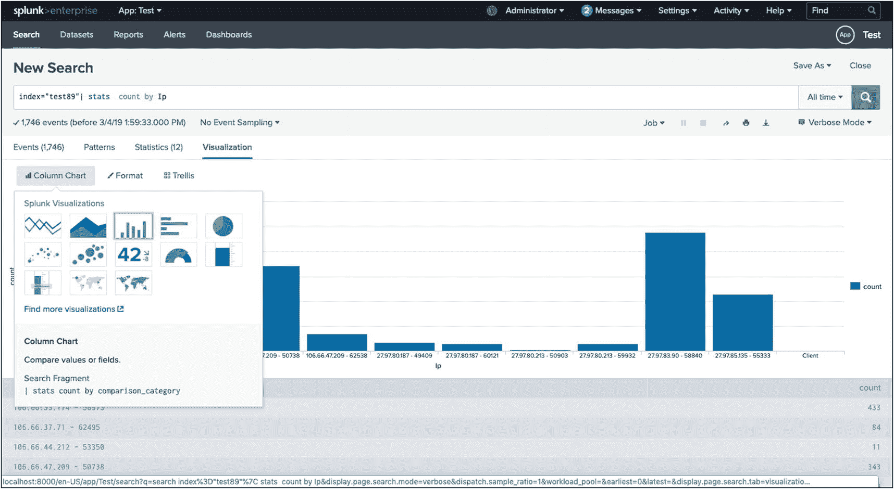

图 4-10：Splunk 可视化界面

1.  导航至 Splunk 中的 `test` 应用。
2.  输入以下搜索命令：`index=test89| stats count by Ip`
3.  在时间范围选择器中，选择**所有时间**。
4.  进入**可视化**并选择**柱状图**。输出结果如图 4-10 所示。

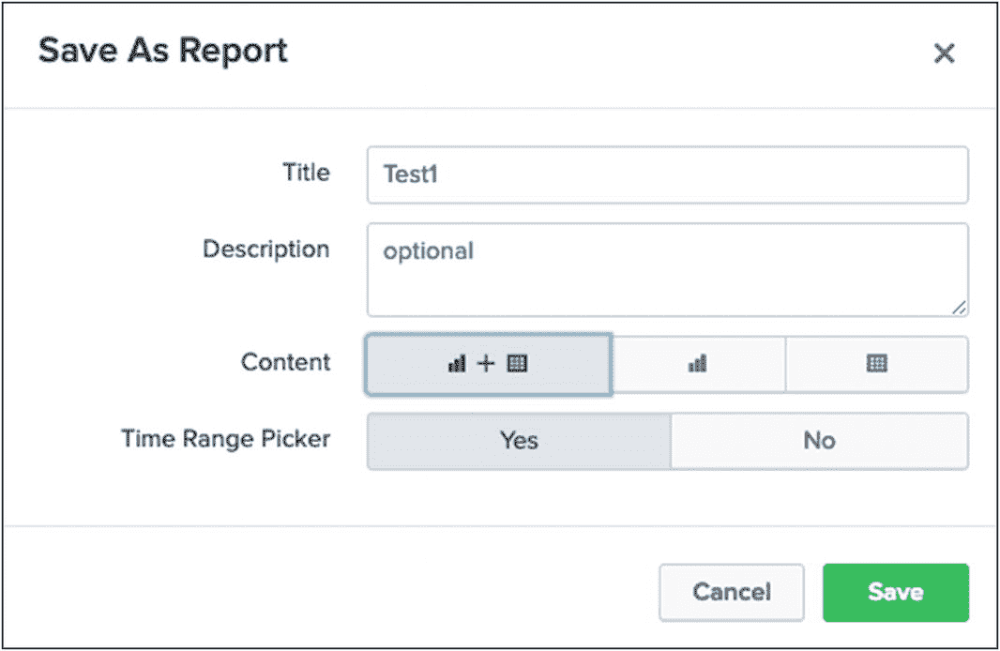

图 4-11：Splunk 报表

5.  在右上角，点击**另存为**。
6.  在**标题**中输入 `Test1`。在**内容**中，选择**表格 + 图表**（见图 4-11）。

`Test1` 报表如图 4-12 所示。

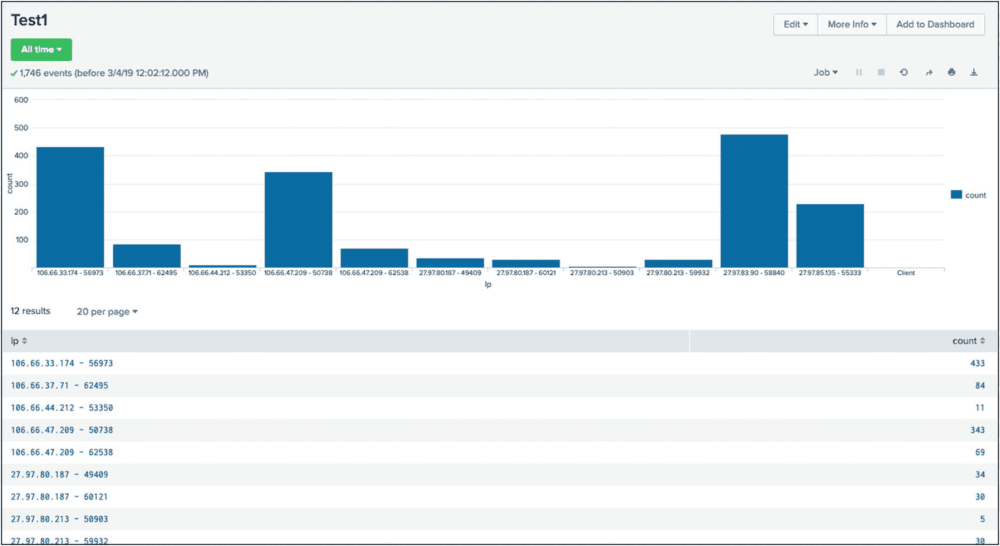

图 4-12：Splunk `Test1` 报表

你也可以通过导航至**设置** ➤ **搜索** ➤ **报表和警报** ➤ **创建新报表**来创建报表。在此报表中，你可能还会获得两个额外的字段：最早时间和最晚时间。图 4-13 展示了一个名为 `test` 的新报表的工作页面，其中最早时间为 `–1y`。

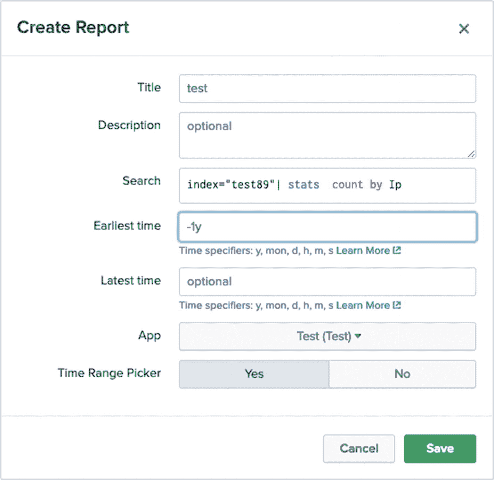

图 4-13：Splunk 中的报表

接下来，你将了解 Splunk 中的报表加速功能。

### Splunk 中的报表加速

Splunk 中的报表加速意味着系统地运行覆盖长时间范围、包含大数据集的报表。当你加速一个报表时，会创建一个摘要；这在处理大量数据时会非常有用。加速搜索模式必须设置为**智能**或**快速**。

#### 创建报表加速

Splunk 中的报表加速会为报表创建一个摘要。在本节中，你将加速报表，以发现从 `index=“test89”` 接收事件最多的端口。

请遵循以下步骤（另请参见图 4-14）。

1.  创建一个报表用于了解 `index = test89` 的顶级端口。将报表命名为 `test10`。在应用中，选择 `test` 应用。请参考以下查询。

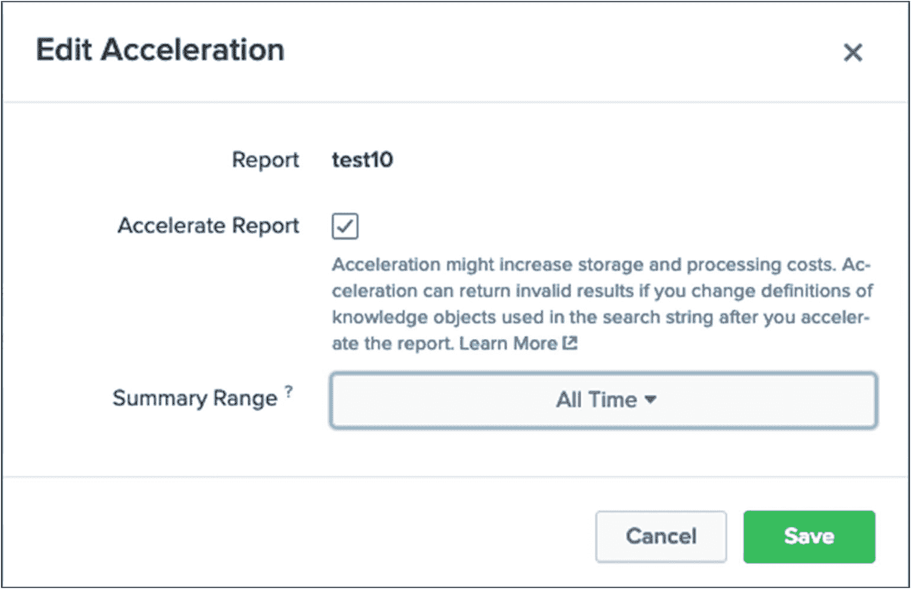

图 4-14：加速页面

2.  进入**设置**。选择**搜索、报表和警报**。
3.  在**应用**中，选择 **test**。
4.  找到 `test10` 报表。点击**编辑**，然后进入**编辑加速**。
5.  点击**加速报表**。
6.  点击**下一步**。
7.  在**摘要范围**中，选择**所有时间**。

```
index="test89" |top port
```

请执行以下操作以查看报表摘要。

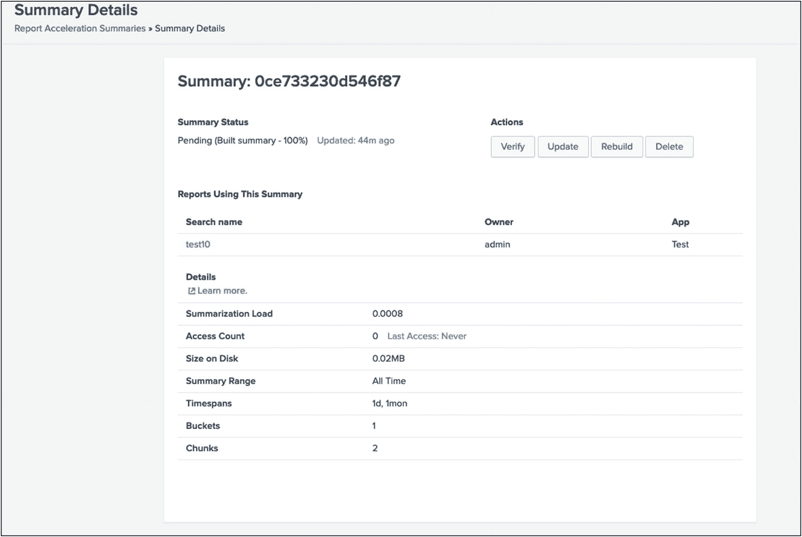

图 4-15：示例摘要

1.  进入**设置**。
2.  选择**报表加速和摘要**。
3.  当你点击**摘要 ID** 时，会获得诸如磁盘上事件大小、摘要范围、桶、块等内容（见图 4-15）。

Splunk 中的报表加速使用自动创建的摘要来加快处理速度，但这也伴随着成本，因为加速报表的数量会影响并发搜索，并可能导致索引器使用量的增加。

### 在 Splunk 中调度报表

调度报表是一种预定义的、按固定时间间隔运行的报表。一旦报表被触发，你可以通过多种方式定义其后续操作，例如通过电子邮件发送报表摘要、通过 CSV 查找文件报告结果、使用 webhook，或者记录并索引可搜索的事件。在本节中，你将调度一个 `Test1` 报表，使其在每周一上午 10:00 以最高优先级运行。

为此，请参考以下步骤。

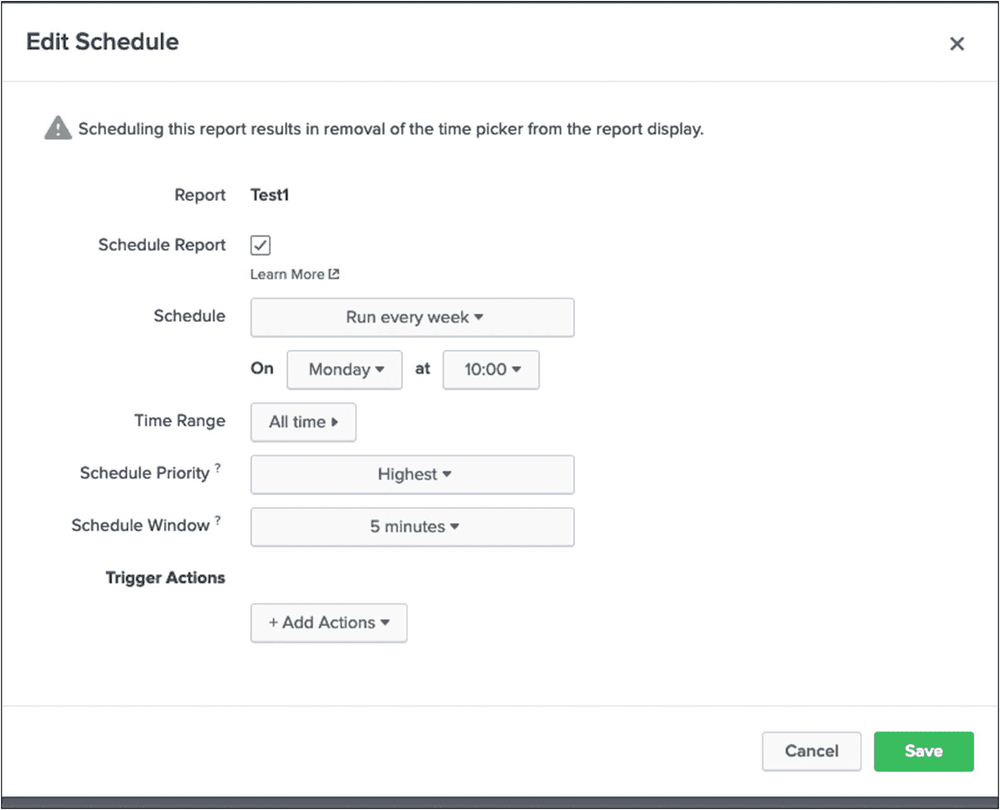

图 4-16：调度页面

1.  进入**设置**。选择**搜索、报表和警报**。
2.  在**应用**中，选择 **test**。找到 `test1` 报表。点击**编辑**并选择**编辑调度**。
3.  在**编辑调度**中，选择**每周一上午 10:00 运行**，并将优先级设置为**最高**（见图 4-16）。

要编辑一个已调度的报表，你需要从 Splunk 管理员那里获得写入权限。

以上完成了在 Splunk Web 中创建和设置报表的流程。下一节将讨论警报。

## Splunk 中的警报

警报在组织中非常重要，因为它们能提供关于系统状态的信息。例如，警报可以判断服务器负载是否增加，或者提供运维洞察。在 Splunk 中，警报是已保存的搜索，用于实时查找事件。当搜索结果满足特定条件时，警报会被触发。

让我们首先了解如何在 Splunk Web 中创建警报。

### 使用 Splunk Web 在 Splunk 中创建警报

Splunk 中的警报会在搜索结果满足特定条件时进行监控并发出警报。一旦警报被触发，你可以定义后续操作。在本节中，你将创建一个在每月第一天的 0:00 运行的警报。当顶级端口的事件计数大于或等于 500 时，你希望获知此信息。

请按照以下步骤执行此任务。

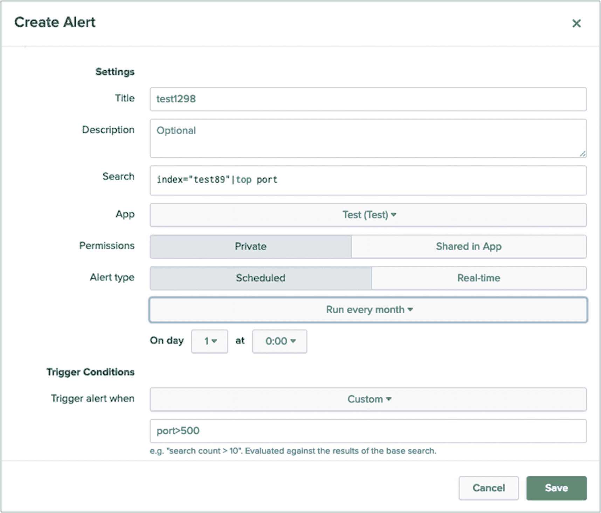

图 4-17：Splunk 中的警报

1.  进入**设置**。选择**搜索、报表和警报**。

2. 选择`新警报`。

3. 将标题设置为`test1298`，应用名称设置为`test`。选择`每月第 1 天 0:00 运行`。设置`port >=500`。请参考图 4-17。

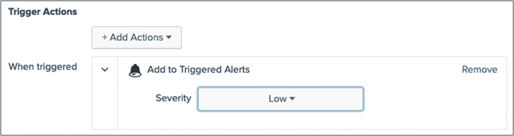

图 4-18：警报中的触发器

1. 在 Splunk 中创建一个触发器，如图 4-18 所示。将严重性设置为`低`。

默认情况下，所有人都有读取警报的权限。在 Splunk 中，只有超级用户和管理员拥有写入警报的明确权限。

## 警报的 Cron 表达式

你可以在 Splunk 中使用 cron 表达式进行警报调度。在本节中，你将创建一个 cron 表达式，使警报每 12 小时运行一次。当顶级端口的事件计数大于或等于 500 时，该警报会通知你。

cron 表达式的语法如下。

* 分钟：0–59
* 小时：0–23
* 月中的日期：1–31
* 月份：1–12
* 星期中的日期：0–6（其中`0`代表星期日）

以下说明了如何编辑此警报。

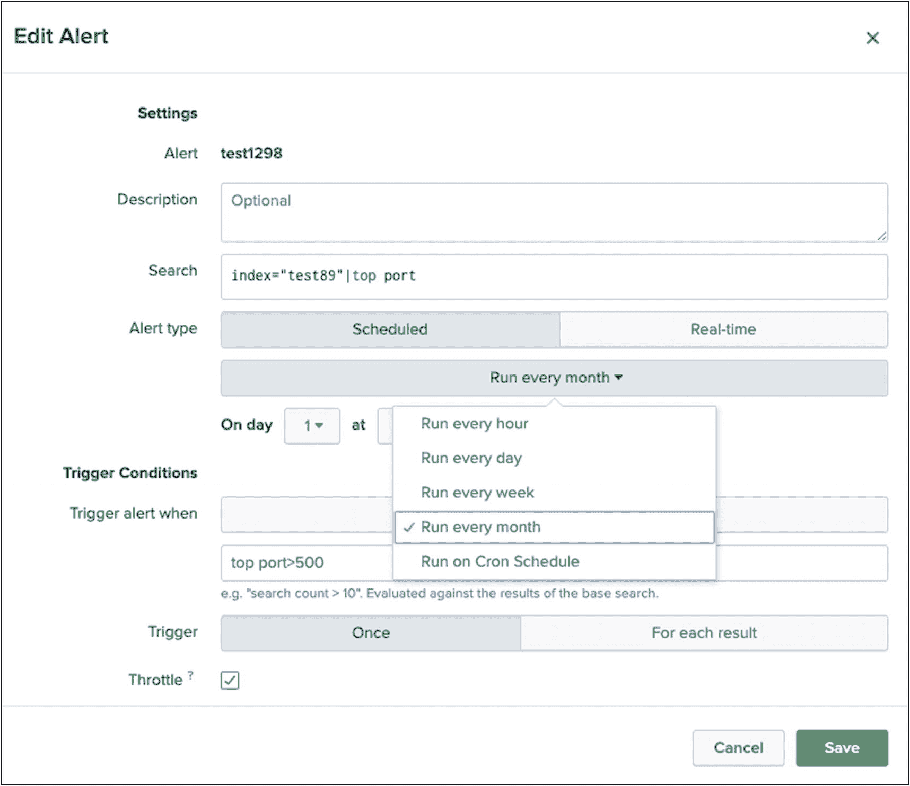

图 4-19：警报页面

1. 在`test`应用中，进入`设置`。
2. 选择`搜索、报表和警报`。
3. 选择`警报`。
4. 将警报名称编辑为`test1298`。
5. 在`每月运行`下拉菜单中，选择`按 Cron 调度运行`，如图 4-19 所示。

你已创建一个每 12 小时运行一次的警报，如图 4-20 所示。

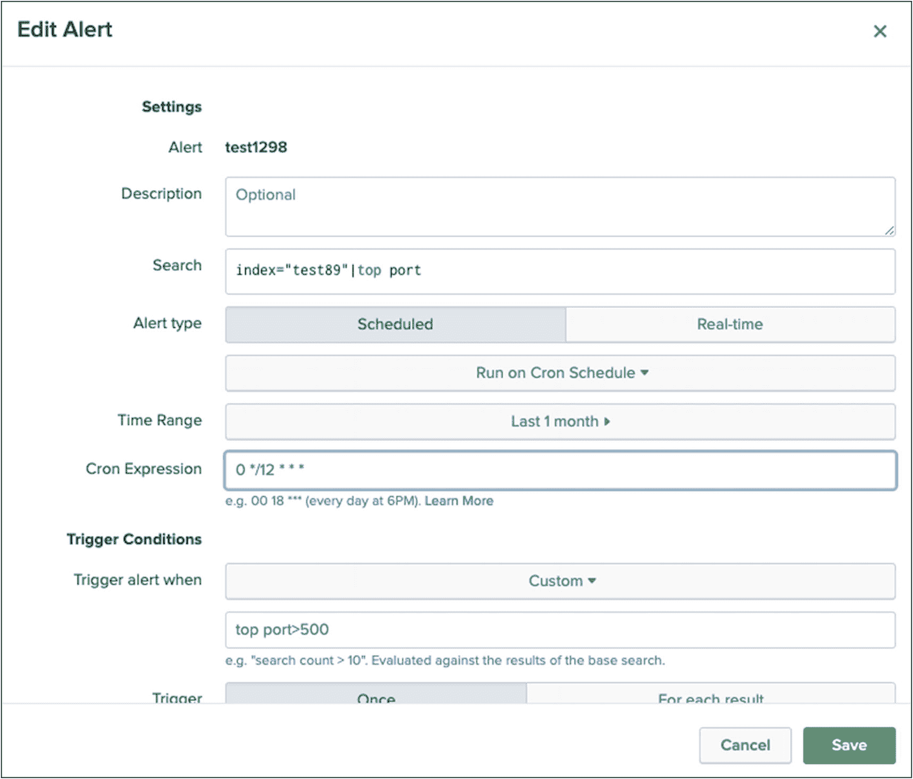

图 4-20：Cron 表达式

```
0 */12 * * *
```

1. 点击`保存`。

恭喜你成功学习了关于表文件、定义、自动查找、Splunk 标签、报表和警报的知识。请通过本章末尾的多项选择题来测试你的理解程度。

## 总结

您学习了查找及其各种类型，例如 CSV 查找、外部查找、地理空间查找和 KV 存储查找。您还学习了如何在 Splunk 中创建标签，以及如何生成报告和警报。这些知识对象发挥着至关重要的作用，尤其对于管理和处理大量数据的 Splunk 管理员而言。

关于 Splunk 中的标签，依据 Splunk 高级用户认证考试大纲`模块 6-10%`涉及在 Splunk 中创建标签的内容。关于 Splunk 中的查找，您也可以在 Splunk 中创建自己的查找，依据 Splunk 用户认证考试大纲`模块 7-6%`涉及在 Splunk 中创建查找的内容。关于报告和警报，您同样可以在 Splunk 中创建自己的报告和警报，依据 Splunk 用户认证考试大纲`模块 6、8-15%`涉及调度报告和警报的内容。

在下一章中，您将学习数据模型、Pivot、事件操作和 CIM。

## 选择题

1. 您可以使用 ____ 在 Splunk 中访问一个标签。（选择所有适用项）
   1. `:`
   2. `=`
   3. `*`
   4. `&`

2. 要使用`.conf`文件在 Splunk 中创建警报，需编辑 ____。
   1. `savedsearches.conf`
   2. `props.conf`
   3. `alert.conf`
   4. `transformation.conf`

3. 要创建警报，您必须是 ___（选择所有适用选项）
   1. 用户
   2. 高级用户
   3. 管理员
   4. `edit_user`

4. 如果我是 ____，我可以编辑一个计划报告。
   1. 用户
   2. 高级用户
   3. 管理员
   4. 以上所有

5. 在 Splunk 中，标签使用事件类型。您可以根据事件的重要性设置优先级和颜色。
   1. 正确
   2. 错误

6. 在 Splunk 中，字段值默认不区分大小写。
   1. 正确
   2. 错误

7. 选择所有查找类型的选项。
   1. CSV 查找
   2. KV 存储查找
   3. 外部查找
   4. 以上都不是

**答案**

```
- a. 1, 2, 3
- b. 2
- c. 2
- d. 3
- e. 2, 3
- f. 1
- g. 1, 2, 3
```