# 5. 数据模型、Pivot 和 CIM

在上一章中，您学习了查找及其各种类型。我们还讨论了 Splunk 中的标签、报告和警报。在本章中，您将学习如何创建数据模型、事件操作和通用信息模型。

Splunk 软件在设计上富有艺术性，并且拥有用户友好的界面，便于解读命令和代码。一款优秀软件应用的标志不在于它是否容易被计算机理解，而在于是否容易被使用它的人理解。Splunk 通过其功能、特性和命令提供了适应性。它是一个易于使用的平台，拥有广阔的适用范围和强大的实用性。

本章涵盖以下主题。

- 数据模型和 Pivot
- Splunk 中的事件操作
- Splunk 中的通用信息模型

数据模型是一个层次化的规范化数据集。事件操作是一个高度配置的知识对象，它在 Splunk Web 中的字段与其他可配置的互联网源之间进行通信。CIM 可以使用字段名称和事件标签来规范化数据，以便从不同的数据源获取事件。学完本章后，您将掌握 Splunk 高级用户认证考试大纲中的 30%。

## 理解数据模型和 Pivot

数据模型是**层次化的数据集，使 Pivot 用户能够创建复杂的报告和仪表板**，而无需在 Splunk 的搜索处理语言中编写复杂的命令。在生成报告时，数据模型及其相应的数据集由组织的知识渊博的管理员进行编码。

数据模型由事件、事务或搜索作为数据集组成。

让我们讨论数据集和数据模型，以便更好地理解 SPL。

### 数据集和数据模型

数据模型由按顺序排列的父数据集和子数据集组成。每个子数据集除了拥有自己的约束和字段外，还继承其父数据集的约束和字段。（这个概念类似于编程中的继承）。

数据集是为特定目的而定义和维护的**数据集合**。它以表格形式呈现，包含列形式的字段及其单元格中的值，用于创建视觉丰富的 Pivot 报告，并在搜索过程中进行扩展。

数据集包括自动提取的字段、eval 表达式、查找、正则表达式和 Geo IP 字段。

### 在 Splunk 中创建数据模型和 Pivot

本节展示了如何创建数据模型，以及 Pivot 如何识别来自美国东部和西部地区的产品销售请求模式。

#### 创建新数据集

按照以下步骤创建新数据集。

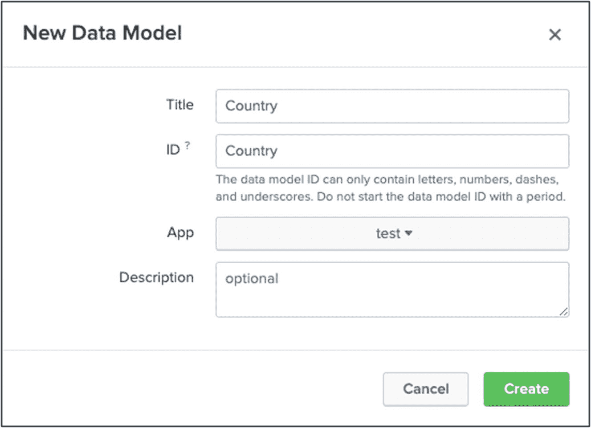

图 5-1 创建数据模型：国家

1. 转到“设置”并选择“数据模型”。点击“创建新数据模型”。在“标题”中，输入 `Country`。在“应用”中，选择 `test`（见图 5-1）。
2. 点击“创建”。您将被重定向到数据集页面。
3. 点击“添加数据集”，然后从下拉菜单中选择“根事件”。

数据模型的国家页面如图 5-2 所示。

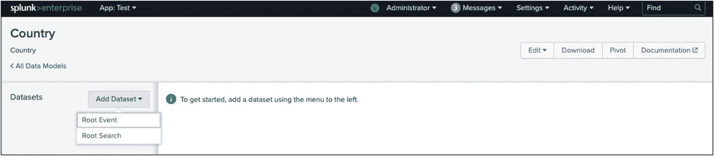

图 5-2 国家数据模型

4. 在“数据集名称”中，输入 `Country`，并在“约束”中，输入以下搜索命令。

```
index="tes22" source="Test2.txt" location=*
```

图 5-3 显示了添加国家数据集后的情况。

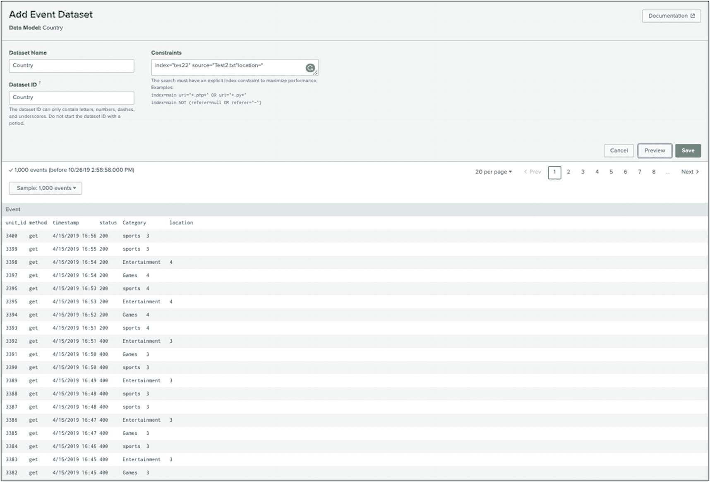

图 5-3 数据模型 国家：数据集

5. 保存设置。

数据集中的约束本质上就是搜索词。

6. 选择“添加字段 → 自动提取”。
7. 从“自动提取”字段中选择“位置”。
8. 保存设置。

您已成功创建了一个数据集。现在让我们继续预测美国地区的销售模式。

### 预测销售模式

要预测美国东部和西部的销售模式，你需要从 `Lookup - Country` 中指定州。

请遵循以下步骤：

1. 转到 `Add Field` 并选择查找表。如果找不到 `Lookup - Country`，请转到 `Settings ➤ Lookups ➤ Lookup table file ➤ New` 并在该部分定义查找表。
2. 在 `Lookup table` 中，选择 `Countries`。
3. 确认 `Field in Lookup` 为 `location`。
4. 将 `Field in Dataset` 更改为 `location`。
5. 选择 `City` 输出字段。
6. 在 `Display Name` 中，输入 `City`。

这些内容如图 5-4 所示。

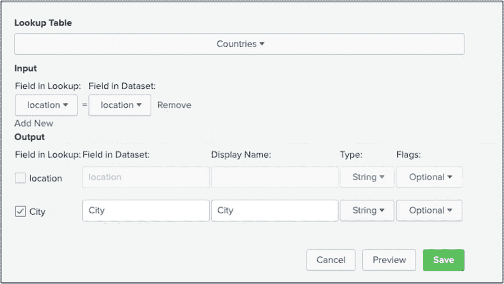

**图 5-4** 查找字段：`City`

7. 保存更改。

现在，你需要将各州适当地归类为美国东部或美国西部。为此，你将使用评估表达式。

1. 点击 `Add Field` 和 `Evaluate Expression`。
2. 在 `Field Name` 中输入 `region`，在 `Display Name` 中输入 `region`。在 `Eval Expression` 中，输入以下命令。

```
case(City in("New york","Chicago","Boston","Washington D.C."),"Eastern USA",City in("San Francisco","Seattle"),"Western USA")
```

这些步骤如图 5-5 所示。

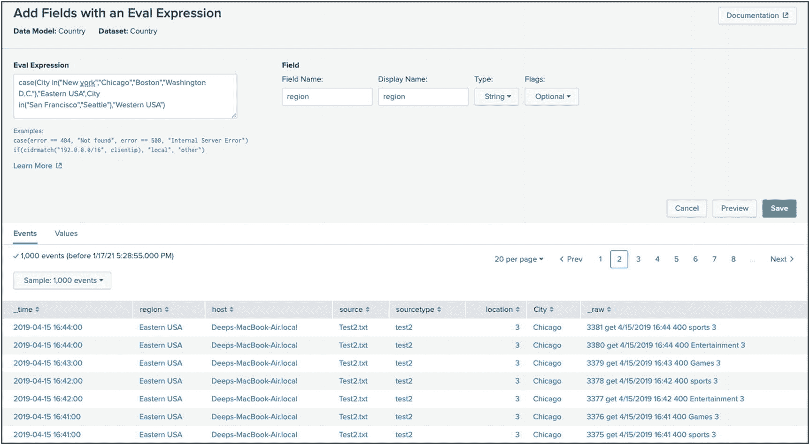

**图 5-5** 评估表达式：`region`

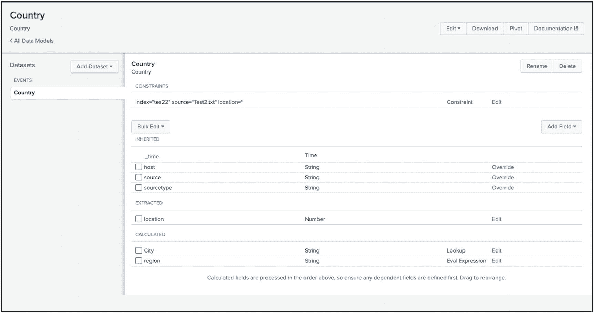

**图 5-6** 数据集 `Country`

3. 保存更改。
4. 使用“从查找表自动提取州”功能添加位置，并通过评估表达式添加区域后，数据集看起来类似于图 5-6。
5. 如果点击 `Pivot`，你可以看到从美国东部和西部获得的产品销售请求的确切数量。
6. 选择 `Pivot` 作为 `Country` 数据集。
7. 将行拆分为 `region`，将列值拆分为 `_time`。
8. 转到柱状图，在范围中选择 `All Time`。
9. 分别为美国西部和美国东部创建一个子数据集，以获取各自的产品销售请求。
10. 点击 `Country` 数据集名称。转到 `Add Dataset`，然后选择 `Child`。
11. 在 `Dataset Name` 中，输入 `Western USA`。在搜索命令中，输入以下命令。

```
region="Western USA"
```

图 5-7 显示了向 `Country` 数据集添加名为 Western USA 的子节点的过程。

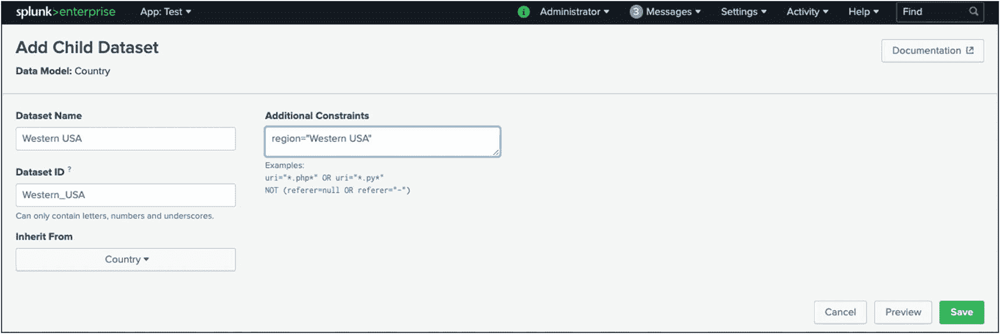

**图 5-7** 数据集 `Country`：美国西部

子数据集继承父数据集的所有数据集。

12. 类似地，为美国东部创建另一个子数据集。将数据集名称设为 `Eastern USA`，并输入以下搜索命令。如需更多帮助，可参考图 5-8 中的截图。

```
region="Eastern USA"
```

图 5-8 显示了向 `Country` 数据集添加名为 Eastern USA 的子节点的过程。


**图 5-8** 数据集 `Country`：美国东部

13. 要获取美国西部地区城市的产品销售请求，请导航到 `Dataset name Country` 下的 Western USA 子数据集。
14. 将 `Dataset` 的 `Pivot` 设为 Western USA。
15. 在 `Split Rows` 中，选择 `City`。在 `Split Columns` 中，选择 `_time`。

图 5-9 中的截图描述了从美国西部地区城市获取产品销售请求的过程。

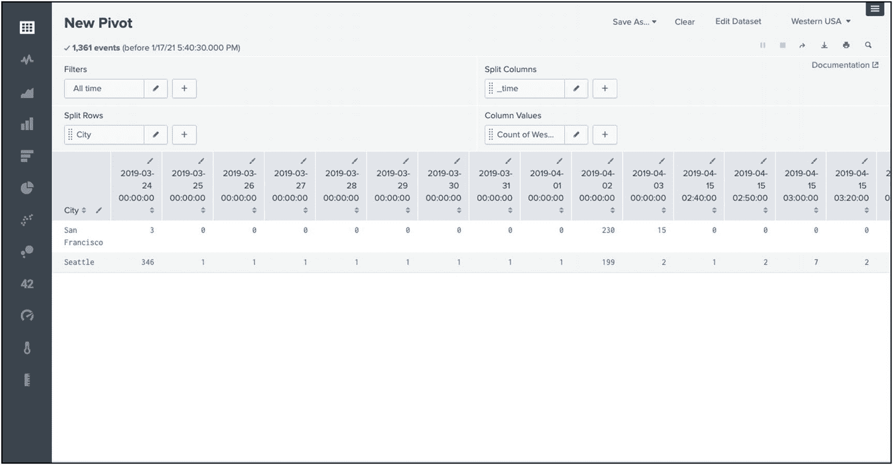

**图 5-9** 产品销售请求表：美国西部

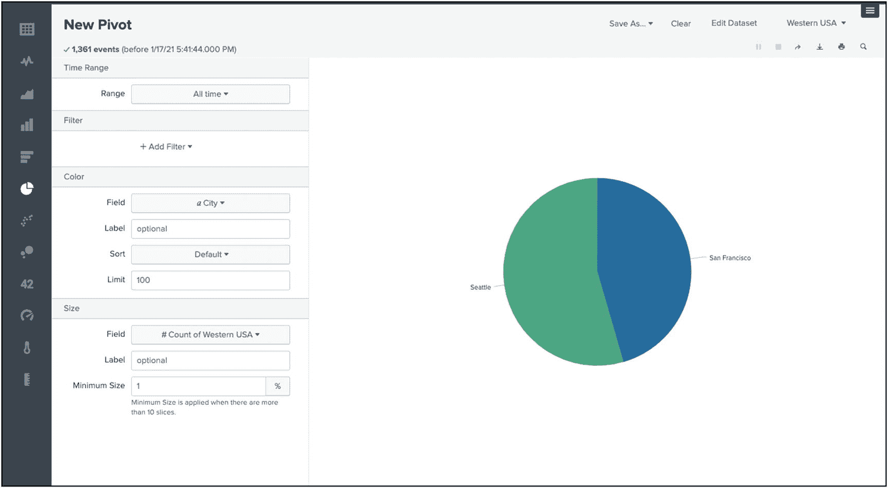

**图 5-10** 产品销售请求饼图：美国西部

16. 点击 `Pie chart`。在 `Range` 中，选择 `All Time`。你应该会看到类似于图 5-10 的饼图。

数据模型为 `Pivot` 提供了一个数据集。

17. 要获取美国东部各州的产品销售数据，请导航到 `Dataset Name Country` 下的 Eastern USA 子数据集。

18. 将 `Dataset` 的 `Pivot` 设为 Eastern USA。

19. 在 `Split Rows` 中，选择 `City`。在 `Column Values` 中，选择 `Count of Eastern USA`。

图 5-11 中的截图描述了从美国东部地区城市获取产品销售请求的过程。

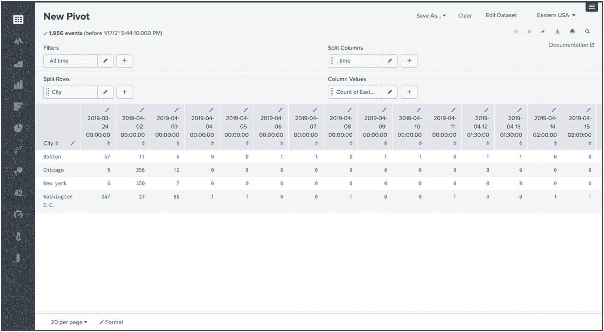

**图 5-11** 产品销售请求表：美国东部

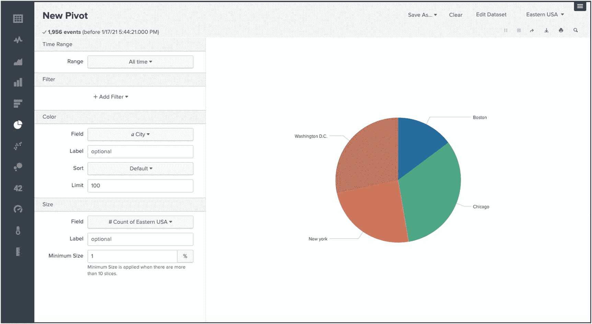

**图 5-12** 产品销售请求饼图：美国东部

20. 点击 `Pie chart`。在 `Range` 中，选择 `All Time`。你应该会看到类似于图 5-12 的饼图。

数据集中的字段可以在 `Pivot` 中用于过滤事件。

你已完成数据集和数据模型的操作。在学习了数据集的创建并使用基于命令的应用程序进行练习后，你现在将进入 Splunk 中的事件操作部分。

## Splunk 中的事件操作

事件操作，也称为工作流，被视为一种配置完善的知识对象，负责启动 Splunk Web 中的字段与其他兼容互联网源之间的通信。例如，人员 A 拥有 IP 作为字段值，人员 B 拥有一个旨在处理 IP 请求的网页。在这里，B 获取 IP 字段的类别，查找 IP 位置等等。因此，使用事件操作，你可以生成 POST 请求并将数据解析到特定的 URI。

在本节中，你将使用事件操作从 `test.txt` 源对 IP 字段发起辅助搜索。你在 Splunk Web 中为 IP 字段生成一个请求。

Splunk 中有三种类型的工作流。

*   GET 工作流操作

*   POST 工作流操作

*   搜索工作流操作

### GET 工作流操作

GET 工作流操作负责将字段值传递给 HTML 链接，类似于 HREF 标签。通过点击超文本传输协议 (HTTP) 链接，GET 请求允许你将 Splunk 字段值传递到特定的 URI。

#### 定义 GET 工作流操作

以下是在 Splunk 中创建 GET 工作流的步骤。

1.  转到 `Settings` 并选择 `Fields`。

2.  转到 `Workflow actions`。

3.  点击 `New` 打开一个工作流操作。

4.  在工作流操作表单中，提供以下字段名称值，并设置在“新窗口”中打开链接。

```
Label=search_ip
apply only to the following fields=ip
URI=www.google.com/search?ip=$ip$
Link method=get
```

图 5-13 显示了获取工作流操作表单的字段值。

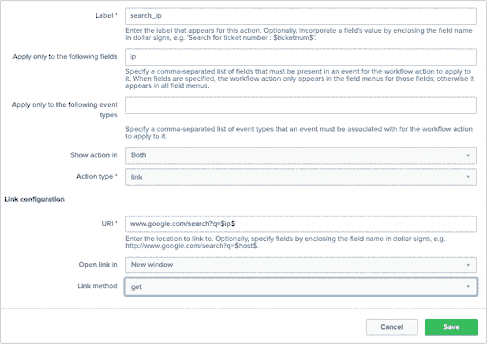

**图 5-13.** 工作流操作的名称不能包含空格或特殊字符。

5.  点击 `Save`。

6.  要检查 GET 工作流操作，请转到 Test 应用程序，并输入以下搜索命令。

```
index="test" source="test.txt"
```

7.  点击任意一个随机事件，然后点击 `Event actions`。在那里，你会发现 `search_ip` 作为一个链接。点击该链接；它会向 `google.com` 执行一个 HTTP GET 请求。

图 5-14 显示了搜索工作流操作表单的字段值。

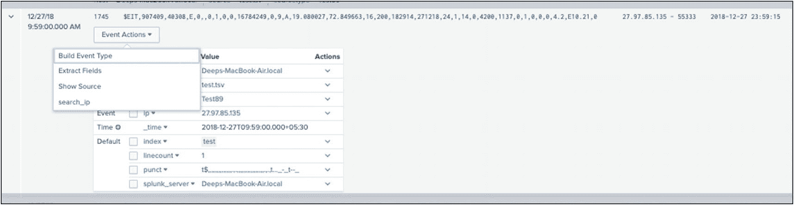

**图 5-14.**

### 搜索工作流操作

搜索工作流操作可在 Splunk 中生成动态搜索。您无需为特定字段编写完整的 SPL 命令或确定获取输出的结果，而是可以使用搜索工作流操作来获得有效的搜索结果。

#### 定义搜索工作流操作

以下示例展示了如何创建一个搜索工作流操作，以获取 `_time` 参数中 IP 值的总数。

1.  转到 `设置` 并选择 `字段`。

2.  转到 `工作流操作`。

3.  点击 `新建` 以打开一个工作流操作。

4.  在工作流操作表单中，提供以下字段名称值，并在 `新窗口` 中设置一个打开的链接。

```
Name=ip_count_by_report
Label=$ip$
apply only to the following fields=ip
show action in=Both
Action type=Search
Search string=index="test"|timechart count by $ip$
Run in app=test
```

图 5-15 显示了搜索工作流操作表单的字段值。

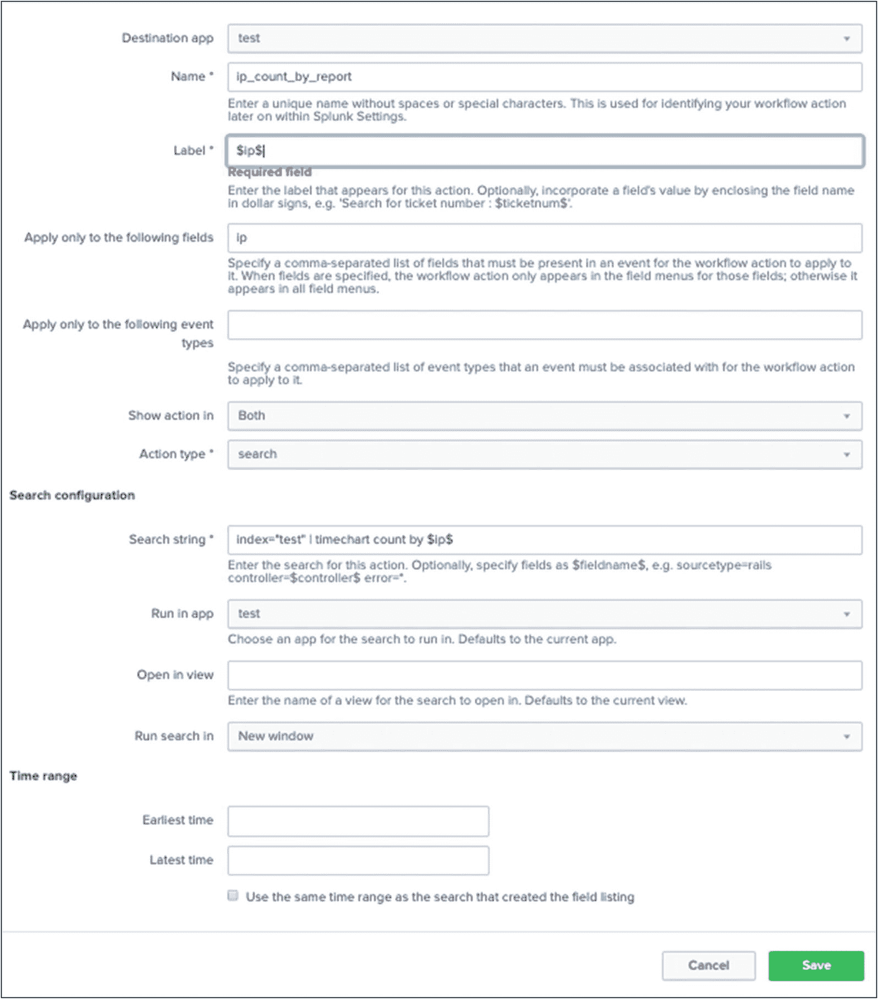

*图 5-15*

在搜索工作流操作中，搜索可以在新窗口或当前窗口中运行。

1.  点击 `保存`。

2.  要检查搜索工作流操作，请转到 `测试` 应用程序，并输入以下搜索命令。

3.  点击任意随机事件，然后点击事件操作。在这里，您会发现 IP 值作为一个链接，在 Splunk 中生成了一个动态搜索。

```
index=" test" source=" test.txt"
```

图 5-16 显示了搜索工作流操作表单的字段值。

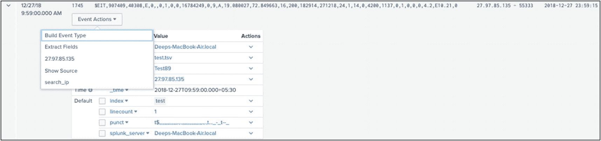

*图 5-16*

图 5-17 显示了搜索工作流操作的输出，该输出在时间图表上提供了特定 IP 的总计数。

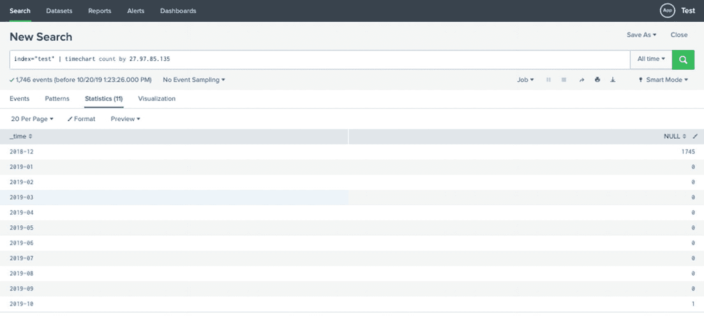

*图 5-17*

这里总结了事件操作。现在让我们讨论 Splunk 中的 CIM。

## Splunk 中的通用信息模型

通用信息模型（CIM）是一个在搜索期间运行的数据模型附加组件集合。Splunk 中的每个数据模型都是一个分层数据集。在 CIM 中，数据模型由标签或一系列字段名称组成。它们通过使用相同的字段名称和事件标签从不同数据源中提取数据，从而规范化数据。

### 在 Splunk 中定义 CIM

以下步骤展示了一个定义 CIM 的示例。

1.  为 `test2.txt` 数据源创建一个名为 `privileged_location` 的标签（字段是 `location`，值是 `4`）。

2.  创建名为 `privileged_location` 的标签后，转到 `设置` 并选择 `数据模型` ➤ `新建`。

3.  将 `标题` 设为 `test`，并选择 `应用程序名称` 为 `test`。

4.  点击 `添加数据集` 并选择 `根事件`。

5.  在 `数据集名称` 中，输入 `test`。在 `约束条件` 中，输入以下搜索命令。

    ```
    (index="tes22" source="Test2.txt") "tag::location"=privileged_location
    ```

图 5-18 说明了在测试数据集中添加根事件的过程。

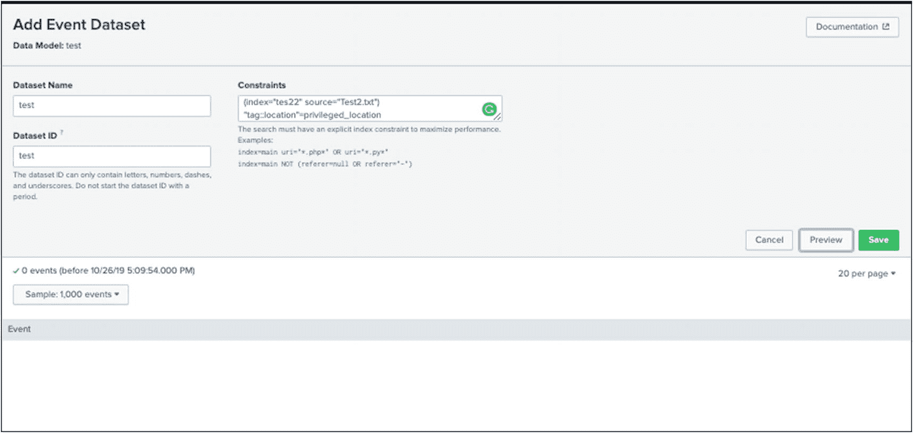

*图 5-18*

1.  点击 `保存`。

2.  点击 `添加字段`。

3.  转到 `自动提取`。

4.  选择 `location`、`method`、`status` 和 `unit_id`，如图 5-19 所示。

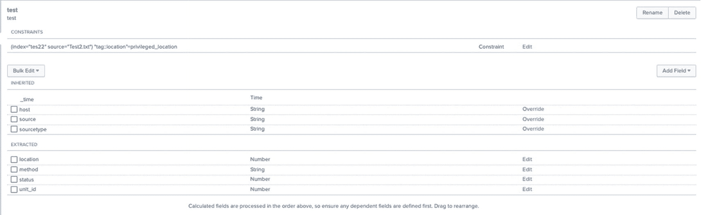

*图 5-19*

5.  现在，如果您点击 `Pivot`，您会看到计数为零，如图 5-20 所示。

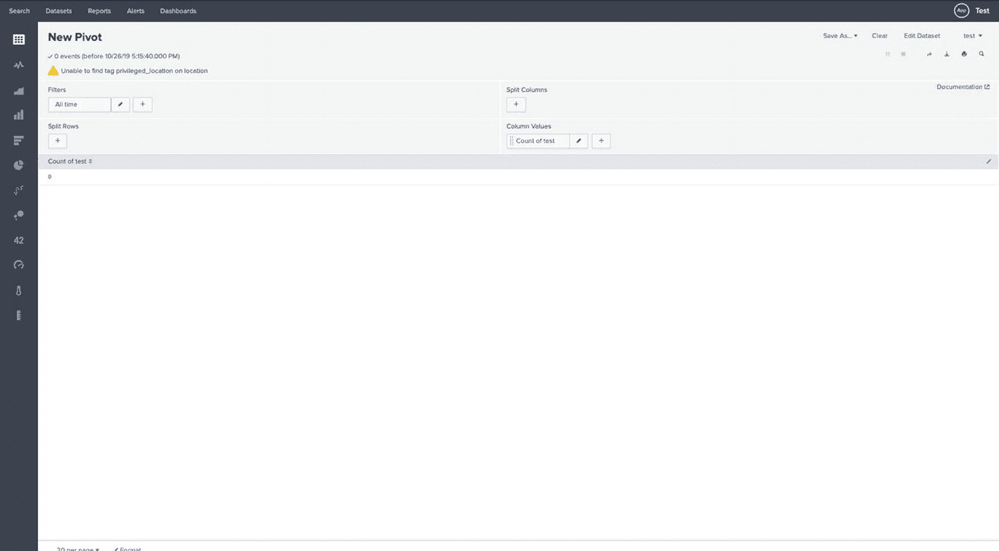

*图 5-20*

由于您得到了零计数，因此需要在 Splunk 中设置 CIM。为此，请按照以下步骤操作。

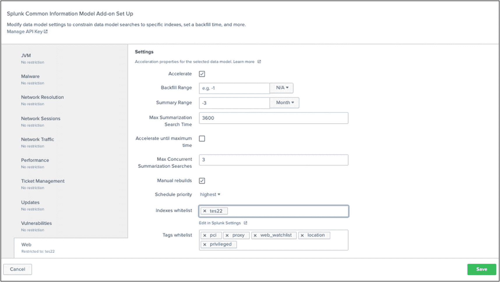

*图 5-21*

1.  转到 Splunk Enterprise 主页，找到 `更多应用`，搜索 `CIM` 并进行安装。

2.  要设置 CIM，请转到 `应用` ➤ `管理应用` ➤ `Splunk Common Information Model`。

3.  转到 Web。在索引白名单中，选择 `tes22`（参见图 5-21）。

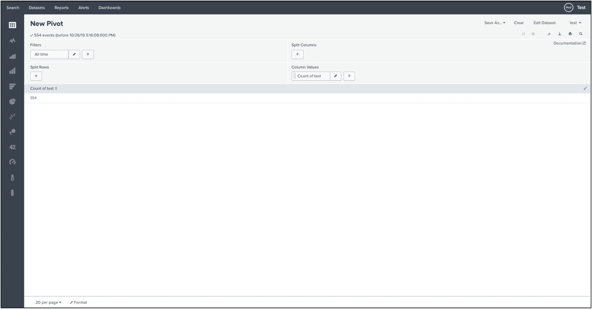

*图 5-22*

4.  返回测试数据模型。刷新页面并运行 `Pivot` 模型。这次您可以看到计数。请参考图 5-22 查看 Pivot 报告。

CIM 中包含的数据模型配置为关闭数据模型加速。

您已到达本章的结尾。祝贺您成功学习了数据集、数据模型、事件操作和 CIM。

## 总结

您学习了 Splunk 命令简单易懂。它们与 HTTP 和 HTML 相关联，无需额外的代码或高级语言，并且具有共同的执行方式。

您已经学习了工作流操作的很大一部分内容。查看 Splunk Power User 考试蓝图，您已经熟悉了模块 9（数据模型和 Pivot）的 10%、模块 8（事件操作）的 10% 和模块 10（CIM 模型）的 10%。

下一章将介绍知识管理器以及如何在 Splunk 中创建仪表板。

## 选择题

1.  选择所有包含 Splunk 中工作流操作类型的选项。

    1.  `post`

    2.  `get`

    3.  `search`

    4.  `以上都不是`

2.  CIM 中包含的数据模型配置为打开数据模型加速。

    1.  `true`

    2.  `false`

3.  子数据集继承父数据集的所有数据集。

    1.  `true`

    2.  `false`

4.  数据集中的约束条件本质上是搜索项。

    1.  `true`

    2.  `false`

5.  数据集中包含哪些字段？

    1.  `auto-extracted`

    2.  `eval expression`

    3.  `lookups`

    4.  `regular expression`

    5.  `geo IP fields`

    6.  `以上所有`

    7.  `以上都不是`

6.  数据模型和 Pivot 之间的关系是什么？

    1.  数据模型为 Pivot 提供数据集。

    2.  Pivot 和数据模型没有关系。

    3.  Pivot 和数据模型是同一回事。

    4.  Pivot 为数据模型提供数据集。

7.  选择所有包含在数据模型事件类型中的选项。

    1.  `events`

    2.  `transactions`

    3.  `searches`

    4.  `以上都不是`

**答案**

*   a. `1, 2, 3`

*   b. `4`

*   c. `6`

*   d. `1`

*   e. `2`

*   f. `1`

*   g. `1, 2, 3`