# 6. Splunk 中的知识管理器和仪表板

前一章介绍了 Splunk 中的各种知识对象、软件组件、命令和功能。它处理了输入输出的技术细节，并提供了分步指南。本章将讨论代码和代码段，并介绍负责执行其中一些功能的手动元素。

本章讨论知识管理器。程序是为人类阅读和机器执行而编写的。知识管理器维护了机器和用户之间通信的便捷性。您还将了解 Splunk 中两种类型的仪表板，并执行辅助命令和操作。

本章涵盖以下主题。

*   知识管理器
*   在 Splunk 中创建仪表板
*   动态基于表单的仪表板

好的，作为一名高级文档工程师和翻译员，我将严格按照您提供的注意事项和示例，将给定的英文文本翻译成中文。

## 理解知识管理员在 Splunk 中的角色

知识管理员是负责对 `Splunk Enterprise` 中的知识对象进行集中监督和维护的人员。知识管理员创建、维护和修改知识对象。知识管理员可以将现有的知识对象重新分配给其他用户，并帮助团队处理日常问题。

前面几章介绍了五种类型的知识对象。

- 数据解释（字段和字段提取）
- 数据分类（事件类型和事务）
- 数据丰富（查找和工作流操作）
- 数据规范化（标签和别名）
- 数据模型

知识管理员究竟做什么？知识管理员如何帮助解决日常问题？

以下描述了知识管理员的职责。

- 他们将知识对象声明为全局对象，以便整个组织都可以访问它们。
- 他们使知识对象可供 `Splunk` 中的应用程序使用。
- 他们授予特定用户对特定知识对象的访问权限。
- 他们管理孤立的知识对象。
- 他们在应用程序级别限制读/写权限。

知识管理员为 `Pivot` 构建数据模型，并确保组织中合适的人员处理知识对象。他们还负责规范化数据事件。

现在，让我们更详细地讨论知识对象。

### 全局转移知识对象

使用 `Splunk Security`，可以将知识对象声明为全局对象，以允许所有用户访问它们。例如，销售、管理和生产团队都可以访问美国的销售数据。这使销售团队能够识别销售图表，管理团队能够了解组织的销售模式，生产团队能够知道哪些产品是盈利的。默认情况下，只有 `Splunk Power User` 或管理员才能修改知识对象。

要使知识对象成为全局对象，请按照以下步骤操作。

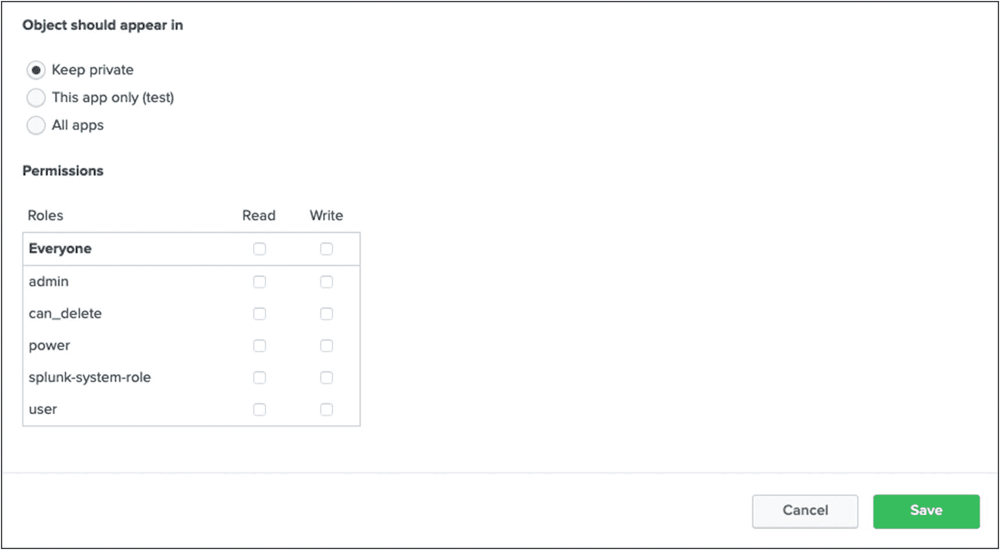

**图 6-1** 知识对象可见性与访问管理

1.  转到 `Splunk Web` 中的 `Settings`，然后选择 `All Configurations`。
2.  搜索要设为全局的知识对象，然后单击 `Permissions`（参见图 6-1）。

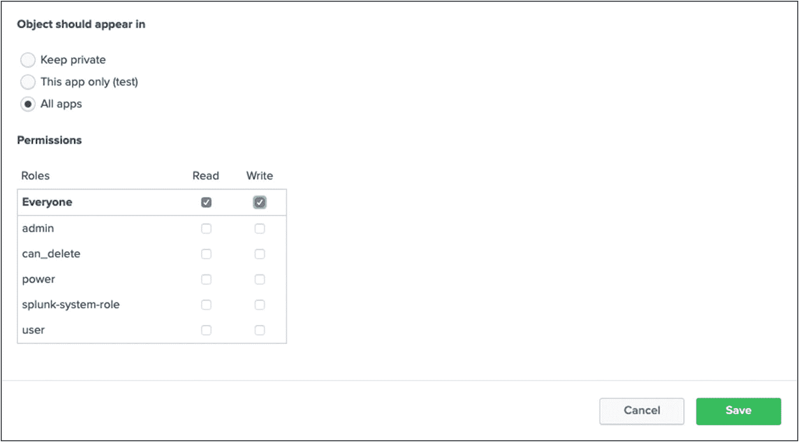

**图 6-2** 知识对象可见性：全局

1.  要使知识对象成为全局对象，该对象应出现在 `All Apps` 选项中。在 `Permission` 下，将 `Read` 和 `Write` 角色设置为 `Everyone`（参见图 6-2）。

### 启用知识对象可见性

与敏感信息或层级问题相关的知识对象具有受限的可见性。并非组织中的每个人都能访问。例如，销售、管理和生产团队都可以访问与美国东部和西部销售相关的数据。但组织的供应链管理（SCM）团队不需要此报告。您可以将对象可见性限制给指定的受众。

要使知识对象具有选择性访问权限，请按照以下步骤操作。

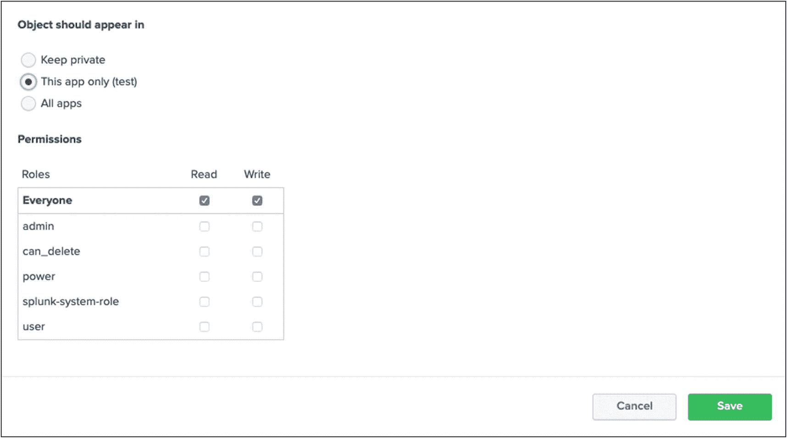

**图 6-3** 知识对象可见性：test 应用

1.  转到 `Settings` 并选择 `All Configurations`。
2.  搜索所需的知识对象，然后单击 `Permissions`。我希望 `Country` 仅对 `test` 应用程序的用户可见。
3.  要使知识对象在应用程序更改后可见，对象应出现在特定的应用程序中。在 `Permissions` 中，将 `Read` 和 `Write` 角色设置为 `Everyone`（参见图 6-3）。

### 限制应用程序的读/写权限

应用程序的读/写权限是另一种知识对象限制。如果您希望用户只能读取对象而不能对其进行编辑，请按照以下步骤操作。

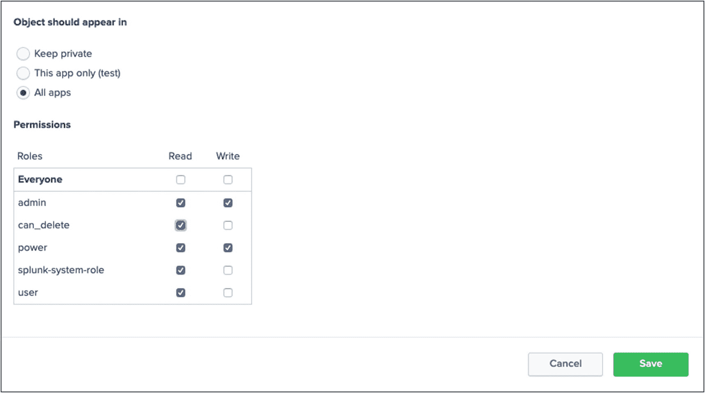

**图 6-4** 知识对象：访问管理

1.  转到 `Settings` 并选择 `All configurations`。
2.  搜索知识对象，然后单击 `Permissions`。例如，您的 `Country` 将成为只读对象。
3.  该对象必须位于 `All apps` 中。
4.  在 `Permissions` 中，将 `Read` 和 `Write` 角色更改为 `admin` 和 `power`。向 `admin`、`can_delete`、`power`、`Splunk-system-role` 和 `user` 提供读取权限（参见图 6-4）。

### 孤立知识对象

当员工离开组织时，与他们关联的知识对象将被停用；但是，这些对象的链接仍然存在。这些对象称为孤立知识对象。没有合法所有者的对象在 `Splunk` 环境中是一种障碍。并且，由于对象所有者不再可用，计划报告器无法追踪和报告它们。为了解决这个问题，`Splunk` 提供了多种检测孤立知识对象的方法。

- 它运行 `Monitoring Console` 健康检查。
- 它使用 `Settings` 中的 `Reassign Knowledge Objects` 页面。
- 它将单个知识对象重新分配给另一个所有者。

#### 运行监控控制台健康检查

如果您具有 `Splunk Enterprise` 的管理员角色访问权限，则可以使用 `Monitoring Console`。这是一个健康检查功能，可以检测孤立的计划搜索、报告和警报。它会告诉您系统中存在的知识对象的数量。以下步骤可监控健康检查。

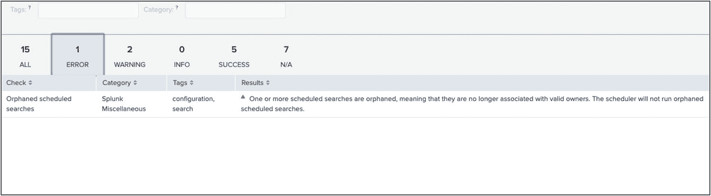

**图 6-5** 孤立知识对象

1.  转到 `Monitoring Console`，然后单击 `Health Check`。
2.  单击 `Start`。
3.  转到 `Error`，您可以在其中找到 `Orphaned scheduled searches`（参见图 6-5）。

#### 使用设置中的重新分配知识对象页面

`Settings` 中的 `Reassign Knowledge Objects` 页面是检测 `Splunk` 环境中是否存在孤立知识对象的最简单方法之一。请参考以下步骤。

1.  选择 `Settings`，然后转到 `All configurations`。
2.  单击 `Reassign Knowledge Objects`。
3.  单击 `Orphaned` 从列表中过滤出它。

孤立按钮还会显示共享的孤立对象。

#### 将知识对象重新分配给另一个所有者

`Reassign Knowledge Objects` 页面用于将知识对象重新分配给新所有者。您可以重新分配已拥有和孤立的知识对象。请按照以下步骤操作。

1.  选择 `Settings`，然后转到 `All configurations`。
2.  单击 `Reassign Knowledge Objects`。
3.  找到您要重新分配的一个或多个对象。

图 6-6 显示了 `Reassign Entry` 对话框。

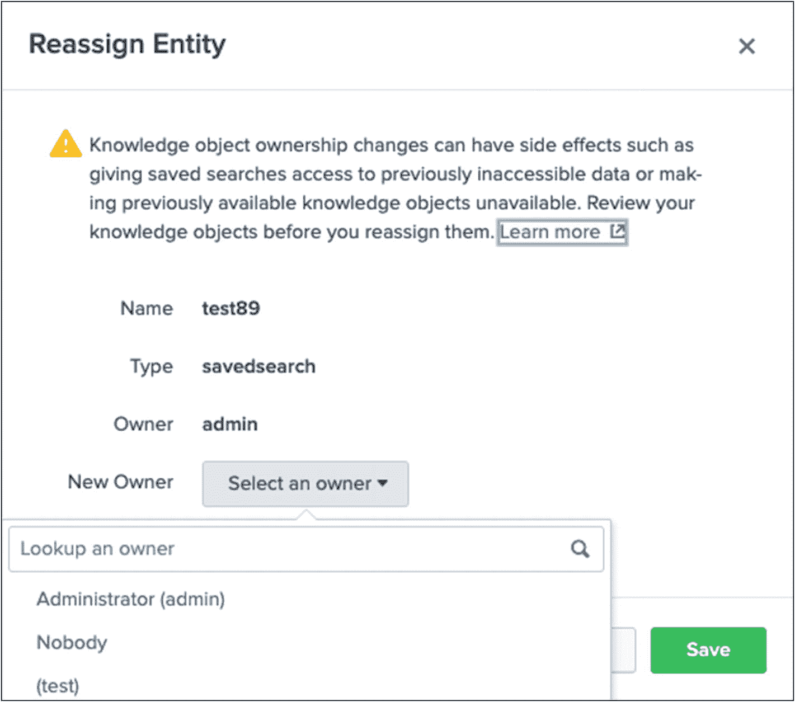

**图 6-6** 重新分配知识对象

`Splunk` 中的知识对象存储在 `macros.conf`、`tags.conf`、`eventtypes.conf` 和 `savedsearches.conf` 中。

在阅读本章的此处时，您已经了解了知识管理员的角色，以及如何规范知识对象的可见性并限制其读写权限。在以下部分中，您将了解 `Splunk` 中的仪表板。

## 仪表板

仪表板旨在通过快速分析和信息摘要，轻松地在 `Splunk` 中可视化数据。由于构成仪表板的面板，它既方便又直接。面板包括与报告直接关联的图表、表格和列表。

`Splunk` 中有两种类型的仪表板。

- 静态实时仪表板
- 动态基于表单的仪表板

### 静态实时仪表板

静态实时仪表板展示组织的关键信息。由于其实时性，它们具有更高的实用性。例如，如果你有一个制造单元，在做出重大决策（如重新订购库存或深入了解生产单元）时，实时数据至关重要。你还可以创建警报。

在本节中，你将学习为 `Test2.txt` 数据集创建一个静态实时仪表板，用户可以通过它确定其网页上的总交易数量、美国东部地区和美国西部地区的总销售额、HTTP 交易的状态、HTTP 方法以及各种产品类别。

要为 `Test2.txt` 创建仪表板，你需要以下 11 个报表。

-   网页上的总交易请求数
-   来自美国西部的总交易请求数
-   来自美国东部的总交易请求数
-   网页上的总成功交易请求数
-   来自美国西部的总成功交易请求数
-   来自美国东部的总成功交易请求数
-   美国西部城市的总销售额
-   美国东部城市的总销售额
-   网页的 HTTP 状态码
-   网页的 HTTP 方法
-   不同类别在网页上的总交易请求数

创建这 11 个报表的解决方案将在下文阐述。如果你已经对创建仪表板充满信心，请尝试在不使用说明的情况下制作这些报表。

### 在 Splunk 中创建获取网页总交易请求的报表

要创建此报表，必须遵循以下步骤。

1.  转到 `Settings`。
2.  转到 `Data models`。
3.  转到 `Country`。
4.  选择 `Pivot`。
5.  点击 `Pivot` 并选择单个值。
6.  另存为关于总交易请求的报表。

### 在 Splunk 中创建获取美国西部总交易请求的报表

要创建此报表，请遵循以下步骤。

1.  转到 `Settings`。
2.  转到 `Data models`。
3.  转到 `Country`。
4.  选择 `Pivot`。
5.  选择 `Western USA`。
6.  点击 `Pivot` 并选择单个值。
7.  另存为关于美国西部总交易请求的报表。

### 在 Splunk 中创建获取美国东部总交易请求的报表

要创建此报表，请遵循以下步骤。

1.  转到 `settings`。
2.  转到 `Data models`。
3.  转到 `Country`。
4.  选择 `Pivot`。
5.  选择 `Eastern USA`。
6.  点击 `Pivot` 并选择单个值。
7.  另存为关于美国东部总交易请求的报表。

### 在 Splunk 中创建获取网页成功交易请求的报表

要创建此报表，请遵循以下步骤。

1.  创建一个与第 5 章中类似的数据模型，用于成功交易。唯一的变化是在 `Country` 数据模型的现有约束中添加一个状态为 200 的约束字段。请参考以下输入约束字段。
2.  创建一个名为 `Country2` 的新数据模型，并保存来自美国东部和西部成功交易请求的报表。

```
index="tes22" sourcetype=test2 location=* status=200
```

按照描述保存来自美国东部和西部的成功交易请求报表。

### 为美国西部城市创建总销售额报表

要创建此报表，请遵循以下步骤。

1.  转到 `Settings`。
2.  转到 `Data models`。
3.  转到 `Country`。
4.  选择 `Pivot`。
5.  选择 `WesternUSA2`。
6.  点击 `Pivot`，然后在 `Split rows` 中选择 `City`。
7.  点击 `Pie Chart`。
8.  另存为关于美国西部城市总销售额的报表。

### 为美国东部城市创建总销售额报表

要创建此报表，请遵循以下步骤。

1.  转到 `Settings`。
2.  转到 `Data models`。
3.  转到 `Country`。
4.  选择 `Pivot`。
5.  选择 `EasternUSA2`。
6.  点击 `Pivot`，然后在 `Split rows` 中选择 `City`。
7.  点击 `Pie Chart`。
8.  另存为关于美国东部城市总销售额的报表。

### 创建 HTTP 状态码报表

要创建此报表，请遵循以下步骤。

1.  转到 `Settings`。
2.  选择 `Searches`、`Reports` 和 `Alerts`。
3.  选择 `New Report`。
4.  在 `Title` 中输入 `Status`。在搜索框中输入以下查询。
5.  点击 `Save`。

```
index="tes22" sourcetype=test2 |timechart count by status
```

### 创建 HTTP 方法报表

要创建此报表，请遵循以下步骤。

1.  转到 `Settings`。
2.  选择 `Searches`、`Reports` 和 `Alerts`。
3.  选择 `New Report`。
4.  将报表命名为 `Method`。
5.  在搜索框中输入类似于以下的查询。
6.  点击 `Save` 以保存报表。
7.  点击 `Save`。

```
index="tes22" sourcetype=test2 |timechart count by method
```

### 创建获取不同类别总交易请求的报表

要创建此报表，请遵循以下步骤。

1.  转到 `Settings`。
2.  选择 `Searches`、`Reports` 和 `Alerts`。
3.  选择 `New Report`。
4.  将报表命名为 `Categories`。
5.  在搜索框中输入类似于以下的查询。
6.  点击 `Save`。

```
index="tes22" sourcetype=test2 | timechart count by Category
```

### 创建仪表板

现在，让我们为应用程序测试创建一个名为 `Sales` 的仪表板。它包含以下报表：网页上的总交易请求数报表、来自美国西部的总交易请求数报表、来自美国东部的总交易请求数报表、网页上的总成功交易请求数报表、来自美国西部的总成功交易请求数报表、来自美国东部的总成功交易请求数报表、美国西部城市总销售额报表、美国东部城市总销售额报表、网页的 HTTP 状态码报表、网页的 HTTP 方法报表，以及不同类别在网页上的总交易请求数报表。

1.  点击屏幕顶部导航栏上的 `Dashboards`。
2.  点击 `Create New Dashboard` 以填写仪表板属性。
3.  在 `Dashboard Title` 中输入 `Sales`。在 `Dashboard Permissions` 中选择 `Shared in App`。

图 6-7 显示了仪表板面板。

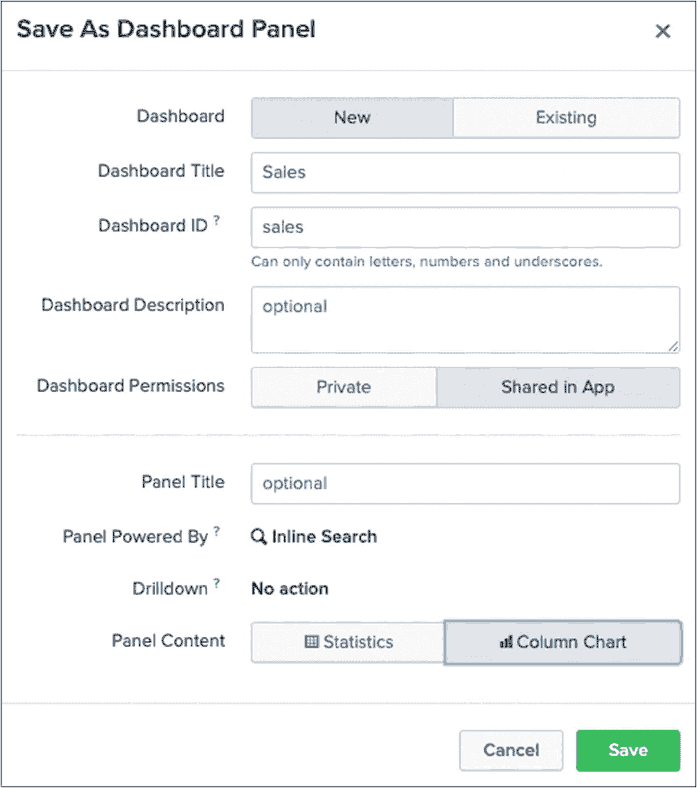

图 6-7：创建仪表板：Sales

### 向仪表板添加报表

要在 Splunk 中添加仪表板，请遵循以下步骤。

1.  在页面顶部的导航栏上，点击 `Dashboards`。
2.  选择 `Sales` 仪表板。
3.  点击 `Edit`，然后点击页面顶部的 `Add panel`。选择 `New from the report`。
4.  选择所有 11 个报表，并将它们添加到 `Sales` 仪表板中。

我创建了如图 6-8 所示的仪表板。

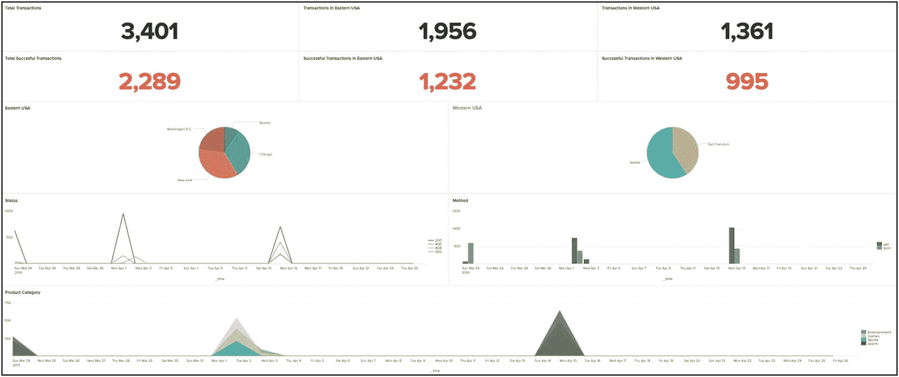

图 6-8：Sales 仪表板

1.  添加所有报表并对仪表板进行大量更改后，点击 `Save`。

你可以通过进入仪表板并点击 `Edit` > `Source` 来从仪表板生成代码。我为我的 `Sales` 仪表板生成了 XML 代码，并将其上传到 GitHub：[`github.com/deeppmehta/splunk-certification-guide/blob/main/ch6/Sales.xml`](https://github.com/deeppmehta/splunk-certification-guide/blob/main/ch6/Sales.xml)。

本章的最后一节将讨论基于动态表单的仪表板及其输入字段。

### 基于动态表单的仪表板

基于动态表单的仪表板允许用户过滤数据，而无需跳转到新页面。它使你能够添加输入字段，例如单选按钮、链接列表、时间修改器和下拉菜单。此类仪表板可用于故障排除、深入了解数据以及获取商业智能。

首先，我们来讨论如何使用 XML 添加单选按钮。

### 使用 XML 添加单选按钮

单选按钮是一种控件元素，允许用户从可用选项中选择任意一项，并根据类别过滤数据。它通过基于动态表单的仪表盘添加。例如，如果想查看“体育”类别下的所有事件，最简单的添加单选按钮的方法是使用源代码。

# 设计带有单选按钮的基于动态表单的仪表盘

设计一个带有单选按钮的基于动态表单的仪表盘，以根据类别值过滤数据。包含一个显示按类别统计事件数量的柱状图。

请尝试自行操作。如果需要参考，请使用以下代码。代码后附有仪表盘的截图。

```
Test2
Test2

Category
All

index="tes22" sourcetype=test2 category=*

Category
Category
*

index="tes22" sourcetype=test2 category=$Category$

index="tes22" sourcetype=test2 category=$Category$ 

true

Count by Category

index="tes22" sourcetype=test2 |stats count by category 

Column Chart
```

图 6-9 展示了带有单选按钮和基于类别事件计数的柱状图的动态表单仪表盘。

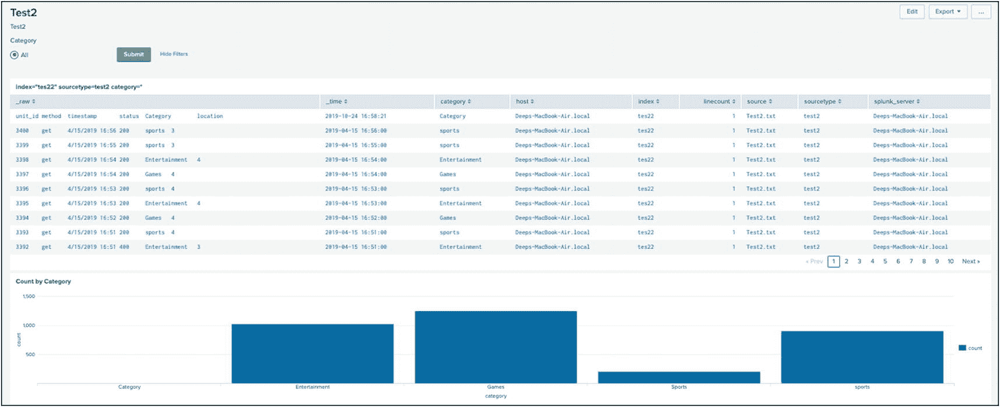

图 6-9.

下一节将讨论如何添加时间修饰符。

## 使用 XML 添加时间修饰符

时间修饰符是一种控件元素，允许用户选择时间范围，并根据类别和时间过滤数据。

例如，如果想查看“体育”类别下、2019 年 3 月 23 日这个时间范围内的所有事件，最简单的添加时间修饰符的方法是使用以下源代码。

设计一个基于动态表单的仪表盘，包含单选按钮和时间修饰符，以根据类别值和时间过滤数据。包含一个显示按类别统计事件数量的柱状图。

请尝试自行操作。如果需要参考，请使用以下代码。代码后附有仪表盘的截图。

```
Test2 Copy
Test2

Category
All

index="tes22" sourcetype=test2 category=*

Category
Category
*

index="tes22" sourcetype=test2 category=$Category$ |timechart count by Category

index="tes22" sourcetype=test2 category=$Category$ |timechart count by Category

true

Count by Category

index="tes22" sourcetype=test2 |stats count by category 

Column Chart
```

图 6-10 展示了带有单选按钮和时间修饰符的动态表单仪表盘。它还包含一个基于类别事件计数的柱状图。

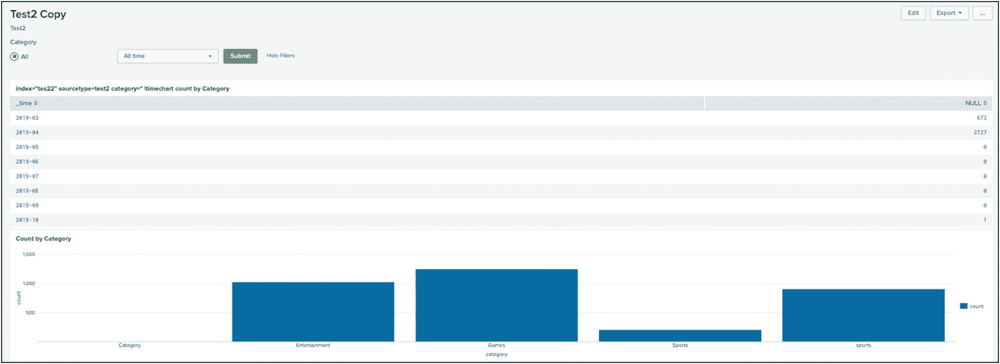

图 6-10.

## 使用 XML 添加下拉菜单

第三个控件元素是下拉菜单，它允许用户从可用选项中选择仅一项，并根据类别、时间和定义的状态过滤数据。这是通过基于动态表单的仪表盘实现的。

例如，如果想查看“体育”类别下、2019 年 3 月 23 日且状态为 200 的所有事件，最简单的方法是使用以下源代码添加一个下拉菜单。

设计一个基于动态表单的仪表盘，包含单选按钮、时间修饰符和下拉菜单，以根据类别值、时间和状态过滤数据。包含一个显示按类别统计事件数量的柱状图。

请尝试自行操作。如果需要参考，请使用以下代码。代码后附有仪表盘的截图。

```
Test3 Copy
Test3

Category
All

index="tes22" sourcetype=test2  Category=* status=*

Category
Category
*

Status

index="tes22" sourcetype=test2  Category=$Category$ $status$ |table status and Category

iindex="tes22" sourcetype=test2  Category=$Category$ $status$ |timechart count by Category

true

Count by Category

index="tes22" sourcetype=test2 |stats count by Category 

Column Chart
```

图 6-11 展示了带有单选按钮、时间修饰符和下拉菜单的动态表单仪表盘。它还包含一个基于类别事件计数的柱状图。

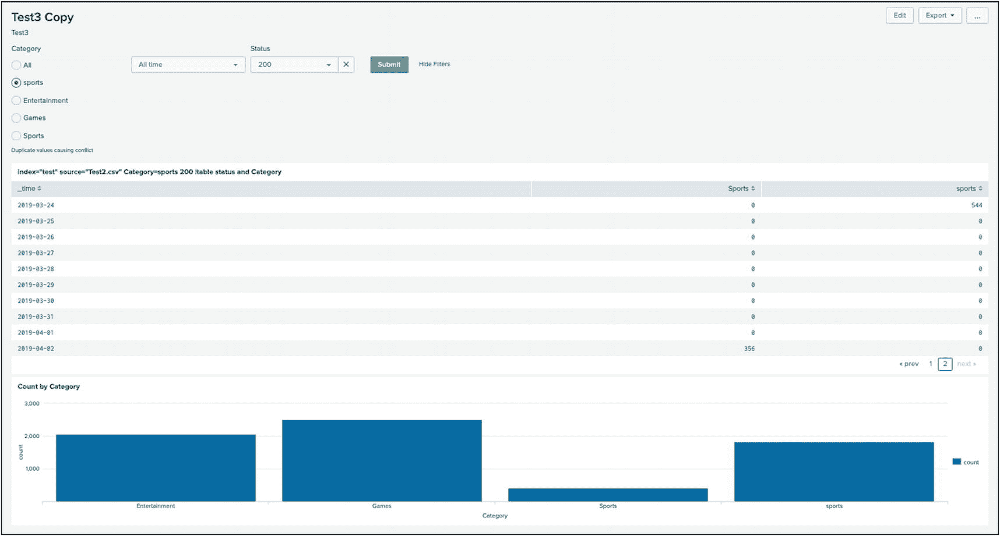

图 6-11.

最后，让我们添加一个链接列表知识对象。

## 使用 XML 添加链接列表

下一个控件元素是链接列表。它允许用户从可用选项中选择仅一项，并根据类别、时间范围、状态和方法过滤数据。

例如，我想查看“体育”类别下、2019 年 3 月 23 日、状态为 200 且方法为 GET 的所有事件。

添加链接列表最简单的方法是使用以下源代码。

使用单选按钮、时间修饰符、下拉菜单和链接列表，设计一个基于动态表单的仪表盘，根据类别值、时间、状态和方法过滤数据。包含一个显示按类别统计事件数量的柱状图。

请尝试自行操作。如果需要参考，请使用以下代码。代码后附有仪表盘的截图。

```
Test3 Copy
Test3

Category
All

index="tes22" sourcetype=test2 category=* status=*

Category
Category
*

method
get
post

Status

index="tes22" sourcetype=test2 category=$Category$ $status$ $method$|table status,method and Category

index="tes22" sourcetype=test2 category=$Category$ $status$ $method$ |timechart count by Category

true

Count by Category

index="tes22" sourcetype=test2 |stats count by category 

Column Chart
```

图 6-12 展示了带有单选按钮、时间修饰符、下拉菜单和链接列表的动态表单仪表盘。它还包含一个基于类别事件计数的柱状图。

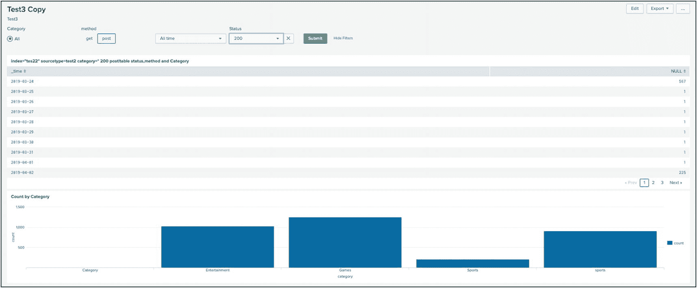

图 6-12.

至此，您已经完成使用 XML 添加基于动态表单的仪表盘。接下来，您将学习如何通过用户界面输入数据。

## 使用用户界面进行输入

通过基于动态表单的仪表盘，使用用户界面 (UI) 进行输入的操作得以简化。请按照以下步骤通过 UI 添加输入。

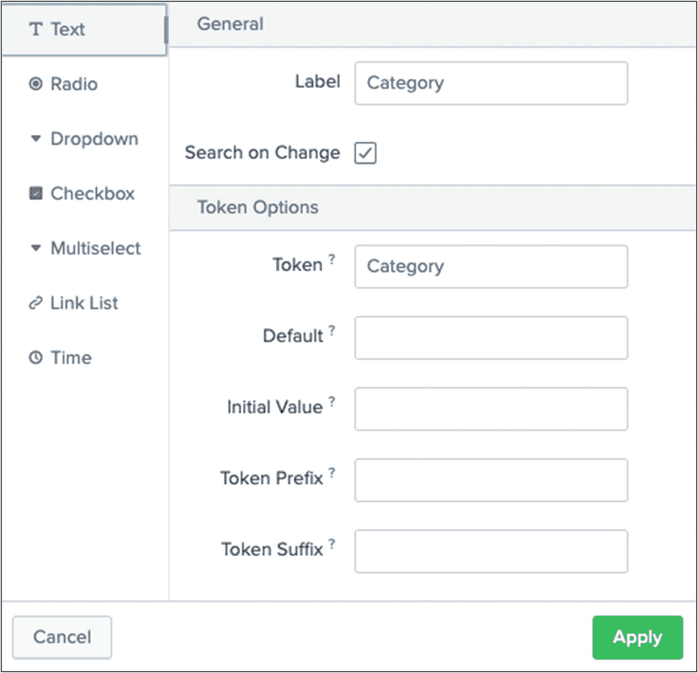

图 6-13.

1. 转到仪表盘页面并选择该仪表盘。
2. 单击“编辑”。
3. 转到“添加输入”并选择所需的输入。
4. 选择“文本”。
5. 单击“编辑”按钮。在“标签”中，输入“Category”。在“令牌”中，输入“Category”，并选择“更改时搜索”（参见图 6-13）。

单选按钮、下拉菜单、复选框和链接列表都可以使用相同的 UI 步骤进行添加。使用 UI 代码添加输入易于理解且足够包容，使初学者也能操作。然而，XML 代码相对更为复杂。

我要表扬您完成了本章的学习。您学习了知识管理器、对知识对象和仪表盘执行的功能及其类型。请练习这些命令以更好地理解它们的功能。

# 总结

Splunk 是一个用于搜索、处理和监控大数据的用户友好型平台。它鼓励在其元素和对象的分层结构中采用更简便的代码和命令。本章进一步讨论了知识对象。它还介绍了知识管理器，即负责维护知识对象的人员。您分析了仪表盘，并了解了它如何轻松提供大数据可视化。您还学习了如何使用 UI 和 XML 输入数据。

下一章是 Splunk 用户和高级用户模拟测试。

您已完成模块 5（知识管理器角色）的 5% 和模块 6（静态实时仪表盘和基于动态表单的仪表盘）的 12%。

# 多项选择题

1. 选择动态表单式仪表板的控制元素。
    1. `radio button`
    2. `time modifier`
    3. `link list`
    4. `drop-down`
    5. `aliases`
    6. 以上都不是

2. 哪种属于知识对象类型？（请选择所有适用的选项。）

## 1. 数据解释（字段和字段提取）

## 2. 数据分类（事件类型和事务）

## 3. 数据富化（查找和工作流操作）

## 4. 数据标准化（标签和别名）

## 5. 数据模型

## 6. 以上都不是

## 3. 知识管理员的职责包括（请选择所有适用的选项。）

1. 授予用户对适当知识对象的访问权限
2. 为 `Pivot` 构建数据模型
3. 标准化数据
4. 以上都不是

## 4. 知识对象存储在 _____ 中。（请选择所有适用的选项。）

1. `macros.conf`
2. `tags.conf`
3. `eventtypes.conf`
4. `savedsearches.conf`
5. `props.conf`
6. `transform.conf`

## 5. 在设置中的“重新分配知识对象”页面，您可以查看共享的知识对象。

1. 正确
2. 错误

**答案**

* a. 1
* b. 1, 2, 3, 4
* c. 1, 2, 3
* d. 1, 2, 3, 4, 5
* e. 1, 2, 3, 4