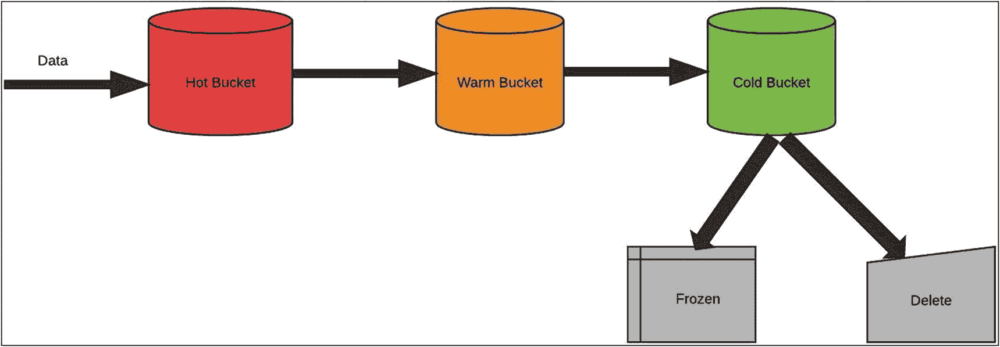
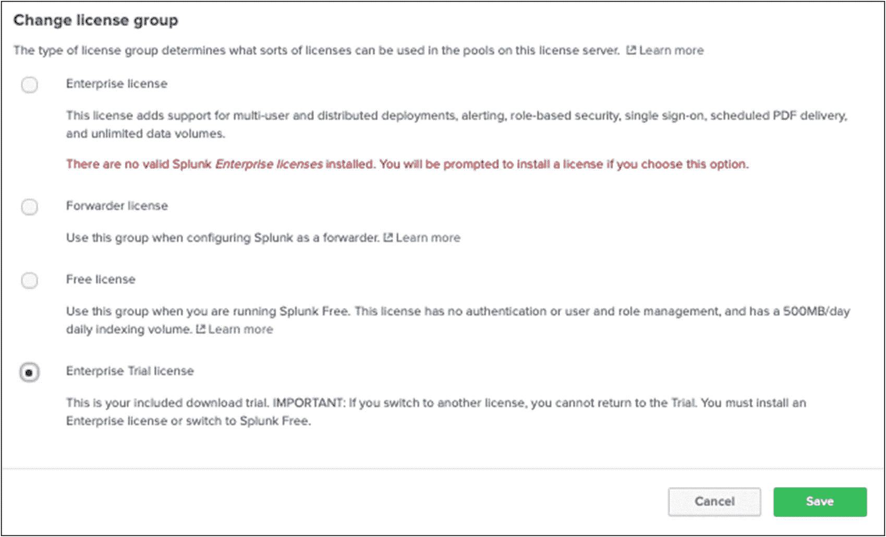
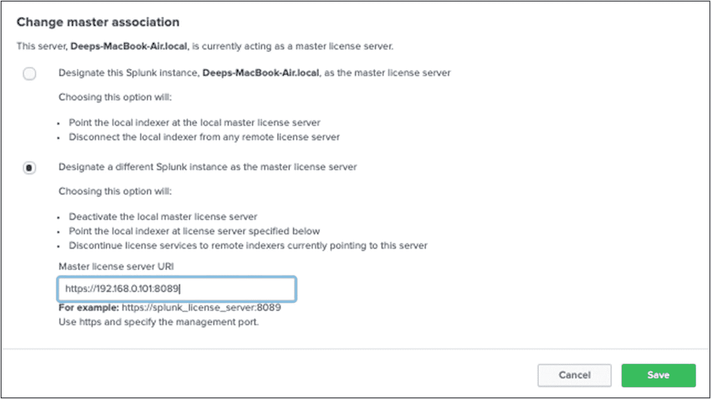
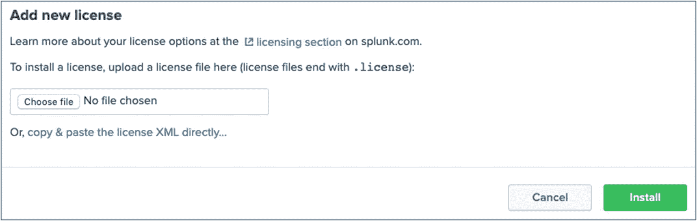
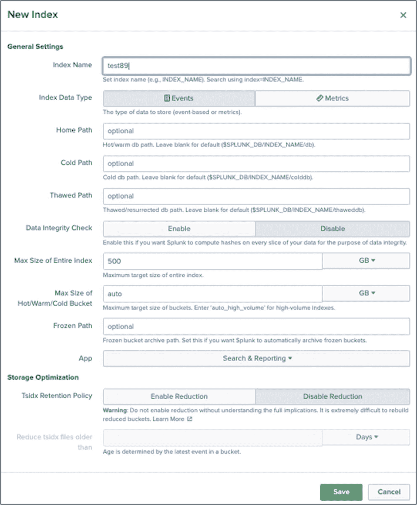
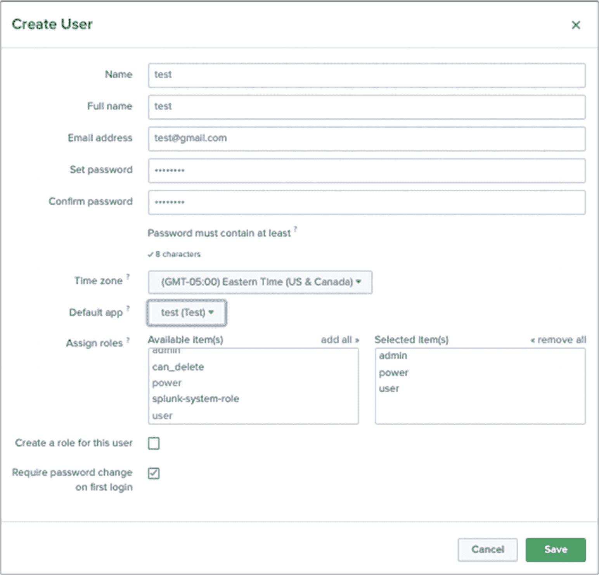
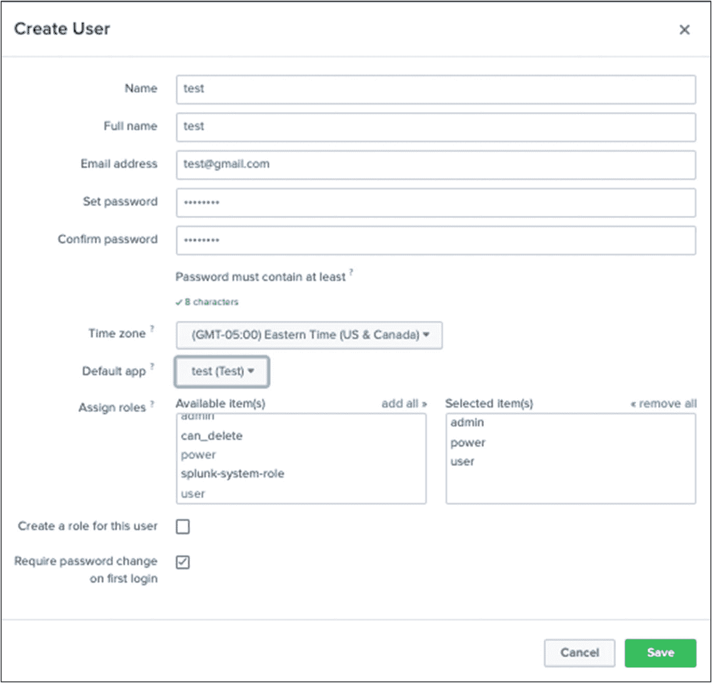
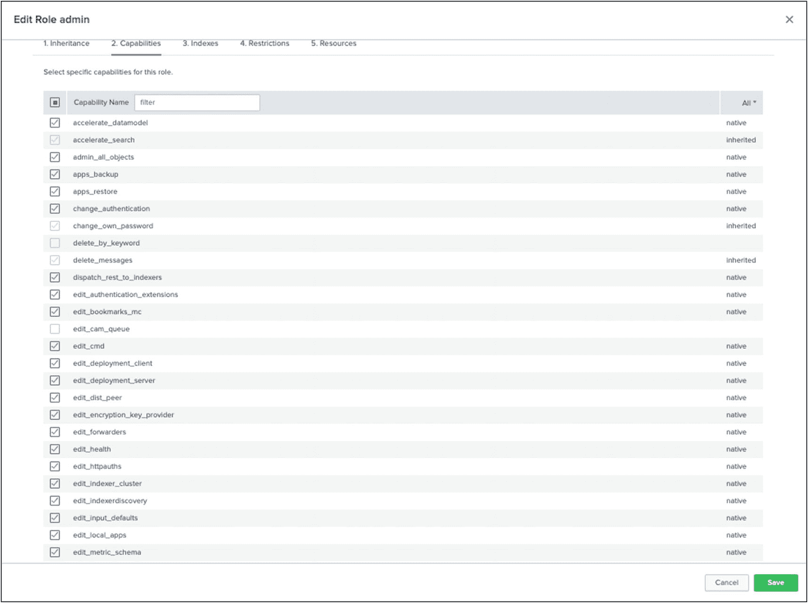
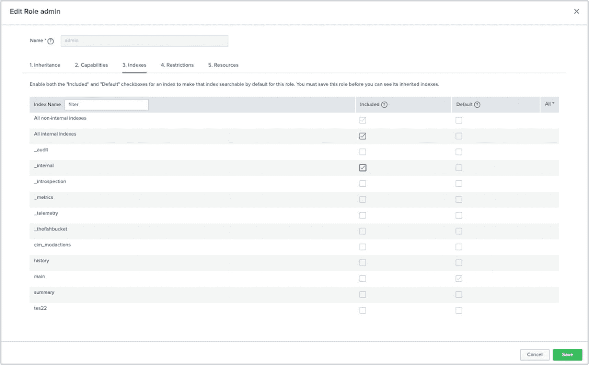

# 8. Splunk 许可证、索引和角色管理

本章将向您介绍 Splunk 桶、许可证和用户角色管理。

本章涵盖以下主题。

* Splunk 中的桶
* `journal.gz`、`.tsidx`和布隆过滤器
* Splunk 许可证
* 管理 Splunk 许可证
* 用户管理

## 桶

桶是存储原始数据和索引数据的目录。它有两个主要属性：最大数据和最长时限。需要配置这两个属性才能使桶平稳运行。桶有三种类型。

*   **热桶**：数据被解析到 Splunk 后，会经过许可证主控服务器，然后事件被写入热桶。简单来说，它是数据写入的桶。热桶是可搜索的。当达到最大大小或 Splunk 重启时，热桶会转换为暖桶。一个索引可能同时打开多个热桶。

*   **暖桶和冷桶**：暖桶是可搜索的，但不会主动写入。暖桶通过`_time`进行标识。当特定索引超过限制时，暖桶会回滚到冷桶。在特定时间后，冷桶会根据索引策略回滚到冻结或归档状态。

*   **冻结**：这也称为*数据过期*。它是最旧的数据桶。当索引大小已满或桶的存在时间超过指定的时间限制时，它会从索引中删除。

`indexes.conf`文件管理索引策略，例如数据过期和数据阈值。


### 存储桶的工作原理是什么？

当你通过监控输入、脚本化输入或数据上传将数据摄取到 Splunk 平台时，数据会被索引。Splunk 将数据保存在名为 *存储桶* 的目录中。根据数据策略定义，第一个存储桶是热存储桶，数据会在其中保存一段时间。这是一个可读写存储桶。

在以下任一情况下，热存储桶会滚动为温存储桶：`splunkd`（一种用于访问、处理、索引流式数据并处理搜索请求的服务）重启；索引大小超过限制；存储桶的时间跨度过大；热存储桶在一段时间内未接收到数据；或者存储桶的元数据增加。随后，它会创建一个名为 `“db_[最新时间]_[最旧时间]_[ID]”` 的新目录。该命名基于 `_time`，用于了解特定存储桶中事件的时间范围。

温存储桶中的时间以纪元时间格式表示。温存储桶通常是只读的，在达到索引限制或创建的温存储桶数量过多时，会滚动为冷存储桶。在从温存储桶滚动到冷存储桶的过程中，整个存储桶目录会被复制到一个冷存储桶路径。理想情况下，最旧的索引会被优先切换。

冷存储桶允许你读取数据，然后根据策略定义，删除数据或将其滚动到冻结存储桶。在冻结存储桶中，索引既不能被读取，也不能写入数据，只能归档。要读取冻结数据，需要将其移动到冷存储桶。当索引达到最大大小，或存储桶的生命周期达到限制时，最旧的存储桶会从索引中删除。可以配置一个冻结路径。此流程如图 8-1 中的示意图所示。



图 8-1

存储桶生命周期

热存储桶和温存储桶应使用更快的存储设备，例如 SSD。冷存储桶可以使用较慢的存储设备，例如 SANS/NAS。

### 在存储桶中如何执行搜索

当你搜索已索引的数据时，Splunk 会以相反的顺序返回结果。假设你想搜索最近添加的事件中的数据。Splunk 会直接查找热存储桶，因为它们是最近写入数据的存储桶。因此，很容易找到最新的结果。

类似地，如果你搜索关键词 *kite*，Splunk 会首先检查热存储桶。如果找不到该词，Splunk 会显示事件 “kite” 的时间戳以及该事件进入存储桶的实际时间。然而，它随后会按照 `_time` 的逆序时间在温存储桶中查找该事件，如果仍未找到，则移动到冷存储桶，以相同的方式进行搜索。因此，在 Splunk 中，搜索主要通过 `_time` 检查最近添加的事件，仅在关键词匹配时才深入挖掘存储桶。因此，如果一个 “kite” 事件是新添加的，而另一个 “kite” 事件在温存储桶或冷存储桶中，Splunk 会首先显示热存储桶中的事件，然后显示温存储桶或冷存储桶中的事件。

现在我们来讨论存储桶用于执行搜索的三个命令：`journal.gz`、`.tsidx` 和 Bloom 过滤器。

## 理解 journal.gz、.tsidx 和 Bloom 过滤器

要理解搜索的工作原理，你需要了解存储桶用于执行搜索的三个组件。

*   **journal.gz**：当你在 Splunk 中摄取数据时，数据会保存在热存储桶中。在热存储桶内部，`journal.gz` 在保存数据方面起着至关重要的作用。原始数据被压缩并分成多个切片。一个切片最多可以包含 128 KB 的未压缩数据。

*   **.tsidx** 代表 *时间序列索引文件*。每个事件在存储桶内都被赋予一个唯一的 ID。一个事件被分割成多个词条，并按字典序（按字母顺序排序）保存。每个词条都在其 `.tsidx` 中被跟踪，并且可以通过二分搜索来确定该词条是否存在。如果找到了该词条，则可以线性扫描以检查数据是否存在。一个词条表会将其指向存储原始数据的地址。`journal.gz` 和 `.tsidx` 共同构成一个存储桶。

*   **Bloom 过滤器** 减少了索引器从索引中检索事件的时间。Bloom 过滤器在预测事件是否存在于索引中起着关键作用。Bloom 过滤器在索引级别运行。例如，如果你使用关键词 *error* 运行搜索命令，Bloom 过滤器会过滤掉所有在其词条表中不包含该关键词的存储桶。Splunk Enterprise 通过在指定存储桶内搜索存在搜索内容的 `.tsidx` 文件来节省你的时间。

现在你已经了解了存储桶及其组件。但是 Splunk 的搜索功能是如何工作的呢？

### 搜索功能是如何工作的？

假设你想搜索包含关键词 *kite* 的事件。当你在 SPL 中编写命令，使用哈希函数搜索这些事件时，它会为 *kite* 生成一个哈希键。然后，它使用 Bloom 过滤器在基于 `_time` 的存储桶上搜索该哈希键。如果 Bloom 过滤器确定该关键词存在于某个特定索引中，它会使用时间序列索引文件生成的词条表，并查找存储原始数据（`journal.gz`）的地址。`journal.gz`、Bloom 过滤器和 `.tsidx` 共同使搜索工作更高效。

现在让我们继续讨论 Splunk 许可证。

## Splunk 许可证

当你在 Splunk 中输入数据时，索引器会将其索引并存储在磁盘上。Splunk 许可证决定了数据摄取的限制。每个 Splunk Enterprise 实例都需要一个许可证，该许可证规定了其一天内可以索引的数据量规则。Splunk 许可证有多种类型。

*   **Splunk Enterprise 许可证**

“标准” Splunk Enterprise 许可证规定了被索引数据的类型，可供购买或配置。

*   **不强制执行许可证**

标准 Splunk Enterprise 许可证有一个最大每日索引量，如果超过该量，你会收到违规警告。如果你在一个月内收到超过五次警告，就违反了许可证规定。这可能导致 Splunk 搜索头被禁用。但是，在不强制执行的情况下，即使违反了许可证，你的搜索头也不会被禁用。

*   **企业试用许可证**

企业试用许可证允许最大索引量为每天 500 MB。它在 60 天后过期，届时系统会要求你切换到标准的 Splunk Enterprise 许可证或免费许可证。

*   **销售试用许可证**

企业试用许可证在 60 天后过期，索引容量为每天 500 MB。如果你有一个试点项目需要的索引容量超过每天 500 MB，可以直接联系 Splunk 销售团队获取许可证。

*   **开发/测试许可证**

Splunk 提供其开发/测试许可证的访问权限，以便在非生产环境中运行。

*   **免费许可证**

Splunk 中的免费许可证的索引容量最高为每天 500 MB。使用此许可证，你无法执行分布式搜索、TCP/HTTP 转发、告警、用户管理、LDAP 或脚本化身份验证。

*   **Splunk 工业物联网许可证**

Splunk 为工业物联网提供了一种特殊许可证，可以访问专门设计的应用集。

*   **转发器许可证**

转发器许可证允许转发无限量的数据。与免费许可证不同，它支持身份验证。你无需购买额外的许可证，因为它已包含在 Splunk 中。

### 在 Splunk 中更改许可证组

要从试用版切换到企业许可证，请按照以下步骤操作。

1.  转到“设置”并选择“许可”。

2.  选择你想要实施的许可证组。

示例屏幕图像如图 8-2 所示。



图 8-2

Splunk 许可证组

管理是任何程序或软件平稳运行的灵魂。让我们来看看 Splunk 许可证是如何管理的。


### 管理 Splunk 许可证

`Splunk` 许可证基于您可以输入的最大数据量。例如，`Splunk Enterprise` 试用许可证组提供 500 MB/天的许可容量。所有 `Splunk Enterprise` 实例都需要根据使用情况和输入的数据类型获得许可证。以下介绍数据类型。

- `事件数据` 是索引器插入索引管道的 `raw_data`。
- `指标数据` 每条计为 150 字节。它与事件数据共享相同的许可配额。
- `摘要索引` 允许您通过将计算成本高昂的报表任务随时间分散开来，对大型数据集执行快速搜索。

许可证计量发生在索引阶段。

`Splunk` 许可证按两类角色管理工作。

- 许可证主服务器
- 许可证从服务器

## 许可证主服务器与从服务器

在 `Splunk` 中，许可证主服务器和许可证从服务器同步工作。在您的企业实例中，有一个许可证主服务器实例，所有其他实例都是从节点。`集群主服务器`、`索引器`、`部署器`、`部署服务器`、`监控控制台`等。所有其他实例通常是由许可证主服务器管理的从节点。许可证主服务器的角色是管理企业实例的许可证使用情况。

### 许可证主服务器

当存在多个实例时，`Splunk` 中的许可证主服务器负责从中央位置管理许可证访问。许可证主服务器分配许可容量并管理所有实例的许可证使用情况。您只需将一个 `Splunk` 实例设置为许可证主服务器，其余实例则为其许可证从服务器。要使用 `Splunk Web` 将实例配置为许可证主服务器，请参考以下步骤。

1. 转到 `设置` 并选择 `许可`。
2. 将许可证服务器类型指定为 `主服务器`。

### 许可证从服务器

当您将一个 `Splunk` 实例配置为许可证主服务器时，其余实例需要成为许可证从服务器。但是，如果您只有一个实例，则该节点将充当许可证主服务器，而没有许可证从服务器。要将实例配置为许可证从服务器，请执行以下步骤。

1. 转到 `设置` 并选择 `许可`。
2. 将许可证服务器类型指定为 `从服务器`。
3. 指定它应向哪个主服务器报告。提供 IP 地址或主机名以及 `Splunk` 管理端口（默认为 `8089`）。
4. 点击 `保存` 并重新启动 `Splunk` 实例。

图 8-3 展示了更改许可证类型的过程。



图 8-3

许可证主服务器

如果您的企业实例中有专用的许可证主服务器，则唯一需要考虑的因素是从服务器的数量。您可以拥有较低的 CPU 核心数、内存和磁盘大小。

下一节将介绍在 `Splunk` 中添加许可证的过程。

## 在 Splunk 中添加许可证

对于 `Splunk` 软件的长期使用而言，添加许可证非常重要。假设您拥有企业试用许可证，并希望切换到标准的 `Splunk Enterprise` 许可证。同样，假设您有一个允许每天最多 500 GB 索引量的许可证，但您的使用量正在增加，需要更多容量。您可以添加更多许可证。

要在 `Splunk` 中添加许可证，请执行以下步骤。

1. 转到 `设置` 并选择 `许可`。
2. 选择 `添加许可证`。
3. 要安装许可证，请上传许可证文件（许可证文件以 `.license` 结尾）。
4. 点击 `安装`。

图 8-4 展示了如何在 `Splunk` 中添加新许可证。



图 8-4

添加许可证

`Splunk` 许可证保存在 `$SPLUNK_HOME/etc/licenses` 中。

## 许可证池

许可证池允许将许可证细分并分配给索引器组。主节点分配一个许可证大小，许可证主服务器管理许可证池以及从节点对容量的访问。如果您有一个 `Splunk` 单机实例，它会自动成为许可主服务器，位于 `Splunk Enterprise` 栈中。它有一个名为 `auto_generated_pool_enterprise` 的默认许可证池。

### 创建许可证池

要使用 `Splunk Web` 创建许可证池，请参考以下内容。

1. 转到 `设置` 并选择 `许可`。
2. 点击页面底部的 `添加池`。
3. 为池指定一个名称。
4. 设置容量分配。分配至关重要。它可以是该栈中可用的全部索引容量；这取决于您的优先级和要求。
5. 指定可以访问该池的索引器。特定索引器可以访问特定池，或者一组索引器可以访问某个特定池。

您不能在 `Splunk Enterprise` 试用许可证下创建许可池。

索引是 `Splunk` 环境中非常重要的一部分。它是整个软件的构建块。因此，高效管理索引至关重要。下一节将讨论 `Splunk` 中索引的管理。

## 管理 Splunk 中的索引

在 `Splunk` 中，索引器默认处理数据并将其保存到主索引。但是，您可以为其他数据输入创建并指定索引。索引由文件和目录组成，也称为 `桶`。`桶` 会根据定义的规则发生变化。

除主索引外，`Splunk` 还拥有预配置的内部索引。

- `main` 是默认索引。所有外部数据都存储在此索引中。
- `_internal` 包含内部日志和矩阵。
- `_audit` 包含与审计、用户搜索历史等相关的日志事件。
- `_introspection` 跟踪系统性能和使用资源。
- `the fishbucket` 包含文件监控的各种检查点。
- `Summary` 是摘要索引系统的默认索引。

以下是索引的类型。

- `事件索引` 施加基本结构，并允许所有类型的事件包含指标数据。
- `指标索引` 是高度结构化的格式，并对与指标数据相关的高延迟需求施加限制。将指标数据放入指标索引而不是事件索引可以获得更好的性能并减少索引存储使用量。每个指标事件固定计为 150 字节。


### 在 Splunk 中创建索引

创建索引可将传入的数据库进行隔离，这有助于 Splunk 管理员安排合适的团队进行操作。例如，如果我创建了一个名为 `security` 的索引来收集与组织安全相关的所有事件，这将有助于公司的安全团队。在 Splunk 中创建索引需要几个步骤。

#### 使用 Splunk Web 创建索引

要通过 Splunk Web 创建索引，请执行以下步骤。

1. 转到 Splunk Web 并选择**设置**。
2. 转到**索引**并单击**新建**。
3. 输入以下信息以创建新索引。
   1. 索引的名称。
   2. 输入 `HOME_PATH`。默认路径为 `$SPLUNK_DB/<索引名称>/db`。
   3. 输入 `COLD_PATH`。默认路径为 `$SPLUNK_DB/<索引名称>/colddb`。
   4. 输入 `THAWED_PATH`。默认路径为 `$SPLUNK_DB/<索引名称>/thaweddb`。
   5. 启用/禁用完整性检查。
   6. 输入索引的最大大小。默认值为 500,000 MB。
   7. 您还可以根据需要配置每个索引桶的大小，或者选择**自动**。
   8. 如果您希望归档数据，请在**冻结路径**中输入路径。
   9. 选择您要为其创建索引的应用程序。
   10. 为存储优化配置 `.tsidx` 策略。

图 8-5 显示了在 Splunk 实例中创建新索引的界面。



**图 8-5** — 创建索引：`test89`

#### 使用 Splunk 配置文件创建索引

要使用配置文件创建索引，请编辑位于 `$Splunk_HOME/etc/system/local` 的 `indexes.conf` 文件。请参考以下代码块。

1. 在 `homePath` 中，输入要在 Splunk 中存储桶的路径。默认路径为 `$SPLUNK_DB/<索引名称>/db`。
2. 在 `coldPath` 中，输入要在 Splunk 中存储冷桶的路径。默认路径为 `$SPLUNK_DB/<索引名称>/colddb`。
3. 在 `thawedPath` 中，输入要在 Splunk 中存储已归档桶的路径。默认路径为 `$SPLUNK_DB/<索引名称>/thaweddb`。
4. 启用**数据完整性控制**以在 Splunk 中配置完整性检查。
5. 启用 **Tsidx 缩减**以进行存储优化。根据您的需要进行配置。
6. 在 `maxTotalDataSizeMB` 中，配置桶的最大大小。请以 MB 为单位输入大小。

```
[security_test]
homePath=
coldPath=
thawedPath=
enableDataIntegrityControl=0|1
enableTsidxReduction=0|1
maxTotalDataSizeMB=
```

#### 使用 Splunk CLI 创建索引

要使用 Splunk CLI 创建索引，请参考以下步骤。

1. 在 `-homePath` 中，输入要在 Splunk 中存储桶的路径。默认路径为 `$SPLUNK_DB/<索引名称>/db`。
2. 在 `-coldPath` 中，输入要在 Splunk 中存储冷桶的路径。默认路径为 `$SPLUNK_DB/<索引名称>/colddb`。
3. 在 `-thawedPath` 中，输入要在 Splunk 中存储已归档桶的路径。默认路径为 `$SPLUNK_DB/<索引名称>/thaweddb`。
4. 在 `-enableDataIntegrityControl` 中，配置 Splunk 中的完整性检查。
5. 根据需要配置 `-enableTsidxReduction`，这涉及存储优化。
6. `-maxTotalDataSizeMB` 配置桶的最大大小。请以 MB 为单位输入大小。

```
splunk add index test  -coldPath 
-thawedPath  -enableDataIntegrityControl  -enableTsidxReduction  -maxTotalSizeMB
```

至此，您已完成了本节内容。本章的最后一节将讨论用户管理和软件权限。

## 用户管理

用户管理涵盖了用户在 Splunk 中拥有的权限。它决定了 Splunk 管理员的角色和工作结构。Splunk 管理员需要处理各种用户管理任务。

- 添加本地用户
- 定义角色继承和角色能力
- 角色索引搜索选项

### 添加本地用户

向 Splunk 添加本地用户是一个简单的过程。要在 Splunk（Web）中添加本地用户，请参考以下说明。

1. 转到**设置**并选择**用户**。
2. 单击**新建用户**。
3. 提供用户名和密码（必填）。
4. 提供用户的全名和电子邮件地址（默认为无）。
5. 输入您的时区（默认为搜索头时区）。
6. 输入默认应用程序（默认为**主页**）。
7. 输入角色（默认为**用户**）。

图 8-6 是向 Splunk 添加本地用户的截图。



**图 8-6** — 添加本地用户

Splunk 中的密码存储在 `$SPLUNK_HOME/etc/passwd` 中。Splunk 中的 `passwd` 文件是加密的。

### 定义角色继承和角色能力

新用户可以继承另一用户的能力和索引访问权限。如果新用户继承了父用户的角色和能力，则无法禁用它。以下步骤定义了角色继承。

1. 转到**设置**并选择**用户**。
2. 选择**管理员**（您想要的任何角色）。
3. 转到**管理员**（您想要的任何用户）。
4. 转到**继承**并选择您想要继承的任何角色。

图 8-7 显示了在 Splunk 中添加继承。



**图 8-7** — 为 Splunk 用户定义角色继承

角色继承可以继承能力和索引访问权限。

以下步骤在 Splunk 中添加角色能力。

1. 转到**设置**并选择**角色**。
2. 转到**管理员**（选择您想要的任何用户）。
3. 转到**能力**并选择**分配或移除能力**。

图 8-8 是向 Splunk 添加角色能力的截图。



**图 8-8** — 为 Splunk 用户定义角色能力

拥有 `edit roles` 和 `edit user` 能力后，用户可以提升为完全管理员角色。

角色索引搜索中的新用户在搜索时无需指定索引名称。这类似于默认索引。在**角色索引访问选项**中，如果未选择索引，用户将无法访问该索引。

1. 转到**设置**并选择**角色**。
2. 转到**管理员**（选择您想要的任何用户）。
3. 转到**默认搜索的索引**并分配或移除索引。

图 8-9 显示了向 Splunk 用户添加索引访问权限。



**图 8-9** — 为 Splunk 用户定义索引访问权限

至此，您已学完本章。为自己喝彩！您可以通过本章末尾的多项选择题进行练习来测试您的知识。

## 总结

完成第 8 章后，您已经涵盖了 Splunk 软件基础的很大一部分。从标签和关键字到管理员和许可，您已学习了 Splunk 的大部分主要概念。本章涉及 Splunk 许可、许可池、管理索引、桶、`journal.gz`、`.tsidx` 和布隆过滤器以及用户管理。因此，您现在重点关注的是执行元素以及管理和维护元素。

根据 Splunk 管理员考试大纲，您已经熟悉模块 2（许可）的 5% 和模块 5（用户管理和桶）的 5%。

下一章将介绍 Splunk 转发器和集群。


## 多项选择题

1. `_internal` 索引中的 Splunk 事件会计入许可用量。
    1. 正确
    2. 错误

1. 指标数据以每个事件固定 150 字节的标准计入企业版许可用量。
    1. 正确
    2. 错误

1. Splunk 中创建的本地用户帐户将密码存储在哪个文件中？
    1. `$SPLUNK_HOME/etc/users/authentication.conf`
    2. `$SPLUNK_HOME/etc/passwd`
    3. `$SPLUNK_HOME/etc/authentication`
    4. `$SPLUNK_HOME/etc/passwd`

1. 许可计量发生在索引时间处理的哪个阶段？
    1. 输入阶段
    2. 解析阶段
    3. 索引阶段
    4. 许可阶段

1. 您可以使用以下哪些选项创建 Splunk 索引？（请选择所有适用的选项。）
    1. Splunk CLI
    2. `indexes.conf`
    3. Splunk Web
    4. `inputs.conf`
    5. `transforms.conf`

1. 以下哪些是预配置的内部索引？（请选择所有适用的选项。）
    1. `main`
    2. `_internal`
    3. `_audit`
    4. `_introspection`
    5. `_thefishbucket`
    6. `summary`
    7. `test`
    8. 以上皆非

1. Splunk Enterprise 试用版许可每天的最大索引容量是多少？
    1. 500 MB
    2. 700 MB
    3. 1 GB
    4. 100 MB

1. 选择 Splunk 中索引的三个主要组件。
    1. `journal.gz`
    2. `.tsidx`
    3. 布隆过滤器
    4. 以上皆非

**答案**

1. 1, 2, 3
2. 1
3. 1, 2, 3, 4, 5, 6
4. 1, 2, 3
5. 3
6. 2
7. 1
8. 2

