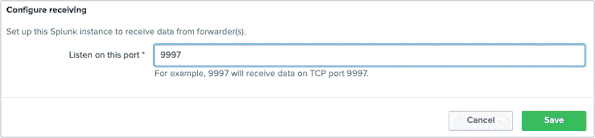
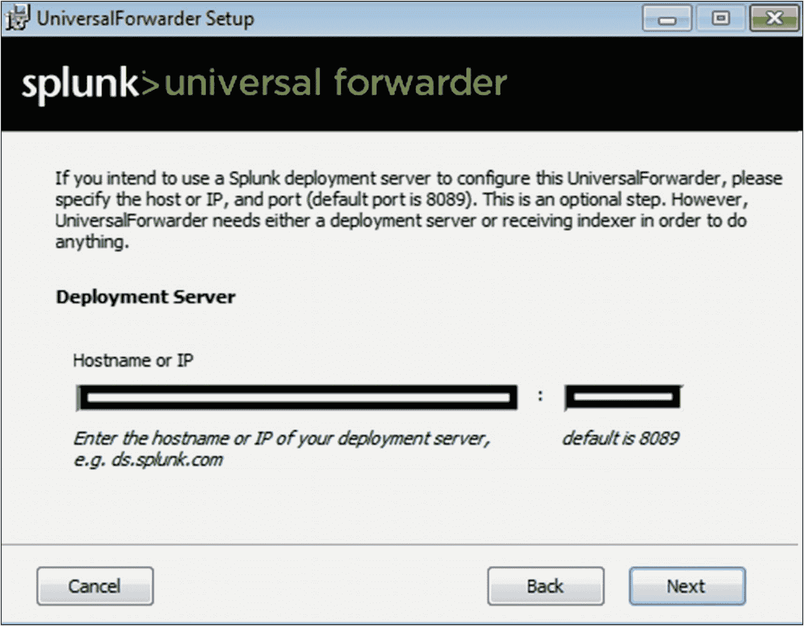
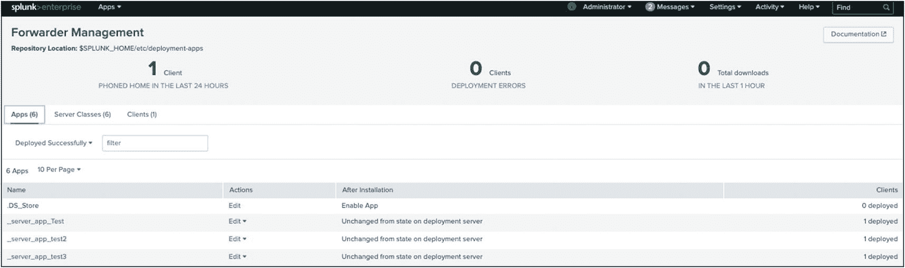
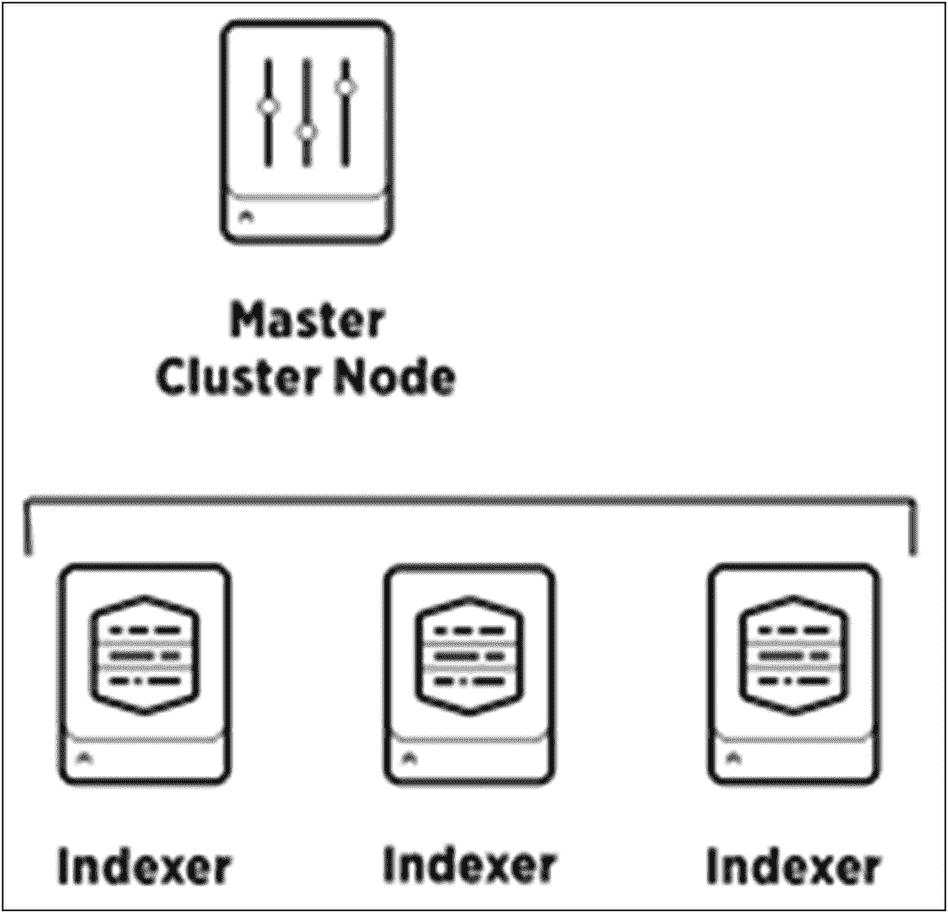
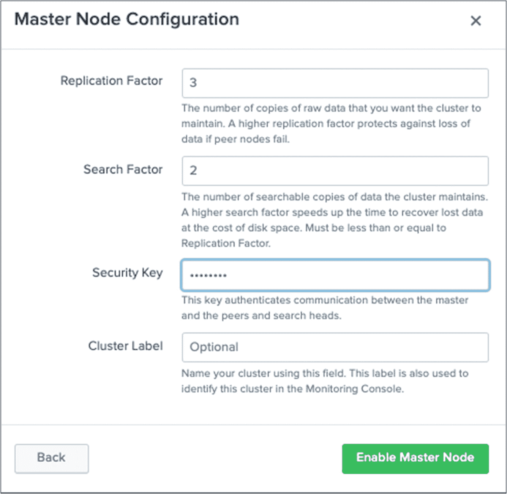
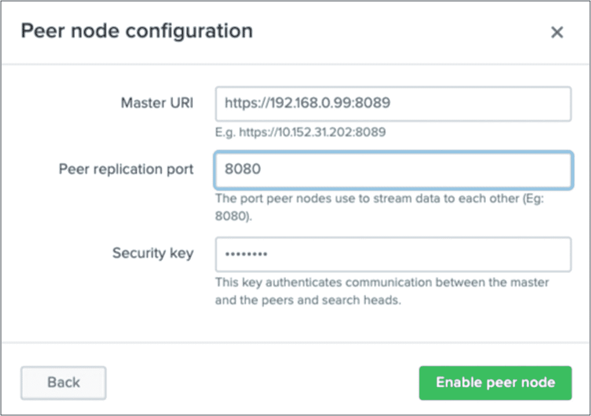
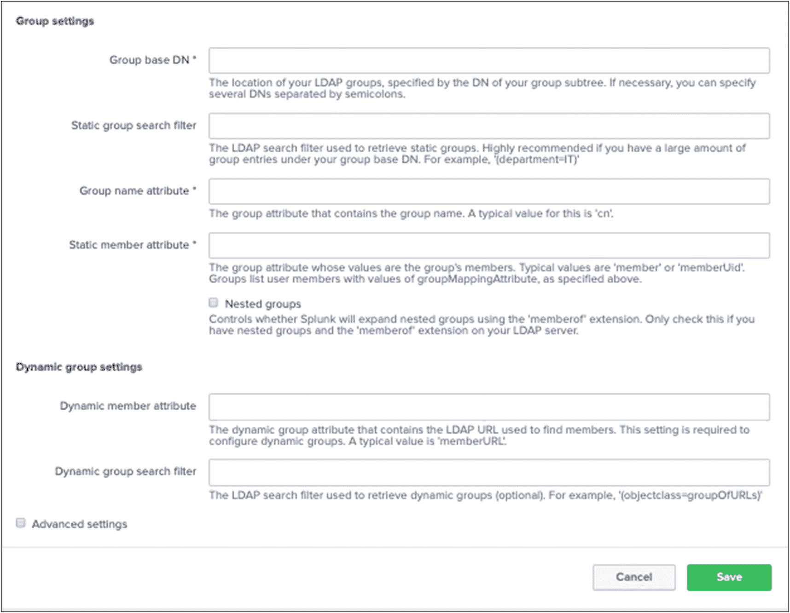
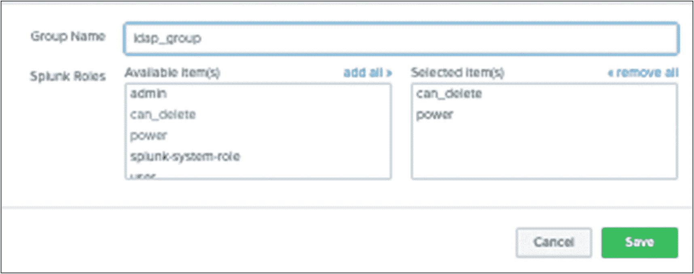
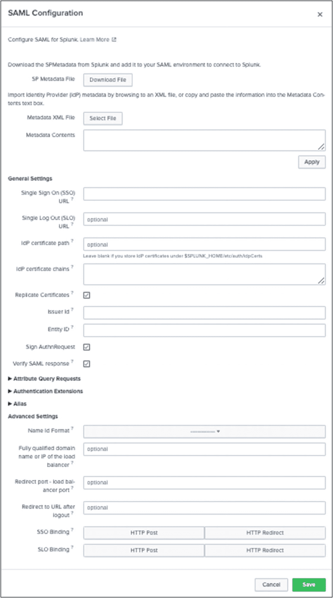
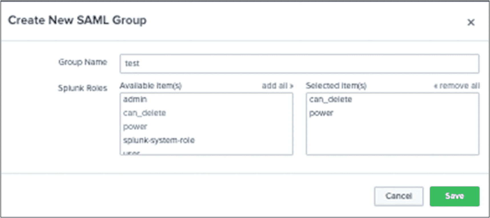

# 使用 Splunk Forwarder 和集群处理机器数据

当处理来自评分系统的大量数据时，数据收集对于功能的系统化流程变得至关重要。首先，本章讨论 Splunk forwarder 及其类型。其次，您还将了解如何将数据从 Splunk forwarder 解析到 Splunk 索引器，以展示机器数据的能力。第三，您将探索集群的过程，以便在数据收集过程中实施集群。最后，您将了解用于 Splunk 中身份验证和凭据管理的 LDAP 和 SAML。

本章涵盖以下主题。

- Splunk 通用转发器

- Splunk 轻型转发器和重型转发器

- 转发器管理

- Splunk 索引器集群

- Splunk 轻量级目录访问协议（LDAP）

- Splunk 安全断言标记语言（SAML）

## Splunk 通用转发器

Splunk 通用转发器使用最少的硬件资源从源收集数据并将其转发到 Splunk 索引器。它更轻量，因为它没有 Web 界面，但需要考虑安装成本。通用转发器仅包含将数据转发到企业版实例所必需的组件。通过编辑配置文件、编辑转发器管理器或通过 Splunk Enterprise 实例中的监控控制台进行管理。

### 配置 Splunk 索引器以接收来自通用转发器的数据

以下说明了通过 Splunk Web 将数据转发到 Splunk 索引器的过程。



*图 9-1 在索引器上配置监听*

1. 转到 Splunk 索引器实例的 Web 界面。

2. 转到`设置`并选择`转发和接收`。

3. 转到`配置接收`并`添加新`。

4. 在`侦听此端口`中输入`9997`。（您可以指定任何端口，但如果分配了其他端口，则需要在转发器实例的端口号块中输入该端口）。请参考图 9-1。

从 Windows 通用转发器发送日志时，支持任何操作系统的索引器平台。

请执行以下操作以使用 Splunk CLI 在索引器中启用端口侦听。

1. 在 Linux 中，转到 Splunk 索引器，并使用终端进入`$SPLUNK_HOME/bin`并运行`sudo ./splunk enable listen <端口号>`。

2. 在 Windows 中，转到 Splunk 索引器，并使用命令提示符进入`%SPLUNK_HOME%/bin`并运行`.\splunk enable listen <端口号>`。

现在让我们看看 Windows Splunk 转发器中使用的配置。

### 配置 Windows Splunk 转发器

有两种方法可以配置 Windows Splunk 通用转发器。

- 使用命令行

- 通过执行`.msi`文件

Windows 可以执行`.msi`文件，或者您可以使用命令行安装 Splunk 通用转发器。从[`www.splunk.com/en_us/download/universal-forwarder.html`](http://www.splunk.com/en_us/download/universal-forwarder.html)下载适用于 Windows 的 Splunk 通用转发器。

### 使用 Windows 的 Splunk 通用转发器

要使用命令行配置 Splunk 通用转发器，请参考以下步骤。

1. 转到命令提示符并进入`%SPLUNK_HOME%/bin`。

2. 要启动、停止和重启 Splunk，请键入`.\splunk start`、`.\splunk stop`和`.\splunk restart`。

3. 通过运行以下命令将数据转发到索引器。

`.\splunk add forward-server <主机名>:<端口>`

1. 转到`SPLUNK_HOME/etc/system/local/outputs.conf`检查通用转发器是否正在转发数据。输出如下所示。

```
[tcpout]
defaultGroup = default-autolb-group
[tcpout:default-autolb-group]
disabled = false
server = 179.10.###.###:9997
```

### 使用 .msi 的 Splunk 通用转发器

要使用`.msi`配置 Splunk 通用转发器，请从[`www.splunk.com/en_us/download/universal-forwarder.html`](http://www.splunk.com/en_us/download/universal-forwarder.html)下载 Splunk `.msi`文件。有关配置通用转发器的说明，请参考以下说明（参见图 9-2）。



*图 9-2 配置通用转发器到索引器*

1. 勾选接受许可协议的框，然后单击`下一步`。

2. 输入用户名和密码。

3. 输入部署服务器的主机名或 IP 以及端口。

现在让我们看看如何配置 Linux Splunk 转发器。

### 配置 Linux Splunk 转发器

Linux Splunk 转发器可以通过命令行工具、`.rpm`文件、`.tgz`文件或`.deb`文件下载。要通过`.rpm`包文件、`.tgz`包文件或`.deb`包文件安装 Splunk 通用转发器，请从[`www.splunk.com/en_us/download/universal-forwarder.html`](http://www.splunk.com/en_us/download/universal-forwarder.html)下载。

现在让我们通过 Linux 终端配置 Splunk 转发器。

1. 在终端中，进入`$SPLUNK_HOME/bin`。

2. 要启动、停止或重启 Splunk，请键入`./splunk start`、`./splunk stop`或`./splunk restart`。

3. 键入`sudo ./splunk start`来配置 Splunk 实例。

4. Splunk 询问您是否同意。键入"`y`"。（y = 是，n = 否）。

5. 输入管理员用户名为`admin`（或您想要的任何名称）。

6. 输入密码。

7. 重新输入并确认密码。

8. 键入以下命令以向索引器类型转发数据。

`./splunk add forward-server <主机名>:<端口>`

1. 转到`$SPLUNK_HOME/etc/system/local/outputs.conf`检查通用转发器是否正在转发数据。您应该会看到类似于以下的输出。

```
[tcpout]
defaultGroup = default-autolb-group
[tcpout:default-autolb-group]
disabled = false
server = 179.10.###.###:9997
```

接下来，让我们讨论两种类型的转发器。

- 轻量型转发器

- 重型转发器

## Splunk 的轻量型和重型转发器

您已经了解到转发器从源收集数据，将其转发到索引器，并使用不同的方法进行配置。现在您将了解两种类型的转发器：重型和轻型。

### Splunk 重量级转发器

重量级转发器的占用空间比 Splunk 索引器小。它能执行索引器的几乎所有工作，但分布式搜索除外。它在转发前解析数据，并根据事件来源或类型等标准路由数据。重量级转发器还能够在本地索引数据，并将其发送到另一个索引器。

#### 配置重量级转发器

要配置重量级转发器，请遵循以下步骤。


图 9-3 配置 Splunk 重量级转发器至索引器

1. 在你想要配置重量级转发器的机器上安装`Splunk Enterprise`。

2. 点击`设置`，进入`转发和接收`。

3. 选择`配置转发`，然后点击`新增`。

4. 输入部署服务器的主机名或 IP 以及端口（请在索引器上启用监听端口）。

5. 重启`Splunk`实例。

#### 配置重量级转发器以索引并转发来自通用转发器的数据

要配置重量级转发器以索引和转发数据，请遵循以下步骤。


图 9-4 在 Splunk 索引器上配置接收

1. 进入`Splunk Enterprise`实例的 Web 界面。

2. 点击 `设置`，进入 `转发和接收`。

3. 进入 `配置接收`，点击 `新建`。

4. 在 `监听此端口` 中，输入 `9997`。（你可以使用任何端口，但如果你分配了不同的端口，则需要在转发器实例的端口号模块中输入该端口。）请参考图 9-4。

重量级转发器是一种能够在转发前解析数据的 Splunk 转发器。

### Splunk 轻量级转发器

轻量级转发器已从 `Splunk Enterprise` 6.0 版本起弃用，并被通用转发器取代。因此，只能在 `Splunk Enterprise` 6.0 之前的版本上配置轻量级转发器。

要在 Splunk 轻量级转发器中转发和接收数据，需要同时配置接收端和转发端。

1. 安装一个完整的 `Splunk Enterprise` 实例。

2. 在该实例上启用转发。

当你将一个 Splunk 实例配置为轻量级转发器时，请选择转发器许可证。该许可证必须适用于低于 6.0 版本的 `Splunk Enterprise`。

现在，我们聚焦于转发器管理。

## 转发器管理

本节讨论转发器的管理及其配置。

Splunk 转发器管理提供了一个集中节点来管理整个 `Splunk` 域。转发器管理角色包括检查系统状态、监控部署活动以及配置和卸载环境中的应用。转发器管理提供了一个界面，用于创建服务器类，同时将客户端部署与应用程序部署进行映射。其主要目标是检查系统状态、监控部署活动，以及配置和卸载环境中的应用。它允许你修改服务器类并推送更新。简而言之，转发器管理提供了一个集中节点来管理整个 `Splunk` 域。

转发器管理中有三个主要标签页。

* `应用：` 此标签页显示已部署的应用列表并显示应用状态。你可以从转发器管理内部推送应用更新并编辑应用的属性。

* `服务器类：` 此标签页显示已部署的类列表并显示服务器类状态。你可以创建新的服务器类并编辑现有的服务器类。

* `客户端：` 此标签页显示已部署的客户端列表及其状态。你可以通过此标签页限制应用的视图。

转发器管理界面中的 `转发器` 类决定了客户端可以安装的应用。

在下一节中，你将了解可用于配置转发器管理的各种流程和平台。

### 配置转发器管理

以下步骤用于在 Splunk 环境中设置转发器管理。

转发器管理屏幕类似于图 9-5 所示。


图 9-5 配置转发器管理

1. 进入 `$SPLUNK_HOME$/etc/system/local/serverclass.conf`。如果此文件不存在，你需要创建 `serverclass.conf`。

2. 将以下代码复制到 `serverclass.conf` 中（提供的代码在你的 Splunk 实例中启用转发器管理）并重启你的实例。

3. 将 `Test` 应用添加到部署服务器文件夹。

4. 在 Splunk Web 中进入 `设置`，然后进入 `转发器管理`。

```
[global]
[serverClass:AllApps]
[serverClass:AllApps:app:*]
```

图 9-6 是已配置的转发器管理页面的截图。



图 9-6 转发器管理页面

### 配置转发器管理客户端

转发器管理客户端可以是通用转发器、索引器或搜索头。除了部署服务器（即转发器管理本身）之外，所有组件都是转发器管理的潜在客户端。

要配置转发器管理的客户端，请参考以下规则。

1. 使用 Linux 终端，进入 `$SPLUNK_HOME$/binsudo./splunk` 并设置 `deploy-poll` (IP 或主机名):(管理端口号)

2. 在 Windows 命令提示符中，进入 `%SPLUNK_HOME%/binsudo.\splunk` 并设置 `deploy-poll` (IP 或主机名):(管理端口号)

设置 `deploy-poll` 后，进入 `$SPLUNK_HOME$/etc/system/local/deploymentclient.conf`。你将看到类似如下的 `deploymentclient.conf`。

```
[target-broker:deploymentServer]
targetUri= 179.12.XXX.XXX:8089
```

至此，关于转发器及其各种元素的讨论到此结束。下一节将讨论索引器集群，这是数据实现的另一个重要方面。

## Splunk 索引器集群

在 `Splunk` 中，集群是指对等节点上每个存储桶的重复因子副本数量。`Splunk` 索引器集群由以某种方式配置的分组索引器组成，这种方式使索引器能够复制数据并维护其多个副本。它支持从一个索引器到下一个索引器的自动故障转移。因此，如果一个索引器宕机，传入 `Splunk` 的数据将通过另一个索引器进行索引，并保持可搜索性。

通过索引复制，你可以实现以下几点：

* 数据可用性

* 数据保真度

* 灾难容错

* 提升搜索性能

### 配置索引器集群

索引器集群是一组 `Splunk Enterprise` 索引器，它们复制数据以创建备份。它还通过其数据复制和搜索能力促进高可用性和灾难恢复。

`Splunk` 中基本的索引器集群架构包括两种类型的节点（见图 9-7）。

* `主节点` 管理集群。它跟踪位于对等节点（从节点）上的副本，并帮助搜索头查找数据。它还帮助维护从一个索引器到下一个索引器的自动故障转移。

* `对等节点` 接收并索引来自转发器的传入数据。对等节点可以索引其传入数据，同时存储来自其他节点的数据副本。



图 9-7 组成索引器集群架构

#### 使用 Splunk Web 创建索引器集群

要使用 Splunk Web 创建索引器集群，请参考以下步骤。

1. 在 Splunk Web 中，转到 `设置`。

2. 选择 `索引器集群` 并启用它。

此步骤用于区分主节点和对等节点的创建方式。

要创建主节点，请输入以下内容。

1. 输入复制因子。（更高的复制因子可在对等节点发生故障时防止数据丢失。）

2. 输入搜索因子。（更高的搜索因子可加快恢复丢失数据的速度，但会占用更多磁盘空间。）

3. 输入安全密钥。（此密钥用于验证主节点与对等节点之间的通信。）

4. 为集群命名。（此步骤为可选。）

图 9-8 展示了配置主节点的示例。



图 9-8 配置主节点：Splunk Web

填写完必要详细信息后，单击 `启用主节点` 来创建该节点。

要配置对等节点，请输入以下信息。

1. 输入主节点 URI（`IP:mgmt_port/主机名:mgmt_port`）。

2. 输入对等复制端口。（对等节点之间用于流式传输数据的端口。）

3. 输入安全密钥。（此密钥用于验证主节点与对等节点之间的通信。）

4. 单击 `启用对等节点`。

图 9-9 展示了配置对等节点的示例。



图 9-9 配置对等节点：Splunk Web

#### 使用 Splunk .conf 文件创建索引器集群

要从主节点的 `.conf` 文件配置 Splunk 索引器集群，索引器会创建或编辑 `$Splunk_Home$/etc/system/local` 目录下的 `indexer.conf` 文件。

以下代码块展示了使用 `.conf` 文件配置主节点的语法。

- `replication_factor` 可在对等节点发生故障时防止数据丢失。

- `search_factor` 可加快恢复丢失数据的速度，但会占用更多磁盘空间。

- `pass4SymmKey` 用于验证主节点与对等节点之间的通信。

- `cluster_label` 是集群的名称。

- 要配置对等节点，索引器会创建或编辑位于 `$Splunk_Home$/etc/system/local` 目录下的 `indexer.conf` 文件。

```
[clustering]
mode = master
replication_factor = 
search_factor = 
pass4SymmKey = 
cluster_label = 
```

以下代码块展示了使用 `.conf` 文件配置对等节点的语法。

- `master_uri` 是主节点的地址。

- `pass4SymmKey` 用于验证主节点与对等节点之间的通信。

```
[replication_port://]
[clustering]
master_uri = https://:,:
mode = slave
pass4SymmKey = 
```

## 使用 Splunk CLI 创建索引器集群

要使用 Splunk CLI 为主节点配置索引器集群，请参考以下步骤。

1. 使用 Windows CMD 或 Linux 终端，转到 `%SPLUNK_HOME%/bin`。

2. 要启动、停止和重启 Splunk，请分别输入 `.\splunk start`、`.\splunk stop` 和 `.\splunk restart`。

以下代码块展示了使用 Splunk CLI 配置主节点的语法。

```
splunk edit cluster-config -mode master -replication_factor  -search_factor  -secret  -cluster_label 
splunk restart
```

以下内容描述了对等节点的配置步骤。

1. 使用 Windows CMD 或 Linux 终端，转到 `%SPLUNK_HOME%/bin`。

2. 要启动、停止和重启 Splunk，请分别输入 `.\splunk start`、`.\splunk stop` 和 `.\splunk restart`。

以下代码块展示了使用 Splunk CLI 配置对等节点的语法。

```
splunk edit cluster-config -mode slave -master_uri https://:,: -replication_port  -secret  -cluster_label 
splunk restart
```

现在，让我们继续学习 Splunk LDAP，它负责监督 Splunk 域中的身份验证。

## Splunk 轻量级目录访问协议 (LDAP)

您已经学习了 Splunk 转发器、转发器管理和索引器集群。它们共同负责从数据源收集、分配和汇总数据。本节将讨论数据身份验证和凭据管理。

Splunk LDAP 在 Splunk Web 的身份验证中起着关键作用。它维护用户凭据（如用户 ID 和密码）以及信息（如主机名、绑定 DN 和用户基础 DN）。当您在 Splunk Web 中配置 LDAP 时，它会处理身份验证。

每次用户登录时，Splunk 都会重新检查 LDAP 服务器。

### 创建 LDAP 策略

要创建 LDAP 策略，请遵循以下步骤。

1. 在 Splunk 主页上单击 `设置`，然后转到 `身份验证方法`。

2. 单击 `配置 Splunk 以使用 LDAP`，然后转到 `新建 LDAP`。在 `新建 LDAP` 中，输入以下详细信息。

   1. LDAP 策略名称

   2. LDAP 服务器的主机名（确保 Splunk 服务器可以识别该主机名）

   3. Splunk Enterprise 用于连接 LDAP 服务器的端口，默认为端口 636（默认情况下，LDAP 服务器侦听 TCP 端口 389，LDAPS (带 SSL 的 LDAP) 侦听端口 636）

3. 检查是否启用了 SSL。此为可选步骤。

4. 提供绑定 DN。（它定义了管理员所在的域名。）

5. 输入并确认绑定用户的绑定 DN 密码。

6. 指定用户基础 DN（Splunk Enterprise 使用此属性来定位用户信息）。

以下是可能需要处理的其他信息。

- 用户基础过滤器（建议仅返回适用的用户；例如，`(department=IT, Management, Accounts, etc.)`。）

- 用户名

- 真实名称属性

- 邮件地址

- 组映射属性（组条目用于定义其成员的用户属性）

- 组基础 DN（LDAP 中用户组的位置）

- 要过滤静态组的对象类的静态组搜索过滤器

- 组名称属性（其值存储组名称的组条目属性）

- 静态成员属性（其值为组成员的组属性）

对于嵌套组，请选中 `嵌套组`。输入 `动态组搜索过滤器` 以检索动态组；如果存在，则输入 `动态成员属性`。

在 `高级设置` 中，您可以限制搜索请求时间、搜索请求大小限制以及网络套接字超时时间。

1. 单击 `保存` 并退出。

图 9-10 和 9-11 展示了 LDAP 策略创建过程。



**图 9-11** 创建 LDAP 策略


**图 9-10** 创建 LDAP 策略

### 将 LDAP 组映射到 Splunk 角色

Splunk Enterprise 通过 LDAP 服务器进行身份验证并映射各种角色。

要将 LDAP 组映射到 Splunk 角色，请遵循以下说明。



**图 9-12** 映射 LDAP 策略：Splunk 角色

1. 选择 `LDAP`。

2. 配置 Splunk 以连接 LDAP 并映射组。

3. 在特定策略的“操作”列中选择 `映射组`。

4. 单击 `组名称`。

5. 将角色映射到组，然后单击箭头将角色移动到 `可用角色` 列表中。这将把该组移动到 `已选角色` 列表中，有助于将多个角色映射到该组（见图 9-12）。

6. 单击 `保存`。

以上总结了 Splunk LDAP 的分析、创建、映射及其在 Splunk 域中的重要性。接下来，我们将学习 Splunk SAML。

## Splunk 安全断言标记语言（SAML）

Splunk SAML（安全断言标记语言）是一个身份提供者（IdP），负责维护用户凭证并处理身份验证。当你配置 Splunk 实例使用 SAML 认证系统时，你可以在 IdP 上授权群组，并通过将它们映射到 Splunk 用户角色来启用其登录。然而，SAML 不支持身份验证。

Splunk SAML 和 LDAP 也可以使用位于 `$SPLUNK_HOME/etc/system/local` 的 `authentication.conf` 进行配置。

### 配置 Splunk SAML

要配置 Splunk SAML，请参考以下步骤。

1.  点击 `设置`，然后转到 `认证方法`。

2.  点击 `配置 Splunk 使用 SAML` 并创建一个新的 SAML。

3.  直接复制元数据文件。

4.  在 `常规设置` 中，提供以下数据。

    *   单点登录 URL（输入复制的元数据文件时自动填充）

    *   IdP 证书路径（可以是目录或文件）。

    *   实体 ID（实体的身份标识）

5.  选择 `签署认证请求`。

6.  选择 `签署 SAML 响应`。

7.  如果你使用 PingIdentity 作为 IdP，请指定属性查询 URL、签名属性查询请求和签名属性查询响应。

8.  在 `高级设置` 中，配置属性别名角色、属性别名角色名称和属性别名邮件等信息。

9.  点击 `保存`。

图 9-13 说明了 Splunk SAML 配置的过程。



**图 9-13** 配置 SAML

让我们来看看 SAML 映射。

### 将 SAML 映射到用户角色

要将 SAML 映射到 Splunk 角色，请参考以下说明。

1.  前往 `访问控制`，选择 `认证方法`。

2.  选择 `SAML`，然后转到 `配置 Splunk 使用 SAML 并映射群组`。

3.  在 `SAML 群组` 页面上，点击 `新建群组`，或点击 `编辑` 修改现有群组。

4.  为该群组提供一个名称。

5.  通过将所需角色从左侧列移动到右侧列，确定要分配给此群组的角色。

6.  点击 `保存`。

图 9-14 是 SAML 映射方法的图示。



**图 9-14** 映射 SAML：Splunk 角色

以上概括了 Splunk SAML 的工作原理。

至此，你已经完成了本章的学习。你应该为自己成功学习了 Splunk 数据管理而感到自豪。当需要分类或简化数据时，本章内容显得尤为重要，并能让你在 Splunk 管理方面更进一步。

## 总结

本章涵盖了 Splunk 通用转发器、重型与轻型转发器、Splunk 索引器集群及其配置、Splunk LDAP 以及 Splunk SAML。这些主题管理着 Splunk 环境中数据的收集、整理和认证。数据收集通常包括远程源和大型处理。实例转发器和索引器集群确保所有数据被分配到正确的存储桶并分类到正确的节点。Splunk LDAP 和 SAML 确保数据输入得到认证，用户凭证得到授权。你通过逐步讨论学习了实现、配置和角色映射。

下一章将讨论如何使用监视器输入和网络输入获取数据、使用脚本化输入和 Windows 输入提取数据、使用无代理输入拉取数据，以及使用微调输入进行数据清理。

练习本章所学内容，并通过以下问题测试你的知识。

## 选择题

1.  如何在 Splunk 中配置 Splunk 索引？（请选择所有适用项。）

    1.  转发器管理

    2.  `Splunk CLI`

    3.  `indexes.conf`

    4.  `Splunk Web`

2.  Splunk Enterprise 原生支持哪些认证方法？（请选择所有适用项。）

    1.  `ADFS`

    2.  `LDAP`

    3.  `SAML`

    4.  `RADIUS`

3.  以下哪些陈述描述了部署管理？

    1.  需要企业许可证

    2.  负责将应用发送到转发器

    3.  一旦使用，是管理转发器的唯一方法

    4.  自动重启运行转发器的主机操作系统

4.  Splunk 多久重新检查一次 `LDAP` 服务器？

    1.  每 5 分钟

    2.  每次用户登录时

    3.  每次 Splunk 重启时

    4.  根据 `LDAP_refresh` 设置而变化

5.  以下哪种认证类型需要在 Splunk 中使用脚本？

    1.  `ADFS`

    2.  `LDAP`

    3.  `SAML`

    4.  `RADIUS`

6.  哪个 Splunk 组件需要转发器许可证？

    1.  搜索头

    2.  重型转发器

    3.  最重型转发器

    4.  通用转发器

7.  从 Windows 通用转发器发送日志时，支持哪个 Splunk 索引器操作系统平台？

    1.  任何操作系统平台

    2.  仅限 Linux 平台

    3.  仅限 MAC OS 平台

    4.  以上都不是

8.  哪种转发器类型可以在转发前解析数据？

    1.  通用转发器

    2.  最重型转发器

    3.  轻型转发器

    4.  重型转发器

## 答案

1.  4

2.  1

3.  2

4.  4

5.  2

6.  2

7.  2, 3

8.  2, 3, 4