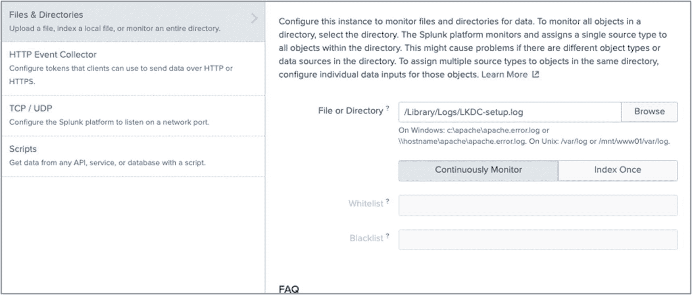
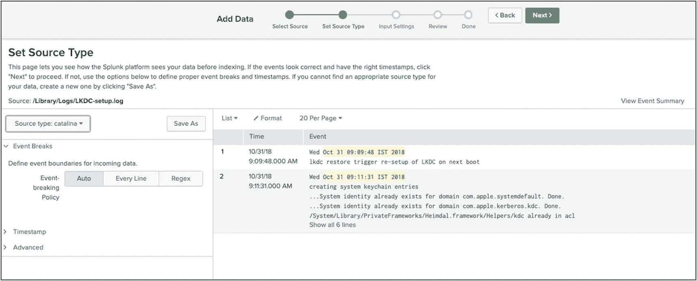
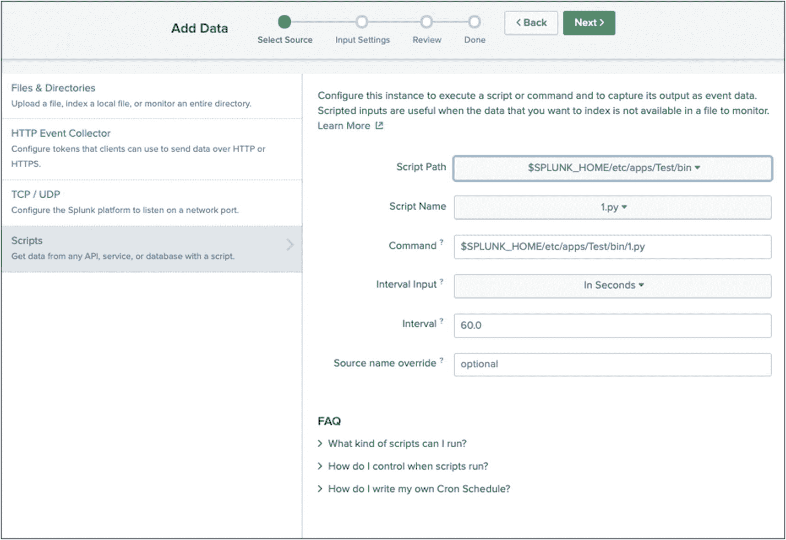
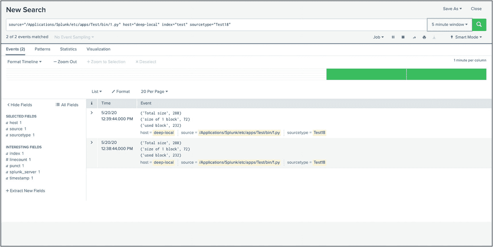
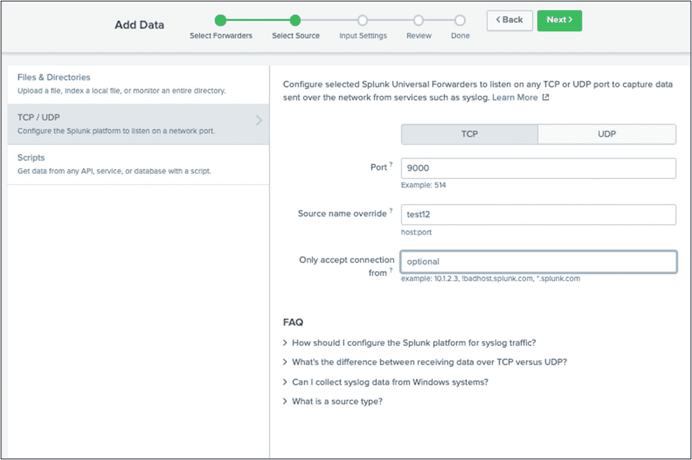
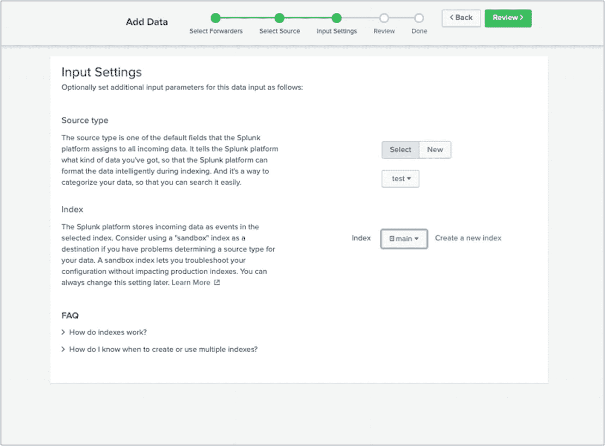
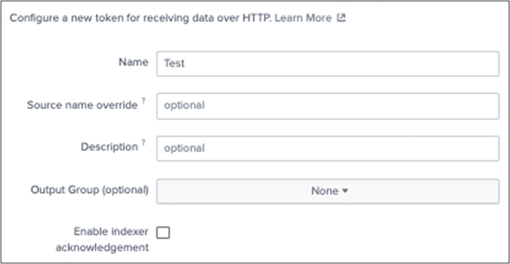
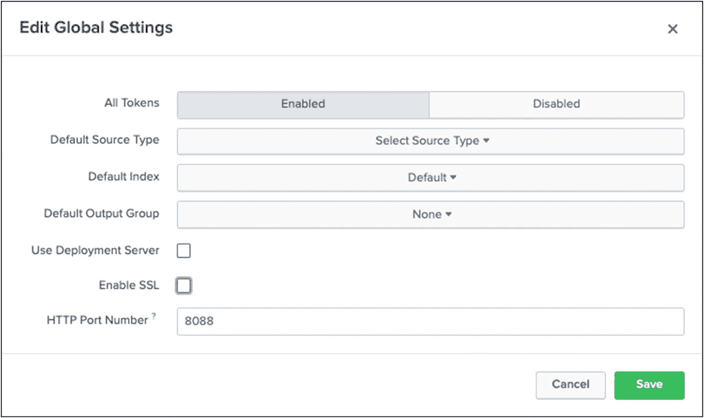
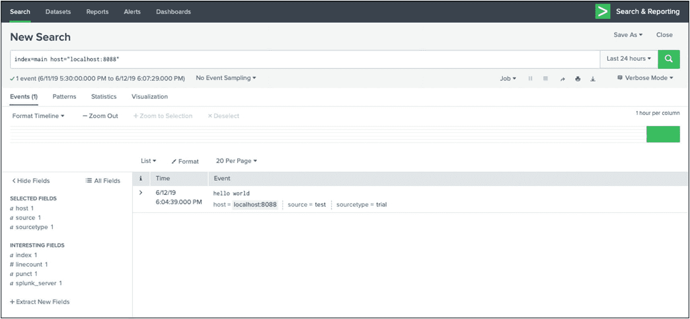

# 10. Splunk 中的高级数据输入

本章深入探讨转发器和输入。你将探索如何通过监视器输入、网络输入、脚本化输入和无代理输入获取数据。

本章涵盖以下主题：

*   其他转发选项
*   使用监视器输入获取数据
*   脚本化输入
*   网络输入
*   使用无代理输入拉取数据

在第一部分中，你将分析其他转发选项。通过这些选项，你可以在将数据发送到 Splunk 索引器之前压缩数据馈送，并确认已索引的数据以防止数据丢失。这些额外的转发选项确保数据馈送的安全，从而让你在 Splunk 中维护数据的完整性。

*   **压缩数据馈送：** 在 Splunk 中压缩数据馈送可以通过编辑转发环境中的 `outputs.conf` 和接收端的 `inputs.conf` 来完成。如果你不压缩数据馈送，转发环境会直接发送原始事件。然而，此选项会在传输前压缩原始事件。
*   **索引器确认：** Splunk 中的索引器确认通过编辑转发环境中的 `outputs.conf` 和接收端的 `inputs.conf` 来完成。使用索引器确认，转发器会重新发送任何未被索引器确认接收的数据。
*   **保护馈送安全：** 在 Splunk 中保护馈送安全（SSL）通过 `outputs.conf` 和 `server.conf` 来完成。要在接收端添加 SSL，你可以编辑 `inputs.conf`。一旦你使用默认 SSL 证书或你自己的 SSL 保护了馈送安全，你就可以维护数据的完整性。此外，由于数据会自动压缩，因此无需手动压缩。
*   **转发环境队列大小：** Splunk 中的队列大小通过 `.conf` 的最大队列大小进行修改，其值为 500 KB。这是当转发器无法连接到服务器时，其可以容纳的最大数据量。

接下来，我们讨论它们的命令和语法。

## 压缩数据馈送

Splunk 会压缩来自转发环境的原始数据，并将其发送到接收端。在接收端，你需要解压数据馈送以获取原始数据，这也会增加 CPU 使用率。`compressed=true` 允许转发环境在向接收端发送数据之前先对数据进行压缩。

要在转发环境中压缩数据馈送，请编辑 `outputs.conf`，如下方代码块所示。

```
[tcpout:splunk_indexer]
server=:/:
compressed=true
```

要在接收端压缩数据馈送，请使用以下代码块命令编辑 `inputs.conf`。

```
[splunktcp:]
compressed=true
```

至此，你已经完成了有关额外转发选项和原始数据压缩语法内容的学习。接下来，我们来讨论索引器确认。

## 索引器确认

索引器确认有助于防止在转发环境向接收端转发数据时发生数据丢失。如果 Splunk 索引器未确认数据，转发环境会重新发送数据。在转发器中启用索引器确认时，应将等待队列修改为 3 倍，以满足更大的空间需求。

要允许索引器确认转发环境，请编辑 `outputs.conf`，如下方代码块所示。

```
[tcpout:splunk_indexer]
server=:/:
useACK=true
```

要允许索引器确认转发环境，请编辑 `inputs.conf`，如下方代码块所示。

```
[splunktcp:]
useACK=true
```

当你使用 `Ack=true` 时，在 Splunk 中，管理索引器确认的等待队列默认最大大小为 21 MB，因此索引器中的输出队列应为 7 MB，因为等待队列是输出队列的 3 倍。

## 保护馈送安全

保护馈送安全（使用 SSL 证书）非常重要，这样任何人都无法轻易向索引器发送数据或操纵事件。要在接收端添加 SSL，你需要编辑 `inputs.conf`；要在发送端添加 SSL，则需要编辑 `outputs.conf` 和 `server.conf`。使用 SSL 保护馈送会增加 CPU 使用率，并自动压缩数据馈送。

要在转发环境中保护馈送安全，请编辑 `outputs.conf`，如下方代码块所示。

```
[tcpout:splunk_indexer]
server=:/:
sslPassword=
clientCert=
sslVerifyServerCert=false
```

要在 Linux 系统的转发环境中保护馈送安全，请编辑 `server.conf`，如下方代码块所示。

```
[sslConfig]
sslRootCAPath=
```

要在 Windows 系统的转发环境中保护馈送安全，请如下编辑 `server.conf`。（仅适用于 Windows）

```
caCertFile = 
caPath = 
```

要在接收环境中保护馈送安全，请如下编辑 `inputs.conf`。

```
[splunktcp:]
[ssl]
sslPassword=
serverCert=
requireClientCert=false
```

要在接收环境中保护馈送安全，请如下编辑 `server.conf`（不在 Windows 系统中）。

```
[sslConfig]
sslRootCAPath=
```

接下来，我们讨论一下队列大小。

## 队列大小

在 Splunk 转发环境中，队列大小用于管理索引器确认。你不能直接配置等待队列的大小；只能在 `outputs.conf` 中配置输出队列的大小。默认情况下，如果 `useACK =false`，最大队列大小为 500 KB；如果 `useACK=true`，最大输出队列大小为 7 MB，等待队列为 21 MB。建议将 `maxQueueSize` 属性设置为 `auto`，因为它会根据索引器确认是否启用来优化队列大小。

要在转发环境中将队列大小设置为 `auto`，请编辑 `outputs.conf`，如下方代码块所示。

```
[tcpout:splunk_indexer]
server=:/:
maxQueueSize=auto
```

## 监控输入

监控输入是一种监视文件、目录、脚本输出或网络端口以获取新数据的操作。它还可以从文件和目录中添加数据。你可以在 `inputs.conf` 中使用两种通配符来监控文件/目录。表 10-1 对它们进行了说明。

**表 10-1** 用于监控输入的通配符

| 通配符 | 描述 |
| --- | --- |
| `...` | 省略号通配符会递归遍历目录和子目录，直到找到匹配项。 |
| * | 星号通配符匹配特定目录路径中的任意文件/目录。 |

### 监控文件

监控输入将特定文件定义为数据源；它会对数据源执行以下任务。

- 插入文件的当前数据。
- 持续监控文件以获取新内容。
- Splunk 会跟踪文件状态，即使在重启 Splunk 实例后也是如此。它会自动定位到 Splunk 实例停止跟踪文件的位置。

Splunk 中的文件监控支持以下数据类型。

- 纯文本数据文件
- 结构化文本文件
- 多行日志
- 读取压缩文件的能力

### 监控目录

监控输入将特定目录定义为数据源。监控输入会对数据源执行以下任务。

- Splunk 会递归遍历目录结构
- 目录中的所有类型的文件都会被纳入监控范围

在监控输入中，你可以使用黑名单和白名单来监控文件和目录。

- **白名单**：一种过滤规则，用于包含集合中的一个或多个成员。你可以使用白名单规则来告诉转发器在监控目录时需要处理哪些文件。你可以在 `inputs.conf` 中定义白名单。
- **黑名单**：一种过滤规则，用于排除集合中的一个或多个成员。你可以使用黑名单规则来告诉转发器在监控目录时不应处理哪些文件。你可以在 `inputs.conf` 中定义黑名单。

监控文件支持 CSV、XML 和 JSON 格式。

### 使用 Splunk Web 监控文件和目录

要使用 Splunk Web 监控文件和目录，请参考以下说明。在本节中，你将监控客户端希望持续监控的 `KDC-setup.log` 文件。



**图 10-1** 监控：KDC-Setup.log

1. 转到“设置”，然后转到“添加数据”。
2. 转到“监控”，然后选择“文件和目录”。
3. 单击“浏览”。导航到文件。选择该文件。请参考图 10-1。（我选择了要监控的 `KDC-Setup.log` 文件。）



**图 10-2** 源类型 catalina：KDC-setup.log

4. 根据你的需求，单击“持续监控”或“索引一次”。我选择了“持续监控”选项。
5. 单击“下一步”进入“设置源类型”页面（根据你的数据选择源类型）。请参考图 10-2。
6. 单击“下一步”进入“输入设置”页面。选择应用：测试。
7. 在“索引数据类型”字段中，确认已选择默认事件索引，然后单击“保存”。

8. 返回“输入设置”页面，索引值处应显示“测试”。

9. 单击“提交”。

## 使用 `inputs.conf` 监控文件和目录

你可以直接使用 `inputs.conf` 在 Splunk 中监控文件或目录。

通过编写 `inputs.conf`，你可以直接监控文件。请参考以下步骤配置 `inputs.conf` 以监控 Splunk 中的文件。

1. 使用终端，进入 `$SPLUNK_HOME$/etc/system/local/inputs.conf`。（如果该文件不存在，请创建一个名为 `inputs.conf` 的新文件。）
2. 编辑 `inputs.conf`。在 `inputs.conf` 中添加一个配置节（stanza）。
3. 选择添加源（在配置节标题中的 `monitor://` 之后）。该路径即为文件路径。
4. 选择所有属性（`source type`、`host`、`index`、`blacklist`、`whitelist` 为可选属性，但可添加到 `inputs.conf` 中）。

请参考表 10-2 了解各属性的说明。

**表 10-2** 监控文件：`inputs.conf`

| 属性 | 值 |
| --- | --- |
| `disabled=<true&#124;false>` | 当 `disabled=true` 时，输入脚本不会运行；当 `disabled=false` 时，输入脚本会被调用。 |
| `Whitelist` | 一种过滤规则，用于从集合中包含一个或多个成员。你使用 `whitelist` 规则来告诉转发器在监控目录时处理哪些文件。 |
| `Blacklist` | 一种过滤规则，用于从集合中排除一个或多个成员。你使用 `Blacklist` 规则来告诉转发器在监控目录时不处理哪些文件。 |
| `host=<hostname>` | Splunk Enterprise 在解析和索引过程中使用主机名。主机名用于搜索。 |
| `index=<Index name>` | Splunk Enterprise 设置一个索引来保存事件。 |
| `Sourcetype=<sourcetype name>` | Splunk Enterprise 中的源类型用于在解析和索引期间格式化数据。 |
| `source=<sourcename>` | Splunk Enterprise 中的源名称是数据来源的输入文件路径。 |

例如，如果客户想要持续监控 `KDC-setup.log` 文件，你可以直接使用 `inputs.conf` 编写一个配置节。（请参考以下解决方案。）

1. 进入 `$SPLUNK_HOME/etc/apps/Test/local/inputs.conf`。按如下所示创建配置节。
2. 保存更改。
3. 重启 Splunk 实例。

```
[monitor:///Library/Logs/KDC-setup.log]
disabled=false
sourcetype=Test18
```

接下来，我们将讨论脚本化输入。

## 脚本化输入

Splunk 脚本化输入可以从脚本中接收数据。你可以使用脚本化输入来从第三方应用、应用程序接口（API）、远程数据接口等处获取数据到 Splunk Enterprise。脚本化输入将数据导入 Splunk Enterprise。可以通过 Splunk Web 或编辑 `inputs.conf` 将脚本化输入添加到 Splunk 实例中。当你配置 Splunk 环境以运行脚本化输入时，它会清除任何可能影响脚本运行的环境变量。

Splunk 从 `$SPLUNK_HOME/etc/apps/<app_name>/bin`、`$SPLUNK_HOME/bin/scripts` 或 `$SPLUNK_HOME/etc/system/bin` 目录执行脚本。

### 使用 Splunk Web 进行脚本化输入

在脚本化输入中，你编写一个脚本，每 60 秒获取一次 RAM 总大小、单个 RAM 块的大小、已用块总数以及时间间隔。每 60 秒后，使用脚本化输入的本地实例会将数据发送到 Splunk 实例。以下是 Python 参考代码。



**图 10-3** 添加脚本：`1.py`

1. 进入“设置”并点击“添加数据”。
2. 进入“监控”并选择“脚本”。
3. 选择你脚本所在的脚本路径。（通常将脚本放置在应用的 `bin` 文件夹中。）
4. 从下拉列表中选择脚本。
5. 在时间间隔中，选择“秒”或“cron 计划”中的任意一种方式。
6. 根据你选择的是“秒”还是“cron 计划”来提供参数。请参考图 10-3。

```python
import sys
print("Total size",sys.getsizeof({}))
print("size of 1 block",sys.getsizeof([]) )
print("used block",sys.getsizeof(set()) )
```



**图 10-4** 脚本化输入：`1.py`

1. 点击“下一步”。
2. 在“输入设置”页面中。
    1. 根据你的数据选择源类型。你也可以创建一个新的源类型。（源类型是 Splunk 平台分配给所有传入数据的默认字段之一。它告诉 Splunk 平台你拥有的数据类型，以便平台能够在索引期间智能地格式化数据。）
    2. 在“应用”中，选择测试应用。
    3. 在“源类型”中，选择 `Test18`。
    4. 在“索引”中，选择名为 `Test` 的索引。
    5. 点击“下一步”。
    6. 点击“审查”。
    7. 点击“完成”。（请参考图 10-4。）

### 使用 `inputs.conf` 文件进行脚本化输入

让我们使用 `inputs.conf` 文件添加脚本化输入。脚本化输入所需的脚本可以位于以下任意位置。

- `$SPLUNK_HOME/etc/bin`
- `$SPLUNK_HOME/etc/apps/<your_apps>/bin`
- `SPLUNK_HOME/bin/scripts`

你可以通过修改 `inputs.conf` 直接在 Splunk 中引入脚本化输入。修改 `inputs.conf` 的各种参数如表 10-3 所示。

**表 10-3** 脚本化输入：`inputs.conf`

| 属性 | 值 |
| --- | --- |
| `disabled=<true&#124;false>` | 当 `disabled=true` 时，输入脚本不会运行；当 `disabled=false` 时，输入脚本会被调用。 |
| `interval=<number>&#124;cron schedule` | 你可以指定时间间隔。设置 `interval=<value>`。在该间隔之后，输入脚本会再次运行。设置 `interval=<cron>`。当你指定 cron 计划时，脚本不会在启动时执行，而是在 cron 计划定义的时间执行。 |
| `host=<hostname>` | Splunk Enterprise 在解析和索引过程中使用主机名。主机名在搜索时使用。 |
| `index=<Index name>` | Splunk Enterprise 设置一个索引，它应该在该位置保存事件。 |
| `Sourcetype=<sourcetype name>` | Splunk Enterprise 中的源类型用于在解析和索引数据期间格式化数据。 |
| `source=<sourcename>` | Splunk Enterprise 中的源名称是数据来源的输入文件路径。 |

在脚本化输入中，你编写一个脚本，每 60 秒获取一次 RAM 总大小、单个 RAM 块的大小、已用块总数以及时间间隔。每 60 秒后，使用脚本化输入的本地实例会将数据发送到 Splunk 实例。你在 `inputs.conf` 中编写一个脚本配置节来监控脚本化输入。

1. 将 `1.py` 代码复制到测试应用的 `bin` 文件夹中。
2. 进入 `$SPLUNK_HOME/etc/apps/Test/local/inputs.conf`。按如下所示创建配置节。
3. 保存更改。重启 Splunk 实例。

```
[script://$SPLUNK_HOME/etc/apps/Test/bin/1.py]
disabled=false
sourcetype=Test18
interval=60
index=Test
```

完成脚本化输入后，现在进入下一部分——网络输入。

## 网络输入

# Splunk Enterprise 网络输入配置

Splunk Enterprise 可以接受任何 TCP（传输控制协议）或 UDP（用户数据报协议）端口上的输入。Splunk 可以消费这些端口上的任何数据。`syslog` 是基于网络的数据的一个很好例子。TCP 是 Splunk 中发送数据的推荐协议，但 UDP 用于监控数据。Splunk 中的网络输入可以监控本地机器上的网络端口，或者您可以使用转发器从另一台机器接收网络数据。

对于 TCP 输入，您需要指定端口应接受来自所有主机的连接还是特定主机的连接。主机值可以是 IP、DNS 或自定义（用户定义的标签）。要在 Splunk 中设置网络输入，需要指定网络协议和端口号。

## 使用 Splunk Web 添加网络输入并将其部署到转发器

以下说明如何在 `Splunk` 中添加网络输入。



**图 10-5** TCP 网络输入监听端口：`9000`

1.  在 `Splunk` 索引器中，单击**设置**，转到**添加数据**，然后单击**转发**。
2.  在**选择转发器**中，配置表单并提供信息。创建一个服务器类，提供主机名，并提供合适的服务器类。
3.  在**选择源**中，单击 **TCP/UDP** 并进行配置。提供您希望监听数据的端口。提供一个源名称，您可以配置为接受来自特定转发器的数据。请参考图 10-5 获取帮助。



**图 10-6** 网络输入：高级输入设置

4.  对于高级输入设置，配置表单并提供源类型和索引名称。请参考图 10-6 获取帮助。

## 使用 `.conf` 文件修改网络输入

您可以使用 `.conf` 文件修改网络输入。您可以使用 `.conf` 文件更改索引值、源值等。

### 使用 `.conf` 文件配置 TCP 网络输入

要配置 TCP 网络输入，请转到 `$SPLUNK_HOME/etc/system/local/inputs.conf`。在 `inputs.conf` 节（stanza）`[tcp://<主机或 IP>:<端口>]` 中，有多种参数可供配置（见表 10-4）。

**表 10-4** TCP 网络输入：`inputs.conf`

| 属性 | 值 |
| --- | --- |
| `host=<主机名>` | `Splunk Enterprise` 在解析和索引期间使用主机名。主机名用于搜索。 |
| `index=<索引名称>` | `Splunk Enterprise` 设置一个索引，用于保存事件。 |
| `Sourcetype=<源类型名称>` | `Splunk Enterprise` 中的源类型用于在数据解析和索引期间对数据进行格式化。 |
| `source=<源名称>` | `Splunk Enterprise` 中的源名称是数据来源的输入文件路径。 |
| `queue = parsingQueue \| indexQueue` | `Queue` 指定输入处理器应将读取的事件存入何处。 |
| `connection_host=ip\|dns` | `Splunk Enterprise` 中的 `Ip` 将主机设置为 Splunk 服务器的 IP 地址。`Splunk Enterprise` 中的 `DNS` 将主机设置为 Splunk 服务器的 DNS 条目。 |

如果客户端希望监听传输控制协议（TCP）端口 `514` 上的所有系统日志，您可以在 `inputs.conf` 中编写一个 TCP 节（stanza）。请参考以下示例。

1.  转到 `$SPLUNK_HOME/etc/apps/Test/local/inputs.conf`。创建如下节（stanza）。
2.  保存更改。
3.  重启 `Splunk` 实例。

```
[tcp://514]
connection_host=dns
sourcetype=Test18
index=Test
```

### 使用 `.conf` 文件配置网络 UDP 输入

要配置 UDP 网络输入，请转到 `$SPLUNK_HOME/etc/system/local/inputs.conf`。在 `inputs.conf` 节（stanza）`[udp://<主机或 IP>:<端口>]` 中，有多种参数可供配置（见表 10-5）。

**表 10-5** UDP 网络输入：`inputs.conf`

| 属性 | 值 |
| --- | --- |
| `host=<主机名>` | `Splunk Enterprise` 在解析和索引期间使用主机名。主机名用于搜索。 |
| `index=<索引名称>` | `Splunk Enterprise` 设置一个索引，用于保存事件。 |
| `Sourcetype=<源类型名称>` | `Splunk Enterprise` 中的源类型用于在数据解析和索引期间对数据进行格式化。 |
| `source=<源名称>` | `Splunk Enterprise` 中的源名称是数据来源的输入文件路径。 |
| `queue = parsingQueue \| indexQueue` | `Queue` 指定输入处理器应将读取的事件存入何处。 |
| `_rcvbuf=<值>` | `Splunk Enterprise` 中的 `_rcvbuf` 设置 UDP 的接收缓冲区。 |
| `no_priority_stripping = true \| false` | `no_priority_stripping` 设置 `Splunk Enterprise` 如何处理接收 Syslog 数据。 |
| `no_appending_timestamp = true \| false` | `no_appending_timestamp` 设置 `Splunk Enterprise` 如何将时间戳和主机应用于事件。 |

如果客户端希望监听用户数据报协议（UDP）端口 `9514` 上的所有应用性能监控（APM）日志，您可以在 `inputs.conf` 中编写一个 UDP 节（stanza）。请参考以下示例。

1.  转到 `$SPLUNK_HOME/etc/apps/Test/local/inputs.conf`。创建如下节（stanza）。
2.  保存更改。
3.  重启 `Splunk` 实例。

```
[udp://9514]
connection_host=ip
sourcetype=Test18
index=Test
```

接下来，我们讨论使用无代理输入拉取数据。

## 使用无代理输入拉取数据

HTTP 事件收集器 (HEC) 是一种基于令牌的 HTTP 输入，安全且可扩展。HEC 允许您使用 HTTP 和安全 HTTP (HTTPS) 协议将数据和应用程序事件发送到 `Splunk Enterprise` 实例。HEC 使用基于令牌的身份验证模型。基于代理的 HTTP 输入更安全、更具可扩展性，并且无需使用转发器。

### 使用 Splunk Web 进行 HTTP 输入

在本节中，您将创建一个 HTTP 事件，配置 HEC，并使用配置文件修改节（stanza）。然后，您将使用 HEC 令牌将数据从本地实例解析到 `Splunk Enterprise` 实例。

要使用 Splunk Web 获取 HTTP 输入，请参考以下步骤。



**图 10-7** 配置 HTTP 输入：Test

1.  转到**设置** ➤ **数据输入**。转到 **HTTP 事件收集器**并单击**新令牌**。
2.  输入名称 `Test`。
3.  输入源名称和描述（可选）。如果您希望为此令牌启用索引器确认，请不要单击**启用索引器确认**复选框（在本练习中）。
4.  单击**下一步**（见图 10-7）。


**图 10-8** HTTP 事件：高级输入设置

5.  （可选）为 HEC 事件选择源类型和索引 (`test`)。
6.  单击**审查**（见图 10-8）。

### 在 Splunk 中配置 HTTP 事件收集器

在 `Splunk` 中使用 HTTP 事件收集器之前，您需要在 Splunk Web 的全局设置中启用它。您还需要配置防火墙和网络设置。要配置 HEC 以在 Splunk Web 中接收事件，请参考以下说明。



## 图 10-9 HTTP 事件收集器：已启用

1.  单击`设置`并转到`数据输入`。
2.  单击`HTTP 事件收集器`。
3.  单击`全局设置`。
4.  在`所有令牌`中，将其切换为`启用`。
5.  选择`源类型`、`索引`和`输出组`（可选）。
6.  要使用部署服务器处理 HEC 令牌的配置，请单击`使用部署服务器`复选框。
7.  要让 HEC 监听并通过 HTTPS（而非 HTTP）进行通信，请单击`启用 SSL 复选框`。（对于本练习，请勿启用它。）
8.  输入 HTTP 端口号（您想要的任何端口号）以使其监听 HTTP 事件。
9.  单击`保存`（见图 10-9）。

### 使用 `.conf` 文件配置 HTTP 输入

要使用`.conf`文件配置 HTTP 输入，请导航至`$SPLUNK_HOME/etc/apps/splunk_httpinput/local/inputs.conf`。在`inputs.conf`文件中，创建一个节`[http]`。在该节中，包含多个参数（参见表 10-6）。

**表 10-6** 配置 HTTP 输入：`inputs.conf`

| 属性 | 值 |
| --- | --- |
| `disabled=<0&#124;1>` | 当`disabled=<0>`时，启用 HTTP 输入；当`disabled=<1>`时，禁用 HTTP 输入。 |
| `host=<主机名>` | Splunk Enterprise 在解析和索引期间使用主机名。主机名用于搜索。 |
| `index=<索引名称>` | Splunk Enterprise 设置一个用于保存事件的索引。 |
| `Sourcetype=<源类型名称>` | 在 Splunk Enterprise 中，源类型用于在数据解析和索引期间格式化数据。 |
| `source=<源名称>` | 在 Splunk Enterprise 中，源名称是数据来源的输入文件路径。 |
| `enableSSL=0&#124;1` | 当`enableSSL=<0>`时，SSL 关闭；当`enableSSL =<1>`时，SSL 启用。 |

在本练习中，要使用直接配置文件更新 HTTP 输入，请为 HTTP 输入启用 SSL。

1.  导航至`$SPLUNK_HOME/etc/apps/splunk_httpinput/local/inputs.conf`。创建如下节。
2.  保存更改。
3.  重启 Splunk 实例。

```
[http]
disabled=0
enableSSL=1
```

### 使用 `.conf` 文件在 Splunk 中配置 HTTP 事件收集器

要配置 HTTP 事件收集器以在 Splunk Web 中接收事件，您需要通过全局设置启用 HEC（HTTP 事件收集器）。

**表 10-7** 配置 HTTP 事件收集器：`inputs.conf`

| 属性 | 值 |
| --- | --- |
| `disabled=<0&#124;1>` | 当`disabled=<0>`时，启用 HTTP 输入；当`disabled=<1>`时，禁用 HTTP 输入。 |
| `token=<值>` | HTTP 中的令牌有助于身份验证，且令牌值唯一，易于识别。令牌值被称为*全局唯一标识符*。 |
| `host=<主机名>` | Splunk Enterprise 在解析和索引期间使用主机名。主机名用于搜索。 |
| `index=<索引名称>` | Splunk Enterprise 设置一个用于保存事件的索引。 |
| `Sourcetype=<源类型名称>` | 在 Splunk Enterprise 中，源类型用于在数据解析和索引期间格式化数据。 |
| `source=<源名称>` | 在 Splunk Enterprise 中，源名称是数据来源的输入文件路径。 |
| `useACK=0&#124;1` | 当`useACK=<0>`时，禁用索引器确认；当`useAck =<1>`时，启用索引器确认。 |

1.  导航至`$SPLUNK_HOME/etc/apps/$APP_NAME/local/inputs.conf`。
2.  在`inputs.conf`文件中，创建一个节`[http://<HEC 名称>]`。在该节中，包含多个参数（参见表 10-7）。

接下来，让我们使用`inputs.conf`文件修改 Splunk 中的 HTTP 事件收集器，并启用确认。

1.  导航至`$SPLUNK_HOME/etc/apps/Test/local/inputs.conf`。修改节如下。
2.  保存更改。
3.  重启 Splunk 实例。

```
[http://Test]
disabled=0
indexes=Test
Token=XXXXXXXX
useACK=1
index=Test
```

### 使用 HTTP 事件收集器在 Splunk 中解析数据

现在，您可以使用 HTTP 事件收集器将数据解析到 Splunk 实例。您可以参考以下代码块和图 10-10，以更好地理解如何使用 HEC 在 Splunk 实例中解析数据。



**图 10-10** HTTP 事件收集器事件：Hello World

```
curl -k  https://localhost:8088/services/collector -H "Authorization: Splunk 876ba4bc-ff77-46f9-b4a4-2b6dd4bcfd14"  -d '{"sourcetype": "trial" ,  "event": "hello world"}'
```

本章到此结束。恭喜您学习了有关额外转发选项、监控输入、脚本化输入和网络输入的知识，这些输入负责 Splunk 环境中的大部分数据。

## 总结

您学习了如何从各种来源获取数据，包括监控输入、网络输入、脚本化输入和无代理输入。您现在可以以更明确的方式输入数据，同时确保事件不被入侵或篡改。您还可以启用数据馈送的安全性，并控制和修改队列大小。您现在知道，确认索引器是 Splunk 软件最重要的部分之一。您可以通过以下问题来检查自己的理解。

## 选择题

1.  `inputs.conf` 中监控节的两个通配符 `...` 和 `*` 有什么区别？
    1.  `...` 在监控节中不受支持
    2.  没有区别——它们可以互换，并匹配目录边界之外的任何内容
    3.  `*` 匹配特定目录路径段中的任何内容，而 `...` 则递归到子目录
    4.  `...` 匹配特定目录路径段中的任何内容，而 `*` 则递归到子目录

2.  哪个选项准确描述了 HTTP 事件收集器 (HEC) 的用途？
    1.  一种基于令牌的 HTTP 输入，安全且可扩展，需要使用转发器
    2.  一种基于令牌的 HTTP 输入，安全且可扩展，不需要使用转发器
    3.  一种基于代理的 HTTP 输入，安全且可扩展，不需要使用转发器
    4.  一种基于令牌的 HTTP 输入，不安全且不可扩展，不需要使用转发器

3.  要在 Splunk 中设置网络输入，需要指定什么？
    1.  文件路径
    2.  用户名和密码
    3.  网络协议和端口号
    4.  网络协议和 MAC 地址

4.  当使用白名单或黑名单配置监控输入时，过滤列表的受支持方法是什么？
    1.  斜线表示法
    2.  正则表达式
    3.  不规则表达式
    4.  仅通配符表达式

5.  监控控制台如何监控转发器？
    1.  通过从转发器拉取内部日志
    2.  通过使用转发器监控附加组件
    3.  通过转发器转发的内部日志
    4.  通过部署服务器转发的内部日志

6.  以下哪些陈述适用于目录输入？（选择所有适用项）
    1.  所有发现的文本文件都会被消费。
    2.  默认情况下会忽略压缩文件。
    3.  Splunk 会递归遍历目录结构。
    4.  当向受监控目录添加新的日志文件时，必须重启转发器才能将其纳入考虑。

7.  通用转发器在发送数据时具有哪些功能？（选择所有适用项）
    1.  发送告警
    2.  压缩数据
    3.  混淆/隐藏数据
    4.  索引器确认

8.  以下哪项在 `outputs.conf` 中为通用转发器启用了压缩？


1.  `[udpout:mysplunk_indexer1] compression=true`

2.  `[tcpout]defaultGroup=my_indexers compressed=true`

3.  `/opt/splunkforwarder/bin/splunk enable compression`

4.  `[tcpout:my_indexers] server=mysplunk_indexer1:9997,mysplunk_indexer2:9997 decompression=false`

`答案`

1.  2

2.  2, 4

3.  1, 3, 4

4.  3

5.  2

6.  3

7.  2

8.  3
