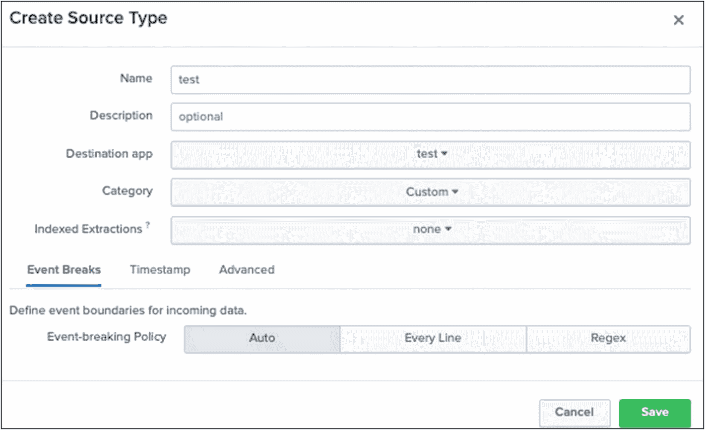
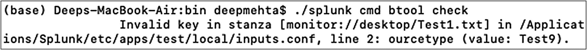
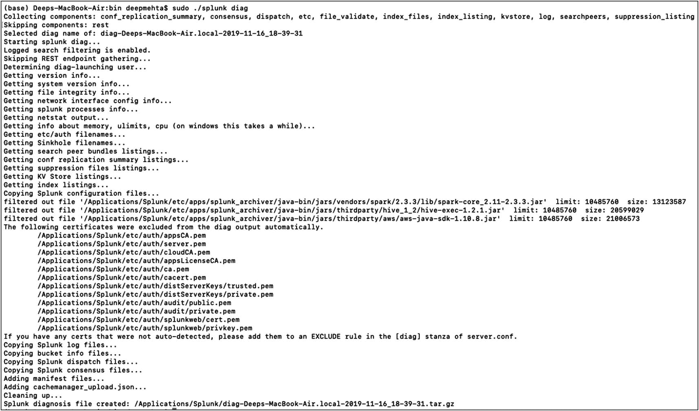

# 11. Splunk 的高级 `.conf` 文件和诊断

本章讨论负责存储 Splunk 配置信息和应用程序的各种 `.conf` 文件。您将学习如何微调输入。您将研究匿名化敏感个人数据的过程，并学习调试配置文件。您将了解 `diag`（诊断工具），它用于收集关于环境、实例和操作系统的基本信息。

简而言之，本章涵盖以下主题。

*   理解 Splunk `.conf` 文件
*   设置微调输入（自定义源类型）
*   匿名化数据
*   理解 Splunk 中的合并逻辑
*   调试配置文件
*   创建 `diag`


好的，作为一名高级文档工程师和翻译员，我将严格按照您提供的注意事项和示例，将给定的英文文本翻译成中文。


## 理解 Splunk .conf 文件

Splunk 中的配置文件被称为 `.conf` 文件。一个 Splunk 配置文件包含了 Splunk Enterprise 的配置信息。

默认的配置文件保存在 `$SPLUNK_HOME/etc/system/default` 中。（建议在 Splunk 中编辑本地文件，避免编辑默认文件，因为每当 Splunk 更新时，默认文件会被覆盖）。要编辑本地文件，请前往 `$SPLUNK_HOME/etc/system/local`。配置文件中的节（Stanzas）包括系统设置、身份验证和授权信息、索引相关设置、部署、集群配置、知识对象以及 Splunk 中的搜索。

本节将讨论以下文件：

- `props.conf`
- `indexes.conf`
- `transforms.conf`
- `inputs.conf`
- `outputs.conf`
- `deploymentclient.conf`

### `props.conf`

`props.conf` 文件存在于重型转发器、搜索头和索引器上。在此文件中，您可以对数据应用解析规则。`props.conf` 文件主要用于以下内容：

- 配置事件的分行
- 字符编码
- 处理二进制文件
- 时间戳识别和时间格式转换
- 事件分段

`props.conf` 文件位于 `$SPLUNK_HOME/etc/system/local/props.conf`。

表 11-1 描述了该文件的属性及其相应的值。

**表 11-1 配置 `props.conf`**

| 属性 | 值 |
| --- | --- |
| `SHOULD_LINE_MERGE=false&#124;true` | `SHOULD_LINE_MERGE` 指定是否将多行数据合并为一个多行事件。 |
| `TIME_PREFIX=<regular expression>` | 事件的 RegEx 检查事件中的时间戳。 |
| `TIME_FORMAT=<strptime-style format>` | `TIME_FORMAT` 指定“strptime”格式字符串并从事件中提取日期。 |
| `MAX_TIMESTAMP_LOOKAHEAD=<Integer>` | `MAX_TIMESTAMP_LOOKAHEAD` 指定 Splunk 应在时间戳中检查的字符数。 |
| `LINE_BREAKER=<regular expression>` | `LINE_BREAKER` 标识下一个事件的开始。 |
| `BREAK_ONLY_BEFORE=<regular expression>` | `BREAK_ONLY_BEFORE` 是一种定义下一个事件开始的方法。 |
| `MAX_EVENTS=<Integer>` | `MAX_EVENTS` 指定一个事件的最大行数。 |
| `ANNOTATE_PUNCT=false&#124;true` | `ANNOTATE_PUNCT` 在事件中启用或禁用标点符号以进行搜索。 |
| `KV_MODE = <none&#124;KV pairs>` | 当您没有任何键值对时，使用 `KV_MODE =none`。 |
| `SEDCMD-<class> = y/<string1>/<string2>/` | `SEDCMD-<class>` 隐藏数据，并可被其他数据替换。 |

表 11-1 包含了 `props.conf` 中使用的一些重要指令。更多信息，请参考 [`docs.splunk.com/Documentation/Splunk/7.3.1/Admin/propsconf`](https://docs.splunk.com/Documentation/Splunk/7.3.1/Admin/propsconf)。

### `indexes.conf`

`indexes.conf` 文件主要存在于 Splunk 索引器上，用于配置索引和管理索引策略，例如数据过期和数据阈值。在 `indexes.conf` 文件中，您可以应用在 Splunk 中创建索引的规则。`indexes.conf` 文件主要用于配置索引及其属性。`indexes.conf` 文件位于 `$SPLUNK_HOME/etc/system/local/indexes.conf`。

表 11-2 描述了如何配置 `indexes.conf` 文件。

**表 11-2 配置 `indexes.conf`**

| 属性 | 值 |
| --- | --- |
| `homePath=<Path>` | `homePath` 包含热存储桶和温存储桶的位置。 |
| `coldPath=<Path>` | `coldPath` 包含冷存储桶的位置。 |
| `thawedPath=<Path>` | `thawedPath` 包含解冻数据库的位置。 |
| `repFactor=<int >` | 确定索引器是否需要复制。 |
| `maxHotBuckets=<int>` | 索引中可以存在的最大热存储桶数。 |
| `maxDataSize=<int>` | 指定可以保存在索引中的最大数据量。 |
| `maxWarmDBCount=<int>` | 指定最大温存储桶数。 |
| `maxTotalDataSizeMB=<int>` | 指定特定索引的最大大小。 |
| `frozenTimePeriodInSecs=<int>` | 索引滚动到冻结状态所需的秒数。 |
| `coldToFrozenDir=<Path>` | 指定冻结归档的路径。 |

表 11-2 列出了 `indexes.conf` 中的一些重要指令。更多信息，请参考 [`docs.splunk.com/Documentation/Splunk/7.3.1/Admin/Indexesconf`](https://docs.splunk.com/Documentation/Splunk/7.3.1/Admin/Indexesconf)

### `transforms.conf`

`transforms.conf` 文件存在于轻型转发器、重型转发器、搜索头和索引器上。在此文件中，您可以应用解析数据的规则，并应用正则表达式规则来转换源类型、匿名化某些类型的敏感输入数据以及创建高级搜索字段提取。`transforms.conf` 文件位于 `$SPLUNK_HOME/etc/system/local/transforms.conf`。

表 11-3 描述了如何配置 `transforms.conf` 文件。

**表 11-3 配置 `transforms.conf`**

| 属性 | 值 |
| --- | --- |
| `SOURCE_KEY=<_raw>` | `SOURCE_KEY` 指示使用哪个数据流作为模式匹配的源。 |
| `REGEX=<regular expression>` | `REGEX` 从 `SOURCE_KEY` 中识别事件。 |
| `DEST_KEY=<Metadata:Sourcetype>` | `DEST_KEY` 指示将处理后的数据写入何处。 |
| `FORMAT=<Sourcetype::<sourcetype name>>` | `FORMAT` 控制 `REGEX` 如何写入 `DEST_KEY`。 |

表 11-3 列出了 `transforms.conf` 中的一些重要指令。更多信息，请访问 [`docs.splunk.com/Documentation/Splunk/8.0.0/Admin/Transformsconf`](https://docs.splunk.com/Documentation/Splunk/8.0.0/Admin/Transformsconf)。

### `inputs.conf`

`inputs.conf` 文件存在于通用转发器、重型转发器、搜索头和索引器上。然而，`inputs.conf` 文件中有各种属性需要在输入数据之前进行处理。`inputs.conf` 文件位于 `$SPLUNK_HOME/etc/system/local/inputs.conf`。

表 11-4 说明了 `inputs.conf` 文件的配置。

**表 11-4 配置 `inputs.conf`**

| 属性 | 值 |
| --- | --- |
| `host=<string>` | 为输入节（stanza）将主机值设置为静态值。 |
| `index=<string>` | 指定存储通过输入节传来的事件的索引。 |
| `source=<string>` | 为来自输入字段的事件设置源字段。 |
| `sourcetype=<string>` | 为来自这些输入字段的事件设置源类型字段。 |
| `host_regex=<regular expression>` | 该正则表达式从路径中提取主机到主机文件。 |
| `whitelist=<regular expression>` | 如果路径匹配正则表达式，则监控此输入的这些文件。 |
| `blacklist=<regular expression>` | 如果路径匹配正则表达式，则不监控此输入的这些文件。 |
| `outputgroup=<string>` | 事件收集器转发数据的组名。 |
| `enableSSL=0&#124;1` | 决定 HTTP 事件收集器组是否应使用 SSL。 |
| `maxSockets=<integer>` | 决定 HTTP 事件收集器输入同时接受的 HTTP 连接数量。 |
| `queue=parsingQueue&#124;indexQueue` | 告诉索引器应该将特定输入节传入的事件提交到哪个队列。 |

表 11-4 列出了一些重要的指令。有关 `inputs.conf` 的更多信息，请参考 [`docs.splunk.com/Documentation/Splunk/7.3.1/Admin/Inputsconf`](https://docs.splunk.com/Documentation/Splunk/7.3.1/Admin/Inputsconf)。


### `outputs.conf`

`outputs.conf`文件存在于通用转发器、重型转发器、搜索头和索引器上。在此文件中，您可以应用规则将数据发送到 Splunk 实例。然而，在转发器将数据发送到接收的 Splunk 实例之前，需要处理各种属性。`outputs.conf`文件位于`$SPLUNK_HOME/etc/system/local/outputs.conf`。

表 11-5 说明了`outputs.conf`的配置。

**表 11-5 配置 `outputs.conf`**

| 属性 | 值 |
| :--- | :--- |
| `heartbeatFrequency=<integer>` | 心跳频率通过发送指定整数块的心跳包来通知接收服务器。 |
| `maxQueueSize=<integer>` | 表示队列中所有项目的 RAM 大小。 |
| `autoLBFrequency=<integer>` | 用于负载均衡，指定整数块中切换服务器的时间。 |
| `autoLBVolume=<integer>` | 在从可用索引器中选择新索引器之前，发送到索引器的数据字节数。 |
| `maxEventSize=<integer>` | Splunk 可以传输的最大事件大小。 |
| `server=<ip>:<port>,<servername>:<port>` | 指定用于传输数据的目标索引器。 |
| `timestampformat=<format>` | 指定事件前置的时间戳格式。 |
| `master_uri=<ip>:<port>,<servername>:<port>` | 集群主 URI 的地址。 |
| `type=tcp&#124;udp` | 指定是使用 TCP 还是 UDP 协议。 |
| `compressed=true&#124;false` | 指定是否需要压缩数据。 |
| `_TCP_ROUTING=<target_group>` | 指定转发数据的目标组。 |
| `disabled=true&#124;false` | 确定是否需要禁用事件传输。 |

表 11-5 列出了`outputs.conf`中的一些重要指令。欲了解更多信息，请参阅[`https://docs.splunk.com/Documentation/Splunk/7.3.1/Admin/outputsconf`](https://docs.splunk.com/Documentation/Splunk/7.3.1/Admin/outputsconf)。

### `deploymentclient.conf`

`deploymentclient.conf`文件位于通用转发器、重型转发器、搜索头和索引器上。此文件包含可用于自定义部署客户端行为的设置描述。`deploymentclient.conf`文件中有多种用于设置客户端-服务器通信的有用属性。`deploymentclient.conf`文件位于`$SPLUNK_HOME/etc/system/local/deploymentclient.conf`。

表 11-6 显示了`deploymentclient.conf`文件中的各种属性及其值。

**表 11-6 配置 `deploymentclient.conf`**

| 属性 | 值 |
| :--- | :--- |
| `targerUri=<uri>` | 指定部署服务器的地址。 |
| `connect_timeout=<integer>` | 部署客户端连接到部署服务器的最长时间（秒）。 |
| `send_timeout=<integer>` | 部署客户端向部署服务器发送或写入数据的最长时间（秒）。 |
| `recv_timeout=<integer>` | 部署客户端从部署服务器读取或接收数据的最长时间（秒）。 |

表 11-6 列出了`deploymentclient.conf`中的一些重要指令。欲了解更多信息，请参阅[`https://docs.splunk.com/Documentation/Splunk/7.3.1/Admin/deploymentclientconf`](https://docs.splunk.com/Documentation/Splunk/7.3.1/Admin/deploymentclientconf)。

您已完成对 Splunk 中六个配置文件的讨论。在下一节中，您将了解为输入数据创建自定义源类型的微调输入。

## 设置微调输入

Splunk 中的微调输入负责为数据（如脚本化输入、非标准日志文件、自定义数据类型等）创建自定义源类型。您还可以通过修改`props.conf`或在 Splunk Web 中创建自己的源类型，以便 Splunk 能够理解所有这些数据。

### 使用 Splunk Web 创建自定义源类型

在本节中，您将为`test.txt`创建一个自定义源类型，以便 Splunk 能够识别事件、从事件中提取时间戳，并理解新事件从何处开始。关于如何使用 Splunk Web 为您的数据执行此操作，请参考以下说明。



**图 11-1** 自定义源类型：`test`

1.  转到“设置”并导航至“源类型”。
2.  点击“新建源类型”。
3.  将源类型名称输入为`test`。
4.  在“目标应用”中，选择`test`应用。
5.  在“类别”中，选择“自定义数据”。
6.  Splunk 有预定义的基于数据类型的索引提取，您可以选择它。对于`test.txt`，选择`none`。（为了更好地理解，请参阅图 11-1）。
7.  在“事件换行”中，有三种事件换行策略：`Auto`、`Every Line` 和 `Regex`。根据您的数据选择。
8.  在“时间戳”选项卡中，有四种策略来确定传入数据的时间戳：`Auto`、`Current Time`、`Advanced` 和 `Configuration`。根据您的数据选择。
9.  在“高级”下，添加 `TIME_FORMAT`、`MAX_TIMESTAMP_LOOKAHEAD`、`TRUNCATE`。要更改 `LINE_BREAKER` 的值，请参考以下针对 `test.txt` 的代码块。
```
SHOULD_LINEMERGE=false
LINE_BREAKER=([\r\n]+)\d+\s+\"\$EIT\,
NO_BINARY_CHECK=true
category=Custom
TIME_FORMAT = %m/%d/%Y %k:%M
MAX_TIMESTAMP_LOOKAHEAD = 15
TRUNCATE = 99999
```

### 使用 `props.conf` 创建自定义源类型

使用 `props.conf` 文件创建自定义源类型是最简单且最佳的选择。转到 `$SPLUNK_HOME/etc/apps/$APP_NAME/local/props.conf`。

如果 `props.conf` 不存在，请创建它。您可以使用 `[my_custom_sourcetype_name]` 修改 `props.conf` 的段。

在 Splunk 中，有六个关键策略来定义任何自定义源类型。许多策略的添加或删除完全取决于输入数据，但总的来说，这六个策略很重要。

这些策略定义在以下代码块中。
```
SHOULD_LINE_MERGE=false|true
TIME_PREFIX=
TIME_FORMAT=
MAX_TIMESTAMP_LOOKAHEAD=
LINE_BREAKER=
TRUNCATE=
```

要为 `test1.txt` 创建一个自定义源类型，其中源类型命名为 `[Test9]`，请在 `props.conf` 中执行以下步骤。
```
[Test9]
TIME_PREFIX=\d{1,3}\.\d{1,3}\.\d{1,3}\.\d{1,3}\s\-\s\d{5}\s+
TIME_FORMAT = %m/%d/%Y %k:%M
MAX_TIMESTAMP_LOOKAHEAD = 15
LINE_BREAKER = ([\r\n]+)\d+\s+\"\$EIT\,
SHOULD_LINEMERGE = false
TRUNCATE = 99999
```

如果您在 `inputs.conf` 中为给定源设置了源类型，则无法在 `props.conf` 中覆盖该源类型的值。

您已完成使用微调输入和 `props.conf` 创建源类型。

**注意**

如果您使用 Splunk Web 在 Splunk Cloud 中创建源类型，则 Splunk Cloud 会自动管理源类型配置。但是，如果您使用的是 Splunk Enterprise 并管理分布式配置，则必须分发新的源类型。

下一节将讨论匿名化敏感数据和凭据的过程。

## 匿名化数据

屏蔽敏感的个人信息（如信用卡号和社会安全号码）至关重要。您可以匿名化事件中的部分数据以保护隐私，同时提供剩余数据进行分析。

在 Splunk 中有两种匿名化数据的方法。

*   使用`props.conf`配合 sed 脚本匿名化数据
*   使用`props.conf`和`transforms.conf`配合正则表达式匿名化数据


### 使用 `props.conf` 通过 `sed` 脚本对数据进行匿名化处理

在此过程中，您可以直接使用 `props.conf` 对事件中的数据部分进行匿名化处理，以保护隐私，同时提供剩余数据供分析。可以使用 `sed`（流编辑器）脚本替换事件中的替代字符串，从而对数据进行匿名化。`sed` 是一种 *nix 工具，它读取文件并根据提供给该工具的命令或参数修改输入。您可以在 `props.conf` 中使用类似 `sed` 的语法来对数据进行匿名化。

#### 使用 `sed` 脚本匿名化数据的语法

```
SEDCMD-<name> = y/<regexp>/<replacement>/
```

在 `Test.txt` 中，数据类似于以下代码块中的数据。

```
1 "$EIT,907409,38550,E,0,,0,1,0,0,16777317,0,8,A,19.079747,72.849640,65529,195,183023,261218,23,1,15,0,4208,1148,0,1,0,0,0,4.2,E10.21,0" 27.97.83.90 - 58840 12/27/2018 0:00
```

您需要将 IP 地址屏蔽为 `XXXX`。首先，您需要修改 `inputs.conf`，该文件有一些类似于以下代码块中的先决策略。

```
inputs.conf
[monitor://desktop/Test1.txt]
sourcetype=Test9
```

更新 `inputs.conf` 后，您可以更新 `props.conf`。在 `props.conf` 中，编写 `SEDCMD` 来屏蔽数据。用于屏蔽 IP 的 `SEDCMD` 命令类似于以下策略。

```
SEDCMD-fixsite=s/(\d{1,3}\.\d{1,3}\.\d{1,3}\.\d{1,3})/ip=xxxx/g
```

执行 `SEDCMD` 命令后，`Test9` 源类型的 `props.conf` 类似于以下代码块。

```
[Test9]
TIME_PREFIX=\d{1,3}\.\d{1,3}\.\d{1,3}\.\d{1,3}\s\-\s\d{5}\s+
TIME_FORMAT = %m/%d/%Y %k:%M
MAX_TIMESTAMP_LOOKAHEAD = 15
LINE_BREAKER = ([\r\n]+)\d+\s+\"\$EIT\,
SHOULD_LINEMERGE = false
TRUNCATE = 99999
SEDCMD-fixsite=s/(\d{1,3}\.\d{1,3}\.\d{1,3}\.\d{1,3})/ip=xxxx/g
```

为 `Test9` 源类型更新 `props.conf` 后，IP 地址就被屏蔽了。

以下代码块显示了 `Test9` 数据。

```
"$EIT,907409,38550,E,0,,0,1,0,0,16777317,0,8,A,19.079747,72.849640,65529,195,183023,261218,23,1,15,0,4208,1148,0,1,0,0,0,4.2,E10.21,0" ip=xxxx - 58840 12/27/2018 0:00
```

在 `props.conf` 文件中，`sedcmd` 命令对数据进行了匿名化处理。

让我们看看如何使用 `props.conf` 和 `transforms.conf` 配合正则表达式来匿名化数据。

### 使用 `props.conf` 和 `transforms.conf` 通过正则表达式匿名化数据

让我们使用 `props.conf` 和 `transforms.conf` 对事件中的数据部分进行匿名化处理，以保护隐私，同时提供剩余数据。如果输入事件匹配正则表达式，`transforms.conf` 和 `props.conf` 会转换事件。

在 `Test.txt` 中，数据类似于以下代码块中的数据。

```
1 "$EIT,907409,38550,E,0,,0,1,0,0,16777317,0,8,A,19.079747,72.849640,65529,195,183023,261218,23,1,15,0,4208,1148,0,1,0,0,0,4.2,E10.21,0" 27.97.83.90 - 58840 12/27/2018 0:00
```

您将从 IP 地址到 `XXXX` 的整个数据屏蔽。首先，您需要修改 `inputs.conf`。它有一些类似于以下代码块中的先决策略。

```
inputs.conf
[monitor://desktop/Test1.txt]
sourcetype=Test9
```

更新 `inputs.conf` 后，您可以更新 `props.conf` 以调用 `transforms.conf` 进行数据屏蔽。`props.conf` 代码块类似于以下代码块。

```
[Test9]
TIME_PREFIX=\d{1,3}\.\d{1,3}\.\d{1,3}\.\d{1,3}\s\-\s\d{5}\s+
TIME_FORMAT = %m/%d/%Y %k:%M
MAX_TIMESTAMP_LOOKAHEAD = 15
LINE_BREAKER = ([\r\n]+)\d+\s+\"\$EIT\,
SHOULD_LINEMERGE = false
TRUNCATE = 99999
TRANSFORMS-anonymize = ip-anonymizer
```

更新 `props.conf` 后，您需要更新 `transforms.conf`，使其代码块类似于以下代码块。

```
[ip-anonymizer]
REGEX = (?ms)(.*)(\d{1,3}\.\d{1,3}\.\d{1,3}\.\d{1,3})(.*)(?ms)
FORMAT = $1******
DEST_KEY = _raw
```

更新 `transforms.conf` 后，对于进入 `Test9` 源类型的数据，IP 地址将被屏蔽。

以下代码块提供了相应的数据。

```
1 "$EIT,907409,38550,E,0,,0,1,0,0,16777317,0,8,A,19.079747,72.849640,65529,195,183023,261218,23,1,15,0,4208,1148,0,1,0,0,0,4.2,E10.21,0" ******
```

在 `transforms.conf` 中，`regex` 命令对数据进行了匿名化处理。

现在，我们来关注 Splunk 中的合并逻辑。

## 理解 Splunk 中的合并逻辑

在 Splunk 中，有多个位于不同位置的配置文件。通过合并逻辑，所有这些配置文件被汇集并组合成一个全局文件。在本节中，您将学习合并是如何执行的，并了解 Splunk 如何组合配置文件。

### 配置文件优先级

Splunk 软件使用配置文件来确定其行为的各个方面。配置文件优先级会合并来自所有文件副本的设置。不同副本可能具有冲突的属性值。具有最高优先级的文件决定了配置文件在目录结构中的位置优先级。

#### Splunk 确定优先级顺序

Splunk 根据以下规则确定优先级顺序。

*   系统本地目录——最高优先级
*   应用本地目录
*   应用默认目录
*   系统默认目录——最低优先级

### Splunk 配置文件位置

Splunk 配置文件位于 `$SPLUNK_HOME/etc` 下。

以下目录包含 Splunk 配置文件。

*   `$SPLUNK_HOME/etc/system/default`：该目录包含 Splunk 中的默认配置文件。默认目录包含预配置版本的配置文件。切勿编辑默认文件，因为在升级过程中它们将被覆盖。
*   `$SPLUNK_HOME/etc/system/local`：该目录包含本地配置文件。您可以在这些目录之一中创建和编辑您的文件。这些目录在更新期间不会被覆盖。
*   `$SPLUNK_HOME/etc/apps/$app_name/local`：该目录包含 Splunk 中应用程序的本地配置。您的应用程序的所有配置都应放置在此处。
*   `$SPLUNK_HOME/etc/users`：这是用户特定的配置目录。如果您想更改密码或任何用户特定的配置，请在此处进行更新。
*   `$SPLUNK_HOME/etc/system/README`：该目录包含参考文件。参考文件是 `.example` 文件或 `.spec` 文件。


### 配置合并逻辑

配置合并逻辑很简单。合并时，配置的名称、节名称和属性名称必须匹配。Splunk 中的合并是基于配置文件的优先级进行的。

#### 示例 1：配置合并（无冲突）

让我们看一个无冲突的配置合并逻辑示例。你有一个 `$SPLUNK_HOME/etc/system/local/sample1.conf`。

```
[N]
k=1
d=2
```

你还有一个 `$SPLUNK_HOME/etc/system/local/sample2.conf`。

```
[N]
e=5
```

最终得到的配置没有冲突，因此 Splunk 会合并这些文件。

```
[N]
k=1
d=2
e=5
```

#### 示例 2：配置合并（冲突）

以下是 `$SPLUNK_HOME/etc/system/local/sample1.conf` 的内容。

```
[N]
k=1
d=2
```

现在，你将其与 `$SPLUNK_HOME/etc/apps/search/local/sample1.conf` 合并，后者的配置如下。

```
[N]
k=5
```

最终的配置 `$SPLUNK_HOME/etc/apps/search/local/sample1.conf` 无法覆盖 `$SPLUNK_HOME/etc/system/local/sample1.conf`，因为根据文件优先级，系统目录下的文件（`$SPLUNK_HOME/etc/system/local/sample1.conf`）的优先级高于应用目录下的文件（`$SPLUNK_HOME/etc/apps/search/local/sample1.conf`）。最终的配置如下所示。

```
[N]
k=1
d=2
```

#### 示例 3：配置合并（冲突）

你有一个 `$SPLUNK_HOME/etc/apps/search/default/sample1.conf`。

```
[N]
k=1
d=2
```

你想合并 `$SPLUNK_HOME/etc/apps/search/local/sample1.conf`。

```
[N]
k=5
```

最终的配置 `$SPLUNK_HOME/etc/apps/search/local/sample1.conf` 可以覆盖 `$SPLUNK_HOME/etc/apps/search/default/sample1.conf` 的值，因为根据文件优先级，`local` 目录下的文件优先级高于 `default` 目录下的文件。因此，最终的配置如下所示。

```
[N]
k=5
d=2
```

现在，让我们讨论如何使用 Btool 调试配置文件。

## 调试配置文件

Splunk 中的 `Btool` 用于显示合并后的磁盘上的配置。`Btool` 是一个命令行工具，可以帮助排查配置文件问题或查看 Splunk Enterprise 安装正在使用的值。Splunk 在 `$SPLUNK_HOME/bin` 文件中提供了 `Btool`。`Btool` 显示磁盘上的配置文件设置，如果你更改了某个设置，则无需重启 Splunk。

`btool <conf_file_prefix>` 的语法如下。

```
./splunk cmd btool  list
```

在上述语法中，`<conf_file_prefix>` 代表你感兴趣的配置名称。

`btool <conf_file_prefix>` 的语法如下。

```
./splunk cmd btool server list --debug | grep ‘\[‘
```

在上述语法中，`./splunk cmd btool server list --debug | grep '\['` 用于确定哪些 `server.conf` 节正在被识别。

### 示例：使用 Btool 排查配置文件问题

这是 `$SPLUNK_HOME/etc/apps/test/local/inputs.conf` 的配置。

```
[monitor://desktop/Test1.txt]
sourcetype=Test9
```

将配置更改为以下代码。

```
[monitor://desktop/Test1.txt]
ourcetype=Test9
```

要排查配置文件，请转到 `$SPLUNK_HOME/bin`。

```
./splunk cmd btool check
```

请注意，`Btool` 会提示你在该节中存在无效键的错误。图 11-2 显示了类似的错误。



图 11-2

针对 sourcetype:Test9 的 Btool 错误检查

现在，让我们看看如何创建诊断包。

## 创建诊断包

在 Splunk 中，诊断包用于收集有关你的 Splunk 环境、实例、配置文件等的基本信息。它会收集关于服务器规格、操作系统版本、文件系统以及从 Splunk 环境中运行的节点建立的当前开放连接的信息。诊断包可以包含应用配置、内部 Splunk 日志文件和来自 Splunk 实例的索引元数据。诊断包存储在 `$SPLUNK_HOME/var/run/diags` 中。

### 在 Splunk 中创建诊断包

可以使用 Splunk Web 或终端/命令行界面创建诊断包。从 Splunk 6.0 开始，你可以为远程实例生成诊断包，但你需要至少具备以下服务器角色之一。

*   搜索头（部署中唯一的搜索头）
*   集群搜索头
*   集群索引器
*   索引器集群主节点

要使用命令行创建诊断包，请转到 `$SPLUNK_HOME/bin`。

*   在 Linux 中，运行以下代码。
*   在 Windows 中，运行以下代码。

```
./splunk diag
```

```
splunk diag
```

图 11-3 显示了为本地实例创建的诊断包。



图 11-3

Splunk 诊断包

要从诊断包中排除文件，请运行以下代码。

*   在 Linux 中
*   在 Windows 中

```
./splunk diag --exclude "*/passwd"
```

```
splunk diag --exclude "*/passwd"
```

当运行 Splunk 诊断包时，它会生成一个 `tar.gz` 文件和一个 `diag.log` 文件。

至此，你已经完成了本章的学习。你可以使用“总结”部分之后提供的题目来检验你的知识。

## 总结

本章讨论了 Splunk 中存在的各种配置文件：`inputs.conf`、`outputs.conf`、`props.conf`、`transforms.conf`、`deploymentclient.conf` 和 `indexes.conf`。你了解了它们的键/值属性及其在创建和修改各种命令中的用途。这些文件负责存储企业及应用配置信息。你还学习了如何使用 Splunk Web 和 `props.conf` 创建自定义源类型。你学习了匿名化敏感或私有数据的过程，以及将位于多个位置的配置文件合并为单个全局文件的过程。最后，你学习了调试配置文件以及创建诊断包（用于收集环境实例、服务器规范和来自节点的开放连接等基本数据）的过程。本章重点介绍了配置文件，这是 Splunk Enterprise 的一个关键元素。

根据 Splunk 管理员考试大纲，配置文件（即模块 16）占 10%，自定义源类型（即模块 15）占 5%，数据匿名化（即模块 17）占 5%，配置文件合并（即模块 1）占 5%。

下一章是 Splunk 管理员模拟考试，旨在帮助你更好地了解 Splunk 管理员考试模式。

## 选择题

1.  根据 Splunk 合并逻辑，哪个文件具有最高优先级？
    1.  系统默认目录
    2.  应用本地目录
    3.  应用默认目录
    4.  系统本地目录

2.  `SEDCMD` 命令在哪个 Splunk 配置中使用？
    1.  `props.conf`
    2.  `inputs.conf`
    3.  `transforms.conf`
    4.  `outputs.conf`

3.  如果你在 `inputs.conf` 中为某个给定源设置了源类型，则无法在 `props.conf` 中覆盖该源类型的值。
    1.  正确
    2.  错误

4.  `inputs.conf` 文件位于何处？（选择所有适用项。）
    1.  通用转发器
    2.  重型转发器
    3.  搜索头
    4.  索引器
    5.  轻型转发器
    6.  以上都不是

5.  `props.conf` 文件将规则应用于正则表达式。
    1.  正确
    2.  错误

6.  Splunk 中的默认配置文件保存在哪个位置？
    1.  `$SPLUNK_HOME/etc/system/local`
    2.  `$SPLUNK_HOME/etc/bin/default`
    3.  `$SPLUNK_HOME/etc/bin/local`
    4.  `$SPLUNK_HOME/etc/system/default`

**答案**

1.  4
2.  2
3.  4
4.  1
5.  1
6.  4

## 参考

欲了解更多信息，请访问 [`docs.splunk.com/Documentation/Splunk/latest/Data/Anonymizedata`](https://docs.splunk.com/Documentation/Splunk/latest/Data/Anonymizedata)。

