# 13. 基于索引器和搜索头集群的基础设施规划

本模块涉及高级 Splunk 部署。部署充当实例的集中配置管理器；基于网络的安装不需要管理员单独为每个操作系统进行安装。

本模块的第一章讨论了 Splunk 的架构。它还涵盖集群。本章讨论以下主题。

- 容量规划
- 配置搜索对等节点
- 配置搜索头
- 搜索头集群
- 多站点索引器集群
- 设计 Splunk 架构

学完本章后，您将了解 Splunk 中的架构设计和资源规划，并能够实现索引集群和搜索头集群。完成本章后，您将覆盖 Splunk 架构师考试大纲的 32%。

## Splunk Enterprise 的容量规划

容量规划在扩展 Splunk Enterprise 中起着至关重要的作用。Splunk Enterprise 容量规划的组件如下。

- `索引器` 是对本地数据进行索引的实例。索引器为远程和本地数据提供数据处理和存储。
- `搜索头` 处理搜索管理功能。它将搜索请求重定向到对等节点，并在对等节点处理完请求后合并结果。
- `转发器` 是将数据转发给索引器进行数据处理和存储的实例。

### Splunk Enterprise 部署的维度

Splunk Enterprise 部署中的容量规划受多个维度影响。

- **传入数据**：发送到 Splunk 的数据量越大，处理传入数据所需的时间和资源就越多。
- **已索引数据**：随着 Splunk Enterprise 中数据的增加，需要更多的 I/O 带宽来存储数据。
- **并发用户**：当同时使用一个 Splunk 实例的用户增多时，该实例需要更多资源来执行搜索、创建报告和仪表板。
- **已保存搜索**：Splunk 需要具备高效运行已保存搜索的能力。

我们从传入数据对容量规划的影响开始介绍。

#### 传入数据影响 Splunk Enterprise 性能

传入数据在 Splunk 的容量规划中起着关键作用。如果有大量数据发送到索引器，但物理内存不足以处理这些数据，索引器的性能就会下降。随着 Splunk 中数据的增加，系统内存的使用量也会增加。因此，在容量规划期间需要考虑传入数据量。

#### 已索引数据影响 Splunk Enterprise 性能

已索引数据在容量规划中也起着关键作用。Splunk Enterprise 捕获传入数据并将其交给索引器。随着索引的增加，可用空间会减少；而已索引数据的增加，则会导致搜索处理速度变慢。

#### 并发用户影响 Splunk Enterprise 性能

并发用户极大地影响 Splunk 的容量规划。索引器需要为用户调用的每次搜索提供一个 CPU 核心。当多个用户同时运行搜索时，所有可用的 CPU 核心很快就会被耗尽。

#### 已保存搜索对 Splunk Enterprise 性能的影响

并发用户影响 Splunk 的容量规划。已保存搜索平均消耗约 1 个 CPU 核心和固定数量的内存。当磁盘系统在索引器中查找并获取数据时，已保存搜索会增加 I/O。如果您安排了过多同时运行的已保存搜索，就会导致资源耗尽。

### Splunk Enterprise 的磁盘存储

Splunk 根据以下公式计算磁盘存储。

- **每日平均索引速率** 统计 Splunk Enterprise 中的传入数据。
- **保留策略** 是在 `indexes.conf` 中设置的参数，称为 `FrozenTimePeriodInSecs`。

```
( 每日平均索引速率 ) x ( 保留策略 ) x 1/2
```

理想情况下，Splunk Enterprise 使用压缩和词法表将原始数据存储为其原始大小的大约一半。如果 Splunk Enterprise 包含 150 GB 的可用磁盘空间，那么以 3 GB/天的索引速率，您可以存储近一百天的数据。

现在，让我们继续学习配置搜索头和搜索对等体的三个过程。

## 配置搜索对等体

Splunk Enterprise 实例既可以作为搜索头运行，也可以作为搜索对等体运行。搜索对等体可以执行索引，并响应来自搜索头的搜索传入请求。

我们首先讨论使用 Splunk Web 配置搜索对等体的过程。

### 从 Splunk Web 配置搜索对等体

要使用 Splunk Web 配置搜索对等体，请参考以下步骤。

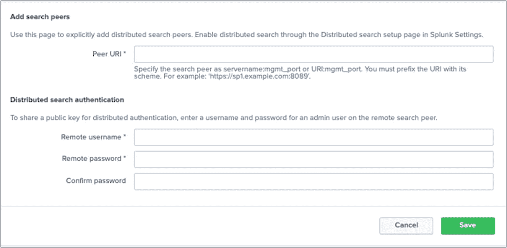

图 13-1. 配置搜索对等体

1. 使用 Splunk Web 转到“设置”，然后转到“分布式搜索”。
2. 移至“搜索对等体”，然后点击“新增”。
3. 输入索引器的 IP 地址或主机名，然后输入 `mgmt 端口号`，后跟冒号（`主机名:mgmt_port`，`IP 地址:mgmt_port`）进行身份验证，以便在搜索头和索引器之间共享公钥。请在搜索头上提供远程索引器的用户名和密码。（请参考图 13-1。）

### 从 .conf 文件配置 Splunk 搜索对等体

要通过编辑 `.conf` 文件来配置 Splunk 搜索对等体，请参考以下步骤。

1. 在搜索头中，创建或编辑位于 `$Splunk_Home$/etc/local` 或 `%Splunk_Home%/etc/local%` 的 `distsearch.conf`。
2. 在 `distsearch.conf` 中添加以下节。

- `servers` 是分布式搜索组服务器的地址。

```
[distributedSearch]
servers = :,:,:,.........:
```

如果您通过编辑 `.conf` 文件添加搜索头，则需要手动分发密钥，步骤如下。

1. 将搜索头文件的密钥从 `$SPLUNK_HOME/etc/auth/distServerKeys/trusted.pem` 复制到索引器位置 `$SPLUNK_HOME/etc/auth/distServerKeys/<searchhead_name>/trusted.pem`。
2. `<searchhead_name>` 是搜索头名称，在搜索头的 `server.conf` 中配置。
3. 重启 Splunk 实例。

### 从 Splunk CLI 配置搜索对等体

要使用 Splunk CLI 配置搜索对等体，请参考以下步骤。

- `search-server` 是远程服务器的地址。
- `-auth` 是当前实例的用户名和密码。
- `-remoteUsername` 是用于认证的远程实例的用户名。
- `-remotePassword` 是用于认证的远程实例的密码。

```
splunk add search-server (IP 地址:mgmt_port 或 主机名:mgmt_port) -auth: -remoteUsername(用户名) -remotePassword(密码)
```

至此，您已了解搜索对等体所用的全部配置方法。

下一节将讨论搜索头集群。

### 配置搜索头

搜索头可以执行搜索，但不能执行索引，这个过程称为专用搜索头。通常在分布式环境中，管理搜索管理功能的实例一般会将搜索请求定向到搜索对等体。搜索头直接与索引器通信。

图 13-2 展示了 Splunk 搜索头的组成结构。

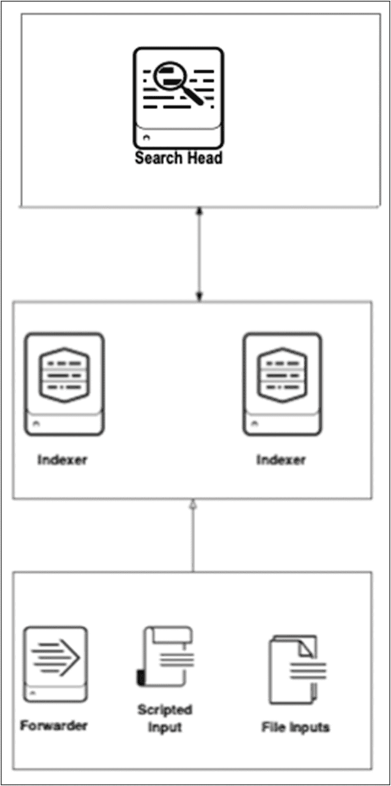

图 13-2. 搜索头组成架构

需要更改 CPU 以增加单个搜索头上的并发搜索（临时和计划）数量，因为临时搜索每次执行消耗一个核心并增加 I/O。如果不增加 CPU，Splunk 系统将无法运行并发搜索。

现在让我们讨论使用 Splunk Web 配置搜索头的过程。

### 使用 Splunk Web 配置搜索头

要使用 Splunk Web 配置搜索头，请参考以下步骤。

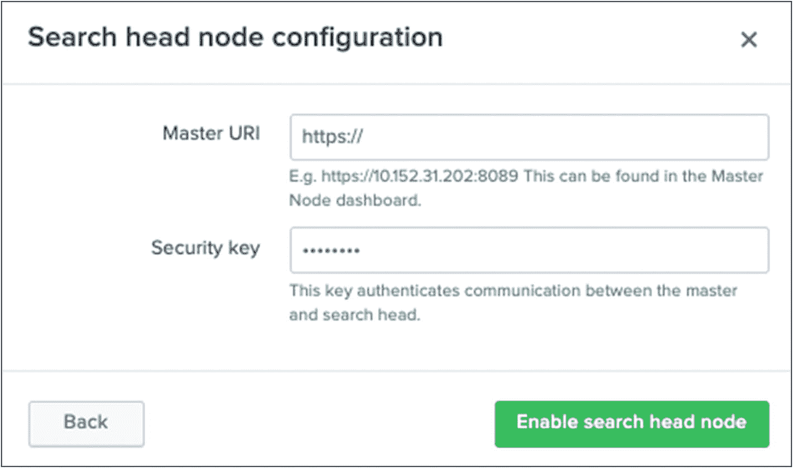

图 13-3. 配置搜索头

1. 转到“设置”，然后转到“分布式搜索”面板。
2. 移至“索引集群” ➤ “搜索头节点”，然后点击“新增”。
3. 输入索引器的 IP 地址或主机名。输入 `mgmt 端口号`，后跟冒号（`主机名:mgmt_port`，`IP 地址:mgmt_port`）进行身份验证，以便在搜索头和索引器之间共享公钥。请提供主节点的公共密钥（请参见图 13-3）。

### 使用 .conf 文件配置 Splunk 搜索头

要通过直接编辑 `.conf` 文件来配置搜索头集群，请参考以下步骤。

1. 在 Splunk 的搜索头中，创建或编辑位于 `$Splunk_Home$/etc/local` 或 `%Splunk_Home%/etc/local%` 的 `server.conf`。

## 编辑配置文件

编辑 `server.conf` 文件中的以下节。请参考以下节。

-   `master_uri` 是主服务器的地址。

-   `mode` 是集群模式的类型。

-   `pass4SymmKey` 是集群密钥。

```
[clustering]
master_uri =(IP 地址:mgmt_port 或 主机名:mgmt_port)
mode = searchhead
pass4SymmKey = 
```

更新配置文件后，重启 Splunk 实例。

### 从 Splunk CLI 配置搜索头

若要通过 Splunk CLI 配置搜索头，请使用以下命令。

- `-master_uri` 是主服务器的地址。

- `-secret` 是集群密钥。

```
splunk edit cluster-config -mode searchhead -master_uri(IP 地址:管理端口 或 主机名:管理端口) -secret 你的密钥
splunk restart
```

## 搜索头集群

搜索头集群由一组搜索头组成，这些搜索头共享配置、作业调度和搜索构件。集群中包含一个搜索头集群队长，以确保整个集群的一致性。搜索头队长可以是搜索头集群中的任意成员，并通过队长选举产生。

- **动态队长**是从搜索头集群成员中选举产生的搜索头队长。动态队长可能会不时变更，通常用于正常运行中的集群。

- **静态队长**并非通过队长选举产生，而是为应对灾难恢复、网络问题等情况而设置的。静态队长仅在选举队长无法产生新队长时创建，且是临时性的。

搜索头集群架构如图 13-4 所示。

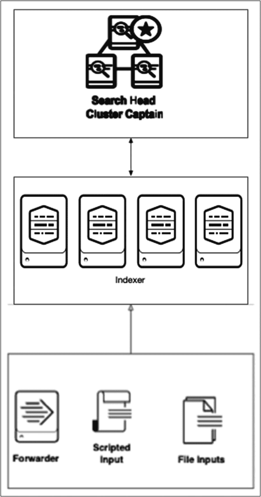

图 13-4 搜索头集群组成架构

### 搜索头集群队长

队长是搜索头集群中的一个成员，除了搜索活动外，还执行额外功能。它负责协调集群的活动。你可以将搜索头设置为运行定时搜索或即席搜索。如果当前队长失效，则会在选举后选出新队长。新队长可以是任意 Splunk 搜索头集群成员。

要配置集群成员运行即席搜索，请编辑 `server.conf` 文件。

```
[shclustering]
adhoc_searchhead = true
```

要配置队长运行即席搜索，请编辑 `server.conf` 文件。

```
[shclustering]
captain_is_adhoc_searchhead = true
```

现在我们来看看队长的角色和功能。

### 队长的作用

以下是在 Splunk 搜索头集群中队长所扮演的角色：

- 调度作业

- 协调集群中的警报及警报抑制

- 将知识包推送到搜索对等节点

- 协调构件复制

- 复制配置更新

### 队长选举

搜索头集群使用动态队长。当特定情况出现时，集群会进行选举，任何 Splunk 搜索头成员都可以成为搜索头队长。

队长选举仅在以下情况发生时进行：

- 当前队长失效

- 出现网络问题

- 当前队长因无法检测到主要成员参与集群而主动退出

- 网络分区发生

### 在 Splunk 中使用 CLI 配置搜索头集群

若要通过 Splunk CLI 配置搜索头集群，请执行以下操作。

- `-auth` 参数指定当前登录凭据。

- `-mgmt_uri` 指定当前实例的 URI。

- `-replication_factor` 指定集群维护的每个构件的副本数量。

- `-replication_port` 指定实例用于监听其他构件的端口。可以是任何未使用的端口。

- `-shcluster_label` 是一个选项，用于给集群打标签。

- `-secret` 是指定安全密钥的密钥。

```
splunk init shcluster-config -auth: -mgmt_uri:/: -replication_factor -replication_port -shcluster_label -secret
splunk restart
```

#### 使用 Splunk CLI 配置动态搜索队长

若要在 Splunk CLI 中配置动态搜索队长，请执行以下操作。

```
splunk bootstrap shcluster_captain -servers_list:/:,:/:,.....,:/:
splunk restart
```

**使用 Splunk CLI 将少数群体成员添加到动态队长**

使用 Splunk CLI 命令将少数搜索成员添加到动态搜索队长。使用队长服务器终端来添加 shcluster 成员。

```
splunk add shcluster-member -new_member_uri :
```

#### 使用 Splunk CLI 配置静态搜索队长

要使用 Splunk CLI 配置静态搜索队长，请参考以下步骤。

```
splunk edit shcluster-config -election false -mode captain captain_uri : 或  :
splunk restart
```

要使用 Splunk CLI 命令将少数搜索成员添加到动态搜索队长，请使用对等节点终端来添加 shcluster 成员。

```
splunk edit shcluster-config -election false -mode member captain_uri : 或  :
splunk restart
```

## 多站点索引器集群

多站点索引器集群是一个由多个站点组成的索引器集群。每个站点都需要遵循特定的复制和搜索因子规则。与单站点集群相比，多站点集群有两个主要优势。

- **改进的灾难恢复**：通过在多个位置维护多份数据副本，可在灾难中保护数据。多站点索引器集群在多个位置保持多份数据副本，并提供站点故障转移能力。

- **搜索亲和性**：该配置使每个站点拥有本地数据以及完整的可搜索数据集。每个站点上的搜索头将搜索范围仅限于对等节点。这消除了在正常情况下搜索头访问其他站点数据的需要，大大减少了站点间的网络流量。

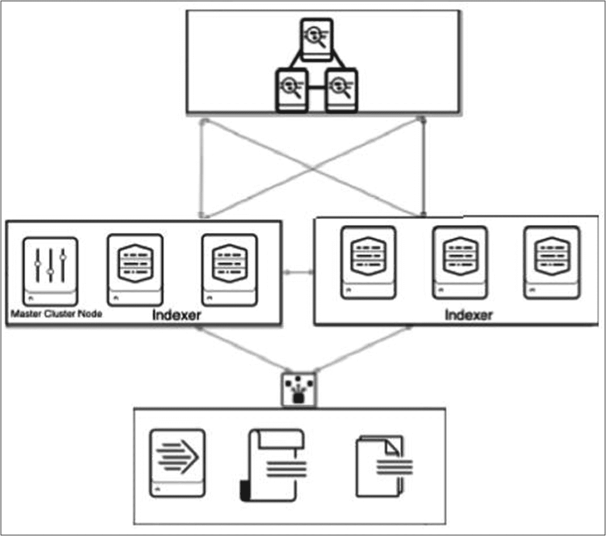

图 13-5 多站点索引集群组成架构

### 使用 `.conf` 文件配置多站点索引器集群

要通过编辑 `.conf` 文件来配置多站点索引器集群，请参考以下步骤。

1.  在 Splunk 搜索头中，创建或编辑位于 `$Splunk_Home$/etc/local` 或 `%Splunk_Home%/etc/local%` 目录下的 `server.conf` 文件。

2.  编辑 `server.conf` 文件中的以下配置段。

*   `available_sites` 在主节点中用于显示哪些站点可用于 Splunk 环境。

*   `site_replication_factor` 指定集群应维护的原始数据总副本数。

*   `site_search_factor` 在主节点中用于在 Splunk 环境中维护多个可搜索副本，以实现灾难恢复。

*   `pass4SymmKey` 用于验证节点之间的通信。

*   `cluster_label` 是集群的名称。

```
[general]
site = site1,site2,site3,......,site n
[clustering]
mode = master
multisite = true
available_sites = site1,site2,.....,site n
site_replication_factor = origin:,total:
site_search_factor = origin:,total:
pass4SymmKey = 
cluster_label = 
```

要使用 `.conf` 文件在 Splunk 中配置多站点索引器对等节点，请参考以下步骤。

1.  在 Splunk 搜索头中，创建或编辑位于 `$Splunk_Home$/etc/local` 或 `%Splunk_Home%/etc/local%` 目录下的 `server.conf` 文件。

2.  编辑 `server.conf` 文件中的以下配置段。

*   `available_sites` 在主节点中用于显示 Splunk 环境中哪些站点可用。

*   `master_uri` 是服务器地址。

*   `pass4SymmKey` 用于验证节点之间的通信。

```
[general]
site = site1,site2,site3,.....site n
[replication_port://]
[clustering]
master_uri = :/:
mode = slave
pass4SymmKey =
```

要使用 `.conf` 文件在 Splunk 中配置多站点索引器搜索头，请参考以下步骤。

# 配置 Splunk 多站点搜索头集群

1.  在 Splunk 搜索头中，创建或编辑位于 `$Splunk_Home$/etc/local` 或 `%Splunk_Home%/etc/local%` 目录下的 `server.conf` 文件。

2.  编辑 `server.conf` 文件中的以下配置段。

    *   `available_sites` 在主节点中用于显示 Splunk 环境中哪些站点可用。
    *   `master_uri` 是服务器地址。
    *   `pass4SymmKey` 用于验证节点之间的通信。

```
[general]
site = site1,site2,site3,....,site n
[clustering]
multisite = true
master_uri = :,:
mode = searchhead
pass4SymmKey = 
```

有关多站点搜索头集群的更多信息，请访问 [`docs.splunk.com/Documentation/Splunk/7.3.0/Indexer/Multisiteconffile`](https://docs.splunk.com/Documentation/Splunk/7.3.0/Indexer/Multisiteconffile)。

## 使用 CLI 配置 Splunk 多站点索引器集群

要使用 CLI 命令将 Splunk 中的对等节点配置为多站点索引集群的主节点，请参考以下配置段。

*   `-available_sites` 在主节点中用于显示 Splunk 环境中哪些站点可用。
*   `-site_replication_factor` 指定集群应维护的原始数据总副本数。
*   `-site_search_factor` 在主节点中用于在 Splunk 环境进行灾难恢复时，维护多个可搜索副本。
*   `-secret` 用于验证节点之间的通信。
*   `-cluster_label` 是集群的名称。

```
splunk edit cluster-config -mode master -multisite true -available_sites site1,site2,.....,site n -site_replication_factor origin:,total: -site_search_factor origin:,total: -secret
splunk restart
```

要使用 CLI 命令将 Splunk 中的对等节点配置为多站点索引集群的从节点，请参考以下配置段。

*   `-available_sites` 在主节点中用于显示 Splunk 环境中哪些站点可用。
*   `-master_uri` 是服务器地址。
*   `-secret` 用于验证节点之间的通信。

```
splunk edit cluster-config -mode slave -site site1,site2,site3,.....,site n -master_uri :/: -replication_port  -secret 
splunk restart
```

要使用 CLI 命令将 Splunk 中的对等节点配置为多站点索引集群的搜索头，请参考以下配置段。

*   `available_sites` 在主节点中用于显示 Splunk 环境中哪些站点可用。
*   `master_uri` 是服务器地址。
*   `pass4SymmKey` 用于验证节点之间的通信。

```
splunk edit cluster-config -mode searchhead -site site1,site2,...,siten -master_uri :/: -secret 
splunk restart
```

在继续讨论 Splunk 架构设计之前，让我们回顾一下本章已学内容：Splunk 环境中的容量规划、配置搜索头、搜索头集群、集群管理器以及多站点索引器集群。下一节将讨论 Splunk 的设计与架构。

设计 Splunk 架构是一项复杂的工作。要在 Splunk 中进行设计，您需要了解其架构中的一系列操作以及所有软件组件。

*   **数据输入**：要在 Splunk 中输入数据，您可以使用通用转发器。不过，重型转发器或索引器也可以在 Splunk 环境中获取数据。
*   **数据解析**：要解析数据，您需要使用重型转发器和索引器。
*   **数据索引**：要在 Splunk 环境中索引数据，您只能使用索引器。
*   **数据搜索**：要在 Splunk 环境中搜索数据，您应该使用搜索头，但也可以使用索引器。

图 13-6 中的图表描绘了整个 Splunk 架构。

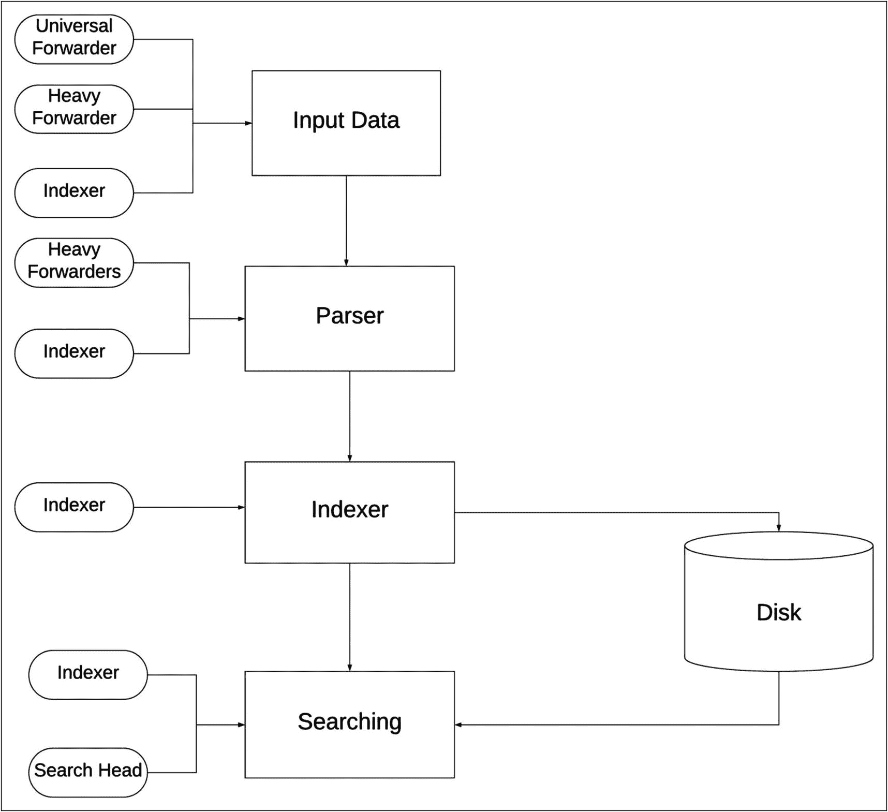

图 13-6 Splunk 组成架构：组件

至此，您已经复习了 Splunk 架构，以及数据输入、数据解析、数据索引和数据搜索所需的所有组件。根据该图，实施 Splunk 架构并非难事。但如何设计 Splunk 架构呢？

要理解如何设计，您需要了解 Splunk 已验证架构。

## Splunk 已验证架构（SVAs）

Splunk 已验证架构（SVAs）旨在实现稳定、高效且可重复的部署。SVAs 确保 Splunk 平台的扩展和故障排除，并降低总体拥有成本。

SVAs 具有以下特点。

*   **性能**：SVAs 帮助组织提高性能并增强稳定性。
*   **复杂性**：SVAs 帮助组织消除环境中的复杂性，因为复杂性是规划扩展 Splunk 环境时最大的障碍。
*   **效率**：SVAs 通过改进运营并加速价值实现，帮助组织提高效率。
*   **成本**：SVAs 通过降低拥有成本，帮助组织降低运营成本。
*   **敏捷性**：SVAs 帮助组织在数据增长时进行扩展，并随之适应变化。
*   **维护**：SVAs 通过将资源导向正确的维度，帮助组织减少维护工作量。
*   **可扩展性**：SVAs 帮助组织高效、无缝地进行扩展。
*   **验证**：SVAs 确保 Splunk 部署基于最佳实践。

## 设计 Splunk 已验证架构

在设计 Splunk 架构时，您需要理解几个关键点，以维持工作流程。

*   **可用性**：Splunk 环境需要随时可用，并能够从计划内和计划外的停机或中断中恢复。
*   **性能**：Splunk 环境需要在不同条件下保持相同的服务水平。
*   **可扩展性**：Splunk 环境需要设计为在所有层级上均可扩展，并能有效处理工作负载。
*   **安全性**：Splunk 环境应保护数据、配置和资产。
*   **可管理性**：Splunk 环境应支持集中操作，并能管理所有层级。

## 小型企业部署

若索引数据量在 20 到 300 GB/天之间，且组织内用户数为 1 到 10 人，则适合采用小型企业部署。小型企业部署使用多个转发器将数据转发至索引器。索引器和搜索头部署在同一位置，以更高效地利用服务器。

图 13-7 展示了一个小型企业部署架构。

*   **数据输入**：根据配置和部署方式，数据通过转发器、脚本化输入、文件输入等渠道进入系统。数据被转发至索引器，或者索引器/搜索头可部署在一起。
*   **索引/搜索**：在此类企业部署中，索引器接收来自转发器的数据，并存储和索引这些传入数据。小型企业部署中的索引器同时也充当搜索头，处理用户查询，并对来自数据输入阶段的数据执行本地搜索。

现在，让我们来看中型企业部署。

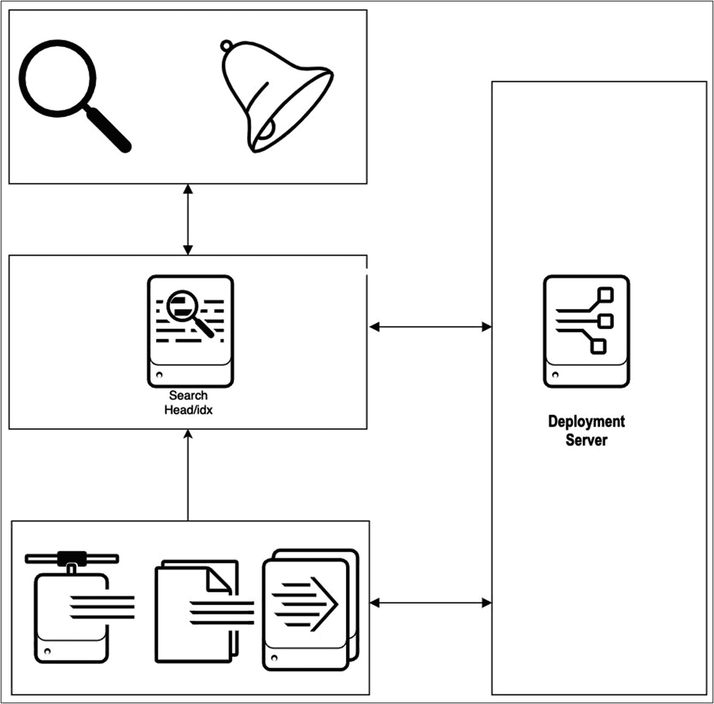

图 13-7 小型企业 Splunk 组件架构部署

## 中型企业部署

若索引数据量在 600 到 1000 GB/天之间，且组织内用户数为 10 到 100 人，则适合采用中型企业部署。该部署使用多个转发器将数据转发至索引器。在此类企业中，搜索头部署在索引器之上，以提高服务运行效率。

图 13-8 展示了一个中型企业部署架构。

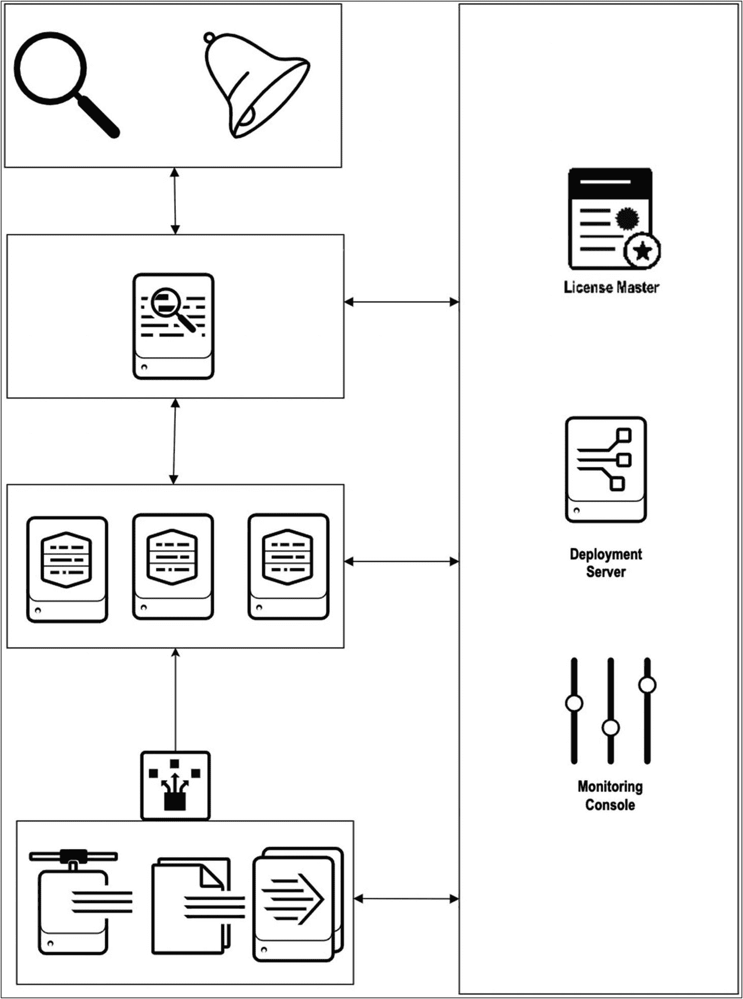

图 13-8 中型企业 Splunk 组件架构部署

*   **数据输入**：根据所需配置和部署方式，数据通过转发器、脚本化输入、文件输入等渠道进入系统。数据被转发至索引器，或者索引器/搜索头可部署在一起。
*   **索引**：在此类企业部署中，索引器接收来自转发器的数据，并存储和索引这些传入数据。
*   **搜索**：在此类企业中，会配置独立的搜索头来处理用户的查询请求。

如果中型企业中的传入数据量突然增长，则需要提高系统的可扩展性。为此，需要添加更多的索引器和搜索头。

现在，让我们来看大型企业部署。

## 大型企业部署

## 大型企业部署

若组织索引数据量超过 1 TB/天，且用户数超过 300 人，则需要采用大型企业部署。大型企业部署使用多个转发器将数据转发至索引器，索引器搜索头则部署在转发器之上。同时，还设有搜索头主管（`Search Head Captain`）以确保搜索效率。

图 13-9 展示了一个大型企业部署架构。

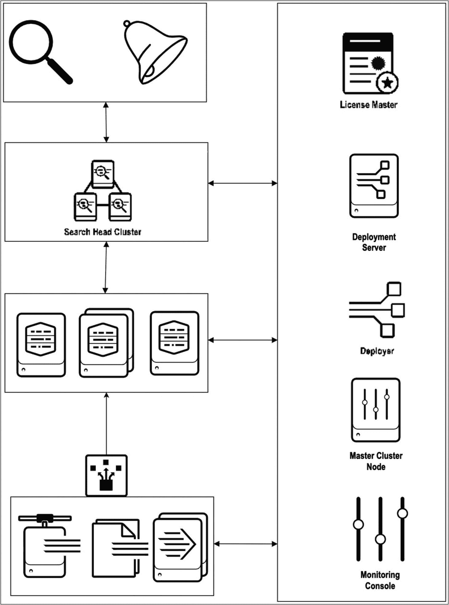

图 13-9 大型企业 `Splunk` 组件架构部署

*   **数据输入**：根据配置和部署方式，数据通过转发器、脚本化输入、文件输入等渠道进入系统。会部署负载均衡功能，使数据均匀分布在多个索引器之间。
*   **索引器**：在此类部署中，索引器接收来自转发器的数据进行存储和索引。
*   **搜索头**：在此类企业中，会配置更多的搜索头来处理大量来自用户的查询请求。

至此，您已了解 `Splunk Enterprise` 能够处理大量传入数据，但这是在单站点部署的情况下。然而，由于所有组件都位于同一站点，这引发了安全问题。如果该单站点在灾难（如洪水或地震）中受损怎么办？为避免这种情况，`Splunk` 支持多站点集群。

### 多站点（M3/M13）

多站点（M3/M13）架构使用搜索头集群（`Search Head Cluster`）实现水平扩展，并消除每个站点搜索层中的单点故障。每个站点均设有搜索头集群（`SHC`），以增加可用搜索容量、分散计划工作负载并实现最佳的用户故障转移。多站点（M3/M13）架构还包含分布式集群部署的实现，通过配置站点复制因子和搜索因子，在多个站点间复制数据。

多站点索引器集群如图 13-10 所示。

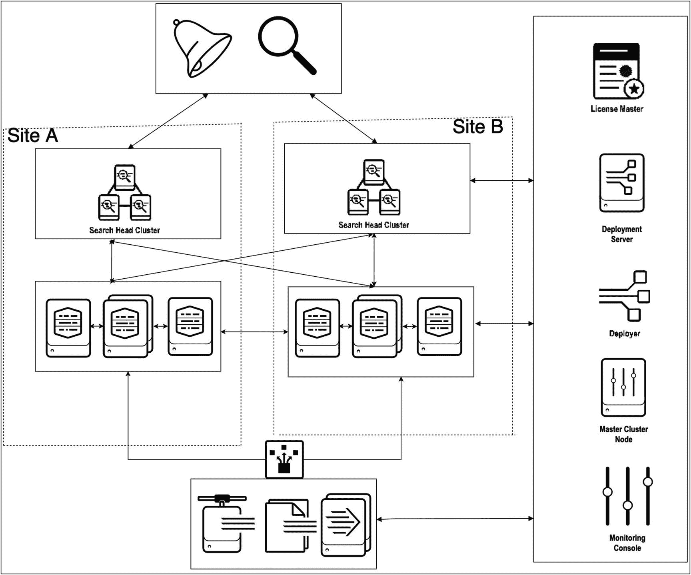

图 13-10 多站点（M3/M13）组件架构部署

*   **数据输入**：根据配置和部署，数据通过转发器、脚本化输入、文件输入等渠道进入系统。会部署负载均衡功能，使数据均匀分布在多个索引器之间。
*   **索引器**：在此类部署中，索引器接收来自转发器的数据进行存储和索引。索引器还包含一个主节点（`master node`），用于管理索引器集群的功能，并协调不同站点间数据桶（`bucket`）的复制方式。
*   **搜索头集群**：为各个站点配置搜索头集群。每个站点拥有自己的搜索头集群。

### 多站点（M4/M14）

多站点（M3/M13）与多站点（M4/M14）架构几乎相同。唯一的区别在于，后者包含一个横跨两个站点的统一搜索头（`stretched search head`）。这有助于在搜索节点或数据中心发生故障时，为用户提供最佳的故障转移体验。

*   **数据输入/索引器**：在此类部署中，数据通过转发器、脚本化输入、文件输入等渠道进入系统。索引器接收来自转发器的数据进行存储和索引。索引器还包含一个主节点，用于管理索引器集群的功能，并协调不同站点间数据桶的复制方式。
*   **搜索头集群**：根据您的企业设计配置搜索头集群。搜索头集群横跨共享站点进行统一部署。

## 使用案例：XYZ 公司

您的客户 XYZ 公司希望迁移至 `Splunk`。其现有基础设施是为满足 PCI 合规的电子商务要求而建立的。用于满足这些要求的日志系统目前已超负荷运转。XYZ 的日志存储资源即将耗尽，这影响了他们监控运维、安全和合规日志的能力。因此，XYZ 希望迁移到 `Splunk`。其当前环境使用基于 Linux 和 Windows 的日志，并与`syslog`直接关联。

当前数据源包括防火墙服务、电子商务、代理、数据库和网络日志。不同数据源的保留期各不相同：防火墙为 90 天，应用服务为 120 天，电子商务为 365 天，代理数据为 90 天，数据库为 180 天，网络为 30 天。应用服务、网络和代理基于 Windows 和 Linux 系统，其余数据源仅基于 Linux。

PCI 合规仅适用于电子商务数据，其他数据源不涉及合规性数据馈送。访问权限分为四个级别：安全、运维、销售和支持。安全团队可访问所有日志；运维团队可访问应用服务、电子商务、数据库和网络日志；支持团队可访问应用服务和电子商务日志；销售团队仅可访问电子商务日志。

原始数据压缩率约为 15%（已提供），索引压缩率约为 35%（已提供）。各数据源日均数据量如下：防火墙 40 GB/天，应用服务 20 GB/天，电子商务 102 GB/天，代理 30 GB/天，数据库 40 GB/天，网络 10 GB/天。

与客户沟通后，您了解到防火墙、电子商务、代理和数据库数据源的监控方式。对于应用服务，需使用脚本化输入。要捕获网络日志，需使用网络端口。

XYZ 公司共有 38 名用户。安全组有 9 名用户，每天活跃 12 至 18 小时；销售组有 12 名用户，每天活跃 7 至 11 小时；运维组有 10 名用户，每天活跃 6 至 13 小时；支持组有 9 名用户，每天活跃 2 至 8 小时。

公司需要 18 个仪表盘、75 个警报、85 个报表和 5 个数据模型。数据从热存储桶滚动到冷存储桶的周期为 30 天。

`Splunk` 架构设计分为六个阶段。

- **`Splunk` 数据输入**是数据收集的初始阶段。解决方案架构师与 XYZ 公司进行了多次沟通，以收集需求，例如每日数据量、数据源、保留期以及各组的访问权限。
- **`Splunk` 索引计算**是第二阶段。它基于原始数据压缩率、保留天数和索引文件压缩率。您需计算原始数据的基础大小和索引计算的基础大小，这有助于设计 `Splunk` 索引并了解当前架构概览。
- **`Splunk` 总保存数据**是第三阶段。在此阶段，您需根据原始数据压缩率、保留天数、索引文件压缩率、复制因子和搜索因子计算所需的总磁盘大小。总保存数据为 `Splunk` 架构师提供洞察，帮助其确定基础设施所需的索引器数量。
- **`Splunk` 用户规划器**是第四阶段。开销成本基于计划搜索、并发用户、并发用户活跃时间和索引并行化计算。`Splunk` 用户规划器帮助架构师确定开销成本并规划 `Splunk` 基础设施设计。
- **`Splunk` 硬件与应用程序考量**是第五阶段。在此阶段，需研究磁盘存储、水平扩展、垂直扩展、索引并行化以及搜索容量因子。硬件和 `Splunk` 扩展考量帮助 `Splunk` 架构师设计可扩展的解决方案。
- **磁盘大小计算**是最后阶段。在此阶段，您需基于之前所有阶段的数据馈送计算确切的磁盘大小。通过磁盘大小计算，您将了解 `Splunk` 架构的设计方式。

现在让我们深入探讨每个阶段。

### `Splunk` 数据输入

`Splunk` 数据输入是初始阶段。它包括收集数据源、方法、环境、索引名称、保留天数、可见性/访问权限、所有权、完整性、原始数据压缩率、索引文件压缩率以及日均数据量（以 GB 为单位）。让我们逐一了解每个组件。

- **数据源**：数据输入或数据源的名称。
- **方法**：描述数据所在位置以及如何将数据导入 `Splunk`。可通过脚本化输入、监控节、网络端口等方式收集。
- **环境**：操作系统。有助于规划企业级部署。
- **索引名称**：`Splunk` 架构师需要规划的索引名称。有助于有效部署。
- **保留天数**：数据应在 `Splunk` 中保留的天数。保留策略取决于法律、业务和搜索需求。
- **可见性/访问权限**：指定哪些个人或团队可以访问数据。
- **所有权**：定义控制可见性/访问权限并能在 `Splunk` 中进行重要更改的所有者或个人。
- **完整性**：指定为维护数据完整性所需的特殊考量。
- **原始数据压缩率**：`Splunk` 通过压缩原始数据所节省的预估百分比。例如，15%意味着 100 GB 原始数据可压缩至 15 GB。
- **索引文件压缩率**：`Splunk` 通过压缩索引文件所节省的预估比率。例如，若传入 100 GB 原始数据，索引文件（词法表）压缩率为 35%，则传入数据压缩至 35 GB。
- **日均数据量（GB）**：每日传入数据的平均量，以吉字节为单位。

图 13-12 是一个 `Splunk` 数据输入电子表格。让我们看一下。

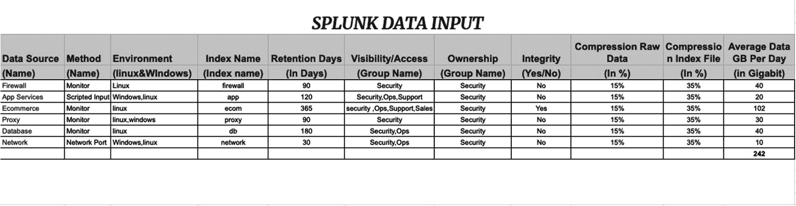

图 13-12 `Splunk` 数据输入

### `Splunk` 索引计算

`Splunk` 索引计算是第二阶段。我们来看一下每个组成部分。

- **原始数据压缩率** 是 `Splunk` 通过压缩原始数据所节省空间的估算比率。`原始数据压缩率 = 压缩百分比 * 每日平均数据量`。例如，防火墙数据源的每日平均数据量为 40 GB，压缩百分比为原始数据的 15%。因此，防火墙数据源的原始数据压缩量为 6 GB/天。

## 核心概念

- **索引文件压缩率** 是 `Splunk` 通过压缩索引文件所节省空间的估算比率。`索引文件压缩率 = 索引文件压缩百分比 * 每日平均数据量`。例如，防火墙数据源的每日平均数据量为 40 GB，压缩百分比为索引文件的 35%。因此，防火墙数据源的索引文件压缩量为 14 GB/天。

- **原始数据基础大小**：原始数据的基础大小由每个数据源的原始数据总量构成。计算公式为：`原始数据基础大小 = 原始数据压缩量 * 保留天数`。例如，防火墙数据源的原始数据压缩量为 6 GB/天，保留期为 90 天。因此，防火墙数据源的原始数据基础大小为 540 GB。

- **索引文件基础大小**：原始数据的基础大小由每个索引文件的总原始数据量构成。计算公式为：`索引文件基础大小 = 索引文件压缩量 * 保留天数`。例如，防火墙数据源的数据索引量为 14 GB/天，保留期为 90 天。因此，防火墙数据源的索引数据基础大小为 1260 GB。

图 13-13 是一个 `Splunk` 索引计算电子表格。我们来看一下。

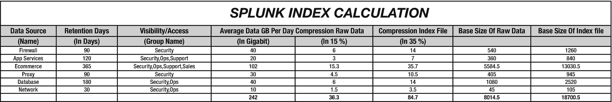

**图 13-13** Splunk 索引计算

## Splunk 总磁盘空间

`Splunk` 总磁盘空间是第三阶段。我们来看一下每个组成部分。

- **搜索因子** 指定了索引集群内可搜索副本的数量。可搜索存储桶同时包含原始数据和索引文件。当您在 `Splunk` Enterprise 中配置主节点时，您需要设置一个搜索因子，该因子定义了整个索引集群中每个存储桶必须维护的可搜索副本数量。搜索因子的默认值为 2。

- **复制因子** 指定了集群应维护的原始数据副本总数。索引器将传入的数据存储在存储桶中，集群会在整个环境中维护每个存储桶的副本。通常，复制因子的值比搜索因子多 1。

- **总磁盘空间** 由原始数据基础大小、索引文件基础大小、搜索因子和复制因子组成。计算公式为：`总磁盘空间 = 原始数据基础大小 * 复制因子 + 索引文件基础大小 * 搜索因子`。例如，当您要计算总磁盘空间时，假设防火墙数据源的 `原始数据基础大小 = 540 GB`，`索引文件基础大小 = 1260 GB`，`搜索因子 = 2` 且 `复制因子 = 3`，则您得到的 `总磁盘空间 = 4140 GB`。

图 13-14 是一个基于用例信息的 `Splunk` 总磁盘空间电子表格。我们来看一下。

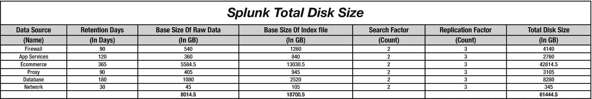

**图 13-14** Splunk 总磁盘空间

## Splunk 用户规划器

`Splunk` 用户规划器是第四阶段。我们来看一下每个组成部分。

- **临时搜索** 也称为非计划搜索。它们可以通过多种方式运行。例如，当您使用 `Splunk` 搜索处理语言调用搜索命令时，它会调用临时搜索。

- **计划搜索** 是使用搜索调度器来计划执行的，或者是作为报告加速或数据模型加速的一部分创建的。报告、仪表板和警报是为报告加速或数据模型加速而生成的搜索。汇总报告也是汇总搜索的一部分。

- **索引并行化** 允许索引器维护多个管道集。它允许索引器创建和管理多个管道，提供更多核心进行处理，并提高索引器 I/O 能力的限制。

- **实时搜索** 会实时刷新，根据边界不断推送旧数据并获取新数据。

- **并发用户** 为每个用户调用的搜索提供一个 CPU 核心。如果多个用户同时登录并运行搜索，所有可用的 CPU 核心会迅速被耗尽。例如，假设有 4 个核心和 12 个用户正在运行不同的搜索。由于可用核心数少于请求数，处理搜索的时间会增加。

图 13-15 是一个基于用例信息的 `Splunk` 用户规划器电子表格。我们来看一下。

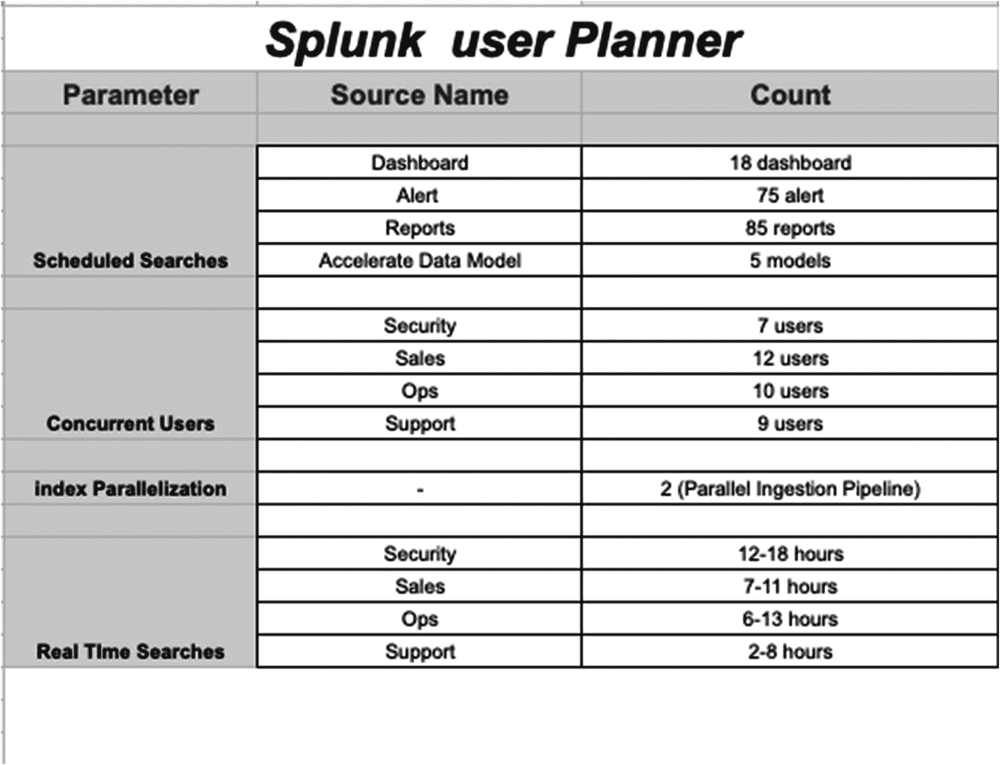

**图 13-15** Splunk 用户规划器

## 硬件与 Splunk 扩展考量

硬件与 `Splunk` 扩展是第五阶段。我们来看一下每个组成部分。

- **磁盘存储** 包括每秒的输入/输出操作数。它有助于衡量磁盘存储。硬盘驱动器的读写速度不同。对于存储桶存储，`Splunk` 使用存储区域网络（SAN）和网络附加存储（NAS）。SAN 用于热存储桶和温存储桶，NAS 用于冷存储桶。

- **水平扩展**：如果负载增加，并且您希望为当前的 `Splunk` 架构池增加更多索引能力，可以使用水平扩展，通过增加更多索引器来升级它。同样地，要提供更多搜索能力，可以向现有资源添加更多搜索头。

- **垂直扩展**：如果负载增加，并且您希望为当前的 `Splunk` 架构池增加更多索引能力，可以使用垂直扩展，通过添加更多 CPU 和核心来升级机器配置。但这存在局限性。

- **增加索引并行化** 仅在当前系统使用率不足时使用。例如，您有 12 个核心的索引器，但只有 4 个核心在使用中。在这种情况下，建议增加索引并行化。

- **搜索规模调整因素**：包括计划搜索的数量、报告数量、仪表板总数、活动并发用户数、每小时搜索总数等等。需要基于所有这些因素来设计搜索的规模调整因素。

## 磁盘大小计算

磁盘大小计算是指标计算的第六个阶段。在此阶段，您需要设计一个 `Splunk` 架构索引，并计算其磁盘大小。

从用例提供的信息中，您可以看到 `Splunk` 中的摄取量为 242 GB/天。复制因子为 3，搜索因子为 2。热存储桶和温存储桶保存在 SAN 中。冷存储桶保存在 NAS 中。根据用例，数据在热存储桶和温存储桶中保留 30 天。您有四个索引器，每天处理 60.5 GB 的数据索引量，开销成本为 25%。

图 13-16 是一个使用用例信息进行磁盘大小计算的电子表格。

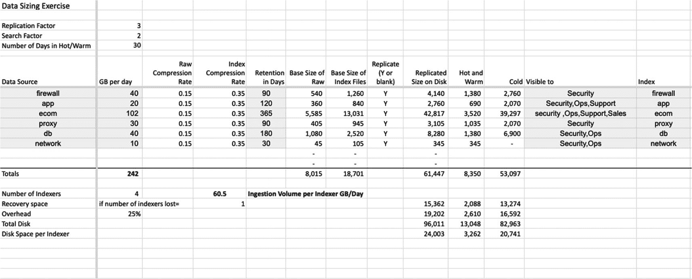

**图 13-16** 磁盘大小练习

让我们快速回顾一下这个用例以及计算磁盘大小所需的内容。

- **复制因子**: 3
- **搜索因子**: 2
- **索引器数量**: 4
- **热/温存储桶中的天数**: 30 天
- **开销**: 0.25 或 25%
- **丢失的索引器数量**: 1
- **原始压缩率**: 15% 或 0.15
- **索引压缩率**: 35% 或 0.35
- **原始数据基础大小**: `压缩原始数据 * 保留天数`
- **索引文件基础大小**: `压缩索引文件 * 保留天数`
- **磁盘上的复制大小**: `原始数据基础大小 * 复制因子 + 索引文件基础大小 * 搜索因子`
- **每个索引器的摄取量**: `每天总 GB / 索引器数量`
- **热和温**: `(原始压缩率 * 每日 GB * 复制因子) + (索引压缩率 * 每日 GB * 搜索因子) * 热/温存储桶中的天数`
- **冷存储桶**: `(原始压缩率 * 每日 GB * 复制因子) + (索引压缩率 * 每日 GB * 搜索因子) * (保留天数 – 热/温存储桶中的天数)`
- **每个索引器的数据存储**: `磁盘上的总复制大小 / 索引器数量`
- **开销成本**: `每个索引器的数据存储 + 开销 * 每个索引器的数据存储`
- **总磁盘空间**: `开销成本 * 索引器数量 + 开销成本`
- **每个索引器的总磁盘空间**: `总磁盘 / 索引器数量`

至此，本章内容结束。恭喜您成功学习了 `Splunk` 环境中的容量规划、单站点和多站点集群、搜索头以及企业部署中的 `Splunk` 架构设计。

## 总结

本章涉及了各种容量规划组件，以及使用 `Splunk` Web、CLI 和配置文件配置搜索头。还涵盖了搜索头集群、搜索头主节点的配置、多站点集群和 `Splunk` 架构。您学习了如何设计小型、中型、大型以及多站点索引器集群。

本章覆盖了 `Splunk` 架构师考试大纲的很大一部分。您已经熟悉了模块 2（项目需求）的 5%、模块 3（基础设施规划）的 5%、模块 4（资源规划）的 7%、模块 18（搜索头集群）的 5% 以及模块 16（多站点索引集群）的 5%。

下一章将介绍监控控制台、`metrics.log`、作业检查器、排查许可证违规问题、排查部署问题以及排查集群问题。

## 选择题

1.  搜索头主要与哪个 `Splunk` 组件进行通信？
    1.  索引器
    2.  转发器
    3.  集群主节点
    4.  部署服务器

2.  需要更改哪个硬件属性才能增加单个搜索头上的并发搜索（临时和计划中）的数量？
    1.  磁盘
    2.  CPU
    3.  内存
    4.  网卡

### 3. 在分布式环境中，哪个 Splunk 组件合并单个结果并准备报告？
1. 索引器
2. 转发器
3. 搜索头
4. 搜索对等端

### 4. 以下哪个是有效的分布式搜索组？
1. `[distributedSearch:test] default=false servers=server1,server2`
2. `[searchGroup:test] default=false servers=server1,server2`
3. `[distributedSearch:test] default=false servers=server1:8089,server2:8089`
4. `[searchGroup:test] default=false servers=server1:8089,server2:8089`

### 5. 哪个 Splunk 组件执行索引并响应来自搜索头的搜索请求？
1. 转发器
2. 搜索对等端
3. 许可证主节点
4. 搜索头集群

### 6. 使用配置文件配置 Splunk 搜索对等端的是哪个文件？
1. `server.conf`
2. `deployment.conf`
3. `output.conf`
4. `distsearch.conf`

### 答案
1. 4
2. 2
3. 3
4. 3
5. 2
6. 1