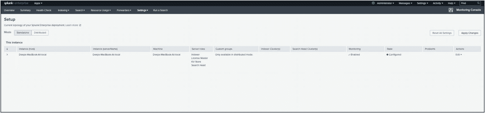
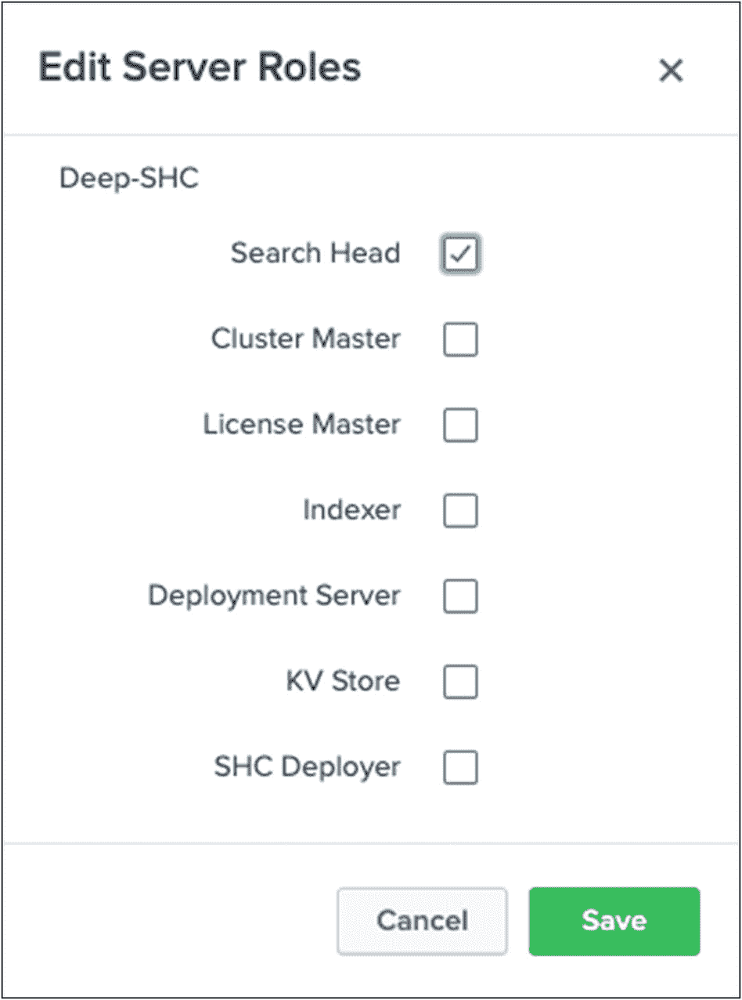
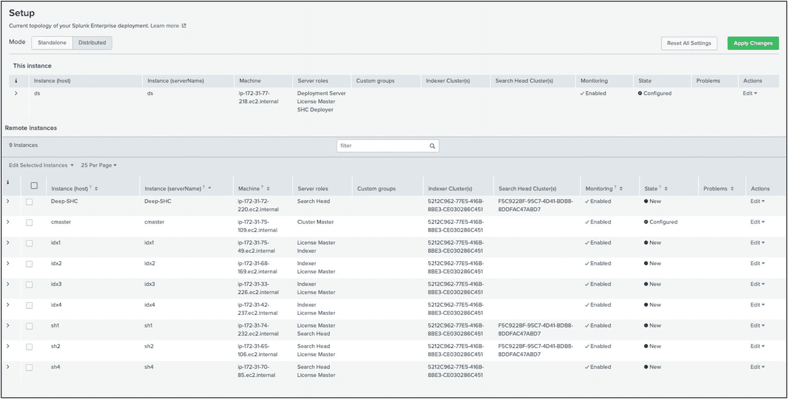
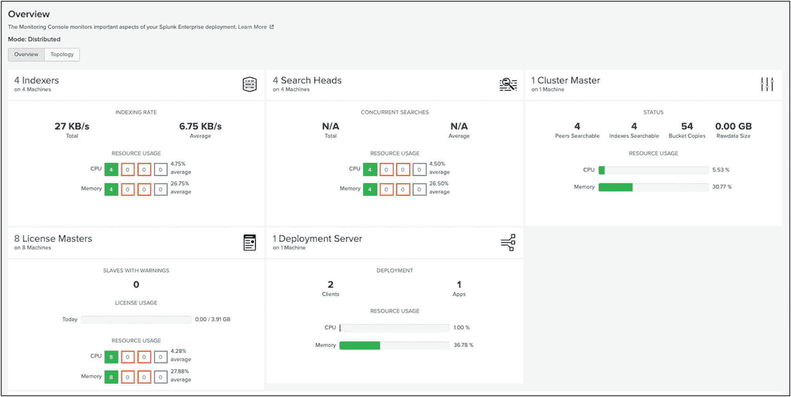
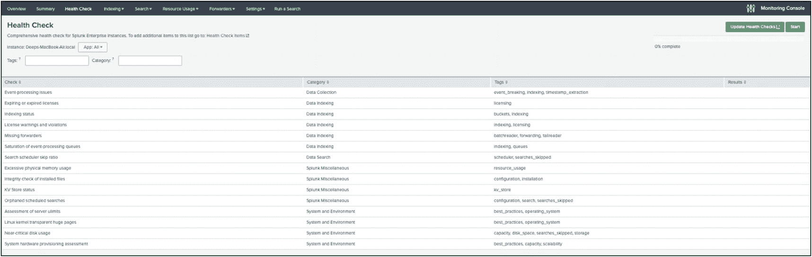
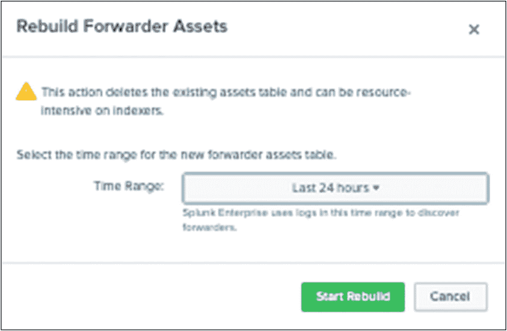
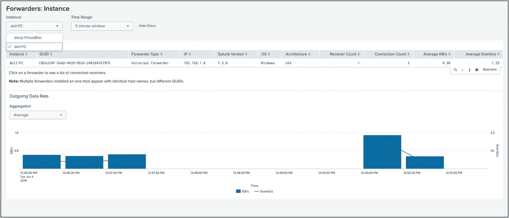
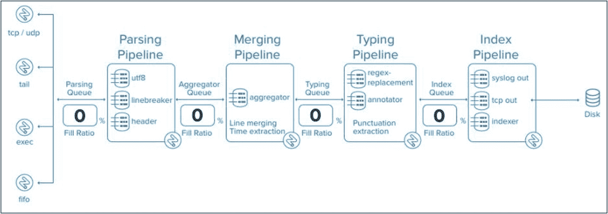
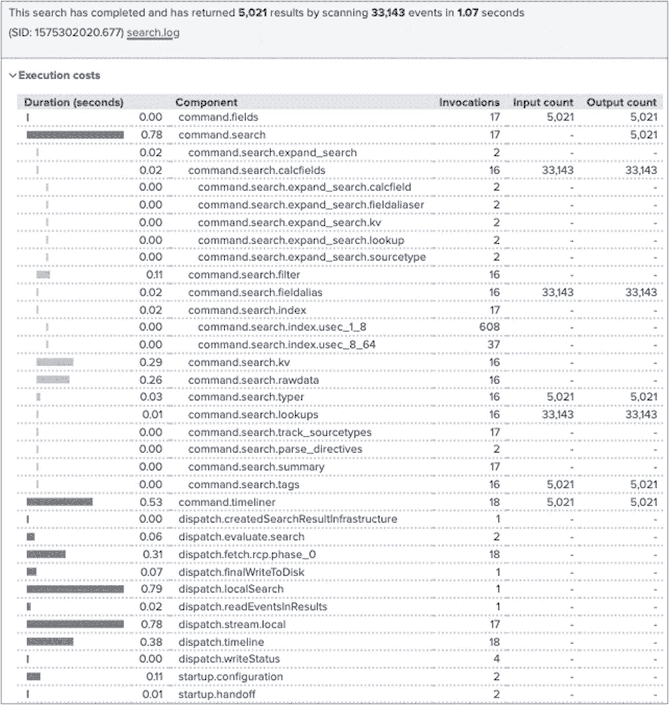
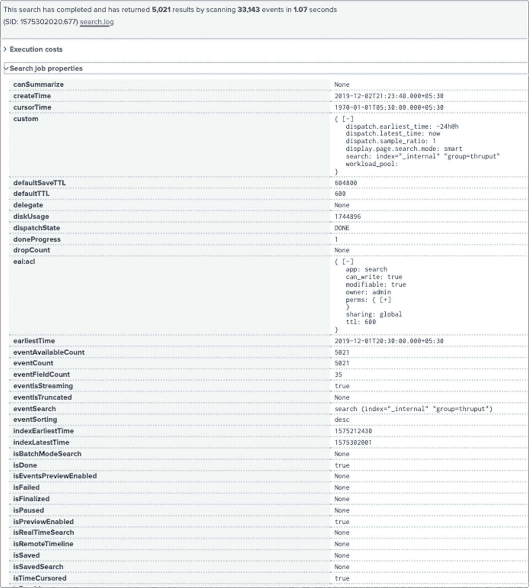

# 14. Splunk 中的故障排除

本章重点介绍分析活动并诊断 Splunk Enterprise 中的问题。您将学习用于故障排除的监控控制台及其所有组件。您将了解所有对故障排除有用的日志文件。您还将学习作业检查器、发生许可证违规时会发生什么，以及排查部署和集群问题。

本章涵盖以下主题。

- 监控控制台
- 用于故障排除的日志文件
- `metrics.log`
- 作业检查器
- 排查许可证违规问题
- 排查部署问题
- 排查集群问题

完成本章后，您将掌握 Splunk 架构师考试大纲的 20%。

## 监控控制台

Splunk 中的监控控制台由一组报告、仪表板、警报和健康检查组成，旨在提供关于 Splunk Enterprise 性能的详细视图和信息。监控控制台仅对管理员用户可用。监控控制台是最大的故障排除资产之一。以下是其最重要的几个功能。

- 单实例部署
- 多实例部署
- 监控系统健康状态
- 配置转发器监控

### 单实例部署监控控制台

单实例部署监控控制台用于单个实例，其中索引器、许可证主节点、KV 存储和搜索头都位于一个实例中。要配置单实例的 Splunk 部署，请参考以下步骤。



**图 14-1.** 监控控制台：单实例

1.  在 Splunk Web 中，转到“设置”页面。
2.  转到“监控控制台”。
3.  转到监控控制台的“设置”页面，然后转到“常规设置”。
4.  单击“独立”。
5.  在“服务器角色”下选择索引器、许可证主节点、KV 存储和搜索头（参见图 14-1）。


### 多实例部署监控控制台

多实例部署监控控制台用于分布式环境，其中`索引器`、`许可证主服务器`、`KV 存储`和`搜索头`不位于单个实例中。要为多实例配置 Splunk 部署，请参考以下步骤。

1. 在 Splunk Web 中，转到 `设置` 页面。
2. 转到 `监控控制台`。
3. 转到监控控制台的 `设置` 页面，然后转到 `常规设置`。
4. 启用 `分布式模式`。
5. 为节点分配角色并配置部署。
6. 单击 `保存`。

图 14-2 展示了如何编辑服务器角色。



**图 14-2**  
监控控制台：服务器角色

以下说明如何在重启后重置服务器角色。

1. 在 `监控控制台` 中，单击 `设置` 并进入 `常规设置`。
2. 单击 `分布式模式`。
3. 要编辑服务器角色，请进入 `远程实例`，然后单击 `编辑`。
4. 选择或编辑服务器角色。
5. 单击 `应用更改`。

图 14-3 展示了如何编辑服务器角色并将角色分配给实例。



**图 14-3**  
监控控制台服务器角色：分布式模式


**图 14-4**

1. 完成服务器角色的所有更改后，单击 `保存` 并继续进入 `概览` 页面。
2. 单击 `转到概览`（见图 14-4）。

图 14-5 展示了多实例部署监控控制台。其中有四个索引器、四个搜索头和一个集群主服务器。



**图 14-5**  
监控控制台：部署

### 使用监控控制台监控系统运行状况

健康检查监控整个系统的运行状况。如果某个特定的转发器被停用，它将保留在转发器表中，直到您将其移除。转发器资产表会从系统中移除已停用的节点。平台警报是 Splunk 中已保存的搜索。平台警报会通知 Splunk 管理员。如果使用 `监控控制台` 触发了任何条件，您就能知道系统中配置了哪些警报。健康检查附带了一些预配置的警报。您可以修改现有的健康检查或创建新的健康检查。

执行以下操作在系统中运行健康检查。

1. 在 Splunk Web 中，转到 `设置` 页面。
2. 转到 `监控控制台`。
3. 转到监控控制台的 `设置` 页面，然后进入 `常规设置`。
4. 转到 `健康检查`。
5. 启动健康检查。

图 14-6 展示了系统中的健康检查。如果您遇到错误，则需要开始进行故障排除。健康检查有助于您了解系统的当前状态。



**图 14-6**  
监控控制台：健康检查

执行以下操作重建转发器资产表。

1. 在 `监控控制台` 中，单击 `设置`。
2. 转到 `转发器监控设置`。
3. 如果已禁用，请单击 `启用转发`。
4. 单击 `保存`。
5. 单击 `重建转发器资产表`。
6. 选择 `时间线`。
7. 单击 `开始重建`。

我选择了 **最近 24 小时** 的时间范围来重建转发器资产表（见图 14-7）。



**图 14-7**  
监控控制台：重建转发器资产表

`监控控制台` 通过重建转发器资产表来移除缺失的转发器。

### 为监控控制台配置转发器监控

`监控控制台` 监控来自转发器连接的传入数据。对转发器传入数据的测量是通过 `metrics.log` 完成的。

以下说明如何设置转发器实例视图。

1. 在 Splunk Web 中，转到 `设置` 页面。
2. 在 `监控控制台` 中，单击 `转发器`。
3. 转到 `转发器实例`。
4. 选择实例名称并选择时间范围。

图 14-8 展示了一个转发器实例，其中实例为 `dell-pc`，时间范围为 **5 分钟窗口**。



**图 14-8**  
监控控制台：转发器监控

接下来，让我们看看用于故障排除和指标分析的日志文件。

## 用于故障排除的日志文件

Splunk 中的日志文件位于 `$SPLUNK_HOME/var/log/splunk/` 文件名下。这些日志文件用于对 Splunk Enterprise 进行故障排除。内部日志可帮助您进行故障排除或用于指标分析。表 14-1 涵盖了故障排除所需的所有主要日志文件。在本章中，我们将详细介绍 `metrics.log` 文件，要了解更多关于用于故障排除的日志文件，请访问 [`docs.splunk.com/Documentation/Splunk/7.3.0/Troubleshooting/WhatSplunklogsaboutitself`](https://docs.splunk.com/Documentation/Splunk/7.3.0/Troubleshooting/WhatSplunklogsaboutitself)。

**表 14-1** 用于分析与故障排除的内部日志文件

| 属性 | 值 |
| --- | --- |
| `audit.log` | 此文件包含关于用户活动、修改知识对象以及 Splunk 中已保存搜索的信息。 |
| `btool.log` | `Btool` 用于对 Splunk 配置文件进行故障排除。您使用 `btool.log` 来记录 `Btool` 活动。 |
| `metrics.log` | 此文件包含性能和系统数据、关于内部处理器 CPU 使用情况的信息以及 Splunk 数据处理中的队列使用情况。 |
| `splunkd.log` | 此文件用于故障排除。由脚本化输入、脚本化搜索命令等生成的任何 `stderr` 消息都会记录在此处。 |
| `splunkd_access.log` | 此文件来自通过已记录的 UI 的 `splunkd`。 |

接下来，我们来讨论 `metrics.log` 文件及其相关的重要组。


### `metrics.log` 文件

`metrics.log` 文件揭示了整个 Splunk Enterprise 的运行状况。Splunk 中的数据通过数据管道分阶段移动。这些阶段包括输入管道、解析管道、合并管道、类型化管道和索引管道，如图 14-9 所示。



图 14-9

Splunk Enterprise 数据管道

*   **输入管道**主要由数据源组成。在此阶段添加主机、源和源类型。该管道是第一阶段。它包括 TCP/UDP 管道、tail 跟踪、FIFO 管道和 exec 管道等方法。`inputs.conf`、`wmi.conf` 和 `props.conf` 是输入管道中的配置文件。
*   **解析管道**是第二阶段。该管道有两个处理器：**读入器**和**发送器**。`props.conf` 文件是解析管道中关注的文件。读入处理器从解析队列中获取数据，发送器将数据发送到聚合器队列。解析阶段包括 UTF-8 解析、换行符和标头。
*   **合并管道**是第三阶段。该管道有两个处理器：**聚合器**和 `winparsingqueue`。聚合器处理器识别事件边界并提取时间戳，而 `winparsingqueue` 处理器拥有自己的聚合器，并将数据馈送到类型化队列。此阶段完成多行事件的合并和每个事件的时间提取。`props.conf` 是合并管道中包含的配置文件。`SHOULD_LINE_MERGE`、`BREAK_ONLY_BEFORE`、`MUST_BREAK_AFTER` 和 `MAX_EVENTS` 包含在合并管道中。
*   **类型化管道**是第四阶段。它有两个处理器：`readerin` 和 `sendout`。`props.conf` 文件和 `transforms.conf` 是类型化管道中关注的文件。`readerin` 处理器从聚合队列读取数据，`sendout` 将数据发送到索引队列。转换 `-xxx`、`SEDCMD`、`SOURCE_KEY`、`DEST_KEY`、`REGEX` 和 `FORMAT` 也包含在类型化管道中。
*   **索引管道**是第五阶段。该管道具有 `indexin` 处理器。`indexes.conf` 和 `outputs.conf` 是索引管道中关注的文件。`indexin` 处理器负责从索引队列读取数据。`Tcp-output-generic-processor`、`syslog-output-generic-processor`、`fishbucket`、`signing`、`indexer` 和 `index_thruput` 包含在索引管道中。

假设有一个数据输入，它是激增的事件。它隐藏在数据中，可能难以理清。因此，在这种情况下，可以查看 Splunk 内部的 `metrics.log`。Splunk 中的 `metrics.log` 文件是一个每 30 秒采集一次输入的报告。它包含有助于审查产品行为的自省信息。要排除 Splunk Web 中的 `metrics.log` 文件故障，请使用内部索引，或者使用 Splunk 中的调试模式查看位于 `$Splunk_home/var/log/splunk/metrics.log` 的 `metrics.log` 文件。`metrics.log` 文件由按 `group` 参数分类的行结构组成，该参数有助于定义度量数据（即 metrics data）的类型。`metrics.log` 文件中有许多组；以下是一些重要的组。

*   pipeline messages
*   queue messages
*   thruput messages
*   tcpout connections messages
*   udpin_connections messages
*   bucket_metrics messages

有关 `metrics.log` 的更多信息，请参阅 [`https://docs.splunk.com/Documentation/Splunk/8.0.0/Troubleshooting/metricslog`](https://docs.splunk.com/Documentation/Splunk/8.0.0/Troubleshooting/metricslog)。

在企业版许可证中，每个事件的度量数据（metrics data）大小为 150 字节。

### 管道消息 (Pipeline Messages)

管道消息包含 Splunk 管道的详细报告。它们被组合在一起以处理和操作用于流入和流出 Splunk 系统的事件。管道消息跟踪每个 CPU 使用的时间，并了解进程执行情况。

管道消息的结构由以下事件确定。

*   **时间戳**：事件包含一个时间戳，用于记录事件在系统中发生的时间。
*   **group=pipeline**：这反映并捕获了 CPU 的发送器执行时间。按处理器绘制总 CPU 秒数，可以了解在索引活动中 CPU 时间的去向。

```
12/1/19
5:17:10.335 PM12-01-2019 17:17:10.335 +0530 INFO Metrics - group=pipeline, name=typing, processor=metricschema, cpu_seconds=0, executes=405, cumulative_hits=8314
```

### 队列消息 (Queue Messages)

Splunk 中的队列消息包含跨事件的聚合信息，并可以告知索引瓶颈所在位置。

队列消息的结构由以下事件确定。

*   **时间戳**：事件包含一个时间戳，用于记录事件在系统中发生的时间。
*   **group=queue**：队列数据包含揭示网络瓶颈的聚合信息。`current_size` 是一个重要值，因为它反映了当时插入索引器中的数据量。例如：当前 `current_size = 955`，这反映了当时插入索引器的数据量较多，可能导致瓶颈。理想情况下，`current_size` 应在 0 到 500 之间，这意味着索引系统运行良好。

```
12/1/19
8:25:19.839 PM
12/01/2019 20:25:19.839 +0530 INFO Metrics - group=queue, blocked=true ,name=typingqueue, max_size_kb=500, current_size_kb=432, current_size=955, largest_size=966, smallest_size=966
```

### 吞吐量消息 (Thruput Messages)

Splunk 中的吞吐量消息衡量索引管道中处理原始事件的速率。吞吐量数字是流经系统的“原始”事件的大小。

消息的结构由以下事件确定。

*   **时间戳**：事件包含一个时间戳，用于记录事件在系统中发生的时间。
*   **group=thruput**：这衡量处理原始事件的速率。自 Splunk Enterprise 启动以来，它最适合用于洞察性能调优或评估平均全面索引。Thruput 有助于确定哪些数据类别繁忙，并有助于性能调优或评估索引负载。

```
12/1/19
11:10:52.469 PM
12-01-2019 23:10:52.479 +0530 INFO Metrics - group=thruput, name=thruput, instantaneous_kbps=3.3666908659618975, instantaneous_eps=16.99733361182728, average_kbps=2.1346675475642374, total_k_processed=46162, kb=104.3837890625, ev=527, load_average=1.48828125
```

### TCP 输出连接消息 (Tcpout Connection Messages)

Splunk 中的 `tcpout` 连接消息提供有关系统的信息；具体来说，`tcpout` 连接已连接到开放的套接字。

`tcpout` 连接消息的结构由以下事件确定。

*   **时间戳**：事件包含一个时间戳，用于记录事件在系统中发生的时间。
*   **group=tcpout_connections**：`tcpout_connections` 统计 Splunk 成功写入套接字的字节数。`tcp_avg_thruput` 演示自 Splunk 系统启动以来字节流入的平均速率。

```
12/1/19
11:10:52.469 PM
12-01-2019 23:10:52.479 +0530 INFO Metrics - group=tcpout_connections, name=undiag_indexers:191.11.41.67:9997:0, sourcePort=9009, destIp=191.11.41.67 destPort=9997, _tcp_Bps=28339066.17, _tcp_KBps=21669.07, _tcp_avg_thruput=29532.96, _tcp_Kprocessed=808751, _tcp_eps=31211.10, kb=807353.91
```


### `udpin_connections` 消息

Splunk 中的 `udpin_connections` 消息实质上是对 UDP 输入进行计量。

`udpin_connections` 消息的结构由以下事件决定。

- **时间戳**：事件包含一个时间戳，用于记录事件在系统中发生的时间。
- **`group=udpin_connections`**：`udpin_connection` 测量 Splunk 写入 UDP 输入的字节数。`udp_avg_thruput` 展示了自启动以来流入 UDP 输入的平均字节速率。它有助于了解当前系统中的数据流情况。

```
12/1/19
11:10:52.469 PM
12-01-2019 23:10:52.479 +0530 INFO Metrics -group=udpin_connections, 8001, sourcePort=8001, _udp_bps=0.00, _udp_kbps=0.00, _udp_avg_thruput=0.00, _udp_kprocessed=0.00, _udp_eps=0.00
```

### `bucket_metrics` 消息

Splunk 中的 `bucket_metrics` 消息是关于存储桶状态的详细摘要报告。您可以获取热存储桶、冷存储桶和冻结存储桶的总数。

`bucket_metrics` 消息的结构由以下事件决定。

- **时间戳**：事件包含一个时间戳，用于记录事件在系统中发生的时间。
- **`group=bucket_metrics`**：显示组织中 Splunk 的存储桶状态。`current_hot` 反映组织中的热存储桶总数。`current_total` 显示整个组织中的存储桶总数。

```
12/2/19
06:34:21.543 AM
12-02-2019 06:34:21.543 +0530 INFO Metrics - group=bucket_metrics, current_hot=6, current_hot_replicas=0, current_total=68, created=0, created_replicas=0, rolled=0, frozen=0, total_removed=0
```

接下来，让我们看看如何使用 Splunk 搜索作业检查器来排查搜索性能问题。

## 作业检查器

Splunk 搜索作业检查器用于排查搜索性能和知识对象的故障。搜索作业检查器提供了关于 Splunk 搜索性能的详细摘要报告。

作业检查器如何帮助您进行故障排除？

搜索作业检查器显示的关键信息是执行成本和搜索作业属性，它们在故障排除中扮演着重要角色。

- **执行成本**显示有关搜索各组件以及每个组件对搜索输出影响程度的信息。
- **搜索作业**属性列出了搜索的特性。搜索作业中的每个命令都包含一个部分和参数。参数值反映了每个命令所花费的时间。
- **EPS（每秒事件数）** = 搜索作业属性推导出每秒事件数，以便您了解系统的处理能力和管道。（`EPS=总事件数/时间`）。

### 作业检查器示例查询

在本节中，您将运行一个示例查询，从内部索引获取组吞吐量事件，并使用作业检查器排查该查询。

```
index="_internal" "group=thruput"
```

执行成本查询如图 14-10 所示。



图 14-10

Splunk 搜索处理语言查询：执行成本

- 持续时间包括处理每个组件所需的时间。
- 组件包括组件的名称。
- 调用次数包括组件被调用的次数。
- 输入和输出是每个组件输入和输出的事件。

`index="_internal" "group=thruput"` 的每秒事件数 `33143/1.07=30,94`

性能成本查询如图 14-11 所示。



图 14-11

Splunk 搜索处理语言查询：性能成本

- 性能成本显示搜索结果的状态，提供事件计数，并确保对所有索引执行了事件搜索。

下一节，您将学习 Splunk 管理员如何使用 `_internal` 索引来排查因许可证主节点和从节点之间连接不当导致的违规问题。

## 排查许可证违规问题

当您超过许可证允许的索引量时，就会发生许可证违规。许可证主节点负责跟踪许可证使用情况。如果许可证使用量超过许可证容量，Splunk 会发出许可证违规警告。如果在连续 30 天内收到五次警告，则构成许可证违规。

当您违反许可证时会发生什么？

在许可证违规期间，Splunk 软件会继续索引数据，但搜索功能将被阻止，同时还会对计划搜索和报告施加限制，但搜索 `_internal` 索引不会被阻止。

要获取详细的许可证使用报告，请使用 `_internal` 索引和 `licenseusage.log`。

### 因许可证主节点和从节点之间连接不当导致的违规

- 许可证主节点定义许可证堆栈和池、添加许可证并通过集中位置管理许可。从节点向主节点报告以获取许可证分配。
- 许可证从节点是向主节点报告以访问企业版许可证的 Splunk Enterprise 节点。

为了更好地理解许可证主节点和许可证从节点之间的连接，以及如何在同步缺失时进行故障排除，您需要参考以下步骤。

- 通过转到“设置” ➤ “许可”，检查 Splunk 主节点上次联系许可证从节点的时间。
- 要确定主节点是否宕机，请在许可证从节点上转到搜索命令，并输入类似于以下代码块的查询。
- 如果主节点宕机，消息的结构看起来类似于以下代码块。

```
index="_internal" "license master"
```

- 如果找不到类似上述代码块中的消息，请重启您的 Splunk 实例并检查防火墙策略；您的网络可能存在问题。
- 如果找到了上述代码块中的消息，请尝试重启许可证主节点或配置辅助主节点。在 72 小时内，数据索引没有问题，但超过 72 小时后，Splunk 部署会受到严重影响。

```
12/1/19
5:17:10.335 PM12-01-2019 17:17:10.335 +0000 ERROR LMTracker – failed to send rows, reason='Unable to connect to license master=https://191.###.####.####:8089 Error connecting: Connect Timeout
```

接下来，让我们看看如何排查部署问题。

## 排查部署问题

Splunk 部署由将数据发送到索引器的转发器组成。索引器对转发器发送的数据进行索引和保存。搜索头搜索保存在 Splunk 索引器中的数据。转发器、索引器和搜索头构成了 Splunk 部署。Splunk 部署可能很复杂，包含数千个转发器和多个索引器，也可能只有少数几个转发器、索引器和搜索头——这取决于规模。对于只有少量转发器的简单部署，故障排除很容易，但在拥有数千个转发器的环境中进行故障排除则非常复杂。让我们来看看如何排查转发器的问题。

要排查转发器和索引器之间的同步问题，请检查转发器中 `outputs.conf` 文件的 `[tcpout]` 节。


好的，作为高级文档工程师和翻译员，我将遵循您的指示，将给定的英文文本翻译成中文，并严格保留所有格式。


### Splunk 转发器故障排除

Splunk 转发器是将数据转发到 Splunk 索引器或重型转发器的实例。要对 Splunk 转发器进行故障排除，您需要查看转发器的 `splunkd.log` 文件，该文件位于 `$SPLUNK_HOME/var/log/splunk/splunkd.log`。

以下是已熟连（cooked）连接的结构说明。

-   **时间戳**：该事件包含一个时间戳，用于记录事件在系统中发生的时间。
-   **TcpOutputProc**：当查询中的多个农场（farms）繁忙时，会使用 `TcpOutputProc` 已熟连（cooked）连接。

```
5:17:10.335 PM12-01-2019 17:17:10.335 +0400 warn TcpOutputProc - Cooked connection to ip=191.x.x.x:9997 timed out
```

如何对 `TcpOutputProc` 进行故障排除？

-   Linux 转发器使用 `netstat`、`iptables` 和 `Telnet` 命令进行故障排除，并检查端口是否打开；如果未打开，则启用允许该端口进行出站连接的防火墙策略。
-   Windows 转发器使用 `Telnet` 命令检查端口是否打开；如果未打开，则启用允许该端口进行出站连接的防火墙策略。
-   检查 `output.conf` 文件的语法。在转发器中编辑配置文件后，重新启动 Splunk 转发器实例。

### Splunk 索引器故障排除

Splunk 索引器是 Splunk 保存其处理后数据的存储库目录。当接收索引器上的内部队列在此类情况下被阻塞时，Splunk 索引器会从转发器接收数据。要对 Splunk 索引器进行故障排除，您需要查看位于 `$SPLUNK_HOME/var/log/splunk/splunkd.log` 的索引器的 `splunkd.log` 文件。

以下是 `TcpInputFd` 的结构说明。

-   **时间戳**：该事件包含一个时间戳，用于记录事件在系统中发生的时间。
-   **TcpInputFd**：当接收器中的多个农场（farms）繁忙时，会使用 `TcpInputFd` 错误。

```
5:19:20.355 PM12-01-2019 17:17:10.335 +0400 ERROR TcpInputFd - SSL Error for fd from HOST:localhost.localdomain, IP:127.0.0.1, PORT:42134
```

如何对 `TcpInputFd` 进行故障排除？

-   重新启动 Splunk 实例
1.  在 Splunk Web 上禁用其农场繁忙的端口的接收功能。
2.  通过编辑 `[splunktcp][stanza from][inputs.conf]` 来禁用接收。

接下来，让我们对集群问题进行故障排除。

## 集群问题故障排除

在 Splunk 集群中，有搜索头、主节点和索引器。如果集群是多站点，则每个集群都有一个组件。尽管主节点位于任何物理站点中，但主节点不属于任何站点的一部分。

-   **主节点** 负责管理整个集群。它协调对等节点的复制活动，并指导搜索头在对等节点中查找数据。
-   **对等节点** 接收并索引传入的数据。它作为独立机器工作，但有一个区别：对等节点复制来自另一个节点的数据。对等节点负责存储内部数据并复制从另一个节点接收的数据。
-   **搜索头** 在一组对等节点之间运行搜索。主节点帮助搜索头查找数据。搜索头用于在整个 Splunk 环境中进行搜索。

对集群进行故障排除很复杂，因为涉及一系列操作。

要对 Splunk 中的集群问题进行故障排除，管理员通常使用监控控制台检查是否存在任何问题。

### 多站点搜索亲和性

当您使用多站点集群时，搜索头被配置为从本地站点的对等节点获取搜索结果；这称为多站点搜索亲和性。如果本地对等节点发生故障并且搜索头同时宕机，您将无法搜索数据。要对多站点搜索亲和性进行故障排除，请通过在搜索头中位于 `$Splunk_HOME/etc/system/local` 的 `server.conf` 文件中禁用它。按如下方式编辑 `server.conf` 文件。

```
[general]
site = site0
[clustering]
multisite = true
```

### 更多存储桶问题

在 Splunk 中，数据被分组到存储桶中。随着存储桶数量的增加，时间也必须增加。如果您的组织有一个超过 38,000 个的存储桶，并且对等节点超过 40 个，那么可能是时候增加心跳间隔时间以获得更流畅的性能。但在增加心跳时间之前，请咨询 Splunk 支持团队，以确定这对您的组织是否安全。要增加 `heartbeat_timeout`，请转到主节点的 `server.conf` 文件，该文件位于 `$Splunk_HOME/etc/system/local`。按如下方式编辑 `server.conf` 文件。

```
[clustering]
heartbeat_timeout=120
```

## 总结

本章涵盖了监控控制台及其所有重要组件，包括单实例和多实例部署、监控系统健康状况以及转发器监控。它概述了 `metrics.log` 文件，并展示了作业检查组如何对 Splunk 搜索进行故障排除。在本章末尾，您了解了在 Splunk 中对许可证违规、部署问题和集群问题进行故障排除的各种方法。

本章涵盖了 Splunk 架构师考试大纲的重要性。您现在熟悉了第 8 模块（Splunk 故障排除方法和工具）的 5%、第 12 模块（搜索问题）的 5%、第 13 模块（部署问题）的 5% 以及第 9 模块（澄清问题）的 5%。

下一章将介绍通过部署服务器部署应用程序、使用 `serverclass.conf` 创建服务器组、通过部署服务器在通用转发器上部署应用程序、负载均衡、SOCKS 代理和索引器发现。

## 选择题

1.  Splunk Enterprise 预配置了以下哪些索引？（选择所有适用的选项。）
    1.  `_license`
    2.  `_internal`
    3.  `_external`
    4.  `_fishbucket`

1.  监控控制台在排查集群问题时非常有用。
    1.  正确
    2.  错误

1.  哪些日志文件对故障排除有用？（选择所有适用的选项。）
    1.  `_internal`
    2.  `metrics.log`
    3.  `_introspection`
    4.  `_license`

1.  搜索作业 ID 的默认过期时间是多少？
    1.  10 分钟
    2.  60 分钟
    3.  7 分钟
    4.  100 秒

1.  如何从监控控制台中删除缺失的转发器？
    1.  通过重启 Splunk
    2.  通过重新扫描活动转发器
    3.  通过重新加载部署服务器
    4.  通过重建转发器资产表

1.  监控控制台如何监控转发器？
    1.  通过从转发器拉取内部日志
    2.  通过使用转发器监控插件
    3.  通过转发器转发的内部日志
    4.  通过部署服务器转发的内部日志

**答案**

1.  3
2.  4
3.  1
4.  2
5.  1
6.  2, 4

