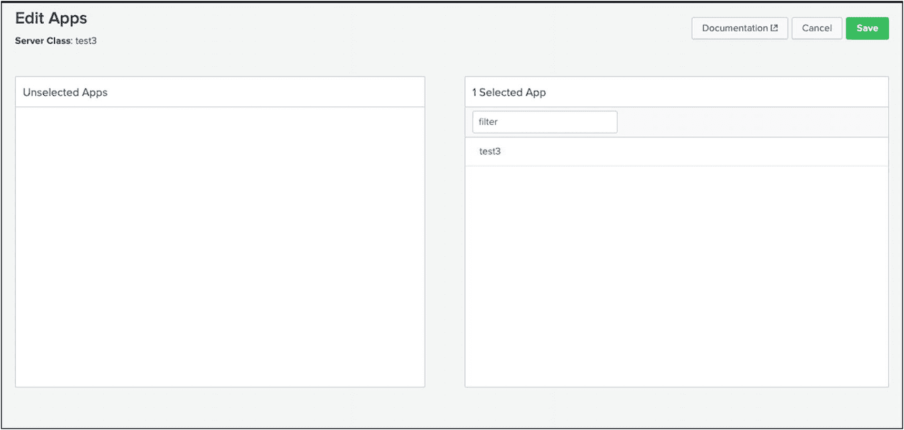
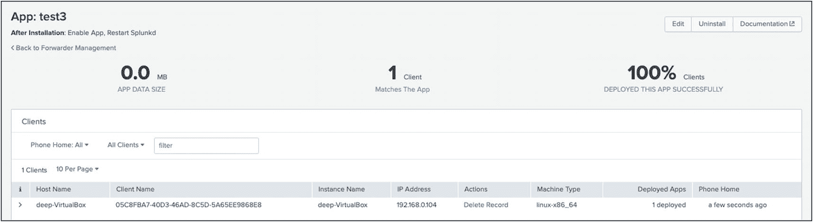
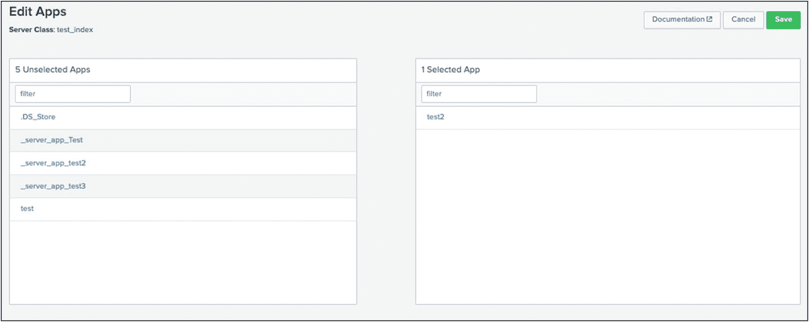
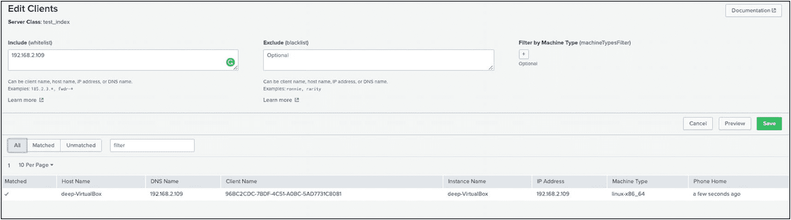
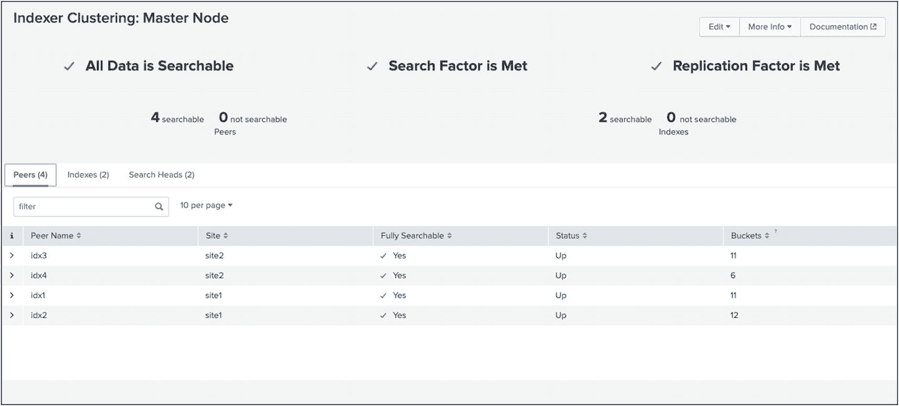
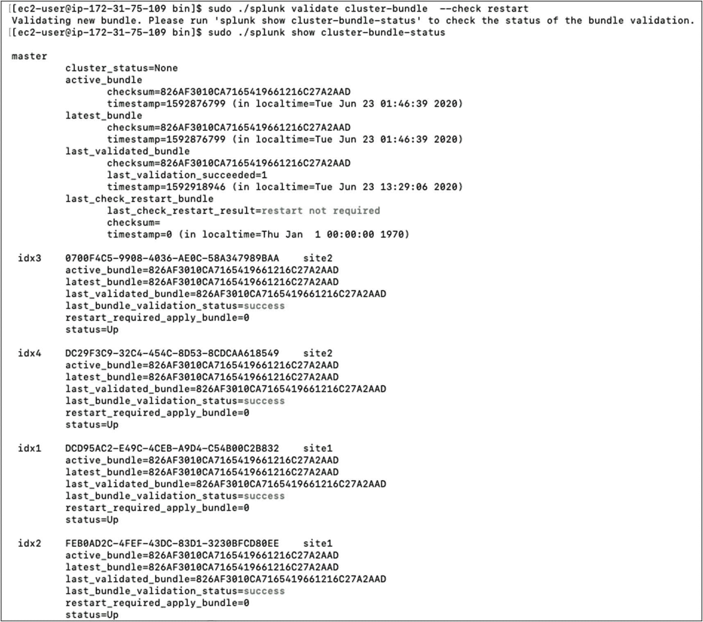
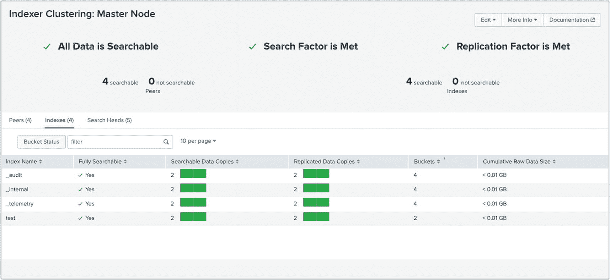
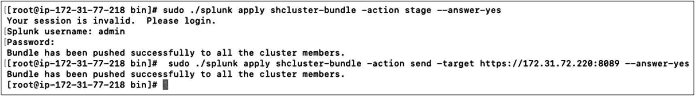
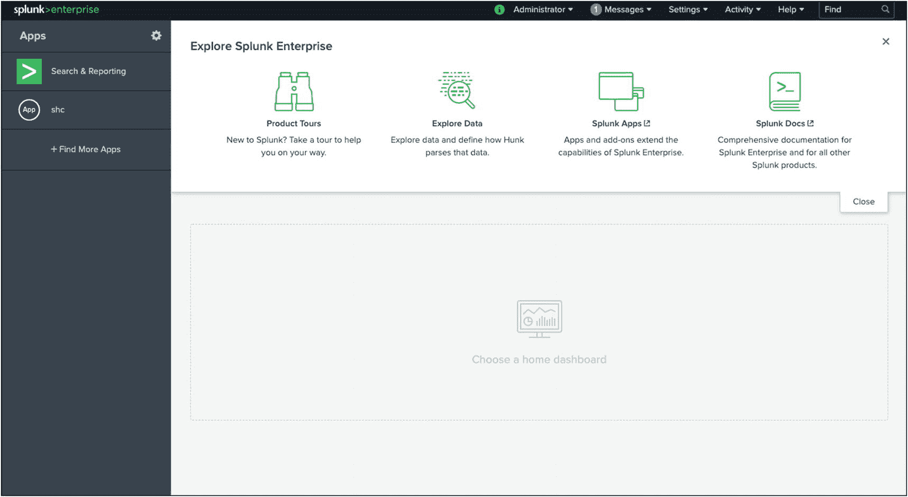

# 15. Splunk 高级部署

在本章中，您将开始通过部署服务器部署应用程序的旅程。您将创建应用程序目录，并通过转发器管理将它们推送到客户端，使用转发器管理中的服务器类将应用程序推送到客户端，并了解如何在 Splunk 中基于时间和容量实现负载均衡。您还将了解 SOCKS 代理和索引器发现。

本章涵盖以下主题。

-   通过部署服务器部署应用程序
-   使用 `serverclass.conf` 创建服务器组
-   使用集群主节点部署应用程序
-   使用部署服务器部署搜索应用程序
-   负载均衡
-   SOCKS 代理
-   索引器发现

完成本章后，您将掌握 Splunk 架构师考试大纲的 16%。

## 通过部署服务器部署应用程序

在本节中，您将学习如何将部署应用程序添加到部署服务器。

Splunk 中的部署应用程序包含要下载到部署客户端的任意内容。任意内容可以是 Splunk Enterprise 应用程序、一组 Splunk 配置和脚本。您可以为该应用程序创建一个目录。创建目录后，您可以添加脚本、配置文件、图像等。

### 在转发器管理中创建应用程序目录并查看应用程序

在转发器管理中创建应用程序目录并查看应用程序是 Splunk 中最重要的任务。

#### 创建应用程序目录

要为每个部署应用程序在部署服务器上创建目录，请前往`$SPLUNK_HOME/etc/deployment-apps`文件夹。在此处为你的应用程序创建一个目录（在本例中，我在`$SPLUNK_HOME/etc/deployment-apps`下创建了`test3`应用）。该目录的名称即为转发器管理中应用程序的名称。你可以随时在 Splunk 转发器管理中添加应用程序。创建应用程序后，你可以通过 Splunk Web 或运行 CLI 命令来运行它。以下 CLI 命令可将 Splunk 应用程序添加到转发器管理。

```
splunk reload deploy-server
```

#### 在转发器管理中查看应用程序

转发器管理在 Splunk 部署中扮演着最重要的角色。它提供了一个创建服务器类的接口，并将部署客户端映射到部署应用程序。要查看转发器管理中的应用程序，请参考以下步骤。



图 15-1 转发器管理

1.  从 Splunk Web 进入设置页面，然后前往转发器管理。
2.  在应用程序中，你可以找到应用程序名称。你应该能看到名为`test3`的应用程序（如果没有，请在 Splunk CLI 中输入以下命令；也可参考图 15-1）。

    ```
    splunk reload deploy-server
    ```



图 15-2 使用转发器管理部署`test3`应用程序

1.  前往`test3`应用程序。在操作中，点击编辑（见图 15-2）。
2.  选中启用安装复选框，如果你想重启 Splunk，也请选中重启 Splunkd 复选框。
3.  点击保存。

### 向客户端重新部署应用程序

部署服务器是一个集中式配置管理器，负责在客户端实例上部署应用程序。当更改服务器类（即应用程序或客户端集合发生变化）、新客户端加入服务器类或更改应用程序的配置文件时，通常需要进行重新部署。通常，重新部署是自动完成的，但在某些情况下，你需要使用`serverclass.conf`或通过转发器管理来重新部署应用程序。

#### 使用转发器管理部署应用程序

服务器类决定了需要部署到一组客户端的内容。当你在 Splunk 中创建服务器类时，你是在告知部署服务器：一组客户端应以应用程序的形式接收配置。

#### 通过编辑`serverclass.conf`部署应用程序

你也可以通过编辑`serverclass.conf`文件来创建服务器类。部署服务器不会自动将应用程序部署到客户端。要将应用程序部署到客户端，你需要通过编写以下 CLI 命令来手动配置转发器管理。

```
splunk reload deploy-server
```

#### 更改内容后重新部署应用程序

当你在 Splunk 的现有应用程序中添加脚本或配置文件时，需要将所有更改反映到你的客户端机器上。要使用更新后的内容重新部署应用程序，你需要遵循以下说明。

1.  在部署服务器上更新部署应用目录中的内容。
2.  重新加载部署服务器。

#### 向新客户端部署应用程序

当新客户端被添加到部署服务器列表时，部署服务器会自动将满足其筛选条件的所有应用程序部署到客户端机器上。如果你使用转发器管理，此过程是自动完成的；否则，你需要通过编写 CLI 命令来手动配置转发器管理。

### 应用程序管理问题

部署服务器对于管理应用程序非常有用，但也存在一些与应用程序管理相关的问题。在部署应用程序之前，我们先讨论一下 Splunk 中与应用程序管理相关的问题。

#### 部署服务器不可逆

一旦你开始使用部署服务器来管理应用程序，就无法停止使用它。因为当从部署服务器上移除一个应用程序时，客户端的行为是删除该应用程序的实例；但从部署服务器上删除应用程序并不等于告诉客户端停止使用该部署服务器来管理该应用；它只是告诉客户端卸载该应用程序，并且没有办法告知部署客户端自行管理该应用。

#### 包含查找表的应用程序

索引器或搜索头可能包含正在运行的、将信息存储在查找表中的应用程序。部署服务器管理这些应用程序并分发其中的更新。如果应用程序配置有更新，则会覆盖任何现有的更新，此时你有可能丢失查找数据。

## 使用`ServerClass.conf`创建服务器组

Splunk 中的转发器管理提供了一个创建服务器类并将部署客户端映射到部署应用程序的接口。该接口将服务器配置保存到`serverclass.conf`文件中。在某些高级服务器类配置中，你可能需要直接编辑`serverclass.conf`。

### 使用转发器管理配置服务器类

服务器类将部署客户端映射到部署应用程序。要创建服务器类，请参考以下步骤。


图 15-3 服务器类：`test_index`

1.  进入设置，然后前往转发器管理。
2.  前往服务器类，然后前往新建服务器类。
3.  在服务器类中，设置名称=`test_index`（见图 15-3）。



图 15-4 `test_index`：部署应用程序

1.  前往添加应用程序，然后选择你想要部署到部署客户端的应用程序（见图 15-4）。



图 15-5 `test_index`：部署客户端

-   添加应用程序时的白名单：这是一个必填字段，你必须在此提供主机名、IP 或 DNS。
-   添加应用程序时的黑名单：这是一个可选字段，你可以在此提供你想要排除的主机名、IP 或 DNS（见图 15-5）。

1.  前往添加客户端，在客户端中，你会看到一个白名单和黑名单块，其后是所有正在轮询部署服务器的客户端。

## 通过集群主节点部署配置文件

Splunk 中的集群主节点负责协调对等节点的活动，这些活动用于调节索引器集群的运行。主节点控制和管理索引复制、将应用包分发给对等节点，并告知对等节点要搜索哪个对等节点（你已在第 9 章中学习了如何配置主节点）。

### 使用主节点管理索引器上的索引

要管理所有对等节点的索引，你需要为所有索引器使用相同的配置文件。无需逐一登录每个 Splunk 实例并编辑其索引文件（不推荐手动编辑每个索引器的配置文件）。你需要使用主节点为所有索引器部署相同的配置文件。在本节中，你将使用集群主节点，在两个站点（`site1` 和 `site2`）的四台索引器上部署相同的 `indexes.conf` 文件。

在主节点上（使用 Splunk Web），进入设置并转到“索引器集群”。在此处，你可以看到所有已向主节点报告的索引。在我的案例中，有四台索引器向主节点报告。图 15-6 显示了与主节点通信的实例。



图 15-6 主节点：索引器集群

名为 `test` 的索引已在第 1 章中配置。该索引需要配置在所有三台索引器上。你可以手动配置，但这不是一个好习惯。在本节中，你将使用集群主节点来部署 `indexes.conf` 文件，从而启用复制因子并配置该索引。

1.  登录集群主节点。导航至 `$SPLUNK_HOME/etc/cmaster/_local` 并创建 `indexes.conf` 文件。
2.  根据以下代码编辑 `indexes.conf`。
3.  要部署 `indexes.conf` 文件，请在集群主节点中切换到 `$SPLUNK_HOME/bin/` 目录。

```
[test]
homePath=$SPLUNK_DB/test/db
coldPath=$SPLUNK_DB/test/colddb
thawedPath=$SPLUNK_DB/test/thaweddb
repFactor=auto
```

4.  要确认包验证的状态，请参考以下命令。

```
sudo ./splunk validate cluster-bundle --check restart
```

```
sudo ./splunk show cluster-bundle-status
```

如果你的集群包部署成功，你会找到部署的校验和。该命令类似于图 15-7。



**图 15-7** 在对等索引器上部署集群包

确认 `test` 索引是否设置了 `repFactor=auto`。要监控集群主节点状态，请导航至 Splunk Web 设置并进入“索引器集群”，在那里你可以找到索引 `test` 的状态（见图 15-8）。



**图 15-8** 索引器集群：test 索引

## 在搜索头集群上部署应用

部署器负责将应用分发到搜索头集群。部署器是一个 Splunk 实例，它将应用和配置更新分发给每个搜索头集群成员。部署器分发的一组更新称为配置包。部署器的主要任务是处理应用和用户配置从非集群实例或搜索头池到搜索头集群的迁移，向搜索头集群成员部署基线应用配置，并提供一种手段来向所有搜索头集群成员分发非复制的、非运行时的配置更新。

### 配置部署器以分发搜索头应用

在本节中，你将使用部署器将 `shc`（搜索头集群）应用推送到搜索头集群节点。你已经了解了如何配置搜索头集群。在本节中，你将学习如何部署该解决方案。

1.  要使用部署服务器部署 `shc` 应用，请在搜索头中导航至 `$SPLUNK_HOME/etc/local/server.conf`。请参考以下命令。
2.  完成更改后，重启 Splunk 实例。

```
[shclustering]
pass4SymmKey = 
```

3.  要使用部署服务器部署 `shc` 应用，请导航至搜索头的 `$SPLUNK_HOME/bin/` 目录。请参考以下命令。

```
splunk restart
```

4.  在部署器中，创建一个名为 `shc` 的应用，位于 `$SPLUNK_HOME/etc/shcluster/apps/` 目录下。
5.  创建或编辑位于 `shc` 应用的 `/local/apps.conf` 中的 `apps.conf` 文件。请参考以下代码。

```
sudo ./splunk edit shcluster-config -conf_deploy_fetch_url :,:
```

6.  创建或编辑位于 `shc` 应用的 `/local/outputs.conf` 中的 `outputs.conf` 文件。请参考以下代码。

```
[ui]
is_visible = 0
[package]
id = shc_base
check_for_updates = 0
```

7.  要将配置推送到搜索头集群节点，请导航至部署服务器的 `$SPLUNK_HOME/bin/` 目录，并参考以下命令（见图 15-9）。

```
[indexAndForward]
index = false
[tcpout]
defaultGroup = default-autolb-group
forwardedindex.filter.disable = true
indexAndForward = false
[tcpout:default-autolb-group]
server=:/:,:/:,............,:/:
```


**图 15-9** 在搜索头集群上部署集群包

```
splunk apply shcluster-bundle -action stage --answer-yes
```

8.  部署已准备好推送。为此，你需要联系搜索头集群 Captain，并使用 `apply shcluster-bundle` 命令。请参考以下命令（见图 15-10）。



**图 15-10** 使用搜索头集群 Captain 在搜索头上部署集群包

```
splunk apply shcluster-bundle -action send -target :/:  --answer-yes
```



**图 15-11** 搜索头：SHC 应用

9.  当导航至搜索头集群节点时，你可以看到 `shc` 应用已部署在其中。请参考图 15-11。同样，你可以找到已部署的应用。

## 负载均衡

转发器将数据转发到 Splunk 索引器。转发器将数据分配到多个接收实例。每个接收器都获取总数据的一部分。转发器会按指定的时间或数据量间隔将数据路由到所有可用的索引器。具体选择取决于你的需求。如果你有三台可用的索引器（`indexer1`、`indexer2` 和 `indexer3`）以及一组转发器，转发器会根据时间或数据量，随机地将数据流切换到一个站点中的另一个索引。

-   **按时间均衡：** 此因素控制转发器从一个索引器切换到另一个索引器的频率。要按时间启用负载均衡器，请在通用转发器的 `outputs.conf` 文件中添加 `autoLBFrequency=<数字>` 来更新设置。
-   **按数据量均衡：** 此因素控制转发器从一个索引器切换到另一个索引器的频率。要按数据量启用负载均衡器，请在通用转发器的 `outputs.conf` 文件中添加 `autoLBVolume=<数字>` 来更新设置。

### 使用 `outputs.conf` 在 Splunk 转发器中配置静态负载均衡

要使用 `outputs.conf` 在 Splunk 转发器中配置静态负载均衡，你需要转到 `$SPLUNK_HOME/etc/system/local` 并编辑 `outputs.conf` 文件（如果该文件不存在，则需要创建它）。你可以按时间或按数据量配置负载均衡器。

#### 按时配置静态负载均衡器

在转发器上进入 `$SPLUNK_HOME$/etc/system/local/outputs.conf`，并根据以下配置编辑配置块，该配置设置了按时间的 `autoLBFrequency`。此因素控制转发器从一个索引器切换到另一个索引器的频率。请参考以下配置文件，了解按时配置静态负载均衡器的语法。

-   `server` 是索引器的地址。
-   `autoLBFrequency` 是一个以秒为单位的时间因子，允许转发器从一个索引器切换到另一个索引器。

```
[tcpout:my_LB_indexers]
server=:/:,:/:,,,,,,,,:/host_namen>:
autoLBFrequency=
```

#### 按容量配置静态负载均衡器

在转发器上进入 `$SPLUNK_HOME$/etc/system/local/outputs.conf`，并根据以下配置编辑配置块，该配置设置了按容量的 `autoLBVolume`。此因素控制转发器从一个索引器切换到另一个索引器的频率。请参考以下配置文件，了解按时配置静态负载均衡器的语法。

-   `server` 是索引器的地址。
-   `autoLBVolume` 是一个以字节为单位的容量因子，允许转发器从一个索引器切换到另一个索引器。

```
[tcpout:my_LB_indexers]
server=:/:,:/:,,,,,,,,:/host_namen>:
autoLBVolume=
```

## 从 Splunk CLI 指定负载均衡

要从 Splunk CLI 配置负载均衡，您需要进入转发器上的`$SPLUNK_HOME/bin`并指定命令。这是实现负载均衡最简单的方法。

要从 Splunk CLI 指定负载均衡，请参考以下内容。

```
splunk add forward-server <主机名>:<端口> -method autobalance
splunk restart
```

## 索引器发现

索引器发现简化了将转发器连接到索引器集群中对等节点的过程。索引器发现由对等节点、主节点和转发器组成。索引器发现中的对等节点向主节点提供其接收端口的信息。转发器定期“轮询”主节点以获取对等节点列表。主节点（响应转发器请求）根据负载均衡策略提供可用对等节点的地址。转发器开始向对等节点发送数据。

### 配置索引器分发

要成功配置索引器分发，您需要配置各个组件。在索引器发现中，对等节点、主节点和转发器是主要组件。您需要按如下方式配置每个组件。

1.  配置对等节点以接收来自转发器的数据。

2.  配置主节点以启用索引器发现。

3.  配置转发器。

#### 配置对等节点

您可以通过编辑配置文件或使用 Splunk Web 进行配置。请参考以下说明。

##### 使用 Splunk Web 配置对等节点

要使用 Splunk Web 将对等节点配置为从转发器接收数据，请执行以下步骤。

1.  进入 Splunk Web，转到“设置”，然后移至“转发和接收”。

2.  在“配置接收”中，单击“新增”。

3.  在“端口”中，输入端口地址`<port>`。

4.  单击“保存”。

##### 使用 inputs.conf 配置对等节点

要使用配置文件将对等节点配置为从转发器接收数据，请进入`$SPLUNK_HOME/etc/system/local/inputs.conf`并编辑`splunktcp`配置块。请参考以下`splunktcp`配置块。

```
[splunktcp://<端口>]
disabled = 0
```

#### 配置主节点

要使用配置文件配置主节点以启用主节点发现，请进入`$SPLUNK_HOME/etc/system/local/server.conf`并编辑`indexer_discovery`配置块。请参考以下内容。

-   主节点中的`pass4SymmKey`用于保护转发器和主节点之间的连接。

-   `polling_rate`用于调整转发器轮询主节点的速率。

-   `indexerWeightByDiskCapacity`是一个可选属性，用于确定索引器发现是否使用负载均衡。

```
[indexer_discovery]
pass4SymmKey = <密码>
polling_rate = <速率>
indexerWeightByDiskCapacity = <true|false>
```

#### 配置转发器

要使用配置文件配置转发器，请进入`$SPLUNK_HOME/etc/system/local/outputs.conf`并编辑`indexer_discovery:<名称>`配置块。请参考以下内容。

-   转发器配置块中的`indexer_discovery:<名称>`用于设置索引器发现属性中的`<名称>`。

-   `pass4SymmKey`用于保护转发器和主节点之间的连接。

-   `master_uri`包含主节点的地址。

-   `tcpout:<目标组>`用于设置索引器发现属性，而不是您用来指定接收对等节点的`server`属性（如果您未启用索引器发现）。

```
[indexer_discovery:<名称>]
pass4SymmKey = <密码>
master_uri = <URI>
[tcpout:<目标组>]
indexerDiscovery = <名称>
[tcpout]
defaultGroup = <目标组>
```

## SOCKS 代理

转发器直接与索引器通信并发送数据，但如果防火墙阻止连接，转发器将无法与索引器通信。在这种情况下，您可以通过在转发器的`outputs.conf`文件的配置块中指定属性，将转发器配置为使用 SOCKS5 代理主机向索引器发送数据。代理主机在索引器和转发器之间建立连接；然后，转发器通过代理主机将数据发送到索引器。

### 配置 SOCKS 代理

SOCKS 代理是通过在转发器的`$SPLUNK_HOME/etc/system/local/outputs.conf`文件中的`outputs.conf`文件内创建`[tcpout]`或`[tcpout-server]`配置块来配置的。配置更新后，重新启动转发器。

表 15-1 说明了在转发器的`outputs.conf`文件中 SOCKS 代理的配置。

**表 15-1** 使用转发器的 `outputs.conf` 配置 SOCKS 代理

| 属性 | 值 |
| --- | --- |
| `socksServer=<ip>:<port>,<host_name>:<port>` | 指定转发器应连接以转发数据 socks5 代理的地址。 |
| `socksUsername=<string>` | 指定用于验证 socks5 代理的用户名。此为可选项。 |
| `socksPassword=<string>` | 指定用于验证 socks5 代理的密码。此为可选项。 |
| `socksResolveDNS=true\|false` | 指定转发器是否应使用 DNS 解析输出组中索引器的主机名。 |

以下代码块说明了在 Splunk 中如何配置 SOCKS 代理的示例。

-   `server`是服务器的名称。

-   `socksServer`指定转发器应连接以转发数据的 socks5 代理的地址。

```
[tcpout]
defaultGroup = proxy_indexer_test
[tcpout:proxy_indexer_test]
server = <主机名>:<端口>,<主机名>:<端口>,.....,
socksServer = <IP>:<端口>
```

## 总结

在本章中，您开始了通过部署服务器部署应用程序的旅程。您创建了应用程序目录，通过部署服务器将应用程序部署到客户端，并通过转发器管理将其推送到客户端。您使用`serverclass.conf`创建了服务器组，并在转发器管理中使用服务器类将应用程序推送到客户端。您还通过部署服务器在通用转发器上部署了应用程序。在下一节中，您学习了如何在 Splunk 上基于时间和容量实现负载均衡。在 SOCKS 代理部分，您了解到如果防火墙不允许数据通过网络传输，您可以实现 SOCKS 代理。您还学习了如何实施索引器发现，以简化将转发器连接到索引器集群中对等节点的过程。

在本章中，您涵盖了 Splunk 架构师考试蓝图的大部分内容。您现已熟悉模块 6（转发器和部署最佳实践）的 6%、模块 19（搜索头集群管理和维护）的 5% 以及模块 14（大规模 Splunk 部署）的 5% 的内容。

在下一章中，您将学习管理索引、管理索引存储、管理索引集群、管理多站点索引集群、Splunk REST API 端点以及 Splunk SDK。

## 多项选择题

1.  Splunk 中索引发现的主要组件有哪些？（选择所有适用的方法。）

    1.  `peer node`

    2.  `master node`

    3.  `universal forwarder`

    4.  `search head`

    5.  以上全部

    6.  以上都不是

2.  负载均衡中使用了哪些方法？（选择所有适用的方法。）

    1.  按时间

    2.  按频率

    3.  按容量

    4.  以上全部

3.  运行以下命令时，创建`deployment server.conf`的默认路径是什么？

    `splunk set deploy-poll deploy server:port`

    1.  `SPLUNK_HOME/etc/deployment`

    2.  `SPLUNK_HOME/etc/system/local`

    3.  `SPLUNK_HOME/etc/system/default`

    4.  `SPLUNK_KOME/etc/apps/deployment`

4.  哪个 Splunk 组件负责向搜索头集群成员分发应用和其他某些配置更新？

    1.  `deployer`

    2.  `cluster master`

    3.  `deployment server`

    4.  `search head cluster master`

5.  客户端拉取的应用在部署服务器上应位于何处？
```

1.  `$SFLUNK_KOME/etc/apps`
2.  `$SPLUNK_HCME/etc/search`
3.  `$SPLUNK_HCME/etc/master-apps`
4.  `$SPLUNK HCME/etc/deployment-apps`

## 答案

1.  4
2.  3
3.  2
4.  1, 3
5.  1, 2, 3