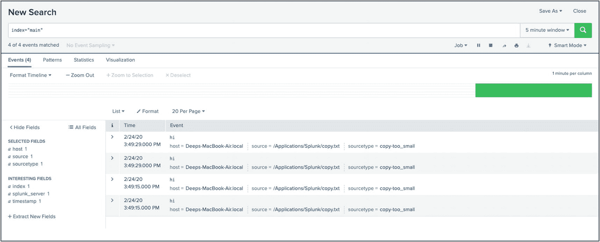
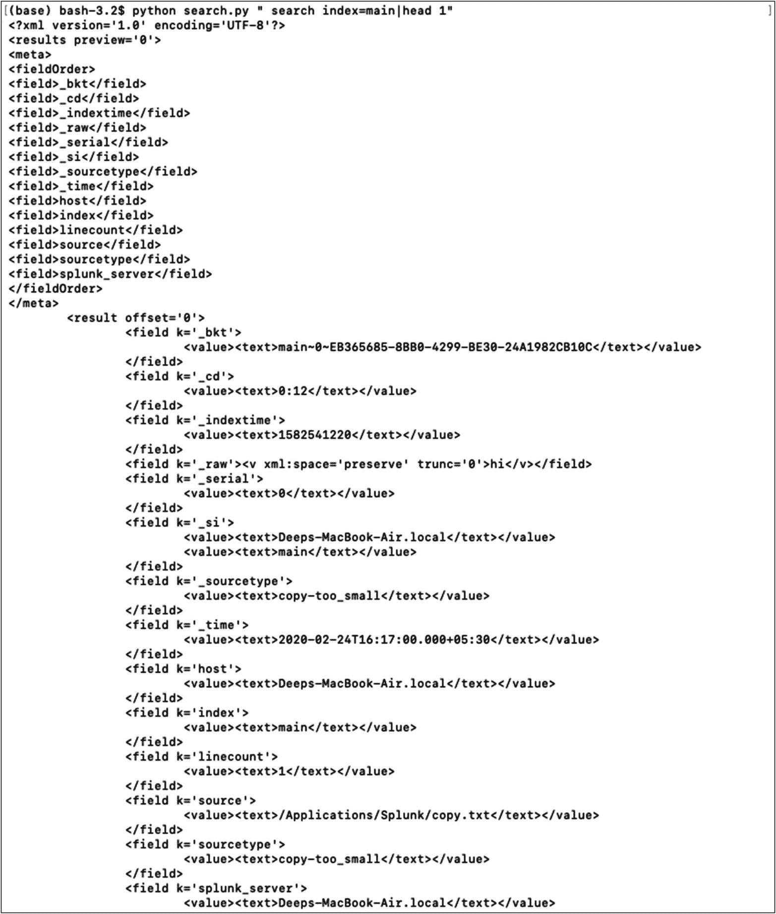

# 16. 高级 Splunk

在本章中，您将学习管理索引、配置自定义索引、删除索引以及配置索引并行化。您将了解如何移动索引数据库、配置最大索引大小以及设置磁盘使用限制。您将学习如何配置离线状态的节点、启用维护模式、执行滚动重启、删除存储桶副本以及移除对等节点。您将了解主站点发生故障时应如何处理。您还将了解 Splunk 中的 REST API 端点功能，并查看 Splunk SDK。

本章涵盖以下主题。

- 管理索引
- 管理索引存储
- 管理索引集群
- 管理多站点索引集群
- Splunk REST API 端点
- Splunk SDK

完成本章时，您将涵盖 Splunk 架构师考试大纲中大约 18% 的内容。

## 管理索引

Splunk 中的索引是目录和文件的集合。Splunk 中的索引目录也称为**存储桶**。它们根据其龄期进行分组；例如，热存储桶、冷存储桶和温存储桶。索引目录位于 `$SPLUNK_HOME/var/lib/splunk`。Splunk Enterprise 支持两种类型的索引。

- **事件索引**施加最小的结构，可以容纳任何类型的数据，包括指标数据。
- **指标索引**以高度结构化的格式使用，以处理与指标数据相关的更高容量和更低延迟需求。

让我们看看如何配置事件索引和指标索引。

### 配置事件索引

您可以使用 Splunk Web、CLI 或配置文件来配置事件索引。如果要为整个索引集群配置索引，则需要使用配置文件（即前往 `SPLUNK_HOME/etc/system/local/indexes.conf`）并直接编辑它。

#### 使用 Splunk 配置文件配置事件索引

要在 Splunk 配置文件中为事件索引添加新索引，请前往 `$SPLUNK_HOME/etc/system/local` 并编辑 `indexes.conf`。在节名称中，提供索引器的名称。您可以参考以下节块，了解有关使用 Splunk 配置文件配置事件索引的更多信息。

- **`homePath`** 在配置事件索引时定义 `<homepath>`。通常，索引中温存储桶和热存储桶的数据位于 `<homepath>`。
- **`coldPath`** 在配置事件索引时定义 `<coldpath>`。通常，索引中冷存储桶的数据位于 `<coldPath>`。
- **`thawedPath`** 在配置事件索引时定义 `<thawedpath>`。通常，索引中冻结存储桶或归档数据位于 `<thawedPath>`。

```
[<index_name>]
homePath = <homepath>
coldPath = <coldpath>
thawedPath = <thawedpath>
```

#### 使用 Splunk CLI 配置事件索引

要使用 Splunk CLI 配置事件索引，请前往 `$SPLUNK_HOME/bin` 并参考以下命令来配置事件索引。

```
splunk add index <index_name> -homePath <homepath> -coldPath <coldpath> -thawedPath <thawedpath>
```

### 配置指标索引

要在 Splunk 中配置指标索引，您可以使用 Splunk Web、CLI 或编辑配置文件。如果要为整个索引集群配置索引，则需要编辑配置文件。前往 `SPLUNK_HOME/etc/system/local/indexes.conf` 并直接编辑它。您无法使用 CLI 和 Splunk Web 为整个索引集群配置索引。

#### 使用 Splunk 配置文件配置指标索引

- **`homePath`** 在配置指标索引时定义 `<homepath>`。通常，索引中温存储桶和热存储桶的数据位于 `<homepath>`。
- **`coldPath`** 在配置指标索引时定义 `<coldpath>`。通常，索引中冷存储桶的数据位于 `<coldPath>`。
- **`thawedPath`** 在配置指标索引时定义 `<thawedpath>`。通常，索引中冻结存储桶或归档数据位于 `<thawedPath>`。
- **`datatype`** 定义索引的类型，是指标索引还是事件索引。

```
[test]
homePath = <homepath>
coldPath = <coldpath>
thawedPath = <thawedpath>
datatype = metric
```

要使用 Splunk CLI 配置指标索引，请前往 `$SPLUNK_HOME/bin` 并参考以下命令。

```
splunk add index <index_name> -datatype metric -homePath <homepath> -coldPath <coldpath> -thawedPath <thawedpath>
```

### 删除索引和索引数据以管理索引

删除索引和索引数据包括从索引中删除数据、从 Splunk 中删除所有数据、删除整个索引，甚至禁用它。这可以使用 Splunk CLI 命令实现。

参考以下命令从特定索引中删除所有数据。

```
splunk clean eventdata -index <index_name>
```

参考以下命令从所有索引中删除所有数据。

```
splunk clean eventdata
```

参考以下命令删除特定索引。

```
splunk remove index <index_name>
```

禁用索引是比删除索引更好的选择。当您禁用索引时，如果需要，可以重新启用它。参考以下命令禁用一个索引。

```
splunk disable index <index_name>
```

要在 Splunk 中启用索引，请参考以下命令。

```
splunk enable index <index_name>
```

### 配置索引并行化以管理索引

索引并行化是一种允许索引维护多个管道集的功能。一个*管道集*处理从原始数据摄取、经过事件处理到将事件写入磁盘的数据处理流程。一个索引运行一个管道集。但是，如果底层机器在可用核心和 I/O 方面利用不足，您可以配置该索引运行两个管道集。通过运行两个管道集，您有可能将索引的索引吞吐能力提高一倍。

#### 为索引并行化配置管道集

要为索引并行化配置管道集，如果 `server.conf` 存在，则编辑它，否则在 `$SPLUNK_HOME/etc/system/local` 创建包含以下节的 `server.conf` 文件。

```
[general]
parallelIngestionPipelines = 2
```

#### 为索引并行化配置索引分配方法

要为索引并行化在 Splunk 中配置索引分配方法，您可以修改位于 `$SPLUNK_HOME/etc/system/local` 的 `server.conf` 文件。在 Splunk 中有两种配置分配方法。可以是轮询选择方法或加权随机选择方法。参考以下节。

```
[general]
pipelineSetSelectionPolicy = round_robin | weighted_random
```

在下一节中，您将学习如何管理存储，以便索引平稳运行。

## 管理索引存储

在 Splunk 中，管理索引存储至关重要。您可以配置索引存储、移动索引数据库、配置索引大小、设置索引存储限制以及设置退役和归档策略。


### 移动索引数据库

您可以通过修改 `SPLUNK_DB` 的路径定义，将 Splunk 中的索引数据库从一个位置移动到另一个位置。

按照以下步骤移动 Splunk 中的索引数据库。

1.  创建具有写入权限的目录。
2.  使用 Splunk CLI 停止索引器。
3.  将索引文件系统复制到该目录。
4.  使用 Splunk CLI 取消设置 Splunk 环境变量。

```
splunk stop
```

5.  将 `$SPLUNK_HOME/etc/splunk-launch.conf` 中的 `SPLUNK_DB` 属性更改为您想要的路径。

```
unset SPLUNK_DB
```

6.  使用 Splunk CLI 启动索引器。

```
SPLUNK_DB=
```

```
splunk start
```

### 配置索引器存储的最大索引大小

要为 Splunk 中的索引器存储配置最大索引大小，您可以使用配置文件。您将学习如何设置每个存储桶的最大大小以及为卷设置最大索引大小。

要为 Splunk 中的存储桶配置最大索引大小，请修改 `$SPLUNK_HOME/etc/system/local` 中的 `indexes.conf` 文件，并在配置文件中添加 `maxTotalDataSizeMB`。请参考以下代码块获取更多帮助。

- `<index_name>` 是存储桶的名称。
- `homePath.maxDataSizeMB` 是存储桶主路径的最大值，单位为兆字节 (MB)。
- `coldPath.maxDataSizeMB` 表示存储桶冷路径的最大值，单位为兆字节 (MB)。

```
[<index_name>]
homePath.maxDataSizeMB = 
coldPath.maxDataSizeMB = 
```

要为 Splunk 中的卷配置最大索引大小，请修改 `$SPLUNK_HOME/etc/system/local` 中的 `indexes.conf` 文件，并在配置文件中添加 `maxVolumeDataSizeMB`。请参考以下代码块获取更多帮助。

- `<volume_name>` 是您要配置的卷的名称。
- `maxVolumeDataSizeMB` 是您要配置的路径的值。

```
[volume:<volume_name>]
path = 
maxVolumeDataSizeMB = 
```

在 Splunk 中为每个索引配置卷时，请参考以下配置段。

- 在为存储桶配置卷时，`<volume_name>` 代表卷的名称。
- 在为存储桶配置名称时，`<idx_name>` 代表索引器的名称。

```
[<idx_name>]
homePath = volume:<volume_name>
coldPath = volume:<volume_name>
```

### 在 Splunk 中设置磁盘使用限制

要限制 Splunk 中的磁盘使用量，您可以为存储索引数据的磁盘设置最小可用空间量。如果达到此限制，索引器将停止索引数据。通常，索引器会检查包含索引的分区。如果达到限制，索引器将停止索引。

#### 使用 Splunk CLI 配置 Splunk 以设置磁盘使用限制

磁盘使用限制主要用于解决磁盘空间问题，以防止磁盘空间耗尽。要配置 Splunk 以限制磁盘使用量，请使用 Splunk CLI。转到 `$SPLUNK_HOME/bin` 目录，并参考以下命令。

```
splunk set minfreemb <value>
```

要启用配置，您需要重新启动 Splunk 实例。请参考以下命令。

```
splunk restart
```

#### 使用 Splunk 配置文件配置 Splunk 以设置磁盘使用限制

要使用 Splunk 配置文件配置 Splunk 以设置磁盘使用限制，请转到 `$SPLUNK_HOME/etc/system/local` 目录并编辑 `server.conf` 文件。请参考以下代码块。

```
[diskUsage]
minFreeSpace = <value>
```

`minFreeSpace` 设置了 Splunk 中磁盘使用量的限制。其后跟一个值，该值表示 Splunk 索引应具有的可用空间量。

现在，让我们进入下一节，了解索引集群的最佳实践。

## 管理索引集群

在 Splunk 中管理索引集群包括执行以下任务：使对等节点离线、使用维护模式、滚动重启索引集群以及从索引集群中移除多余的存储桶集群。让我们逐一查看每个主题，首先从配置对等节点离线开始。

### 配置对等节点离线

当您希望从现有的 Splunk 环境中临时或永久地使一个对等节点下线时，`splunk offline` 命令有两个优点：您可以临时和永久地移除对等节点。当您使用 `splunk offline` 命令时，它最大程度地减少了对 Splunk 中搜索任务的中断。

#### 使用 Splunk CLI 将 Splunk 配置为离线模式

Splunk 离线命令处理两种类型的对等节点关闭（即临时或永久）。

- `splunk offline` 使对等节点离线以进行维护。
- `splunk offline --enforce-counts` 从集群中永久移除一个对等节点。

在对等节点关闭后，临时使其下线是最快的方法。集群会启动存储桶修复活动。请参考以下代码块。

```
splunk offline
```

集群尝试在对等节点上重新分配主副本后，临时将其下线。等待对等节点当前正在执行的任何搜索任务完成。`decomission_node_force_timeout` 的值决定了在对等节点的 `server.conf` 文件中为存储桶的主分配分配的最长时间。默认情况下，该值为 5 分钟。对等节点还会根据其 `server.conf` 文件中的 `decomission_search_jobs_wait_secs` 值等待任何正在进行的搜索完成。默认情况下，该值为 3 分钟。要更改分配给集群恢复到有效状态的时间段，请参考以下命令。

```
splunk offline --decommission_node_force_timeout <value>
```

要更改在主节点重启期间分配给对等节点的时间，请参考以下命令。

```
splunk edit cluster-config -restart_timeout <value>
```

要永久移除一个对等节点，在对等节点永久关闭之前，需要考虑两件事：存储桶修复活动和正在进行的完成过程。请参考以下命令在 Splunk 中永久移除对等节点。

```
splunk offline --enforce-counts
```

### 使用 Splunk CLI 将 Splunk 配置为维护模式

维护模式会暂停最关键存储桶的修复活动，并阻止热存储桶的滚动。在对等节点上执行对等节点维护和其他维护活动时，维护模式非常有用。请仅在必要时尝试使用维护模式。

要使用 Splunk CLI 启用维护模式，请参考以下配置段。

```
splunk enable maintenance-mode
```

要将标准存储桶滚动行为恢复为正常模式，请参考以下配置段。

```
splunk disable maintenance-mode
```


### 使用 Splunk CLI 执行滚动重启

滚动重启会对所有对等节点进行分阶段重启。滚动重启可确保向集群发送数据的负载均衡转发器始终有对等节点可用于接收数据。您可以同时对所有节点执行滚动重启，但不建议这样做。为了基于近似百分比执行滚动重启，主节点通常会在滚动重启过程中指定要保持开启的重启槽位数。

#### 使用 Splunk CLI 指定每次重启的对等节点百分比

重启百分比可以通过 Splunk Web、配置文件或 CLI 进行配置。要使用 Splunk CLI 指定重启的对等节点百分比，请参考以下命令。

```
splunk edit cluster-config -percent_peers_to_restart
```

#### 使用 Splunk CLI 执行可搜索的滚动重启

Splunk Enterprise 7.1.0 及更高版本提供了可搜索的滚动重启选项。该选项允许您在对等节点上执行滚动重启，同时最大限度地减少对正在进行的搜索的中断。当因定期维护或配置包推送而需要执行滚动重启时，您可以使用可搜索的滚动重启来最大限度地减少搜索中断。要执行可搜索的滚动重启，请参考主节点上的以下配置段。

```
splunk rolling-restart cluster-peers -searchable true
```

如果希望在健康检查失败的情况下仍继续执行可搜索的滚动重启，请在主节点上使用 `-force` 选项。不建议这样做，因为它可能导致清除索引器尚未索引的队列数据。请参考以下配置段。

```
splunk rolling-restart cluster-peers -searchable true \
-force true \
-restart_inactivity_timeout \
-decommission_force_timeout
```

### 从索引器集群中移除多余的桶副本

多余的桶副本是指超出了集群复制因子或搜索因子要求的副本数量。如果主节点上的复制因子是 2，而您有 3 个副本，那么桶副本就超了。请从索引中移除多余的桶副本。多余的桶副本通常是在计划某个对等节点下线进行维护时产生的。主节点可能会启动桶修复活动，以让桶可用于搜索；而当对等节点维护完成后，就会产生多余的桶副本。

要从 Splunk 索引器中移除多余的桶副本，请参考以下命令。

```
splunk remove excess-buckets
```

### 从主节点列表中移除一个对等节点

当一个对等节点永久下线后，它仍会保留在主节点列表中。例如，一个对等节点永久下线，但它仍会出现在主节点仪表板上，尽管其状态已更改为 Down（已关闭）或 Graceful Shutdown（正常关闭），具体取决于其下线方式。在这种情况下，您需要将该对等节点从主节点上永久移除。

要使用 Splunk CLI 从主节点列表中移除一个对等节点，请参考以下配置段。

```
splunk remove cluster-peers -peers <peer_1>,<peer_2>,...
```

更多信息，请访问 [`https://docs.splunk.com/Documentation/Splunk/7.3.0/Indexer/Aboutindexesandindexers`](https://docs.splunk.com/Documentation/Splunk/7.3.0/Indexer/Aboutindexesandindexers)。现在我们来讨论多站点索引集群的最佳策略。

## 管理多站点索引集群

管理 Splunk 中的多站点索引集群包括各种任务，例如处理多站点故障、在主节点重启或站点故障后重启多站点集群中的索引、将多站点索引集群转换为单站点，以及将对等节点迁移到新站点。

### 多站点索引集群中的主站点发生故障

如果在多站点索引集群中主节点发生故障，则会导致 Splunk 环境拥塞。在此期间，集群会尽可能保持正常运行。对等节点也会根据主节点下线时正在使用的目标对等节点列表，继续将数据流式传输给其他对等节点，但这不足以支持顺畅运行。因此，最佳实践是配置一个备用服务器来处理多站点服务器故障。

#### 配置备用服务器

要配置备用服务器，您需要注意以下两点。

*   备份替换主节点所需的文件。
*   确保对等节点和搜索头节点可以找到新的主节点。

#### 备份替换主节点所需的文件

您必须备份两个静态配置，以便将其复制到替换主节点。

*   主节点的 `server.conf` 文件，其中存储了主节点的集群设置。
*   主节点的 `$SPLUNK_HOME/etc/master-apps` 目录，该目录必须存储所有对等节点配置的通用部分。

#### 确保对等节点和搜索头节点可以找到新的主节点

为确保对等节点和搜索头节点可以找到新的主节点，您需要遵循以下规则中的任意一条。

*   替换主节点必须使用与原始主节点相同的 IP 地址和管理端口。
*   如果替换主节点未使用与原始主节点相同的 IP 地址和管理端口，则需要配置对等节点并添加一个新的 `master_uri` 地址。

### 在主节点重启或站点故障后重启多站点集群中的索引

当 Splunk 中的主节点重启时，它会阻止数据索引，直到有足够数量的对等节点加入索引器集群。在多站点集群中，即使没有足够的可用对等节点来满足站点复制因子的所有要求，您可能仍希望重启索引。当对等节点的复制因子不可用时，请在主节点上运行 Splunk `set indexing-ready` 命令以解除索引阻塞。

在主节点重启或站点故障后，重启多站点集群中的索引（使用 Splunk CLI），请参考以下配置段。

```
splunk set indexing-ready -auth admin:your_password
```

### 将对等节点迁移到新站点

如果您想在多集群环境中将一个对等节点从一个站点迁移到另一个站点，可以按照以下说明进行操作。

1.  使用 `offline` 命令将该对等节点离线。主节点会将该对等节点处理的桶副本重新分配给同一站点上的其他对等节点。
2.  将该对等节点的服务器运送至新站点。
3.  从服务器上删除整个 Splunk Enterprise 安装，包括其索引数据库和所有桶副本。
4.  在服务器上重新安装 Splunk Enterprise，重新启用集群，并将该对等节点的站点值设置为新站点位置。

现在我们来讨论如何在 Splunk 中使用 REST API 端点。

## REST API 端点

Splunk REST API 端点可以执行 Splunk 中的几乎所有操作——从身份验证到搜索再到配置管理。该 API 由 `splunkd`（即管理端口 8089）提供服务的端点（URI）组成。程序员可以使用 Splunk 中的 REST API 端点进行远程查询、远程搜索，并让第三方将其应用与 Splunk 集成。Splunk 为程序员提供了一个软件开发工具包 (SDK)，用于将其应用与 Splunk 集成。该 SDK 就像一个包装器，负责调用 REST API，并通过提供易于使用且能与 Splunk 交互的对象来帮助抽象细节。

在 REST API 端点中，您可以使用开源命令行工具 `cURL`。还有其他可用的命令行工具，例如 `wget`。`cURL` 在 Mac 和 Linux 上默认可用。也可以为 Windows 下载；更多信息请访问 [`http://curl.haxx.se/`](http://curl.haxx.se/)。

Splunk REST API 端点中有三种主要方法。

*   `GET` 方法用于获取与资源相关联的数据；例如，访问搜索以获取结果。
*   `POST` 方法用于创建或更新现有资源。
*   `DELETE` 方法用于删除资源。

REST API 端点具有三个主要功能。

*   运行搜索
*   管理知识对象和配置
*   更新 Splunk Enterprise 配置


### 使用 REST API 运行搜索

在 Splunk 中，REST API 端点用于运行已保存的搜索。当您想在 Splunk 中运行搜索时，需要处理一些参数。

- `max_count`：如果搜索结果超过 10,000 个事件，请设置此参数。
- `status_buckets`：要访问搜索作业的摘要和时间线信息，请为此参数指定一个值。
- `rf`：使用此参数在 Splunk 中添加一个参数。

#### 创建搜索作业

要在 Splunk 中创建搜索作业，请遵循以下说明。

1. 打开终端并浏览至 `$SPLUNK_HOME/bin`。
2. 执行以下 `curl` 命令。
3. 在搜索字符串中，提供你的搜索命令。
4. Splunk 返回一个包含搜索 ID (SID) 的 XML。默认情况下，SID 有效期为 10 分钟。以下代码块是 Splunk 的回复。

```
curl -u admin:changeme -k https://localhost:8089/services/search/jobs -d search=""
```

5. 要检查搜索状态，请键入以下命令。

```
1568421821.56
```

```
curl -u admin:changeme -k https://localhost:8089/services/search/jobs/
```

如果你想知道搜索是否成功，回复中会收到一条 `Job Done` 消息。

6. 要获取搜索操作的结果，请执行以下命令，只需将 Search ID 替换为你的搜索 ID 即可。
7. 要以 CSV 或 JSON 格式获取结果，请参考以下命令。

```
curl -u admin:changeme -k https://localhost:8089/services/search/jobs//results
```

```
curl -u admin:changeme -k https://localhost:8089/services/search/jobs//results --get -d output_mode=csv
```

#### 在 Splunk 中管理配置文件

在 Splunk 中使用 REST API 时，有两组端点可提供对配置文件的访问：`properties/` 和 `configs/conf-(file)/`。

- `properties/` 使用 REST API 端点编辑 Splunk 中的配置文件。
- `configs/conf-(file)/` 用于设置权限、移动资源等。
- `properties` 端点提供多种列出配置的选项。可使用 GET 操作从配置文件列表向下钻取到键/值对。请注意以下示例。
- `configs/conf-(file)/` 端点使用 POST 操作向指定的配置文件中添加节。您还可以为新添加的节指定键/值对。请注意以下示例。

```
curl -k -u admin:pass https://localhost:8089/servicesNS/nobody/search/properties/props
```

```
curl -k -u admin:pass https://localhost:8089/servicesNS/nobody/search/configs/conf-props \
-d name=test89 \
-d SHOULD_LINEMERGE=false
-d  ............. \
```

至此，Splunk REST API 端点的介绍就结束了。现在，让我们进入 Splunk SDK 部分。

## Splunk SDK

在本节中，您将学习如何使用 Splunk 的软件开发工具包 (SDK)，该工具包可用于 Python、Java、JavaScript 和 C#。通常，由于 Python SDK 使用最为频繁，因此本书将对其进行介绍。使用软件开发工具包，您可以在 Splunk 中执行以下操作。

- 使用 REST API 在 Splunk 中运行外部搜索
- 创建仪表板、用于机器学习的先进模型以及使用其他应用程序进行可视化
- 使用 REST API 端点将数据直接发送到 Splunk
- 从 Splunk 提取数据以进行保存

### 用于 Splunk 的 Python 软件开发工具包

适用于 Python 的 Splunk SDK 帮助程序员与 Splunk 进行交互，以执行各种操作，包括搜索、已保存搜索、数据输入、REST API 端点、构建应用程序等。适用于 Python 的 Splunk SDK 已在 Python 2.7 和 3.5 版本上进行了测试。要使用适用于 Splunk 的 Python SDK，您需要将 `PYTHONPATH` 环境变量设置为 Splunk SDK。要使用 Python 安装 Splunk，请访问 `https://github.com/splunk/splunk-sdk-python`。

#### 使用 `splunklib.client` 在 Splunk 中进行数据输入的程序

要使用 `splunklib.client` 来使用 SDK，您无需配置 `.splunkrc` 文件；只需在 Python 环境中拥有 `splunklib.client` 文件即可。以下是一个简单程序，演示如何将特定文件中的数据推送到 Splunk 环境中的主索引。

```python
import splunklib.client as client
HOST = "localhost"
PORT = 8089
USERNAME = "admin"
PASSWORD = "Deep@1234"
service = client.connect(
host=HOST,
port=PORT,
username=USERNAME,
password=PASSWORD)
myindex = service.indexes["main"]
file=open("/Applications/Splunk/copy.txt", "w")
file.write("hi")
file.close()
uploadme = "/Applications/Splunk/copy.txt"
myindex.upload(uploadme);
print(myindex.upload(uploadme))
print("successful")
```

执行程序后，转到您的 Splunk Web 环境并查看输出。它类似于图 16-1。



图 16-1. 使用 Splunk Web 输出 `Search.py` 事件

#### 使用命令行在 Splunk 中进行搜索的程序

要使用 Splunk SDK 中提供的示例，您需要在各自的环境中在 `http://dev.splunk.com/view/python-sdk/SP-CAAAEFC` 配置 `.splunkrc` 文件。

以下是 `.splunkrc` 文件的配置语法。

- `host` 是您可以访问 Splunk 实例的地址
- `port` 指的是您的 `mgmt_port`（默认为 8089）
- `username` 是 Splunk 实例的用户名（默认为 admin）
- `password` 用于保护您的帐户安全

```
host=,,
port=
username=
password=
```

以下是 `.splunkrc` 文件。

```
host=localhost
port=8089
username=admin
password=Deep@1234
```

配置 `.splunkrc` 文件后，尝试使用命令提示符 (Windows) 或终端 (Linux) 在 Python 中运行 `search.py` 程序。转到示例 `splunk-sdk` 文件夹并运行以下命令。

```
python search.py " search index=main|head 1"
```

`search.py` 程序的输出如图 16-2 所示。



图 16-2. 使用终端输出 `search.py` 事件

您可以运行其他示例 `.py` 文件并查阅参考资料，以进一步熟悉 Splunk SDK 和 Splunk 环境。

## 总结

在索引的这段学习旅程中，您学习了如何配置自定义索引、移除索引、索引数据以及配置索引并行化。您了解了如何移动索引数据库、配置最大索引大小以及设置磁盘使用限制。您学习了如何将节点配置为离线状态、启用维护模式、滚动重启、移除存储桶副本以及移除对等节点。您还学习了 Splunk REST API 端点、Splunk SDK 和 Python SDK，并执行了一个测试程序。

本章涵盖了 Splunk 架构师考试蓝图的大部分内容。您已熟悉模块 7（性能监控与调优）的 5%、模块 17（索引器集群管理与管理）的 7%、模块 15（单站点索引集群）的 5%、模块 16（多站点索引集群）的 5%，以及模块 20（KV 存储集合与查找管理）的部分内容。

至此，我们精彩的旅程就结束了。祝您好运，快乐使用 Splunk！


## 多项选择题

1.  要配置事件索引，你需要编辑哪个文件？
    1.  `input.conf`
    2.  `deployment.conf`
    3.  `output.conf`
    4.  `indexes.conf`

2.  Splunk 中的默认管理端口是哪个？
    1.  8000
    2.  8089
    3.  8001
    4.  8098

3.  哪些方法用于 Splunk 中的 REST API 端点？
    1.  `GET`
    2.  `POST`
    3.  `DELETE`
    4.  `INSERT`
    5.  以上都不是

4.  Splunk 软件开发工具包（SDK）支持哪些语言？（请选择所有适用的选项。）
    1.  Python
    2.  Java
    3.  JavaScript
    4.  Impala
    5.  Scala
    6.  以上都不是

5.  Splunk 管理员想要为索引并行化配置管道集。请从以下选项中选择正确的选项。
    1.  `[general]` `parallelIngestionPipellines = 2`
    2.  `[general]` `parallelIngestionPippellines = 2`
    3.  `[general]` `parallelIngestionPipelines = 2`
    4.  `[general]` `parallelIngestionPiipellines = 2`

**答案**

1.  3
2.  1, 2, 3
3.  1, 2, 3
4.  2
5.  4

