# 18. 使用 AWS 搭建 Splunk 环境

在本章中，你将学习使用 Splunk 进行 AWS 部署。

本章涵盖以下主题。

*   Amazon Web Services
*   在 EC2 上配置 Splunk 实例
*   部署多站点索引集群
*   部署搜索头集群
*   使用集群主节点部署配置文件
*   监控分布式环境


## Amazon Web Services

亚马逊于 2006 年推出了其云计算服务——Amazon Web Services（AWS）。云计算可分为基础设施即服务（IaaS）、平台即服务（PaaS）和软件即服务（SaaS）。

IaaS 是一种云服务类型，包含计算所需的所有组件，包括机器、块存储、路由器和防火墙。IaaS 能够根据用户需求实现终端用户的可扩展性，且终端用户只需为其使用的服务付费。AWS 支持基础设施，并以其 IaaS 服务而闻名。Amazon Virtual Private Cloud、AWS Direct Connect、Amazon Route 53、Amazon CloudFront、Amazon Elastic Load Balancing、Amazon Elastic Cloud Computing、Amazon Elastic Container Services 和 Amazon Lambda 是亚马逊的 IaaS 服务。

PaaS 是一种云服务类型，包含应用程序开发所需的硬件和软件工具。PaaS 包括高可用性和关系型 NoSQL 数据库、大数据摄取以及可扩展的 Web 可访问存储。AWS 拥有支持 PaaS 的服务，包括 Amazon Elastic Block Storage、Amazon Elastic File System、Amazon Simple Storage Service、Amazon Glacier 和 AWS Storage Gateway。

SaaS 是一种云服务类型，用户直接使用服务。终端用户无需了解其所用服务的工作原理。AWS Partner Network 向客户提供 SaaS 服务，包括 Amazon WorkMail、Amazon WorkDocs 和 Amazon WorkSpaces。

在本章中，您仅使用 Amazon Elastic Compute Cloud（EC2）实例来为 AWS 设置 Splunk。

### 使用 AWS 管理控制台配置 EC2 实例

Amazon EC2 实例可以通过多种方式进行配置，但最简便且最佳的方式是访问 [`https://aws.amazon.com/`](https://aws.amazon.com/) 并登录控制台。一旦登录到您的 AWS 账户，您就可以访问 Amazon Management Console 页面。您可以在此页面管理您的整个账户。让我们看一下它（见图 18-1）。

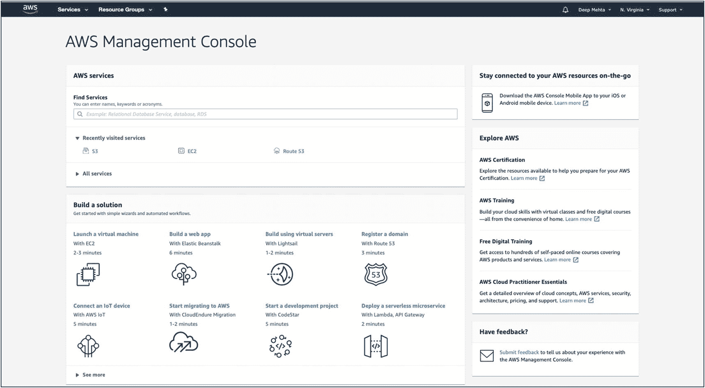

Figure 18-1

AWS 管理控制台

在本节中，您仅使用 EC2 实例来配置 Splunk 实例。在 AWS 中，搜索 EC2 实例，然后进入 EC2 页面。

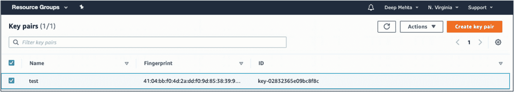

Figure 18-2

密钥对：测试

1. 在 EC2 实例的左侧，有“网络与安全”菜单栏。

2. 转到“密钥对”。

3. 添加一个密钥（我创建了一个名为`test`的密钥。）请参考图 18-2。


Figure 18-3

安全组：主

1. 在“网络与安全”中，转到“安全组”。

2. 创建一个新的安全组。（我创建了一个名为`Main`的安全组）。

3. 编辑入站规则，其中入站流量选择“所有流量”，协议选择“所有”，端口选择“所有”，目标来源选择“任何位置”。请参考图 18-3。

1. 在 EC2 仪表板中点击“启动实例”。

2. 选择一个映像（选择您想要的任何映像）。本练习我选择了 Amazon Linux 2 AMI。点击“下一步”。实例类型提供了多种针对不同用例优化的实例类型（本练习我选择了`t2.micro`）。

3. 点击“审核并启动”。

4. 点击“编辑安全组” ➤ “现有安全组”，然后选择您创建的安全组（我的是`Main`）。

5. 点击“启动”并选择您创建的密钥对。（我创建了一个名为`Test`的密钥。）

在本章中，您将为站点 A 和站点 B 部署 Splunk 多站点集群。每个站点有两个索引器、搜索头集群、一个许可证主节点、一个集群主节点，以及一个位于同一实例上的部署服务器/监控控制台，并且有两个通用转发器。实例的公有 IP 也已提供。请参考图 18-4 所示的示意图。

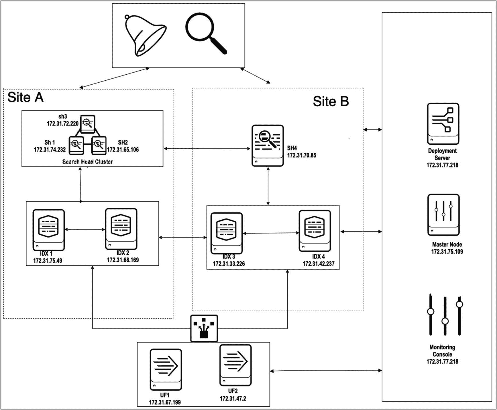

Figure 18-4

Splunk 部署组成架构

要部署多站点集群，您需要拥有 12 个不同的 Splunk 实例。根据需求创建 EC2 实例。（这只是一个用于实现多站点索引集群的测试练习。）对于生产环境部署，完全不推荐这样做。在本练习中，我们有 5 个索引器、4 个搜索头、2 个通用转发器以及一个部署服务器/监控控制台。您可以参考图 18-5。

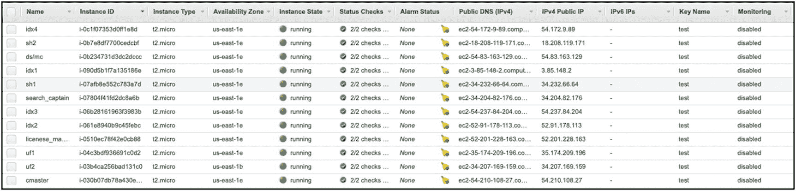

Figure 18-5

Splunk 部署组件：EC2 实例

### 在 EC2 实例上配置 Splunk

您已经为多站点 Splunk 部署创建了 12 个 Amazon Web Services EC2 实例。在此部署中，您需要配置两个 Splunk 通用转发器和十个带有 Splunk 映像的实例。

#### 配置 Splunk Enterprise

要在 Amazon Web Services EC2 上配置 Splunk Enterprise 实例。使用您的凭据登录 EC2 实例，然后参考以下说明。

1. 在 `/opt` 下创建一个名为 `splunk` 的目录。

2. 使用 Splunk 小部件配置 Splunk Enterprise 映像。

3. 将 Splunk 映像解压到 `/opt`。示例如下。

```
$ sudo mkdir /opt/splunk
```

4. 安装 Splunk 映像并接受 Splunk 许可证。

```
$ sudo tar -xzvC /opt -f
```

5. 设置您选择的用户名和密码。启动 Splunk 服务器。

```
$ sudo ./splunk install --accept-license
```

6. 根据实例类型设置 Splunk 服务器名称和主机名；例如，如果是索引 1，则命名为 `idx1`。

```
$ sudo ./splunk start
```

7. 启用您选择的 Splunk 端口。我启用了端口 9997。

```
$ sudo ./splunk enable boot-start
```

```
$ sudo ./splunk enable listen 9997
```

#### 配置 Splunk 转发器

让我们在 Amazon Web Services EC2 实例上配置 Splunk 转发器。登录 EC2 实例并参考以下说明。

1. 在 `/opt` 下创建一个名为 `splunk forwarder` 的目录。

2. 使用 Splunk 小部件配置 Splunk 转发器映像。

3. 将 Splunk 映像解压到 `/opt`。示例如下。

```
$ sudo mkdir /opt/splunk forwarder
```

4. 安装 Splunk 映像并接受 Splunk 许可证。

```
$ sudo tar -xzvC /opt -f
```

5. 设置您选择的用户名和密码。启动 Splunk 服务器。

```
$ sudo ./splunk install --accept-license
```

6. 根据实例类型设置 Splunk 服务器名称和 Splunk 主机名；例如，如果是转发器 1，则命名为 `uf1`。

```
$ sudo ./splunk start
```

7. 启用 Splunk 开机自启。

```
$ sudo ./splunk set servername <name>
$ sudo ./splunk set default-hostname
```

```
$ sudo ./splunk enable boot-start
```

接下来，让我们转到 Splunk 多站点索引集群，以配置主站点和从节点。

## 部署多站点索引集群

在本节中，您将配置 Splunk 中的多站点索引集群，其中有两个站点：站点 1(A) 和站点 2(B)（参考图 18-4）。在本练习中，您将部署多站点索引集群，其中复制因子 = 1：总计 = 2 个副本，可搜索副本 = 1：总计 = 副本数。


### 配置集群主节点

要在 Splunk 中配置集群主节点，请登录到集群主节点的 EC2 实例，并进入 `$SPLUNK_HOME/bin/` 目录。  
要在 Splunk 中启用集群主节点，请参照以下命令，该命令将设置可搜索副本数为 `1`，复制因子为 `1`。

```
$ sudo ./splunk edit cluster-config -mode master -multisite true -site site1 -available_sites site1, site2 -site_replication_factor origin:1, total:2 -site_search_factor origin:1, total:2 -replication_factor 1 -search_factor 1 -secret idxcluster
```

要监控集群主节点的状态，请导航至 Splunk Web 的设置，然后进入**索引器集群**，您会看到一个类似于图 18-6 的界面。

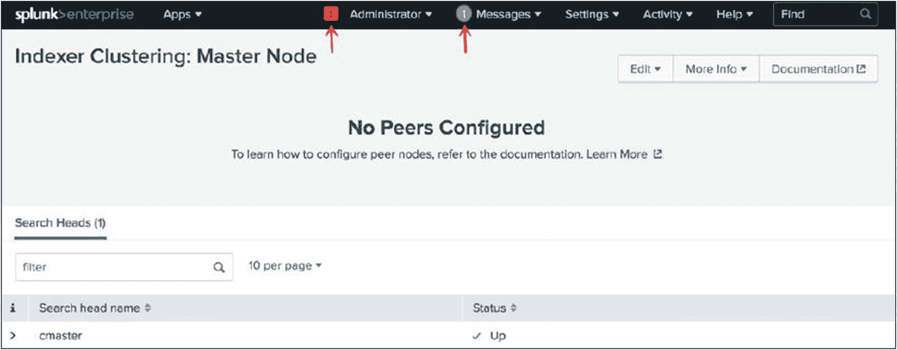

**图 18-6** 监控索引器集群：主节点

### 配置从节点

要为 Splunk 中的集群主节点配置从节点，请登录到索引器的 EC2 实例，并进入 `$SPLUNK_HOME/bin/` 目录。  
要启用索引器 1 和索引器 2，并使其向站点 1 的主节点报告，请参照以下命令。

```
$ sudo ./splunk edit cluster-config -mode slave -master_uri https://172.31.75.109:8089 -secret idxcluster -replication_port 9200 -site site1
sudo ./splunk restart
```

要启用索引器 3 和索引器 4，并使其向站点 2 的主节点报告，请参照以下命令。

```
$ sudo ./splunk edit cluster-config -mode slave -master_uri https://172.31.75.109:8089 -secret idxcluster -replication_port 9200 -site site2
sudo ./splunk restart
```

将主节点和所有索引器配置到它们各自的站点。要开始监控集群，请切换到集群主节点，并导航至 Splunk Web 的设置。进入**索引器集群**，您会找到所有向集群主节点报告的 Splunk 实例。图 18-7 显示了 `idx1`、`idx2`、`idx3` 和 `idx4` 已向主节点报告。

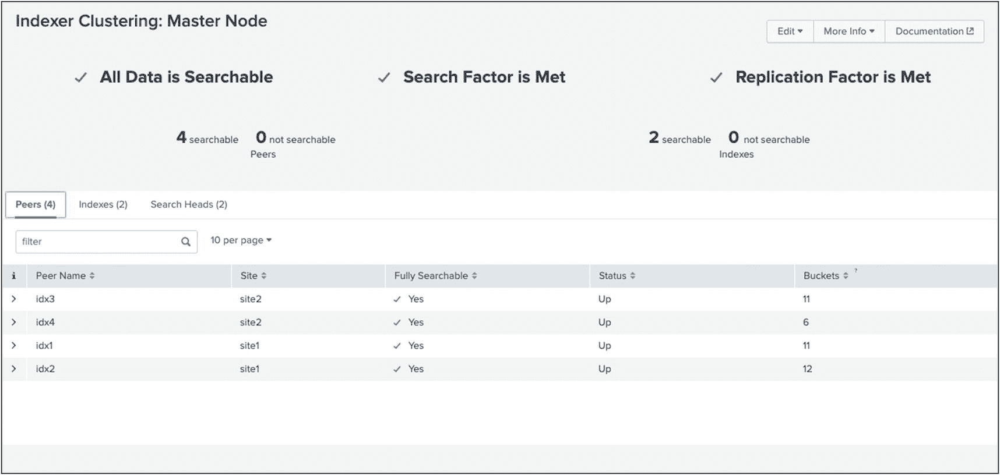

**图 18-7** 监控索引器集群：对等节点

接下来，我们来部署搜索头集群。

## 部署搜索头

在此部分，您将为站点 1 配置多站点搜索头集群，并为站点 2 部署搜索头。

### 配置搜索头

要为 Splunk 中的搜索头配置从节点，请登录到搜索头的 EC2 实例，并进入 `$SPLUNK_HOME/bin/` 目录。  
要启用 `sh1`、`sh2` 和 `sh3`，并使其向站点 1 的主节点报告，请参照以下命令。

```
sudo ./splunk edit cluster-config -mode searchhead -master_uri https://172.31.75.109:8089 -site site1 -secret idxcluster
sudo ./splunk restart
```

要启用 `sh4` 并使其向站点 2 的主节点报告，请参照以下命令。

```
sudo ./splunk edit cluster-config -mode searchhead -master_uri https://172.31.75.109:8089 -site site2 -secret idxcluster
sudo ./splunk restart
```

将搜索头配置到它们各自的站点后，为了监控集群主节点的状态（即搜索头是否已向主节点报告），请导航至 Splunk Web 的设置，进入**索引器集群**，您会找到一个**搜索头**栏。导航至**搜索头**。您可以找到所有已向主节点报告的实例。图 18-8 显示了 `Deep-SHC` (`sh3`)、`sh1`、`sh2`、`sh4` 和 `cmaster` 已向主节点报告。

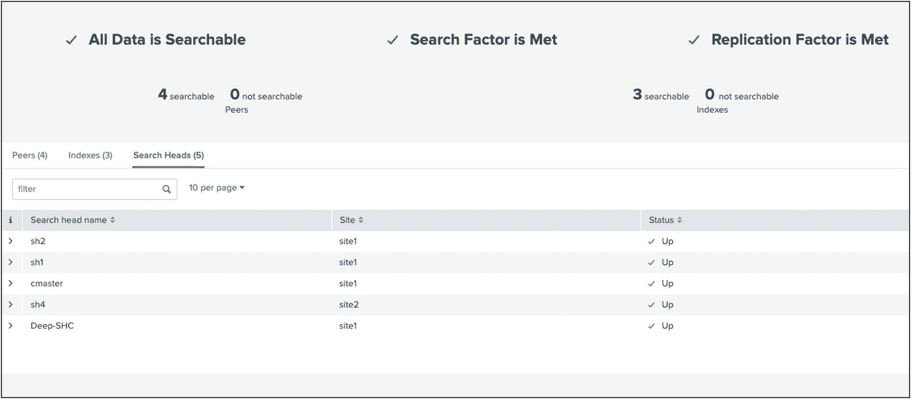

**图 18-8** 监控索引器集群：搜索头

### 配置搜索头集群

在此部分，您将为站点 1（即 `sh1`、`sh2` 和 `sh3` (`Deep-shc`)）配置 Splunk 搜索头集群。我习惯给 captain 节点起一个独特的标签，这样便于记忆。这纯属个人选择。我将 `sh3` 实例标记为 `Deep-shc`。要为搜索头集群启用 `sh1`、`sh2` 和 `Deep-shc`（即 `sh3`）：

要使用密钥启用 `sh3` 进行集群，请使用 `init` 命令。请参照以下命令。

```
sudo ./splunk init shcluster-config -mgmt_uri https://172.31.72.220:8089 -replication_port 9200 -secret shcluster
sudo ./splunk restart
```

要使用密钥启用 `sh1` 进行集群，请使用 `init` 命令。请参照以下命令。

```
sudo ./splunk init shcluster-config -mgmt_uri https://172.31.74.232:8089 -replication_port 9200 -secret shcluster
sudo ./splunk restart
```

要使用密钥启用 `sh2` 进行集群，请使用 `init` 命令。请参照以下命令。

```
sudo ./splunk init shcluster-config -mgmt_uri https://172.31.65.106:8089 -replication_port 9200 -secret shcluster
sudo ./splunk restart
```

转到您希望其成为搜索头 captain 节点的那台实例；在我的例子中，它是 `Deep-shc` 节点。使用 `bootstrap` 命令来选举一个 captain，因为集群中只有一个节点。请参照以下命令。

```
sudo ./splunk bootstrap shcluster-captain -servers_list https://172.31.72.220:8089
```

要将 `sh1` 添加到现有的 Splunk 搜索头集群，请使用 `add shcluster-member` 命令，但只能从 captain 节点执行此操作。请参照以下命令。

```
sudo ./splunk add shcluster-member -new_member_uri https://172.31.74.232:8089
```

要将 `sh2` 添加到现有的 Splunk 搜索头集群，请使用 `add shcluster-member` 命令，但只能从 captain 节点执行此操作。请参照以下命令。

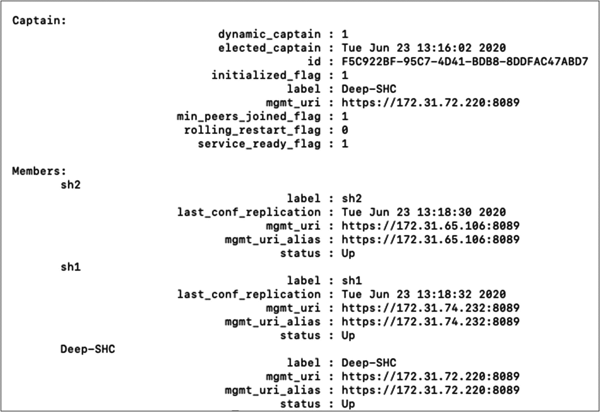

**图 18-9** 配置搜索头集群 Captain 节点

```
sudo ./splunk add shcluster-member -new_member_uri https://172.31.65.106:8089
```

要使用 captain 检查搜索头集群成员的状态，请参照以下命令。

```
sudo ./splunk show shcluster-status
```

本节为站点 1 实现了多站点搜索头集群，为站点 2 部署了搜索头。在下一节中，您将使用部署实例在 Splunk 中部署配置文件。

## 部署配置

在此部分，您将为以下任务部署配置：

- 使用集群主节点将 `indexes.conf` 和 `props.conf` 部署到所有索引器。
- 使用部署服务器将 `shc` 应用部署到搜索头集群。
- 为索引器发现配置通用转发器。
- 使用部署服务器在 `universalforwarder1` 上部署配置以监控 `Text.txt` 文件。
- 配置主节点和部署服务器，将内部日志发送到索引器。


### 配置集群主节点

主节点可以将配置分发到索引器。主节点在索引层中间部署一个插件。在本用例中，通用转发器将 `Test.txt` 数据转发到索引 `test`。

1.  要使用主节点部署配置，请迁移到 `$SPLUNK_HOME/etc/cmaster/_local`。
2.  创建或编辑 `indexes.conf` 文件。请参考以下代码段。
3.  为源类型 `Test9` 创建或编辑 `props.conf` 文件。请参考以下代码段。

```
[test]
homePath=$SPLUNK_DB/test/db
coldPath=$SPLUNK_DB/test/colddb
thawedPath=$SPLUNK_DB/test/thaweddb
repFactor=auto
```

4.  要使用集群主节点将配置文件部署到所有索引器，请转到 `$SPLUNK_HOME/bin/`。

```
[Test9]
TIME_PREFIX=\d{1,3}\.\d{1,3}\.\d{1,3}\.\d{1,3}\s\-\s\d{5}\s+
TIME_FORMAT = %m/%d/%Y %k:%M
MAX_TIMESTAMP_LOOKAHEAD = 15
LINE_BREAKER = ([\r\n]+)\d+\s+\"\$EIT\,
SHOULD_LINEMERGE
```

5.  要确认包验证的状态，请参考以下命令。

```
sudo ./splunk validate cluster-bundle --check restart
```

```
sudo ./splunk show cluster-bundle-status
```

如果你的集群包成功部署，你将找到部署的校验和。该命令类似于图 18-10。

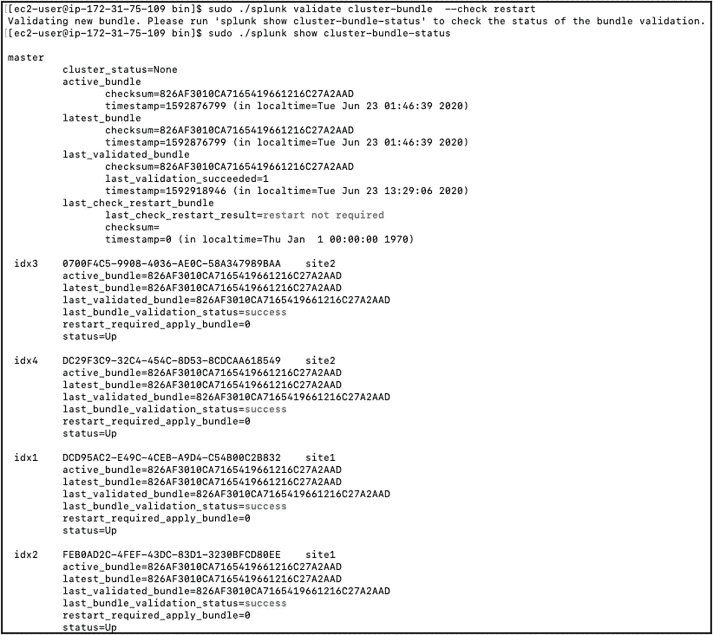

图 18-10

在对等索引器上部署集群包

### 使用部署服务器将应用部署到搜索头集群

在本节中，按用例所示，为构建一个可扩展的平台，你无需物理地访问每个节点来推送所有配置，而是使用部署服务器来推送配置。类似地，你使用部署服务器将 `shc` 应用推送到搜索头集群的所有节点。`shc` 应用将内部日志发送到索引器。

要使用部署服务器部署 `shc` 应用，请在搜索头 1 (sh1) 上转到 `$SPLUNK_HOME/bin/`。请参考以下命令。

```
sudo ./splunk edit shcluster-config -conf_deploy_fetch_url https://172.31.77.218:8089
```

要使用部署服务器部署 `shc` 应用，请在搜索头 2 (sh2) 上转到 `$SPLUNK_HOME/bin/`。请参考以下命令。

```
sudo ./splunk edit shcluster-config -conf_deploy_fetch_url https://172.31.77.218:8089
```

要使用部署服务器部署 `shc` 应用，请在搜索头 3 (sh3) 上转到 `$SPLUNK_HOME/bin/`。请参考以下命令。

```
sudo ./splunk edit shcluster-config -conf_deploy_fetch_url https://172.31.77.218:8089
sudo ./splunk edit shcluster-config -conf_deploy_fetch_url https://172.31.77.218:8089
```

在部署服务器中，创建一个名为 `shc` 的应用，位于 `$SPLUNK_HOME/etc/shcluster/apps/`。

1.  为 `shc` 应用创建或编辑位于 `/local/apps.conf` 的 `apps.conf` 文件。请参考以下代码。
2.  为 `shc` 应用创建或编辑位于 `/local/outputs.conf` 的 `outputs.conf` 文件。请参考以下代码。

```
[ui]
is_visible = 0
[package]
id = shc_base
check_for_updates = 0
```

3.  要在搜索头集群节点中推送配置，请在部署服务器中进入 `$SPLUNK_HOME/bin/`。请参考以下命令。

```
[indexAndForward]
index = false
[tcpout]
defaultGroup = default-autolb-group
forwardedindex.filter.disable = true
indexAndForward = false
[tcpout:default-autolb-group]
server=172.31.75.49:9997,172.31.68.169:9997,172.31.33.226:9997,172.31.42.237:999
```


图 18-11

在搜索头集群上部署集群包

```
sudo ./splunk apply shcluster-bundle -action stage --answer-yes
```

4.  部署已准备好推送，但尚未推送。要推送部署，你需要联系搜索头集群 Captain，并使用 `apply shcluster-bundle` 命令。请参考以下命令。

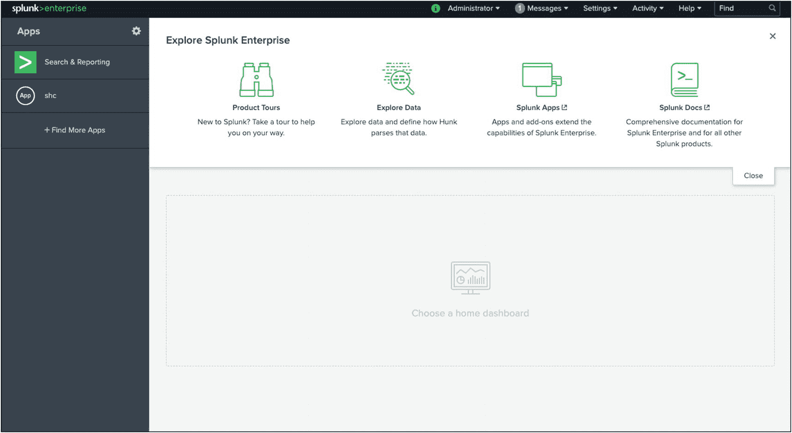

图 18-13

搜索头：SHC 应用已部署

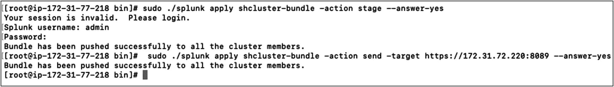

图 18-12

使用搜索头集群 Captain 在搜索头上部署集群包

```
sudo ./splunk apply shcluster-bundle -action send -target https://172.31.72.220:8089 --answer-yes
```

#### 为索引器发现配置通用转发器

在本节中，你将在通用转发器上启用索引器发现并配置站点故障转移。索引器发现是在 `autoLBFrequency` 上配置的。

#### 为索引器发现配置集群主节点

要在 Splunk 部署中配置索引器发现，你需要编辑 `server.conf`。

1.  创建或编辑位于 `$SPLUNK_HOME/etc/system/local/` 的 `server.conf` 文件。请参考以下代码。
2.  通过进入 `$SPLUNK_HOME/bin/` 重启 Splunk 主节点。请参考以下命令。

```
[indexer_discovery]
pass4SymmKey = my_secret
```

```
sudo ./splunk restart
```

#### 为索引器发现配置通用转发器

要在通用转发器中配置索引器发现，你需要编辑 `outputs.conf`。

1.  在转发器上创建或编辑位于 `$SPLUNK_HOME/etc/system/local/` 的 `outputs.conf` 文件。请参考以下代码。
2.  在转发器 1 上创建或编辑位于 `$SPLUNK_HOME/etc/system/local/` 的 `server.conf` 文件。请参考以下代码。

```
[indexer_discovery:master1]
pass4SymmKey = my_secret
master_uri = https://172.31.75.109:8089
[tcpout:group1]
autoLBFrequency = 30
forceTimebasedAutoLB = true
indexerDiscovery = master1
useACK=true
```

3.  在转发器 2 上创建或编辑位于 `$SPLUNK_HOME/etc/system/local/` 的 `server.conf` 文件。请参考以下代码。

```
[general]
site = site1
[clustering]
forwarder_site_failover = site1:site2
```

4.  通过进入 `$SPLUNK_HOME/bin/` 重启 Splunk 转发器。请参考以下命令。

```
[general]
site = site2
[clustering]
forwarder_site_failover = site2:site1
```

```
sudo ./splunk restart
```


##### 为索引器部署配置通用转发器

在本节中，您将使用部署服务器在通用转发器 1 上部署一个名为 `uf1` 的应用，该应用会监控 `Test.txt` 文件。

##### 为部署配置部署服务器

通过导航到部署服务器的 EC2 实例并迁移至 `$SPLUNK_HOME/etc/deployment-apps/`，来为 `uf1` 应用配置部署服务器。

1. 创建一个名为 `uf1` 的应用。
2. 迁移到 `uf1/local` 目录并创建 `inputs.conf` 文件以监控 `Test.txt` 文件。请参考以下配置块。

```
[monitor:///opt/Test.txt]
disabled=false
index=test
sourcetype=Test9
```

##### 为部署服务器配置转发器

要为部署服务器配置转发器，请前往转发器的 EC2 实例并迁移至 `$SPLUNK_HOME/bin/` 目录。

要配置转发器使其向部署服务器报告，请参考以下命令。

```
./sudo splunk set deploy-poll 172.31.77.218:8089
```

##### 部署 `uf1` 应用

使用转发器管理功能在通用转发器上部署 `uf1` 应用。

1. 在 Splunk Web 中前往部署服务器。
2. 在 Splunk Web 中转到**设置**，然后转到**转发器管理**。

有两个通用转发器向转发器管理报告。请参考图 18-14。

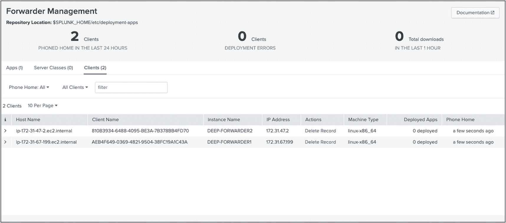

**图 18-14** 转发器管理：通用转发器

1. 一旦通用转发器 1 向部署服务器报告，您需要创建一个服务器类。选择 `uf1` 应用以部署在通用转发器 1 上。

图 18-15 显示了部署在通用转发器 1 上的 `uf1` 应用。

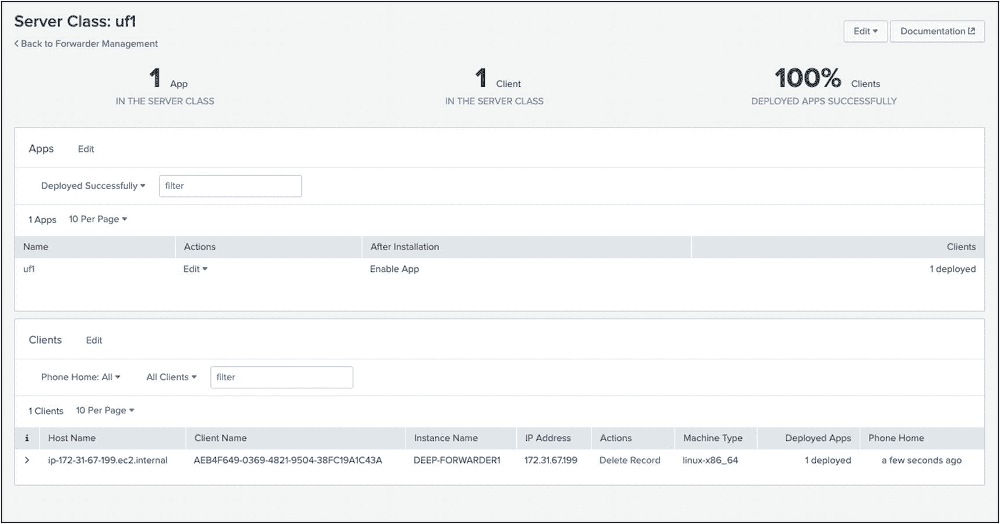

**图 18-15** 服务器类：`uf1`

一旦 `uf1` 应用部署在通用转发器上，当您登录到搜索头 3 并在搜索栏中输入 `index =”test”` 时，您可以观察到您的数据是从主机 `"DEEP-FORWARDER1"` 解析的。请参考图 18-16。

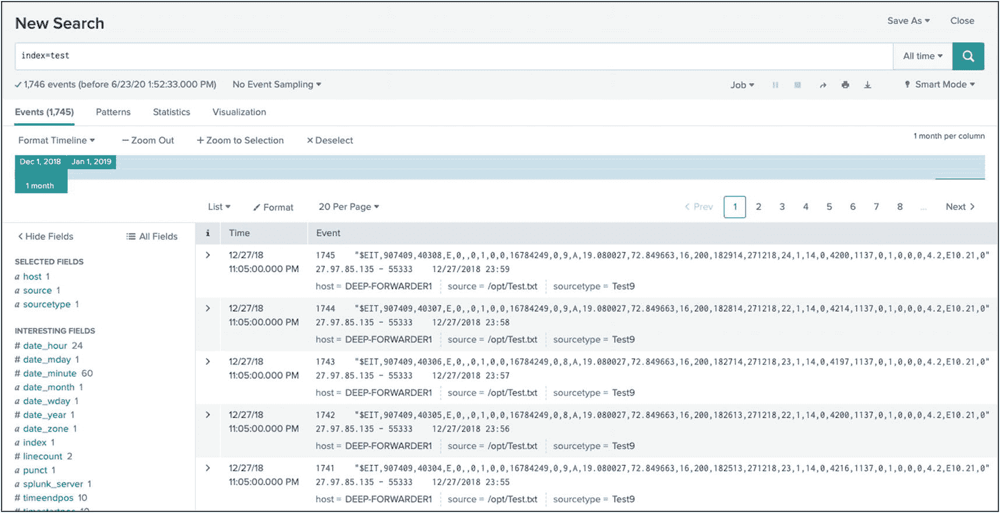

**图 18-16** 索引 `test` 中的事件：`DEEP-FORWARDER1`

要确认 `test` 索引的 `repFactor=auto` 是否生效，请在集群主节点上导航到 Splunk Web 设置，然后转到**索引器集群**。您可以找到 `test` 索引的状态。它应该是可搜索的，并且应有复制的数据副本。请参考图 18-17。

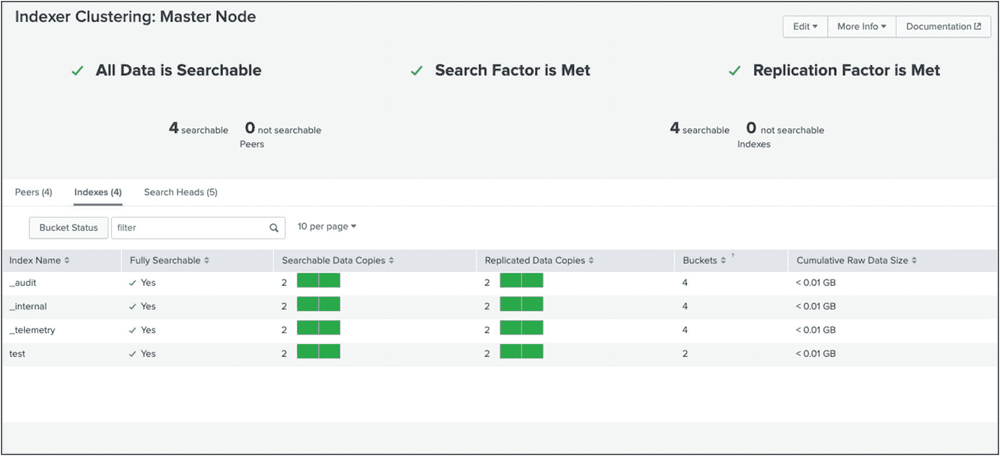

**图 18-17** 索引器集群：`test` 索引

### 配置主节点、部署服务器和搜索头 4 以发送内部日志

在本节中，您将把内部日志从部署服务器、主节点和搜索头 4 发送到索引器 1、索引器 2、索引器 3 和索引器 4。内部日志用于监控 Splunk Enterprise 的部署情况。

1. 前往部署服务器、集群主节点和搜索头 4 的实例。
2. 转到 `$SPLUNK_HOME/etc/system/local/outputs.conf` 文件。请参考以下代码。（例如，将 `server=172.31.49.45:9997` 替换为您索引器的 IP 地址。）
3. 转到 `$SPLUNK_HOME/bin/` 目录并输入以下命令。

```
[indexAndForward]
index = false
[tcpout]
defaultGroup = default-autolb-group
forwardedindex.filter.disable = true
indexAndForward = false
[tcpout:default-autolb-group]
server=172.31.75.49:9997,172.31.68.169:9997,172.31.33.226:9997,172.31.42.237:9997
```

```
./sudo splunk restart
```

现在让我们来看一下如何监控分布式环境。

## 监控分布式环境

在本节中，您将使用部署服务器/监控控制台来监控分布式环境。监控控制台负责监控分布式环境。当 Splunk 实例发生故障或您的 Splunk 环境中出现任何其他问题时，它可以进行故障排除。

### 添加搜索对等节点以进行监控

在本节中，您将使用 Amazon Web Services EC2 实例上的部署服务器/监控控制台来监控您的 Splunk 环境。要监控 Splunk 环境，您需要在集群主节点和搜索头上添加一个搜索对等节点。要添加搜索对等节点，请参考以下说明。

1. 转到监控控制台实例，并使用 Splunk Web 导航到**设置** > **分布式搜索**。
2. 单击**新建**，然后输入对等节点 URI，接着输入远程用户名和远程密码。确认密码。
3. 单击**保存**。

将所有搜索对等节点添加到您的实例后，您将看到类似于图 18-18 的屏幕。

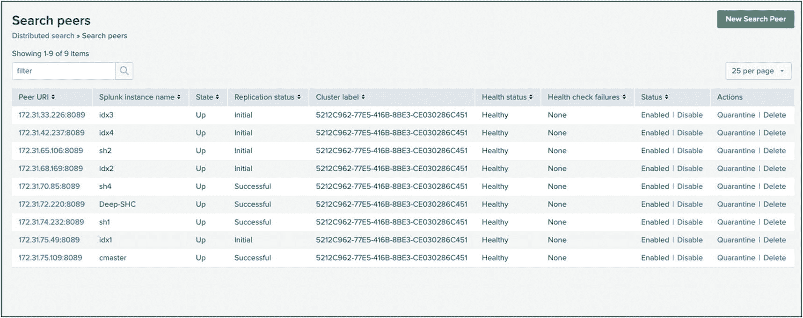

**图 18-18** 监控控制台：搜索对等节点

### 分布式环境的通用设置

要在 Splunk 中设置通用的分布式环境，请前往 Splunk Web 中的部署服务器/监控控制台实例，并参考以下说明。

1. 前往部署服务器/监控控制台，然后在 Splunk Web 中进入**设置**。
2. 转到**监控控制台**。
3. 单击**设置**，然后在监控控制台上转到**通用设置**。
4. 在**模式**选项下选择**分布式**。单击**继续**。您应该能看到实例列表。
5. 检查自动选择的角色。编辑那些未按其用例进行配置的角色。
6. 根据其实例编辑完所有角色后，单击**应用更改**。
7. 保存所有配置更改，然后转到**概览**页面。

在**概览**页面上，您会找到如图 18-19 所示的部署拓扑图。

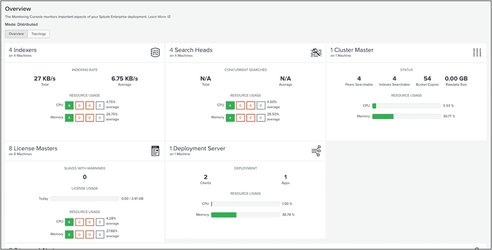

**图 18-19** 监控控制台：部署拓扑图

## 结论

在本章中，您学习了如何在 AWS 平台上部署 Splunk 环境。

这也标志着本书的结束。我尝试覆盖所有 Splunk 相关主题，但如果您想了解更多，请参考 [`docs.splunk.com/Documentation`](https://docs.splunk.com/Documentation) 上的 Splunk 文档。如果您有疑问，或者无法解决某个问题，请前往 [`community.splunk.com/t5/Community/ct-p/en-us`](https://community.splunk.com/t5/Community/ct-p/en-us) 的 Splunk 社区。Splunk 专家可以指导您并帮助您解决问题。


