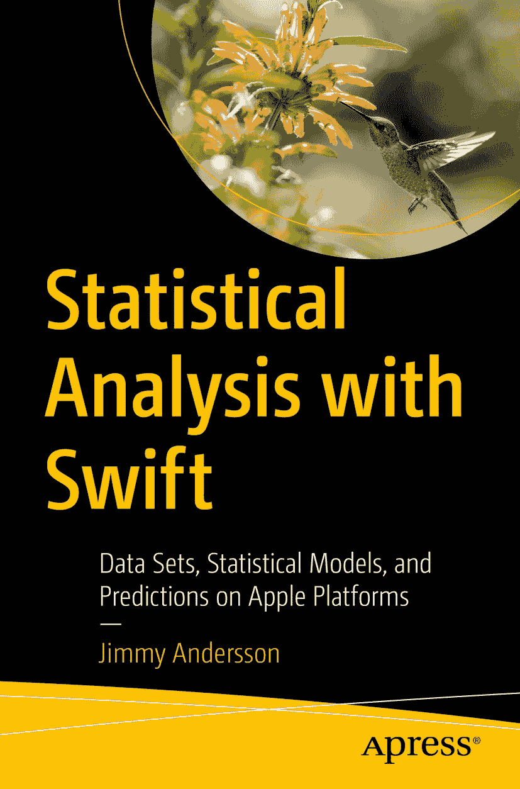

ISBN 978-1-4842-7764-5

e-ISBN 978-1-4842-7765-2

[`doi.org/10.1007/978-1-4842-7765-2`](https://doi.org/10.1007/978-1-4842-7765-2)

© Jimmy Andersson 2022

本作品受版权保护。版权所有，无论整体或部分内容，均需出版方独家授权，具体涉及翻译、重印、插图复用、朗诵、广播、微缩胶片或其他物理形式复制，以及电子改编、计算机软件或任何现有或未来开发的相似或不同方法的传输或信息存储与检索。即使未作明确声明，本出版物中使用通用描述性名称、注册商标名称、商标、服务标记等，也不意味着此类名称不受相关保护性法律法规的约束，因此可被一般公众自由使用。出版方、作者和编辑假定，本书在出版日期时的建议和信息均真实准确。出版方、作者或编辑对本材料中包含的内容或可能存在的任何错误或疏漏，概不提供明示或暗示的保证。出版方对已出版地图中的司法主张和机构隶属关系保持中立。

本 Apress 印记由注册公司 APress Media, LLC（斯普林格自然集团旗下）出版。注册公司地址为：1 New York Plaza, New York, NY 10004, U.S.A.