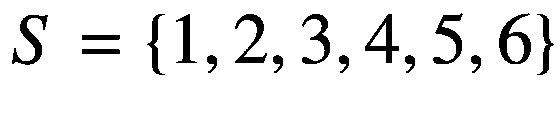
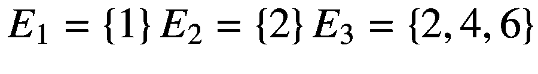
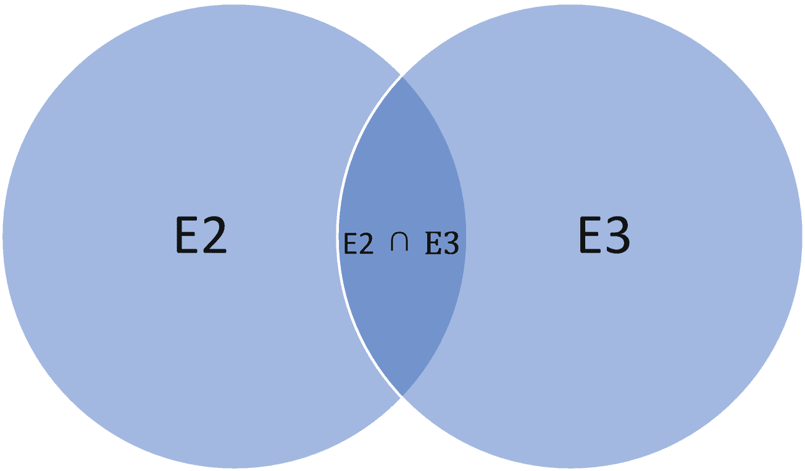

# 2. 概率与随机变量导论

既然我们已经讨论了选择 Swift 作为统计分析主要工具的可行性，接下来应该温习一下概率和随机变量的概念。这些是统计学的基本构建块，我们将在本书中频繁使用它们。本章介绍一些数学理论，并为我们讨论问题和解决方案时使用的许多符号奠定基础。本章还讨论了其他关键方面，例如独立性、变异性和条件性。闲话少叙，让我们从学习概率开始吧。


## 概率

即便我们可能没有意识到，概率并非只是研究人员和工程师专属的数学概念。我们所有人每天都在评估和解读概率。如果我们计划本周末去海滩，而天气预报显示周六有 60%的降雨概率，我们可能会改选周日出行。如果我们听说今天早上常走的上班路线交通状况糟糕，我们可能会冒险绕道以准时到达。诚然，在大多数此类情况下，我们大多数人可能不会进行任何严格的数学分析。相反，大多数时候，我们可能依赖于一种直觉，即哪种行动能最大化实现目标的可能性。然而，当紧要关头时，我们仍然在估计和评估不同结果的概率。

概率的核心，只是一种帮助我们理解某个事件发生可能性的工具。正如我们之前所见，有些人可能用 0 到 100 之间的数字以百分比形式来表达。本书将采用 0 到 1 之间（含端点）的实数来表达概率。这种表示法在科学界更为常见，也更便于计算。我们通过以下方式描述概率及其对相关事件的影响：

- 如果事件的概率接近 1，则事件**非常可能**发生。
- 同样地，如果事件的概率接近 0，则事件**非常不可能**发生。
- 概率为 0 或 1 的事件是确定的。概率为 0 表明结果不可能发生，而概率为 1 则表明结果必然发生。

举一个具体的例子，我们可以考虑变量赋值 `let myConstant = 5`。我们使用 `let` 关键字声明了该变量，这使其不可变。我们可以用以下概率来描述 `myConstant`：

![$$ P\left[\mathrm{myConstant}=5\right]=1 $$](images/512351_1_En_2_Chapter/512351_1_En_2_Chapter_TeX_Equa.png)

上面的符号读作“`myConstant` 等于 5 的概率为 1”，并且告诉我们，无论我们查看多少次，`myConstant` 的值都肯定是 5。

然而，统计学和概率论激动人心之处在于当我们离开确定性的时候。例如，某件事情的概率为 0.3 意味着什么？为了让后续的讨论易于理解，我们将使用一个简单的六面骰子作为例子。用一个熟悉的事物来展示有时很抽象的主题的实用性，希望能让我们更好地理解为什么讨论这些主题对我们有益。

### 样本空间

在估计一个或多个事件的概率之前，了解哪些事件是可能出现的会很有帮助。在我们的六面骰子示例中，枚举所有可能的结果相对容易。这样做之后，我们得到了从 1 到 6 的所有整数的集合。我们称这些数字为样本空间，并用字母 S 表示，如下所示：



这个特定的样本空间是一个相当易于管理的数字列表，这对我们来说很幸运。然而，许多其他问题的样本空间是巨大的，甚至是无限的。例如，如果我们让某人挑选他们能想到的任何实数，我们的样本空间将是所有实数的集合，这是一个无限集合。

既然我们知道 S 包含了掷骰子的所有可能结果，我们也可以推导出概率最基本公理之一，即：

![$$ P\left[\mathrm{S}\right]=1 $$](images/512351_1_En_2_Chapter/512351_1_En_2_Chapter_TeX_Equc.png)

上面的等式指出，如果我们掷一个骰子，结果有 100%的把握是样本空间中的某个样本点。

### 事件

事件是样本空间中样本点的一个子集。假设我们定义 E[1] 为骰子显示偶数点数的掷骰结果；我们实际上是说 E[1] = {2, 4, 6}。如果我们再定义一个事件 E[2] 为显示奇数点数的掷骰结果，我们就得到了两个所谓的互斥事件。如果两个事件永远不能同时发生，则称它们是互斥的。在我们的例子中，推理很简单。因为我们掷出的点数要么是偶数，要么是奇数，永远不会同时是两者，所以 E[1] 和 E[2] 永远不能同时发生。这个性质为另一个概率公理奠定了基础，该公理指出：

如果 {E[1], E[2], E[3], …} 是一组互斥事件的集合，那么

![$$ P\left[{E}_1\cup {E}_2\cup {E}_3\cup \dots \right]=P\left[{E}_1\right]+P\left[{E}_2\right]+P\left[{E}_3\right]+\dots $$](images/512351_1_En_2_Chapter/512351_1_En_2_Chapter_TeX_Equd.png)

这个公理告诉我们，一组互斥事件的并集的概率等于各个事件概率之和。我们假设骰子是均匀的，每次掷骰子每个面出现的概率相等。我们通过将 1（整个样本空间的概率）除以集合中的项数来计算各个概率，这样每个结果的概率都是 1/6。现在我们定义一个事件 A，使得一次掷骰结果为 1 或 2。使用前面的公式，我们计算出 A 的总概率是

![$$ P\left[A\right]=P\left[ roll=1\cup roll=2\right]=P\left[ roll=1\right]+P\left[ roll=2\right]=\frac{1}{6}+\frac{1}{6}=\frac{1}{3} $$](images/512351_1_En_2_Chapter/512351_1_En_2_Chapter_TeX_Eque.png)

需要特别注意的是，这个计算仅在事件互斥的假设下才成立。如果不互斥，我们将需要借助另一个众所周知的规则。

> **注意**  
> 上一条公理中使用的 `∪` 运算符称为并集运算符。它接收两个项目集合并将它们合并成一个集合。两个集合的并集包含原始集合中的所有元素，但不会有任何重复项。


## 一般加法法则

一般加法法则与我们刚刚使用的公式非常相似。它用于计算事件并集的总概率，但同时也考虑了这些事件可能并非互斥的情况。该法则可以表述如下：

![$$ P\left[{E}_1\cup {E}_2\right]=P\left[{E}_1\right]+P\left[{E}_2\right]-P\left[{E}_1\cap {E}_2\right] $$](images/512351_1_En_2_Chapter/512351_1_En_2_Chapter_TeX_Equf.png)

我们通过一个代码示例来看看为什么这个公式能修正重叠事件的计算。下一页的清单 2-1 展示了互斥事件 `E[1]` 和 `E[2]` 的公式应用。紧随其后的清单 2-2 展示了同一公式以及一般加法法则应用于两个重叠事件 `E[2]` 和 `E[3]` 的情况。前者得出错误结果，而后者正确。事件 `E[1]`、`E[2]` 和 `E[3]` 定义如下：

- `E[1]`：掷骰子结果为 1。
- `E[2]`：掷骰子结果为 2。
- `E[3]`：掷骰子结果为偶数。

```
let E3 = { (roll: Int) -> Bool in
return roll.isMultiple(of: 2)
}
let nonMutExUnionProb = Double(
dieRolls.filter { roll in
E2(roll) || E3(roll)
}.count) / totalCount
let E3Prob = Double(
dieRolls.filter(E3).count
) / totalCount
let E2andE3 = Double(
dieRolls.filter { roll in
E2(roll) && E3(roll)
}.count) / totalCount
let genAddRule = E2Prob + E3Prob - E2andE3
print(
"""
Events E2 and E3, no mutual exclusivity:
P[E2 || E3]:   \(nonMutExUnionProb)
P[E2]:         \(E2Prob)
P[E3]:         \(E3Prob)
P[E2] + P[E3]: \(E2Prob + E3Prob)
P[E2] + P[E3] - P[E2 && E3]: \(genAddRule)
"""
)
// Prints:
// Events E2 and E3, no mutual exclusivity:
// P[E2 || E3]:   0.5
// P[E2]:         0.16666666666666666
// P[E3]:         0.5
// P[E2] + P[E3]: 0.6666666666666666
// P[E2] + P[E3] - P[E2 && E3]: 0.5
清单 2-2
使用一般加法法则计算重叠事件并集的概率
```

```
let dieRolls = Array(1 ... 6)
let totalCount = Double(dieRolls.count)
let E1 = { (roll: Int) -> Bool in
return roll == 1
}
let E2 = { (roll: Int) -> Bool in
return roll == 2
}
let mutExUnionProb = Double(
dieRolls.filter { roll in
E1(roll) || E2(roll)
}.count
) / totalCount
let E1Prob = Double(
dieRolls.filter(E1).count
) / totalCount
let E2Prob = Double(
dieRolls.filter(E1).count
) / totalCount
print(
"""
Mutually Exclusive events E1 and E2:
P[E1 || E2]:   \(mutExUnionProb)
P[E1]:         \(E1Prob)
P[E2]:         \(E2Prob)
P[E1] + P[E2]: \(E1Prob + E2Prob)
"""
)
// Prints:
// Mutually Exclusive events E1 and E2:
// P[E1 || E2]:   0.3333333333333333
// P[E1]:         0.16666666666666666
// P[E2]:         0.16666666666666666
// P[E1] + P[E2]: 0.3333333333333333
清单 2-1
计算互斥事件并集的概率
```

互斥情况下的公式为何失效，起初可能并不显而易见。我们可以通过观察每个事件所涵盖的样本点来揭示问题所在。



观察 `E[1]` 和 `E[2]`，很容易看出这两个事件没有任何重叠的样本点，也就是说它们是互斥的。然而，我们也能看到 `E[2]` 和 `E[3]` 共享一个样本点，即数字 2。如果使用互斥事件的公式，我们最终会把掷出数字 2 的概率重复计算一次！一般加法法则正是为了解决这个问题。公式末尾的减法确保我们只计算一次重叠样本点的概率。图 2-1 以可视化方式展示了这些重叠的集合。



图 2-1

用维恩图显示的两个事件之间的重叠。一般加法法则通过减去本会被重复计算的元素概率来补偿重叠部分

现在我们已经了解了样本空间和事件的基本概念，接下来还应该看看事件序列之间如何相互依赖。让我们将掷骰子的示例扩展为连续投掷两次的情况。第一次掷出偶数的概率是多少？或者第二次掷出奇数的概率是多少？类似地，如果第一次掷出偶数，那么第二次掷出奇数的概率又该如何计算？这些正是接下来我们要探讨的问题。


### 条件概率

在大量统计问题中，事件发生的概率会随着另一事件是否发生而变化。例如，上班途中燃油耗尽的概率，会根据我们昨天是否加满油而取不同的值。另一个例子是，在德州扑克游戏中拿到同花顺的概率，取决于我们起手牌拿到的牌。这些依赖关系并不总是容易考虑。有时，建模这种关系颇具挑战性。其他时候，我们根本不知道这种依赖关系存在。然而，如果我们能形式化两个事件之间的关联方式，我们就能用这一知识丰富我们的模型，并可能改进我们做出的任何预测。

为了解释条件概率的概念，让我们重新审视我们的骰子——不过这次，我们以不同的方式设置前提条件。首先，我们不只是掷一颗骰子。相反，我们首先掷一颗常规的六面骰子。根据第一次掷骰的结果，我们将面临两种不同的情况：

- 如果第一次掷出的是偶数，我们将用一颗只有偶数的骰子进行第二次投掷。
- 类似地，如果第一次掷出的是奇数，我们将用另一颗只有奇数的骰子进行投掷。

让我们看看与这个问题相关的不同样本空间。第一次掷骰的样本空间 `S` 与我们之前看到的一样，即从 1 到 6 的所有整数。然而，第二次掷骰本身并没有明确定义的样本空间。它可能是 `S[2] = {1, 3, 5}` 或 `S[2] = {2, 4, 6}`，具体取决于第一次掷骰的结果。如果有人问我们第二次掷出 2 的概率，我们无法用我们目前掌握的工具来回答。然而，我们可以以第一次掷骰为条件，并针对特定结果给出答案。为了表示条件概率，我们使用以下符号：

![$$ P\left[ rol{l}_2=2| rol{l}_1=x\right]P\left[ rol{l}_1=x\right] $$](images/512351_1_En_2_Chapter/512351_1_En_2_Chapter_TeX_Equh.png)

这个等式读作“给定第一次掷骰结果为 `x` 时，第二次掷骰结果为 2 的概率”。它强调了两个重要概念。第一个是条件概率。由于我们确定了第一次掷骰有一个特定结果 `x`，我们也能说出第二次掷出数字 2 的概率。例如，我们可以说：

![$$ P\left[ rol{l}_2=2| rol{l}_1=1\right]P\left[ rol{l}_1=1\right]=0 $$](images/512351_1_En_2_Chapter/512351_1_En_2_Chapter_TeX_Equi.png)

如果我们第一次掷出了 1，根据我们设定的规则，第二次就不可能掷出 2。

这里展示的第二个重要概念是乘法规则。在数学符号中，我们将其写成：

![$$ P\left[ rol{l}_1=x\cap rol{l}_2=y\right]=P\left[ rol{l}_2=y| rol{l}_1=x\right]P\left[ rol{l}_1=x\right] $$](images/512351_1_En_2_Chapter/512351_1_En_2_Chapter_TeX_Equj.png)

两个事件的联合概率可以看作是单个概率的乘积，同时考虑了它们之间可能存在的条件关系。下一页的代码清单 2-3 展示了两个条件概率计算的代码示例。第一个计算了我们前一页所做的相同掷骰序列，第二个计算了在已知掷出偶数的条件下，单次掷出 4 的概率。

乘法规则对于计算两个事件同时发生的联合概率非常强大。我们已经在研究相互依赖的事件时看到了如何使用它的例子。然而，如果我们能假设它们之间没有这种关系，我们就可以大大简化计算，这正是下一节的主题。

**注**

代码清单 2-3 中使用的 `realValue` 属性来自 `StatKit` 库，其作用仅仅是将数值类型转换为 `Double`。

```
let dieRolls = Array(1 ... 6)
let evenRolls = [2, 4, 6]
let oddRolls = [1, 3, 5]
let firstIs1Prob = dieRolls.filter { roll in
roll == 1
}.count.realValue / dieRolls.count.realValue
let secondIs2Prob = oddRolls.filter { roll in
roll == 2
}.count.realValue / oddRolls.count.realValue
let rollIs4GivenEvenProb = dieRolls.filter { roll in
roll == 4
}.count.realValue / evenRolls.count.realValue
let rollIsEven = dieRolls.filter { roll in
roll.isMultiple(of: 2)
}.count.realValue / dieRolls.count.realValue
print(
"""
P[roll2 == 2 | roll1 == 1]*P[roll1 == 1]:
\(secondIs2Prob * firstIs1Prob)
P[roll1 == 4 | roll1 == even]*P[roll1 == even]:
\(rollIs4GivenEvenProb * rollIsEven)
"""
)
// 输出：
//P[roll2 == 2 | roll1 == 1]*P[roll1 == 1]:
// 0.0
// P[roll1 == 4 | roll1 == even]*P[roll1 == even]:
// 0.16666666666666666
代码清单 2-3
使用 Swift 计算条件概率
```

### 独立性

我们再次拿出骰子，在没有特殊规则或限制的情况下投掷两次。我们有理由相信，第一次投掷的结果不会改变我们第二次投掷时掷出特定数字的概率。无论第一次掷出的结果是 1、6 还是 4，我们掷出 2 的概率都是相同的。这个性质被称为**独立性**，如果我们能假设我们研究的事件满足该性质，它就能显著简化我们的计算。上一节中的乘法规则可以简化为以下表达式：

![$$ P\left[ rol{l}_1=x\cap rol{l}_2=y\right]=P\left[ rol{l}_2=y\right]P\left[ rol{l}_1=x\right] $$](images/512351_1_En_2_Chapter/512351_1_En_2_Chapter_TeX_Equk.png)

第二次掷骰的概率不再依赖于第一次掷骰的结果，因此我们去掉了那个条件。我们最终只需要将各个结果的概率相乘。如果我们想计算第一次掷出 4 且第二次掷出 2 的概率，我们会得到：

![$$ P\left[ rol{l}_1=4\cap rol{l}_2=2\right]=P\left[ rol{l}_2=2\right]P\left[ rol{l}_1=4\right]=\frac{1}{6}\cdotp \frac{1}{6}=\frac{1}{36} $$](images/512351_1_En_2_Chapter/512351_1_En_2_Chapter_TeX_Equl.png)

依赖性和独立性的概念在统计分析中随处可见。它们可以帮助使我们的模型更准确，也可以简化数学表达式和逻辑推理。在下一节中，我们将介绍统计学中最重要的定理之一。它建立在条件概率的基础之上，并允许我们提取那些否则将极难发现的信息。


## 贝叶斯定理

托马斯·贝叶斯牧师是 18 世纪的统计学家和长老会牧师。以他命名的定理用于计算条件概率`P[E[1]|E[2]]`。清单 2-4 中的示例比较宽容。我们很快就能找出`P[roll[1] = 4 | roll[1] ∈ {2, 4, 6}]`的正确值，从而完成所有计算。然而，在许多情况下，这些值要难找得多。让我们通过一个玩具示例来探讨这样一种情况：

> *一个气象站每天测量温度和日照情况。在一年的时间里，40%的日子气温超过 20°C，而 50%的日子是晴天。60%的晴天里气温超过 20°C。如果今天气象站显示气温为 22°C，那么出太阳的概率是多少？*

我们想要在室外气温高于 20°C 的条件下，确定出太阳的概率。用数学符号表示，我们要找的是：

`P[天气 = 晴天 | 温度 > 20]`

快速盘点已知信息，我们已知以下条件：

- `P[温度 > 20] = 0.4`
- `P[天气 = 晴天] = 0.5`
- `P[温度 > 20 | 天气 = 晴天] = 0.6`

虽然最后一个表达式与我们感兴趣的非常相似，但并不完全正确。然而，正如我们即将看到的，这三个表达式合起来足以提供计算所需概率的信息。

在关于条件概率的部分，我们看到可以用以下公式表示两个事件同时发生的概率：

`P[E[1] ∩ E[2]] = P[E[2] | E[1]] P[E[1]]`

不过，我们以哪个事件为条件并不重要。以下“反转”后的表达式同样有效，因为我们只需交换条件事件即可：

`P[E[1] ∩ E[2]] = P[E[1] | E[2]] P[E[2]]`

这一认识恰恰是贝叶斯定理所利用的。现在我们有了两个等式，其左边相等，因此我们也可以通过代入法将两个右边等同起来：

`P[E[1] | E[2]] P[E[2]] = P[E[2] | E[1]] P[E[1]] ⟺ P[E[1] | E[2]] = (P[E[2] | E[1]] P[E[1]]) / P[E[2]]`

我们刚刚推导出了贝叶斯法则，这是统计分析中应用最广泛的公式之一。回到我们的天气示例，现在我们有了计算所需概率的方法。我们只需将事件代入贝叶斯法则即可，得到以下表达式（为简洁起见，我们省略一些繁复的符号，因为所讨论的事件仍然很清楚）：

`P[晴天 | 温度 > 20] = (P[温度 > 20 | 晴天] P[晴天]) / P[温度 > 20] = (0.6 * 0.5) / 0.4 = 0.75`

利用贝叶斯定理，我们计算出在室外温度为 22°C 的条件下，出太阳的概率为 75%。至于这一信息对我们有多大价值，取决于附近是否有窗户可以让我们看一眼外面。然而，同样的原理适用于许多有趣的问题，其中一些我们将在本书后面看到。

## 随机变量

我们在本书前面已经处理过随机变量，尽管从未明确提及。例如，在骰子示例中，`roll[1]`和`roll[2]`都是随机变量。其作用是将样本空间元素映射为可用于计算的实数值。对于骰子来说，我们已经可以将骰子面上的点数表示为实数，因此映射就是恒等函数。

其他文献通常用单个大写字母表示随机变量，例如`X`、`Y`和`Z`。为了为进一步阅读提供衔接基础，我们也将采用这种表示法。在骰子示例中，先掷出 2 点再掷出 4 点的概率转化为以下表示法：

`X[1]：第一次投掷`

`X[2]：第二次投掷`

`P[X[1] = 2 ∩ X[2] = 4] = P[X[1] = 2] P[X[2] = 4] = (1/6) * (1/6) = 1/36`

请注意，随机变量本身并不能提供关于我们实际投掷骰子会看到什么结果的信息。即使我们知道每个面出现的概率是六分之一，这并不意味着我们投掷六次就会看到每个数字各出现一次。同样，即使我们投掷六次，也不能保证一定会看到数字 1。清单 2-4 展示了一段代码片段，说明了这一点。

```
struct Die {
    func roll() -> Int {
        return .random(in: 1 ... 6)
    }
}

let die = Die()
for _ in 1 ... 5 {
    let rolls = (1 ... 5)
        .map { _ in String(die.roll()) }
        .joined(separator: ", ")
    print("We rolled \(rolls)")
}
// 输出：
// We rolled 1, 4, 4, 1, 3
// We rolled 1, 5, 6, 1, 6
// We rolled 6, 1, 6, 6, 5
// We rolled 6, 6, 4, 2, 1
// We rolled 3, 3, 2, 5, 2
清单 2-4
一个示例，说明即使是公平的骰子，在六次投掷中也可能不会出现所有可能的点数
```

> **注意：** 清单 2-4 中打印的骰子投掷结果是随机的。这意味着每次运行代码时，结果很可能有所不同。


### 离散型与连续型随机变量

随机变量的另一个特性与其样本空间有关，即它们是离散的还是连续的。本章开头我们提到，样本空间囊括了所有可能的实验结果。我们还举例说明了两个样本空间：一个是掷骰子，另一个是让朋友任意选择一个实数作为随机数。与这些实验相关的随机变量属于不同类别——掷骰子是离散型随机变量，而朋友选择的随机数则是连续型。

要将随机变量归类为离散型或连续型，我们需要问自己两个关于其样本空间的问题：

1.  样本空间是有限的吗？
2.  样本空间是可数的吗？

这两个问题可能看起来很相似。“可数的”不就是“有限的”另一种说法吗？答案是否定的，我们将通过几个例子来阐明：

-   骰子有六个不同的面，因此其样本空间由六个数字组成。由于样本空间中的数字数量有限，并且我们可以遍历所有数字，这是一个**有限**集合。
-   我们抛一枚硬币，记录需要抛多少次才能得到反面。我们可能很幸运，只抛一次就得到反面，但也可能非常不幸，一直抛到世界末日。样本空间由所有正整数组成，即 `{1, 2, 3, 4, ...}`。这个集合是无限的，因为我们计数可以一直往上没有上限。然而，我们仍然可以从 1 开始无限地枚举样本点。这种样本空间我们称之为**可数无限**。
-   让朋友选择一个实数作为随机数，意味着他们有可能选择整个实数轴上的任意数，这是一个无限集。然而，与之前的抛硬币例子不同，这个集合的样本点是不可数的。即使我们将选择范围限制在 0 到 1 之间的实数，样本点也是不可数的。我们从 0 开始枚举，但接下来呢？如果我们下一步选择 0.1，那么 0.05 又该怎么办？实数的特性在于，通过增加更多小数位，我们总能在两个数之间找到新的值。这个性质使得即使在 0 和 1 之间，样本点也是无限且不可数的。我们将这类集合称为**不可数无限**。

现在我们知道了如何对样本空间分类，也就准备好定义随机变量是离散还是连续的含义了：

-   与**有限**或**可数无限**样本空间相关联的随机变量是**离散型**随机变量。
-   如果随机变量的样本空间是**不可数无限**，则该随机变量是**连续型**随机变量。

离散与连续的概念在后续章节中非常重要，因此我们必须尽早理解它们的定义。

### 章节总结

本章涵盖了我们将在本书中用到的一些最重要的理论概念。我们探讨了概率及其不同表示形式，学习了样本空间、事件和条件概率。当我们发现统计学中最重要的定理之一——即贝叶斯定理时，本章早期学到的理论得到了很好的应用。我们还研究了随机变量，并学习了如何根据其样本空间的属性将它们分类为离散型或连续型。

既然我们已经掌握了基础知识，现在是时候回答一些关于随机变量及其样本空间的更深入问题了。如果样本空间中的某个点出现的可能性是其他点的两倍，会发生什么？我们如何对不同结果的可能性进行建模？对于一个并非所有结果皆等可能的随机变量，我们如何为其生成随机值？在下一章中，我们将讨论分布。

