# 3. 分布

在上一章中，我们讨论了随机变量的一些特性。然而，关于其样本空间，仍有一个关键方面需要我们讨论和理解，以便解决问题。回到骰子的例子，我们知道抛一次骰子相关的样本空间包含从 1 到 6 的所有整数。虽然这是有用信息，但仅凭样本空间本身并不能告诉我们掷出特定数字的可能性有多大。

到目前为止，我们假设每个骰子面出现的概率相等，但情况可能并非总是如此。如果有人动了手脚，使得掷出 2 点的可能性是其他数字的两倍呢？在这种情况下，我们如何描述掷出偶数的几率？这些是我们在本章中将讨论并回答的一些问题。

## 什么是分布？

分布是对样本空间中各点可能性的一种描述。对于一枚公平的骰子，每个面出现的可能性相同，总概率 1 被均匀分布在六个可能的结果上。我们可以用以下函数来表达这个分布：

```
P[X=x] = {
    1/6   if x ∈ {1,2,3,4,5,6}
    0     其他情况
}
```

我们也可以使用柱状图来表示公平骰子的分布。将样本点放在 X 轴上，相对概率放在 Y 轴上，我们就能得到如图 3-1 所示的图表。

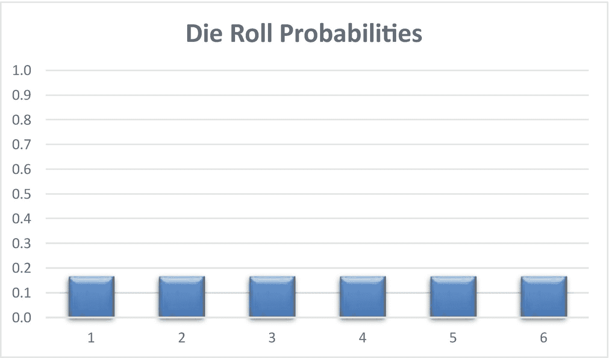

图 3-1：掷骰子不同结果的概率

正如我们在上一章中发现的，掷骰子的样本空间是离散的，因为它包含一个有限的样本点集合。我们还了解到，这种分类同样适用于代表掷骰子的随机变量，使其成为*离散型随机变量*。除此之外，这种分类也适用于分布，因为分布同样描述样本空间。因此，公平骰子的分布是一个*离散分布*。同样的逻辑也适用于*连续分布*，后者处理的是不可数无限的样本空间。

本章剩余部分将探索和理解一些最常见的标准分布，它们的属性、参数，以及我们可以从中推导出哪些有用信息。我们将在后续章节中利用这些信息进行进一步计算，因此必须尽早对它们的含义建立良好的直觉。我们从离散分布开始。


### 伯努利分布与伯努利试验

伯努利试验的概念非常简单。我们进行一次单一的实验（即一次试验），其结果要么是成功，要么是失败。通常我们用 `p` 表示成功的概率，用 `q` 表示失败的概率。由于这些事件互斥且构成了整个样本空间，我们可以用以下公式描述它们的关系：

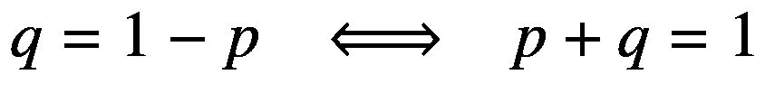

现在想象我们抛一枚硬币，并将正面朝上定义为“成功”。这意味着我们将反面朝上定义为“失败”。如果硬币是均匀的，那么它两面朝上的概率均为 0.5。这种硬币的柱状图与我们之前看到的掷骰子示意图类似，只不过有两个柱形而不是六个。在数学上，我们通过以下方式描述这样一枚硬币：

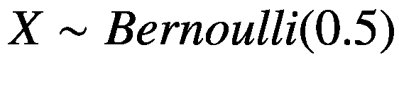

上述符号告诉我们，随机变量 `X`（代表抛硬币的结果）服从伯努利分布，并且

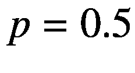

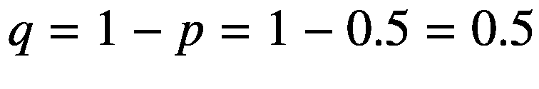

也就是说，抛这枚硬币时，两面朝上的可能性相同。然而，让我们考虑另一种场景：硬币稍有瑕疵，正面朝上的概率略高一些。

假设这枚新硬币正面朝上的概率为 0.54，并用随机变量 `Y` 表示它。那么，根据同样的逻辑，我们通过以下方式描述它：

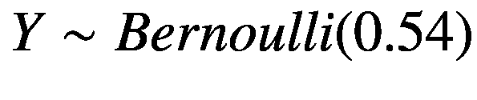

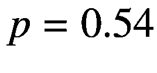

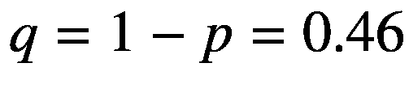

我们第一反应可能认为这没什么大区别。抛这枚新硬币时，它两面朝上的概率仍然接近 50-50。然而，如果我们多次抛这枚硬币，就会发现这一微小偏差会导致正面朝上的次数多于反面朝上的概率更大。我们可以通过编写一个类似代码清单 3-1 的小脚本来演示这一点，该脚本模拟抛 10,000 枚硬币各两次，每次正面朝上的概率不同。

```
func simulate(p: Double) {
    let q = (100 - p * 100).rounded() / 100
    let results = (1 ... 10000)
        .reduce(into: [0, 0]) { result, _ in
            let success = Double.random(in: 0 ... 1) < p
            result[success ? 1 : 0] += 1
        }
        .enumerated()
        .map { index, count in
            let outcome = (index == 0) ? "Tails" : "Heads"
            let probability = (index == 0) ? q : p
            return "\(outcome) (\(probability)): \(count)"
        }
    print(
        """
        \(results.joined(separator: "\n"))
        """
    )
}
simulate(p: 0.50)
simulate(p: 0.54)
// -- 这些输出可能会有所不同，因为
// -- 我们处理的是随机变量
// 输出：
// Tails (0.5): 5042
// Heads (0.5): 4958
//
// Tails (0.46): 4588
// Heads (0.54): 5412
代码清单 3-1
模拟两组各 10,000 次抛硬币的序列，其中一组 p = 0.5，另一组 p = 0.54
```

### 几何分布

现在我们知道了如何思考具有二元结果的单一试验。然而，在某些情况下，我们可能想了解关于最终成功概率的一些信息。例如，如果我们开始反复抛一枚硬币，它在第三次尝试时正面朝上的可能性有多大？就样本空间而言，我们可以将其表示如下：

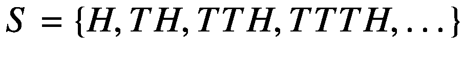

硬币可能在第一次尝试时就正面朝上，但也可能在成功之前连续出现几次反面。如果我们非常不走运，可能会在成功之前出现无限次反面朝上的抛掷结果。计算每种情况发生的概率并不比应用乘法规则更困难。

使用伯努利试验部分的符号和推理，单次抛掷成功的概率是 `p`。要计算第二次尝试成功的概率，我们需要考虑第一次尝试失败。由于每次抛掷相互独立，我们可以通过将失败一次和成功一次的概率相乘来计算结果。

![$$ P\left[X=2\right]=p\cdotp q $$](images/512351_1_En_3_Chapter/512351_1_En_3_Chapter_TeX_Equj.png)

我们可以通过在首次成功前增加更多失败次数，并将它们的概率相乘来继续扩展这个公式：

![$$ P\left[X=3\right]=p\cdotp q\cdotp q=p\cdotp {q}² $$](images/512351_1_En_3_Chapter/512351_1_En_3_Chapter_TeX_Equk.png)

![$$ P\left[X=4\right]=p\cdotp q\cdotp q\cdotp q=p\cdotp {q}³ $$](images/512351_1_En_3_Chapter/512351_1_En_3_Chapter_TeX_Equl.png)

![$$ P\left[X=5\right]=p\cdotp q\cdotp q\cdotp q\cdotp q=p\cdotp {q}⁴ $$](images/512351_1_En_3_Chapter/512351_1_En_3_Chapter_TeX_Equm.png)

![$$ P\left[X=6\right]=p\cdotp q\cdotp q\cdotp q\cdotp q\cdotp q=p\cdotp {q}⁵ $$](images/512351_1_En_3_Chapter/512351_1_En_3_Chapter_TeX_Equn.png)


这些公式可以很好地归纳为一个简洁的表示法，我们将其写作：

![$$ P\left[X=x\right]=p\cdotp {q}^{x-1}\kern0.75em ,\kern0.75em x\in {\mathbb{N}}^{+}\kern0.75em ,\kern0.75em p\in \left(0,1\right] $$](images/512351_1_En_3_Chapter/512351_1_En_3_Chapter_TeX_Equp.png)

我们刚刚推导出了几何分布的*概率质量函数* (PMF)。PMF 为我们提供了一个公式，用于计算离散分布中某个结果出现的可能性。该符号还表明，`x` 必须是正整数集合中的元素，且参数 `p` 必须位于区间 `0 < p ≤ 1` 内。正如在伯努利试验示例中一样，我们可以根据 `p` 的值计算出参数 `q`。

下一页的代码清单 3-2 展示了一个简短的程序，用于计算参数 `p = 0.4` 的几何分布的 PMF。如果将其映射回抛硬币的例子，该程序计算的是：假设我们的硬币稍微偏向于反面朝上，在特定的尝试次数后首次出现正面朝上的概率。将结果绘制成柱状图，我们得到如图 3-2 所示的示意图。

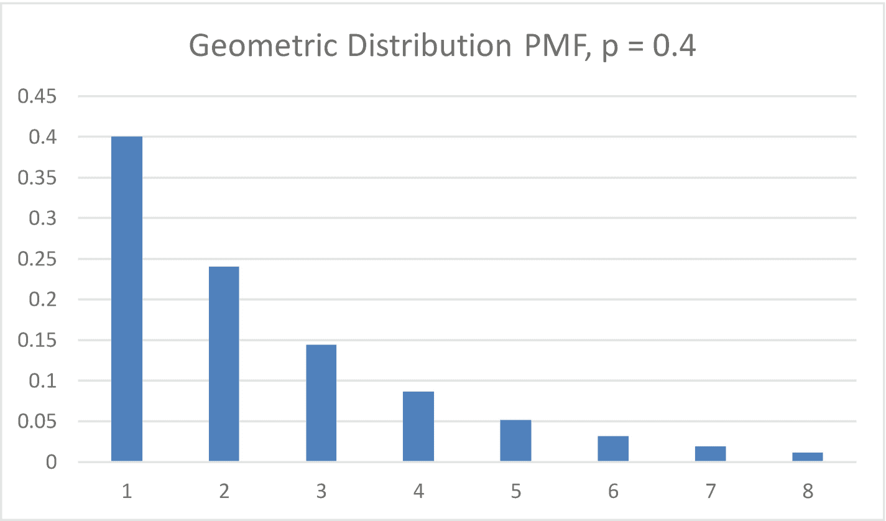

图 3-2
绘制参数 p = 0.4 的几何分布的概率质量函数 (PMF)


```swift
import Foundation
private static func geometricPMF(
of x: Int,
with p: Double
) -> Double {
precondition(0 < x, "0 ≮ x.")
precondition(0 < p && p <= 1, "p ∉ (0, 1].")
return p * pow(1 - p, Double(x) - 1)
}
(1 ... 8)
.reduce(into: [Int: Double]()) { result, x in
result[x] = geometricPMF(of: x, with: 0.4)
}
.sorted(by: <)
.forEach { trials, prob in
let probability = String(format: "%.4f", prob)
print("\(trials): \(probability)")
}
// 输出：
// 1: 0.4000
// 2: 0.2400
// 3: 0.1440
// 4: 0.0864
// 5: 0.0518
// 6: 0.0311
// 7: 0.0187
// 8: 0.0112
代码清单 3-2
计算参数 p = 0.4 的几何分布的概率质量函数
```

**注意**

图 3-2 中的图表与图 3-1 中的图表看起来非常相似，而且这样设计是有充分理由的。图 3-1 中的图表也描绘了一个 PMF（来自离散均匀分布）。实际上，每个离散分布都有一个 PMF。

我们知道，PMF 为我们提供了一种计算单一结果概率的方法。但是，如果我们想知道最多需要抛三次硬币才能得到正面朝上的概率是多少呢？为此，我们可以遵循一个相当直接的思路：

- 首先，我们得出结论：无论我们在第一次、第二次还是第三次尝试中成功，对于这个问题来说都没有影响。所有这些情况都满足我们的前提条件，因此都是有效的。
- 其次，我们意识到 PMF 为我们提供了一种计算单一结果概率的方法。

用数学方式写下我们的问题，并运用前几章学到的一些规则，我们得到：

`P[X ≤ 3] = P[X = 1 ∪ X = 2 ∪ X = 3] =`

`P[X = 1] + P[X = 2] + P[X = 3] = Σ_{x=1}³ P[X = x]`

倒数第二个等号成立是因为这些事件是互斥的。因此，我们可以直接将各个概率相加，而无需补偿重叠部分。最后，如果我们假设硬币是公平的，每次抛掷正面或反面朝上的概率各占 50%，我们就可以展开公式，代入 `p` 和 `q` 的实际值，并计算出结果如下：

`P[X ≤ 3] = Σ_{x=1}³ P[X = x] = Σ_{x=1}³ p * q^(x-1) =`

`0.5 * 0.5⁰ + 0.5 * 0.5¹ + 0.5 * 0.5² = 0.875`

根据这个结果，一枚公平硬币在三次抛掷内正面朝上的概率为 87.5%。如果硬币是有偏的，且 `p = 0.3`，那么这个概率将是 0.657。这差别可真大！

我们刚刚为几何分布推导出来的函数 `P[X ≤ x]` 也是一个特殊的函数。它被称为累积分布函数（CDF），它告诉我们从分布中随机抽取一个点小于或等于某个 `x` 值的概率。图 3-3 通过突出显示我们求和以得出 `P[X ≤ 3]` 结果的概率，形象地展示了这种关系。

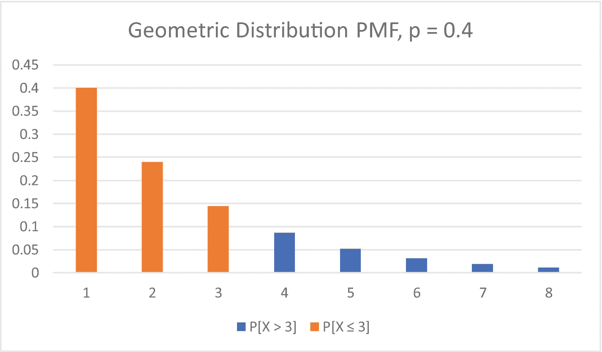

**图 3-3**

CDF 是通过对所有小于或等于某个数值的概率进行求和来计算的。在本例中，该数值为 3

在抛硬币的例子中，我们用它来计算最多需要抛三次就能得到正面朝上的比例。代码清单 3-3 展示了一段代码片段，它计算了在给定我们使用一枚严重偏倚且 `p = 0.25` 的硬币时，最多需要抛五次硬币的概率。我们看到，即使在如此强的偏倚下，即使我们抛五次硬币，正面朝上的概率也只有大约 76%！

```swift
private static func geometricPMF(
of x: Int,
with p: Double
) -> Double {
precondition(0 < x, "0 ≮ x.")
precondition(0 < p && p <= 1, "p ∉ (0, 1].")
return p * pow(1 - p, Double(x) - 1)
}
let probability = 0.25
let cdf = (1 ... 5)
.reduce(into: 0.0) { result, x in
result += geometricPMF(of: x, with: probability)
}
print("P[X ≤ 5] = \(cdf)")
// 输出：
// P[X ≤ 5] = 0.7626953125
代码清单 3-3
使用几何累积分布函数计算在八次抛硬币中至少看到一次正面的可能性。
```


### 二项分布

现在我们已经知道如何使用伯努利试验来推理单个二元事件。我们也理解了如何理解在第一次成功结果时终止的伯努利试验序列。作为探索标准离散分布的最后一步，我们将提出一个问题：在固定次数的伯努利试验中，恰好获得一定成功次数的概率是多少？例如，如果我们抛一枚硬币五次，恰好看到三次正面的概率是多少？

解决这个问题的第一种方法可能是参考几何分布。如果我们建立一个由五次伯努利试验组成的序列，其中三次成功，这意味着两次不成功。利用这个推理，我们可以写出以下公式：

![$$ \mathrm{P}\left[\mathrm{X}=3;\mathrm{n}=5\right]={p}³\cdotp {q}^{5-3}={p}³\cdotp {q}² $$](images/512351_1_En_3_Chapter/512351_1_En_3_Chapter_TeX_Equu.png)

前面的符号表示我们正在寻找随机变量 `X` 等于 3 的概率，就像之前一样。我们还提供了一个固定参数 `n`，它告诉我们想要进行多少次试验。`p` 和 `q` 参数与伯努利试验和几何分布部分中的相同。

说实话，这种方法相差并不远。然而，它忽略了一个事实，即可能存在许多组合导致三次成功的试验。例如，如果 `H` 表示硬币正面朝上，`T` 表示反面朝上，我们可能会得到以下任何一种组合：

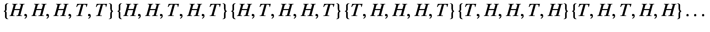

正如我们所见，这些都是完全有效的硬币抛掷组合。然而，我们的公式只考虑了其中一种。具体是哪一种并不重要；需要注意的重点是，我们的计算没有考虑到可能存在多个满足条件的结果。这时候，二项式系数就派上用场了。

二项式系数，也称为组合数或“n-选-k”，表示从一个包含 `n` 个可能结果的集合中选取 `k` 个无序项的子集的方法数。下面的公式展示了二项式系数的数学简写和计算公式：

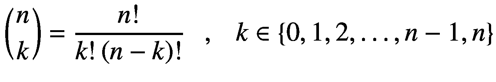

请注意，二项式系数的其他公式允许 `n` 和 `k` 都是实数值（甚至是复数）。然而，我们目前只关心这个变体。这个公式的证明超出了本书的范围，但我们将展示一个小示例，让我们了解它是如何工作的。

如果我们抛三枚硬币，并且想知道有多少种组合中恰好有一次正面朝上，我们可以列出并计算符合我们条件的可能结果，如下所示：

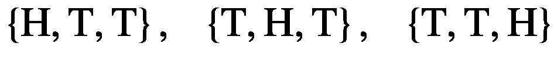

由于我们使用的样本空间相对较小，很容易验证这三个序列是唯一满足要求的序列。如果我们想使用二项式系数来解决这个问题，我们会得到：

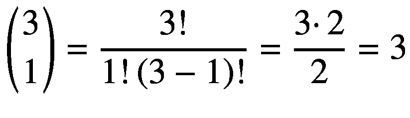

这个结果与我们手动计数的结果一致。对于这样的小例子，这种方法可能没有太大优势。然而，随着样本空间变大，它就变得非常有用了。

现在我们知道如何计算单个硬币抛掷组合的可能性以及有效组合的总数，我们准备解决最初的问题。抛硬币五次看到三次正面的概率归结为将这两个量相乘：

![$$ \mathrm{P}\left[\mathrm{X}=3;\mathrm{n}=5\right]=\left(\genfrac{}{}{0pt}{}{n}{k}\right)\cdotp {p}³\cdotp {q}² $$](images/512351_1_En_3_Chapter/512351_1_En_3_Chapter_TeX_Equz.png)

前面的公式是二项分布的 PMF（概率质量函数）。例如，如果我们抛一枚完全公平的硬币四次，恰好三次正面朝上的概率为：

![$$ \mathrm{P}\left[\mathrm{X}=3;\mathrm{n}=4\right]=\left(\genfrac{}{}{0pt}{}{4}{3}\right)\cdotp {0.5}³\cdotp {0.5}¹=\frac{4!}{3!\left(4-3\right)!}\cdotp {0.5}⁵=4\cdotp {0.5}⁴=0.25 $$](images/512351_1_En_3_Chapter/512351_1_En_3_Chapter_TeX_Equaa.png)

二项分布也有 CDF（累积分布函数）。与几何分布一样，我们通过将所有小于或等于某个数的结果的 PMF 相加来计算它：

![$$ P\left[X\le x\right]=\sum \limits_{i=0}^xP\left[X=x\right]=\sum \limits_{i=0}^x\left(\genfrac{}{}{0pt}{}{n}{i}\right)\cdotp {p}^i\cdotp {q}^{n-i} $$](images/512351_1_En_3_Chapter/512351_1_En_3_Chapter_TeX_Equab.png)

清单 3-4 中的代码展示了一个计算二项分布 PMF 的小例子。该代码片段借用了 `StatKit` 中的函数 `choose(n:k:)`，该函数计算在 `n` 次试验中 `k` 次成功的组合数。

```
func binomialPMF(
of x: Int,
p: Double,
n: Int
) -> Double {
precondition(0 < x, "0 ≮ x.")
precondition(0 < p && p <= 1, "p ∉ (0, 1].")
precondition(0 < n, "n must be positive.")
let binomialCoef = choose(n: n, k: x).realValue
let successProb = pow(p, x.realValue)
let failureProb = pow(1 - p, (n - x).realValue)
return binomialCoef * successProb * failureProb
}
let p = 0.4
let n = 10
let x = 7
let pmf = binomialPMF(of: x, p: p, n: n)
let probability = String(format: "%.2f", p)
print(
"""
Likelihood of \(x) heads,
with p = \(probability) and n = \(n):
\(String(format: "%.4f", pmf))
"""
)
// Prints:
// Likelihood of 7 heads,
// with p = 0.40 and n = 10:
// 0.0425
Listing 3-4
Computing the binomial PMF with parameters p = 0.4 and n = 10
```

### 分布应用

现在我们已经了解了离散概率分布的基础知识，是时候介绍代码仓库中的一个“另类”项目了。`DistributionsApp` 项目与本书附带的其他代码示例不太一样。运行此代码不会在终端中产生任何数值结果，而是打开一个如图 3-4 所示的交互式应用程序。

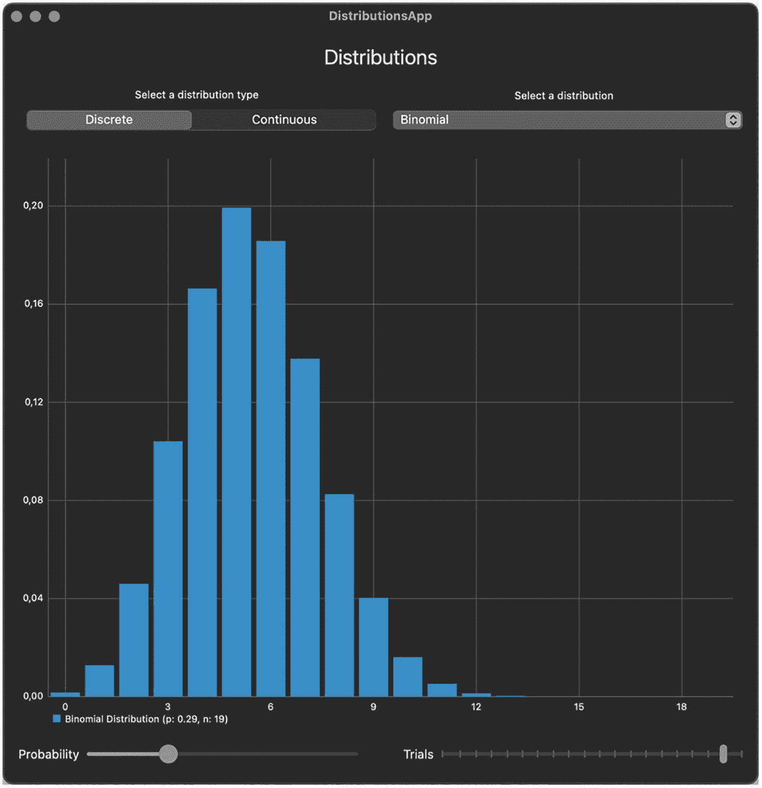

图 3-4

来自代码仓库的 `DistributionsApp` 项目

`DistributionsApp` 允许我们调整一些标准分布的参数，这有助于我们培养对不同结果概率如何变化的直觉。我们需要做的只是：

*   从左上角的分段控件中选择要查看的分布类型。
*   从右上角的下拉菜单中选择一个可用的不同标准分布。
*   使用图表下方出现的控件更改所选分布的参数。

此应用程序支持离散分布和连续分布，其中一些我们已经介绍过，而另一些则是新的，可以作为进一步学习研究的灵感。花几分钟时间查看不同的图表，并研究在操作它们的参数时它们是如何变化的。当我们进入下一节（涵盖连续分布的基础知识）时，这个程序将会派上用场。


## 连续分布

从概念上讲，连续分布与离散分布并无太大区别。它仍然是样本空间中各种结果可能性的描述。然而，一旦我们开始使用连续分布进行计算，它们就会展现出极大的不同。有些差异很容易适应，而另一些在我们遇到时可能会感觉相当违反直觉。

### 与离散分布的区别

连续分布与离散分布的主要区别之一在于，连续分布没有概率质量函数。相反，连续分布具有一个被称为*概率密度函数*（`PDF`）的相似属性。我们不再使用图表中的柱状图来可视化`PDF`，而是使用折线图，它会在所有样本点上生成一条曲线，如图 3-5 所示。

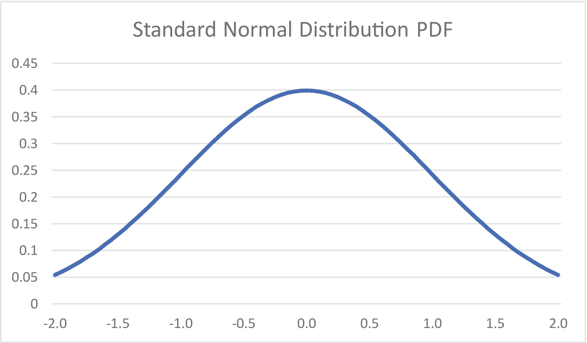

图 3-5

展示标准正态分布`PDF`的图表

虽然连续曲线无疑比我们在离散图表中看到的柱状图在视觉上更令人愉悦，但无限的样本点也使得情况变得有点棘手。起初可能不明显，但 Y 轴上的值不再代表概率。为澄清这一点，我们在表 3-1 中列出了几个样本点。

表 3-1

标准正态分布的几个样本点

| 样本点 | PDF 值 |
| --- | --- |
| -0.10 | 0.397 |
| -0.05 | 0.398 |
| 0.00 | 0.399 |
| 0.05 | 0.398 |
| 0.10 | 0.397 |

如果我们将这些值视为概率，那么从标准正态分布中抽取这五个点中任意一个的概率大约为 199%。考虑到整个样本空间的总概率应等于 1，并且还有无限多的其他点可供选择，这是不现实的。这种认识迫使我们思考`PDF`值实际上代表什么，以及它们为何与`PMF`值不同。

离散分布使我们可以相对简单地想象所有单个样本点的概率之和为 1。然而，当处理无限多个样本点时，要描绘出同样的画面就不那么简单了。我们需要将每个`PDF`值设得多小才能确保它们总和为 1？答案是，我们不用常规求和来计算连续分布，而是使用积分，积分所具有的特性有时可能违反直觉甚至不受欢迎。

任何上过微积分课程的人都可以证明，有些积分的计算极其复杂。在统计学中也是如此，我们经常最终得到包含多个相关随机变量的`PDF`的方程。连续样本空间的另一个令人惊讶的特性是，任何单个点的概率为零。是的，这是真的。以下是对其原因的简要概述：

```
设 f(x) 为一个连续随机变量的 PDF。
```

```
设 F(x) 为 f(x) 的原函数。那么
```

```
P[X=x] = ∫_x^x f(x) dx = [F(x)]_x^x = F(x) - F(x) = 0
```

上述内容并非严格的证明，而是为了提供对数字如此运作方式的深入理解。一个粗略的解释是，当样本点数量趋近于无穷时，任何单个样本点的概率趋近于零。当然，和往常一样，也存在例外情况。但总的来说，这意味着我们只询问连续随机变量是否在某个值域范围内的问题。图 3-6 直观地展示了连续`CDF`与`PDF`的关系。计算`CDF`归结为计算`PDF`曲线下的面积。

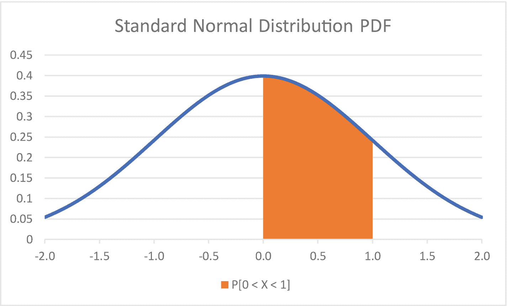

图 3-6

计算连续`CDF`归结为计算`PDF`曲线下的面积。在此情况下，突出显示了 `P[0 < X < 1]`

幸运的是，我们在这本书中不会大量处理积分问题。许多标准分布都有其累积分布函数的闭式解析解或近似解，我们可以利用它们来计算答案。现在，让我们继续来看一个在计数过程和排队论中经常使用的连续标准分布。


#### 指数分布

指数分布描述了泊松分布中两个事件之间的时间间隔的分布情况。虽然我们没有具体介绍泊松分布，但指数分布本身仍是一个很好的计算工具。

指数分布有一个参数，通常称为*速率*，用希腊字母 λ 表示。速率表示在确定的时间单位内平均发生的事件数量。例如，如果我们经营的商店平均每天有 20 位顾客光顾，我们可以将时间单位设为一天，那么速率就是 20。如果我们选择以一小时为基本单位，那么速率就是 2（假设商店营业 10 小时）。需要注意的一点是，由于我们处理的是时间间隔，样本空间严格由非负数构成。

指数分布描述的是某个时间间隔分隔两个事件的可能性有多大。例如，如果我们的商店每小时有两位顾客光顾，我们可以计算开门后 10 分钟内第一位顾客到来的概率。我们可以用以下数学符号来表示：

![$$ P\left[\ 0\le X\le \frac{1}{6};\lambda =2\right] $$](images/512351_1_En_3_Chapter/512351_1_En_3_Chapter_TeX_Equaf.png)

请注意，我们需要指定一个值的范围，因为我们处理的是一个包含连续时间间隔的样本空间。根据我们在上一节中应用的相同逻辑，第一位顾客正好在开门后十分钟到达的概率为零。我们还注意到，上限不是 10，而是十分钟在我们基本单位（一小时）中所占的分数。

我们可以计算从零到十分钟的指数分布 PDF 的积分来回答我们的问题。PDF 的推导超出了本书的范围。因此，我们只在下面的等式中给出公式：

![$$ P\left[\ 0\le X\le \frac{1}{6};\lambda =2\right]={\int}_0^{\frac{1}{6}}\lambda {e}^{-\lambda x} dx={\left[-{e}^{-\lambda x}\right]}_0^{\frac{1}{6}}=1-{e}^{-\frac{2}{6}}\approx 0.283 $$](images/512351_1_En_3_Chapter/512351_1_En_3_Chapter_TeX_Equag.png)

计算结果表明，如果我们睡过头，晚开门 10 分钟，那么我们的第一位顾客在我们之前出现，并因此未购买任何东西就离开的风险约为 28.3%。

这个特定的积分并不难。事实上，它的性质相当好且易于计算。然而，还有另一种方法可以使用累积分布函数来计算相同的结果。这里给出指数分布的 CDF：

![$$ P\left[X\le x\right]=1-{e}^{-\lambda x} $$](images/512351_1_En_3_Chapter/512351_1_En_3_Chapter_TeX_Equah.png)

这个公式与我们刚刚求解的积分中最后一个等式之一非常相似。由于它计算的是随机变量低于某个阈值的概率，我们将用它来执行一个技巧。如果我们想知道第一位顾客在开业后 5 到 10 分钟内出现的可能性，我们可以再次计算积分。但是，我们也可以这样重新表述问题：

![$$ P\left[X\le \frac{1}{6};\lambda =2\right]-P\left[X\le \frac{1}{12};\lambda =2\right] $$](images/512351_1_En_3_Chapter/512351_1_En_3_Chapter_TeX_Equai.png)

也就是说，我们计算第一位顾客在开业后 10 分钟内出现的可能性，但减去他们在前 5 分钟内出现的概率，从而得到我们感兴趣的区间的答案：

![$$ P\left[X\le \frac{1}{6};\lambda =2\right]-P\left[X\le \frac{1}{12};\lambda =2\right]=1-{e}^{-\frac{2}{6}}-1+{e}^{-\frac{2}{12}}\approx 0.13 $$](images/512351_1_En_3_Chapter/512351_1_En_3_Chapter_TeX_Equaj.png)

这个技巧对于第一个例子也同样适用。我们只需要将减去第一位顾客在零分钟内出现的概率改为减去五分钟的概率。清单 `[3-5]` 中的代码展示了如何计算在给定速率为 `λ` 的指数分布下，事件发生在时间 `x[1]` 和 `x[2]` 之间的可能性。

```
func probability(
between x: Double,
and y: Double,
rate: Double
) {
precondition(0 <= x, "x mustbe non-negative.")
precondition(0 <= y, "y must be non-negative.")
precondition(x <= y, "x must be ≤ y.")
precondition(0 < rate, "rate must be positive.")
let upperCDF = 1 - exp(-rate * y)
let lowerCDF = 1 - exp(-rate * x)
let prob = upperCDF - lowerCDF
print(
"""
P[\(x) ≤ x ≤ \(y) | λ = \(rate)] = \(prob)
"""
)
}
probability(between: 0, and: 1, rate: 2)
probability(between: 0, and: 1, rate: 0.2)
probability(between: 0, and: 0, rate: 10)
// Prints:
// P[0.0 ≤ x ≤ 1.0 | λ = 2.0] = 0.8646647167633873
// P[0.0 ≤ x ≤ 1.0 | λ = 0.2] = 0.18126924692201818
// P[0.0 ≤ x ≤ 0.0 | λ = 10.0] = 0.0
清单 3-5
一个在给定指数分布下计算事件发生概率的示例
```

现在我们对连续样本空间有了一些经验，是时候看看最重要且最广泛使用的连续分布之一了。


#### 正态分布

法国数学家亚伯拉罕·棣莫弗在 18 世纪首次描述了正态分布。这一发现在相当长一段时间内未被重视，直到被卡尔·弗里德里希·高斯和皮埃尔-西蒙·拉普拉斯“重新发现”。它通常也被称为高斯分布或钟形曲线，因为其形状像一口钟。

我们可以通过均值和标准差来定义一个正态分布。均值，用希腊字母 `μ` 表示，决定了分布中最常见的数值。该值位于曲线的中心，曲线在该点两侧呈对称形状。标准差，用 `σ` 表示，描述了钟形的“宽度”。`σ` 值越大，意味着样本点往往离均值越远，而 `σ` 越小，则说明样本通常更接近均值。我们将在本章后面更深入地探讨这些概念。目前，有一个高层次的直觉理解就足够了。

图 3-7 展示了两个具有相同参数 `μ`、但不同 `σ` 的正态分布。请注意 `σ` 参数如何使得均值附近的概率降低，而离均值较远的样本概率却变得更大。`DistributionsApp` 项目也提供了一个工具，用于测试不同参数值如何改变样本点的概率。

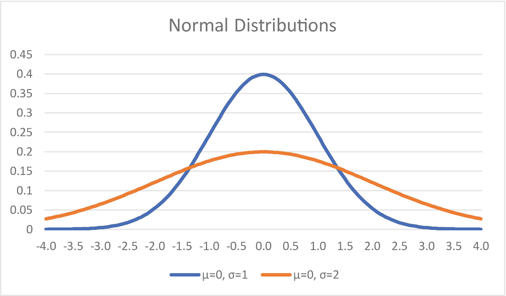

图 3-7

两个具有不同参数的正态分布

要使用正态分布进行计算，我们需要知道其概率密度函数（PDF）：

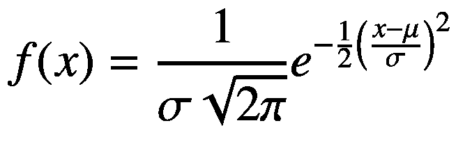

这个公式给出了任何样本点的相对似然值。值得注意的是，这个特定的样本空间包含所有实数，范围从负无穷到正无穷。然而，要计算一个样本落在某个区间内的概率，我们需要计算一个积分：

![$$ P\left[{x}_1&lt;X&lt;{x}_2\right]={\int}_{x_1}^{x_2}\frac{1}{\sigma \sqrt{2\pi }}{e}^{-\frac{1}{2}{\left(\frac{x-\mu }{\sigma}\right)}²} dx $$](images/512351_1_En_3_Chapter/512351_1_En_3_Chapter_TeX_Equal.png)

我们很快意识到，这比计算指数分布要复杂得多。不幸的是，使用累积分布函数（CDF）并采用与指数分布相同的技巧对我们并没有帮助。让我们看看这个函数，以理解原因：

![$$ P\left[X&lt;x\right]=\frac{1}{2}\left[1+\operatorname{erf}\left(\frac{x-\mu }{\sigma \sqrt{2}}\right)\right] $$](images/512351_1_En_3_Chapter/512351_1_En_3_Chapter_TeX_Equam.png)

如我们所见，这是一个非常复杂的函数。正态分布的 CDF 依赖于高斯误差函数，通常记为 `erf(z)`。这是一个以如下方式定义的复杂函数：

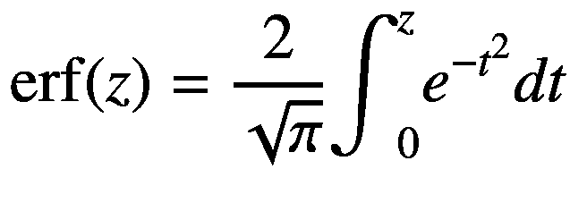

误差函数也包含一个积分，并且并不比我们上一页看到的积分更容易计算。幸运的是，研究人员已经开发出以惊人精度逼近误差函数的方法。由米尔顿·阿布拉莫维茨和艾琳·斯特根编写的《数学函数手册：公式、图表和数学用表》（1964 年，第 299 页）包含了一个由小塞西尔·黑斯廷斯设计的逼近误差函数的公式。该公式计算成本相对较低且易于实现，使其非常适合我们的需求。清单 3-6 提供了一个实现，清单 3-7 使用该实现来逼近正态分布的 CDF。

```
func normalCDF(
x: Double,
mu: Double,
sigma: Double
) -> Double {
let z = (x - mu) / (sigma * sqrt(2))
return 0.5 * (1 + erf(z))
}
print(
"""
标准正态分布
P[X < 0] = \(normalCDF(x: 0, mu: 0, sigma: 1))
"""
)
// 输出:
// 标准正态分布
// P[X < 0] = 0.5000000005
清单 3-7
使用高斯误差函数逼近计算正态分布 CDF
```

```
import Darwin
let p = 0.3275911
let coefficients = [
0.254829592,
-0.284496736,
1.421413741,
-1.453152027,
1.061405429
]
let exponents = (1 ... coefficients.count)
.map(Double.init)
func erf(_ z: Double) -> Double {
let sign = (z.sign == .plus) ? 1.0 : -1.0
let absZ = abs(z)
let t = 1 / (1 + p * absZ)
let powerSeries = zip(coefficients, exponents)
.reduce(into: 0.0) { (result, zipped) in
let (coefficient, exponent) = zipped
result += coefficient * pow(t, exponent)
}
let tail = powerSeries * exp(-pow(absZ, 2))
return sign * (1 - tail)
}
清单 3-6
逼近高斯误差函数
```

清单 3-7 中 CDF 的真实解为 0.5，而我们的逼近结果得到 0.5000000005。我们对这个误差可以接受，因为它对我们正在计算的总体似然度影响不大。该实现还提供了通过使用与指数分布相同的技巧来计算落入特定数值区间内的概率的能力：

![$$ P\left[{x}_1&lt;X&lt;{x}_2\right]=P\left[X&lt;{x}_2\right]-P\left[X&lt;{x}_1\right] $$](images/512351_1_En_3_Chapter/512351_1_En_3_Chapter_TeX_Equao.png)

逼近通常让人觉得粗糙且不精确。然而，这是我们必须接受并拥抱的现实。由于位宽的限制，现代计算机上进行的许多计算最终都是近似值。公平地说，许多我们可能认为是精确的数学公式，本质上也是对经验测量的近似。

我们现在已经了解了一些最常见的标准分布。当然，还有比这多得多的分布。然而，这些概念也同样适用于它们。为了结束本章，让我们再看一下分布的几个性质。这些将在本书后面用到，我们必须了解它们是什么。


#### 期望值

期望值最常见的用途之一就是我们通常所说的平均值。我们对随机变量的期望定义如下：

![$$ \mathbbm{E}\left[X\right]=\sum \limits_{x\in S}x\cdotp p(x)\kern3.75em for\ discrete\ distributions\mathbbm{E}\left[X\right]={\int}_{-\infty}^{\infty }x\cdotp f(x)\ dx\kern2em for\ continuous\ distributions $$](images/512351_1_En_3_Chapter/512351_1_En_3_Chapter_TeX_Equap.png)

在这些公式中，`f(x)` 是连续分布的概率密度函数（PDF），而我们用 `p(x)` 表示离散分布的概率质量函数（PMF）。随机变量的期望会产生一个实数（至少对于本书中我们会遇到的分布而言是如此）。这个数不一定是随机变量样本空间的一部分。起初，考虑到它的名称，这一事实可能会让人觉得奇怪或违反直觉。难道期望不应该是用来计算一个分布的期望值吗？

为了使这个概念更具体，我们将再次以骰子为例，计算几个期望值。我们首先关注一个公平的骰子，它每个面朝上的概率相等。其期望值为：

![$$ \mathbbm{E}\left[X\right]=1\cdotp \frac{1}{6}+2\cdotp \frac{1}{6}+\dots +6\cdotp \frac{1}{6}=3.5 $$](images/512351_1_En_3_Chapter/512351_1_En_3_Chapter_TeX_Equaq.png)

正如我们所见，期望值落在两个样本点之间。这个数就是各个面点数的平均值。现在，想象一下有人对这个骰子动了手脚，使得掷出数字二的概率是其他数字的两倍。这种篡改意味着分布发生了变化，期望值变为：

![$$ \mathbbm{E}\left[X\right]=1\cdotp \frac{1}{7}+2\cdotp \frac{2}{7}+3\cdotp \frac{1}{7}+\dots +6\cdotp \frac{1}{7}\approx 3.2857 $$](images/512351_1_En_3_Chapter/512351_1_En_3_Chapter_TeX_Equar.png)

新分布下的平均值小于均匀分布下的平均值。值变小是有道理的，因为使用这个骰子我们更有可能掷出较小的数字。需要注意的是，这完全等同于我们更熟悉的计算平均值的方法，即把一些数字加起来，再除以相加的个数。如果有重复的数字，那就对应着一个分布发生了偏移，使得该数字出现的概率更高。

#### 方差与标准差

期望值不仅可用于计算平均值。我们可以将任何随机变量表达式放入 `[·]` 中，并计算出有效的期望值。这个概念正是我们用来计算一种名为**方差**的度量指标的依据，其定义如下：

![$$ {\sigma}²= Var\left[X\right]=\mathbbm{E}\left[{\left(X-\mu \right)}²\right] $$](images/512351_1_En_3_Chapter/512351_1_En_3_Chapter_TeX_Equas.png)

虽然这些符号乍一看可能令人畏惧，但它有一个相当直接的解释。方差度量的是分布的*离散程度*。也就是说，它衡量的是均值与所有样本点之间距离平方的平均值。

对距离进行平方可以确保我们将正值加在一起。如果我们允许负值存在，就会产生一些奇怪的副作用。例如，正态分布（关于均值对称）的方差将为零，尽管很明显除了恰好是均值的那个点之外还有其他样本点。

由于平方可能会使根据方差得出结论更具挑战性，因此我们还有标准差这个度量指标。标准差无非就是方差的平方根，它去掉了结果中的平方，同时仍然保证结果非负。回到公平骰子的例子，我们计算方差和标准差如下：

![$$ {\sigma}²= Var\left[X\right]={\left(1-3.5\right)}²\cdotp \frac{1}{6}+{\left(2-3.5\right)}²\cdotp \frac{1}{6}+\dots +{\left(6-3.5\right)}²\cdotp \frac{1}{6}\approx 2.92 $$](images/512351_1_En_3_Chapter/512351_1_En_3_Chapter_TeX_Equat.png)

![$$ \sigma = Std\left[X\right]=\sqrt{2.92}\approx 1.71 $$](images/512351_1_En_3_Chapter/512351_1_En_3_Chapter_TeX_Equau.png)

这些数字告诉我们，如果投掷大量骰子，我们可以预期离散程度大约在距离均值 1.71 的范围内。方差和标准差在分析置信区间时被广泛使用，我们将在接下来的章节中用到它们。

### 章节总结

本章内容涵盖甚广。我们学习了如何对样本空间进行分类，并看到了这如何催生出两类截然不同的分布——离散分布和连续分布。我们学习了如何使用概率质量函数、概率密度函数和累积分布函数进行计算。我们还了解了一些统计学中使用的标准分布。

在本书的后续内容中，我们将大量运用迄今为止所构建的理论基础。均值、方差和标准差是描述分布时广泛使用的度量指标，我们将在构建的算法中使用它们。现在我们已经掌握了一些所需的理论概念，接下来我们将进入一个更偏向实际应用的章节。我们将使用回归技术来开发一个基于数据预测房屋销售价格的算法。

