# 4. 使用线性回归预测房屋销售价格

到目前为止，我们都是从描述数据的角度来看待统计学的。我们试图找到将潜在海量数据集的重要属性提炼成一个或几个数字的方法。虽然这种方法无疑很实用，但我们也希望利用这些数据来展望未来。因此，我们希望查看一些已经发生的样本点，并用它们来预测接下来会发生什么。本章将研究实现这一目标的一种方法——本章全部关于线性回归。

## 线性回归

线性回归这个概念，尽管名称复杂，但其思想却出奇地简单。我们利用已有的数据点，来建立一个线性方程，用以对新样本点进行合理的预测。例如，如果我们知道一磅苹果的价格是`$1.3`，我们就可以计算出购买`1.5`磅的价格。我们利用“不买东西就无需付费”这一隐含知识，在重量和价格之间建立了一种线性关系——这实际上就是执行了一种简单的线性回归。这个计算过程假设线性方程能够恰当地描述重量与成本之间的关系。我们用来预测苹果总价的函数如下：

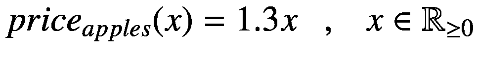

我们在上一个例子中看到的那种线性内插或外推方法有一些好处。首先，它易于执行，并且对许多问题都很有效。其次，它的资源效率非常高，因为我们无需记住每磅苹果的具体价格，只需要记住一个公式即可。

然而，一旦引入真实世界的数据，情况就会变得复杂得多。这些样本点通常带有噪声，很难完美地契合到这种规整的数学模型中。例如，看看图 4-1 中可视化的数据集。

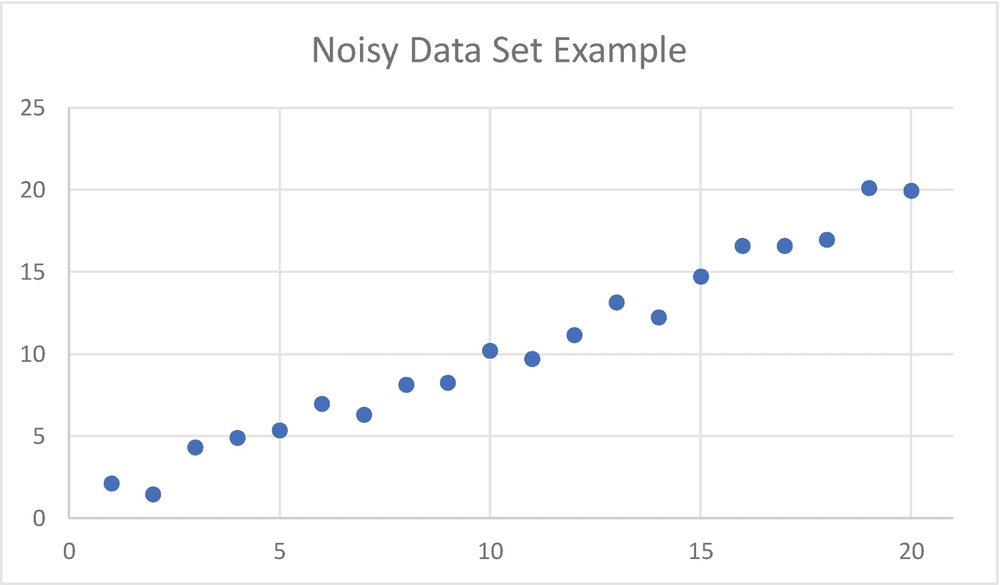

图 4-1 一个噪声数据集的示例

图 4-1 中的数据看起来更符合我们对真实世界样本集的预期。这些样本来自于以下函数：

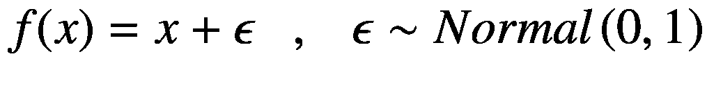

这个公式是一个基本的线性方程，但在其末尾附加了一个变量。`𝝐` 是一个噪声项，它加上了一个从标准正态分布中采样的随机数。这种添加随机性的方式通常被称为高斯噪声。我们可以看到数据具有线性趋势，但我们无法用一条直线连接所有点。我们需要采取另一种方法来理解这些数据。

### 样条

样条是一种建立在插值思想之上的数学概念。它不同于回归，但可以作为一块垫脚石，帮助我们理解这种方法的工作原理以及为什么需要它。

在线性样条的情况下，我们将每一对相邻的点视为一个具有线性性质的区间的端点，并用一条直线将它们连接起来。因此，将其应用于之前的数据集，结果将如图 4-2 所示。

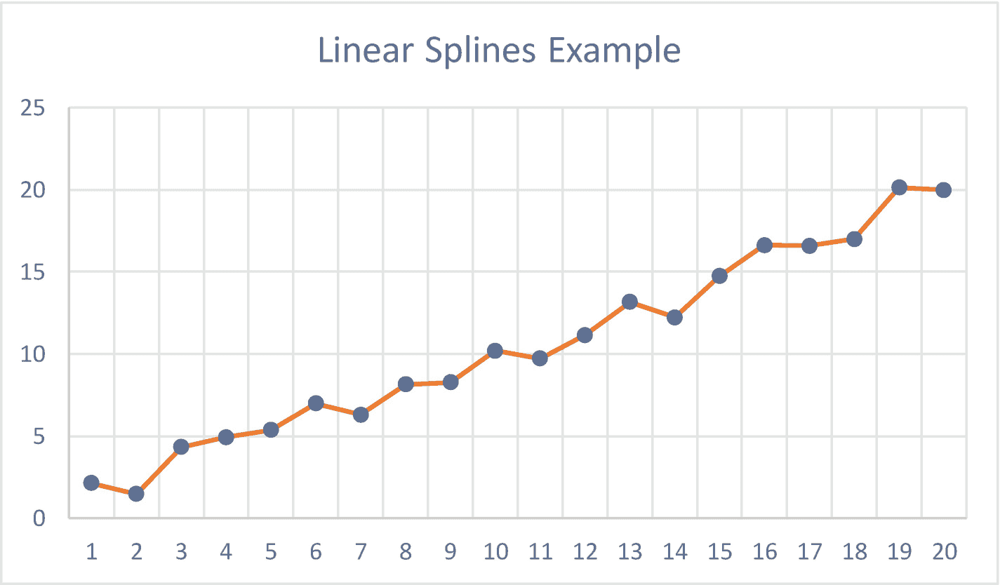

图 4-2 使用线性样条通过直线段连接相邻样本点

正如我们所看到的，当把这条线看作一个整体时，它完全不是一条直线。然而，假设我们想预测数值 `8.4` 对应的值。我们会确定它落在原始样本点 8 和 9 之间，因此，我们使用介于这两点之间的样条所对应的线性方程。在这个特定案例中，该方程是

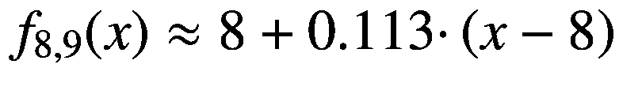

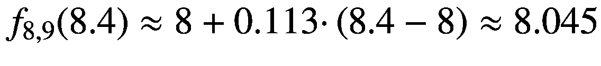

总的来说，这种近似效果还不错。然而，在一些场景下我们会遇到麻烦。其中几个场景是：

*   样条方法迫使我们记住部分原始数据，以便确定在不同区间使用哪个线性方程。如果数据点很少，这算不什么大问题，但对于包含数百万或数十亿条记录的数据集，这很快就会变得难以处理。

*   如果我们尝试对大于 `20` 的值进行预测，我们最终会使用定义 `19` 和 `20` 之间数值的同一个线性方程。由于在这个例子中该方程具有负系数，那么在数轴上越靠后的位置，我们做出的预测值会越小。鉴于总的趋势是正向的，这种预测就会成为问题。同样地，在这个例子中，对小于 1 的值进行预测也会遇到类似的问题。

我们总结出，使用样条对于规模较小的数据集是一种合理的方法，并且只要是在进行内插，就能产生良好的结果。然而，对于较大的数据集，或者当需要进行外推（即预测超出已有数据范围的值）时，它们就不太理想了。为了改进我们的方法，我们需要以某种方式解决这些问题。

## 回归技术

为了做出更好的预测，我们需要解决刚刚列出的问题。在像这样能够观察到数据具有明显线性趋势的情况下，我们希望一种方法具备两个特性：

*   它应该遵循数据的总体趋势。一个带有噪声的测量值不应导致我们的模型改变方向而去违背该趋势——无论是在我们有样本的范围内还是范围外。

*   我们希望计算开销低。理想情况下，我们希望将原始样本的基本特征提炼成少数几个系数，这些系数能够构成一个线性方程的基础。

基于这些特性，我们的目标是找到最适合现有数据的线性方程。请记住，一条直线的通用公式是

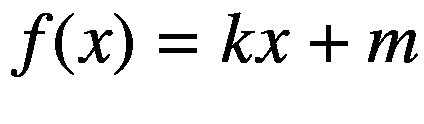

由于 `x` 代表我们想要预测其值的新样本，我们的任务是确定变量 `k` 和 `m`，使得 `f(x)` 尽可能接近真实值。为此，我们需要定义一种衡量我们预测效果好坏的方法。

### 损失函数

顾名思义，损失函数的职责是衡量当前模型所承受的损失。优秀的模型损失值较低，表明其预测值非常接近数据点的测量值。反之，当模型预测效果极差时，我们希望损失函数返回一个较大的数值。

创建和优化模型时的主要挑战之一，在于设计一个合适的损失函数。其包含的参数反映了哪些信息对我们而言是重要的。例如，如果我们想通过房屋的平方英尺数来确定其售价，但损失函数只包含房间数量这一因素，那我们永远无法做出准确的预测。

回到我们的示例数据，我们希望最小化模型预测值与数据中测量值之间的总距离。例如，如果目标值是 4，但我们预测为 3，那么距离（或误差）就是 1。通过汇总模型产生的所有误差，我们可以量化模型的表现。同时，我们还需要避免正负误差相互抵消，以免造成损失函数的混乱。用`N`表示数据集中的样本点数量，用`y`表示样本的观测值，我们可以设置以下满足需求的损失函数`ℒ`：

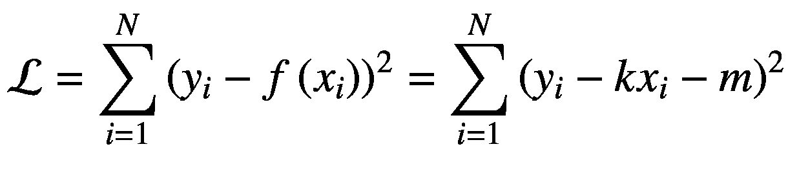

我们通常将上述函数称为平方和误差。平方运算确保了预测值与目标值之间的误差始终为正，并且保持了误差的顺序关系。因此，如果用`e[1]`和`e[2]`表示两个点的误差，那么

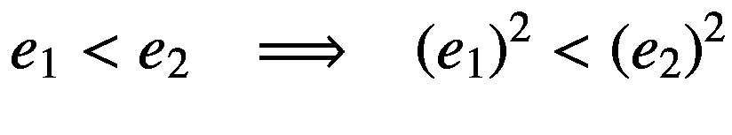

维持这种关系至关重要。引入任何打破这种顺序关系的变换都可能产生意料之外的后果，因为好的预测反而会比坏的预测贡献更大的损失。

现在，我们已经确定了满足目标的损失函数，可以开始优化阶段。我们将`k`和`m`视为变量，因为它们是本次优化的目标。首先，我们计算`ℒ`关于`k`和`m`的黑塞矩阵，结果为：

# 黑塞矩阵与线性回归

![$$ {\boldsymbol{H}}_{\mathbf{\mathcal{L}}}=\left[\ \begin{array}{cc}\frac{\partial²\mathcal{L}}{\partial {k}²}&amp; \frac{\partial²\mathcal{L}}{\partial k\ \partial m}\\ {}\frac{\partial²\mathcal{L}}{\partial m\ \partial k}&amp; \frac{\partial²\mathcal{L}}{\partial {m}²}\end{array}\kern0.5em \right]=\left[\begin{array}{cc}2\sum_{i=1}^N{\left({x}_i\right)}²&amp; 2\sum_{i=1}^N\left({x}_i\right)\\ {}2\sum_{i=1}^N\left({x}_i\right)&amp; 2N\end{array}\right] $$](images/512351_1_En_4_Chapter/512351_1_En_4_Chapter_TeX_Equh.png)

黑塞矩阵是一个由二阶偏导数组成的方阵，描述了函数的曲率。我们继续计算该矩阵的特征值，得到：

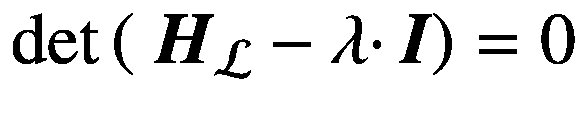

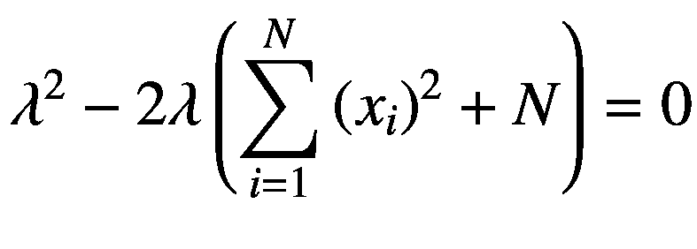

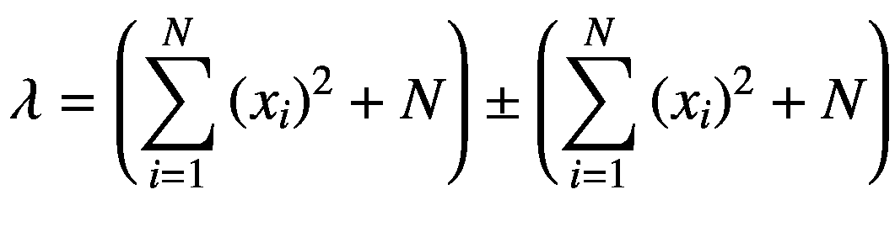

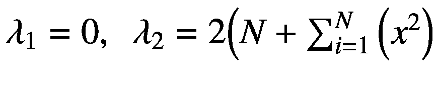)

虽然第一个特征值是标量，但我们需要对第二个特征值做进一步分析。我们可以判断，`N`始终为正，因为样本点至少有一个。我们也知道，对平方值求和的结果总是正数。这些认知让我们得出结论：第二个特征值必然为正，因此该黑塞矩阵是半正定的。接下来我们将看到，这会影响我们找到最优解的能力。

除了判定`H[ℒ]`的半正定性，我们还需要确定损失函数的定义域是否为凸集。

![$$ 集合\ D\ 是凸集，如果对于任意\ {x}_1,{x}_2\in D\ 及任意实数\ \theta \in \left[0,1\right]，\\ 满足以下条件： $$](images/512351_1_En_4_Chapter/512351_1_En_4_Chapter_TeX_Equl.png)

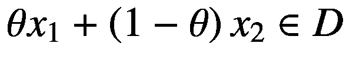

上述定理指出，如果我们能选取任意两个元素并组合，结果仍属于同一集合，则该集合是凸集。图 4-3 展示了这一概念的可视化效果。无论我们在圆形内选择哪两个点，它们之间的直线只会穿过该集合的其他元素。

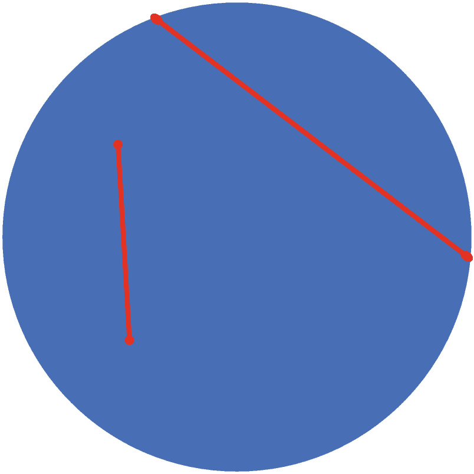

**图 4-3** 实心圆是一个凸集，因为任意两点之间的线段仅包含该集合内的其他点

实数集`ℝ`是凸集。无论我们选择哪两个数，它们的凸组合总是另一个实数值。我们可以得出结论：我们问题的定义域是凸集。结合黑塞矩阵为半正定的结论，这对我们来说是件好事。这意味着，如果能找到问题的一个最优解，那么该解必定是全局最优解。

## 寻找最优解

上一节的理论内容相当厚重，因此让我们快速回顾一下所学内容以及我们想要达成的目标。我们学到了：

- 我们设计了一个损失函数，以帮助我们判断模型的预测是好是坏。
- 由于我们能够确认海森矩阵是半正定的，因此可以验证我们的损失函数在其定义域上是凸函数。
- 损失函数的定义域是整个实数线 `ℝ`。实数集是凸集，因为它满足我们之前看到的定理中的条件。
- 如果我们能为损失函数找到一个局部最优解（一个使输出值最小化的输入值），那么它必然也是全局最优解。得益于此，我们无需担心找到的输入值只是局部最优。

有了这些知识，我们就可以着手寻找最能拟合观测数据的线性方程了。此外，既然我们现在知道问题具有凸性，就可以使用最经典的优化技巧之一——计算关于 `k` 和 `m` 的偏导数，将它们设为零，并进行一些代数变换。

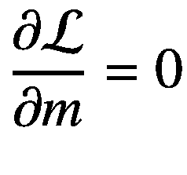

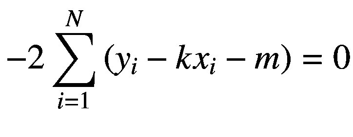

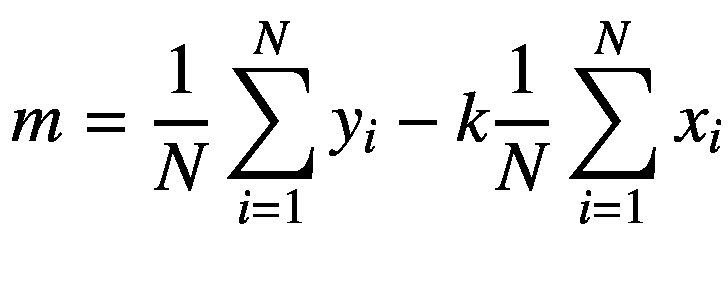

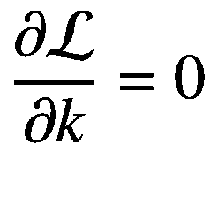

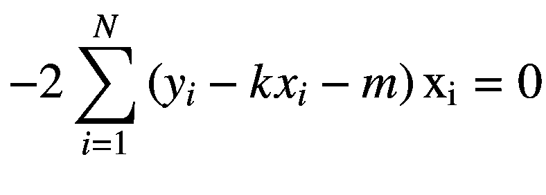

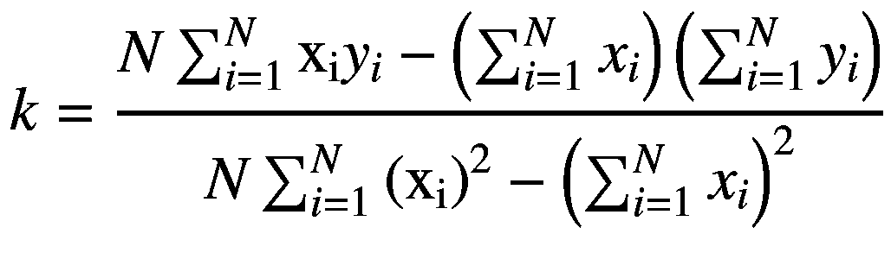

乍一看，这些方程可能让我们觉得情况更糟了。然而，仔细观察后，我们注意到一个重要的点。`k` 和 `m` 的表达式完全由数据集中的基本元素构成。因此，我们只需要进行一些变换和求和运算即可！

## 实现简单线性回归

现在我们已经解决了问题的数学部分，实现解决方案就会容易得多。让我们从创建一个名为 `SimpleLinearRegression` 的类型开始。这个类型的目的是为某个数据集拟合一个线性方程。不过，我们不想将数据整理成实数数组，这么麻烦。相反，我们希望 `SimpleLinearRegression` 接收原始数据集，并从中检索一些指定的值用于计算。这些需求正是我们之前学过的 `KeyPath` 类型的完美应用场景。代码清单 4-1 定义了该 `struct` 及其一些属性。

```swift
import StatKit
struct SimpleLinearRegression: CustomStringConvertible {
    let k: Double
    let m: Double
    var description: String {
        let sign = (m.sign == .plus) ? "+" : "-"
        return "\(k)x \(sign) \(abs(m))"
    }
    func predict(x: X) -> Double {
        return k * x.realValue + m
    }
}
```

代码清单 4-1 为简单线性回归定义基础类型

在进入数学部分之前，我们快速浏览一下代码。这里涉及到一些相当高级的概念，我们需要理解它们才能理解剩余部分。

- 以尖括号开头的那行列出了一些*泛型类型*。`Element` 是我们送入回归器的数据的占位符，可以是任何类型。`X` 和 `Y` 是我们想要进行线性回归的变量类型的占位符。它们受到约束，只允许使用符合 `ConvertibleToReal` 协议的类型。该协议来自 `StatKit`，适用于所有可以转换为 `Double` 的类型。

- `CustomStringConvertible` 协议是 Swift 标准库的一部分，要求我们实现 `description` 属性。我们用它来告诉系统，在尝试打印回归器时该如何描述它。

- `predict(x:)` 函数顾名思义，它的功能是对某个输入值进行预测。如我们所见，参数 `x` 被限制为泛型类型 `X`，这与我们将要对训练集中的数据施加的约束相同。

唯一缺少的方法是拟合训练数据的方法。由于线性回归与我们用于拟合函数的数据紧密耦合，我们可以在初始化器中进行计算。代码清单 4-2 为我们的 `SimpleLinearRegression` 定义了一个初始化器。

```
init(
from samples: [Element],
x: KeyPath,
y: KeyPath
) {
let n = samples.count.realValue
let (xSum, ySum, xSqSum, xySum) = samples
.reduce(
into: (0.0, 0.0, 0.0, 0.0)
) { result, point in
let x = point[keyPath: x].realValue
let y = point[keyPath: y].realValue
result.0 += x
result.1 += y
result.2 += x * x
result.3 += x * y
}
let kNumerator = (n * xySum - xSum * ySum)
let kDenominator = (n * xSqSum - xSum * xSum)
self.k = kNumerator / kDenominator
self.m = (ySum - k * xSum) / n
}
```
代码清单 4-2
`SimpleLinearRegression` 的初始化器

这个函数就是数学魔法发生的地方。正如我们所见，泛型声明用于约束输入值。这些构造让 Swift 编译器有机会帮助我们检查代码并提供反馈。我们使用在第一章中学到的 `KeyPath` 来检索计算所需的值，并根据推导出的公式计算 `k` 和 `m`。

这些实现构成了完整的 `SimpleLinearRegression` 类型，也是我们进行统计分析所需的全部内容。代码清单 4-3 展示了如何使用我们新的 `struct` 计算最适合示例数据的直线。

```
let points = DataLoader.load(
Point.self,
from: .simpleLinearRegression
)
let regressor = SimpleLinearRegression(
from: points,
x: \.x,
y: \.y
)
let x = 5.0
let prediction = regressor.predict(x: x)
let observed = points
.first(where: { point in
point.x == 5
})!.y
print(
"""
Best fit linear equation for example data
f(x) = \(regressor)
Prediction for x = 5
\(prediction)
Observed value for x = 5
\(observed)
"""
)
// 输出：
// Best fit linear equation for example data
// f(x) = 0.9522649643240606x + 0.4713220140473652
//
// Prediction for x = 5
// 5.232646835667667
//
// Observed value for x = 5
// 5.371954518
```
代码清单 4-3
使用我们新的 Swift 类型执行线性回归

得益于我们刚刚编写的线性回归类型，执行这次回归所需的粘合代码量非常少。如果我们想进行其他回归分析，也很容易重用。例如，假设数据集还包含一个 `z` 变量。我们只需创建一个新的回归器，并将相关的 `KeyPath` 引用替换为 `\.z` 即可实现！

让我们看看这个方程对数据的描述效果如何。图 4-4 展示了一个是输入给算法的带噪声样本数据，另一个是得到的线性方程。

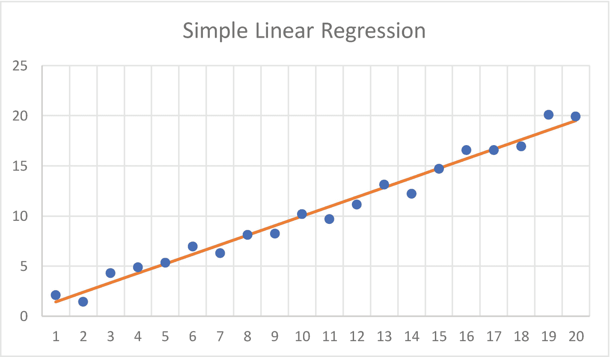

图 4-4

带噪声样本数据与线性回归拟合模型绘制在一起的对比图

正如我们所见，这条直线对数据集的拟合效果非常好。它遵循了总体趋势，并且对局部变化不敏感。另一个优点是，进行任何预测时，我们只需要存储两个浮点数。此外，由于我们已经提炼出了数据的特征，因此无需保留原始数据。这非常轻量！

#### 多元线性回归

我们现在已经知道如何将线性方程拟合到一组数据上。这自然要求数据集中的样本展现出某种线性关系的趋势。然而，大多数数据集都包含与单个数据点相关的多个变量的信息。

例如，一套房屋的销售不仅包含售价和面积的信息，还可能包含房间数量、运营成本和建造年份等信息。这些变量都以某种方式影响着价格，因此我们理应尝试将它们纳入考量。为了阐述这一思路，我们给示例数据增加一个维度。图 4-5 展示了一个新的数据图，其中两个特征变量分别位于 X 轴和 Y 轴，目标变量位于 Z 轴。

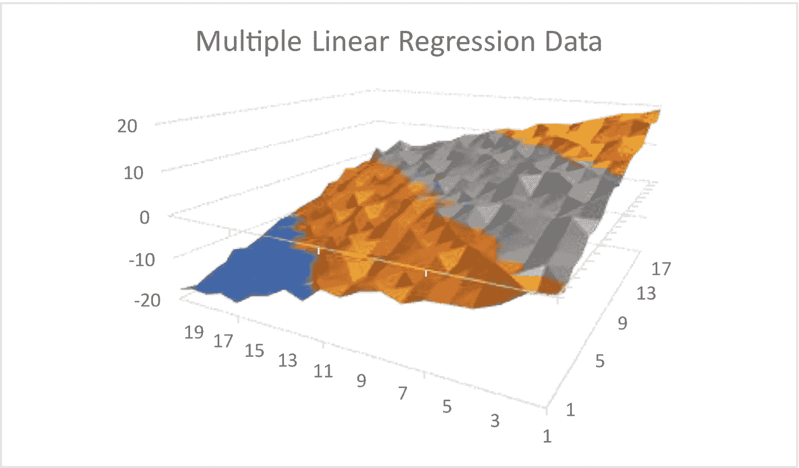

图 4-5：扩展后的示例数据图，现在包含三个变量。

如图所示，新的维度也与目标值呈线性关系。这两个特征变量与目标变量共同构成了一个类似倾斜不平的平面。在对数据有了直观理解之后，让我们开始进行数学推导。

#### 用向量推导线性回归

在推导简单线性回归时使用的数学符号，对于一两个变量通常没问题。然而，我们可能希望将此技术用于包含 5 个、10 个甚至 50 个变量的数据上。这样一来，我们需要推导的公式会变得极其复杂。我们需要一种新的符号表示法，以使后续的公式简洁紧凑，因此我们将使用向量和矩阵。使用向量符号，我们可以将一个样本点及其 *d* 个特征表示为

![$$ \boldsymbol{x}=\left[\begin{array}{c}{x}_1\\ {}{x}_2\\ {}\begin{array}{c}\vdots \\ {}{x}_d\\ {}1\end{array}\end{array}\right] $$](images/512351_1_En_4_Chapter/512351_1_En_4_Chapter_TeX_Equt.png)

我们在向量末尾添加一个 1，以包含截距项，即在单变量情况下我们称之为 *m* 的值。如果现在将所有系数和截距项封装到一个向量 **w** 中，如下所示

![$$ \boldsymbol{w}=\left[\begin{array}{c}{w}_1\\ {}{w}_2\\ {}\begin{array}{c}\vdots \\ {}{w}_d\\ {}{w}_{d+1}\end{array}\end{array}\right] $$](images/512351_1_En_4_Chapter/512351_1_En_4_Chapter_TeX_Equu.png)

那么这些向量的点积将产生如下表达式


这个方程正是我们所需的预测器。它是每个特征变量的线性表达式，加上一个截距变量，在此符号中我们称之为`w[d+1]`。与简单线性回归情况类似，我们希望衡量这个公式对训练数据的拟合效果。我们可以通过计算观测目标值与预测值之间差值的平方和来实现，因此可以修改之前的损失函数为

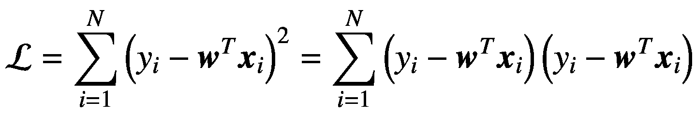

为了进一步简化符号，我们可以将所有样本点收集到一个矩阵中，我们将其称为 **X**。通过将每个单独的特征向量作为行放入该矩阵，我们可以使用矩阵-向量乘法一次性计算出所有预测值。由于这会产生一个向量，因此我们也必须将目标值堆叠成向量格式。我们将此向量称为 **Y**。重写后的损失函数为

## 实现多元线性回归

在完成数学推导后，我们现在可以着手实现代码了。在本节中，我们将介绍 `Accelerate` 框架。`Accelerate` 是一个专注于数学计算和高性能的库集合。它利用 CPU 的向量处理能力来加速密集型计算，并并行处理多个数值。

我们将复用 `SimpleLinearRegression` 结构体的一般结构。我们会在初始化器中拟合模型，使用泛型使结构体可复用至任意数据类型，通过 `KeyPath` 定位感兴趣的变量，并使用 `predict(x:)` 函数对新数据点进行预测。不过，由于我们要定位多个变量，因此将使用可变参数。清单 4-4 展示了我们将在该任务中使用的新初始化器定义。

```
init(from samples: [Element],
      data: KeyPath...,
      target: KeyPath) throws
清单 4-4
我们多元线性回归类型的初始化器定义
```

这个初始化器看起来与简单线性回归的初始化器非常相似。区别在于 `data` 参数类型后面跟的省略号。这种点点点语法使得参数可变，意味着只要它们符合声明的 `KeyPath` 类型，我们就可以定位任意数量的变量。清单 4-5 展示了此初始化器的两种完全有效的用法。

```
let points: [Point3D] = ...
let singleVar = MultipleLinearRegression(
    from: points,
    data: \.x,
    target: \.z
)
let multiVar = MultipleLinearRegression(
    from: points,
    data: \.x, \.y,
    target: \.z
)
清单 4-5
使用可变参数定位不同变量的两种方式
```

如我们所见，可变参数为我们选择计算中要包含的变量提供了极大的灵活性。这种方法使得对可用信息的不同子集进行多个模型的测试和运行变得更加容易。

现在我们已经明确了如何使用 `MultipleLinearRegression`，接下来让我们深入探讨其运作细节。我们将把整个初始化器主体拆分成几个清单，以便分别推理每个部分。首先，清单 4-6 显示了初始设置。

```
let sampleCount = Int32(samples.count)
let dimCount32 = Int32(data.count + 1)
let dimCount64 = data.count + 1
let XTransXDimension = dimCount64 * dimCount64

var X = samples.flatMap { sample -> [Double] in
    var row = data.map { keyPath in
        sample[keyPath: keyPath].realValue
    }
    row.append(1)
    return row
}
var XTrans = X
var Y = samples.map { sample in
    return sample[keyPath: target].realValue
}
var XTransX = Double
var XTransY = Double
清单 4-6
MultipleLinearRegression 初始化器执行的初始设置
```

我们做的第一件事是设置一些所需的数据结构。我们为样本数量和数据维度创建了计数变量。注意，变量 `dimCount32` 和 `dimCount64` 的值相同，仅类型不同。也可以选择使用单个变量并在需要时进行类型转换，但这会增加阅读此类代码时的认知噪音。

我们通过使用 `flatMap(_:)` 创建了 `X` 矩阵，这是一个与 `map(_:)` 和 `filter(_:)` 类似的高阶函数。它的工作方式类似于 `map(_:)`，但要求为每个数据点创建一个值序列。然后它会把生成的所有数组合并成一个，其中第一个数据点的 `k` 个元素占据序列中的前 `k` 个索引。这种方法的一个后果是，我们用一维表示来存储二维数据结构。与其他许多语言中保持嵌套数组的方式不同，我们将每一行依次排列。这种布局称为行主序。相反的做法是将矩阵的各列依次放置，这被称为列主序。

`XTrans` 是数学符号中我们称为 `X^T` 的矩阵。很容易看出它并不是 `X` 的转置，而仅仅是一个普通副本。不过这没关系，因为我们将从 `Accelerate` 框架中使用的函数调用，能在执行主要计算前先计算矩阵的转置。

`Y` 是包含目标值的向量，即每个样本点的观测值。由于我们希望尽量减少在得到结果前需要执行的数学运算次数，因此更倾向于先进行矩阵-向量乘法，再进行矩阵-矩阵乘法。然而，我们无法避免单独计算 `(X^T X)^(-1)`。为最小化工作量，我们将计算分为三步：

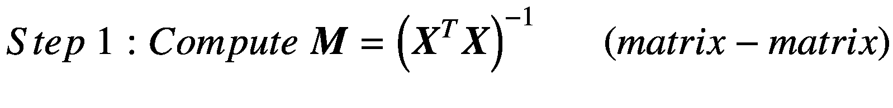

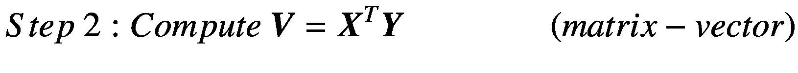

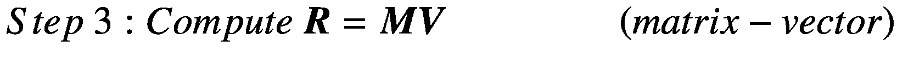

因为我们采用这种方法，所以还设置了 `XTransX` 和 `XTransY` 数组。请注意，我们使用 `var` 关键字声明了所有数组。这样做是因为我们需要将指针传递给 `Accelerate` 方法。由于指针可能会修改底层存储，因此这些变量必须是可变的。

现在我们已经为计算分配了部分所需存储空间，接下来让我们开始对 `Accelerate` 框架进行首次调用。我们将从使用清单 4-7 所示的方法开始。

```
func cblas_dgemv(
    _ __Order: CBLAS_ORDER,
    _ __TransA: CBLAS_TRANSPOSE,
    _ __M: Int32,
    _ __N: Int32,
    _ __alpha: Double,
    _ __A: UnsafePointer!,
    _ __lda: Int32,
    _ __X: UnsafePointer!,
    _ __incX: Int32,
    _ __beta: Double,
    _ __Y: UnsafeMutablePointer!,
    _ __incY: Int32
)
```

清单 4-7：Accelerate 框架中提供的众多矩阵-向量乘法方法之一

那些对 Swift 开发略有经验的人会注意到，这个声明看起来与他们见过的多数 Swift 代码不同。这是因为该函数（以及我们将使用的其他一些函数）引用的是 Apple 为 C 语言实现的*基础线性代数子程序*（CBLAS）。Swift 拥有便捷的 C 函数导入能力。这一特性非常实用，但伴随一个小不便：在使用这些接口时，代码看起来不那么现代。

回到清单 4-7 中的函数，我们快速梳理一下它期望我们传递给各个参数的内容：

*   `__Order`：此参数指定用于乘法的矩阵的顺序。由于我们选择按行主序组织矩阵，因此传入 `CblasRowMajor` 作为参数。
*   `__TransA`：指定函数是否应在执行乘法前对矩阵进行转置。我们并未预先计算转置，因此传递 `CblasTrans`。
*   `__M`：原始矩阵的行数。由于我们将样本点放在每一行，因此有 `sampleCount` 行。
*   `__N`：原始矩阵的列数。我们的矩阵将有 `dimCount32` 列。
*   `__alpha`：此参数按一定比例缩放乘法的结果。我们希望保持原有比例，因此传入 1。
*   `__A`：指向矩阵的指针。
*   `__lda`：矩阵的主维度。由于我们选择了行主序，将传入列数，即 `dimCount32`。
*   `__X`：指向向量的指针。
*   `__incX`：遍历向量 `X` 时使用的步长。
*   `__Y`：指向可存储结果向量的结构的指针。
*   `__incY`：遍历 `Y` 时使用的步长。

BLAS 接口确实信息量很大。代码清单 4-8 展示了另一个我们将用于矩阵-矩阵乘法的 BLAS 函数声明。不过，我们不会解释那些参数，因为它们与代码清单 4-7 中函数的参数非常相似。

```
func cblas_dgemm(
_ __Order: CBLAS_ORDER,
_ __TransA: CBLAS_TRANSPOSE,
_ __TransB: CBLAS_TRANSPOSE,
_ __M: Int32,
_ __N: Int32,
_ __K: Int32,
_ __alpha: Double,
_ __A: UnsafePointer!,
_ __lda: Int32,
_ __B: UnsafePointer!,
_ __ldb: Int32,
_ __beta: Double,
_ __C: UnsafeMutablePointer!,
_ __ldc: Int32
)
```

代码清单 4-8：多个可用于矩阵-矩阵乘法的 BLAS 函数之一

> **注意**
>
> 我们只是触及了 BLAS 接口所能实现功能的冰山一角。要深入研究，欢迎访问 IBM 关于*工程与科学子程序库*的文档，其中包含对 BLAS 例程的良好文档化实现。
>
> [`www.ibm.com/docs/en/essl`](http://www.ibm.com/docs/en/essl)

现在我们已经知道如何使用矩阵和向量乘法方法，我们可以将代码清单 4-9 中列出的代码添加到我们的初始化器中。

```
cblas_dgemv(
CblasRowMajor,
CblasTrans,
sampleCount,
dimCount32,
1,
&XTrans,
dimCount32,
&Y,
1,
1,
&XTransY,

)
cblas_dgemm(
CblasRowMajor,
CblasTrans,
CblasNoTrans,
dimCount32,
dimCount32,
sampleCount,
1,
&XTrans,
dimCount32,
&X,
dimCount32,
1,
&XTransX,
dimCount32
)
```

代码清单 4-9：为我们的多元线性回归计算 `XTX` 和 `XTY`

在执行最后一次矩阵-向量乘法并得到结果之前，我们需要对 `X^T X` 求逆。为此，我们将使用一组 LAPACK 例程，即 `dgetrf_` 和 `dgetri_`。这两个函数协同工作，对矩阵执行 LU 分解，然后求解方程组以找到其逆矩阵。代码清单 4-10 显示了这些函数的声明。

```
func dgetrf_(
_ __m: UnsafeMutablePointer!,
_ __n: UnsafeMutablePointer!,
_ __a: UnsafeMutablePointer!,
_ __lda: UnsafeMutablePointer!,
_ __ipiv: UnsafeMutablePointer!,
_ __info: UnsafeMutablePointer!
) -> Int32
func dgetri_(
_ __n: UnsafeMutablePointer!,
_ __a: UnsafeMutablePointer!,
_ __lda: UnsafeMutablePointer!,
_ __ipiv: UnsafeMutablePointer!,
_ __work: UnsafeMutablePointer!,
_ __lwork: UnsafeMutablePointer!,
_ __info: UnsafeMutablePointer!
) -> Int32
```

代码清单 4-10：LAPACK 函数 `dgetrf_` 和 `dgetri_` 的声明

诚然，如果 BLAS 方法看起来有点吓人，那么这些看起来就像真正的噩梦。然而，一旦我们稍微了解一下幕后发生的事情，这些方法也会变得有用。

`__CLPK_integer` 和 `__CLPK_doublereal` 只是 `Int32` 和 `Double` 的类型别名。仅知道这一点就能让认知负担减轻一些。参数 `__m` 和 `__n` 是矩阵维度，就像其他函数一样。参数 `__a` 代表我们要逆的矩阵，`__lda` 和之前一样是主维度。`__ipiv` 代表一组主元索引，用于指示函数在分解过程中如何重新排列行。`__work` 和 `__lwork` 分别是工作空间数组及其维度。根据 IBM 的文档，工作空间的大小至少应为 `__n` 的一百倍，才能使算法获得良好性能。最后，`__info` 参数向开发者返回有关失败的信息。例如，它告诉我们试图求逆的矩阵是否包含特征值为零的情况。这个机制就是我们在讨论*可逆矩阵定理*时谈到的安全防护。

要使用这些函数，我们需要设置一些额外的数组和支持变量。我们还需要声明一个错误枚举，用于传播任何失败。代码清单 4-11 显示了枚举，而代码清单 4-12 列出了设置以及对 `dgetrf_` 和 `dgetri_` 的调用。

```
var m = dimCount32
var n = dimCount32
var lda = dimCount32
var workspaceSize = 100 * m
var pivots = Int32
var workspace = Double
)
var luError = Int32.zero
var invError = Int32.zero
dgetrf_(&m, &n, &XTransX, &lda, &pivots, &luError)
switch luError {
case ..<0:
throw LinearRegressionError.invalidArguments
case 1...:
throw LinearRegressionError.singularMatrix
default:
break
}
dgetri_(&m, &XTransX, &lda, &pivots, &workspace, &workspaceSize, &invError)
switch invError {
case ..<0:
throw LinearRegressionError.invalidArguments
case 1...:
throw LinearRegressionError.singularMatrix
default:
break
}
```

代码清单 4-12

设置工作空间并计算 `(XTX)-1`

```
enum LinearRegressionError: Error {
case singularMatrix
case invalidArguments
}
```

代码清单 4-11

我们用于传播错误的错误结构体的定义

一旦这些调用返回，逆矩阵 (**X**^T**X**)^(-1) 就存入了名为 `XTransX` 的变量中。假设 `dgetrf_` 和 `dgetri_` 正常退出，并且我们没有抛出任何错误，那么我们就拥有了计算向量 **w** 所需的两个组件——`dimCount32` × `dimCount32` 的矩阵 (**X**^T**X**)^(-1) 和长度为 `dimCount32` 的向量 **X**^T**Y**。剩下的就是再执行一次矩阵-向量乘法来获得最终结果。代码清单 4-13 显示了初始化器中最后的代码片段，其中出现了我们的老朋友 `cblas_dgemv(_:_:_:_:_:_:_:_:_:_:_:_:)`。

```
var w = Double
cblas_dgemv(
CblasRowMajor,
CblasTrans,
dimCount32,
dimCount32,
1,
&XTransX,
dimCount32,
&XTransY,
1,
1,
&w,

)
self.w = w
self.variables = data
```

代码清单 4-13

初始化器方法的最后代码片段

完成初始化器中的计算后，我们为 `w` 创建存储空间，执行最后的乘法，然后将计算出的系数和 `KeyPath` 存入 `data` 参数以供后续使用。

我们完成了学习算法的实现，这本身就是一个重要的里程碑。但是，如果我们不能用它来进行预测，它就没有任何实际价值，因此我们还需要实现 `predict(x:)` 函数。为此，我们将再使用一个 BLAS 例程。请记住，我们将预测定义为

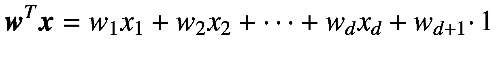

我们已经可以轻松访问`w`^T，这要归功于刚刚实现的初始化器。然而，我们需要为想要预测的样本点创建一个新的特征向量。幸运的是，我们已经有了一个实现该过程的方法，因为我们已为矩阵`X`创建了整套特征向量。剩下的任务就是执行求和运算。我们可以使用像`reduce(_:)`这样的高阶函数来将所有元素相乘并求和。这种方法对于小型特征集或仅对有限数量的数据点进行预测时是完全可接受的。然而，如果特征集或数据点数量较大，则可能需要很长时间。让我们探索一种借助 BLAS 进行此计算的方法。清单 4-14 展示了一个计算两个向量点积的函数的声明。

```
func cblas_ddot(
_ __N: Int32,
_ __X: UnsafePointer!,
_ __incX: Int32,
_ __Y: UnsafePointer!,
_ __incY: Int32
) -> Double
清单 4-14
计算点积的多个 BLAS 例程之一
```

该函数的参数含义与矩阵-向量和矩阵-矩阵乘法方法中的参数相似，但让我们快速过一遍：

*   `__N`：此参数指定每个向量中要包含在点积中的元素数量。它最多不能超过最短向量的长度，否则会发生奇怪的事情。对于我们的线性回归，它将与`w`的长度相同。

*   `__X`：此参数接受指向第一个向量的指针。在我们的例子中，这是`w`。

*   `__incX`：向量`__X`的步长。由于我们需要求和中的所有元素，我们将其设置为 1。

*   `__Y`：指向第二个向量的指针。我们将传入一个指向数据点的特征向量的指针。

*   `__incY`：与`__incX`类似，此参数指定向量`__Y`内部的步长。我们也将其设置为 1。

现在我们已经涵盖了进入预测的不同部分，让我们实现`MultipleLinearRegression`的最后一部分。清单 4-15 中的代码展示了该函数。

```
func predict(x: Element) -> Double {
var features = variables.map { keyPath in
x[keyPath: keyPath].realValue
}
features.append(1)
let n = Int32(w.count)
var w = w
return cblas_ddot(
n,
&w,
1,
&features,

)
}
清单 4-15
在多元线性回归类型中使用我们的工作成果之前的最终函数
```

正如我们所见，特征的映射与我们之前在初始化器中学习线性函数时执行的映射非常相似。唯一的区别在于，我们只创建一个单一的特征向量，而不是将多行放入矩阵结构中。总的来说，这个函数非常简洁，阅读和理解起来也不费太多功夫。

所有这些工作最终形成了一个功能性的算法，用于学习线性回归并进行预测。清单 4-16 包含来自附带代码项目的一些代码，展示了如何在一个示例数据集上使用我们新的 Swift 类型。请记住，我们需要将代码包装在`do-catch`子句中，以处理任何抛出的错误。还有一个新的`description`属性的实现，用于打印我们新的线性方程。但为了简洁起见，此清单中省略了它。

```
let points = DataLoader.load(
Point3D.self,
from: .multipleLinearRegression
)
do {
let regressor = try MultipleLinearRegression(
from: points,
data: \.x, \.y,
target: \.z
)
let observed = points[42]
let prediction = regressor.predict(x: observed)
print(
"""
f(x) = \(regressor)
Prediction for (\(observed.x), \(observed.y))
\(prediction)
Observed value for (\(observed.x), \(observed.y))
\(observed.z)
"""
)
}
catch {
print("An error was thrown: \(error)")
}
// 输出：
// f(x) = 1.010083366089924 * x_1 –
// 0.9873800441120847 * x_2 - 0.23672317614604843
// Prediction for (3.0, 3.0)
// -0.16861321021253062
// Observed value for (3.0, 3.0)
// -0.379395117657068
```

## 清单 4-16
如何使用我们新的 `MultipleLinearRegression` 类型的示例

### 预测房屋销售价格

在完成新工具的开发后，尝试在有趣的数据集上使用它们总是很有趣的。代码项目中包含一个名为`HousePricePredictions.swift`的文件，我们可以专门用于此目的。它加载了一个包含生成的房屋销售数据的数据集，该数据集遵循与瑞典四个大城市近 12500 笔近期销售相似的分布。欢迎自由探索这些数据，并尝试哪些变量能为您带来最小的损失值。思考不同变量的性质，它们是否自然地由实数或整数表示，以及这如何影响回归。

### 章节总结

在本章中，我们从数学和工程方面都涵盖了不少理论。我们学习了两个数据点之间的简单线性外推，以及当样本变得过于不规则时它是如何失效的。我们还了解了线性样条，讨论了它们为何以及如何有用，以及为什么它们不太适合大型数据集。这些讨论后来帮助我们理解了线性回归所解决的缺点，从而进入了线性回归的领域。

在关于线性回归的章节中，我们学习了损失函数，它帮助我们确定特定模型描述我们观测数据的程度。我们还借助该损失函数推导了线性回归的理论，并进行了两种实现——一种用于简单情况，另一种用于多变量情况。后者引导我们了解了`BLAS`和`LAPACK`，并展示了我们在解决这些问题时可以使用的一些工具。

在尝试对现实世界进行预测时，对其进行建模是一项非常有用的技能。然而，观察两组观测数据并评估某些重要指标是否发生了显著变化，同样是一项有用的技能。这正是我们将在下一章中研究的问题。