# 5. 假设检验

假设检验是统计学中一个有价值的分支。它在处理那些分布可能随时间或因某些事件而变化的随机变量时，可以为我们提供帮助。然而，它也是学生认为最令人生畏且最难理解的主题之一。在本章中，我们将通过几个例子来学习如何提出一个假设，并利用 Swift 来确定它是否比当前公认的真相更有可能成立。

## 什么是假设检验？

为了更好地理解假设检验为何有用，让我们来看一个示例陈述：

- 一所大学的院长声称在校学生拥有高于平均水平的智力。随机抽取的 30 名学生同意参加一项智商测试，根据韦克斯勒成人智力量表（`WAIS`），他们的平均得分为 105 分。院长的说法正确吗？

虽然这个具体例子可能不是数据科学家或统计学家日常工作中的一部分，但它将帮助我们思考一些需要考虑的问题。

`WAIS`的分数呈正态分布，平均分为 100 分，标准差为 15 分。由于学生的平均得分为 105 分，高于`WAIS`的平均分 100 分，人们可能会倾向于得出结论：院长是正确的。然而，这种推理方式引发了一些问题。

- 即使分数有差异，差异也仅为 5%。这个差异是否足以做出如此笼统的断言？
- 如果我们选择参与测试的学生时运气好怎么办？也许参与测试的学生分数比其他学生要高。
- 我们如何衡量前两个问题带来的不确定性？我们能否得出一个数字，告诉我们对自己的结果有多大的信心？

正如我们所看到的，在判断这个例子中的论断是否合理，或者是否应该拒绝它们之前，我们需要考虑许多因素。首先，我们需要建立一些术语，以便更容易地使用数学工具来解决问题。

### 提出假设

为了解决这些问题，我们首先需要将想要检验的假设正式化。初学者经常在这一部分遇到困难，主要原因似乎是，筛选出问题的相关信息并不总是那么容易。为了能熟练地提出假设，我们将描述为任何问题都需要提出的两种不同类型的假设，并展示几个例子来熟悉这些概念。现在，我们将重点放在高层概念上，更多细节将在后续章节中介绍。

#### 零假设

零假设，用 `H[0]` 表示，描述了一个普遍接受的事实。它表明我们收集的样本与当前公认的基准事实之间没有显著差异。例如，一家汽车制造商可能规定某款车型的平均油耗为每加仑 23 英里。那么零假设认为，我们通过测试该车型的几辆车所收集到的任何数据，其平均油耗都将为每加仑 23 英里。这个假设的数学表述如下：

```
H0: μ = 23 mpg
```

就是这样！不多也不少。我们陈述，根据 `H[0]`，平均值 `μ` 等于每加仑 23 英里。

#### 备择假设

备择假设，用 `H[A]` 表示，是一个我们想要研究的论断。它提出了一种零假设不再成立的新情况。例如，前面例子中的汽车制造商最近可能对生产线进行了改动。由于这些改动，我们相信新车不再能达到每加仑 23 英里的油耗。然而，我们对于这些改动是提高了还是降低了燃油效率并无定见。它可能比以前更高，也可能更低。用数学符号表示，我们将这个假设记为：

```
HA: μ ≠ 23 mpg
```

备择假设看起来和上一节的零假设一样简单。需要注意的一点是，零假设和备择假设互为补集。也就是说，它们涵盖了所有可能的结果。在这个例子中，平均燃油效率要么是 23 英里/加仑，要么是其他数值。绝无可能构造出两个假设同时为真或同时为假的情况。

零假设和备择假设互为补集这一事实，使我们能够更深入地探索其他问题。我们能否利用其他的互补关系，在检验的内容和方式上拥有更大的灵活性？

#### 单侧与双侧检验

我们在上一节中提出备择假设的方式在技术上并没有错。然而，假设平均燃油效率发生了变化却没有指明方向，确实感觉有些奇怪。确实有些时候我们只需要检验某个统计量是否朝着某个方向变化了，但还有些时候我们希望更具体一些。

想象一下，前面例子中对生产线的改动意味着燃烧室现在由拥有更好技术的合作伙伴提供，使得零部件质量更高。有了这样的额外信息，我们可能更有把握地假设平均燃油效率提高了。做出这个假设意味着我们之前提出的 `H[0]` 和 `H[A]` 不再能描述我们的假设。相反，我们的备择假设认为平均值大于每加仑 23 英里。由于 `H[0]` 和 `H[A]` 需要互为补集，因此零假设必须是平均值小于或等于 23。数学上，我们的新假设如下所示：

```
H0: μ ≤ 23 mpg
```

```
HA: μ > 23 mpg
```

虽然这样做没有精确地捕捉到当前公认的平均燃油效率，但这种表述方式确实有一些好处。首先，它允许我们通过指定我们认为平均值发生了变化的方向，将额外信息封装到备择假设中。其次，尽管零假设的范围从每加仑 23 英里向下延伸，但它仍然包含了汽车制造商最初的声称。

我们将这种新的表述称为*单尾检验*，仅仅是因为它指定了我们认为统计量发生变化的单一方向。如果我们认为平均值向下偏移，也会使用同样的术语。第一个例子仅仅假设平均值发生了变化，但没有指定方向，因此被称为*双尾检验*。

我们还可以将单尾检验进一步细分为*左尾检验*和*右尾检验*。这种分类取决于所认为的变化的具体方向。当 `H[A]` 指定统计量减少时，我们使用左尾检验；而当 `H[A]` 指定统计量增加时，则使用右尾检验。

有一点非常关键：假设检验对假设是否为真没有任何说明。它只说明根据我们收集的数据，哪个假设更有可能。这听起来可能有些奇怪，但解释起来相当直接。仅仅因为我们可能最终证明了其中一个选项比另一个更有可能，并不一定意味着它就是真的。证明一个假设或理论为真是一项困难得多的任务。

既然我们已经定义了假设检验相关的一些术语，是时候深入探讨细节了。首先，根据我们到目前为止的定义，单尾检验和双尾检验是相对容易理解的。然而，我们还没有揭示这些“尾”究竟是什么。为了理解这一点，我们需要问自己几个关于样本均值分布的问题。

## 样本均值的分布

想象一下，一顶帽子里有 100 张折叠好的纸条。每张纸条上都写着一个介于 0 到 5 之间的数字。我们的任务是计算这些数字的平均值，但我们只能查看 30 张随机选出的纸条。这个场景会产生几种不同的可能结果。

- 我们最终可能选到数字最大的那几张纸条。在这种情况下，我们的计算结果可能远大于真实均值。然而，恰好选中这些纸条的概率相对较小。
- 类似地，我们最终也可能选到数字最小的那几张。在这种情况下，我们计算出的均值会比真实均值小很多。出现这种情况的概率也同样很小。
- 最可能的结果介于上述两个极端之间。我们很可能会选到一些较大数字和较小数字的混合，取这些数字的平均值会得到一个至少在一定程度上接近真实均值的结果。

这种类型的分布听起来可能让你想起第三章 3 的内容。让我们编写一些代码，来可视化从某个集合中抽取的样本均值的分布。代码清单 5-1 展示了一个 SwiftUI 视图的初始化器，它接收一个数字数组，并用其计算大量样本均值。然后，我们在 `body` 属性中将这些结果绘制成直方图进行可视化，如代码清单 5-2 所示。

```
var body: some View {
    VStack(spacing: 20) {
        Text("计算样本均值")
            .font(.largeTitle)
        HStack(spacing: 20) {
            Text("真实均值: \(mean, specifier: "%.3f")")
            Text("每个均值的样本数: \(numberOfSamples)")
        }
        .padding(.horizontal)
        Histogram(
            data: data,
            label: "样本均值的分布",
            barWidth: barWidth,
            xAxisMin: 0,
            xAxisMax: 5
        )
    }
}
```

代码清单 5-2：在直方图中展示计算出的样本均值

```
init(
    numberOfMeans: Int,
    numberOfSamples: Int,
    sampledFrom set: [Double]
) {
    precondition(
        !set.isEmpty,
        "样本至少需要包含一个元素。"
    )
    // 用于将值放入直方图的组块中
    let rounding = 0.1
    let meansIterator = (1 ... numberOfMeans).lazy
    let samplesIterator = (1 ... numberOfSamples).lazy
    self.data = meansIterator
        .map { _ in
            samplesIterator
                .compactMap { _ in set.randomElement() }
                .mean(of: \.self)
        }
        .reduce(into: [Double: Int]()) { dict, mean in
            let roundedMean = (mean / rounding)
                .rounded() * rounding
            dict[roundedMean, default: 0] += 1
        }
        .map { key, value in
            BarChartDataEntry(
                x: key,
                y: value.realValue / numberOfMeans.realValue
            )
        }
    self.barWidth = 0.9 * rounding
    self.mean = set.mean(of: \.self)
    self.numberOfSamples = numberOfSamples
}
```

代码清单 5-1：计算并绘制多个样本均值

在一个包含 100 个 0 到 5 之间均匀随机数的集合上运行上述代码，会生成如图 5-1 所示的直方图。该代码计算了总共 5000 个样本均值，每个均值使用了 30 个样本。

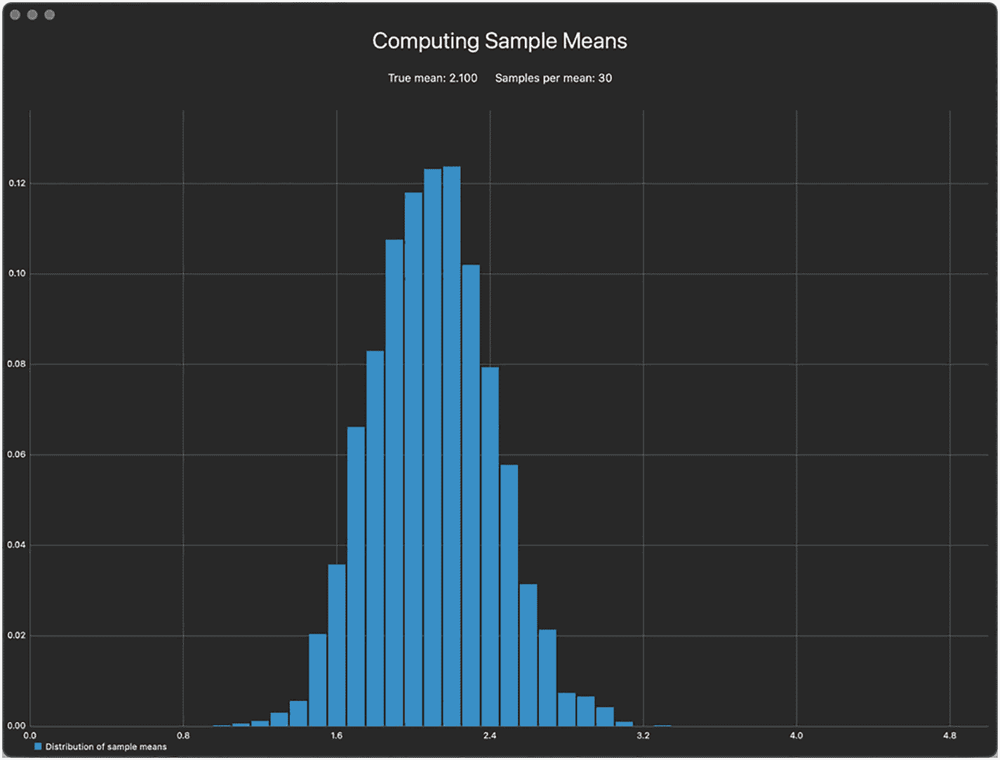

图 5-1：从一个包含 100 个均匀随机数的集合中计算出的 5000 个样本均值

观察这个直方图，我们得到了一个可视化证据，证实了之前列举计算样本均值的不同结果时的猜想。这些柱状图形成了一个看起来非常像正态分布的形状！这个结果并非巧合，而是由一个数据科学家和统计学家经常使用的定理所正式表述的。

## 中心极限定理

中心极限定理让任何想要进行假设检验的人的生活变得轻松得多。它告诉我们，来自总体的样本均值的分布可以用正态分布来近似。无论我们从中采样的分布是否为正态分布，这个结论都成立。但是，我们需要满足一些条件。

-   我们需要进行有放回抽样。例如，一旦我们选择了一名学生进行智商测试，就不能将其从样本池中移除，因为这会改变剩余样本的分布。相反，我们必须接受可能多次选中同一名学生的可能性。

-   我们需要样本量足够大。也就是说，我们不能只随机选择两三个学生。一个普遍接受的界限是，我们至少需要 30 个样本，该定理才适用。

注意：上述样本量限制有一个例外。如果样本来自正态分布的总体，那么即使样本量小于 30，该定理也适用。

假设上述条件成立，中心极限定理告诉我们，我们可以用正态分布来近似样本均值的分布。当我们在第三章 3 讨论正态分布时，我们提到均值 `μ` 和标准差 `σ` 定义了特征钟形曲线的确切形状。我们通过以下公式来估计这些参数：

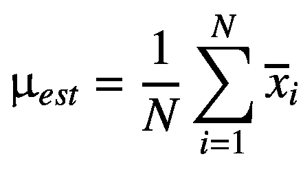

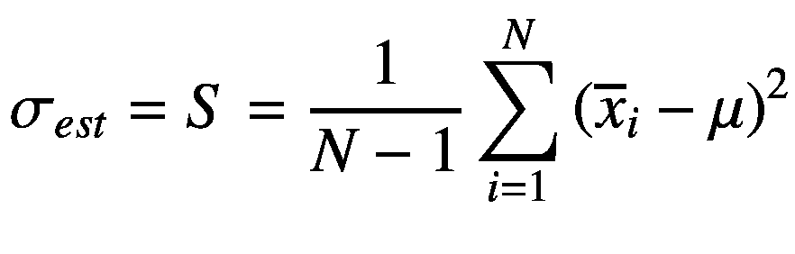

在这些公式中，我们用顶部带横线的 *x* 表示单个样本均值。我们用 *S* 表示样本标准差。这两者都是真实均值和标准差的无偏估计量，因此在我们不知道实际值的情况下，它们是可接受的替代品。在已知总体均值和标准差的情况下，我们可以改用以下公式：


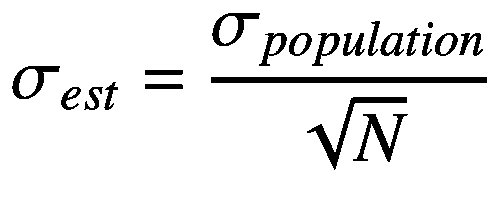

在这些方程中，`N` 表示样本量，用于缩放总体的标准差。上述公式的推导和证明超出了本书的范围。但是，我们将看两个例子，以便直观地感受它们成立。

图 5-2 展示了一个参数为 `α = 3` 和 `β = 3` 的伽马分布。图 5-3 展示了 1000 个样本量为 30 的样本均值的密度直方图。它还叠加了一条根据估计未知均值和标准差的公式计算参数的正态分布曲线。

图 5-4 展示了一个更有趣的分布。它是两个贝塔分布的线性组合，一个参数为 `α = 7` 和 `β = 2`，另一个参数为 `α = 2` 和 `β = 5`。图 5-5 展示了样本均值的直方图以及一条参数经过适当估计的正态分布曲线。

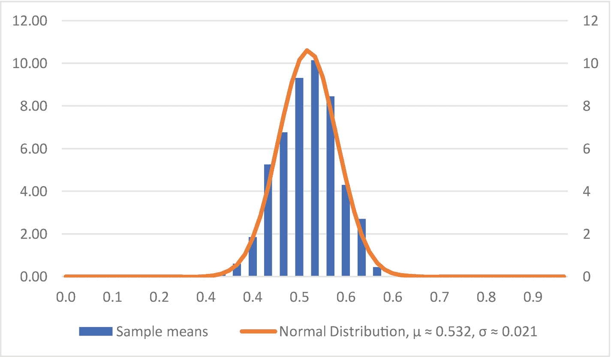

图 5-5：根据图 5-4 中贝塔分布的线性组合计算出的 1000 个样本均值的分布，以及一条参数 `μ ≈ 0.532` 且 `σ ≈ 0.021` 的叠加正态分布曲线

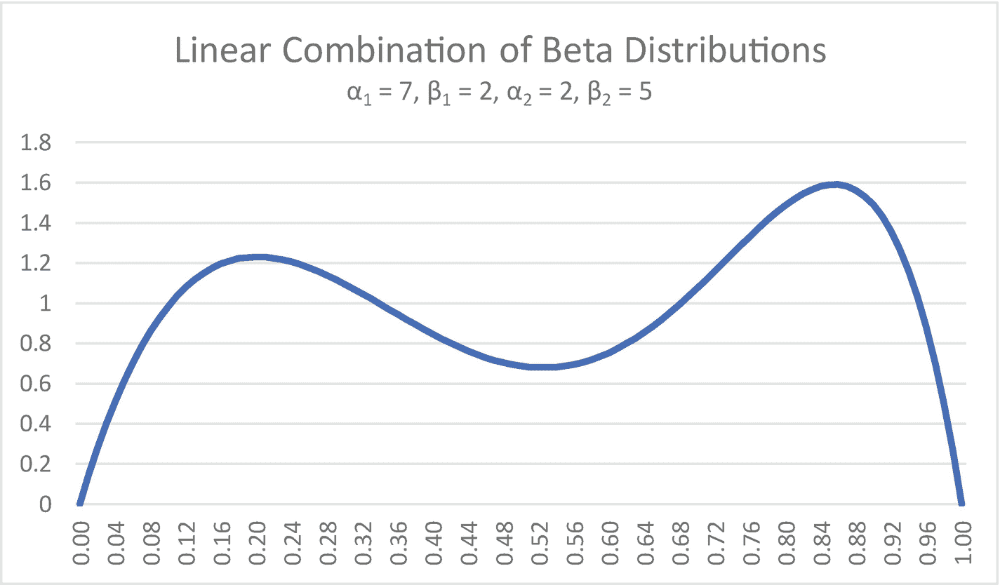

图 5-4：一个由两个贝塔分布线性组合构成的分布

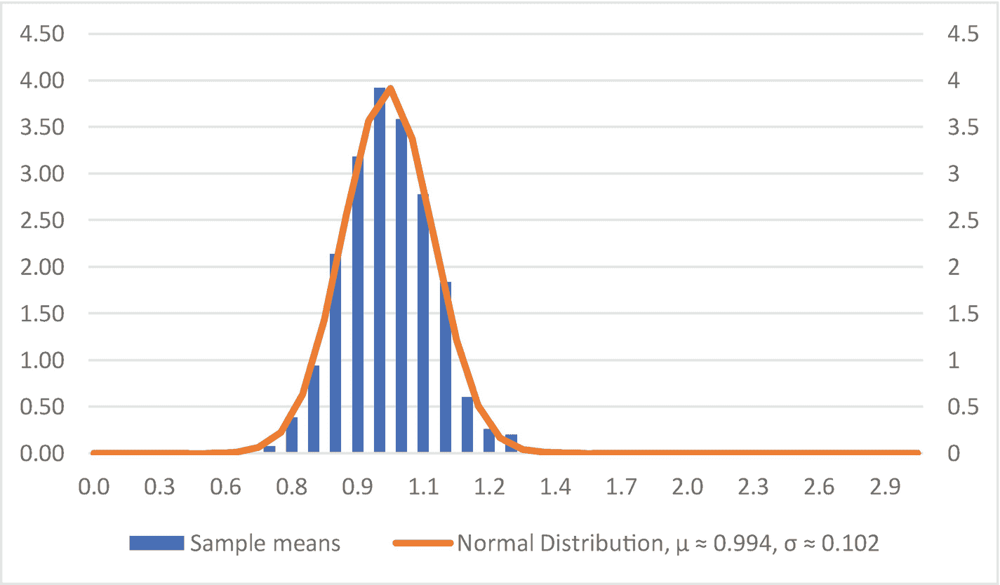

图 5-3：根据图 5-2 中的伽马分布计算出的 1000 个样本均值的分布，以及参数为 `μ ≈ 0.994` 和 `σ ≈ 0.102` 的正态分布叠加图

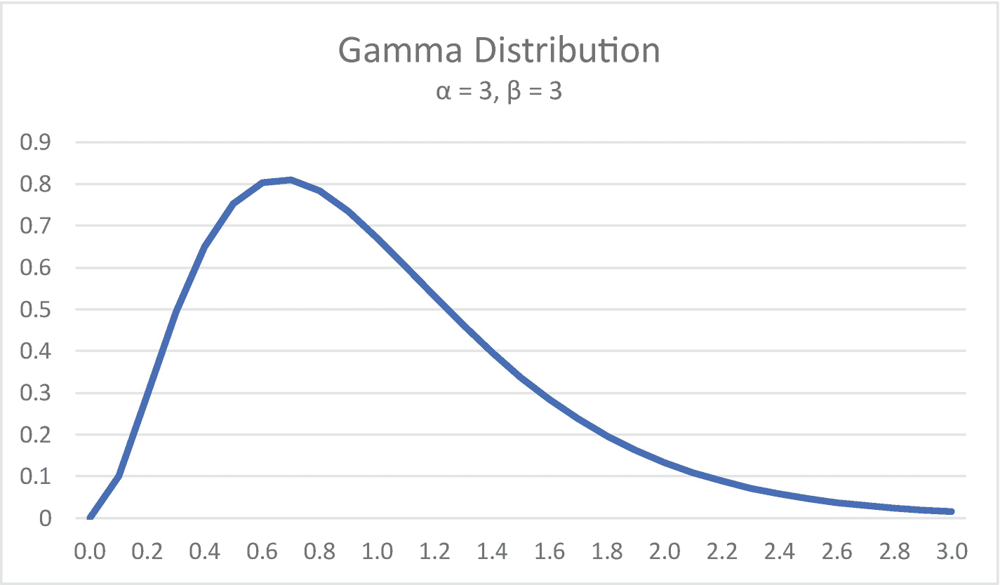

图 5-2：参数为 `α = 3` 和 `β = 3` 的伽马分布

我们首先来讨论伽马分布。将所有 1000 个样本均值绘制成直方图后，我们会发现这个分布呈钟形。当将其与我们根据估计参数 `μ` 和 `σ` 得到的正态分布进行比较时，可以看到两者非常吻合。我们还可以注意到，估计均值 `μ` 非常接近该分布的真实均值（即 1）。有人可能会认为，这个特定的伽马分布看起来有点像偏态正态分布，因此近似效果更好。然而，观察后续的图表，我们会发现情况并非如此。

两个贝塔分布的线性组合形成了一个有趣的形状。它有两个峰值，且完全不像正态分布。尽管如此，计算样本量为 30 的 1000 个样本均值并绘制成直方图后，得到的分布与伽马分布例子中的形状非常相似。将其与正态分布曲线进行比较，我们发现，尽管两者的拟合程度不如第一个例子那么好，但考虑到原始分布如此奇特，这种匹配效果仍然令人印象深刻。

既然我们知道正态分布可以近似表示样本均值的分布，那么我们就可以讨论什么是尾部了：

- **左尾检验**关心样本均值需要小到何种程度才会被视为统计异常值。也就是说，它需要比 `μ` 低多少，才小到不可能是偶然出现的？

- **右尾检验**描述了相反的情况：样本均值需要大到何种程度，才大到不可能是巧合？

- **双尾检验**关心的是样本均值需要与 `μ` 在任何方向上相差多少，我们才能有把握地说这绝非随机事件。

在掌握了这些理论之后，我们就可以确定什么是“不太可能”，并开始检验一些假设了！

## 检验假设
```

# 假设检验：判断大学院长的说法

我们刚刚介绍的工具和理论几乎就是判断大学院长的说法是否正确所需的一切。我们从提出原假设和备择假设开始。在这个案例中，我们正在调查一项主张，即院长所带的学生智力高于平均水平。原假设必须是其对立面，即他们的智力等于或低于平均水平。根据韦氏成人智力量表（WAIS），平均智力得分为 100，因此我们得到：

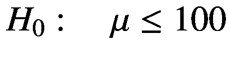

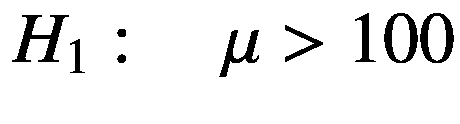

下一步是决定我们对自己的判断要有多少把握。假设我们最终认为这些大学学生的智力确实高于平均水平。在这种情况下，我们希望将所抽样的学生都来自校园智商最高群体的可能性降到最低。我们需要确定一个置信水平和阿尔法值。

## 确定置信水平

置信水平通常用字母 `c` 表示，它决定了我们需要对结果有多大的把握才能拒绝原假设。它告诉我们在备择假设变得比原假设更可能成立之前，检验统计量必须与 `μ` 偏离多少。如果我们决定要有 95% 的把握，那么

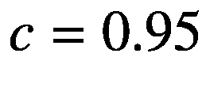

置信水平不仅能告诉我们拒绝和保留原假设的界限划在哪里，而且在向他人解释我们的决定时，它也能为我们的决策提供合理性依据。如果我们最终拒绝原假设，从而认为这些大学的学生比平均水平更聪明，那么置信水平为 0.95 就意味着我们至少有 95% 的把握认为这个决定是正确的。

## 确定阿尔法值

与置信水平相对的是阿尔法值，用希腊字母 `α` 表示。我们将其定义为

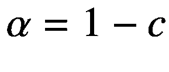

如果我们想要 0.95 的置信水平，那么 `α` 就是 0.05。置信水平规定了我们对结果的确信程度，而阿尔法则从相反的方向起作用。在这种情况下，它表示来自 `H[0]` 的分布产生一个比我们计算出的样本均值更极端的样本均值的概率只有 5%。

## 执行检验

我们决定置信水平为 0.95，这相应地意味着阿尔法值为 0.05。被抽样的学生得出的平均得分为 105。韦氏成人智力量表呈正态分布，其中 `μ = 100` 且 `σ = 15`。我们想知道，这个 WAIS 分布产生一个大于 105 的样本均值的概率有多大——即：

![$$ P\left[x&gt;105\right]=1-P\left[x&lt;105\right] $$](images/512351_1_En_5_Chapter/512351_1_En_5_Chapter_TeX_Equm.png)

如果这个概率小于 5%，那么我们就可以自信地拒绝原假设，并确认院长的说法很可能是正确的。代码清单 5-3 展示了一个小型的 Swift 程序，用于计算并打印我们想要的信息。

```
let numberOfStudents = 30.0
let WAISAverage = 100.0
let WAISSD = 15.0
let computedAverageScore = 105.0
let sdScalar = sqrt(numberOfStudents.realValue)
let normalDist = NormalDistribution(
mean: WAISAverage,
standardDeviation: WAISSD / sdScalar
)
let probability = 1 - normalDist.cdf(x: computedAverageScore)
let confidence = 1 - probability
let probString = String(
format: "%.2f",
probability * 100
)
let confString = String(
format: "%.2f",
confidence * 100
)
print(
"""
计算出的平均得分属于原假设的概率为 \(probString)%。
如果我们拒绝原假设，我们可以有 \(confString)% 的把握！
"""
)
// 输出：
// 计算出的平均得分属于原假设的概率为 3.39%。
// 如果我们拒绝原假设，我们可以有 96.61% 的把握！
```

代码清单 5-3

正如我们所见，在 WAIS 测试中平均得分达到 105 并不像人们可能想象的那样常见。如果我们选择拒绝原假设，我们犯错的概率只有 3.4%——这相应地意味着我们可以有大约 96.6% 的把握确定自己是对的。既然我们想要至少 95% 的把握，那么我们可以告诉院长，他们完全有理由为这些学生感到骄傲。

代码项目中的第 5 章包含一个名为 `IQHypothesisTest.swift` 的 SwiftUI 视图，它可以根据我们在不同字段中输入的值来计算并显示这个结果。请随意尝试一下，看看样本量、计算出的平均值以及原假设值如何影响我们拒绝 `H[0]` 这一决策的置信度。

## 确定 P 值

p 值是一个在文章、纪录片和报告中经常出现的术语。然而，理解它的含义及其为何有用可能颇具挑战性。利用我们在本章中学到的工具，我们应该能够理解它。

首先，我们将重温 alpha 值，它帮助我们划定了需要达到多不可能的值才能拒绝原假设的界限。在右尾检验中，alpha 值定义了图 5-6 中正态曲线下的阴影区域。

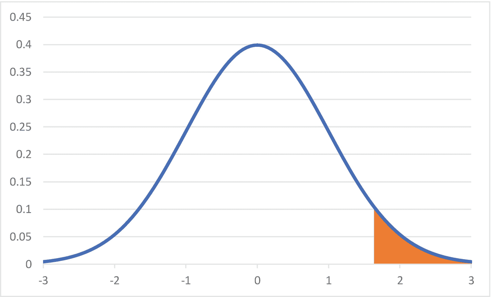

图 5-6

在右尾检验中，我们需要检验统计量足够远离均值（在水平 X 轴上），以便它进入橙色阴影区域。我们用 alpha 值来定义该区域的大小。

图 5-6 直观地展示了 alpha 值将“最极端”的值与分布的其他部分分开。如果是左尾检验，阴影区域将位于分布的左侧；而双尾检验则会在两侧都有阴影区域。

为了拒绝原假设，我们希望检验统计量落在阴影区域内。它需要足够极端，以至于能够拒绝对这个分布通过随机概率产生该结果的可能性。p 值是获得至少与我们自己的值同样极端的值的概率。对于图 5-6 中描绘的右尾检验，我们可以写成

![$$ P- Value=P\left[X&gt;\overline{x}\right]=1-P\left[X&lt;\overline{x}\right]=1- CD{F}_{N\left(\mu, \sigma \right)}\left(\overline{x}\right) $$](images/512351_1_En_5_Chapter/512351_1_En_5_Chapter_TeX_Equn.png)

由于左尾检验将分布的左侧视为极端值，计算 p 值的公式变为

![$$ P- Value=P\left[X&lt;\overline{x}\right]= CD{F}_{N\left(\mu, \sigma \right)}\left(\overline{x}\right) $$](images/512351_1_En_5_Chapter/512351_1_En_5_Chapter_TeX_Equo.png)

双尾检验的公式稍微复杂一些，因为我们需要考虑分布的两侧。然而，我们正在处理的分布是对称的，并且两个尾部的概率相同。因此，我们可以使用左尾两次：

![$$ P- Value=2\cdotp P\left[X&lt;\mu -\left|\mu -\overline{x}\right|\right]=2\cdotp CD{F}_{N\left(\mu, \sigma \right)}\left(\mu -|\mu -\overline{x}|\right) $$](images/512351_1_En_5_Chapter/512351_1_En_5_Chapter_TeX_Equp.png)

清单 5-4 中的代码展示了如何在一个易于使用的函数中实现此计算。

# 清单 5-4 — 使用 Swift 计算 p 值

```swift
enum TestTail {
case left, right, both
}
func pValue(
of x: Double,
mu: Double,
sigma: Double,
tail: TestTail
) -> Double {
let dist = NormalDistribution(
mean: mu,
standardDeviation: sigma
)
let leftProb = dist.cdf(x: mu - abs(mu - x))
return tail == .both
? 2 * leftProb
: leftProb
}
let sample = 105.0
let mu = 100.0
let sigma = 15 / sqrt(30)
let pValue = pValue(
of: sample,
mu: mu,
sigma: sigma,
tail: .right
)
print("P-Value for the dean's experiment: \(pValue)")
// 打印：
// 院长实验的 P 值：
// 0.033944520649489496
```

## 标准化

处理假设检验的一种常见方法是对检验统计量进行标准化。也就是说，我们将其转换，以便与某个标准分布进行比较。第 3 章提到了标准正态分布——一个均值为零、标准差为 1 的正态分布。如果我们总能使用同一组参数来检验假设，那就太好了。主要的好处是，`alpha` 值每次都会在相同的 X 轴值处画出拒绝线，而不是依赖于分布的具体形状。幸运的是，确实存在这样的标准化方法。

### 计算标准分数

标准分数，也称为 `z` 分数，是一个紧凑的公式，将我们的观测值转换为标准化的数字。它代表了原始分数与均值相差的标准差个数。如果我们将来自另一个正态分布的原始分数标准化，这也可以视为将原始分数和原始分布转换到标准正态分布。图 5-7 展示了这一思路的概念图。

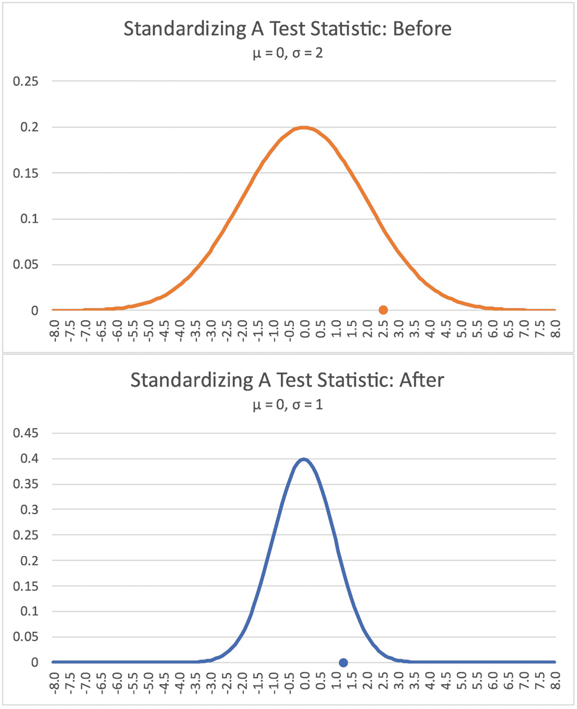

图 5-7

将 `z` 分数概念化为将原始分数及其原始正态分布转换到标准正态分布

我们将 `z` 分数定义为

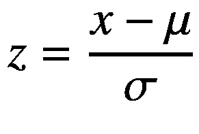

在这个公式中，`μ` 和 `σ` 是总体的均值和标准差。为之前的智力测试计算 `z` 分数，我们得到

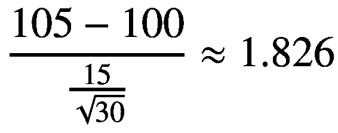

这个 `z` 分数告诉我们，学生产生的平均结果大约与分布均值相差 1.8 个标准差。现在，验证我们是否能拒绝原假设的任务，就归结为将其与某个 `alpha` 值的 `z` 分数进行比较。例如，右尾检验 `alpha` 值为 0.05 对应的 `z` 分数是 1.645。由于我们的检验统计量在此测试中获得了更高的分数，我们可以拒绝`H0`。

既然我们已经介绍了标准化和 `z` 分数，请随时返回本章的代码示例。尝试将检验统计量标准化，通过标准正态分布运行它，并确保结果相同。

> **注意**
>
> 使用 `z` 分数时结果可能略有不同。这种差异源于与计算机有限位宽相关的舍入误差。然而，这些误差非常小，可以忽略不计。

### 计算置信区间

`z` 分数不仅提供了一种方法，让我们能够对来自不同分布的数据使用相同的测量标尺进行检验，还让我们能够精确了解对检验结果的确信程度。

回到大学学生的例子，我们想知道对他们的平均智力分数的估计可能存在多大偏差。也就是说，我们想知道满足以下概率的 `μ` 的取值范围：

![$$ P\left[-z<\frac{x-\mu }{\sigma }<z\right]=c=1-\alpha $$](images/512351_1_En_5_Chapter/512351_1_En_5_Chapter_TeX_Equs.png)

通过对这个表达式进行一些代数运算，我们可以将其改写为：

![$$ P\left[\mu - z\sigma <x<\mu + z\sigma \right]=c=1-\alpha $$](images/512351_1_En_5_Chapter/512351_1_En_5_Chapter_TeX_Equt.png)

由于我们可以轻松找出与不同置信水平或 `α` 值相对应的 `z` 值，并且只关心 `μ` 在该表达式中的极限值，因此我们可以进一步将这个方程改写为：

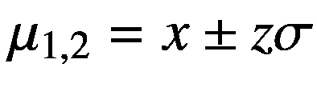

这个表达式看起来很简洁，但它正是我们为结果计算置信区间所需的一切。由于样本均值和总体标准差是常数，我们唯一需要调整的就是 `z` 值。假设我们想知道样本均值以 95%的确定性落在哪个范围内。由于这是一个双尾计算，我们需要将不确定性均等地分配到两侧，这意味着我们需要将 `α` 值除以 2。对应于 `α` 值为 0.025 的 `z` 分数是 1.96。因此，我们得到：

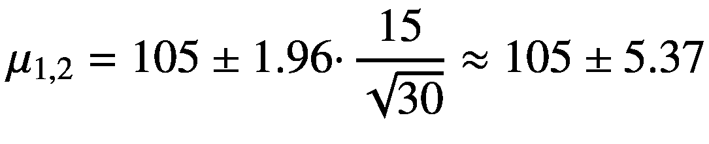

这个结果得出的范围是从 99.63 到 110.37，因此我们可以 95%地确信，我们学生的真实平均智力分数位于这两个数值之间。这项技术非常强大，因为它为我们提供了一种工具，可以确定如果我们从头开始进行这项检验，样本均值可能会落在哪里。

### 关于卡方检验的一点说明

卡方检验是另一类有用的假设检验，可以帮助我们确定，例如，某些测量数据与模型的拟合程度。我们使用的方法与本章节讨论的方法非常相似——我们设定零假设和备择假设，确定 `α` 值，然后进行检验。然而，要完全理解这些检验如何以及为何有用，我们需要理解卡方分布的工作原理，这本身可能就能单独写满一章。不过，欢迎你在后续学习中进一步深入了解这些主题。

### 章节总结

本章在理论方面内容较多。我们学习了什么是假设，以及如何为检验制定零假设和备择假设。我们学习了样本均值的分布，并了解了统计学中最重要的定理之一——中心极限定理。我们学习了如何定义置信水平、`α` 值以及计算 `p` 值，还学习了如何标准化检验统计量并为其计算置信区间。

下一章将是一个彻底的转向。理论概念会更加轻松且更易直观理解，我们将更多地关注代码方面的事情。是时候学习如何用统计学来压缩信息了。