# 6. 用于数据压缩的统计方法

统计方法不仅适用于核心数据科学领域，在更传统的计算机科学领域，比如压缩算法中，也有其应用。虽然通过机器学习进行压缩的研究仍在活跃进行中，但我们将探索、推导并实现一个更古老、基于规则的算法。

## 压缩简介

从高层次角度来看，压缩的概念非常直接。我们想要变换任意一段数据，使其占用更少的空间。这个数据占用的空间越小，我们以后为其他数据留出的空间就越多。我们将这种变换称为*压缩*。

我们不仅需要某种能使数据体积变小的算法，还希望这个过程在某种程度上是可逆的。一旦我们找到占用更少空间的表示形式，我们希望能够选择恢复原始数据。这种压缩阶段的逆向操作被称为*解压缩*。

举个例子，我们来分析一个简单的压缩算法。每当有人给我们一个数据块时，我们总是返回一个值为 `0xFF` 的单个字节。从压缩阶段看，这个算法表现惊人。我们可以给它 Netflix 的整个视频库，它也能将其压缩成一个字节。这令人印象深刻！然而，当我们进入解压缩阶段时，情况就变得相当糟糕了。无论输入是什么，该算法总是返回相同的压缩表示。如果有人给了我们这个字节并让我们解压缩它，我们将不知道它应该是一部动画电影、一份数字餐厅菜单，还是《权利法案》。这是一个非常糟糕的特性！要做好这一点，我们需要讨论一些与函数相关的数学性质。

## 函数行为

我们许多人可能已经知道，数学函数是一种将输入集合（称为*定义域*）中的元素映射到输出集合（称为*值域*）中元素的方法。定义域中的每个元素都需要映射到值域中的一个单一元素。如果定义域中的一个成员有多个映射或没有映射，那么它在数学意义上就不算是一个函数。图 6-1 展示了一个不符合函数定义的映射示例。

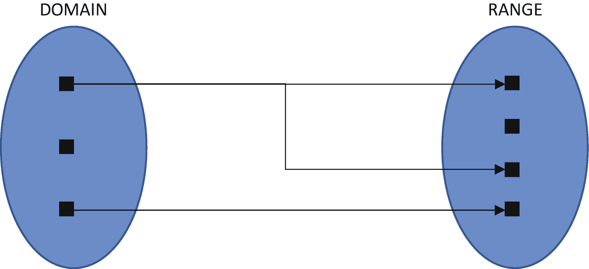

**图 6-1** 此映射不符合函数定义。并非所有定义域成员都映射到值域元素，而其他成员则具有多个映射。

既然我们知道了数学家如何定义函数，接下来就可以讨论这些映射的一些不同性质。假设我们有一个函数 `f(x)`，它将定义域 `X` 中的元素映射到值域 `Y`，那么我们可以说：

- 如果 `Y` 中的所有元素都被 `X` 中的某个元素所映射，则函数 `f(x)` 是`满射的`。这类函数的一个优点是集合 `Y` 中的所有元素都能被 `X` 中的某个元素所到达。然而，满射函数允许多个定义域成员映射到同一个值域成员，因此不同的输入可能会产生相同的输出。

- 如果值域 `Y` 中的一个成员只能被 `X` 中的单个元素所映射，则函数 `f(x)` 是`单射的`。具有此属性的函数永远不会将两个不同的输入映射到相同的输出。但是，值域中可能存在未被映射的元素，因此如果有人给我们一个输出元素，我们可能无法回溯并找到输入元素。

- 既是满射又是单射的函数 `f(x)` 被称为`双射`。一个双射函数将定义域中的所有元素映射到值域中不同的元素，因此存在完美的一一对应关系。双射函数的一个方便特性是存在一个反函数 `f-1(x)`，它能将 `Y` 中的元素映射回它们在 `X` 中对应的元素。

让我们看一个例子来直观理解这意味着什么。我们定义函数：

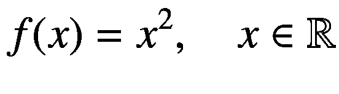

函数 `f(x)` 的定义域覆盖了整个实数轴。由于它只能产生非负数，因此其值域由非负实数组成。这个函数是满射的，因为 `f(x)` 可以从所有可能的输入中产生任何非负实数值。然而，该函数不是单射的。也就是说，该函数对定义域中的所有元素并不产生唯一的结果。例如，-1 和 1 产生相同的结果。正因如此，该函数也不是双射的。我们可以良好地定义的方式将所有可能的输入映射到输出空间，但我们没有一个反函数能够确定地将我们带回到原始输入。

现在，考虑以下函数：

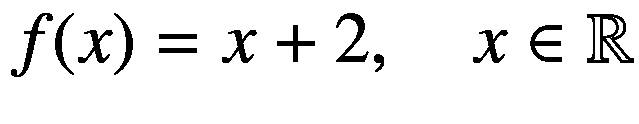

该函数的定义域和值域都是实数。我们可以看到它是满射的，因为它映射了值域中的所有成员。它也是单射的，因为所有定义域元素都产生唯一的结果。由于 `f(x)` 既是单射又是满射，因此它也是双射的，我们可以通过一些代数运算找到反函数 `f^(-1)(x)`。

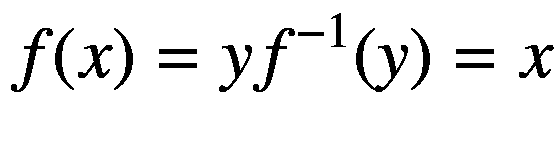

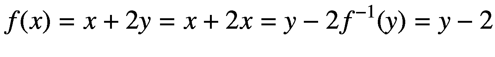

基于这个理论，双射是压缩算法的一个理想属性。当我们改变某些数据的表示形式，通常是变成一种不易于人类阅读的格式时，我们希望能够逆转该压缩过程并恢复原始信息。然而，有时我们也能接受函数只是“近似双射”，这是一个我们将接下来讨论的迷人话题。

## 无损压缩 vs. 有损压缩

任何压缩算法的一个关键方面是它是有损的还是无损的。也就是说，当我们解压缩时，我们得到的数据是与原来相同的，还是有所差异？让我们看一下图 6-2 中一个真正双射压缩算法的可视化表示。

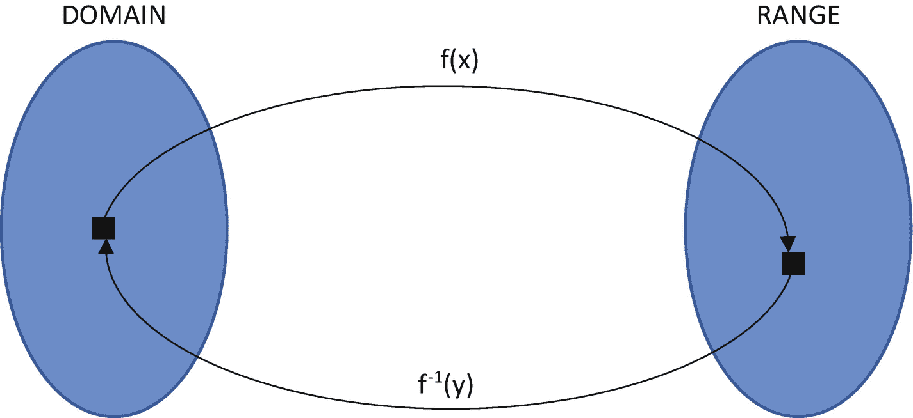

**图 6-2** 用于压缩定义域中数据点的函数有一个反函数，它允许我们在解压缩时恢复完全相同的信息。

图 6-2 中可视化的压缩函数是双射的，这意味着解压缩函数会给我们返回与压缩时完全相同的数据。表现出这种行为的算法通常被称为无损算法。一些使用无损压缩的格式示例包括：

- `bzip2`（通用）
- `FLAC`（音频）
- `WMA Lossless`（音频）
- `PNG`（图形）

在相反的一侧，我们有仅“近似双射”的压缩函数。虽然这不是一个普遍接受的术语，但它相当准确地描述了我们所要的行为。图 6-3 展示了此类函数背后的思想。

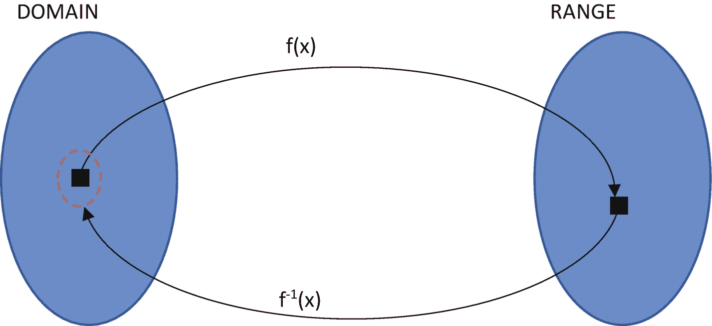

**图 6-3** “近似双射”函数不能保证在解压缩时重现完全相同的数据。相反，它会生成该数据点的近似值——一个根据我们选择的某种距离度量接近原始数据的点。

我们通常将这类函数称为有损压缩。假设我们可以接受可能无法再次重现原始数据的事实。在这种情况下，有损压缩算法通常能够提出一种比无损算法占用空间更小的数据表示。一些使用有损压缩算法的流行文件格式包括：

- `MP3`（音频）
- `WMA`（音频）
- `JPEG`（图形）
- `H.261`（图形）

既然我们已经更深入地了解了一些重要的压缩特性，接下来我们将深入探讨，实现一个基于哈夫曼编码的无损算法。

## 哈夫曼编码

大卫·A·哈夫曼是哈夫曼算法之父。该算法的核心思想是生成一串由 0 和 1 组成的序列，用以表示分布中的某个元素。这些序列需满足以下要求：

1. 每个元素在分布中都必须有唯一对应的序列。
2. 元素出现越频繁，其对应的序列长度应越短。
3. 我们确定的序列应能使所有元素序列的期望长度在分布上最小化。即要最小化表示完整数据集所需所有序列的总长度。

让我们通过为单词 `"Hello"` 中的每个字母生成哈夫曼编码来获得一些直观理解。表 6-1 显示了每个字母的出现频次。

**表 6-1** 单词 `"Hello"` 的字母频次

| 字母 | 频次 |
| --- | --- |
| H | 1 |
| E | 1 |
| L | 2 |
| O | 1 |

表 6-1 显示，字母 `l` 出现最频繁，而其他字母出现频率相同。因此，用较短序列表示 `l` 比表示其他字母更为重要。哈夫曼算法通过以下步骤构建一棵二叉树来生成这些序列：

1. 将每个元素及其关联计数值视为树中的叶节点。
2. 找出出现频率最低的两个节点。如果有多个节点频率相同，则随机选取一个。
3. 将这两个节点作为新树节点的子节点。新节点的频率等于其子节点频率之和。
4. 将新节点放回集合中。
5. 如果集合中仍不止一个节点，则返回步骤 2。如果只剩下一个节点，则该节点代表我们的哈夫曼树，算法结束。

按照该算法，单词 `"Hello"` 生成了一棵类似图 6-4 所示的树。

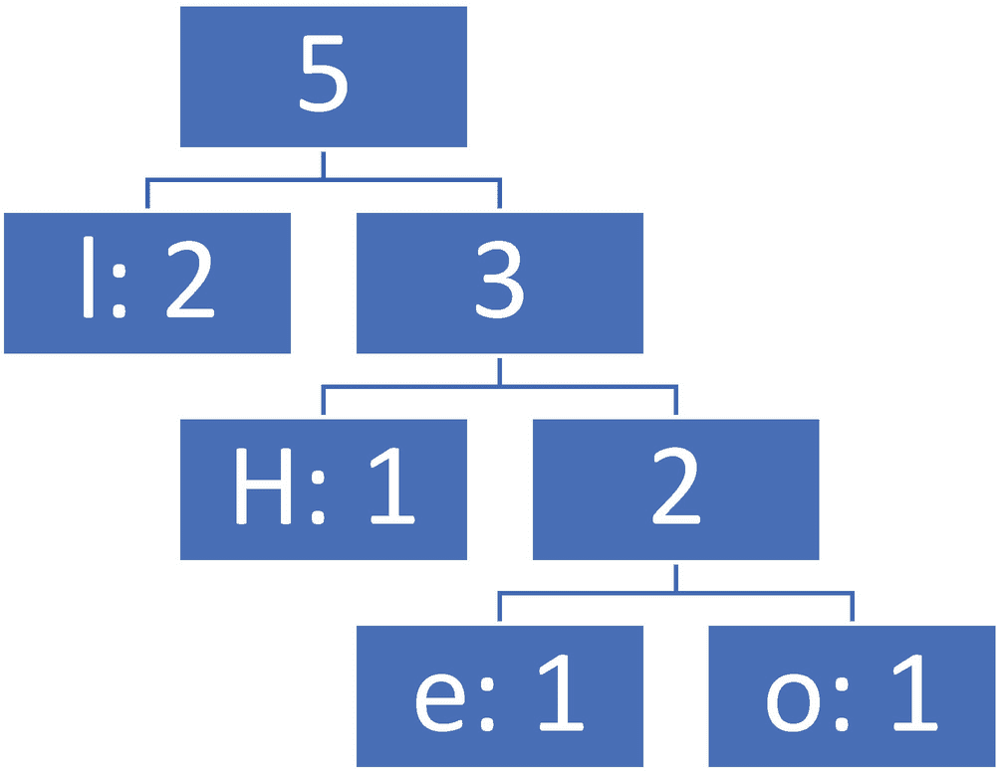

**图 6-4** 单词 `"Hello"` 的哈夫曼树示例。叶节点同时显示了所代表的字母和频次计数，而分支节点则显示从其子节点继承的总频次。

# 哈夫曼编码

现在我们已经建立了哈夫曼树，可以为每个叶节点生成编码。我们约定：沿左分支下行则在编码序列后添加 `0`，沿右分支下行则添加 `1`。由于只需沿左分支下行一次即可到达字母 `"l"`，它可以用编码 `"0"` 表示。而字母 `"e"` 位于树中更深位置，因此需要更长的序列 `"110"`。我们将此树生成的所有哈夫曼编码列于表 6-2 中。

**表 6-2** 图 6-4 中树生成的所有哈夫曼编码

| 字母 | 哈夫曼编码 |
| --- | --- |
| H | 10 |
| E | 110 |
| L | 0 |
| O | 111 |

最后，我们将这些编码按照原始字母的相同顺序排列。如此一来，`"Hello"` 就变成了 `"10 110 0 0 111"`。借助哈夫曼编码，我们仅用十位比特就能表示单词 `"Hello"`。一个原本需要五个字节存储空间的单词，在新表示法下仅需两个字节。这真是一个显著的改进！

## 存储哈夫曼树

在我们急于将整个硬盘压缩成哈夫曼编码之前，需要讨论解压的必要性。由于我们希望完美还原原始数据，因此还需要存储用于压缩的树。然而，这样做也会占用存储空间。在我们的示例中，一旦保存了这棵树，最终占用的空间很可能会超过原来的五个字节。若是如此，做这一切又有什么意义呢？

由于本示例的学习性质，我们故意让数据量很小。现实应用场景中，几乎不会出现压缩只包含单个单词的文本文件。相反，我们可能需要压缩大型视频文件或包含数百万行文本的日志文件。随着数据集规模的增长，存储哈夫曼树所需的空间可以忽略不计。例如，如果我们压缩一个巨大文件节省了几百兆字节，那么为这棵树多花几 KB 空间也无伤大雅。

**注意**：我们在前一个例子中计算的哈夫曼树并非唯一的完美解决方案。根据处理平局的方法不同，最终也可能得到一棵生成 4 个长度为 2 的编码的树。这两种树都能使表示单词所需的期望比特数最小化，但需要记住，某些输入可能存在多组最优哈夫曼编码集。

## 实现压缩算法

现在我们已经讲解了哈夫曼编码的概念，本章剩余部分将致力于实现一个基于这些思想的压缩算法。该实现将涵盖生成哈夫曼树、压缩一段 Lorem Ipsum 文本字符串、并将其与树一同放入二进制对象所需的所有步骤。同时也会涵盖逆过程，即从二进制表示中解析出哈夫曼树和已压缩文本。虽然压缩文本会尽可能进行空间效率优化，但我们不会对树的内存占用做同样程度的优化。不过，使用我们编码哈夫曼编码的相同技术，当然也能降低树的存储空间需求！

### 压缩阶段

让我们先来看一下用于压缩文本的主程序，如清单 6-1 所示。

```
let text = DataLoader.loadText(from: .huffman)
let coder = HuffmanTextCoder()
let compressed = try coder.encode(text)
```

清单 6-1 用于压缩示例文本的主程序

这个程序相对较小，因为所有的复杂性都隐藏在 `HuffmanTextCoder` 实例内部。我们使用 `DataLoader` 中的另一个加载函数来读取位于代码项目共享资源中的文本文件。然后，我们将加载的文本传递给 `encode(_:)` 函数，该函数以 `Data` 对象的形式返回一个压缩后的二进制表示。

要编码一个文本字符串，我们首先需要决定如何细分数据点。分割文本的方法有很多种。我们应该将其分割成句子、单词，还是字母？在本实现中，我们选择按字节处理。因此，霍夫曼树将为用于构造 UTF-8 编码字符串的所有八位模式构建编码，而压缩数据所需的编码步骤可以总结如下：

1.  统计文本中每个字节的频率以发现其分布。
2.  根据步骤 1 中提取的计数构建一棵霍夫曼树。
3.  创建该树的二进制表示，以便与压缩后的文本一起存储。
4.  使用步骤 2 中创建的树，为文本创建霍夫曼编码表示。
5.  将霍夫曼树的二进制版本与压缩后的文本连接成一个单一的二进制对象。

清单 6-2 展示了 `encode(_:)` 函数，它将上述每一步都委托给了独立的专业化方法。清单 6-3 展示了我们在编码或解码失败时使用的一个枚举。虽然我们在这个方法中没有显式地使用该枚举，但了解子程序在标有 `try` 关键字的调用中可能抛出的不同错误类型是有益的。

```
enum HuffmanError: Error {
    case emptyInputData
    case treeBuilderFailure
    case textEncodingFailure
    case textDecodingFailure
}
```

清单 6-3 用于表示压缩或解压缩期间可能抛出的错误的枚举

```
func encode(_ text: String) throws -> Data {
    let byteFrequencies = countBytes(in: text)
    let root = try createHuffmanTree(
        from: byteFrequencies
    )
    let treeData = createTreeData(from: root)
    var (encodedText, encodingSize) = try encodeText(
        text,
        with: root,
        frequencies: byteFrequencies
    )
    let encodingSizeData = Data(
        bytes: &encodingSize,
        count: MemoryLayout.size
    )
    return encodingSizeData + treeData + encodedText
}
```

清单 6-2 我们对 `HuffmanTextCoder.encode(_:)` 的实现

如清单 6-2 所示，我们逐步执行了之前列出的每个步骤。然而，代码中有一个我们尚未讨论的变量，即 `encodingSize`。它由将文本编码为霍夫曼编码二进制数据的方法生成，其目的在于让我们知道编码整条消息使用了多少位。

由于通用计算机中最小的可寻址构建块是字节，这限制了我们只能处理八位的倍数。然而，我们更有可能需要一个非标准大小的位数。例如，我们编码单词“Hello”需要十位，这要求我们分配两个字节。这两个字节包含 16 位，这意味着我们最终会在编码数据中得到六位未使用的位。现在想象一下，解码这两个字节的数据，却不知道有多少位包含了有效信息。我们能够正确地解码前 10 位。但是，我们也会解码最后六位，最终得到单词“Hellollllll”。由于这不是我们想要的，我们需要提示解码过程何时停止。我们没有发明一个停止序列，而是简单地将位数附加到编码数据的开头。

既然我们已经知道了最终的二进制对象是什么样子，那么让我们深入探讨实现这一目标的不同子程序。清单 6-4 展示了 `countBytes(in:)` 方法，它负责计算文本中字节的分布。

```
func countBytes(in text: String) -> [UInt8: Int] {
    var text = text
    return text.withUTF8 { pointer in
        pointer
            .reduce(into: [UInt8: Int]()) { dict, byte in
                dict[byte, default: 0] += 1
            }
    }
}
```

清单 6-4 `countBytes(in:)` 的实现，返回文本字符串内字节的分布

在上述方法中，发生的第一件事是使 `text` 参数变为可变的。由于我们不打算改变该字符串，所以这不是算法方面的硬性要求。相反，这是 `String` 类型本身强加的要求。因为指向字符串内容的指针允许我们修改其中的任何内容，所以我们不能将其用于不可变对象。

接下来，我们请求一个指向连续内存块的指针，该内存块保存了文本的字节内容。一旦我们获得了这个指针，我们就可以使用高阶函数来统计每个字节。`reduce(into:_:)` 方法会遍历存储中的每个字节，并用它来递增一个计数器。当迭代完成时，我们返回一个包含字节及其各自计数器变量的 `Dictionary`。我们使用 `UInt8` 类型表示字节，因此，如果我们将单词“Hello”输入到 `countBytes(in:)` 中，它将产生类似于 `[111: 1, 108: 2, 101: 1, 72: 1]` 的结果。在这个特定例子中，字节与单个字母的 ASCII 代码表示完美对应。然而，由于我们处理的是 UTF-8 编码的字符串，情况可能并非总是如此。

接下来，我们继续查看 `createHuffmanTree(from:)`，它根据我们刚计算出的分布构建一棵霍夫曼树。清单 6-5 展示了我们用于表示树中节点的枚举，而清单 6-6 展示了该方法的实现。

# 霍夫曼编码实现详解

## 树节点定义与构建

```
indirect enum HuffmanNode
where Value: Hashable & Comparable {
case node(left: HuffmanNode, right: HuffmanNode)
case leaf(value: Value, count: Int)
}
```
清单 6-5：我们用于表示树节点的 `HuffmanNode` 枚举

```
func createHuffmanTree(from freqs: [UInt8: Int])
throws -> HuffmanNode {
var nodes = freqs
.map { key, value -> HuffmanNode in
.leaf(value: key, count: value)
}
.sorted(by: >)
guard !nodes.isEmpty else {
throw HuffmanError.emptyInputData
}
while
nodes.count > 1,
let rhs = nodes.popLast(),
let lhs = nodes.popLast()
{
nodes.append(.node(left: lhs, right: rhs))
nodes.sort(by: >)
}
if let root = nodes.first {
return root
} else {
throw HuffmanError.treeBuilderFailure
}
}
```
清单 6-6：我们对 `createHuffmanTree(from:)` 的实现

在这些代码片段中发生了一些有趣的事情。首先，`HuffmanNode` 枚举是一个泛型类型，它允许我们为任何其他类型创建树，只要该类型符合 `Hashable` 协议和 `Comparable` 协议即可。

其次，我们使用 `indirect` 关键字标记了 `HuffmanNode`。这个关键字在撰写本文时并不常见，但它允许枚举递归地引用自身。在 `indirect` 出现之前，开发者不能使用值类型来创建图状结构。这一限制源于编译器计算不同类型内存占用方式。如果值类型引用自身，编译器会认为需要无限的内存来存储实例。得益于 `indirect` 关键字，我们现在可以像这样使用 `enum`。不过，`struct` 仍然会抛出编译错误。

创建树的算法首先将字节及其各自的计数映射到每个叶节点。然后，它将两个最小的节点分组为一个新的分支节点，从而构建一棵完整的树，直到集合中只剩下一个节点，即根节点。

需要注意的重要一点是，如果我们要对 `HuffmanNode` 实例进行排序，它们需要遵循 `Comparable` 协议。我们希望根据频率计数对节点进行排序。如果它们的计数相等，则根据字节值进行排序。这种回退行为并非绝对必要，但它能以可预测的方式打破平局，确保每次运行算法时，同一文本生成的霍夫曼树都相同。清单 6-7 和代码项目中的 `HuffmanNode+Comparable.swift` 文件显示了遵循 `Comparable` 协议所需的实现。

```
extension HuffmanNode: Comparable {
    static func < (lhs: HuffmanNode, rhs: HuffmanNode) -> Bool {
        switch (lhs, rhs) {
        case (.leaf(let lhsValue, let lhsCount), .leaf(let rhsValue, let rhsCount)):
            return lhsCount == rhsCount ? lhsValue < rhsValue : lhsCount < rhsCount
        default:
            return false
        }
    }

    static func == (lhs: HuffmanNode, rhs: HuffmanNode) -> Bool {
        switch (lhs, rhs) {
        case (.node(let lhsleft, let lhsright), .node(let rhsleft, let rhsright)):
            return lhsleft == rhsleft && lhsright == rhsright
        case (.leaf(let lhsValue, let lhsCount), .leaf(let rhsValue, let rhsCount)):
            return lhsValue == rhsValue && lhsCount == rhsCount
        default:
            return false
        }
    }
}
```
清单 6-7：使我们的 `HuffmanNode` 遵循 `Comparable` 协议

## 树的编码

现在我们有了霍夫曼树，是时候将树和文本都编码为二进制表示形式了。我们首先使用清单 6-8 中显示的 `createTreeData(from:)` 方法来编码树。

```
func createTreeData(
    from node: HuffmanNode
) -> Data {
    switch node {
    case .node(let lhs, let rhs):
        let left = createTreeData(from: lhs)
        let right = createTreeData(from: rhs)
        let branchMarker = Data(repeating: 0, count: 1)
        return branchMarker + left + right
    case .leaf(var value, var count):
        let valueData = Data(
            bytes: &value,
            count: MemoryLayout<UInt8>.size
        )
        let countData = Data(
            bytes: &count,
            count: MemoryLayout<Int>.size
        )
        let leafMarker = Data(repeating: 1, count: 1)
        return leafMarker + countData + valueData
    }
}
```
清单 6-8：将霍夫曼树编码为可与压缩文本一起存储的二进制表示形式

`createTreeData(from:)` 的递归性质使其成为一个相当简洁的方法。其核心思想如下：

-   如果将一个叶节点传入函数，我们只需返回一个二进制包，其中包含叶节点标记、频率计数以及与该节点关联的字节。

-   如果将一个分支节点传入函数，我们知道可以访问两个子节点。我们通过将它们传入递归方法调用来进行编码，然后返回一个分支节点标记，后跟左节点和右节点分别返回的数据。由于从树向下所有路径都保证会到达一个叶节点，我们可以确保递归会在某个有限的时间点终止。

正如我们之前提到的，如果想要节省更多空间，这部分实现还有改进的余地。每个标记向数据对象增加了整整一个字节，尽管从技术上讲我们可以用一个比特来表示它。只要稍微动动脑筋，发挥创意，就可以使用我们在以下方法中看到的相同思路重新实现 `createTreeData(from:)`。清单 6-9 展示了 `encodeText(_:with:frequencies:)` 的实现，它会创建文本的压缩二进制表示。

# 清单 6-9

## 使用计算出的霍夫曼树对文本字符串进行编码

```swift
func encodeText(
    _ text: String,
    with root: HuffmanNode,
    frequencies: [UInt8: Int]
) throws -> (data: Data, numberOfBits: Int) {
    let codes = root.codeMap()
    let numberOfBits = frequencies
        .reduce(into: 0) { result, args in
            let (byte, count) = args
            let mapping = codes[byte, default: (Data(), 0)]
            result += mapping.bitLength * count
        }
    let numberOfBytes = 1 + (numberOfBits - 1) / 8
    var encoding = Data(
        repeating: 0,
        count: numberOfBytes
    )
    var textVar = text
    var index = 0
    try textVar.withUTF8 { pointer in
        try pointer.forEach { byte in
            guard let (bits, bitCount) = codes[byte]
            else { throw HuffmanError.textEncodingFailure }
            for offset in 0 ..< bitCount {
                let mask: UInt8 = 0x80 >> (offset % 8)
                let masked = bits[offset / 8] & mask
                if masked > 0 {
                    encoding[index / 8] |= 0x80 >> (index % 8)
                }
                index += 1
            }
        }
    }
    return (encoding, numberOfBits)
}
```

这个函数使用了诸如位运算等底层编程概念，我们可以花另一本书来讨论其中无数的细节。然而，为传达核心概念，我们将从较高层次进行讨论。欢迎在代码项目中尝试实现，这将让你更深入地理解其中的小细节。

首先，`encodeText(_:with:frequencies:)`要求我们计算出的霍夫曼树创建一个所有编码的映射。我们不会详细讨论`codeMap()`方法，因为它只是将霍夫曼编码简化为`Dictionary`格式。编码映射的类型注解是`[UInt8: (Data, Int)]`，它将每个字节映射到其各自的霍夫曼编码和编码长度。

在下一步中，我们计算编码文本所需的总比特数。我们还将比特数转换为相应的字节数，并分配表示编码文本所需的内存。

和之前一样，我们需要一个指向原始文本的指针，并需要创建一个可变的版本。我们通过将其存储在一个新的`textVar`变量中来解决这一点。我们还创建了一个计数器变量`index`来跟踪当前正在编码的比特。现在，思路是遍历文本中的字节，检索其霍夫曼编码，并将每个 1 或 0 写入新的存储中。`for`循环相当直接，但让我们仔细看看这些位运算。

`mask`变量创建一个位掩码，用于定位霍夫曼编码中的单个比特。然后我们使用`mask`来计算`masked`变量，如果目标霍夫曼编码比特为 0，则`masked`为零；如果编码比特为 1，则`masked`非零。由于我们将`encoding`存储初始化为全零，因此只有当`masked`变量大于零时，我们才需要写入一个比特。在迭代结束时，我们递增`index`变量以指示可以继续处理下一个比特。

该函数随后返回`encoding`对象和我们用于编码文本的比特数，正如我们之前讨论的那样。此时，我们只需按正确顺序连接我们的计算结果，并将其返回给调用点。在主脚本中，我们可以打印原始文本的大小和压缩数据的大小以查看差异，如清单 6-10 所示。

# 清单 6-10

```swift
print(
    """
    Text size: \(text.utf8.count) bytes
    Data size: \(compressed.count) bytes
    """
)
// 输出：
// Text size: 12806 bytes
// Data size: 7331 bytes
```

压缩后的数据占用空间不到原始存储的 60%。这一结果令人印象深刻，尤其是考虑到我们已经确定这种表示方式在编码霍夫曼树时并非最优方法。

现在我们已经能够压缩任意文本字符串，接下来需要设计一个逆向算法。下一节将讨论并实现一个解压算法，将位数据还原为 UTF-8 字节。

### 解压阶段

在深入实现解压算法之前，我们先退一步，分析已编码数据对象的结构。

- 使用四个或八个字节指定编码文本所用的位数。具体字节数取决于平台：在 32 位平台上，`Int`占用 4 字节；在 64 位平台上则占用 8 字节。
- 不定数量的字节定义了用于编码原始文本的霍夫曼树。虽然无法精确知道其字节数，但可以确定它紧跟在指定位数的字节之后，并且其结构支持递归解包。
- 另外不定数量的字节包含编码后的消息。通过计算前两个数据段的大小，可以确定其在内存中的起始位置，并从中提取所有剩余数据。

通过将任务拆分为处理不同数据段的方法，我们可以定义`decode(_:)`方法，从`Data`对象中还原原始文本。清单 6-11 展示了这一实现。

# 清单 6-11

```swift
func decode(_ data: Data) throws -> String {
    let encodingSize = parseEncodingBitSize(data)
    var huffmanData = data[MemoryLayout.size...]
    let tree = parseTree(&huffmanData)
    let text = try parseText(
        from: huffmanData,
        using: tree,
        bitLength: encodingSize
    )
    return text
}
```

清单 6-11 中的代码完美反映了前文列出的不同数据段的解析过程。这种抽象使得步骤概览更清晰，并允许我们一次专注于单一任务。然而，它并未深入揭示底层实现细节，因此我们需要进一步探讨。清单 6-12 展示了`parseEncodingBitSize(_:)`，该函数读取编码文本的长度。

# 清单 6-12

```swift
func parseEncodingBitSize(_ data: Data) -> Int {
    data.withUnsafeBytes { pointer in
        pointer.load(as: Int.self)
    }
}
```

为了解析编码原始文本所用的位数，我们需要从压缩数据中读取前四个或八个字节。请求数据对象的指针相当直接。由于我们只关心读取内容而不修改，因此使用`withUnsafeBytes(_:)`方法，该方法提供只读缓冲区指针的访问。如果需要可变指针，则创建可变变量并使用`withUnsafeMutableBytes(_:)`。

返回的指针是一个`UnsafeRawBufferPointer`，它具有两个重要属性。首先，它不携带任何类型信息——这是原始指针的本质，它不知道包含何种内容。其次，它遵循`Collection`协议，这使我们能使用下标、元素计数和索引等众多实用操作。

要解析位数，我们使用函数`load(fromByteOffset:as:)`，该函数从指定的偏移量开始解析构成`Int`的字节数。在本例中，我们对`fromByteOffset`使用默认值 0，因此可以省略该参数。

解码完第一段数据后，接下来需要解码霍夫曼树。我们创建可变变量`huffmanData`，它包含除刚解析的字节以外的所有数据。并将新数据对象传递给`parseTree(_:)`函数，清单 6-13 展示了其实现。

## 清单 6-13
`parseTree(_:)` 的实现

```swift
func parseTree(
    _ data: inout Data
) -> HuffmanNode {
    let marker = data.first
    data = Data(data.dropFirst())
    switch marker {
    case 0:
        let left = parseTree(&data)
        let right = parseTree(&data)
        return .node(left: left, right: right)
    default:
        let (count, value) = data
            .withUnsafeBytes { pointer -> (Int, UInt8) in
                let count = pointer.load(as: Int.self)
                let value = pointer.load(
                    fromByteOffset: MemoryLayout<Int>.size,
                    as: UInt8.self
                )
                return (count, value)
            }
        let intSize = MemoryLayout<Int>.size
        let byteSize = MemoryLayout<UInt8>.size
        data = Data(data.dropFirst(intSize + byteSize))
        return .leaf(value: value, count: count)
    }
}
```

该方法首先从数据对象中获取第一个字节，该字节包含一个标记，用于指示我们正在解析的是分支节点还是叶子节点。然后，它通过丢弃标记字节来创建一个新的 `Data` 对象。通常不推荐像这样创建许多新对象，因为这可能会显著影响性能。问题来了：我们为什么还要这样做？

我们需要创建新的 `Data` 对象，这是由于我们打包树的方式带来的副作用。一方面，我们以紧凑的方式存储了标记、字节值和计数。虽然并非绝对紧凑，但不同信息之间没有间隙。另一方面，这种混合类型的打包方式违反了某些对齐约定。例如，`UInt8` 类型的对齐值为 1。如果在偏移量 0 处存储一个 `UInt8` 值，那么下一个合法的 `UInt8` 值存储偏移量是 0 + 1 = 1。对于 `Int64`，对应的对齐值是 8。只有将此类值存储在 8 的倍数偏移量（如 0、8 或 16）处才是合法的。我们的紧凑表示法就存在这个问题：我们在偏移量 0 处存储了一个 `UInt8` 大小的标记，而在偏移量 1 处存储了一个 `Int` 大小的计数变量。为了解决这个对齐问题，我们创建了一个新的 `Data` 对象，这实际上重置了偏移量，并将第一个元素置于索引 0 处。

> **注意**
> 如前所述，完全可以用不同方式存储树。一个简单修复方法是丢弃计数变量，因为它与解码过程无关。这样做会消除对齐问题，因为其余编码数据均为 `UInt8` 类型。欢迎尝试修改代码项目，看看还有哪些其他可行方案。

现在我们已经了解了编码此类二进制数据时可能遇到的问题，接下来看看 `parseTree(_:)` 的其余部分。我们根据标记判断当前节点是分支还是叶子。如果是分支节点，则递归调用 `parseTree(_:)` 解码左右分支，并将它们归入一个新的 `.node` 实例返回。反之，如果解析的是叶子节点，我们从指针中读取计数和字节值。然后，通过创建一个新的 `Data` 对象来解析未来可能出现的对齐问题，从而在解析完当前节点后重置索引。最后，返回该叶子节点。

最后但同样重要的是，我们来看一下解析编码文本消息的函数。清单 6-14 展示了其实现。

## 清单 6-14
`parseText(from:using:bitLength:)` 的实现

```swift
func parseText(
    from data: Data,
    using tree: HuffmanNode,
    bitLength: Int
) throws -> String {
    var textData = Data()
    if case .leaf(let value, _) = tree {
        textData.append(
            contentsOf: [UInt8](repeating: value, count: bitLength)
        )
    } else {
        var index = 0
        var currentNode = tree
        while index < bitLength {
            let byteIndex = index / 8
            let bitIndex = index % 8
            let mask: UInt8 = 1 << (7 - bitIndex)
            let step = data[byteIndex] & mask
            if case .node(let lhs, let rhs) = currentNode {
                currentNode = step > 0 ? rhs : lhs
            }
            index += 1
            if case .leaf(let value, _) = currentNode {
                textData.append(value)
                currentNode = tree
            }
        }
    }
    guard let text = String(
        data: textData,
        encoding: .utf8
    ) else { throw HuffmanError.textDecodingFailure }
    return text
}
```

`parseText(from:using:bitLength:)` 的第一部分检查了一个虽不常见但很重要的边界情况。如果原文只包含一个字节值，例如文件内容全是字母 T，那么树将是一个单独的叶子节点。在这种情况下，我们应生成一个重复单个字节 `bitLength` 次的 `Data` 对象。然而，如果根节点是分支节点，我们需要通过解析单个比特来计算正确的字节顺序。

我们初始化一个索引变量来跟踪当前正在解析的比特位。同时，我们还初始化一个变量，用于根据每个比特的值遍历树。如果遇到叶子节点，我们将字节值追加到名为 `textData` 的字节缓冲区中。但如果遇到分支节点，我们创建一个针对当前比特的掩码，并检查该比特是 0 还是 1。按照压缩阶段定义的规则，如果比特值为 0，则向左分支移动；否则向右分支移动。此时，递增 `index` 计数器，继续处理下一个比特。

解析完所有比特后，我们得到一个包含原始文本字节值且顺序正确的 `textData` 缓冲区。接着，我们可以使用专用的 `String` 类型初始化器 `init(data:encoding:)`，将解压后的数据转换为实际的文本字符串并返回。

为确保解压阶段能产生正确输出，我们可以将原始文本与经过压缩管道处理后的文本进行比较。清单 6-15 展示了主脚本的最后部分。

## 清单 6-15
解压验证

```swift
let decompressed = try coder.decode(compressed)
print(
    """
    解压文本与原文匹配：
    \(text == decompressed ? "是" : "否")
    """
)
// 打印：
// 解压文本与原文匹配：
// 是
```

### 清单 6-15
将解压输出与原始文本进行比较

尽管这远非一个完整的存储节省示例，但它仍然凸显了这些技术所能产生的惊人效果。如果一个简单的实现（存在前文讨论的问题和局限性）就能将体积减少 40%，那么可以想象更优化的版本能做到什么程度。

## 本章小结

本章重点放在实现方面。我们学习了函数及其一些属性，如满射、单射和双射。我们还引入了技术上不准确的“近似双射”概念，在不需要精确逆运算时可将其作为一个工具。

我们研究了霍夫曼编码以及如何通过二叉树生成它。还讨论了此类编码的唯一性问题，因为多棵树都可能使编码某些数据所需的比特数最小化。最后，我们实现了一个文本压缩工具，可以对文本文件进行压缩和解压。在此过程中，我们还涵盖了一些关于内存布局及其布局规则影响的底层计算机科学知识。

在下一章中，我们将结合本书中学到的许多概念，实现一个电影推荐系统。

# 7. 推荐系统中的统计方法

当我们登录网站或打开应用时，统计方法很可能会在幕后工作。它们可能正在推送我们可能感兴趣的内容，或展示我们可能想要购买的商品。所有这些算法的共同点是，它们利用过去的行为和已知的偏好，对我们可能喜欢的事物进行统计预测。在本章中，我们将构建一个推荐系统来推荐我们可能喜欢的电影。

## 推荐系统

推荐系统的核心，是一种试图预测用户偏好的系统。这类系统广泛存在于各类网店、社交媒体平台和流媒体服务中。以下是一些推荐系统实际应用的例子：

- Netflix 主页会推荐一批我们可能喜欢的电影。
- YouTube 会显示一系列可能引发我们兴趣的视频片段。
- LinkedIn 和 Facebook 会向我们推荐可能想要联系或交友的人。
- Twitter 会展示我们不熟悉但发布的内容可能合我们口味的人。
- Amazon 会推荐我们可能感兴趣购买的其他产品。

上述例子只是最突出的几个案例，但要点很明确——推荐系统无处不在，它们影响着我们如何花费时间、金钱和注意力。

### 推荐系统的功能

我们开发推荐系统的原因有很多，其中一些原因比其他原因更显而易见。让我们先来看看“为什么”，这样我们以后就能更好地理解“怎么做”。

首先，好的推荐能提高追加销售的可能性。一家能对附加产品做出良好推荐的在线商店，更有可能售出额外的商品。例如，想象我们在某家线上电子商店的购物车里放了一台电视。商店可以通过建议购买一包遥控器用的电池、一些屏幕清洁湿巾或一个壁挂支架来多赚一点钱。对于正在购买电视的人来说，展示这些东西似乎都是不错的选择。然而，如果他们展示的是电脑或咖啡机，可能就没那么幸运了。当然，顾客也可能恰恰在寻找这些东西，但这似乎是一场没有把握的赌注。

其次，好的推荐能让顾客有宾至如归的感觉。我们都曾有过这种感觉：当某个网站建议我们购买完全离谱的产品时。这种感觉甚至可能导致潜在客户离开网站，并且再也不回来。一个能做出恰当推荐的服务会让用户感到被看见、被理解，从而提升使用体验。按照这个逻辑，一个完善的推荐系统既服务于销售产品的公司，也服务于使用它的顾客。例如，如果 Netflix 的应用只是随机推荐任何类型的电影，它就不会拥有同样规模的忠实观众。

### 解决问题的方法

做出这样的推荐绝非易事，而且这个领域有大量正在进行的研究。本章将采用与推导线性回归公式时类似的路径。我们会从一个简单但略显幼稚的推荐电影规则开始，讨论其影响，然后加以改进。最后，我们将得到一种名为`协同过滤`的方法，并实现它来为用户推荐电影。

#### 第一种方法

我们推荐电影的第一条规则是：随机挑选一些电影，不管它们的类型或评分如何。这条规则易于理解和实现，因此在复杂性方面很有吸引力。然而，这种方法存在一些固有的问题。

- 我们选到差评电影和好评电影的概率是相同的。正因如此，我们很可能会推荐一批质量参差不齐的电影。另一个问题随着我们做出越来越多推荐而出现。随着时间的推移，我们推荐的好电影和差电影的分布将趋向于所有可用电影的评分分布。这意味着，如果可用的差电影数量更多，我们推荐的差电影就会比好电影多。这真是一个大问题！
- 我们选到任何类型电影的概率也是相同的，这会引发与前一个要点类似的问题。即使用户只对一两种类型感兴趣，我们也会推荐来自不同类型电影。这种选择同样会遵循类型的总体分布，因此如果可用的剧情片更多，我们就会推荐更多的剧情片。

正如我们所见，第一种方法的简单性带来了一些严重的问题。如果系统推荐不符合用户偏好的电影，用户可能会放弃使用该服务。为了缓解这些问题，我们建议进行两项改进：

1. 在推荐时，我们应该考虑电影的评分，评分越高的电影被选中的可能性应该越大。
2. 在选择时，我们也应该考虑电影的类型。如果用户指定了他们只喜欢恐怖片，那么推荐纪录片或剧情片就没有什么意义，甚至毫无益处。

#### 第二种方法

为了缓解与第一种方法相关的一些问题，我们根据建议的改进更新了选择规则。这一次，我们首先过滤掉所有未标有用户偏好类型的电影。过滤之后，我们选择那些评分最好的电影。这种方法稍好一些，因为我们只推荐用户喜欢的类型中评分高的电影。然而，这种方法还存在其他更微妙的问题：

- 用户可能会错过其他相关类型的电影。例如，即使他们只选择了恐怖片作为偏好，但他们很有可能也会喜欢一些惊悚片。
- 这种方法也将集体意见置于用户自己的判断之上。由于我们选择评分高的电影，我们可能会推荐一部与用户不喜欢的另一部电影相似的作品。例如，向一位不喜欢第一部《惊声尖叫》的用户推荐《惊声尖叫 2》很可能是一个糟糕的选择，即使大多数其他用户给了它好评。

尽管这种方法似乎比第一种更好，但它仍然存在几个我们想要解决的恼人缺陷。我们需要一种方法，它不那么看重精确的类型，而更关注我们到底喜欢和不喜欢哪些电影。为了解决这个问题，我们引入`协同过滤`的概念。

## 最终方法

在研究这个问题的最终方法时，我们不妨设想一下：在流媒体服务出现之前，我们会向谁寻求电影推荐。我们可能有一些朋友，与我们口味相投，他们推荐的内容很可能正中我们下怀。这正是协同过滤的核心思想。如果某人在某个话题上与 X 先生/女士意见一致，那么相比随机选中的另一个人，X 更有可能在另一个话题上与其观点相同。

为了让这一概念更具体，我们想象一下：安娜和佐伊已经看过《惊声尖叫》前两部并给出了评分，而尼克只看过第一部。我们可以将他们的评分整理成表 7-1 所示的形式。

**表 7-1** 三位观众对电影的评分

| | 《惊声尖叫》 | 《惊声尖叫 2》 |
| --- | --- | --- |
| 尼克 | 好 | ? |
| 安娜 | 好 | 好 |
| 佐伊 | 差 | 差 |

基于这些评分，尼克应该向谁咨询是否观看《惊声尖叫 2》呢？更好的选择可能是问安娜，因为她和尼克对第一部电影的看法一致。由于佐伊不喜欢《惊声尖叫》，她的偏好很可能与尼克不同，她的建议可能与尼克的喜好不太吻合。

通过将这一思路扩展到所有服务用户，我们便得到了推荐系统的一个可行方案。这样一来，为用户推荐一部电影就归结为以下几个步骤：

1. 找到一定数量与提出推荐请求的用户评分相似的其他用户。
2. 根据这些相似用户的评分，计算所有电影的预期评分。
3. 推荐预期评分最高的电影。

要执行这些步骤，我们首先需要确定如何计算两个用户之间的相似度。下一节将介绍两种常用方法。另外需要注意的是，当有大量其他用户可供比较时，协同过滤的效果很好，因为其他人喜欢相同东西的可能性更大。但试想一下，如果服务中只有两个用户，且他们喜欢的东西完全不同，由于缺乏数据，算法就不得不向喜欢不同电影的用户征求意见了。

另一种不依赖其他用户的方法是`基于内容的过滤`，它完全专注于提出推荐请求的用户对其他电影的评分。本教程不对此方法进行详细讨论，但值得读者在进一步学习时深入了解。

### 相似度衡量

顾名思义，相似度衡量是一种确定两个对象相似程度的方法。可用的衡量方法数不胜数，我们需要仔细思考设计它们的原因和方式。这里将讨论两种衡量方法：其中一种对我们试图解决的问题没有帮助，而另一种则更合适。重点是展示如何对这些计算进行推理，以便为未来的问题选择合适的衡量方法。

#### 余弦相似度

余弦相似度通过考察两个特征向量之间的夹角来衡量相似性。它的实现方式是计算评分向量在彼此上的投影程度。我们可以从欧几里得点积公式推导出两个非零向量 **A** 和 **B** 之间余弦相似度的公式。

```
A·B = ||A|| ||B|| cos θ
```

```
CosSim(A, B) = cos θ = (A·B) / (||A|| ||B||)
```

该公式得出的结果是一个介于 -1 和 1 之间的实数，具体数值取决于两个向量的相似程度。如果它们指向大致相同的方向，相似度得分会趋向于 1；如果方向相反，则得分趋向于 -1。在我们的案例中，最低得分为 0，因为我们不能给电影评负分。

为了使讨论更具体，假设有四个人根据下一页的表 7-2 对两部电影进行评分。

**表 7-2** 四人对两部电影的评分示例

| | 电影 1 | 电影 2 |
| --- | --- | --- |
| **泰勒** | 5 | 5 |
| **莎拉** | 5 | 5 |
| **迈克** | 5 | 1 |
| **简** | 1 | 1 |

从这些评分来看，我们期望相似度衡量方法能得出：泰勒与莎拉非常相似，与迈克略有相似，但与简完全不相似。然而，经过计算，我们得到以下结果：

CosSim(泰勒, 莎拉) = (5·5 + 5·5) / (√50·√50) = 1

CosSim(泰勒, 迈克) = (5·5 + 5·1) / (√50·√26) = 0.832

CosSim(泰勒, 简) = (5·1 + 5·1) / (√50·√2) = 1

这不是我们想要的结果。这种相似度衡量方法认为泰勒和简与泰勒和莎拉一样相似。让我们绘制出向量来理解原因。图 7-1 将它们展示为图表中的箭头，其中电影 1 的评分绘制在 X 轴上，电影 2 的评分绘制在 Y 轴上。

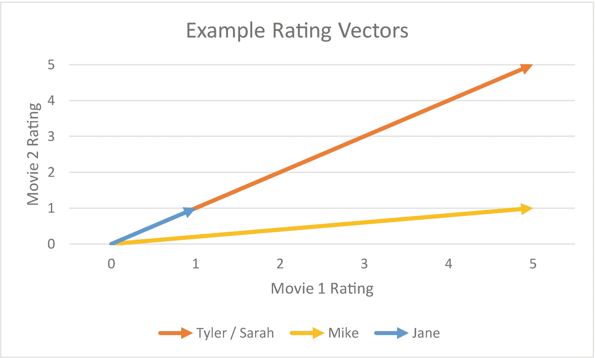

**图 7-1** 电影 1 和电影 2 的示例评分绘制为二维向量

这张图清楚地说明了问题所在。尽管泰勒和莎拉的评分与简的评分相差很大，但它们产生的向量却是平行的。由于余弦相似度只关心向量间的夹角，因此它认为泰勒和简的评分非常相似，而迈克的评分则与其他人的评分不完全相似。

我们不会在实现中使用这种相似度衡量方法，因为它的表现不符合我们的预期。然而，这个例子确实突显了仔细思考如何定义对象相似性的重要性。某个度量标准起初看似合理，但最终可能会给我们的计算带来严重问题。在这种情况下，我们最终可能会向泰勒推荐简最喜欢的电影，而这很可能是糟糕的选择。现在我们已经了解了可能出现的问题，接下来定义一个效果更好的相似度度量标准。

## 欧几里得距离

**欧几里得距离**，也称为**毕达哥拉斯距离**，表示两点之间直线路径的长度。通过将每个电影评分向量想象成一个点，我们可以使用该公式计算这些点之间的距离，从而最终衡量两个用户的相似度。两个列向量 `A` 和 `B` 的欧几里得距离定义如下：

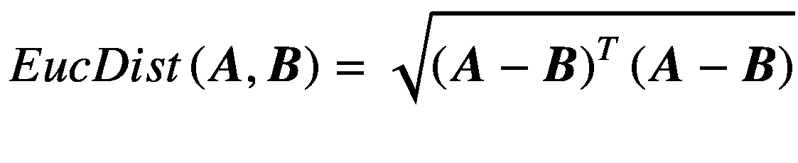

通过此公式计算示例用户的相似度，我们得到以下结果：

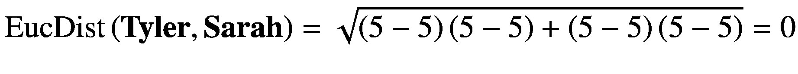

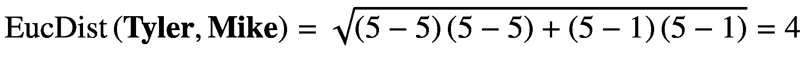

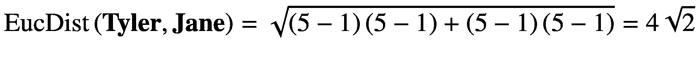

这些结果看起来比之前的相似度度量好多了。该公式与余弦相似度的另一个不同之处在于，两个向量差异越大，它产生的数值就越大。这本身并不是问题；只是我们在设计算法时需要注意的一点。

### 欧几里得平方距离

**欧几里得平方距离**是一种计算上简化的度量方式。它与欧几里得距离的唯一区别在于，它省去了最后的平方根计算，因此变为：

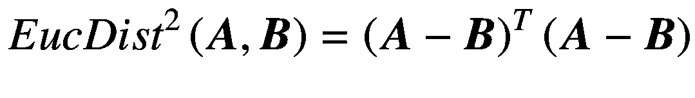

需要注意的一点是，这种简化之所以成立，完全是因为它保持了元素的相对顺序。假设我们有两个数字——`x` 和 `y`。那么以下关系成立：

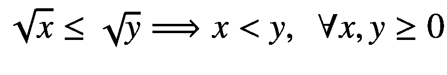

对于计算机来说，计算平方根是一项成本较高的操作。如果能省去，我们当然会这样做！由于省去平方根不会改变两个数的相对顺序，因此我们可以通过跳过这一步来节省一些计算资源。

让我们快速计算一下示例用户之间的相似度，来验证这个新的计算方法：

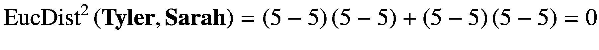

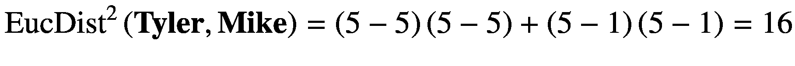

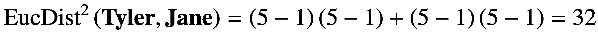

结果看起来不错。泰勒(Tyler)与莎拉(Sarah)最相似，与简(Jane)最不相似。然而，我们还需要处理一种边缘情况。

我们的服务在数据库中拥有大量的电影收藏。并非所有用户都看过所有电影，更不用说给它们全部评分了。当某些评分缺失时，我们需要决定如何处理这些计算。

由于数据中的评分 0 代表缺失评分，从数值角度看，并无阻碍我们像这样计算欧几里得平方距离的障碍。不过，我们很可能会遇到一些不一致的情况。

-   如果我们比较两个还没有机会评任何分的新用户，数据会将他们所有可能的评分都显示为零。我们的计算会将其解读为这两个用户非常相似，尽管我们根本不知道这是否属实。
-   想象一下，我们将一个没有任何评分的新用户与两个老用户进行比较。假设其中一个老用户给所有电影都打了 1 分，而另一个则都打了 5 分。我们的算法会认为新用户与那个给所有电影打 1 分的用户更相似，因为两者之间的欧几里得平方距离更短。然而，我们并不知道哪个用户与新用户更相似。

我们在此实现中选择的解决方案是将缺失评分视为不确定性。如果一个或两个用户都没有对某部电影进行评分，我们将其中一个评分计为 0，另一个计为 5。这样，缺失评分会增大距离度量值，使得用户之间的相似度略微降低。

现在我们已经知道如何判断哪些用户相似，是时候处理下一个任务了。我们需要以某种方式推荐用户可能会喜欢的电影。

## 期望评分

在进入本节之前，让我们花一点时间回顾一下评分数据的结构。我们服务的用户关联着以下信息：

-   唯一的用户 ID。
-   对所有可用电影的评分集合。
-   评分是介于 1 到 5 之间的整数值。如果用户尚未对某部特定电影进行评分，则其默认评分为 0。

要计算某部电影的期望评分，我们可以使用在第 [3](https://wiki.example.org/512351_1_En_3_Chapter.xhtml) 章学到的公式：

![$$ \mathbbm{E}\left[R\right]=\sum \limits_{r\in R}r\cdotp p(r) $$](images/512351_1_En_7_Chapter/512351_1_En_7_Chapter_TeX_Equo.png)

虽然这个公式在技术上正确，但我们不能简单地按原样实现它。我们组织数据的方式迫使我们稍作扩展，以便进行合理的计算。让我们从一个改动开始，这个改动不会直接影响数学表述，而是影响每个评分概率的计算方法。

### 拉普拉斯平滑

让我们来看一下电影《大鱼》所有评分的分布情况，如图 7-2 所示。这个分布基于数据集中所有 800 名用户的评分。

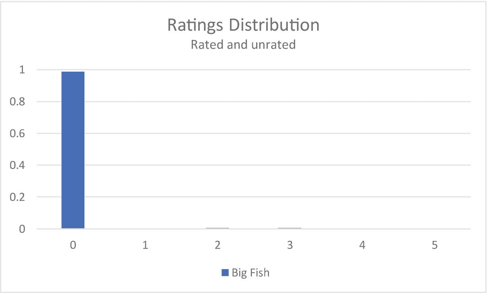

*图 7-2 电影《大鱼》所有评分的分布*

可以看出，大多数用户尚未给这部电影评分。准确来说，98.6%的用户还没有为《大鱼》提供评分。这一观察结果很重要，因为它将在后续步骤中发挥重要作用。不过现在，我们先关注那些已经评分的用户。图 7-3 展示了已提供评分的用户对应的条形图。

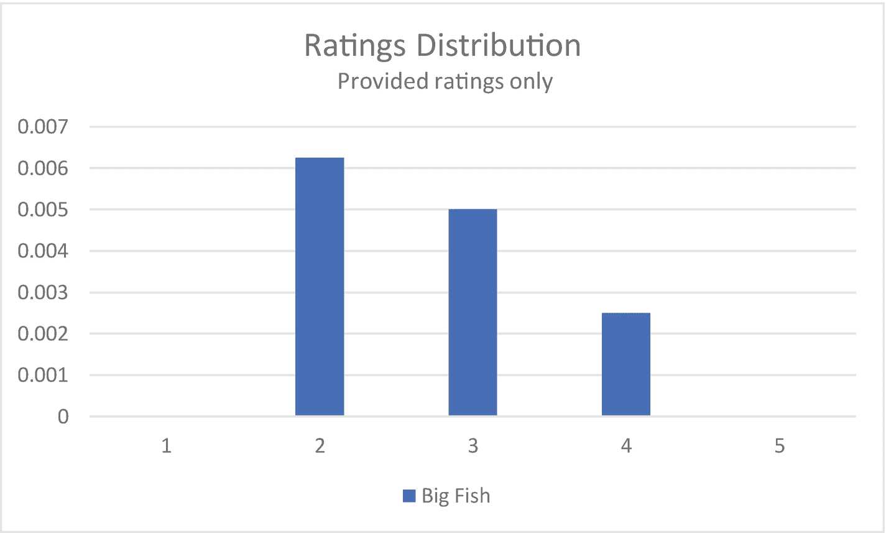

*图 7-3 电影《大鱼》的评分分布（不含未评分标记类别）*

这张图让我们更清楚地看到实际情况。大多数用户的评分似乎集中在中间区域。没有一个用户给这部电影打 1 分或 5 分。如果我们直接将这些概率输入算法，本质上就是告诉算法，用户永远只会给 2 分、3 分或 4 分，而打出 1 分的概率为 0%。但合理的想法是，可能存在用户会打 1 分，只是我们尚未遇到这样的用户。因此，我们需要设计一种算法，确保所有评分结果都有非零概率。这就引入了拉普拉斯平滑。

拉普拉斯平滑的思路是，让分布稍微向均匀分布方向倾斜。做法是引入一个*伪计数*，这也是该方法有时被称为*加法平滑*的原因。为每个样本点添加伪计数，可以确保所有样本点都具有非零概率。我们来看一个例子，帮助理解这一概念。

假设我们掷十次骰子，表 7-3 展示了每个数字出现的次数。

*表 7-3 十次掷骰子的结果统计*

| 结果 | 次数 |
| --- | --- |
| 1 | 2 |
| 2 | 3 |
| 3 | 2 |
| 4 | 0 |
| 5 | 2 |
| 6 | 1 |

看起来这一轮我们掷出了不少 2 点，但一次 4 点都没有。如果据此近似估算每个结果的概率，我们会得到以下结果：

![$$ P\left[X=1\right]=\frac{2}{10}=0.2 $$](images/512351_1_En_7_Chapter/512351_1_En_7_Chapter_TeX_Equp.png)
![$$ P\left[X=2\right]=\frac{3}{10}=0.3 $$](images/512351_1_En_7_Chapter/512351_1_En_7_Chapter_TeX_Equq.png)
![$$ P\left[X=3\right]=\frac{2}{10}=0.2 $$](images/512351_1_En_7_Chapter/512351_1_En_7_Chapter_TeX_Equr.png)
![$$ P\left[X=4\right]=\frac{0}{10}=0.0 $$](images/512351_1_En_7_Chapter/512351_1_En_7_Chapter_TeX_Equs.png)
![$$ P\left[X=5\right]=\frac{2}{10}=0.2 $$](images/512351_1_En_7_Chapter/512351_1_En_7_Chapter_TeX_Equt.png)
![$$ P\left[X=6\right]=\frac{1}{10}=0.1 $$](images/512351_1_En_7_Chapter/512351_1_En_7_Chapter_TeX_Equu.png)

在前面的章节中，我们计算过公平骰子每个面朝上的真实概率约为 16.66%，因此上述某些结果偏差很大。我们的估算显示掷出 2 点的概率为 30%，而掷出 4 点的概率则为零。对于掷骰子这种情况，我们可以轻松地重复实验多次来获取更多信息。但在电影评分的情况下，事情就没那么简单了。因为影片有 2000 部，而用户只有 800 个，所以大多数影片的某个评分值很有可能出现零计数。这就称为数据*稀疏*。

为了缓解这个问题，假设我们为表 7-3 中的每个结果都添加一个伪计数 1。现在总共有 16 个数据点，从而得到以下新的概率：

![$$ P\left[X=1\right]=\frac{3}{16}=0.1875 $$](images/512351_1_En_7_Chapter/512351_1_En_7_Chapter_TeX_Equv.png)
![$$ P\left[X=2\right]=\frac{4}{16}=0.25 $$](images/512351_1_En_7_Chapter/512351_1_En_7_Chapter_TeX_Equw.png)
![$$ P\left[X=3\right]=\frac{3}{16}=0.1875 $$](images/512351_1_En_7_Chapter/512351_1_En_7_Chapter_TeX_Equx.png)
![$$ P\left[X=4\right]=\frac{1}{16}=0.0625 $$](images/512351_1_En_7_Chapter/512351_1_En_7_Chapter_TeX_Equy.png)
![$$ P\left[X=5\right]=\frac{3}{16}=0.1875 $$](images/512351_1_En_7_Chapter/512351_1_En_7_Chapter_TeX_Equz.png)
![$$ P\left[X=6\right]=\frac{2}{16}=0.125 $$](images/512351_1_En_7_Chapter/512351_1_En_7_Chapter_TeX_Equaa.png)

引入伪计数后，我们不再认为掷出 4 点是不可能的了。事实上，如果我们给表 7-3 中的结果添加无穷大的伪计数，结果会趋近于真实分布。不过，大多数分布并非均匀分布。这意味着我们不能给每个电影评分都添加一个巨大的数字，并指望得到好的结果。我们将采用一个伪计数 1。这足以消除零概率，同时不会过度扭曲原始分布。

### 评分概率

我们刚刚制定了一种策略，用于处理稀疏数据中经常出现的零概率问题。现在，让我们来看一种近似计算评分概率的方法。回想一下，我们使用以下公式定义了期望评分：

![$$ \mathbbm{E}\left[R\right]=\sum \limits_{r\in R\ }r\cdotp p(r) $$](images/512351_1_En_7_Chapter/512351_1_En_7_Chapter_TeX_Equab.png)

这里我们重点关注`p(r)`这一项。假设一部电影只收到一个评分，即 4 分。运用我们刚学到的拉普拉斯平滑技术，我们可以通过以下计算来近似每个评分的概率：

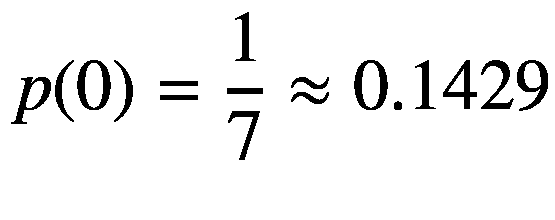

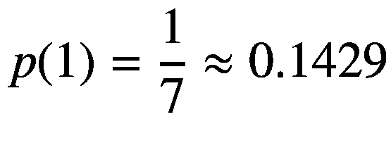

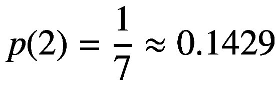


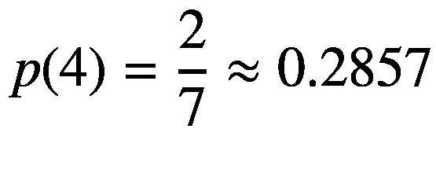

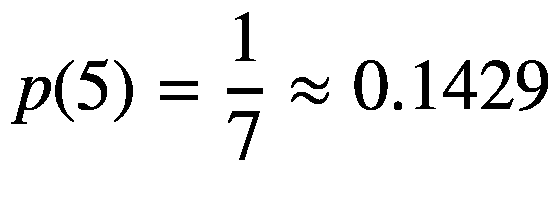

这些结果看起来不错，但有一个需要解决的微妙问题。我们对评分的定义与我们构建数据的方式并不一致。请记住，零评分只是一个占位符，表示用户没有对该电影进行评分。在这种情况下，我们实际上是通过包含非评分项来稀释每个评分的概率。

为了解决这个问题，我们将借助贝叶斯牧师（Rev. Bayes）和他的定理。回想一下，我们这样表述贝叶斯定理：

![$$ P\left[A\ |\ B\right]=\frac{P\left[B\ |\ A\right]\cdotp P\left[A\right]}{P\left[B\right]} $$](images/512351_1_En_7_Chapter/512351_1_En_7_Chapter_TeX_Equai.png)

由于我们要寻找的是在评分大于零的条件下某个评分的概率，我们可以运用贝叶斯定理进行如下推导：

![$$ P\left[r\ |\ r&gt;0\right]\cdotp P\left[r&gt;0\right]=P\Big[r&gt;0\ \left|\ r\right]\cdotp P\left[r\right] $$](images/512351_1_En_7_Chapter/512351_1_En_7_Chapter_TeX_Equaj.png)

通过整理这个等式，我们可以分离出真正感兴趣的项，即`p(r | r > 0)`：

![$$ P\left[r\ |\ r&gt;0\right]=\frac{P\left[r&gt;0\ |\ r\right]\cdotp P\left[r\right]}{P\left[r&gt;0\right]} $$](images/512351_1_En_7_Chapter/512351_1_En_7_Chapter_TeX_Equak.png)

上述等式才是我们真正想要的概率——在给定评分是真实评分（而非占位符）的条件下，该评分的概率。让我们逐一分析右边的每一项，看看计算它们需要什么。

*   `P(r > 0 | r)`：对于所有真实评分，这一项为 1，因为如果评分不是占位符，那么它肯定大于零。同理，对于所有占位符，这一项为零。由于占位符本身为零，我们可以从等式中去掉这一项。在这两种情况下，它都不会产生影响。

*   `P(r)`：这一项是通过拉普拉斯平滑得到的近似概率。我们有一种方法可以基于数据计算所有电影的此项比例。

*   `P(r > 0)`：评分大于零的概率也可以通过拉普拉斯平滑得到。我们可以将所有大于零的评分的概率相加，或者用 1 减去零评分的概率。

根据这个推理，我们可以将期望评分的公式重写为：

![$$ \mathbbm{E}\left[R\right]=\sum \limits_{r\in R}r\cdotp p\left(r\ |\ r&gt;0\right)=\sum \limits_{r\in R}r\cdotp \frac{p(r)}{p\left(r&gt;0\right)} $$](images/512351_1_En_7_Chapter/512351_1_En_7_Chapter_TeX_Equal.png)

就是这样。我们得出了一个可以计算期望评分的公式。借助相似度度量和拉普拉斯平滑，我们已经准备好实现一个电影推荐算法。

## 实现算法

本节将介绍如何用 Swift 实现我们刚刚在本章推导出的推荐算法。我们还将了解 Accelerate 框架中的一个新模块。我们将使用`vDSP` API，而不是用 CBLAS 和 LAPACK 进行线性代数运算。`vDSP`提供了与数字信号处理和科学数据处理相关的功能，提供了用于处理向量、傅里叶变换、卷积以及许多其他任务的工具。

### 主程序

在深入细节之前，我们先来看一下主程序，以熟悉其整体结构。清单 7-1 展示了其实现。

```

```markdown
var raters = DataLoader.load(
    MovieWatcher.self,
    from: .movieRatings
)
let user = raters.remove(at: 0)
let recommendations = MovieRecommender
    .recommend(
        movies: 5,
        for: user,
        from: raters,
        neighbors: 30
    )

清单 7-1

推荐系统的主程序。

像往常一样，我们首先将数据集加载到内存中，并解码成我们可以使用的 Swift 类型。`MovieWatcher` 类型包含一个用户 ID、一个电影评分数组以及一个对应的电影标题数组，如清单 7-2 所示。

我们从电影爱好者集合中移除并存储第一个用户。之所以将这个用户放在首位，是因为他有一组非常清晰且规整的类型偏好，即喜剧片和恐怖片。这样，我们就有机会验证另一端收到的推荐是否合理。

在将寻求推荐的用户与其他用户分开后，我们调用 `MovieRecommender`，请求它根据本章介绍的方法推荐五部电影。结果是一个包含推荐电影标题的字符串数组。

```swift
struct MovieWatcher {
    let id: Int
    let titles: [String]
    let ratings: [Double]
}
```

清单 7-2

`MovieWatcher` 类型的定义

为了完成当前任务，`MovieRecommender` 需要确定哪 30 个用户与提出建议的用户最为相似。我们将这 30 个用户称为*邻居*，因为这是以这种方式寻找邻近数据点时常用的术语。

推荐器还需要根据这些邻居计算经过拉普拉斯平滑处理的评分分布，计算每部电影的期望评分，并返回指定数量的期望评分最高的电影标题。清单 7-3 展示了 `recommend(movies:for:from:neighbors:)` 方法的实现。

```swift
func recommend(
    movies: Int,
    for someone: MovieWatcher,
    from others: [MovieWatcher],
    neighbors: Int
) -> [String] {
    let similarUsers = getMostSimilar(
        to: someone,
        from: others,
        neighbors: neighbors
    )
    let ratingDist = ratingDistributions(
        from: similarUsers,
        movieCount: someone.ratings.count,
        neighbors: neighbors
    )
    let expectations = expectedRatings(
        using: ratingDist
    )
    return getTopRated(
        movies: movies,
        for: someone,
        expectations: expectations
    )
}
```

清单 7-3

`recommend(movies:for:from:neighbors:)` 方法的实现

与第 6 章类似，我们将不同的子问题拆分成辅助函数。这种方法使代码更具可读性，也更容易理解 `recommend(movies:for:from:neighbors:)` 的功能。第一步是计算 30 个最相似的用户，这一任务委托给了 `getMostSimilar(to:from:neighbors:)`。清单 7-4 展示了该方法的实现。

```swift
private static func getMostSimilar(
    to someone: MovieWatcher,
    from others: [MovieWatcher],
    neighbors: Int
) -> [MovieWatcher] {
    let similarities = others
        .map { other in
            similarity(lhs: someone, rhs: other)
        }
    let mostSimilar = similarities
        .enumerated()
        .sorted { lhs, rhs in
            lhs.element < rhs.element
        }
        .dropLast(others.count - neighbors)
        .map { offset, element in
            others[offset]
        }
    return mostSimilar
}
```

清单 7-4

`getMostSimilar(to:from:neighbors:)` 方法的实现

我们首先将所有用户映射到各自的相似度度量上。这里使用的是我们之前讨论过的欧几里得平方距离，稍后我们会讨论其实现。

一旦获得所有相似度，我们通过调用 `enumerated()` 将它们与各自的数组索引捆绑起来，并根据相似度值按升序排序。请记住，两个用户越相似，他们的相似度值就越小。最后，我们丢弃除前 `neighbor` 个相似度之外的所有内容，并将它们映射回对应的用户。此操作会留下一个包含最相似用户数量的数组，并将其返回给调用函数。

为了全面理解这个函数，我们需要查看 `similarity(lhs:rhs:)` 方法。清单 7-5 展示了其实现。

```swift
func similarity(
    lhs: MovieWatcher,
    rhs: MovieWatcher
) -> Double {
    var (left, right) = (lhs.ratings, rhs.ratings)
    for index in 0 ..< left.count {
        if left[index] == 0 {
            right[index] = 5
        } else if right[index] == 0 {
            left[index] = 5
        }
    }
    return vDSP
        .distanceSquared(
            left,
            right
        )
}
```

清单 7-5

`similarity(lhs:rhs:)` 方法的实现

这个函数包含两个有趣的部分。首先，它获取两个用户的评分集合。请记住，我们希望缺失的评分会降低两个用户之间的相似度。因此，对于至少有一个评分缺失的所有电影，该算法将这两个评分分别设置为 0 和 5，从而使距离贡献尽可能大。

最后，我们首次使用了 `vDSP` 模块。清单 7-6 展示了 `distanceSquared(_:_:)` 的定义，供参考。

```swift
static func distanceSquared(
    _ pointA: U,
    _ pointB: V
) -> Double
    where U : AccelerateBuffer,
          V : AccelerateMutableBuffer,
          U.Element == Double,
          V.Element == Double
```

清单 7-6

`vDSP.distanceSquared(_:_:)` 的定义

由于这里涉及大量的泛型和约束，我们将尝试分解出最重要的信息。首先，该方法接受两个向量作为参数。这些向量代表我们要用于计算的两个点。它们受到必须遵循 `AccelerateBuffer` 和 `AccelerateMutableBuffer` 协议的要求约束。同时，这些向量内部的元素必须为 `Double` 类型。完成后，该方法返回所提供点之间的欧几里得平方距离。

现在我们已经提取了最相似的用户，可以计算每部电影的不同评分分布了。`ratingDistributions(from:movieCount:neighbors:)` 方法使用拉普拉斯平滑技术来近似每部可用电影的评分分布。清单 7-7 展示了其实现。

```swift
func ratingDistributions(
    from similarUsers: [MovieWatcher],
    movieCount: Int,
    neighbors: Int
) -> [[Double]] {
```

## 计算每部电影的评分分布

在前几行中，我们确定了伪计数的规模，并计算出每部电影在计数后拥有的数据点总数。我们创建了一个矩阵，每部电影一行，0 到 5 之间的每个评分一列。使用与之前相同的枚举技巧，我们可以追踪哪部电影获得了特定评分，并递增相应的计数器。最后，通过除以函数开头计算出的数据点总数，我们将计数转换为比例。

当此方法返回时，它会返回一个矩阵，该矩阵指定了一部电影获得某个评分的近似概率。我们基于先前计算的邻居来确定这些概率，因此它们应该能在一定程度上代表请求建议的用户可能如何评价每部电影。现在我们有了可供使用的分布，终于可以开始计算每部电影的期望评分。代码清单 7-8 展示了`expectedRatings(using:)`的实现，它为我们处理了这项任务。

```swift
func expectedRatings(
    using ratingsDist: [[Double]]
) -> [Double] {
    ratingsDist
        .map { distribution -> Double in
            let bayesDenom = 1 - distribution[0]
            return distribution
                .enumerated()
                .dropFirst()
                .reduce(into: 0.0) { expectation, args in
                    let (intRating, prob) = args
                    let rating = intRating.realValue
                    expectation += rating * prob / bayesDenom
                }
        }
}
```

## 计算集合中每部电影的期望评分

程序会遍历每部电影的评分分布数组。对于每个分布，我们计算项`p(r > 0)`并将其存储在名为`bayesDenom`的变量中。我们使用枚举技巧来获取每个评分及其对应的概率，丢弃第一个条目（因为它包含未评分的占位符），然后使用我们之前推导的公式计算期望值。

此函数生成一个实数数组，每个实数对应一部电影。每个数字代表由最相似用户确定的一部电影的期望评分。这个期望值集合应该能大致代表我们为其推荐建议的用户会如何评价每部电影。剩下要做的就是提取评分最高的电影并返回它们的名称。代码清单 7-9 展示了`getTopRated(movies:for:expectations:)`，它执行最后一步并完成电影推荐任务。

```swift
private static func getTopRated(
    movies: Int,
    for someone: MovieWatcher,
    expectations: [Double]
) -> [String] {
    expectations
        .enumerated()
        .sorted { lhs, rhs in
            if someone.ratings[lhs.offset] != 0 {
                return false
            }
            if someone.ratings[rhs.offset] != 0 {
                return true
            }
            return lhs.element > rhs.element
        }
        .dropLast(expectations.count - movies)
        .map { index, _ in
            someone.titles[index]
        }
}
```

## 将最高期望评分映射到推荐电影集合

这个处理流程中的大多数阶段现在应该看起来都很熟悉了。枚举将每个期望评分与其所描述的电影的索引配对。然而，排序阶段做了一些不那么显而易见的事情。即使一部电影可能有很高的期望评分，但如果用户已经评价过它，我们也不想推荐它。因此，我们不仅基于期望值进行排序，还添加了两个条件，将已评分的电影排到列表更靠后的位置。

排序完成后，我们只保留前`movie`个评分，并将它们映射回各自的标题。这两个阶段生成一个电影标题数组，我们可以将其返回给主程序并显示给用户。代码清单 7-10 展示了我们在主程序中打印推荐结果。

```swift
print(
    """
    Recommended movies for user \(user.id):
    \(recommendations.joined(separator: "\n"))
    """
)
// 输出：
// Recommended movies for user 1:
//
// Dawn Patrol
// Surfer, Dude
// Winnie Mandela
// Grand Theft Parsons
// An American in Hollywood
```

## 为 ID 为 1 的用户打印推荐电影

我们现在有一些电影建议了！我们知道我们为其提供建议的用户是喜剧和恐怖片的粉丝，那么让我们评估一下这些推荐是否合理。表 7-4 列出了每部推荐电影的类型。

**表 7-4**
推荐电影及其类型

| 电影 | 类型 |
| --- | --- |
| *Dawn Patrol* | 惊悚/剧情 |
| *Surfer, Dude* | 喜剧 |
| *Winnie Mandela* | 历史/剧情 |
| *Grand Theft Parsons* | 喜剧/剧情 |
| *An American in Hollywood* | 喜剧/剧情 |

这些结果看起来相当不错。推荐中有不少喜剧片。可以说，有一部惊悚片在某种意义上也与恐怖类型相关。

唯一与用户类型偏好不太吻合的电影是*Winnie Mandela*，这是一部剧情片。然而，这些电影都是由与我们的用户喜欢许多相同电影的其他用户推荐的。即使类型不完全匹配，它也可能是一个不错的选择。请记住，这种协同过滤的思路是观察一群志同道合的人对一部电影的感知质量。由于类型不是那么重要，我们最终可能会得到一些跨越类型偏好界限但用户仍可能喜欢的推荐。

表 7-5 列出了其他一些用户索引及其偏好的类型。请随意尝试代码项目，看看算法会生成什么样的建议。

**表 7-5**
其他一些用户索引及其偏好的类型

| 用户索引 | 偏好类型 |
| --- | --- |
| 8 | 动作 |
| 54 | 喜剧, 悬疑 |
| 82 | 剧情, 奇幻 |
| 172 | 喜剧, 浪漫 |
| 220 | 动画 |

## 本章小结

本章将我们在本书中讨论的许多概念交织在一起。我们学会了如何通过整合基于统计分析的思想和概念，一步步解决一个现实世界的问题。我们介绍了两种衡量相似性的方法，讨论了它们如何工作以及它们在某些类型的数据上表现不佳的情况。我们还讨论了期望值的应用，并重新审视了贝叶斯定理以推导出一个有助于我们实现目标的公式。

本章的实现部分详细介绍了基于现有知识推荐电影标题所需的代码。我们使用了高阶函数链，并看到它们如何形成从输入到期望输出的声明式流程。我们还快速了解了`vDSP`模块，该模块包含几个在处理向量时非常有用的方法。由于`vDSP`是`Accelerate`框架的一部分，这些方法将通过在我们的 CPU 向量处理器上计算结果来加速执行。

下一章通过总结我们在本书中学到的内容来收尾。它还探讨了了解统计方法有益的一些领域，并建议了一些资源以及未来学习的有趣相关主题。

# 8. 反思

本书以较快的节奏介绍了新的主题、技术和框架。要充分消化新内容，有必要花时间反思我们所做的事情。本章将回顾前几章中最重要的主题，提供重复练习，并留出一些时间来反思各个主题是如何结合在一起的。在结束之前，我们还将探讨一些需要统计分析知识至关重要的职业，并建议一些进一步学习相关的主题。

## Swift 编程语言

在第 1 章中，我们讨论了 Swift 及其作为统计分析工具的可行性。正如我们当时提到的，解决这类问题有很多不错的替代方案，例如 Python 和 R。然而，Swift 在某些情况下确实具有优势，不应仅仅因为有其他语言可用就将其排除在工具箱之外。

- Swift 是一种静态类型、编译型语言，在处理大规模数据时快速高效。
- 通过 Swift 包管理器可以获得大量框架和库，从而能够访问构建应用所需的广阔工具生态。
- Swift 也是苹果平台的主要语言，这使得我们更容易将算法整合到 Mac、iPhone 和 iPad 上的应用程序中。这一点本身就很重要，因为最终我们希望用户能够享受我们工作的成果。

本书处理了存储在 CSV 文件中的数据。主要原因是这种格式在可读性和存储需求之间取得了平衡。我们还介绍了几种用于数据持久化的其他格式，例如 `JSON`、`XML` 和 `Protobuf`。这些都是易于写入和读取文件的格式。然而，Swift 有多个选项可以使用更复杂的数据库管理系统来存储和检索数据。甚至可以在关系型、NoSQL 和基于图的数据库之间进行选择。表 8-1 显示了 Swift 开发人员可用的一些选项。考虑到所有这些不同的可能性，无论我们的用例是什么，我们都一定能找到合适的匹配。

**表 8-1** Swift 开发人员可用的数据库管理系统

| 名称 | 类型 |
| --- | --- |
| SQLite | 关系型 DBMS |
| Realm | NoSQL DBMS |
| ObjectBox | NoSQL DBMS |
| Neo4j | 图 DBMS |

我们在本书中大量使用了 Swift 的内置语言特性，例如高阶函数和 `KeyPath` 类型。高阶函数在我们几乎所有的代码项目中都扮演了重要角色。诸如 `filter(_:)`、`reduce(_:)` 和 `map(_:)` 之类的方法帮助我们转换和精简数据集，直到得出最终结果。`KeyPath` 类型通过允许调用函数选择一个或多个目标变量，使我们的某些算法更具通用性。这种方法使我们能够创建真正通用的程序，例如，快速更改用于线性回归计算的变量。

Swift 的另一个宝贵特性是，通过 `Encodable` 和 `Decodable` 协议，我们可以获得一个数据编解码器的世界。有些是苹果提供给我们的，另一些则来自才华横溢的第三方开发者。无论我们使用何种数据格式，几乎可以肯定都有大量解析数据文件的选项，无需我们手动拆解。

## 概率论

在第 2 章中，我们介绍了概率论中一些最重要的概念。我们了解到，尽管这看起来像是一个小众话题，但我们大多数人在日常生活中都会遇到它。这里列出一些现实世界应用的例子：

- 天气预报可能会告诉我们，明天下雨的概率是 5%。
- 一项民意调查可能显示，一位总统候选人领先对手 2%，但也可能得出结论，该结果在统计上并不显著。
- 记录显示，一个国家 85% 的人口接种了针对一种新疾病的疫苗，而住院的人中有 50% 未接种疫苗。

最后一个例子非常适合应用我们学到的另一个重要概念——贝叶斯定理。利用贝叶斯法则，例如，我们可以计算出在接种疫苗后住院的概率。这个看似简单的公式提供了一种强大的工具，通过向我们的估计中注入更多信息，来权衡不同的情景。

第 2 章还向我们介绍了独立性，以及它如何经常简化我们的计算。有些人可能会认为万物都是相互关联的，两个事件永远不可能真正独立。然而，如果两个事件对彼此概率的影响小到可以接受，我们通常就认为它们是独立的。原因之一是我们喜欢简单，思考不相互作用的事物不那么复杂。另一个原因是，如果影响足够小，我们最终得到的近似值仍然接近真实值，因此不会损失太多精度。

## 分布

在学习样本空间的过程中，我们了解了如何根据样本点的性质对其进行分类。这种看待可能结果的方式引导我们讨论了离散分布和连续分布及其性质。

离散分布以其概率质量函数 (PMF) 为特征，而连续分布则具有概率密度函数 (PDF)。两者都描述了分布中包含的所有样本点的可能性。然而，我们还了解到，只有 PMF 能得出一个可以解释为概率的数字。另一方面，PDF 给出的是相对似然值。可能性更大的样本点会得到更高的数值，但我们需要计算一个积分才能得到正确的概率。我们还了解到，在连续分布中，单个样本点的概率为零，我们应该计算样本点范围内的概率。

另一个帮助我们描述分布的函数是累积分布函数 (CDF)。它告诉我们样本落在或低于指定点的概率。例如，标准正态分布的 CDF 会告诉我们随机样本小于或等于零的概率是 50%。

第 3 章还介绍了期望值的概念。最常见的期望值是平均值。我们通过在给定分布中将每个样本点按其概率加权来计算它。然而，还有其他期望值，例如分布的方差、偏度和峰度。我们在学习中涵盖了方差及其密切相关的标准差。但另外两个性质很容易查找和理解，因为它们建立在相同的概念之上。

## 回归技术

第 4 章带领我们学习了简单线性回归和多元线性回归。在此过程中，我们了解了一系列相关方法。

-   如果我们确信两个属性之间存在精确的线性关系，那么通过两个数据点进行`线性插值`和`外推`会很有帮助。本章使用的例子是购买苹果时重量与成本之间的关系。如果一磅苹果售价 1.3 美元，那么有理由相信两磅苹果会花费 2.6 美元。
-   当我们拥有呈现线性趋势的不规则数据点时，`线性样条`会很有用。我们可以对现有数据点之间进行插值，以近似得到它们之间的任意数值。然而，我们也了解到这种方法存在缺陷，例如需要存储完整的数据集，并且如果我们试图近似估计原始数据范围之外的数值，估算值可能会迅速偏离真实值。
-   `线性回归`则试图在前两种方法之间找到一个平衡点。它只需要我们存储一个线性方程的系数，并能概括原始数据的整体趋势。前者意味着，一旦我们获得系数，就不需要太大的存储空间来进行估算。后者则减少了我们在经验数据范围之外看到的样条函数可能存在的问题。

为了构建线性回归的公式和算法，我们还学习了`损失函数`。损失函数绝非线性回归所独有。我们在许多激动人心的应用中都会用到它们，例如需要逼近函数的机器学习算法。

第 4 章还向我们介绍了 `Accelerate` 框架以及 `BLAS` 和 `LAPACK` 库。在进行涉及线性代数的数学计算时，所有这些工具都提供了出色的支持。与串行计算所有内容相比，计算机能够并行处理大部分工作，从而节省了大量时间。我们只介绍了特定用例所需的极小部分功能，但这些库中包含了大量可供我们使用的宝贵数学函数。欢迎进一步深入研读第 4 章中引用的文档，以发现更多内容。

## 假设检验

正如我们在第 5 章开头所述，假设检验是学生们认为最难理解的主题之一。仅仅是确定零假设和备择假设这一任务就可能很困难。

-   零假设 `H[0]` 表明当前公认的真理仍然成立。例如，如果先前的研究表明密歇根州四月份的平均气温是 64.6°F，那么 `H[0]` 就声称这个数值仍然成立。
-   备择假设 `H[A]` 则陈述了一个我们想要检验的新假设。如果我们认为密歇根州近年来变得更暖和了，那么 `H[A]` 就声称平均气温大于 64.6°F。

为了开始检验，我们需要进一步了解样本均值的分布。随着我们使用越来越多的样本进行计算，样本均值会越来越趋近于真实均值。然而，除非我们使用整个总体，否则我们的计算结果存在不可忽视的偏差可能性。为了量化这种不确定性，我们求助于`中心极限定理`，该定理告诉我们，正态分布可以近似样本均值的分布。只要我们有足够的样本，无论样本来自何种分布，这一定理都成立。

学习如何估算计算中的不确定性使我们能够确定临界点，当备择假设偶然发生的可能性足够小时，我们可以拒绝它。这些临界点让我们定义了置信水平、`alpha` 值和 `p` 值，这些都是量化结果不确定性的重要工具。包含这些值可以让其他人决定是否要根据结果采取行动。

## 数据压缩的统计方法

统计方法并非只适用于繁重的数据科学任务或机器学习算法。在第 6 章中，我们了解到可以将它们用于更传统的计算机科学主题，例如数据压缩。首先，我们必须了解函数。

-   `满射函数`的特性是我们可以到达值域中的所有元素。然而，多个定义域成员可以映射到同一个值域元素。因此，我们可能无法确定一个唯一的映射回到定义域。
-   `单射函数`将所有定义域成员映射到值域中的唯一元素。这种特性很好，因为存在唯一的方法将这些元素映射回各自对应的定义域成员。但是，可能存在值域中的某些元素无法从定义域到达。这个缺点意味着我们无法保证存在从值域到定义域的逆映射。
-   `双射函数`既是满射又是单射，这意味着所有定义域成员都映射到值域中的一个唯一元素，并且所有值域成员都是可达的。当这两个性质都成立时，我们知道该函数存在一个反函数。我们可以利用这对函数来开发无损压缩算法。

除了双射，我们还引入了“近似双射”的概念。虽然这不是一个普遍接受的术语，但它恰当地描述了有损函数的思想，在这类函数中，反函数不能保证将一个值域成员映射回原始的定义域元素。相反，它会映射回其邻近的某个成员。

为了实现压缩算法，我们需要一些双射函数来压缩和解压数据。在我们的例子中，我们学习了`哈夫曼编码`以及如何使用`哈夫曼树`来创建它们。借助哈夫曼编码背后的理论，我们成功设计了一个算法，该算法能显著缩小文本文件，然后将其解压回原始形式。在实现过程中，我们还亲身体验了 Swift 的一些底层功能，例如位运算符和指针类型。我们还了解了一些更通用的计算机科学惯例，比如内存对齐。这些惯例很好地服务于它们的目的，但也迫使我们思考在打包数据时如何组织数据。与此相关，我们还提出了一个关于改进算法打包和解打包字节方式的练习。

## 推荐系统中的统计方法

在第 7 章中，我们介绍了一个非常前沿的话题——推荐系统。由于大多数服务都使用某种算法来推荐内容或产品，了解其背后的一些基本思想至关重要。同时，这也让我们得以混合搭配本书中学到的一些理论知识。

我们学习了相似度度量，以及它们如何根据某种相似性概念来对数据点进行分组。然而，一种相似度度量并不适用于所有问题，当我们试图通过余弦相似度来判断电影爱好者的相似度时，便痛苦地意识到了这一点。该小节提供了一些直觉，帮助思考在为特定用例选择度量标准时需要考虑的事项。

我们看到了贝叶斯定理如何帮助我们克服表示数据点时的局限性。最终，我们用它推导出了一个更符合需求的期望值公式版本。多亏了我们进行的这些数学变换，我们的算法实现起来变得容易得多。

在实现阶段，我们接触了 Accelerate 框架中的另一个模块，名为 `vDSP`。该模块提供了使用向量执行计算的功能，顾名思义，即数字信号处理。与 `BLAS` 和 `LAPACK` 一样，我们只使用了可用功能的极小一部分。对于有兴趣的人而言，仍有大量实用的方法等待发掘。

> **注意**：对于希望深入了解 Accelerate 框架的人来说，Apple 的文档是一个不错的起点。请访问 `https://developer.apple.com/documentation/accelerate` 了解更多信息。

## 专业应用领域

既然我们已经打开了使用 Swift 作为统计分析工具的大门，那么很自然会问这些知识能应用于何处。以下列表简要展示了统计分析作为一项相关技能的不同领域，但绝不算详尽。许多职业都能从这些技能中受益，未来可能还会出现更多需要掌握这些概念的职位。

### 数据科学家

显而易见的首选当然是数据科学家这一角色。数据科学家处理大量数据，构建数学模型和计算机程序，以提供关于趋势、行为或新收入来源的有用信息。

### 机器学习工程师

机器学习工程师是熟练的程序员，负责研究、设计或实现复杂的软件。他们使用海量数据集来开发能够学习并做出决策或预测的算法。

### 数据工程师

与数据科学家相比，数据工程师的工作更偏向计算机科学方面。尽管如此，当他们构建系统来收集、存储和分析海量数据时，掌握统计学知识对他们来说仍然很有必要。

### 数据分析师

与前几种职业相比，数据分析师更多地扮演面向客户的角色。他们的工作是收集、分析和解释数据，并呈现研究结果，以便所有相关利益方能够理解并据此做出适当的决策。

## 进阶学习主题

学习是快乐与挫折的美妙结合。最终掌握某样东西并将其应用于实践的成就感，是我们持续学习的主要原因之一。然而，有时很难知道下一个挑战该从哪里寻找。毕竟，如果我们从未听说过某样东西的存在，几乎不可能去寻找它。如果你喜欢本书中的主题，以下列表提供了一些可能感兴趣的相关领域。无论你选择哪一个作为下一个目标，我都祝愿你在获取更多知识的旅程中一切顺利。

### 数值线性代数

本书涉及了相当多的线性代数内容，并使用了 `BLAS`、`LAPACK` 和 Accelerate 框架。如果那些章节让你感到兴奋，那么进一步学习数值线性代数可能会引起你的兴趣。可汗学院提供了一门优秀的线性代数课程，格兰特·桑德森的 *3Blue1Brown* 系列视频则对基础知识进行了非常直观的讲解。

### 多元统计学

本书主要关注单变量的分析，即所谓的单变量统计。然而，当今数据的复杂性通常需要分析多个变量。西奥多·W·安德森的《多元统计分析导论》是希望深入研究者的一个良好起点。

### 监督式机器学习

机器学习是目前的热门话题，事实上，我们之前实现的线性回归就属于监督式机器学习。那些有兴趣了解更多相关技术并学习一门新编程语言的读者，可以参阅塞巴斯蒂安·拉施卡的《Python 机器学习》。

索引 A, B  
贝叶斯定理  
`BLAS` 与 `LAPACK` 库  
`BLAS` 函数  
C  
累积分布函数 (CDF)  
中心极限定理  
卡方检验  
`CodableCSV`  
协同过滤  
连续分布  
定义  
期望值  
指数分布  
正态分布  
概率密度函数 (PDF)  
方差/标准差  
D  
数据分析师  
数据压缩  
压缩阶段  
解压阶段  
函数行为  
霍夫曼编码  
无损压缩与有损压缩  
统计方法  
数据工程师  
数据科学家  
解压缩  
离散分布  
应用  
伯努利试验  
二项分布  
分布  
连续分布  
定义  
离散分布  
随机变量  
概率  
定义域  
点点点语法  
E, F  
指数分布  
G  
广义加法法则  
H  
高阶函数  
霍夫曼算法  
二叉树  
编码  
定义  
频率  
要求  
存储  
假设检验  
阿尔法值  
备择假设  
中心极限定理  
置信水平  
定义  
原假设  
执行检验  
p 值  
样本均值  
标准化  
卡方检验  
计算置信区间  
标准分数  
尾部  
工具  
`WAIS`  
I, J, K  
可逆矩阵定理  
L  
线性回归  
定义  
实现  
内插与外推  
损失函数  
多元线性回归  
最优解  
预测房屋销售价格  
样条技术  
向量  
M, N  
互斥事件  
机器学习工程师  
多元线性回归  
多元统计分析  
O  
单侧检验  
P, Q  
概率密度函数 (PDF)  
`parseTree(_:)` 函数  
`predict(x:)` 函数  
概率  
贝叶斯定理  
条件概率  
事件  
广义加法法则  
独立性  
样本空间  
概率密度函数 (PDF)  
概率质量函数 (PMF)  
概率论  
欧几里得距离  
R  
随机变量  
离散 vs. 连续  
示例  
单个大写字母  
推荐系统  
处理问题的方法  
余弦相似度  
度量标准  
定义  
欧几里得距离  
示例  
期望评分  
拉普拉斯平滑  
评分概率  
服务函数实现  
`getMostSimilar(to:from:neighbors:)`  
主程序  
电影推荐  
`MovieWatcher` 类型  
偏好类型  
评分分布方法  
`similarity(lhs:rhs:)`  
服务  
S, T  
统计方法  
统计学与概率论  
监督式机器学习  
Swift  
Apple 平台  
代码仓库  
正确性  
数据库管理系统  
数据格式  
`Decodable` 协议  
定义  
硬件加速  
高阶函数  
`KeyPath` 类型  
性能  
安全性  
Swift 包管理器  
U, V  
单变量统计  
W  
韦氏成人智力量表 (WAIS)  
`withUnsafeBytes(_:)` 方法  
X, Y  
`XTransX`  
Z  
Z 分数