# 1. Streamlit 简介

随着数据洪流及其生成速度的急剧增长，传统的计算方法越来越难以高效地交付结果。相比之下，云计算是一个强大的赋能者，有助于克服这些限制。云迁移提供了更强的可扩展性、更低的成本和更高的灵活性，使服务提供商、开发者和用户都能从中受益。

由于 `Python` 仍然是大多数软件开发社区首选的脚本语言，提供一个能够弥合开发者技能鸿沟的 Web 框架变得至关重要。虽然 `Flask` 和 `Django` 等传统框架要求开发者扎实掌握 `HTML` 和 `CSS`，但 `Streamlit` 作为首个完全依赖 `Python` 的主流框架脱颖而出，将开发时间从数周大幅缩短至数小时。

## 1.1 为什么选择 Streamlit？

将自己局限于本地计算已经是过去式，因为云计算释放了众多优势，赋予开发者对世界产生更大影响的能力。这正是新一代开发者全心全意拥抱云的原因，而向这种计算范式的快速转变也凸显了其变革潜力。在此背景下，像 `Streamlit` 这样的纯 `Python`  Web 框架变得无价，它为开发者提供了实现转型的可及桥梁，同时也成为了那些希望充分利用云计算潜力的人的有力赋能者。

### 1.1.1 本地计算 vs. 云端计算

云正日益成为数据的代名词。哪里有海量数据，哪里就常常与云计算紧密相连。简而言之，不利用云，几乎不可能发掘大数据的价值。依靠 `Microsoft Excel` 为数据集创建过时仪表盘的日子已经一去不复返了。面对今天可用的庞大数据规模，仅靠本地计算已不再足够。

话虽如此，本地计算也有其优点。原型设计通常更快，节点与服务器之间的延迟也显著更低。这就是为什么边缘计算在特定场景下仍保持关键优势。对于安全要求极高或法规严格的应用程序，本地计算可能是更好的选择。然而，除此之外，本地计算的弊端远大于其益处。维护基础设施的高昂开销，以及应对流量峰值（例如超级碗中场秀期间的流量暴增）时有限的适应性，都使得本地计算在许多现代应用中不切实际。

相比之下，云计算提供了经济高效的资源调配、卓越的可扩展性、高可靠性以及故障恢复能力。它可以通过两种方式进行扩展：水平扩展（使用相同资源的多个实例）和垂直扩展（使用 GPU、TPU 和高级数据库系统等定制资源）。最值得注意的是，云计算拓展了可能性，使得产品可以作为服务在网络上提供。这种向 *即服务*（aaS）模式的转变——涵盖软件即服务（SaaS）、机器学习即服务（MLaaS）等——重新定义了在线价值的交付方式。

这正是像 `Streamlit` 这样的框架变得无价之所在。它充当了云计算的赋能者，解决了阻碍许多开发者将其工作部署到网上的技能鸿沟。`Streamlit` 赋能各个层次的开发者，使他们更容易将价值带到网络上，并参与到云计算驱动的软件开发未来中。


### 1.1.2 云计算趋势

云计算已成为现代技术的指南针，引导着学术界、企业、政府乃至情报机构，使其从本地系统迅速向云端迁移。随着传统软件难以实现增长和投资回报，各类组织越来越多地转向云服务提供商（CSP），以寻求敏捷性、成本效益及对先进计算资源的访问。甚至云服务提供商也在重新构想其产品，谷歌和微软正通过 Google G Suite 和 Microsoft Office 365 等平台，将其传统应用迁移至云端。

从商业角度来看，拥抱云计算的理由比以往任何时候都更充分。颠覆性的企业已全面接纳了此前许多人所犹豫不决的事物，这使得采用云计算不再是一种选择，而是关乎生存的必要条件。缩短交付周期、可扩展性、降低资本支出以及加速创新，仅是推动这一转变的部分优势。对于云服务提供商而言，优势同样引人注目：资源池化、增强的弹性以及降低的维护成本构成了极具吸引力的价值主张。最值得一提的是，对于消费者来说，云计算已成为一种变革性的力量，堪比互联网本身。SaaS 模式提供了无与伦比的灵活性、精细化的定价以及卓越的价值，创造了多方共赢的局面，让每个人都能从中获益。

云计算的发展轨迹本已强劲，但全球疫情起到了催化剂的作用，打破了远程学习、在线考试、远程办公等领域长期存在的障碍。技术界数十年的努力未能实现的成就，竟被这一特殊事件在普及基于云的解决方案方面所达成。展望未来，云计算的采用率增长甚至可能超越最乐观的预测。如果趋势和数据可作为指引，那么方向已然明确，如图 1-1 所示。

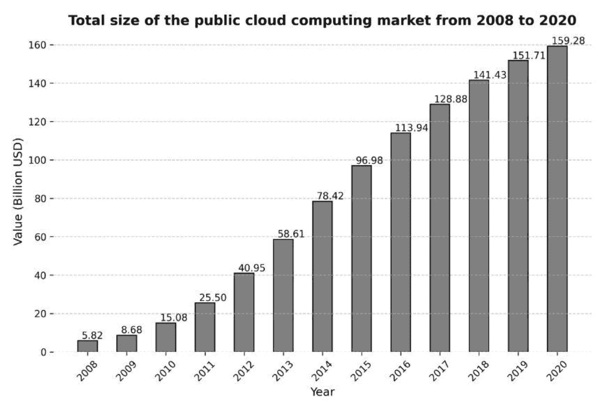

图 1-1

2008 年至 2020 年公有云计算市场的增长情况。[13]

### 1.1.3 Python Web 框架的历史

Web 开发通常需要一个具备前端、后端和服务器端开发专业知识的跨学科团队。这种需求催生了全栈开发者的兴起，他们掌握整个开发流程的知识，因此备受青睐，通常享有丰厚的薪酬。

从历史上看，Web 应用程序是使用 JavaScript、PHP 或 Perl 等语言开发的，而 Python 则被局限于本地脚本任务。这主要是因为 Python 并非为 Web 开发原生设计，需要框架来与 Web 服务器和浏览器交互。然而，随着时间的推移，Python 社区引入了多个框架，使得高效的 Web 开发成为可能。得益于 Python 对简洁性、可读性的关注、其丰富的库生态系统以及开源特性，它已发展成为 Web 开发的热门选择。谷歌和 Instagram 等主要平台也采用了 Python，进一步巩固了其声誉。

Web 框架通常分为两类：全栈框架和微框架（非全栈框架）。两者都管理 Web 开发的基本方面，如通信和基础设施，但范围不同。全栈框架为处理解释请求、管理数据存储和渲染用户界面等任务提供全面、内置的解决方案，因此适用于复杂的应用程序。相比之下，微框架仅提供基本功能，例如路由 HTTP 请求、分派控制器和返回响应。开发者通常会将其与额外的 API 和工具集成来构建应用程序。下文将概述这两类框架中一些流行示例。

### 1.1.4 Flask

Flask 由 Armin Ronacher 于 2010 年开发，最初据称是作为愚人节玩笑诞生的。它是一个微框架，或称非全栈框架，提供了一个应用服务器，但提供的最小组件很少。Flask 的核心围绕着两个关键工具构建：支持 HTTP 路由的 `Werkzeug`，以及用于渲染基本 HTML 页面的模板引擎 `Jinja`。此外，它还整合了用于字符串处理的 `MarkupSafe` 和用于安全数据序列化的 `ItsDangerous`，使得会话数据可以作为 Cookie 存储。

Flask 是一个极简主义框架，仅配备了创建 Web 应用所必需的核心组件。这种设计赋予了开发者极大的灵活性和控制力，但也让他们承担了更多构建和管理应用程序基础设施的责任。因此，Flask 最适合静态网站，或者那些乐于自行设计基础设施和界面的经验丰富的开发者。

### 1.1.5 Django

Django 由一群 Web 程序员于 2003 年开发，使用 Python 构建 Web 应用程序。与 Flask 相比，它允许开发者以更少的开销创建更复杂的应用。具体来说，Django 使得以更高的可扩展性渲染动态内容变得更加容易，并提供了通过对象关系映射（ORM）与数据库交互的内置能力。

此外，Django 包含了用于各种功能的广泛模块，例如电子商务、身份验证和缓存。这些预构建的包使开发者能够快速为他们的应用程序添加扩展服务。通过包含众多第三方包，Django 允许开发者专注于其项目的核心思路，而无需处理实现的每个细节。

### 1.1.6 Dash

Dash 是由 Plotly 开发的一个 Web 框架，用于使用 Python、R 甚至 Julia 构建企业级 Web 应用程序。虽然 Plotly 主要以其数据分析和可视化工具而闻名，但 Dash 通常用于创建交互式仪表盘。然而，凭借其广泛的定制选项，Dash 也可用于通用目的的应用程序。

Dash 原生支持 D3.js 图表，并为开发者提供了默认的 HTML 和 CSS 模板。不过，要实现更定制化的界面，开发者需要具备前端编程的熟练技能。此外，Dash 提供了一个企业级软件包，允许经验丰富的开发者在云上部署其应用程序，并附带身份验证和数据库集成等生产级功能。

### 1.1.7 Web2Py

Web2Py 是一个 Python 的全栈 Web 框架，遵循模型-视图-控制器（MVC）架构模式，与 Django 类似。它允许开发者轻松创建动态内容，并提供与数据库系统的原生集成。Web2Py 的独特功能之一是其内置的基于 Web 的集成开发环境（IDE），其中包含用于错误跟踪和管理的工单系统，简化了开发和调试过程。

然而，Web2Py 的一个关键缺点在于，它在一个单一的全局环境中执行对象和控制器，该环境会在每次 HTTP 请求时重新初始化。虽然这种设置在某些情况下可能有益，但也可能导致性能问题，并与某些模块不兼容，尤其是在应用程序扩展时。


好的，作为一名高级文档工程师和翻译员，我将遵循您提供的注意事项和示例，将给定的英文文本翻译成中文。


### 1.1.8 对纯 Python Web 框架的需求

以往，Python 开发者除非精通 `HTML`、`CSS` 和 `JavaScript`，否则只能将软件作为桌面应用部署在本地。虽然使用 `Tkinter` 和 `PyQt`，程序员可以创建复杂、动态且视觉上吸引人的界面，但缺点是无法在网页上渲染这些应用。许多 Python 爱好者都面临这一挑战，直到最近，他们还没有一种直接的方法仅使用 Python 就能将工作迁移到云上。

浏览一个又一个由才华横溢的人开发的令人惊叹的应用仓库，最终却发现分享他们工作的唯一方式就是提供源代码，并希望其他人能在本地复现，这总是令人沮丧。更别提那些根本无法执行代码的非技术用户了。这些努力中有许多在很大程度上未被使用。简而言之，我们显然需要一个不需要高级 Web 技术知识的框架——一个能让开发者编写典型的 Python 脚本并直接将其部署到云端的工具。然后，`Streamlit` 出现了，它解放了开发者，使其不再需要 `HTML`、`CSS` 和 `JavaScript`。正如他们所说，剩下的就是历史了。

### 1.1.9 学术意义

能够轻松地用 Python 直接创建 Web 应用，使得 `Streamlit` 成为学术界的一个宝贵工具 [1]。尽管它相对较新，首个测试版于 2019 年 4 月发布，但世界各地的研究团队已经开始采用该框架来展示其项目的成果。如今，许多出版物已经将 `Streamlit` 作为其可视化框架进行引用，涵盖了广泛的领域。其中一些领域包括健康 [2, 3, 4, 5]、计算机科学 [6, 7, 8, 9]、经济学 [10, 11] 和土木工程 [12] 等。

## 1.2 开始使用

作为高度通用且适应性强的框架，`Streamlit` 允许开发者利用各种计算资源和技术栈来使用它。即便如此，为了获得更好的易用性和可用性，我们仍建议遵循一些推荐的最佳实践。

### 1.2.1 技术建议

虽然运行 `Streamlit` 没有一刀切的解决方案，但建议满足以下计算和系统要求（或更优配置），以确保开发和运行应用流畅。请参考表 1-1、1-2、1-3 和 1-4 获取推荐的规格列表。

**表 1-4**
网络建议

| 入站端口 | 出站端口 |
| --- | --- |
| HTTP: TCP 8080, 8443 | HTTPS: TCP 443 |
| SSH: TCP 22 | SMTP: TCP 25 |
| LDAP(s): TCP 389/636 |

**表 1-3**
软件建议

| Streamlit | Anaconda |
| --- | --- |
| 1.41.1 或更高版本 | 附带 Python 3.9 或更高版本 |

**表 1-2**
系统建议

| 操作系统 | 数据库 |
| --- | --- |
| Ubuntu 16.04 或更高版本 | PostgreSQL 17 或更高版本 |
| Windows 7 到 11/Windows Server 2019 | |
| Mac OS X 10.12 或更高版本 | pgAdmin 4 v8.14 或更高版本 |
| Linux: RHEL 6/7 | |

**表 1-1**
硬件建议

| CPU | 内存 | 存储 | 互联网/网络接入 |
| --- | --- | --- | --- |
| 4 x 64 位 2.8 GHz | 8 GB 1600 MHz DDR3 | 100 GB | 10 Mbps |

### 1.2.2 使用 Anaconda 安装环境

要创建一个运行在本地 `Streamlit` 服务器上进行原型设计和测试的 Web 应用，我们首先需要设置一个包含所有必要依赖项的 Python 运行时环境。为此，我们将使用 `Anaconda`，这是最广泛使用和支持的 Python 发行版之一。首先，下载并安装一个兼容版本的 `Anaconda`。安装完成后，创建一个虚拟环境来安装运行 Web 应用所需的包。

#### 程序化安装

要通过控制台创建一个 `Anaconda` 环境，请遵循以下步骤：

1.  要以编程方式创建和安装环境，请在 `Anaconda Prompt` 中依次输入以下命令：

    ```
    conda create -n <environment_name> python=<version>
    ```

    当 `conda` 提示你是否继续时，选择 *y*。

    ```
    proceed ([y]/n)?
    ```

    接下来，新环境将在 `Anaconda` 根目录下的 environments 文件夹中创建，路径为 `C:/ProgramData/Anaconda3/envs/`。

2.  输入以下内容激活你的环境：

    ```
    conda activate <environment_name>
    ```

3.  如果你有一个依赖列表文件 `dependencies.yml`，将其放置在你新创建的环境目录中：

    ```
    C:/ProgramData/Anaconda3/envs/<environment_name>/
    ```

4.  输入以下内容，将根目录更改为你的环境目录：

    ```
    cd C:/ProgramData/Anaconda3/envs/<environment_name>/
    ```

5.  确保 `dependencies.yml` 中的第一行正确写入了你的环境名称 `name: <environment_name>`；否则，环境可能无法安装。

6.  输入以下内容，通过安装 `dependencies.yml` 文件中列出的所有依赖项来更新你的环境：

    ```
    conda env update -f dependencies.yml
    ```

7.  如果 `Anaconda` 提示，输入以下内容继续更新你的 `conda` 版本：

    ```
    conda update -n base -c defaults conda
    ```

8.  要查看环境列表，输入以下内容：

    ```
    conda info -envs
    ```

9.  要查看你环境中的依赖项列表，输入以下内容：

    ```
    conda list
    ```

10. 要安装以后可能需要的额外依赖项，请输入以下内容：

    ```
    conda install <package_name>
    ```

11. 某些依赖项可能无法通过 `conda install` 下载；在这种情况下，请先下载 `pip`，然后按照以下方式使用 `pip install`：

    ```
    conda install pip
    pip install <package_name>
    ```

12. 要停用你的环境，你可以输入以下内容：

    ```
    conda deactivate
    ```


#### 图形化安装

此外，你也可以使用 Anaconda Navigator 按如下方式创建和管理环境：

1. 启动 Anaconda Navigator。
2. 点击 `Environments` 选项卡。请参见图 1-2。

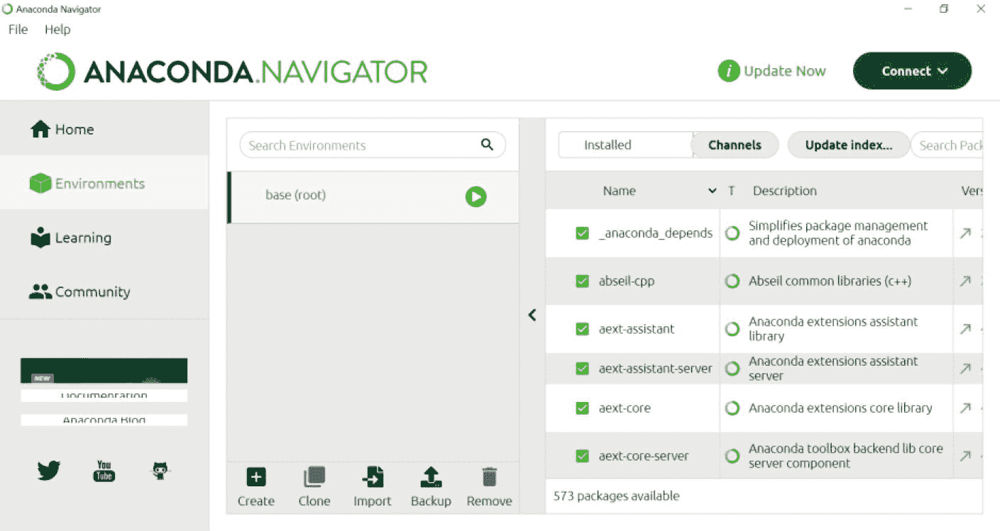

图 1-2

在 Anaconda 中打开 `Environments` 选项卡

1. 点击 `Create` 按钮，然后输入你环境的所需名称和 Python 版本。请参见图 1-3。

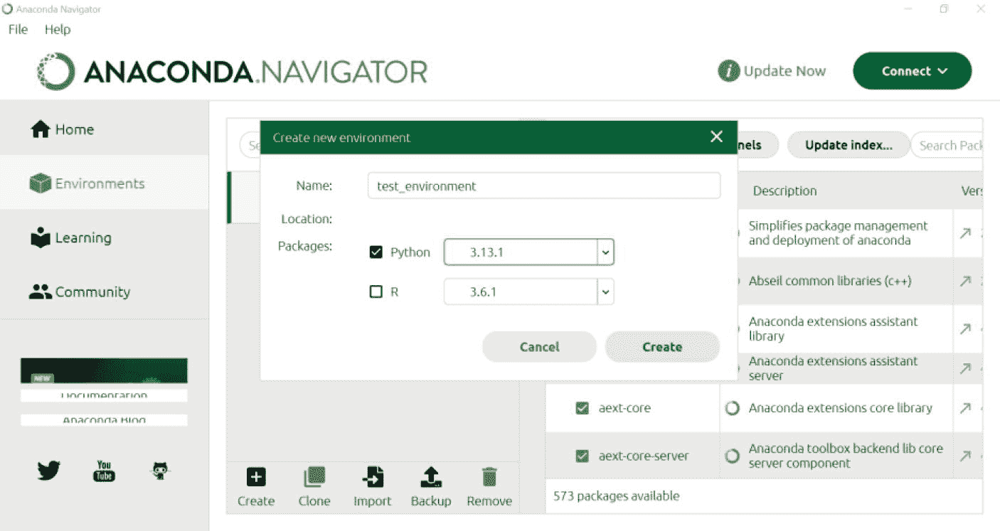

图 1-3

在 Anaconda 中创建环境

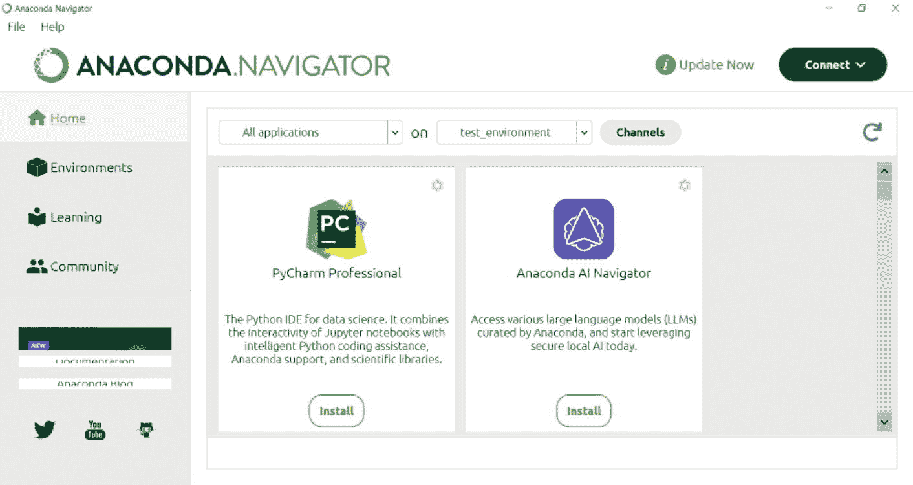

图 1-4

在 Anaconda 中新建的环境

1. 接下来，按照上一节的步骤 2-12 安装依赖项。然后，如图 1-4 所示，`test_environment` 环境将显示为已激活，且所有必需的软件包均已安装。
2. 最后，你将能够在 Anaconda 的 `Home` 选项卡中，在你新建的环境里启动任何可用的 IDE。请参见图 1-5。

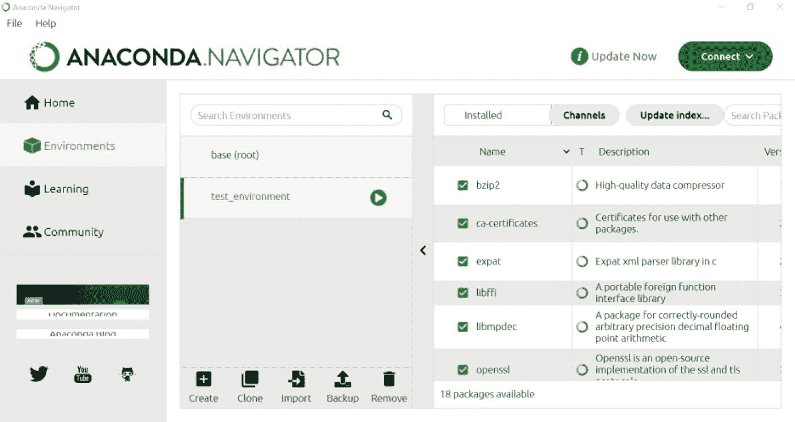

图 1-5

Anaconda 中可选的 IDE

### 1.2.3 下载并安装 Streamlit

有多种方式可以下载并安装 Streamlit 库，在本节中，我们将介绍其中最常用的安装方式之一。

#### 直接 pip 安装

1.  要下载并安装 Streamlit，首先请确保你处于正确的环境中，方法是在 Anaconda Prompt 中输入以下命令：

    ```
    conda activate 
    ```

2.  接下来，你可以通过输入以下命令来下载并安装 Streamlit：

    ```
    pip install streamlit
    ```

#### 手动轮文件安装

1.  确保你处于正确的环境中，方法是在 Anaconda Prompt 中输入以下命令：

    ```
    conda activate 
    ```

2.  从以下地址手动下载轮安装文件：

    [`https://pypi.org/project/streamlit/`](https://pypi.org/project/streamlit/)

3.  将目录更改为轮文件所在的位置：

    ```
    cd C:/Users/.../
    ```

4.  然后通过输入以下命令安装下载的轮文件：

    ```
    pip install streamlit-1.41.1-py2.py3-none-any.whl
    ```

如果安装成功，你可以继续创建脚本。为保险起见，请在此之前重启 Anaconda。

#### 导入 Streamlit

要将 Streamlit 导入你的 Python 脚本，请确保在你的其余代码之前包含以下代码行：

```
import streamlit as st
```

之后，任何 Streamlit 方法都可以通过在其前面加上 `st` 来调用，如下所示：

```
st.write('Hello world')
```

### 1.2.4 Streamlit 控制台命令

当 Streamlit 安装完成后，Streamlit 命令行（CLI）工具也同时被安装。命令行可以帮助你运行、操作和诊断与 Streamlit 应用程序相关的问题。

要获取更多帮助，请输入以下命令：

```
streamlit --help
```

要运行你的应用程序，请确保已将目录更改为你的脚本所在位置：

```
cd C:/Users/.../script directory/
```

然后输入以下命令来运行你的脚本：

```
streamlit run  [--script args]
```

随后，你的应用程序的本地 URL 和网络 URL 将显示出来。同时，你的应用程序将自动出现在你的默认网页浏览器中。你可以使用本地 URL 在本地连接到你的应用程序，使用网络 URL 通过局域网在任何其他设备上连接。此外，你将能够看到你的 Streamlit 应用程序的控制台，如图 1-6 所示。


图 1-6

运行 Streamlit 应用程序时的控制台

要清除缓存，请输入以下命令：

```
streamlit cache clear
```

要在网页浏览器中打开 Streamlit 的文档，请输入以下命令：

```
streamlit docs
```

要显示 Streamlit 的版本号，请输入以下命令：

```
streamlit --version
```

#### 通过控制台配置 Streamlit

你可以向 `streamlit run` 传递配置选项，以配置诸如应用程序运行端口、禁用“保存时运行”等选项。

要查看完整的配置选项列表，请输入以下命令：

```
streamlit run --help
```

你可以通过输入以下命令来查看已配置的选项列表：

```
streamlit config show
```

你可以通过以下四种方法之一来配置这些选项：

1.  使用位于 `.streamlit/config.toml` 的全局配置文件：

    ```
    [server]
    port = 80
    ```

2.  在你的项目目录中使用每个项目的配置文件：

    ```
    C:/Users/.../.streamlit/config.toml
    ```

3.  使用 `STREAMLIT_*` 环境变量，如下所示：

    ```
    export STREAMLIT_SERVER_PORT=80
    ```

4.  在运行脚本时使用命令行标志，如下所示：

    ```
    streamlit run  --server.port 80
    ```


### 1.2.5 运行演示应用

要运行 Streamlit 的演示应用，请输入以下命令：

```
streamlit hello
```

随后，您的默认浏览器将显示以下应用界面。您可以使用侧边栏菜单访问以下四个演示应用，如图 1-7、1-8、1-9、1-10 和 1-11 所示。

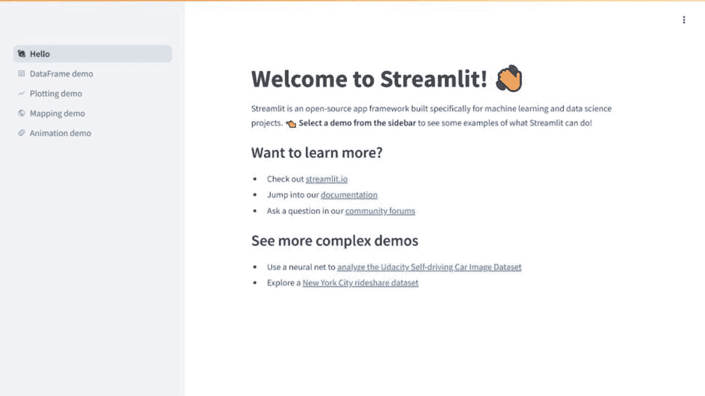

**图 1-7** Streamlit 演示应用主页

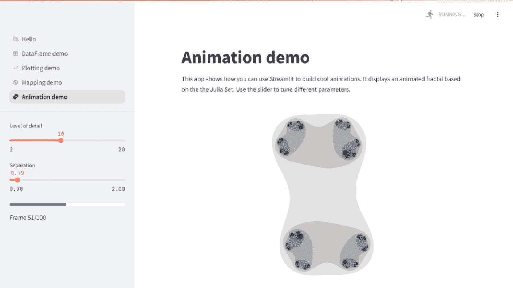

**图 1-8** Streamlit 动画演示应用

### 1.2.6 使用 PyCharm 编写和测试代码

通常，代码会随时间增长，要么是通过向原始代码库添加新模块，要么是通过与第三方服务集成。为了确保代码完美运行，可以采用测试。代码测试通常分为两种方法：单元测试和集成测试。单元测试用于测试单个模块，而集成测试则确保整个系统按预期工作。在本例中，我们将重点关注单元测试，但相同的概念也可应用于集成测试。在这两种情况下，我们都需要提供输入，并将预期输出与实际输出进行比较。对于一个允许用户计算两个数字之和的简单 Streamlit 应用，我们可以测试两个主要方面：首先，Web 应用程序是否按预期渲染；其次，求和逻辑是否正确。这是两个独立的单元测试，但第一个测试在开发任何前端应用时都很常见。清单 1-1 显示了我们将要测试的示例应用程序，当使用 Streamlit 运行时，其输出如图 1-12 所示。清单 1-2 则测试了该示例的渲染和求和逻辑。

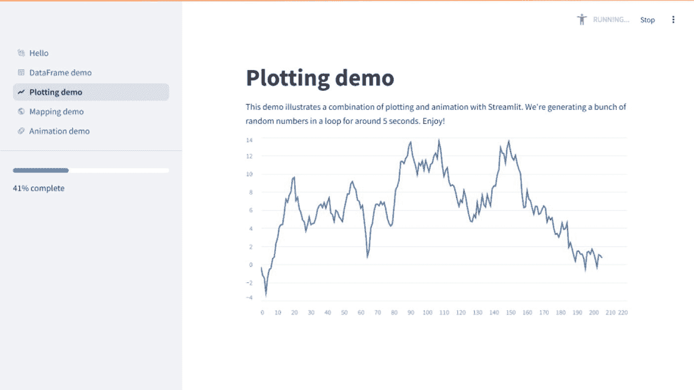

**图 1-9** Streamlit 绘图演示应用

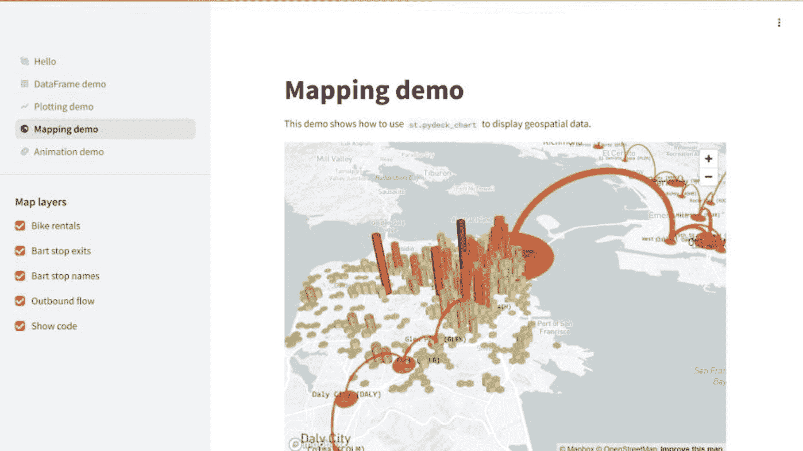

**图 1-10** Streamlit 地图演示应用

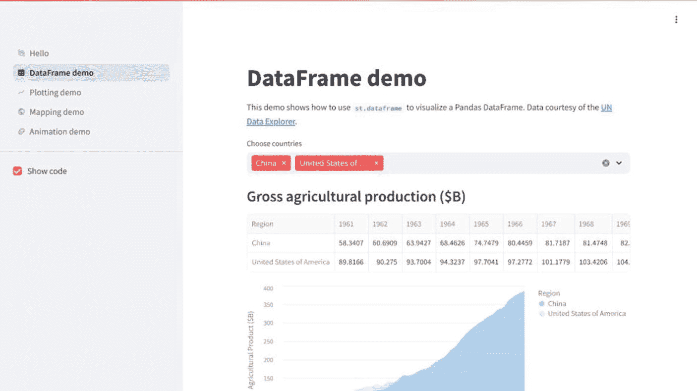

**图 1-11** Streamlit 数据框演示应用

```
from main import calculate_sum
from selenium import webdriver
from selenium.webdriver.chrome.options import Options
from selenium.webdriver.common.by import By
from selenium.webdriver.support.ui import WebDriverWait
from selenium.webdriver.support import expected_conditions as EC
from selenium.webdriver.chrome.service import Service
def test_user_interface():
# chromedriver 的路径。请确保此路径与您的环境相符
driver_path = r'----------\chromedriver.exe'
# 设置选项
options = Options()
options.add_argument('--headless')  # 不打开真实的 Chrome 窗口
# 使用 Service 指定驱动路径
service = Service(driver_path)
# 使用选项和来自 WebDriverManager 的驱动路径初始化驱动
with webdriver.Chrome(service=service, options=options) as driver:
url = 'http://127.0.0.1:8501'
driver.get(url)
# 等待页面元素加载
try:
WebDriverWait(driver, 10).until(
EC.presence_of_element_located((By.TAG_NAME, 'h1'))
)
html = driver.page_source
except Exception as e:
print(f'等待页面时出错: {e}')
html = driver.page_source
# 执行断言以检查页面内容
assert 'Add numbers' in html
assert 'First Number' in html
assert 'Second Number' in html
def test_logic():
assert calculate_sum(1, 1) == 2
assert calculate_sum(1, -1) == 0
assert calculate_sum(1, 9) == 10
if __name__ == '__main__':
test_logic()
test_user_interface()
清单 1-2
unit_test.py
```

```
import streamlit as st
def calculate_sum(n1, n2):
return n1 + n2
st.title('Add Numbers')
n1 = st.number_input('First Number', value=0)
n2 = st.number_input('Second Number', value=0)
if st.button('Calculate'):
summation = calculate_sum(n1, n2)
st.write(f'Summation is: {summation}')
清单 1-1
main.py
```

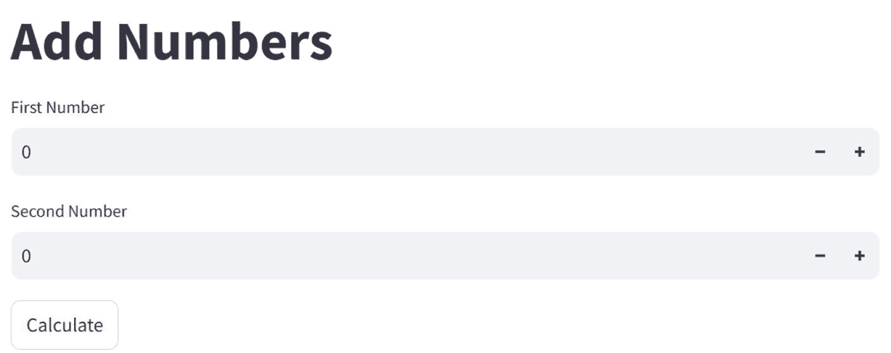

**图 1-12** 清单 1-1 的输出

为了测试渲染，我们首先需要让应用保持运行状态，以便 Selenium 的驱动（本例中为 Chrome）可以访问它。为了自动化在运行测试前启动应用的过程，我们可能需要一个高级 IDE。PyCharm 可以为我们处理此任务。首先，我们需要设置一个运行配置，以便通过单击按钮启动 Streamlit，如图 1-13 所示。一旦我们有了这个运行 Streamlit 的配置，就可以将其用作另一个配置（用于运行图 1-14 中所示的单元测试）中的预运行命令。

虽然像 Selenium 这样的浏览器自动化工具对于端到端测试非常强大，但值得注意的是，Streamlit 现在提供了自己的内置测试框架 AppTest。AppTest 专为 Streamlit 应用设计，无需管理浏览器即可实现更快、更集成的测试。该框架简化了测试流程，并确保开发人员能够高效地验证其 Streamlit 应用的功能。通过利用 AppTest，开发人员可以专注于编写和部署应用，因为他们知道其测试已无缝集成到 Streamlit 环境中。


## 1.3 Streamlit 的工作原理

与其他将静态文件发送到浏览器的 Web 框架不同，Streamlit 在服务端修改真实的 DOM 及其状态来渲染最终的 Web 文档。在正常的用户行为下，不应存在安全问题。然而，与 PHP 类似，如果代码编写不当，Streamlit 也容易受到远程代码执行（RCE）的攻击，即用户输入未经清理，可能被利用执行操作系统级别的代码。最近在社区组件 `streamlit-geospatial` 中发现了此类漏洞的一个真实案例 [参考：(`https://securitylab.github.com/advisories/GHSL-2024-100_GHSL-2024-108_streamlit-geospatial/`)]。

运行一个 Streamlit Web 应用程序，首先要使用默认的 Python 解释器执行二进制文件（Windows 上是 `streamlit.exe`，macOS 或 Linux 上是 `streamlit.sh`）。这会初始化应用程序配置，包括机密信息、设置、主题，以及最重要的**Delta 生成器（DG）**，它充当着 Python 脚本与 Streamlit 服务的 ReactJS Web 应用程序之间的中介。


图 1-13 创建一旦选择并运行当前配置就执行的 shell 命令

### 1.3.1 Streamlit 架构

DG 负责高效地传输要渲染到客户端侧的 HTML 组件，并检索其状态。初始渲染从 Python 文档的开头开始，一直持续到最后一行。后续渲染并非从文件开头开始，而是从用户与之交互或其状态发生改变的组件开始。这将在后面的章节中更详细地介绍。每个组件的每次新渲染都会在 DG 中排队，它要么替换现有的 HTML 片段，要么在最终 DOM 中的其他已渲染 HTML 组件之间插入。

Streamlit 组件是逐个排队和渲染的，以避免因渲染耗时过长而出现空白页面，从而对用户体验产生负面影响。这种延迟可能由大量的计算、等待 API 响应，甚至是像清单 1-3 中演示的休眠函数引起，如图 1-15 和 1-16 所示。

```
import streamlit as st
import time
# 用户首先看到这个
st.title('My Title')
time.sleep(2)
清单 1-3
text_display.py
```

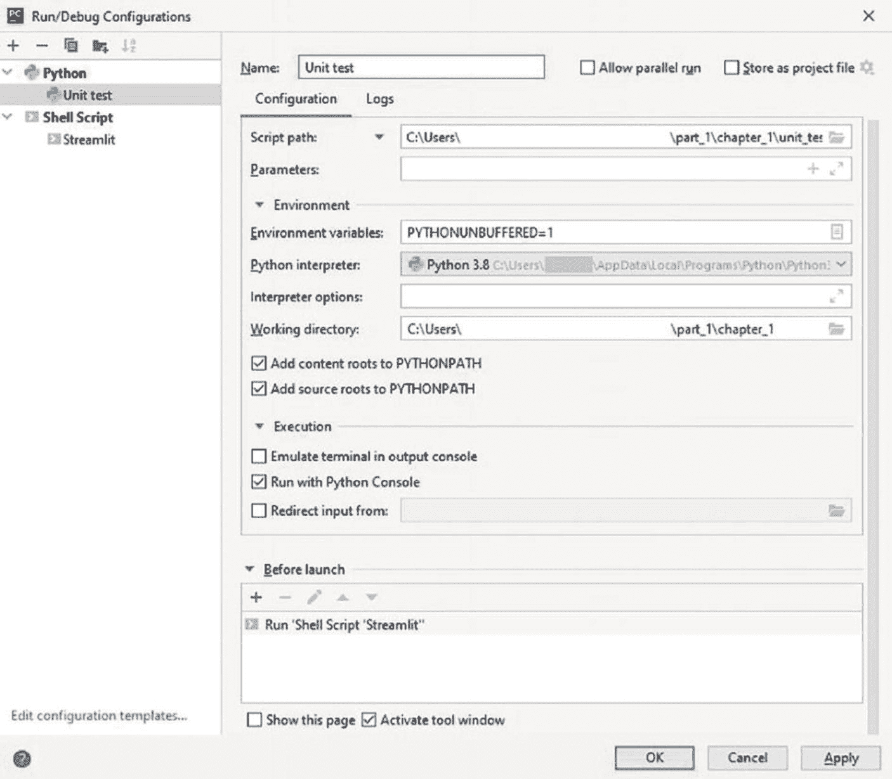

图 1-14 选择 Python 解释器来运行单元测试文件，但这是在运行了图 1-13 中的配置之后

```
# 用户在 2 秒后其次看到这个
st.write('My *markdown* text in **Streamlit**')
```

最终用户会注意到页面在两秒内更新，包含了 `st.write` 消息，看起来像是加载完成的页面。

### 1.3.2 Streamlit 中的 ReactJS

为简单起见，我们一直称 Streamlit 将 HTML 插入到客户端的浏览器中。实际上，它使用 ReactJS 的虚拟 DOM 来插入元素并管理其状态。这可以通过使用 Chrome 的 *React Developer Tools* 扩展来确认，如图 1-17 所示。

基于这一点，并理解了 Streamlit 的源代码，我们可以得出结论：Streamlit 使用内置的 ReactJS 组件，将它们组合在一起，就能用 Python 创建一个功能齐全的 JavaScript Web 应用程序！此外，我们可以利用 Streamlit 对组件的通用处理能力，构建未内置提供的自定义和复杂组件，我们将在后面的章节中对此进行探索。


图 1-15 清单 1-3 的端到端执行序列


图 1-16 清单 1-3 的 Streamlit 输出


图 1-17 清单 1-3 的 Streamlit 输出

## 1.4 总结

本章重点介绍了云计算的趋势及其为开发者、用户和云服务提供商带来的好处。我们还讨论了四种最常用的 Python Web 框架，包括一个微框架——Flask——和三个全栈框架：Django、Dash 和 Web2Py。Streamlit 作为一个纯 Python 框架被引入，展示了它在弥合技能差距和将开发时间从数周缩短到数小时方面的竞争优势。然后，引导读者通过安装和使用 Streamlit 按需创建基本应用程序。在下一章中，我们将探讨 Streamlit 的核心组件，全面概述其应用程序编程接口，并演示如何使用它来开发定制化的应用程序。

