# 2. Streamlit 基础

得益于其便捷且高度直观的 API，Streamlit 简化了从构想到部署的创建界面、显示文本、可视化数据、渲染小部件以及管理 Web 应用程序的过程，附录中对此有重点说明。本章涵盖了创建输入表单、实现条件流程、处理错误、修改数据框以及渲染基本图表的技术。掌握基础知识后，开发者将能够在本机上生成、管理和部署一系列简单的 Web 应用程序。这些应用程序可能包括数据浏览器、机器学习工具、多媒体处理工具、数据整理工具以及其他通用解决方案。一旦熟练掌握了这些基础，开发者就可以继续创建更高级和复杂的应用程序，这将在后续章节中探讨。

## 2.1 创建基础应用

通过利用 Streamlit 强大的 API，我们可以创建从简单的微服务到与分布式架构集成的复杂系统等广泛的应用。Streamlit 让我们能够轻松适应不同用户的多样化需求。不过，在本节中，我们将先专注于探索较为简单的应用，然后在后续章节中再逐步深入到更复杂的应用。

### 2.1.1 生成用户输入表单

在 Streamlit 中创建表单非常简单，只需在页面上对多个输入组件（例如文本和数字字段）进行分组，并添加一个按钮来触发操作（如将条目保存到数据库或存储在会话状态中）即可。然而，这种方法的一个关键考虑因素是，每当用户与任何组件交互时，Streamlit 都会自动从头到尾重新运行整个脚本。虽然这确保了程序逻辑顺畅且无缝，但在某些情况下，将输入组件分组并仅在用户明确提示时才重新运行脚本更为实用。这可以通过使用 `st.form` 命令来实现。

```python
import streamlit as st
from datetime import date  # 导入以使用当前日期
# 创建反馈表单
with st.form('feedback_form'):
    st.header('反馈表单')
    # 将表单输入组织到列中
    col1, col2 = st.columns(2)
    with col1:
        name = st.text_input('请输入您的姓名', placeholder='您的全名')
        rating = st.slider('给此应用评分 (0 = 最差, 10 = 最佳)', 0, 10, 5)
    with col2:
        dob = st.date_input('请输入您的出生日期')
        recommend = st.radio('您会向他人推荐此应用吗？', ('是', '否'))
    # 提交按钮
    submit_button = st.form_submit_button('提交')
# 处理表单提交
if submit_button:
    # 检查姓名是否为空
    if not name.strip():
        st.error('姓名不能为空。请提供您的姓名。')
    # 检查出生日期是否有效
    elif dob > date.today():
        st.error('出生日期不能是将来的日期。')
    else:
        st.success('感谢您的反馈！')
        st.write('**姓名：**', name)
        st.write('**出生日期：**', dob)
        st.write('**评分：**', rating)
        st.write('**会推荐吗？：**', recommend)
# 代码清单 2-1
# input_form. py
```

可以使用 `with` 语句结合 `st.form` 命令来创建 Streamlit 表单。在代码清单 2-1 中，我们首先使用 `st.columns` 命令将表单内的组件组织成两个等宽的列。在第一列中，我们分别使用 `st.text_input` 和 `st.slider` 命令包含一个文本输入和一个滑块组件。在第二列中，我们使用 `st.date_input` 和 `st.radio` 命令添加了一个日期输入和一个单选按钮组件。

在同一个 `with` 语句中，我们使用 `st.form_submit_button` 命令包含了一个表单提交按钮。该按钮允许通过一次点击集体提交表单中的所有组件条目，无论包含多少项内容。需要注意的是，`st.form_submit_button` 与 `st.button` 不同，如果没有它，对于使用 `st.form` 创建的表单，Streamlit 将报错。

如图 2-1 所示，所有组件都使用 `st.form` 命令分组到一个表单中。一旦点击表单提交按钮，组件条目将被一起处理，并显示输出，如图 2-2 所示。

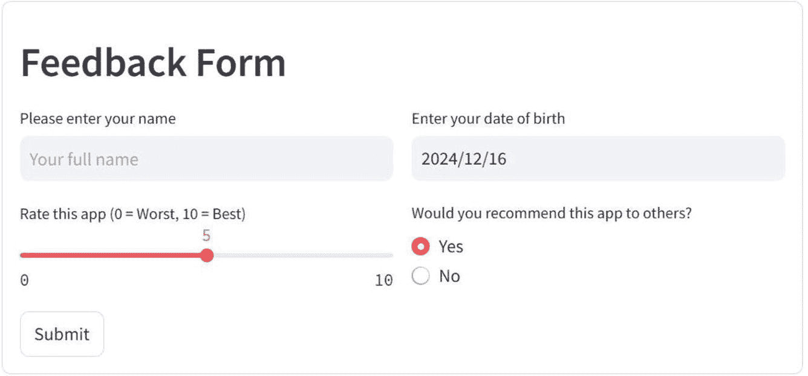

图 2-1

Streamlit 输入表单（代码清单 2-1 的输出）

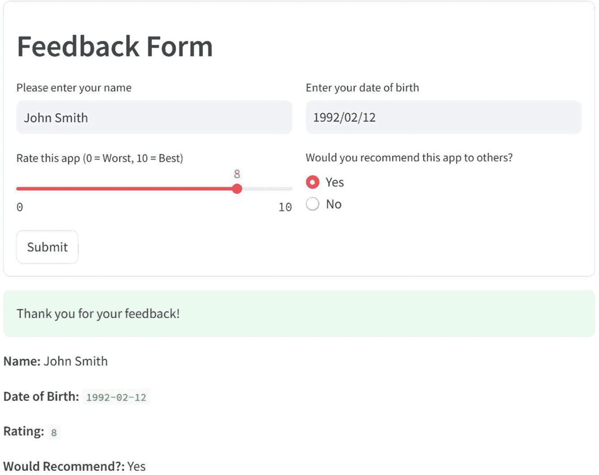

图 2-2

实例化的 Streamlit 输入表单（代码清单 2-1 的输出）

### 2.1.2 引入条件流程

可能需要在 Streamlit 应用中引入条件流程，即某些操作依赖于先前的操作或组件的状态。这对于引导用户正确填写表单并按预期使用应用特别有用。如果没有条件流程，用户若错误地与应用交互，您的应用可能会遇到错误。

#### 示例 1

```python
import streamlit as st
# 显示姓名的函数
def display_name(name):
    st.info(f'**姓名：** {name}')
# 姓名输入
name = st.text_input('请输入您的姓名')
# 验证：如果输入了姓名，则显示信息；否则，显示错误消息
if name:
    display_name(name)
else:
    st.error('未输入姓名')
# 代码清单 2-2
# conditional_flow_1.py
```

在代码清单 2-2 中，我们使用一个 `if` 语句来检查姓名字段是否已填写。如果该字段为空，用户将看到一条错误消息（图 2-3）。如果该字段不为空，则调用一个函数来显示用户的输入（图 2-4）。

#### 示例 2

```python
import streamlit as st
# 显示姓名的函数
def display_name(name):
    st.info(f'**姓名：** {name}')
# 姓名输入
name = st.text_input('请输入您的姓名')
# 检查是否输入了姓名
if not name:
    st.error('未输入姓名')
else:
    display_name(name)
# 代码清单 2-3
# conditional_flow_2.py
```

在代码清单 2-3 中，我们同样使用一个 `if` 语句来检查姓名字段是否不为空。这里的区别在于，如果字段为空，我们使用 `st.stop` 命令来停止脚本的执行。如果字段不为空，脚本继续执行，显示输入的姓名。这种方法的好处是它消除了对额外 `if` 语句的需求，简化了脚本。就功能而言，这两种方法本质上是相同的。


图 2-3

实现条件流程（代码清单 2-2 的输出）

条件流程编程既可以应用于简单应用，也可以应用于复杂应用。当需要时，可以扩展此技术，并与嵌套的 `if` 语句、`while` 循环和其他方法一起实现。

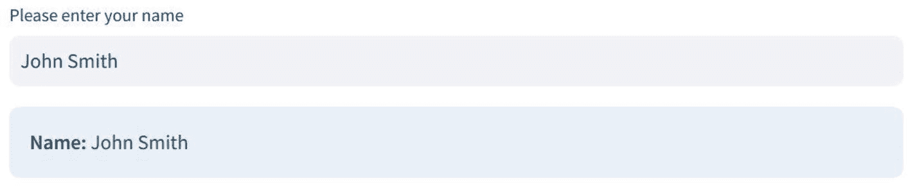

图 2-4

继续实现条件流程（代码清单 2-2 的输出）

### 2.1.3 管理和调试错误

如果你在开发模式下运行 `Streamlit`，并且按照 3.1 节中表 3-1 所示配置了 `showErrorDetails = True`，那么 `Streamlit` 会在网页上显示运行时异常，就像 IDE 在控制台中显示此类消息一样。这并不理想，因为用户可能难以理解错误并感到困惑。更重要的是，未处理的异常可能会在你代码的后续部分触发一系列致命错误，从而可能影响其他系统。此外，`Streamlit` 会显示导致异常的特定代码段，如果你的源代码受知识产权保护，这可能会带来风险。

```markdown
```python
import streamlit as st
# 为输入创建列
col1, col2 = st.columns(2)
with col1:
    number_1 = st.number_input('请输入第一个数字',value=0,step=1)
with col2:
    number_2 = st.number_input('请输入第二个数字',value=0,step=1)
st.info(f'**{number_1}/{number_2}=** {number_1/number_2}')
```
清单 2-4 `without_try_and_except.py`

运行清单 2-4，我们可以创建一个简单的应用程序，用于一个数除以另一个数。如果用户除以非零数字，应用程序会正常运行并显示如图 2-5 所示的输出。然而，如果用户尝试除以零，Python 会引发零除错误，`Streamlit` 会将其显示出来，如图 2-6 所示。

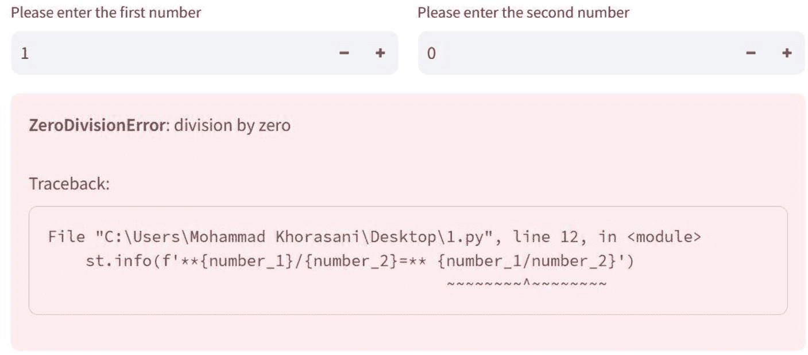

`图 2-6` – 在出现错误的情况下运行不带 `try` 和 `except` 块的 `Streamlit`（清单 2-4 的输出）

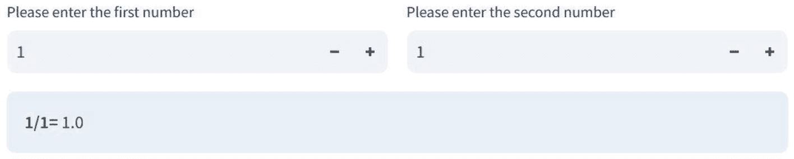

`图 2-5` – 在没有错误的情况下运行不带 `try` 和 `except` 块的 `Streamlit`（清单 2-4 的输出）

示例 1

你可以限制 `st.number_input` 组件的输入值范围，但暂时假设你无法做到。在这种情况下，解决方案是在代码中使用 `try` 和 `except` 块，如清单 2-5 所示，在可能出现意外问题的地方应用。在此示例中，我们尝试使用 `try` 语句执行脚本中可能出问题的部分。如果该部分因 `ZeroDivisionError` 而失败，则通过 `except ZeroDivisionError` 语句处理，并向用户显示自定义错误消息，如图 2-7 所示。如果错误由其他问题引起，则可以使用通用的 `except` 语句来跳过这部分代码而不执行它。

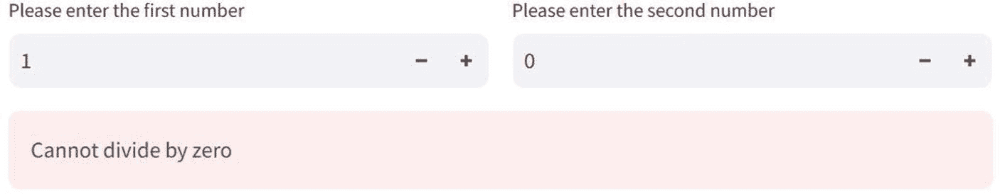

`图 2-7` – 在出现错误的情况下运行带 `try` 和 `except` 块的 `Streamlit`（清单 2-5 的输出）

```python
import streamlit as st
# 为输入创建列
col1, col2 = st.columns(2)
with col1:
    number_1 = st.number_input('请输入第一个数字', value=0, step=1)
with col2:
    number_2 = st.number_input('请输入第二个数字', value=0, step=1)
try:
    st.info(f'**{number_1}/{number_2}=** {number_1/number_2}')
except ZeroDivisionError:
    st.error('不能除以零')
```
清单 2-5 `try_and_except_1.py`

示例 2

另一种管理异常的方法是使用通用的 `except` 语句，该语句会显示实际错误的定制化消息，如图 2-8 所示。这种方法在开发期间对调试脚本特别有帮助，同时通过不向用户透露太多技术细节来保持积极的用户体验。

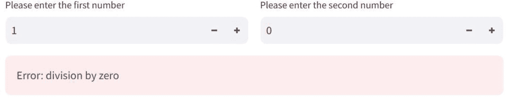

`图 2-8` – 在出现错误的情况下运行带 `try` 和 `except` 块的 `Streamlit`（清单 2-6 的输出）

```python
import streamlit as st
# 为输入创建列
col1, col2 = st.columns(2)
with col1:
    number_1 = st.number_input('请输入第一个数字', value=0, step=1)
with col2:
    number_2 = st.number_input('请输入第二个数字', value=0, step=1)
try:
    st.info(f'**{number_1}/{number_2}=** {number_1/number_2}')
except Exception as e:
    st.error(f'错误：{e}')
```
清单 2-6 `try_and_except_2.py`

## 2.2 修改数据框

鉴于 `Streamlit` 专注于开发机器学习和数据科学应用，开发者通常需要根据用户输入或需求来修改数据框。在本节中，我们将介绍一些最常用的修改 Pandas 数据框的方法（非详尽列表）。

### 2.2.1 筛选

可以使用清单 2-7 中所示的方法来筛选数据框。通过为某列指定一个数值或字符串条件，例如 `df[df['Column 1'] > -1]`，我们可以根据该条件筛选行，如图 2-9 所示。

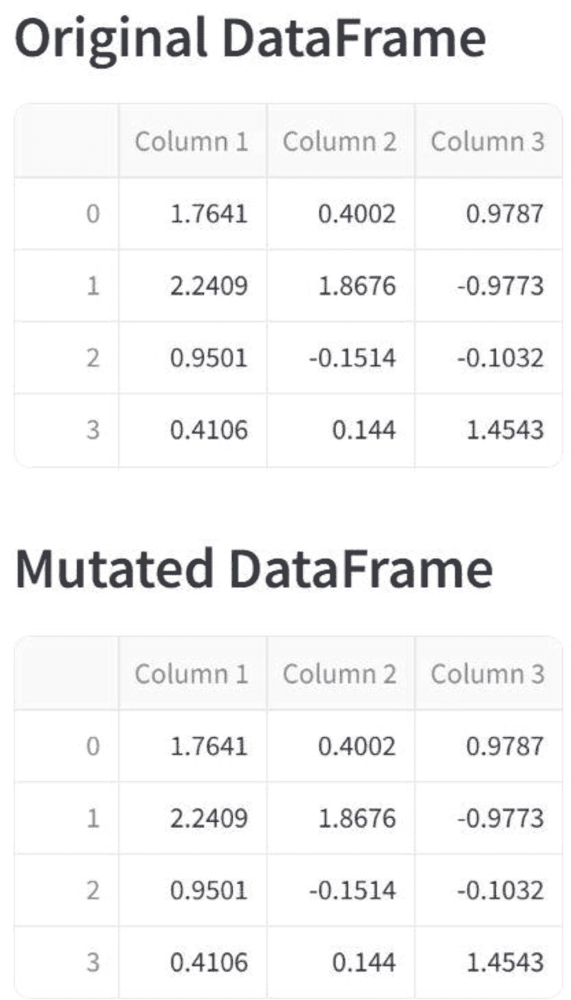

`图 2-9` – 筛选 Pandas 数据框（清单 2-7 的输出）

```python
import streamlit as st
import pandas as pd
import numpy as np
# 设置随机种子以确保可重复性
np.random.seed(0)
# 使用随机数据创建数据框
df = pd.DataFrame(
    np.random.randn(4, 3),
    columns=('Column 1', 'Column 2', 'Column 3')
)
# 显示原始数据框
st.subheader('原始数据框')
st.dataframe(df)
# 筛选数据框（修改它）
df = df[df['Column 1'] > -1]
# 显示修改后的数据框
st.subheader('修改后的数据框')
st.dataframe(df)
```
清单 2-7 `mutate_dataframe_filter.py`

### 2.2.2 选择（Select）

可以使用清单 2-8 所示的方法来选择数据框的列。我们可以通过列名指定要保留哪些列，例如 `df[['Column 1', 'Column 2']]`，并移除其他列，如图 2-10 所示。或者，也可以使用 `drop` 命令达到相同效果，如 `df.drop(columns=['Column 3'])`。

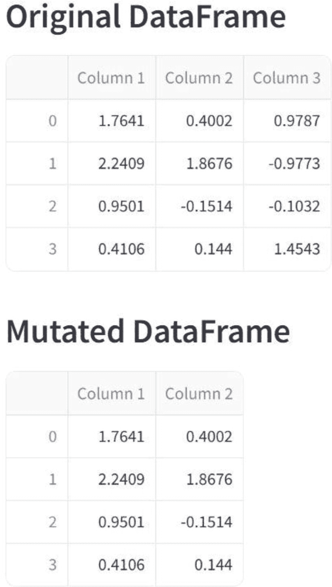

`图 2-10` – 选择 Pandas 数据框的列（清单 2-8 的输出结果）
```

### 2.2.3 排序（Arrange）

数据框的列可以基于指定列的数值或名义值，进行升序和/或降序的排列与排序，如清单 2-9 所示。我们可以指定要排序的列及其顺序，例如 `df.sort_values(by='Column 1', ascending=True)`，如图 2-11 所示。一旦列排序后，索引也会相应调整以反映新的顺序。如果需要，可以使用 `df.reset_index(drop=True)` 命令重置索引，使其从零开始。

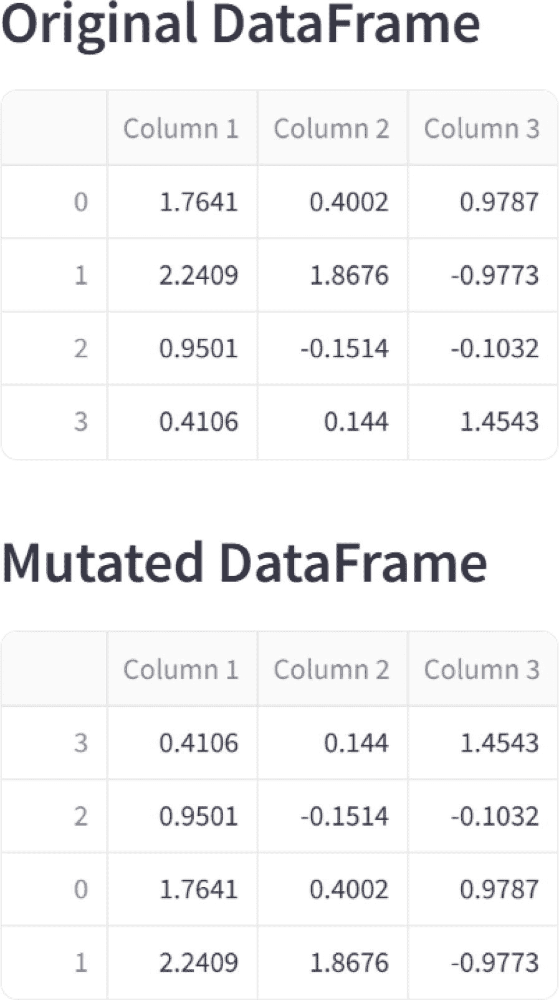

图 2-11: 对 Pandas 数据框的列进行排序（清单 2-9 的输出结果）

```python
import streamlit as st
import pandas as pd
import numpy as np

# Set the seed for reproducibility
np.random.seed(0)

# Create DataFrame with random numbers
df = pd.DataFrame(
    np.random.randn(4, 3),
    columns=('Column 1', 'Column 2', 'Column 3')
)

# Display the original DataFrame
st.subheader('Original DataFrame')
st.dataframe(df)  # Use st.dataframe for interactive display

# Mutate the DataFrame by sorting by 'Column 1'
df = df.sort_values(by='Column 1', ascending=True)

# Display the mutated DataFrame
st.subheader('Mutated DataFrame')
st.dataframe(df)  # Use st.dataframe for interactive display
```

### 2.2.4 变形（Mutate）

可以基于另一列的值来指派新列，从而对数据框的列进行变形，如清单 2-10 所示。我们可以指定一个简单的 lambda 函数应用于现有列的值，例如 `Column_4 = lambda x: df['Column 1']*2`，以计算如图 2-12 所示的输出结果。

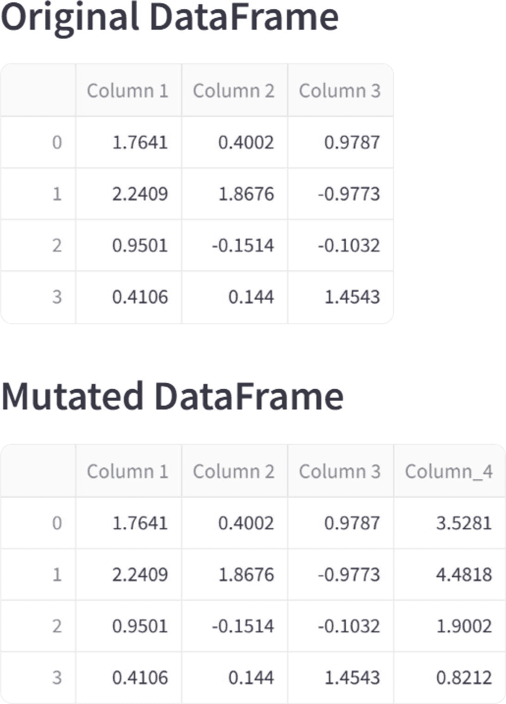

图 2-12: 变形 Pandas 数据框（清单 2-10 的输出结果）

```python
import streamlit as st
import pandas as pd
import numpy as np

# Set the seed for reproducibility
np.random.seed(0)

# Create DataFrame with random numbers
df = pd.DataFrame(
    np.random.randn(4, 3),
    columns=('Column 1', 'Column 2', 'Column 3')
)

# Display the original DataFrame
st.subheader('Original DataFrame')
st.dataframe(df)

# Create a new column 'Column 4' based on 'Column 1'
df = df.assign(Column_4 = lambda x: x['Column 1'] * 2)

# Display the mutated DataFrame
st.subheader('Mutated DataFrame')
st.dataframe(df)
```

### 2.2.5 分组（Group By）

有时，可能需要对数据框中一个或多个列的值进行分组或聚合。这可以在 Pandas 中使用清单 2-11 所示的方法完成。我们可以使用 `df.groupby(['Column 1', 'Column 2'])` 命令指定要依据哪个或哪些列进行分组。这将对数据框重新索引，并将相关行分组在一起，如图 2-13 所示。

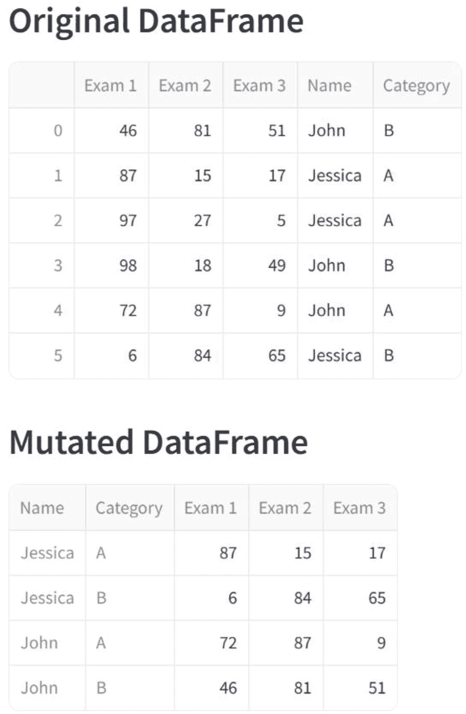

图 2-13: 对 Pandas 数据框进行分组（清单 2-11 的输出结果）

```python
import streamlit as st
import pandas as pd
import numpy as np

# Create a DataFrame with random integers between 0 and 100
df = pd.DataFrame(
    np.random.randint(0, 101, size=(6, 3)),
    columns=('Exam 1', 'Exam 2', 'Exam 3')
)

# Assign 'Name' and 'Category' columns directly
df['Name'] = ['John', 'Jessica', 'Jessica', 'John', 'John', 'Jessica']
df['Category'] = ['B', 'A', 'A', 'B', 'A', 'B']

# Display the original DataFrame
st.subheader('Original DataFrame')
st.dataframe(df)

# Group by 'Name' and 'Category' and get the first row of each group
df_grouped = df.groupby(['Name', 'Category']).first()

# Display the mutated DataFrame after grouping
st.subheader('Mutated DataFrame')
st.dataframe(df_grouped)
```

### 2.2.6 合并

多个 DataFrame 可以通过 `Pandas` 使用一个公共列作为参考合并在一起，如代码清单 2-12 所示。我们可以使用 `df1.merge(df2, how="inner", on="Name")` 命令指定合并时依据的列，以及合并结果是两个 DataFrame 的并集还是交集。这将创建一个合并后的 DataFrame，如图 2-14 所示。

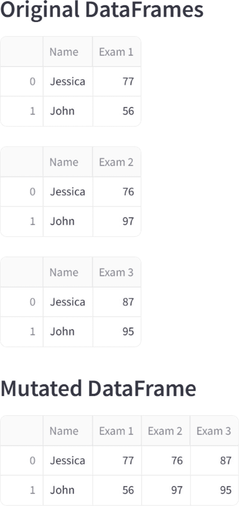

**图 2-14** 合并 Pandas DataFrame（代码清单 2-12 的输出）

```
import streamlit as st
import pandas as pd
# Create the first DataFrame (df1)
df1 = pd.DataFrame(data={'Name': ['Jessica', 'John'],
'Exam 1': [77, 56]})
# Create the second DataFrame (df2)
df2 = pd.DataFrame(data={'Name': ['Jessica', 'John'],
'Exam 2': [76, 97]})
# Create the third DataFrame (df3)
df3 = pd.DataFrame(data={'Name': ['Jessica', 'John'],
'Exam 3': [87, 95]})
# Display the original dataframes
st.subheader('Original DataFrames')
st.dataframe(df1)
st.dataframe(df2)
st.dataframe(df3)
# Merge the dataframes on 'Name' column using inner join
df_merged = df2.merge(df3, how='inner', on='Name')
df_merged = df1.merge(df_merged, how='inner', on='Name')
# Display the mutated dataframe after merging
st.subheader('Mutated DataFrame')
st.dataframe(df_merged)
```

**代码清单 2-12** `mutate_dataframe_merge.py`

### 2.2.7 数据编辑器

Streamlit 的`st.data_editor`小部件提供了一种强大且交互式的方式，可以直接在应用中编辑 DataFrame 中的数据。此功能对于从事机器学习和数据科学应用的开发者尤其有用，它允许在运行中实时调整数据，从而节省宝贵时间。用户无需离开应用或手动编辑源代码，即可更新、添加或删除数据条目。通过`st.data_editor`小部件所做的更改会立即反映在 DataFrame 中，使得尝试不同数据配置并实时查看结果变得更加容易。

除了交互功能外，`st.data_editor`小部件还支持多种自定义选项，以满足特定的编辑需求。开发者可以配置该小部件来允许或限制某些类型的编辑，从而确保数据完整性。

## 2.3 渲染静态和交互式图表

数据可视化是 Streamlit 真正擅长的领域。创建和显示各种静态与交互式图表的便捷性令人印象深刻。Streamlit 原生支持多种图表，包括但不限于条形图、折线图和面积图，以及图形、地图和其他类型的交互式与非交互式可视化。此外，还有许多第三方绘图库可以与 Streamlit 集成。在本节中，我们将使用 Pandas DataFrame 中的数据创建几个静态和交互式图表的示例。

### 2.3.1 静态条形图

通过将 Pandas DataFrame 输入到 Matplotlib 图形中，使用代码清单 2-13 所示的方法可以生成静态条形图。我们可以通过设置`kind='bar'`来指定图表类型。其他 Matplotlib 参数可在[`https://matplotlib.org/stable/api/_as_gen/matplotlib.pyplot.plot.html`](https://matplotlib.org/stable/api/_as_gen/matplotlib.pyplot.plot.html)找到。生成的图表如图 2-15 所示。

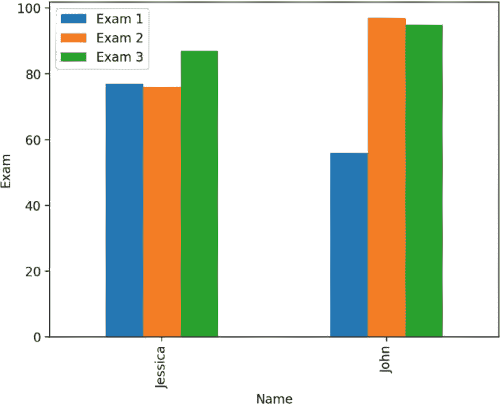

**图 2-15** 生成静态条形图（代码清单 2-13 的输出）

```
import streamlit as st
import pandas as pd
import matplotlib.pyplot as plt
# Create a DataFrame
df = pd.DataFrame(data={'Name': ['Jessica', 'John'],
'Exam 1': [77, 56],
'Exam 2': [76, 97],
'Exam 3': [87, 95]})
# Set the 'Name' column as the index and plot the bar chart
df.set_index('Name').plot(kind='bar', stacked=False, xlabel='Name', ylabel='Exam')
# Display the plot using Streamlit
st.pyplot(plt)
```

**代码清单 2-13** `static_bar_chart.py`

### 2.3.2 静态折线图

类似地，通过将 Pandas DataFrame 输入到 Matplotlib 图形中，使用代码清单 2-14 所示的方法可以生成静态折线图。我们可以通过设置`kind='line', subplots=True`来指定图表类型以及是否使用子图选项。其他 Matplotlib 参数可在[`https://matplotlib.org/stable/api/_as_gen/matplotlib.pyplot.plot.html`](https://matplotlib.org/stable/api/_as_gen/matplotlib.pyplot.plot.html)找到。生成的图表如图 2-16 所示。

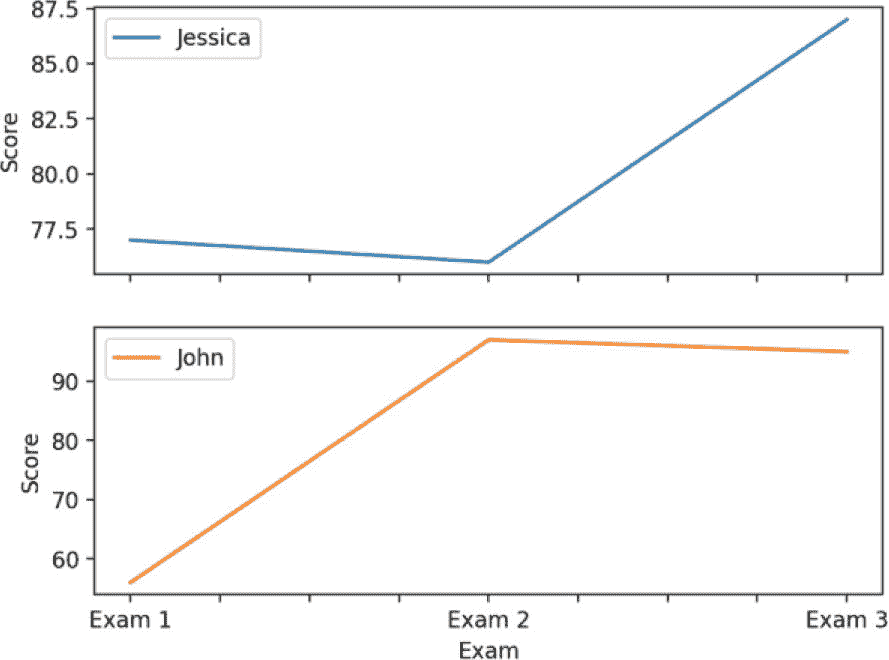

**图 2-16** 生成静态折线图（代码清单 2-14 的输出）

```
import streamlit as st
import pandas as pd
import matplotlib.pyplot as plt
# Create a DataFrame
df = pd.DataFrame(data={'Exam': ['Exam 1', 'Exam 2', 'Exam 3'],
'Jessica': [77, 76, 87],
'John': [56, 97, 95]})
# Set 'Exam' as the index and plot the line chart
df.set_index('Exam').plot(kind='line', xlabel='Exam', ylabel='Score', subplots=True)
# Display the plot using Streamlit
st.pyplot(plt)
```

**代码清单 2-14** `static_line_chart.py`

### 2.3.3 交互式折线图

通过使用清单 2-15 所示的方法，将 `Pandas` 数据框输入到 `Plotly` 图形中，即可生成交互式折线图。我们可以使用所有 `Plotly` 图表和图形通用的 JSON 表示法来声明图表类型及其相关属性。我们还可以通过 `st.plotly_chart` 组件中的 `on_select` 参数，以交互方式返回图表上选定的数据点。其他 `Plotly` 参数可在 [`https://plotly.com/python/line-charts/`](https://plotly.com/python/line-charts/%3B) 找到；我们将在第 4.2 节更深入地介绍 `Plotly` 折线图。生成的图表如图 2-17 所示。

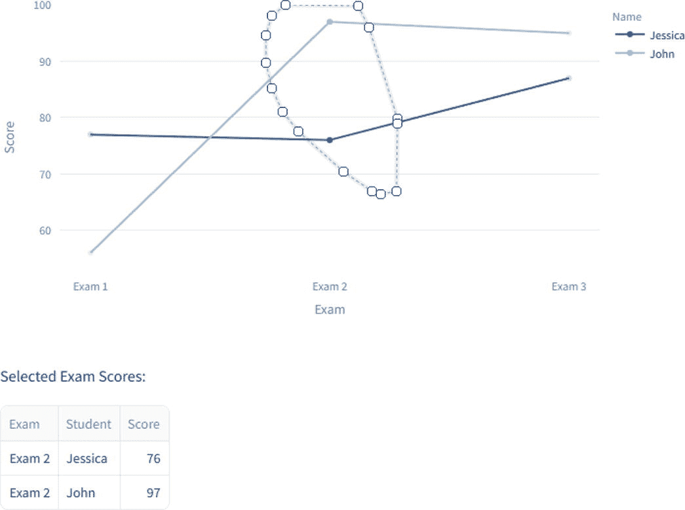

图 2-17

生成交互式折线图（清单 2-15 的输出）

```
import streamlit as st
import pandas as pd
import plotly.graph_objects as go
# Create a DataFrame
df = pd.DataFrame(data={
'Exam': ['Exam 1', 'Exam 2', 'Exam 3'],
'Jessica': [77, 76, 87],
'John': [56, 97, 95]
})
# Create the plotly figure with line plots
fig = go.Figure(data=[
go.Scatter(name='Jessica', x=df['Exam'], y=df['Jessica'], mode='lines+markers'),
go.Scatter(name='John', x=df['Exam'], y=df['John'], mode='lines+markers')
])
# Update the layout
fig.update_layout(
xaxis_title='Exam',
yaxis_title='Score',
legend_title='Name',
)
# Display the plot using Streamlit with selection enabled
event = st.plotly_chart(fig, on_select='rerun')
# Access selected points
if event and event.selection:
selected_data = []
for point in event.selection.points:
selected_data.append({
'Exam': point['x'],
'Student': point['curve_number'],
'Score': point['y']
})
# Map curveNumber to student names
for item in selected_data:
item['Student'] = fig.data[item['Student']].name
st.write('Selected Exam Scores:')
st.dataframe(selected_data)
```

`Listing 2-15`
`interactive_line_chart.py`

### 2.3.4 交互式地图

同样地，通过使用清单 2-16 所示的方法，将包含一组点经纬度的 `Pandas` 数据框输入到 `Plotly` 图形中，即可生成交互式地理空间地图。此外，我们可以通过设置 `geo_scope='usa'` 来指定要放大的精确地理位置。其他 `Plotly` 参数可在 [`https://plotly.com/python/scatter-plots-on-maps/`](https://plotly.com/python/scatter-plots-on-maps/%3B) 找到；我们将在第 4.2 节更深入地介绍 `Plotly` 地理空间图表。生成的地图如图 2-18 所示。


图 2-18

生成交互式地图（清单 2-16 的输出）

```
import streamlit as st
import pandas as pd
import plotly.graph_objects as go
# Data with university locations
df = pd.DataFrame(data={'university': ['Harvard University', 'Yale University', 'Princeton University',
'Columbia University', 'Brown University', 'Dartmouth University',
'University of Pennsylvania', 'Cornell University'],
'latitude': [42.3770, 41.3163, 40.3573, 40.8075, 41.8268, 43.7044, 39.9522, 42.4534],
'longitude': [-71.1167, -72.9223, -74.6672, -73.9626, -71.4025, -72.2887, -75.1932, -76.4735]
})
# Create the scattergeo plot
fig = go.Figure(data=go.Scattergeo(
lon=df['longitude'],
lat=df['latitude'],
text=df['university'],
mode='markers',
marker=dict(size=10, color='red', opacity=0.7)
))
# Update the layout to focus on the USA and set additional map properties
fig.update_layout(
geo_scope='usa',
geo=dict(
projection_type='albers usa',
showland=True,
landcolor='lightgray',
subunitwidth=1,
))
# Display the map using Streamlit
st.plotly_chart(fig)
```

`Listing 2-16`
`interactive_map.py`

## 2.4 开发用户界面

通常，为 Web 应用程序开发用户界面需要一套与图形设计和可用性研究相关的单独技能。前端开发人员首先通过绘制线框图来构思他们的想法，该线框图可以划分页面元素。然后，通过反复优化和测试，最终确定用户界面。`Streamlit` 通过其直观、响应迅速且标准化的界面大大简化了这一过程，使开发人员无需担心复杂的设计细节即可渲染网页。

换句话说，`Streamlit` 界面是即插即用的，使开发人员能够专注于程序的逻辑，同时将可视化实现留给 `Streamlit`。然而，对于那些需要更多定制化功能的人来说，他们可以集成自己的 HTML 和/或 JavaScript 组件。可定制性和外部组件将在后续章节中介绍。

在本节中，我们将开发一个类似于前一章中的数据框演示应用程序的应用程序，以此作为创建基本用户界面的示例。

```
import streamlit as st
import pandas as pd
import plotly.express as px
# Sidebar for program selection
program = st.sidebar.selectbox('Select program', ['Dataframe Demo', 'Other Demo'])
code = st.sidebar.checkbox('Display code')
# Program logic
if program == 'Dataframe Demo':
    df = px.data.stocks()
    st.title('DataFrame Demo')
    # Multiselect for stock selection
    stocks = st.multiselect('Select stocks', df.columns[1:], default=df.columns[1:])
    # Displaying stock data as a DataFrame
    st.subheader('Stock value')
    st.write(df[['date'] + stocks].set_index('date'))
    # Plotting a Plotly line chart
    fig = px.line(df, x='date', y=stocks, hover_data={'date': '|%Y %b %d'})
    st.write(fig)
    # Displaying the code when checkbox is selected
    if code:
        st.code(
            """
import streamlit as st
import pandas as pd
import plotly.express as px
df = px.data.stocks()
st.title('DataFrame Demo')
program = st.sidebar.selectbox('Select program', ['Dataframe Demo', 'Other Demo'])
code = st.sidebar.checkbox('Display code')
if program == 'Dataframe Demo':
    df = px.data.stocks()
    st.title('DataFrame Demo')
    stocks = st.multiselect('Select stocks', df.columns[1:], default=df.columns[1:])
    st.subheader('Stock value')
    st.write(df[['date'] + stocks].set_index('date'))
    fig = px.line(df, x='date', y=stocks, hover_data={'date': '|%Y %b %d'})
    st.write(fig)
            """
        )
elif program == 'Other Demo':
    st.title('Other Demo')
```

`Listing 2-17 dataframe_demo.py`

与往常一样，我们首先导入此应用程序所需的所有依赖项，即 `Streamlit`、用于数据框处理的 `Pandas`，以及用于绘制几个蓝筹股价值随时间变化的简单时间序列图表的 `Plotly Express`。然后，我们从 `Plotly` 的可用开源数据集列表中下载一个数据集，并通过调用 `st.title` 命令来初始化我们的用户界面。

接下来，我们添加一个 `st.sidebar.selectbox` 命令来定义此应用程序的程序/页面列表。然后，我们在侧边栏上添加一个复选框，使用 `st.sidebar.checkbox` 命令来显示我们的代码。通过添加适当的前缀 `st.sidebar`，可以将组件添加到侧边栏。然后，我们使用 `st.multiselect` 命令来选择我们想要可视化的股票列表。选择结果将过滤包含股票价值的数据框，过滤后的数据将使用 `st.write` 命令显示。

随后，我们将使用过滤后的数据框，并参考 [https://plotly.com/python/time-series/](https://plotly.com/python/time-series/)，利用 `Plotly` 创建一个时间序列折线图。图表生成后，可以通过 `st.write` 命令来显示，该命令因其几乎能渲染任何内容的通用性而被称为 *瑞士军刀*。最后，如果用户选中了复选框，我们将使用 `st.code` 命令来展示我们的代码片段。至此，您就完成了一个仅用 40 多行代码构建的基本数据框应用（图 2-19 和 2-20）。

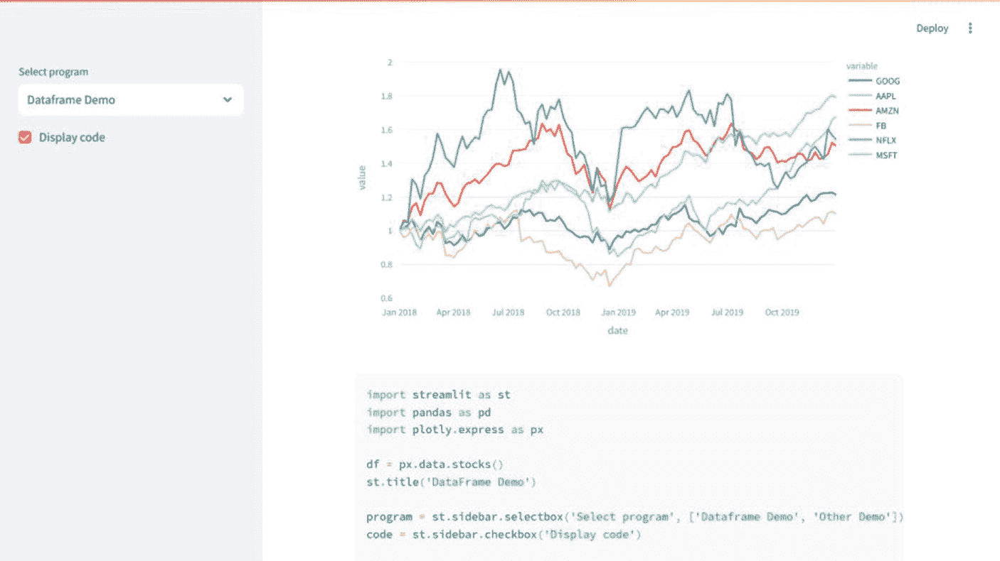

图 2-20 数据框演示应用续（清单 2-17 的输出）

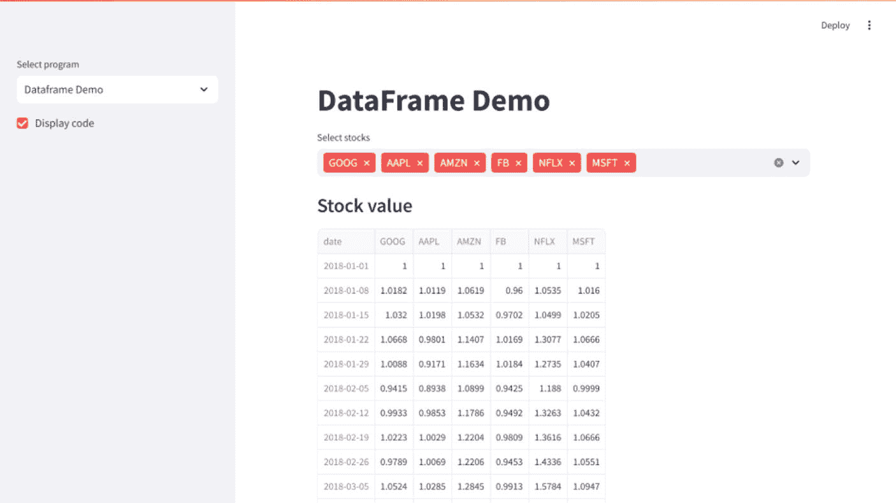

图 2-19 数据框演示应用（清单 2-17 的输出）

## 2.5 总结

本章内容确实非常详尽。至此，您应该已经非常熟悉 `Streamlit` 的核心原则和功能了。您探索了 `Streamlit` API 中的多种命令，涵盖了从显示文本、表格和图表到渲染交互式小部件和多媒体对象的各个方面，以及允许您组织页面并优化 `Streamlit` 以高效处理大数据的命令。在本章后半部分，我们重点介绍了创建简单 Web 应用的基础知识。这包括创建表单、实现条件流程、管理异常、数据变更、渲染各种可视化内容，以及将所有元素整合到一个统一的用户界面中。简而言之，在回顾本章后，您应该对自己能够开始使用 `Streamlit` 开发基本 Web 应用充满信心。
