# 3. 开发用户界面

使用 Streamlit，开发者可以专注于实现后端逻辑，同时依赖框架处理大部分前端任务。此外，Streamlit 允许您轻松为 PC、平板和移动平台创建响应式界面，且无需额外开销。然而，如果需要更定制化和适配性更强的应用，Streamlit 提供了相当大的前端定制自由度，而无需任何 HTML、CSS 或 JavaScript 知识。开发者可以通过图形界面和编程方式，为其应用配置各种配色方案、字体和外观。

Streamlit 还允许您通过结合使用侧边栏、列、折叠器和容器来有效地构建和组织网页。这些元素协同工作，在优化页面空间使用的同时提升用户体验。此外，占位符和进度条允许您按需或响应事件来渲染动态内容。最重要的是，Streamlit 支持创建多页面和嵌套子页面，从而实现了高度模块化和可扩展的应用开发方法。

## 3.1 设计应用

在设计 Streamlit 应用时，我们可以利用其广泛的本地方法来完全按照需求定制页面。从配色方案和主题，到列、折叠器、侧边栏和占位符，设计的可能性几乎是无限的。

### 3.1.1 配置页面

使用 Streamlit，您可以配置网页的各种属性，例如页面布局、初始侧边栏状态、页面标题（显示在浏览器中）、图标、汉堡菜单状态、页脚等。虽然其中一些设置可以直接在脚本中配置，但其他设置必须在全局配置文件`/.streamlit/config.toml`中设置，如第 1.2 节所述。

#### 基本页面配置

清单 3-1 可用于配置页面标题、图标、布局、初始侧边栏状态和菜单项，如图 3-1 所示。请注意，页面图标支持`.ico`文件，您可以使用`Pillow`包来导入和处理图像。页面布局可以设置为`centered`（居中）或`wide`（宽屏），而初始侧边栏状态可以配置为`auto`（自动）、`expanded`（展开）或`collapsed`（折叠）。此外，您可以在汉堡菜单中自定义以下一个或多个页面：*Get help*（获取帮助）、*Report a bug*（报告错误）或 *About*（关于）。获取帮助和报告错误页面只能通过 URL 实例化，以将用户重定向到另一个网页。而 *About*（关于）页面可以显示为模态窗口，如图 3-2 所示。

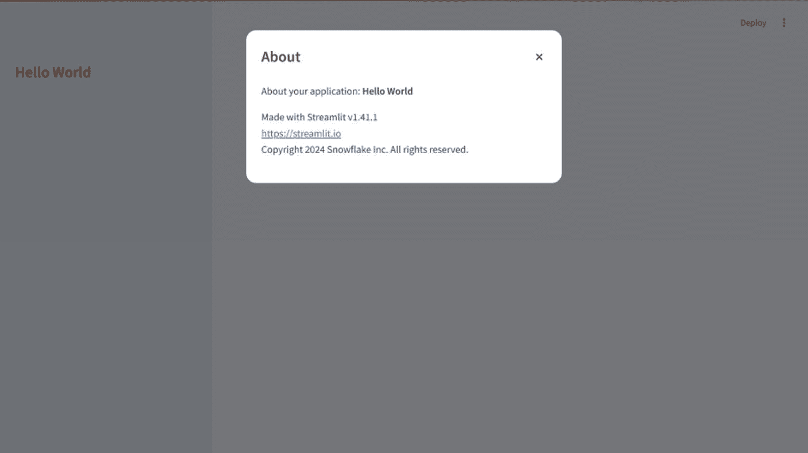

图 3-2

显示关于模态窗口

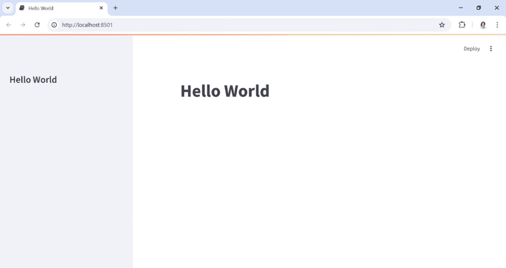

图 3-1

使用清单 3-1 配置的 Streamlit 页面

```python
import streamlit as st
from PIL import Image
icon = Image.open('favicon.ico')
# Page configuration
st.set_page_config(
page_title='Hello World',
page_icon=icon,
layout='centered',
initial_sidebar_state='auto',
menu_items={
'Get Help': 'https://streamlit.io/',
'Report a bug': 'https://github.com',
'About': 'About your application: **Hello World**'
}
)
# Set up titles
title = 'Hello World'
st.sidebar.title(title)
st.title(title)
```

清单 3-1

page_config. py

#### 移除页脚和汉堡菜单

你可以使用代码清单 3-2 中所示的命令移除 Streamlit 提供的默认页脚以及整个汉堡菜单。最终输出效果如图 3-3 所示。但请注意，虽然修改 CSS 在当前版本的 Streamlit 中可能有效，但若未来版本内部实现发生变更，此方法将无法保证仍能正常运行。

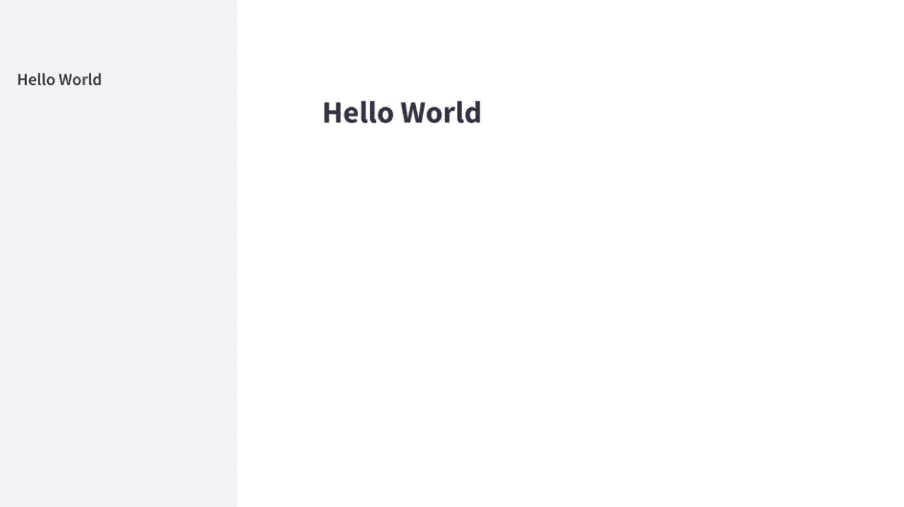

**图 3-3** — 从页面移除页脚和汉堡菜单

```
# Custom CSS to hide header and footer
hide_streamlit_style = """

/* Hide Streamlit header */
header {
visibility: hidden;
}
/* Hide Streamlit footer */
footer {
visibility: hidden;
}

"""
st.markdown(hide_streamlit_style, unsafe_allow_html=True)
```

代码清单 3-2
remove_footer_menu. py

#### 添加自定义页脚

此外，你可以使用代码清单 3-3 中所示的`markdown`命令添加自定义页脚。最终输出效果如图 3-4 所示。

```
# Add custom footer to the sidebar
custom_footer_style = """

Hello world v 0.1
Hello world LLC.

"""
st.sidebar.markdown(custom_footer_style, unsafe_allow_html=True)
```

代码清单 3-3
footer. py

#### 高级页面配置

除了 Streamlit 网页的基本可配置设置外，还可以通过修改全局配置文件`/.streamlit/config.toml`来调整许多其他参数，这一点在前文第 1.2 节中已讨论过。这些参数包括全局、日志记录器、客户端、运行器、服务器、浏览器、Mapbox、弃用、AWS S3 以及主题配置的设置，具体如表 3-1、3-2 和 3-3 所示。有关更多详细信息，请参阅 [`https://docs.streamlit.io/library/advanced-features/configuration`](https://docs.streamlit.io/library/advanced-features/configuration)。配置网页主题的示例如清单 3-4 所示。

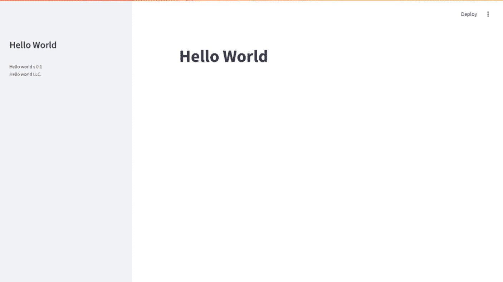

**图 3-4** 添加自定义页脚

**表 3-3** `config.toml` 文件参数（续—2）

| 配置选项 |
| --- |
| `[mapbox]` |
| • `token = ' '` |
| 此参数用于指定自定义 Mapbox 元素的令牌；更多信息请参阅 [`www.mapbox.com/`](http://www.mapbox.com/)。 |
| `[theme]` |
| • `base =` |
| 此参数用于指定与自定义主题配合使用的 Streamlit 主题；可选值为 `'light'` 或 `'dark'`。 |
| • `primaryColor =` |
| 此参数用于指定 Streamlit 交互元素使用的颜色十六进制代码。 |
| • `backgroundColor =` |
| 此参数用于指定 Streamlit 页面主要内容区域使用的颜色十六进制代码。 |
| • `secondaryBackgroundColor =` |
| 此参数用于指定侧边栏使用的颜色十六进制代码。 |
| • `textColor =` |
| 此参数用于指定文本使用的颜色十六进制代码。 |
| • `font =` |
| 此参数用于指定文本使用的字体；可选值为 `'sans serif'`、`'serif'` 或 `'monospace'`。 |
| `[secrets]` |
| • `files =` |

# 3.1.1 配置参数

**表 3-1** `config.toml` 文件参数

| 配置选项 |
| --- |
| `[global]` |
| • `disableWidgetStateDuplicationWarning = False` |
| Streamlit 监控器会检查是否通过会话状态和小部件键为小部件设置了重复值。如果此参数被禁用，Streamlit 在发现重复值时将不会显示警告消息。 |
| • `showWarningOnDirectExecution = True` |
| 当此参数设置为 `true` 时，尝试使用 `python script.py` 运行脚本时，Streamlit 将显示警告。 |
| `[logger]` |
| • `level = 'info'` |
| 为 Streamlit 内部日志记录器指定的日志记录级别。可用选项包括 `'error'`、`'warning'`、`'info'` 和 `'debug'`。 |
| • `messageFormat = '%(asctime)s %(message)s'` |
| 此参数将指定日志消息的字符串格式。 |
| `[client]` |
| • `showErrorDetails = 'full'` |
| 控制是否在浏览器中显示未捕获的异常和/或弃用警告。可用选项包括 `'full'`、`'stacktrace'`、`'type'`、`'none'`、`True` 和 `False`。 |
| • `toolbarMode = 'auto'` |
| 控制位于应用程序工具栏、选项和设置菜单中的项目的可见性。可用选项包括 `'auto'`、`'developer'`、`'viewer'` 和 `'minimal'`。 |
| • `showSidebarNavigation = True` |
| 控制是否在多页面应用程序中显示侧边栏页面导航。 |
| `[runner]` |
| • `magicEnabled = True` |
| 将此参数设置为 `true` 将允许您在 `st.write` 命令之外编写字符串和变量。 |
| • `fastReruns = True` |
| 将此参数设置为 `true` 将立即处理脚本重新运行请求，从而使应用程序响应更快。 |
| • `enforceSerializableSessionState = False` |
| 将此参数设置为 `true` 将在会话状态中添加不可序列化的数据时引发异常。 |
| • `enumCoercion = 'nameOnly'` |
| 控制某些小部件（如 `radio`、`selectbox` 和 `multiselect` 小部件）如何强制转换枚举数值。可用选项包括 `'off'`、`'nameOnly'` 和 `'nameAndValue'`。 |

**表 3-2** `config.toml` 文件参数（续—1）

| 配置选项 |
| --- |
| `[server]` |
| • `folderWatchBlacklist = [ ]` |
| 此参数指定 Streamlit 不应检查更改的文件夹列表。 |
| • `fileWatcherType = 'auto'` |
| 将此参数设置为 `auto` 将确保 Streamlit 在可用时使用 `watchdog` 模块；`watchdog` 将强制 Streamlit 使用 `watchdog` 模块；`poll` 强制 Streamlit 使用轮询；`none` 将阻止 Streamlit 检查文件。 |
| • `cookieSecret = 'key'` |
| 此参数用于指定生成 Cookie 的密钥；如果未设置，Streamlit 将随机分配一个值。 |
| • `headless = False` |
| 将此参数设置为 `false` 将强制 Streamlit 在浏览器窗口中启动应用程序。 |
| • `runOnSave = False` |
| 将此参数设置为 `true` 将强制 Streamlit 在重新保存脚本时自动运行该脚本。 |
| • `address =` |
| 此参数用于指定服务器监听客户端和/或浏览器连接的地址。 |
| • `port = 8501` |
| 此参数用于指定服务器监听浏览器连接的端口。 |
| • `baseUrlPath = 'URL'` |
| 此参数用于指定提供 Streamlit 应用程序的 URL 的基本路径。 |
| • `enableCORS = True` |
| 将此参数设置为 `true` 将启用跨域请求共享保护。 |
| • `enableXsrfProtection = True` |
| 将此参数设置为 `true` 将启用跨站请求伪造保护。 |
| • `maxUploadSize = 200` |
| 此参数用于指定最大可上传文件大小（以兆字节为单位）。 |
| • `maxMessageSize = 200` |
| 此参数用于指定通过 WebSocket 连接可发送的最大消息大小。 |
| • `enableWebsocketCompression = False` |
| 将此参数设置为 `true` 将启用对 WebSocket 压缩的支持。 |
| • `enableStaticServing = False` |
| 将此参数设置为 `true` 将允许从应用程序目录中的静态目录提供文件服务。 |
| • `disconnectionSessionTTL = 120` |
| 指定与断开连接的 WebSocket 的会话持续时间，超过此时间后，服务器可能会清理会话状态和上传的文件。 |
| • `sslCertFile =` |
| 指定用于通过 HTTPS 连接的证书文件。 |
| • `sslKeyFile =` |
| 指定用于通过 HTTPS 连接的加密密钥文件。 |
| `[browser]` |
| • `serverAddress = 'localhost'` |
| 此参数指定用户应在浏览器中输入以连接到 Streamlit 应用程序的 URL；可以是 IP 地址或带路径的 DNS。 |
| • `gatherUsageStats = True` |
| 将此参数设置为 `true` 将允许向 Streamlit 发送使用统计数据。 |
| • `serverPort = 8501` |
| 此参数设置用户浏览器指向的端口，以便连接到 Streamlit 应用程序。 |

指定将搜索密钥的位置列表。可以是 TOML 文件的路径，也可以是 Kubernetes 风格的密钥。

## 3.1.2 开发主题和配色方案

Streamlit 允许开发者和用户通过图形界面或编程方式自定义应用程序的主题和配色方案。

### 以图形方式自定义主题

你可以从汉堡菜单中的设置菜单里选择可用的主题外观，即`Light`（浅色）或`Dark`（深色），如图 3-5 所示。此外，你还可以为以下区域选择颜色：`Primary color`（主色）、`Background color`（背景色）、`Text color`（文本色）和 `Secondary background color`（次要背景色），并可从可用字体中选择一种——`Sans serif`（无衬线字体）、`Serif`（衬线字体）或 `Monospace`（等宽字体），如图 3-6 所示。

表 3-4 提供了关于每种颜色设置及其影响的 Streamlit 元素的更多详细信息。请注意，当交互式小部件（如 `st.slider`）放置在应用程序主体中时，会使用 `Secondary background color`。但是，当小部件放置在侧边栏时，则会使用 `Background color`，如图 3-7 所示。

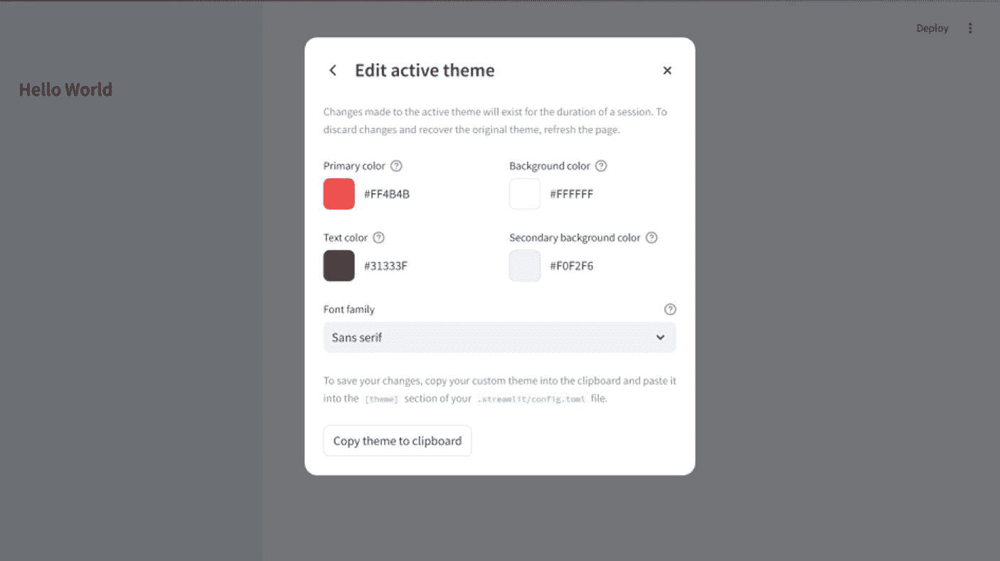

图 3-6

从设置菜单中自定义主题颜色

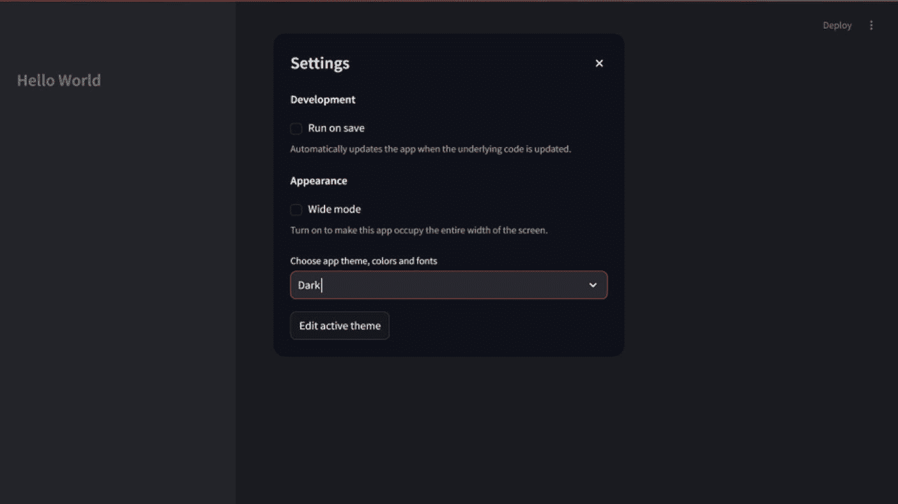

图 3-5

从设置菜单中自定义主题外观

表 3-4

主题颜色设置

| 颜色参数 | 被更改的元素 |
| --- | --- |

| Primary color（主色） | 交互式小部件，例如 `st.slider`。 |
| --- | --- |
| Background color（背景色） | 应用程序主体。 |
| Text color（文本色） | 所有文本元素。 |
| Secondary background color（次要背景色） | 侧边栏背景色。 |

#### 以编程方式自定义主题

或者，你也可以通过修改全局配置文件 `/.streamlit/config.toml` 以编程方式自定义主题的外观和颜色，如前面第 1.2 节所述。要指定主题设置，请修改 `[theme]` 参数，如下面的代码清单 3-4 所示。请注意，所使用的颜色约定是 `color HEX`（十六进制颜色码）。有关此约定的更多信息，请参考 [`www.w3schools.com/colors/colors_hexadecimal.asp`](http://www.w3schools.com/colors/colors_hexadecimal.asp)。

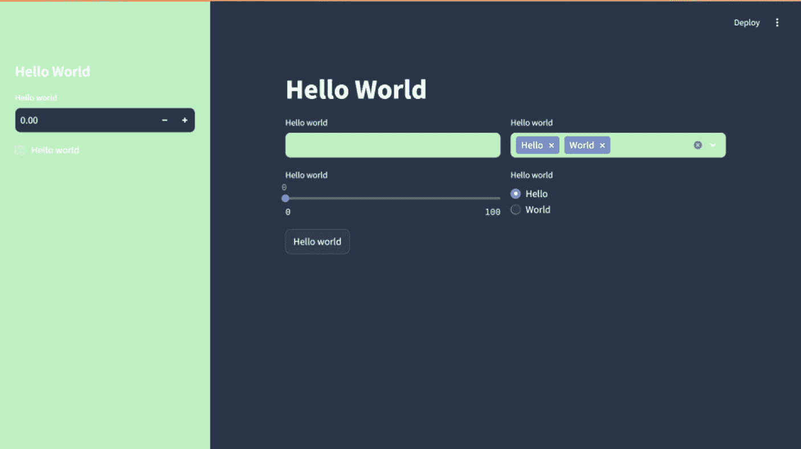

图 3-7 自定义后的主题颜色

```
[theme]
base = "light"
primaryColor = "#7792E3"
backgroundColor = "#273346"
secondaryBackgroundColor = "#B9F1C0"
textColor = "#FFFFFF"
font = "sans serif"
```

代码清单 3-4 `config.toml`

#### 在自定义组件中使用主题

如果你正在开发自定义的 Streamlit 组件，你可能需要将应用程序的主题设置传递给组件。请确保已通过运行以下命令安装了最新版本的 `streamlit-component-lib`：

```
npm install streamlit-component-lib
```

该包会自动更新自定义组件的颜色，以匹配 Streamlit 应用程序的主题设置。此外，它还能让你在 JavaScript 和/或 CSS 脚本中读取主题设置，如下所示。

对象设置可以作为 CSS 变量暴露出来，如下所示：

```
--primary-color
--background-color
--secondary-background-color
--text-color
--font
```

相应地，可以通过如下方式访问这些设置：

```
.mySelector {
color: var(--primary-color);
}
```

或者，你也可以将对象设置作为 ReactJS 属性（prop）暴露出来，并通过如下方式访问：

```
{
"primaryColor": ""
"backgroundColor": "",
"secondaryBackgroundColor": "",
"textColor": "",
"font": "",
}
```

### 3.1.3 组织页面

Streamlit 提供了多种方法来组织和自定义应用程序的前端设计。作为开发者，你可以启用侧边栏、将网页分成多列、展示可扩展框以隐藏内容，以及创建容器来组合多个小部件。组合使用这些功能，可以实现高度的自定义，并为用户提供量身定制的体验。

#### 侧边栏

使用 Streamlit，你可以通过侧边栏优雅地细分页面，侧边栏可以使用 `st.sidebar` 命令按需展开和收缩。此外，如第 3.1 节所示，你可以配置 Streamlit，使其在启动时根据屏幕尺寸保持侧边栏展开、收缩或自动调整。实际上，除了 `st.echo` 和 `st.spinner` 之外，每个 Streamlit 元素和小部件都可以在侧边栏中使用。你甚至可以在侧边栏内渲染其他页面组织功能，例如 `st.columns`、`st.expander` 和 `st.container`，如代码清单 3-5 和图 3-8 所示。

#### 扩展框

使用 Streamlit，你可以将内容折叠到扩展框中，从而更有效地利用应用程序主体或侧边栏的空间。扩展框可以按需展开和收缩，或者默认设为任一状态。此外，扩展框可以包含任何元素，包括列和容器，但不能包含嵌套的扩展框。使用扩展框的示例如代码清单 3-5 和图 3-8 所示。

#### 列

类似地，你可以使用 Streamlit 的列功能来划分主体和侧边栏，该功能可通过 `st.columns` 命令调用。你可以通过编写 `st.columns(2)` 来指定所需的列数，或者使用列表任意设置列的数量和宽度，例如 `st.columns([2, 1])`。列可以在 `with` 语句中调用，并与扩展框和容器同时使用，但它们不能相互嵌套。使用列的示例如代码清单 3-5 和图 3-8 所示。

#### 容器

如果你需要将多个小部件或元素捆绑在一起，可以使用 Streamlit 的容器功能，该功能可通过 `st.container` 命令在主体或侧边栏中调用。容器可以在 `with` 语句中调用，并且可以与列、扩展框以及嵌套容器一起使用。它们还可以按非顺序方式更改；例如，如果你在容器外显示一些文本，然后在容器内显示更多文本，那么后者将先显示。使用容器的示例如代码清单 3-5 和图 3-8 所示。

#### 弹出窗口

如果你的应用程序需要引入一个弹出窗口来渲染另一个控件，可以通过在主内容区或侧边栏中使用 `st.popover` 命令轻松实现。弹出窗口可以在 `with` 语句中调用，并能在列、扩展器和容器内渲染。唯一的限制是弹出窗口不能相互嵌套。使用弹出窗口的示例如列表 3-5 和图 3-9 所示。

#### 对话框

类似地，如果你需要根据用户操作按需显示某些信息或渲染另一个控件，可以使用 `@st.dialog()` 装饰器。该装饰器必须放置在用于定义对话框的函数之前，并可在调用该函数时渲染。请注意，如果你使用对话框收集用户输入（例如渲染 `st.selectbox` 控件），则还应包含一个 `st.button`，该按钮在按下时将用户的任何输入保存到 `st.session_state`，然后使用 `st.rerun` 命令重新运行页面。更多信息请参考列表 3-5 和图 3-10。

```
import streamlit as st
from datetime import datetime
tab1, tab2 = st.tabs(['Tab 1', 'Tab 2'])
with tab1:
    st.subheader('_Tab 1_')
    # Expander in sidebar
    st.sidebar.subheader('Expander')
    with st.sidebar.expander('Time'):
        time = datetime.now().strftime('%H:%M:%S')
        st.write(f'**{time}**')
    # Columns in sidebar
    st.sidebar.subheader('Columns')
    col1, col2 = st.sidebar.columns(2)
    with col1:
        option_1 = st.selectbox('Please select option 1', ['A', 'B'])
    with col2:
        option_2 = st.radio('Please select option 2', ['A', 'B'])
    # Container in sidebar
    container = st.sidebar.container()
    container.subheader('Container')
    option_3 = container.slider('Please select option 3')
    st.sidebar.warning('Elements outside of container will be displayed externally')
    container.info(f'**Option 3:** {option_3}')
    # Expander in main body
    st.subheader('Expander')
    with st.expander('Time'):
        time = datetime.now().strftime('%H:%M:%S')
        st.write(f'**{time}**')
    # Columns in main body
    st.subheader('Columns')
    col1, col2 = st.columns(2)
    with col1:
        option_4 = st.selectbox('Please select option 4', ['A', 'B'])
    with col2:
        option_5 = st.radio('Please select option 5', ['A', 'B'])
    # Container in main body
    container = st.container()
    container.subheader('Container')
    option_6 = container.slider('Please select option 6')
    st.warning('Elements outside of container will be displayed externally')
    container.info(f'**Option 6:** {option_6}')
with tab2:
    # Popover in main body
    st.subheader('Popover')
    with st.popover('Popover'):
        option_7 = st.radio('Please select option 7', ['A', 'B'])
        st.write(f'**Option 7:** {option_7}')
    # Dialog box in main body
    st.subheader('Dialog box')
    @st.dialog('Option 8')
    def dialog_box():
        option_8 = st.selectbox('Please select option 8', ['A', 'B'])
        if st.button('Submit'):
            st.session_state['option_8'] = option_8
            st.rerun()
    if 'option_8' not in st.session_state:
        if st.button('Dialog box'):
            dialog_box()
    else:
        st.write(f'**Option 8:** {st.session_state['option_8']}')
```

列表 3-5 `page_organization.py`

### 占位符

占位符是 Streamlit 提供的最通用且最强大的功能之一。通过使用`st.empty`或`st.sidebar.empty`命令，你可以在应用程序主内容区或侧边栏的任何位置预留空间。这对于在特定事件或触发后按需显示内容，或打乱显示顺序特别有用。可以通过编写`placeholder = st.empty()`来创建占位符，并可根据需要将任何控件或元素附加到其上。例如，你可以通过编写`placeholder.info('Hello world')`来附加文本，稍后可通过分配不同的元素来替换该占位符。最后，当不再需要时，可以使用`placeholder.empty()`命令清除占位符。

### 选项卡

顾名思义，选项卡允许你使用`st.tabs`命令将应用程序组织到同一页面内的不同容器中。你可以通过指定选项卡名称来创建任意数量的选项卡，例如`tab1, tab2 = st.tabs(['Tab 1', 'Tab 2'])`。选项卡的名称将显示在页面顶部，用户可以在它们之间自由导航。每个选项卡的内容可以使用`with`语句定义。需要注意的是，与页面不同，Streamlit 默认会调用每个选项卡中的逻辑，但仅渲染被选中的选项卡。这意味着在加载页面之前，Streamlit 会执行每个选项卡的逻辑，因此导航到包含选项卡的页面可能会出乎意料地慢。使用扩展器的示例如列表 3-5 和图 3-8 所示。

## 3.2 显示动态内容

要显示持续更新的地图、图表或时钟等动态内容，你可以将元素放入一个占位符中，并在 `for` 循环或 `while` 循环中调用它，以遍历该元素的多个实例。这样，元素就会呈现出动态效果，其状态会随着每次循环迭代而不断变化。动态内容的一个示例是使用占位符构建的时钟应用，如代码清单 3-6 和图 3-11 及 3-12 所示。在此案例中，使用了一个 `while` 循环来持续更新 `st.info` 元素以显示当前时间，直到达到预设的时间点，此时占位符被清除，`while` 循环结束。


图 3-12 代码清单 3-6 的输出（续）

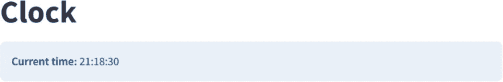

图 3-11 代码清单 3-6 的输出

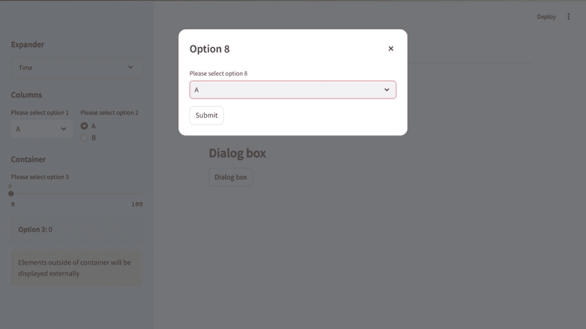

图 3-10 使用代码清单 3-5 显示对话框小部件

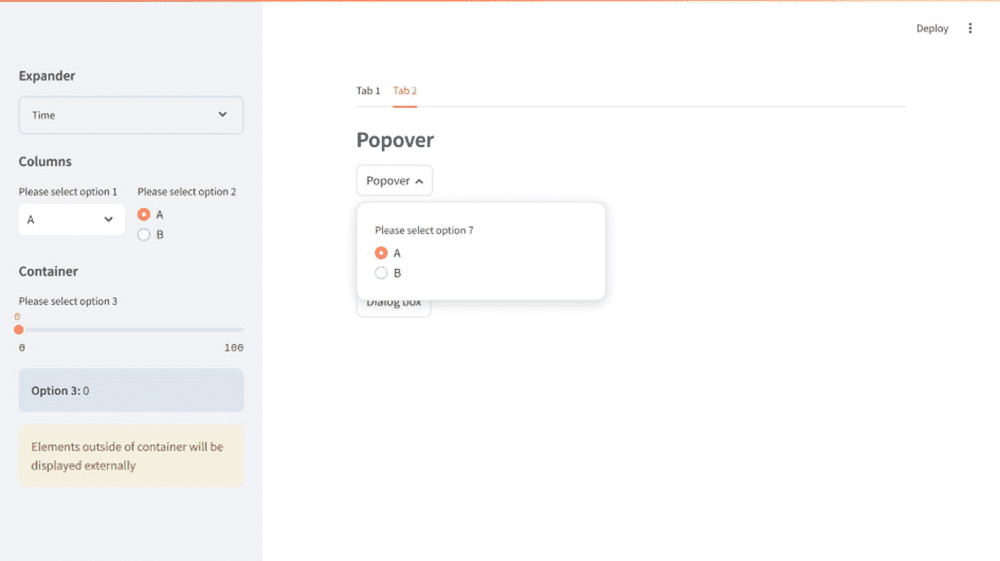

图 3-9 使用代码清单 3-5 显示弹出窗口小部件

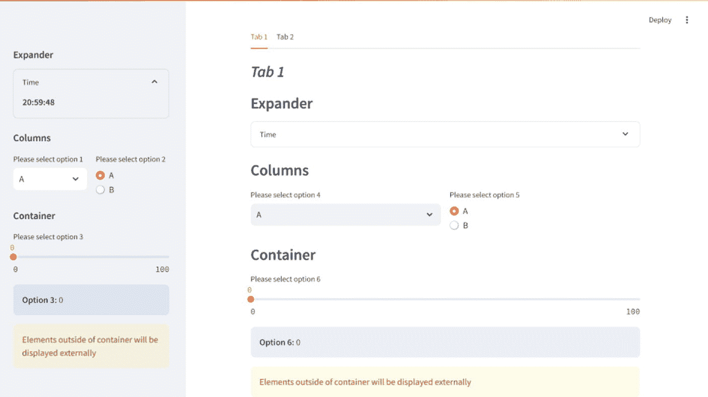

图 3-8 使用代码清单 3-5 组织页面

# 3.2 使用 Streamlit 进行数据可视化

## 3.2.1 创建实时进度条

处理大数据时，可视化下载、上传或执行耗时计算的进度会非常有帮助。用户需要清晰地看到已完成的进度以及还需等待多久才能完成该过程。为此，我们可以使用 Streamlit 的 `st.progress` 小部件，它会渲染一个进度条，显示提供给它的值，该值可以是 1 到 100 的整数，也可以是 0.0 到 1.0 的浮点数。例如，在代码清单 3-7 中，我们使用 `requests` 包可视化了从 URL 下载文件的进度。如果尚未安装，请使用 `pip install wget` 进行安装。通过 `requests`，我们可以读取以字节为单位的文件总大小和当前已下载的字节数，然后将这些数据提供给进度条进行可视化，如图 3-13 所示。


图 3-13 代码清单 3-7 的输出

```python
import streamlit as st
import requests

# 创建用于显示进度文本的空占位符
progress_text = st.empty()

# 创建一个进度条小部件，初始为 0%
progress_bar = st.progress(0)

def download_file(url, filename):
    response = requests.get(url, stream=True)
    total_size = int(response.headers.get('content-length', 0))
    with open(filename, "wb") as f:
        downloaded = 0
        for chunk in response.iter_content(chunk_size=8192):
            if chunk:
                f.write(chunk)
                downloaded += len(chunk)
        percent = int(downloaded * 100 / total_size) if total_size else 0
        # 更新进度文本和进度条
        progress_text.subheader(f'Progress: {percent}%')
        progress_bar.progress(percent)
    return filename

# 使用自定义进度条，通过 requests 下载文件
download_file('file url', 'output.file')
```

*代码清单 3-7 progress_bar.py*

## 3.3 实现多页面应用

分页和可扩展性对于任何 Web 应用都至关重要，而 Streamlit 提供了原生和非原生两种方式来解决扩展需求。简而言之，Streamlit 应用的广度只受限于想象力的极限。

### 3.3.1 创建页面

在任何 Web 应用中创建页面都是内在需求，使用 Streamlit 你可以原生地创建额外的页面来相应地组织内容。首先，你需要一个主脚本来定义应用中的页面，如代码清单 3-8 所示。接着，你可以根据需要添加任意数量的其他页面，如代码清单 3-9 和 3-10 所示，每个页面都是一个独立的脚本，位于同一目录或子目录中。你还可以在页面标题中添加图标，以便在渲染时显示，如代码清单 3-8 所示。运行应用时，每个页面都将作为一个按钮，按顺序自动显示在侧边栏中，如图 3-14 所示。

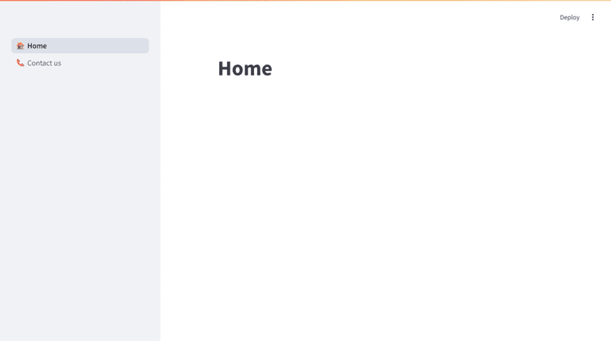

图 3-14 多页面 Streamlit 应用

```python
import streamlit as st

pg = st.navigation([st.Page('home.py', title=' Home'),
                    st.Page('contact_us.py', title=' Contact us')])
pg.run()
```

*代码清单 3-8 navigation.py*

```python
import streamlit as st

st.title('Home')
```

*代码清单 3-9 pages/1_Home.py*

```python
import streamlit as st

st.title('Contact us')
```

*代码清单 3-10 pages/2_Contact_us.py*

### 3.3.2 子页面分组

使用 Streamlit，您还可以将多个页面分组到一个下拉菜单中。例如，我们将 `Message` 和 `Address` 两个页面归入 `Contact us` 菜单下。为清晰起见，在根文件夹内创建一个名为 `contact_us` 的文件夹，并将每个页面的脚本放入其中。然后，在主脚本中以字典形式调用这些脚本，其中每个键是菜单名称，值是对应的页面。更多详情请参考图 3-15 以及列表 3-11 至 3-13。

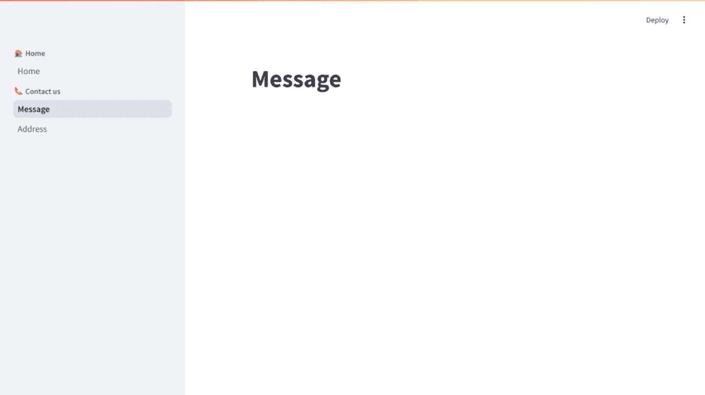

图 3-15 包含子页面的多页面 Streamlit 应用程序

```python
import streamlit as st
pages = {
' Home': [
st.Page('home.py', title='Home')
],
' Contact us': [
st.Page('contact_us/message.py', title='Message'),
st.Page('contact_us/address.py', title='Address'),
],
}
pg = st.navigation(pages)
pg.run()
```

*列表 3-11 navigation_2.py*

```python
import streamlit as st
st.title('Message')
```

*列表 3-12 contact_us/message.py*

```python
import streamlit as st
st.title('Address')
```

*列表 3-13 contact_us/address.py*

### 3.3.3 启用子 URL 路径

虽然 Streamlit 不直接支持子 URL 路径，但您可以通过使用 `st.query_params` 命令，在单页面或多页面 Streamlit 应用程序中实现显示唯一 URL 路径的效果。关于实现子 URL 路径的示例，请参见列表 3-14 和图 3-16。

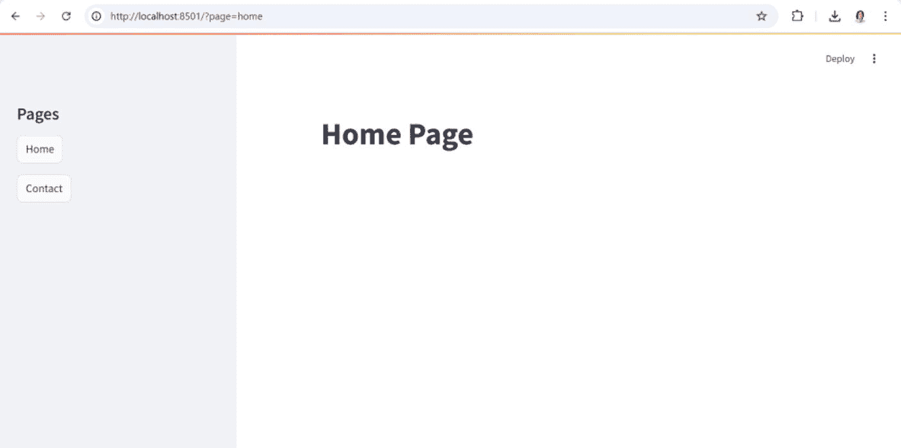

图 3-16 为应用程序启用子 URL 路径

## 代码示例

```python
import streamlit as st
# 确定当前页面
current_page = st.query_params.get('page', ['home'])
# 根据页面显示正确的内容
if current_page == 'home':
    st.title('Home Page')
elif current_page == 'contact':
    st.title('Contact Page')
# 添加链接以在子 URL 之间导航
st.sidebar.title('Pages')
if st.sidebar.button('Home'):
    st.query_params['page'] = 'home'
    st.rerun()
if st.sidebar.button('Contact'):
    st.query_params['page'] = 'contact'
    st.rerun()
```

列表 3-14 `sub_url_paths.py`

## 3.4 应用程序开发模块化

几乎在每个 Web 项目中，都需要视觉组件和代码来管理整体体验，这些组件和代码最终用户虽不直接看见，但仍能感受到。这通常被称为应用程序的业务逻辑，负责控制和管理模块间的通信，特别是在需要对用户操作做出反应或发起某个操作时，例如提示用户登录。

### 3.4.1 示例：开发一个社交网络应用

例如，一个简单的社交网络应用（如图 3-17 所示）需要创建帖子和读取信息流的组件。这两个看似简单的需求可以分解为三个主要部分：视图、操作处理服务，以及用于连接其他后端服务的数据库连接或 API（应用程序接口）客户端。在这个例子中，一切都是围绕帖子（post）进行的，意味着它应该是一个可重用的共享资源。一个像这样的基础应用程序会具有类似于图 3-18 所示的架构。

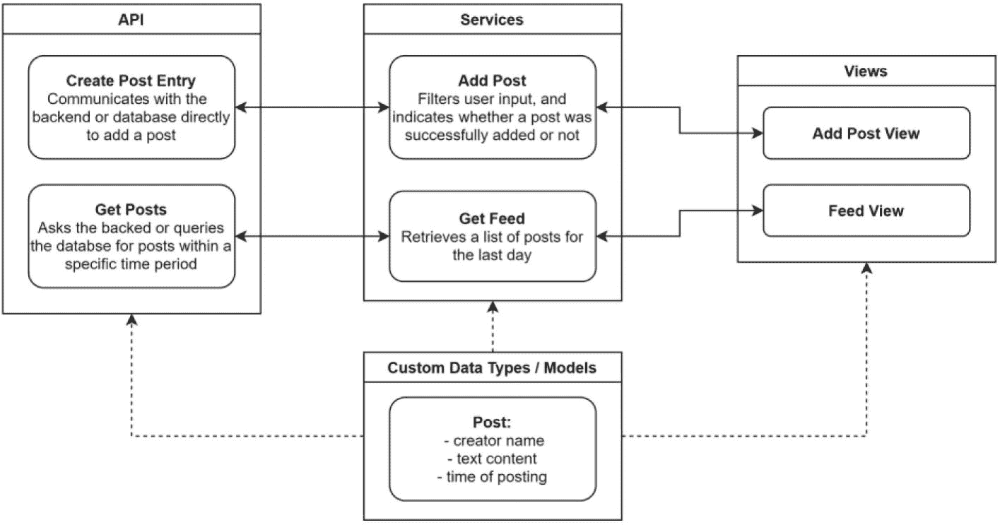

图 3-18 基础社交网络 Streamlit 架构

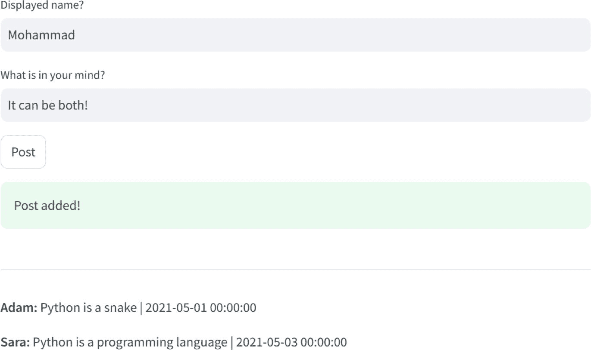

图 3-17 演示社交网络应用

要构建上述项目，应遵循自底向上的方法，从设计中最依赖的对象开始，即 `Post` 类，然后向上构建到用户可见的视图。帖子应该是一个类，如列表 3-15 和 3-16 所示，因为它将相关数据封装在一个结构中。在 Python 中，我们可以使用 `dataclasses` 装饰器来指示这是一个旨在保存数据的类。我们还可以提供一个默认的初始化函数来为声明的变量赋值。这可以被视为 C# 的 DTO（数据传输对象）的 Python 风格替代方案。

```python
from .Post import Post
```

列表 3-16 `Models/__init__.py`

```python
from dataclasses import dataclass
import datetime

@dataclass(init=True)
class Post:
    creator_name: str
    content: str
    posting_date: datetime.datetime
```

列表 3-15 `Models/Post.py`

接下来，需要一个数据源访问机制，其唯一职责是存储和写入新帖子，无论是直接存储在数据库中，还是通过可通过 HTTP 方法或消息服务（如 Kafka、RabbitMQ 或 AWS 的 SQS）访问的外部服务。对于此示例，我们假设已经构建了一个后端服务，它公开了两个方法：一个用于添加帖子，另一个用于检索两个时间戳之间的帖子，如列表 3-17 所示。

```python
from Models import Post
import datetime

class API:
    def __init__(self, config=None):
        self.config = config

    def add_post(self, post: Post):
        # 向后端发送 POST HTTP 请求以添加帖子
        # 返回 True 表示帖子已添加
        return True

    def get_posts(self, start_date: datetime.datetime, end_data: datetime.datetime):
        # 向后端发送 GET HTTP 请求以获取时间段内的帖子
        # 返回帖子列表
        return [
            Post(
                'Adam', 'Python is a snake',
                datetime.datetime(year=2021, month=5, day=1)
            ),
            Post(
                'Sara', 'Python is a programming language',
                datetime.datetime(year=2021, month=5, day=3)
            )]
```

列表 3-17 `API.py`

一旦我们的 `API` 准备就绪，就可以开始构建一个内部服务，作为可视化组件和 `API` 之间的中间件。经验丰富的开发人员通常将其称为 `Service`。

```python
from .AddPost import add_post
from .GetFeed import get_feed
```

列表 3-20 `Services/__init__.py`

```python
from API import api_instance
import datetime

def get_feed():
    # Returns the posts fed to the API instance
    to_date = datetime.datetime.now()
    from_date = to_date - datetime.timedelta(days=1)
    posts = api_instance.get_posts(from_date, to_date)
    return posts
```

列表 3-19 `Services/GetFeed.py`

```python
from API import api_instance
from Models import Post

def add_post(post: Post):
    # Check if the post is None or if any required fields are empty
    # Returns the result of addition operation
    if post is None or len(post.creator_name) == 0 or len(post.content) == 0:
        return None
    # Adding the post using the API instance
    did_add = api_instance.add_post(post)
    return did_add
```

列表 3-18 `Services/AddPost.py`

尽管由于缺少与用户交互的关键组件，该应用程序尚未完全完成，但它仍然可以作为任何软件的独立服务运行，因为它的结构是端到端的，具有明确的用途：添加帖子并以过滤数据的方式检索帖子。最后，为了与代码库的其他部分保持一致性，我们将把 Streamlit 可视化组件放置在一个类似的结构中。

此外，除了直接导入并使用服务函数外，我们还可以引入*依赖注入*的概念。这种模式在强类型语言（如 `C#` 和 `Java`）中广泛使用，它允许在需要时（例如，在创建应避免使用真实帖子的测试用例时）向类提供同一函数的不同实现。除了提高可测试性外，这种模式还因其可读性而受到许多框架的青睐。

## 3.4.2 分解应用程序的各个部分

在组织 Streamlit 应用程序时，另一个有用的实践是使用 `@st.fragment` 装饰器将小部件分解为模块化的代码片段。基本上，与其在每次发生变化时重新运行整个脚本，不如将应用程序的某些部分包裹在一个片段内。这创建了一个拥有自身状态的独立容器，仅在需要时重新执行，这对于具有大量计算或多个独立部分的应用程序特别有用。例如，请参考列表 3-24。

```python
import streamlit as st
# Define a fragment
@st.fragment
def my_fragment():
    name = st.text_input('Enter your name')
    if name:
        st.write(f'Hello, {name}!')
    st.write('This runs every time. ')
my_fragment()  # Only this part re-runs when the input changes
st.write('This also stays the same.')
```
Listing 3-24 `fragmenting.py`

## 3.4.3 文件夹结构的最佳实践

第 3.4 节讨论的示例可以将所有文件放置在项目的根文件夹中。虽然这种设置最初可能产生一个没有错误的应用程序，但随着应用程序的不断增长，它可能会让任何阅读或维护代码的人感到困惑。为了解决这个问题，我们应该将文件组织到文件夹中，并将它们作为模块公开，从而以一种干净且专业的方式更容易地将它们集成到其他 Python 脚本中。像图 3-19 中所示的文件夹结构将相似的文件分组在一起。每个子文件夹中都包含 `__init__.py` 脚本，用于将其中的文件作为模块导出，如列表 5 所示。在 `API/__init__.py` 脚本中，如列表 6 所示，我们暴露的是类的实例，而不是类本身。类实例名称前的下划线是一种命名约定，表示该属性旨在成为此脚本的私有属性。这是对开发人员尝试直接访问它时的一个警告，尤其是在会高亮显示此类命名模式的 IDE 中。

```python
from .API import API as _API
api_instance = _API()
```
Listing 3-26 `API/__init__.py`

```python
from .AddPostView import AddPostView
from .FeedView import FeedView
```
Listing 3-25 `Views/__init__.py`

值得注意的是，在列表 3-25 和 3-26 中，导入是相对于文件的路径，而不是绝对路径。从 `.AddPostView` 和 `.FeedView` 前面的“点”可以明显看出这一点。点表示被导入的文件与导入文件位于同一文件夹中，而不是在项目的根文件夹中搜索它。


图 3-19 图 3-18 的有序文件夹结构

## 3.5 总结

在本章中，我们探讨了设计 Streamlit 应用程序前端的各种方法。我们涵盖了配置配色方案和主题的方法，以及使用列、展开器、侧边栏和容器等功能组织页面，为开发人员提供了创建定制用户界面的工具。此外，我们讨论了如何使用模块化和可扩展的系统架构构建多页面和子页面应用程序。最后，我们研究了使用 Streamlit 强大的占位符功能来显示动态内容和可视化图表的方法。在下一章中，我们将深入探讨大型数据集的缓存、数据变更以及渲染静态和动态数据可视化图表的基础知识。

```python
import streamlit as st
from Views import FeedView, AddPostView
from Services import get_feed, add_post
AddPostView(add_post)
st.write('___')
FeedView(get_feed)
```
Listing 3-23 `main.py`

```python
import datetime
import streamlit as st
from Models import Post
from typing import Callable
class AddPostView:
    def __init__(self, add_post_func: Callable[[Post], bool]):
        # Adds the required fields to the post
        user_name_text = st.text_input('Displayed name? ')
        post_text = st.text_input('What is in your mind? ')
        clicked = st.button('Post')
        if clicked:
            post = Post(
                creator_name=user_name_text,
                content=post_text,
                posting_date=datetime.datetime.now()
            )
            did_add = add_post_func(post)
            if did_add:
                st.success('Post added! ')
            else:
                st.error('Error adding post')
```
Listing 3-22 `AddPostView.py`

```python
import streamlit as st
from Models import Post
from typing import Callable
class FeedView:
    def __init__(self, get_feed_func: Callable[[], list]):
        posts = get_feed_func()
        for post in posts:
            _PostView(post)
class _PostView:
    def __init__(self, post: Post):
        # Renders the feed from the posts
        st.write(f'{post.creator_name}: {post.content} | {post.posting_date}')
```
Listing 3-21 `FeedView.py`