# 4. 管理与可视化数据

与任何 Web 应用程序一样，数据管理是流程中不可或缺的一部分。随着大数据的兴起，开发能够高效、稳健地处理海量数据的技术需求日益增长。在本章中，我们将探讨一些用于管理大数据的关键方法。具体来说，我们将介绍如何将大型多媒体文件和 DataFrame 编码为字节，从而允许在数据库系统或内存中进行更稳健的存储。接下来，我们将演示 Streamlit 内置缓存功能的实用性，该功能可用于缓存数据、函数执行和对象，从而显著减少应用程序后续运行的执行时间。最后，我们将研究按需在应用程序中变更 DataFrame 和表格的技术。

在本章的第二部分，我们将深入探讨数据可视化的深度，特别关注 Python 的 Plotly 可视化库。我们将提供可用于在 Streamlit 中渲染基础、统计、时间序列、地理空间和动画数据可视化的样板脚本。

## 4.1 数据管理

在大多数（即便不是全部）Web 应用程序中，处理数据的需求都是固有的。虽然我们不会在本节深入探讨数据的前后处理，但我们将探索一些最有效的数据管理方法，特别关注大数据。

### 4.1.1 处理字节数据

根据您的应用程序，您可能需要处理二进制/字节数据。例如，您可能需要流式传输多媒体内容或将文件存储在数据库系统中。幸运的是，Streamlit 处理了处理此类数据所涉及的许多开销。通过使用 `st.image`、`st.video` 和 `st.audio` 命令，我们不仅可以原生处理磁盘上的已保存文件，还可以处理 Numpy 数组、URL，以及最重要的字节数据。

虽然结构化数据库将在第 5.1 节中更详细地介绍，但这里值得指出的是，只要列数据类型设置为 `bytea`，几乎任何字节数据都可以在 PostgreSQL 表中保存和检索。这在处理大型对象（如图像、视频和音频文件）时特别有用，这些对象需要以 BLOB（二进制大对象）的形式存储。为此，您需要按如下方式对数据进行编码。

#### 文本

字符串和文本可以简单地按如下方式编码以供存储：

```python
bytes_data = b'Hello world'
# 或者
text = 'Hello world'
bytes_data = text.encode()
```

随后，编码后的字符串或文本可以按如下方式解码：

```python
bytes_data.decode()
```

除非另有指定，上述方法中使用的默认编码是 UTF-8。

#### 多媒体

要将任何上传的图像、视频或音频文件转换为字节数据，只需使用以下代码：

```python
uploaded_file = st.file_uploader('请上传一个多媒体文件')
if uploaded_file is not None:
    bytes_data = uploaded_file.read()
```

然后，您可以使用以下命令将字节数据渲染为图像、视频或音频：

```python
# 图像
st.image(bytes_data)
# 视频
st.video(bytes_data)
# 音频
st.audio(bytes_data)
```

#### DataFrames

要读取和显示 DataFrame，您可以使用以下方法：

```python
import pandas as pd
uploaded_file = st.file_uploader('请上传一个 CSV 文件', type='csv')
if uploaded_file is not None:
    df = pd.read_csv(uploaded_file)
    st.write(df)
```

或者，要编码 DataFrame（例如，为了在数据库中作为 BLOB 数据存储），您可以使用 Python 模块 `StringIO`，它将内容（如 CSV 文件）作为文件类对象存储在内存中，也称为基于字符串的 I/O。然后，其他函数和库（如 Pandas）可以访问这些对象，如下所示：

```python
from io import StringIO
import pandas as pd
uploaded_file = st.file_uploader('请上传一个 CSV 文件', type='csv')
if uploaded_file is not None:
    stringio = StringIO(uploaded_file.getvalue().decode())
    st.write(pd.read_csv(stringio))
```

请注意，虽然您可以使用上述方法将 Pandas DataFrame 存储为基于字符串的 I/O，但您不能直接将 `StringIO` 对象存储在数据库中。要存储 Pandas DataFrame，最好使用 Pandas 命令 `dataframe.to_sql` 将其保存为表格，这将在后面的章节中详细介绍。

### 4.1.2 缓存大数据

鉴于我们可用的数据量巨大，有时可能需要将数据缓存在易失性存储器中，以便日后更快地访问。Streamlit 提供了原生方法，分别使用 `@st.cache_data` 和 `@st.cache_resource` 装饰器来缓存可以存储在数据库中的数据以及无法存储的数据。您只需编写一个返回数据或对象的函数，并在其前面加上适当的装饰器即可利用此功能。首次调用该函数时，返回的数据或对象会缓存在内存中。对于后续的每次调用，返回值将来自缓存，而不是函数本身，除非您更改函数的参数。

您可以使用代码清单 4-1 中的 Streamlit 缓存功能来衡量通过从缓存中检索 DataFrame 所节省的运行时间百分比。如图 4-1 所示，这对运行时间有显著的积极影响，尤其是在 DataFrame 增长到超过 100,000 行时。这种影响在大约 100,000,000 行时开始趋于平稳，可节省约 70% 的运行时间。

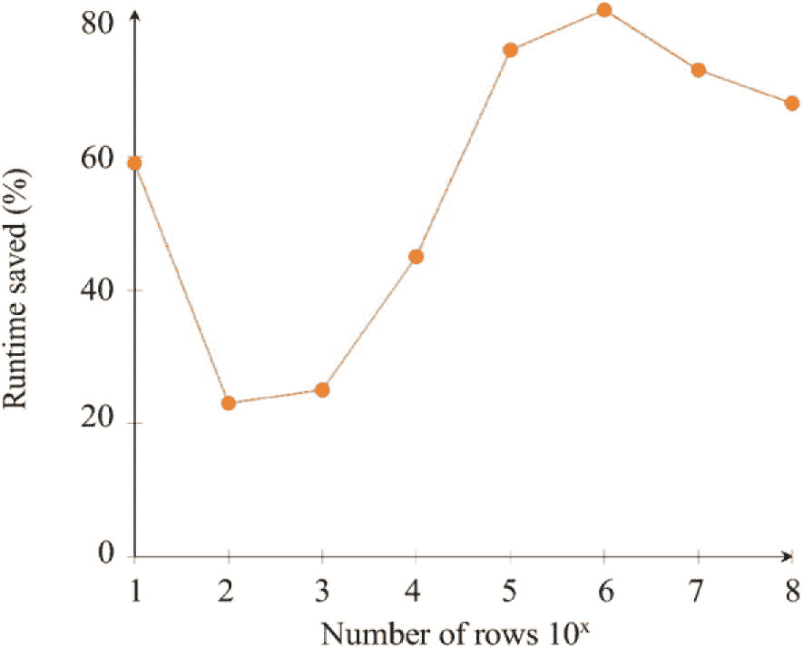

**图 4-1** 使用 `st.cache_data` 时，六次试验的平均节省运行时间百分比与行数的关系

```python
import streamlit as st
import pandas as pd
import numpy as np
import time

@st.cache_data
def dataframe(rows):
    df = pd.DataFrame(
        np.random.randn(rows, 5),
        columns=('col %d' % i for i in range(5)))
    return df

runtime = pd.DataFrame(data={
    'Number of rows': [10, 100, 1000, 10000, 100000, 1000000, 10000000, 100000000],
    'First runtime (s)': None,
    'Second runtime (s)': None,
    'Runtime saved (%)': None
})

for i in range(0, len(runtime)):
    start = time.time()
    dataframe(runtime.loc[i]['Number of rows'])
    stop = time.time()
    runtime.loc[i, 'First runtime (s)'] = stop - start

    start = time.time()
    dataframe(runtime.loc[i]['Number of rows'])
    stop = time.time()
    runtime.loc[i, 'Second runtime (s)'] = stop - start

    runtime.loc[i, 'Runtime saved (%)'] = 100 - int(100 * (runtime.loc[i, 'Second runtime (s)'] / runtime.loc[i, 'First runtime (s)']))

st.write(runtime)
```

**代码清单 4-1** `cache.py`

### 4.1.3 实时变更数据

您可能需要在应用程序中按需变更数据，特别是 DataFrame。无论是基于给定的日期时间范围过滤时间序列数据集，还是将数据追加到现有列，数据的变更通常是必要的。为此，Streamlit 提供了使用原生方式或通过第三方工具包变更数据的选项，如下面的章节所示。

#### 原生数据变更

Streamlit 提供了一种直观的原生方法，可使用 `st.add_rows` 命令向现有表格添加数据。通过此方法，您可以轻松地将一个数据帧追加到之前创建的表格中，并实时立即重新生成和查看任何关联图表，如清单 4-2 以及图 4-2 和图 4-3 所示。

```python
import streamlit as st
import pandas as pd
import random
def random_data(n):
    y = [random.randint(1, n) for value in range(n)]
    return y
if __name__ == '__main__':
    df1 = pd.DataFrame(data={'y': [1, 2]})
    # 为表格和图表创建列
    col1, col2 = st.columns([1, 3])
    with col1:
        # 使用 st.dataframe 进行动态更新
        table = st.dataframe(df1)
    with col2:
        # 显示初始图表
        chart = st.line_chart(df1)
    # 用户输入要添加的行数
    n = st.number_input('要添加的行数', 0, 10, 1)
    # 更新按钮
    if st.button('更新'):
        y = random_data(n)
        df2 = pd.DataFrame(data={'y': y})
        # 将新数据追加到现有数据帧
        table.add_rows(df2)
        chart.add_rows(df2)
清单 4-2
mutate_data_real_time.py
```

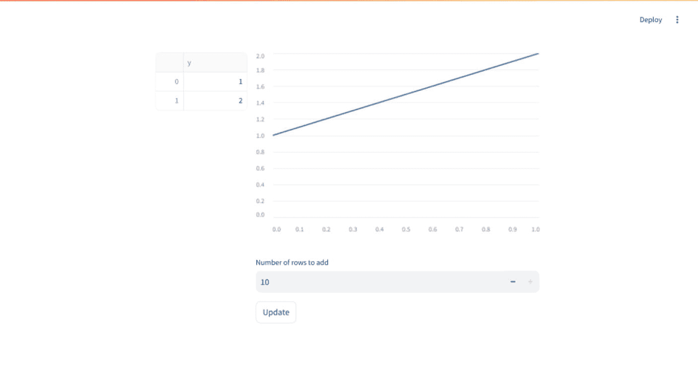

**图 4-2**
使用清单 4-2 实时变更数据

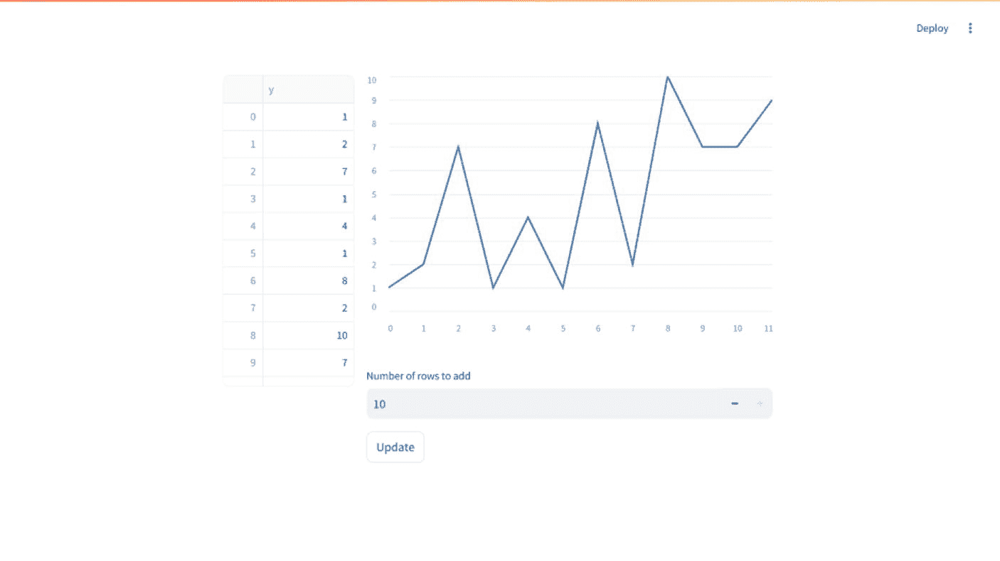

**图 4-3**
使用清单 4-2 实时变更数据（续）

### 4.1.4 高级与交互式数据变更

虽然 Streamlit 的原生数据变更方法允许您将行追加到现有数据帧和图表中，但它不提供其他高级数据操作方法，例如修改单个单元格、删除数据或过滤。幸运的是，一个名为 `streamlit-aggrid` 的、高度通用的第三方组件填补了这一空白。`streamlit-aggrid` 构建于适用于 JavaScript 框架的 AG Grid 库之上，它以交互式网格小部件的形式显示数据，允许用户通过过滤、排序、选择、更新、数据透视、聚合、查询以及许多其他方法来操作数据。有关更多功能的更多信息，请访问 [`www.ag-grid.com`](http://www.ag-grid.com/)。

要在您的 Streamlit 应用程序中使用 `streamlit-aggrid`，您首先需要初始化小部件并配置您需要的功能。然后，您可以使用 `AgGrid()` 命令插入您的 Pandas 数据帧。小部件将被渲染，其返回值（当被调用时）将以字典形式提供。要访问小部件内的数据，请从字典中检索 `data` 键。同样，要访问选中的行，您必须检索 `selected_rows` 键。数据将作为表格返回，而选中的行将作为字典列表返回。

具体来说，清单 4-3 将使您能够对任何提供的数据集执行创建、读取、更新和删除操作，如下所示：

*   **创建**：要在小部件中创建新记录，您可以简单地在数据帧末尾追加一个空行，如下所示：

```python
    index = len(df)
    df_new['data'].loc[index,:] = 'None'
    df_new['data'].to_csv(path, index=False)
    st.rerun()
```

*   **读取**：您可以通过将数据帧渲染为网格小部件来读取数据。请注意，此步骤必须在脚本中执行任何其他操作之前完成，并且小部件应使用一个与原始数据帧不同的新名称来调用：

```python
    df = pd.read_csv(path)
    df = df.fillna('None')
    index = len(df)
    gb = GridOptionsBuilder.from_dataframe(df)
    gb.configure_side_bar()
    gb.configure_default_column(groupable=True, value=True, enableRowGroup=True, aggFunc='sum',editable=True)
    gb.configure_selection(selection_mode='multiple', use_checkbox=True)
    gridOptions = gb.build()
    df_new = AgGrid(df,gridOptions=gridOptions,enable_enterprise_modules=True, update_mode=GridUpdateMode.MODEL_CHANGED)
```

*   **更新**：您可以交互式地更新小部件中每个单元格的值，并立即将修改后的值保存到磁盘，如下所示：

```python
    if not df.equals(df_new['data']):
        df_new['data'].to_csv(path, index=False)
        st.rerun()
```

*   **删除**：您也可以删除小部件中其复选框已被选中的任何行，如下所示：

```python
    if len(df_new['selected_rows']) > 0:
        exclude = pd.DataFrame(df_new['selected_rows'])
        pd.merge(df_new['data'], exclude, how='outer',
        indicator=True).query('_merge == "left_only"').drop('_merge', 1).to_csv(path, index=False)
        st.rerun()
```

此外，您可以选择使用以下方法删除重复行：

```python
df_new['data'] = df_new['data'].drop_duplicates()
df_new['data'].to_csv(path, index=False)
st.rerun()
```

请注意，对于我们的创建、更新和删除操作，我们使用 `st.rerun()` 命令在做出修改后自动重新运行脚本。这是必要的，以便在无需用户进一步输入的情况下渲染修改后的小部件。或者，您可以添加一个虚拟按钮，在用户点击时重新运行脚本并更新小部件，如下所示：

```python
if st.button('更新'):
    pass
```

最终渲染后的小部件如图 4-4 所示。

## 4.2 探索 Plotly 数据可视化

Python 中有大量的数据可视化库，其中许多都可以在 Streamlit 中轻松渲染。无论你是使用更原生的命令如 `st.vega_lite_chart`，还是求助于瑞士军刀般的 `st.write` 命令，你都可以广泛地进行数据可视化。在众多可视化库中，有一个最为突出：Plotly。它可以说是目前功能最丰富、交互性最强、视觉效果最出众的可视化工具集之一，提供了丰富的可能性。在本节中，我们将展示一些最适用于 Web 开发的图表类型。当然，下面的列表绝非详尽无遗。要获取完整的图表列表，请参阅 Plotly 官方文档 [`https://plotly.com/python/`](https://plotly.com/python/)。

### 4.2.1 在 Streamlit 中渲染 Plotly

如第 4.2 节所述，Streamlit 提供了两种原生方式来显示 Plotly 及其他类型的图表。具体来说，你可以使用常被称为“瑞士军刀”的 `st.write` 命令，只需将 Plotly 图表对象（以下称为 `fig`）写入命令即可渲染图表，如下所示：

```python
st.write(fig)
```

或者，你也可以使用功能更强大的 `st.plotly_chart` 命令来渲染 Plotly 图表：

```python
st.plotly_chart(fig, use_container_width=True)
```

你可以使用 `st.plotly_chart` 命令，并可额外添加 `use_container_width` 参数，以指定图表宽度是否应限制在其所在列的宽度范围内。

### 4.2.2 基础图表

在本节中，我们将介绍 Plotly 的折线图、散点图、柱状图和饼图。在开始之前，我们首先导入本节所需的所有库，如下所示：

# Plotly 图表可视化

为了保持一致性，我们将使用同一个随机生成的 Pandas 数据框（如下所示）作为数据集来生成每个图表：

```python
import streamlit as st
import numpy as np
import pandas as pd
import plotly.express as px
import plotly.graph_objects as go
```

```python
data = np.random.randint(0, 10, size=(40,2))
df = pd.DataFrame(data, columns=['Column 1', 'Column 2'])
```

## 折线图

```python
fig = go.Figure()
fig.add_trace(go.Scatter(x=df.index, y=df['Column 1'],
                         mode='lines',
                         name='Column 1'))
fig.add_trace(go.Scatter(x=df.index, y=df['Column 2'],
                         mode='lines',
                         name='Column 2'))
```

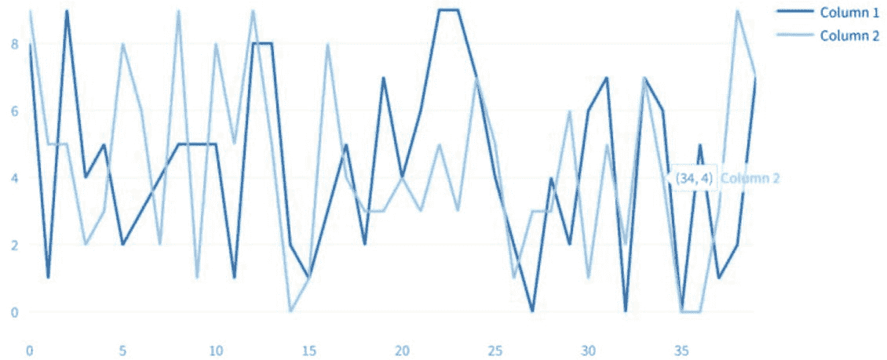

## 散点图

```python
fig = go.Figure(data=go.Scatter(
    y = df['Column 1'],
    mode='markers',
    marker=dict(
        size=10,
        color=df['Column 2'], # 设置颜色等于一个变量
        colorscale='Viridis', # 选择色阶
        showscale=True
    )
))
```

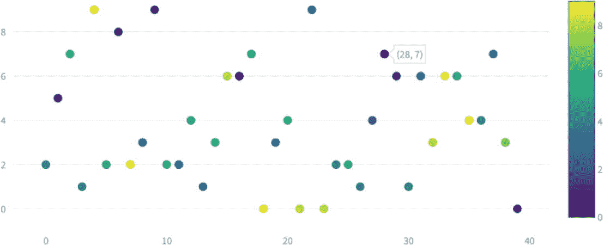

## 柱状图

```python
fig = go.Figure(data=[
    go.Bar(name='Column 1', x=df.index, y=df['Column 1']),
    go.Bar(name='Column 2', x=df.index, y=df['Column 2'])
])
```

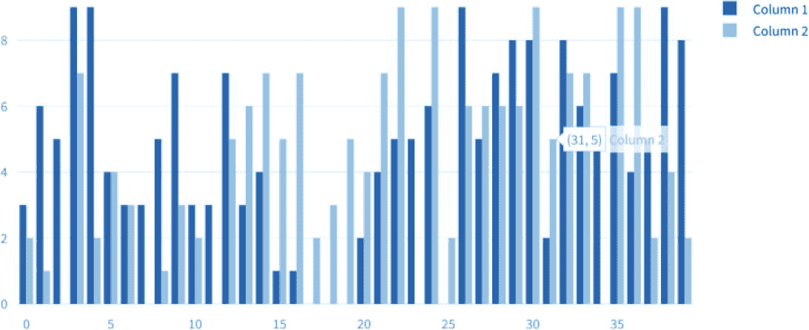

## 饼图

```python
fig = px.pie(df, values=df.sum(), names=df.columns)
```

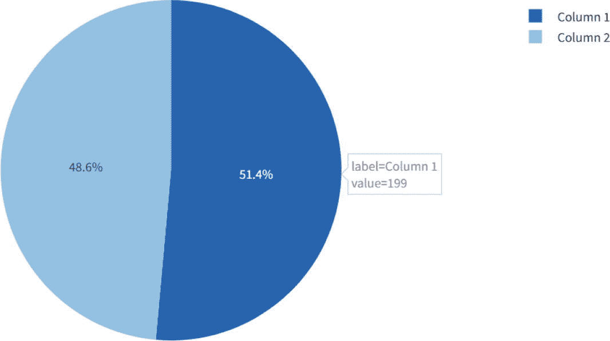

## 图表布局

要更新图表的属性和布局，可以使用 `update_layout` 方法，如下所示：

```python
fig = go.Figure(data=[
    go.Bar(name='Column 1', x=df.index, y=df['Column 1']),
    go.Bar(name='Column 2', x=df.index, y=df['Column 2'])
])
fig.update_layout(
    title='列 1 vs. 索引',
    xaxis_title='索引',
    yaxis_title='数值',
    legend_title='列',
    font=dict(
        family='Arial',
        size=10,
        color='black'
    )
)
```

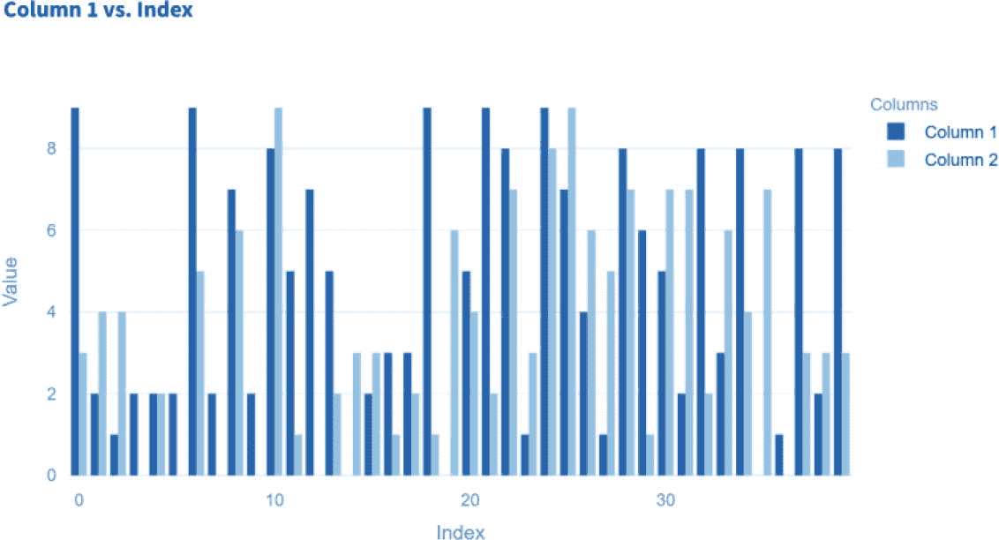

## 4.2.3 统计图表

在本节中，我们将生成一个 Plotly 直方图和箱线图。以下随机生成的数据帧将用于这两种图表：

```python
data = np.random.randn(40, 2)
df = pd.DataFrame(data, columns=['Column 1', 'Column 2'])
```

### 直方图

```python
fig = go.Figure()
fig.add_trace(go.Histogram(name='Column 1', x=df['Column 1']))
fig.add_trace(go.Histogram(name='Column 2', x=df['Column 2']))
fig.update_layout(barmode='overlay')
fig.update_traces(opacity=0.75)
```

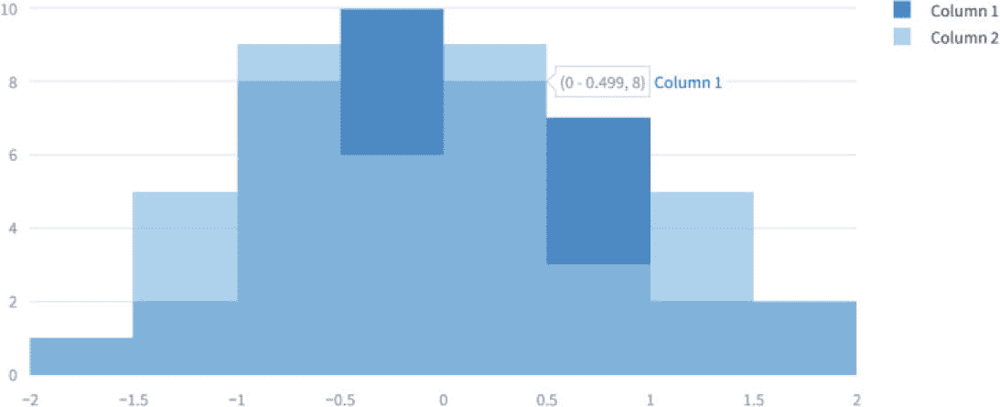

### 箱线图

```python
fig = go.Figure()
fig.add_trace(go.Box(
    y=df['Column 1'],
    name='Column 1',
    boxmean='sd' # 显示均值、中位数和标准差
))
fig.add_trace(go.Box(
    y=df['Column 2'],
    name='Column 2',
    boxmean='sd' # 显示均值、中位数和标准差
))
```

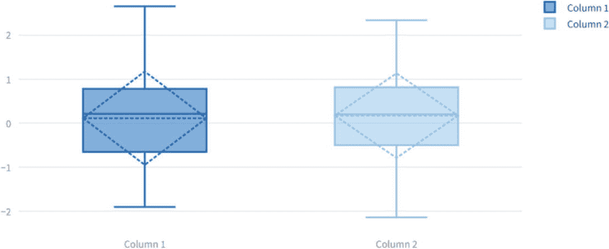

## 4.2.4 时间序列图表

时间序列图表可以使用与第 4.2 节相同的折线图函数生成；唯一的区别是提供的索引必须是日期时间格式。你可以使用以下函数创建一个包含随机生成值的 Pandas 数据帧，其索引在指定的日期范围内：

```python
data = np.random.randn(40, 2)
df = pd.DataFrame(data, columns=['Column 1', 'Column 2'])
df.index = pd.date_range(start='1/1/2018', end='2/9/2018', freq='D')
```

然后，可以按如下方式调用折线图函数：

```python
fig = px.line(df, x=df.index, y=df.columns)
```

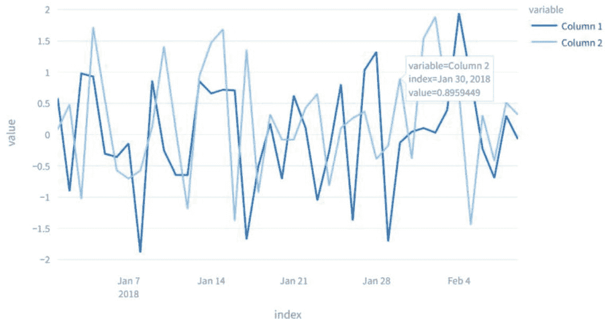

## 4.2.5 地理空间图表

根据你的应用程序需求，可能需要使用地理空间数据渲染交互式地图。幸运的是，Plotly 提供了具有广泛功能和属性的地理空间图表。在本节中，我们将重点介绍其中一种图表——等值区域图，使用一个 1990 年至 2023 年世界人均 GDP 数据集 [22]：

```python
df = pd.read_csv('gdp-per-capita-worldbank.csv').sort_values(by='Year', ascending=False)
fig = px.choropleth(df, locations=df['Code'],
                    color=df['GDP per capita, PPP (constant 2021 international $)'],
                    hover_name=df['Entity'])
```

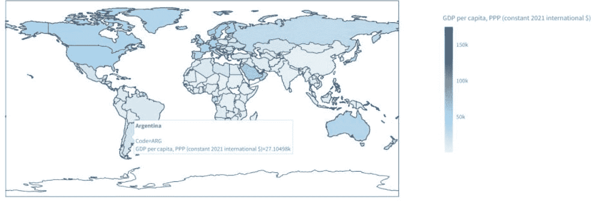

## 4.2.6 动画可视化

使用 Plotly，你可以为图表添加简单的动画。这在显示时间序列数据集中随时间变化的数值时特别有用。但是，你并不局限于时间序列数据，也可以为其他类型的数值数据添加动画效果。在本节中，我们将使用相同的 1990 年至 2023 年世界人均 GDP 数据集 [22] 来制作动画，分别使用动画气泡地图和条形图，如下所示。

### 动画气泡地图

```python
df = pd.read_csv('gdp-per-capita-worldbank.csv').sort_values(by=['Year', 'Entity'])
fig = px.scatter_geo(df, locations=df['Code'],
color=df['GDP per capita, PPP (constant 2017 international $)'],
hover_name=df['Entity'],
size=df['GDP per capita, PPP (constant 2017 international $)'],
animation_frame=df['Year'])
```

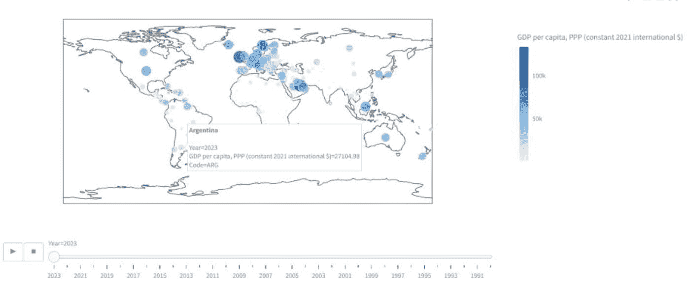

### 动画条形图

```python
df = pd.read_csv('gdp-per-capita-worldbank.csv').sort_values(by=['Year', 'Entity'])
df = df[df['GDP per capita, PPP (constant 2021 international $)'] > 50000]
fig = px.bar(df, x=df['Entity'],
y=df['GDP per capita, PPP (constant 2021 international $)'],
animation_frame=df['Year'])
```

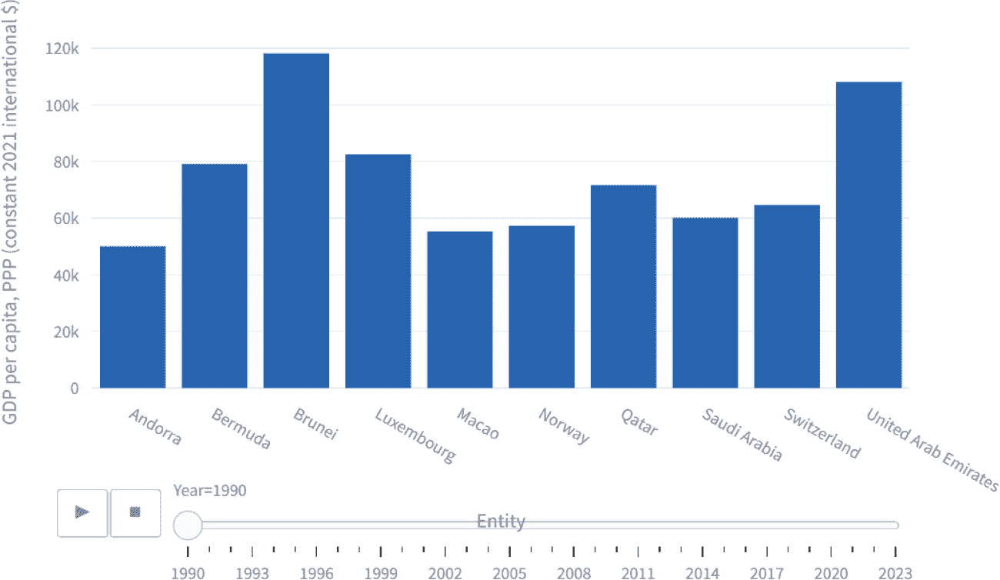

## 4.3 总结

在本章中，我们探索了管理大数据的一些技术。具体来说，我们学习了如何将多媒体文件和数据帧编码为字节数据，从而能够在数据库或内存中稳健地存储大量数据。我们还了解了当应用程序重新运行时，Streamlit 的缓存函数如何显著减少执行时间。此外，我们介绍了一种原生方法和一个第三方工具包，用于在我们的应用程序中修改数据帧和表格。在本章的后面部分，我们学会了如何使用 Plotly 数据可视化库在 Streamlit 中生成各种类型的图表，包括基本图表、统计图表、时间序列图表、地理空间图表和动画图表。通过本章的学习，我们应该能够熟练地在我们的 Web 应用程序中高效且稳健地管理和可视化不同规模的数据。
