# 5. 集成数据库

在开始利用应用数据和用户交互洞察之前，我们必须首先了解如何使用健壮且分布式的数据库系统，以有序的方式持久地存储和管理不同模式的数据。本章将重点介绍两类数据库系统：关系型数据库和非关系型数据库。我们将通过连接 `PostgreSQL` 和 `MongoDB` 来演示各自的使用场景。此外，还将介绍模糊匹配和全文索引等高级特性，并提供样板代码作为构建你自己应用的基石。最后，你将学习如何将这些数据库与 `Streamlit` 无缝集成，以实现数据可视化，并执行创建、读取、更新和删除（CRUD）操作。为充分理解本章内容，需要安装 `PostgreSQL` 和 `pgAdmin`。

## 5.1 关系型数据库

由于大多数使用 `Streamlit` 构建的应用都会以各种方式操作数据，这些数据通常需要存储在磁盘上以备后用。在很多情况下，数据遵循特定的格式，即它是结构化的。我们可以利用这一特性，使用 SQL 数据库来存储这些数据。`PostgreSQL` 将成为演示此用例的首选工具，因为它是免费且开源的。

### 5.1.1 SQL 介绍

结构化查询语言（SQL）用于对具有相似结构的数据执行 CRUD 操作。*相同结构*数据指的是共享相同特征（列）的不同条目（行）。一个关系型 SQL 数据库的例子是包含员工数据的公司目录，它被分成两个独立的表：一个用于员工的个人信息，另一个用于他们的薪资等级。这两类数据都可以表示为数据库中的表，如表 5-1 和 5-2 所示，表之间的一对一关联表明每位员工都对应一个薪资等级。

表 5-2

薪资等级表

| ID | 基本工资 | 报销额度 | 奖金 |
| --- | --- | --- | --- |
| 1 | L3 | L2 | L0 |
| 2 | L1 | L1 | L1 |
| 3 | L3 | L3 | L3 |
| 4 | L1 | L3 | L1 |

表 5-1

人员表

| ID | 姓名 | 出生日期 | 薪资等级 ID |
| --- | --- | --- | --- |
| 1 | Adam | 01/01/1990 | 2 |
| 2 | Sara | 01/01/1980 | 1 |
| 3 | Bob | 01/01/1970 | 1 |
| 4 | Alice | 01/01/2000 | 3 |

当一个表中的每一行都对应于另一个表中的唯一 ID 时，就存在一对一关系，该关系用第二个表中的数据扩展了第一个表的信息。

表之间还存在其他类型的关系，例如一对多和多对多，但本书不在此赘述，因为它们对本书的目的没有额外的价值。不过，为了演示真实世界的场景，我们将在部分示例中继续使用一对一关系。

CRUD 是创建、读取、更新和删除的缩写，指代可以使用 SQL 命令在数据库内执行的主要操作，如下所示：

*   创建：创建一个新的员工条目，其薪资等级为 3

*   读取：检索所有基本工资等级等于 L3 的薪资等级数据

```
SELECT * FROM INTO PayGradeLevels WHERE BaseSalary = "L3";
```

*   更新：将 Bob 的薪资等级更新为薪资等级 2

```
INSERT INTO Persons VALUES ("Charlie", "01/01/1995", 3);
```

*   删除：将薪资等级 4 删除

```
UPDATE Persons SET PayGradeId = 2 WHERE ID = 3;
```

```
DELETE FROM PayGradeLevels WHERE id = 4;
```

构建数据库时需要理解的最重要的概念之一是主键。这指的是表 5-1 和 5-2 中的 `ID`。*主键*是一个唯一且始终有效（即非空）的标识符，用于引用表中的单一行。它也是经过索引的，这意味着数据库内部会对其进行管理，从而在按此 `ID` 进行过滤时显著提高查询性能。

值得注意的是，索引是可以应用于任何列的特性——不仅仅是主键——但通常需要谨慎使用。对一列进行索引可能会使其存储空间增加到原始大小的两倍。然而，对于经常被搜索的列（尤其是代表 ID 的列）进行索引是非常有益的，因为它可以实现更快的数据检索。

后端开发者经常遇到的另一个关键术语是*外键*。外键是指向另一个表中某一行的 ID。例如，表 5-1 中的 `薪资等级 ID` 列就充当了一个指向表 5-2 中 `ID` 列的外键。


### 5.1.2 将 PostgreSQL 数据库连接到 Streamlit

首先，我们需要使用 *pgAdmin 4*（一种用于管理 PostgreSQL 数据库的图形用户界面工具）创建第 5.1 节中描述的数据库和表。假设 *pgAdmin 4* 已在你的系统上安装和配置好，然后我们可以按照图 5-1 和图 5-2 所示步骤依次创建一个新数据库。

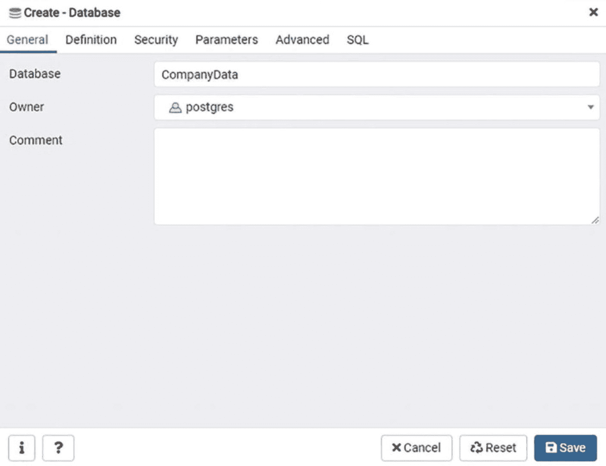

图 5-2

创建一个新的 PostgreSQL 数据库（续）

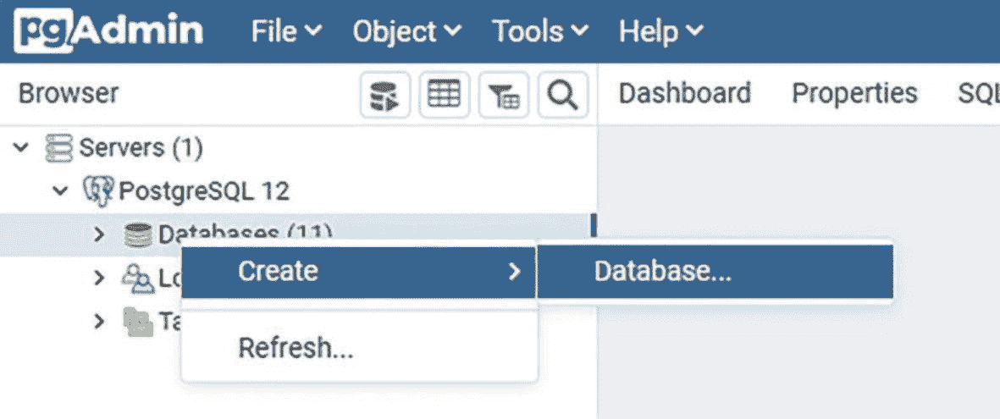

图 5-1

创建一个新的 PostgreSQL 数据库

数据库准备就绪后，点击左上角的 *查询工具* 来运行原始 SQL 命令。如图 5-3 所示，我们将创建两个表——每个表都有一个主键，其中一个表包含外键。列的一些其他特性——在数据库术语中通常被称为约束——包括将列设置为 `NOT NULL` 和启用自增。

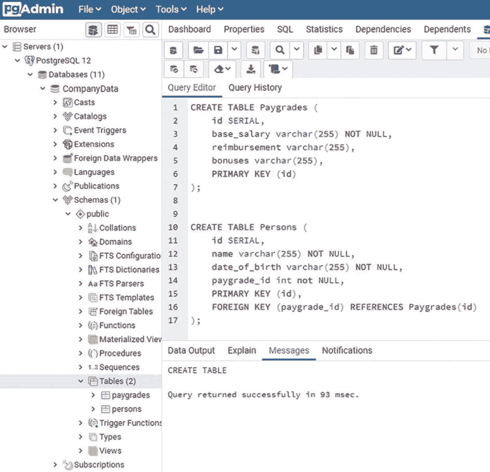

图 5-3

从 `create_tables.sql` 运行 SQL 命令以创建数据库表

将列设置为 `NOT NULL` 会指示数据库拒绝任何该列缺失或明确设置为 `NULL` 的 `INSERT` 或 `UPDATE` 操作。PostgreSQL 提供了一种名为 `SERIAL` 的特殊数据类型，它会自动确保该列不为空，并为其整数值启用自增，以便插入每一行新数据。

在继续进行 Streamlit 集成之前，我们将首先使用原始 SQL 向数据库中插入一些数据，如图 5-4 所示。请注意，我们不需要为任一表手动设置 ID 值——由于使用了 `SERIAL` 数据类型，这些值由数据库自动生成。


图 5-4

使用 `inserting_data.sql` 向数据库插入数据

接下来，我们需要配置数据库访问凭据，以便在 Streamlit 中使用。这些凭据（包括用户名和密码）可以通过多种方式安全存储：

- 作为 `.env` 文件中的环境变量
- 在 `secrets.yaml` 文件中（由应用读取和解析）
- 推荐方式：在位于 `.streamlit` 文件夹中的 `secrets.toml` 文件中，如代码清单 5-1 所示。

这个 `secrets.toml` 文件会被 Streamlit 自动解析，从而使文件中的变量易于在你的应用中访问。为了保持一致性并正确解析，数据库连接详细信息应归组到一个类似 `[db_postgres]` 的标签下，然后便可在你的代码中引用该标签。

> **⚠ 安全提示** 始终使用强密码，尤其是当你的数据库可以公开访问时。弱密码容易受到暴力破解攻击，可能会暴露敏感数据。

```
[db_postgres]
host = "127.0.0.1"
port = "5432"
user = "postgres"
password = "82qeD\t_K7n~`7A&"
dbname = "CompanyData"
代码清单 5-1
.streamlit/secrets.toml
```

为了在 Python 与 PostgreSQL 之间建立接口，我们需要使用一个功能强大的库，例如 *psycopg3*。虽然 *psycopg3* 是本示例的绝佳选择，但其他库（如 *SQLAlchemy*）也能完成同样的任务，我们将在后续章节中介绍。

如前面章节所述，当用户与应用交互时，Streamlit 会自动重新运行 Python 脚本。这通常不是问题，但在本例中，它可能会导致效率低下。例如，每次应用重新运行时，都会建立一个新的数据库连接。为了防止这种不必要的开销，我们可以缓存第一个建立的连接。Streamlit 提供了一种简便的方法，即使用其原生的 `@st.cache_resource` 装饰器。该装饰器可以接受额外的参数，例如缓存的过期时间。如果缓存过期，当再次调用该函数时，它将会重新执行。在代码清单 5-2 中，第 5 行演示了如何将已建立的连接保存在缓存中。

一旦建立了连接，我们将需要一个游标来执行 SQL 查询。在查询执行完毕后，正确处理游标以避免内存问题非常重要。如果游标未被关闭，它将保留在内存中，随着执行更多查询，这可能导致内存泄漏——这对任何开发者来说都是一场噩梦。有两种管理游标的方法：手动关闭它或使用上下文管理器。上下文管理器会在其作用域退出时自动关闭游标。在代码清单 5-2 中，第 14 行和第 22 行展示了这两种方法的示例，它们的输出结果如图 5-5 所示。

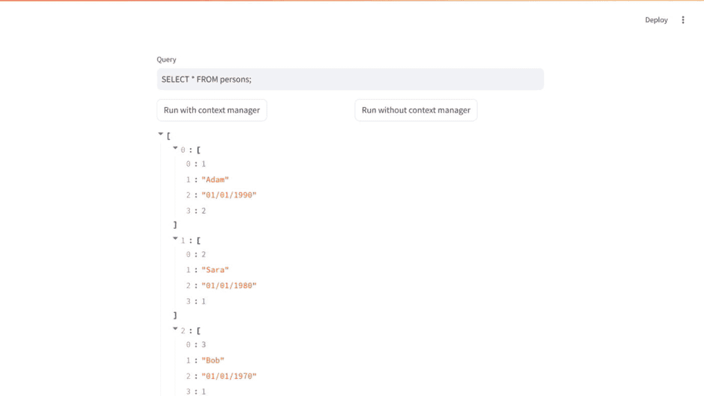

图 5-5

从 Streamlit 运行用户 SQL 命令

```
import streamlit as st
import psycopg2

@st.cache_resource
def init_connection():
    return psycopg2.connect(**st.secrets['db_postgres'])

conn = init_connection()

def run_query(query_str):
    cur = conn.cursor()
    cur.execute(query_str)
    data = cur.fetchall()
    cur.close()
    return data

def run_query_with_context_manager(query_str):
    with conn.cursor() as cur:
        cur.execute(query_str)
        return cur.fetchall()

query = st.text_input('Query')
c1, c2 = st.columns(2)
output = None

with c1:
    if st.button('Run with context manager'):
        output = run_query_with_context_manager(query)

with c2:
    if st.button('Run without context manager'):
        output = run_query(query)

st.write(output)
代码清单 5-2
main.py
```


### 5.1.3 在 Streamlit 中显示表格

从数据库查询数据后，我们可以用纯文本显示，也可以使用 Streamlit 中更直观的可视化工具，这可能需要修改数据的表示方式。

在数据科学和开发社区中，解析结构化数据很常见，无论是传感器读数、身份信息，还是任何重复数据组织成的结构化格式，例如 `Pandas` 数据框。数据框本质上是具备额外功能的 `Numpy` 数组，包括列名和类似 SQL 的查询能力。此外，它们还继承了 `Numpy` 数组高效的向量化特性，能够对整个数组而非单个元素进行并行化数学计算。

Streamlit 提供了两种显示数据框的方式。第一种是 `st.table`，它提供数据框的非交互式表示，如图 5-6 所示。第二种是 `st.dataframe`，它会渲染出数据框的交互式版本。在这种交互格式中，用户只需点击列标题即可对任意列进行排序，如图 5-7 所示。但这需要权衡：这种交互功能会消耗额外的 CPU 和内存资源，可能拖慢应用程序。例如，排序操作的时间复杂度为 *O(n*log(n))*，这意味着随着数据集增大，应用程序性能可能会下降。

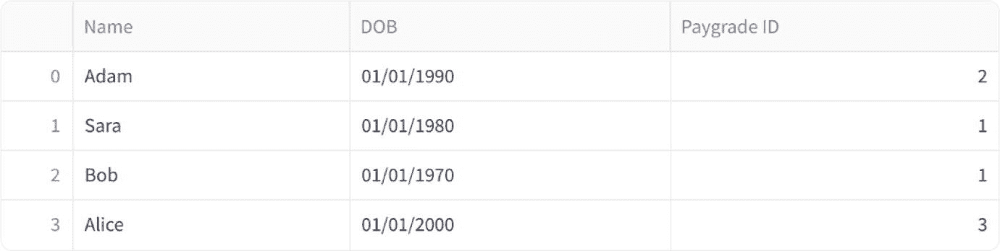

图 5-7

来自清单 5-3 的 `st.dataframe`

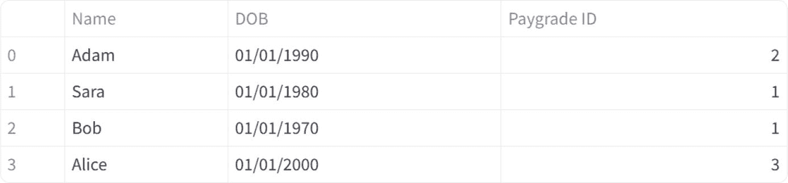

图 5-6

来自清单 5-3 的 `st.table`

```
import streamlit as st
import pandas as pd
df = pd.DataFrame([['Adam', '01/01/1990', 2],
['Sara', '01/01/1980', 1],
['Bob', '01/01/1970', 1],
['Alice', '01/01/2000', 3]
], columns=['Name', 'DOB', 'Paygrade ID'])
st.table(df)
st.dataframe(df)
清单 5-3
df_demo. py
```

## 5.2 非关系型数据库

虽然在大多数使用场景中，处理的是结构化数据集——模式、属性、数据类型和元数据都是预先已知的——但有些情况下这些信息并不可用。例如，考虑构建一个搜索引擎，用户可上传长度不一、标题数量不同、包含各种图片和媒体类型的文档。在这种情况下，几乎不可能定义一个固定的模式或表结构来容纳这些数据。这正是 NoSQL 数据库（如 MongoDB）的实用价值所在。NoSQL 数据库旨在处理和存储非结构化或半结构化的数据，在数据存储和查询方式上提供了灵活性。

### 5.2.1 MongoDB 简介

MongoDB 允许将数据存储为 JSON 文档，这些文档可以拥有不同的属性和数据类型，全部放在一个可以拥有动态模式的 *集合* 中。在此语境下，文档类似于关系数据库中的行，集合则类似于表。即使你的数据集最初是结构化的，随着应用程序的扩展，特别是当你开始处理非结构化数据时，使用像 MongoDB 这样的 NoSQL 数据库也会大有裨益。此外，如果你需要高级功能，如全文索引（对集合中每个文档的每一个单词进行索引）或模糊匹配（有助于处理查询中的拼写错误），MongoDB 是理想的选择。

在本节中，我们将探索 MongoDB 的功能，并通过使用一个公开的、关于餐厅评分的非结构化数据集，来构建一个餐厅搜索引擎，演示如何将其与 Streamlit 集成。该应用程序的目标是允许用户根据美食类型和地址搜索餐厅。对于美食类型，我们将使用简单的精确匹配，与预定义的美食类型列表进行比对来筛选数据。对于地址，则需要使用全文索引来匹配文档中可能存储在不同对象或数组中的 borough（行政区）和街道地址字段中的 n-gram（连续的词语或词元序列），如图 5-8 所示。此外，还将实现模糊匹配，以确保包含轻微拼写错误（最多两个字符差异）的搜索查询仍能与相关记录正确匹配。

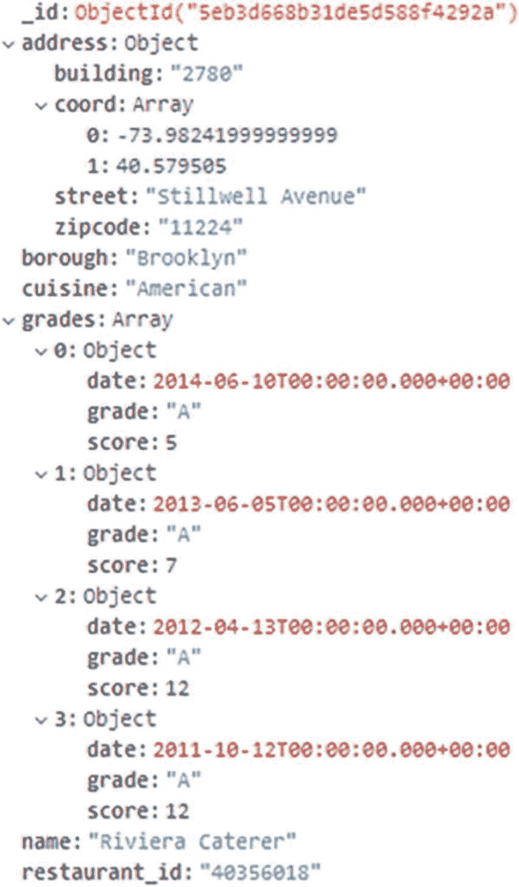

图 5-8

来自餐厅数据集的一个示例文档


### 5.2.2 配置云数据库

`MongoDB` 既可以在本地搭建，也可以在云端部署。然而，若要利用 `MongoDB` 的 *Atlas Search* 服务所提供的全文索引功能，则必须将数据库托管在云端。以下是具体操作步骤：

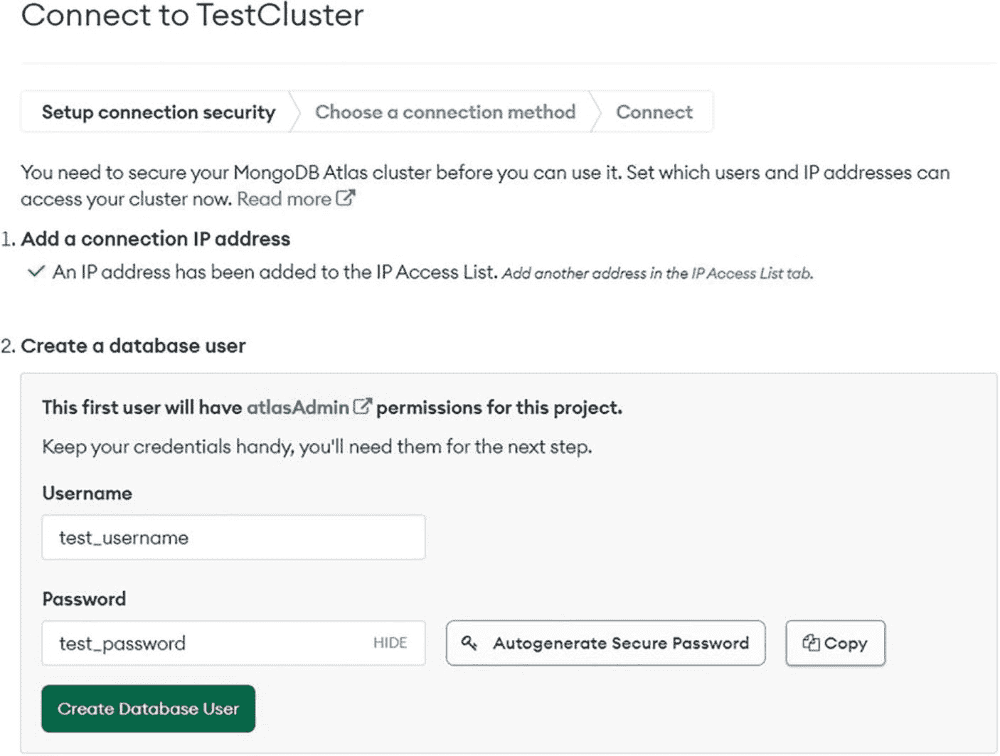

图 5-12

为数据库创建用户凭证

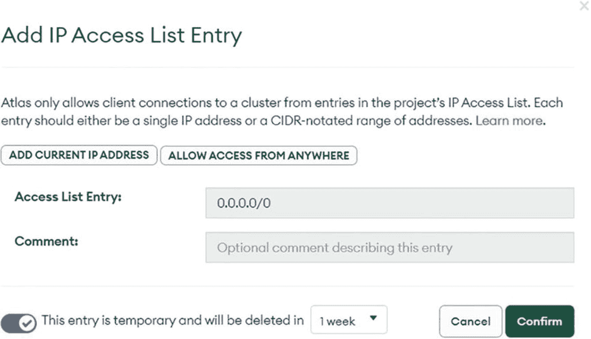

图 5-11

配置数据库的网络访问

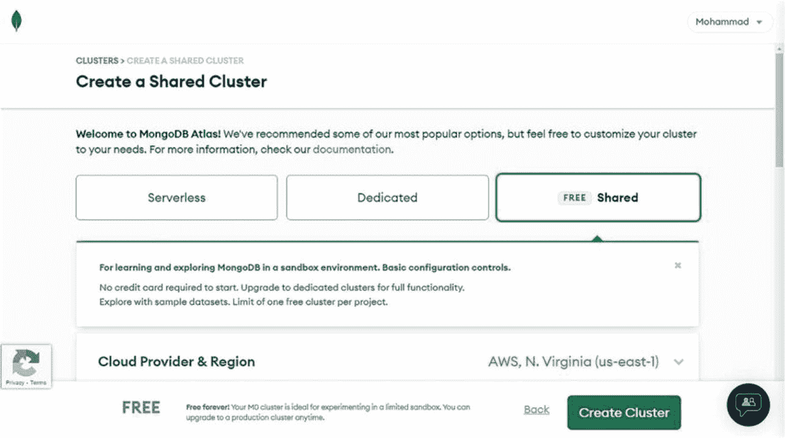

图 5-10

配置免费的 M0 Sandbox 集群

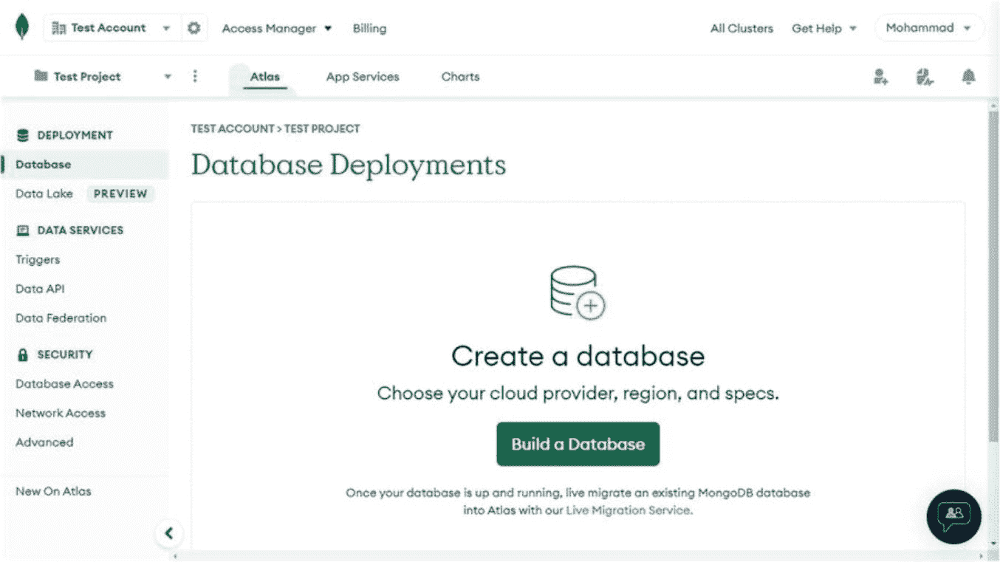

图 5-9

设置 MongoDB 数据库

1.  首先，在 [`www.mongodb.com/atlas/database`](http://www.mongodb.com/atlas/database) 上注册账户并创建项目。

2.  配置免费的 *M0 Sandbox* 集群，如图 5-9 和图 5-10 所示。如果需要，可调整托管区域以最小化数据库与服务器之间的延迟。

3.  配置好集群后，请在 *网络访问* 菜单中将能够访问数据库的 IP 地址加入白名单。尽管不推荐，您可以将所有地址加入白名单（如图 5-11 所示），以允许从任何位置进行访问。

4.  接着，在 *数据库* 菜单的 *概览* 标签页中创建用于数据库访问的用户凭证，如图 5-12 所示。


图 5-14

为数据库创建连接字符串（续）

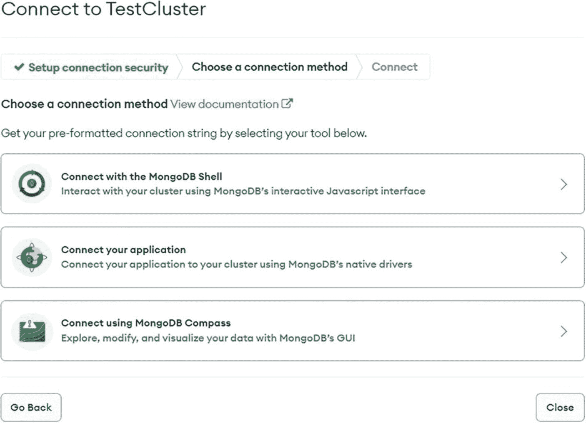

图 5-13

为数据库创建连接字符串

1.  接下来，在 *选择连接方式* 标签页中选择 *连接您的应用程序* 选项来创建连接字符串。然后，选择最适合您应用的 Python 驱动程序，如图 5-13 和图 5-14 所示。

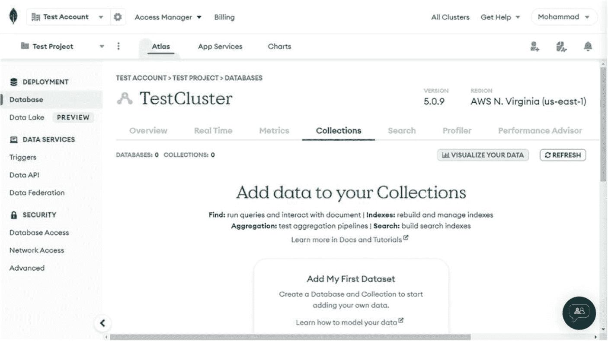

图 5-15

将数据集加载到数据库中

1.  最后，您可以在 *数据库* 菜单的 *集合* 标签页中上传自己的数据集，或者加载 `MongoDB` 提供的示例数据集，如图 5-15 所示。在本例中，我们将使用 `MongoDB` 自有数据集中的示例 *restaurants* 集合。

### 5.2.3 全文索引

全文索引会对数据库中所有文档里所有对象的每个词元进行索引。这是一种非常强大的索引形式，能够实现精确查询并检索所有匹配的文档，其运作方式与搜索引擎类似。在 `MongoDB` 中，您可以通过以下步骤在云数据库上创建全文索引：

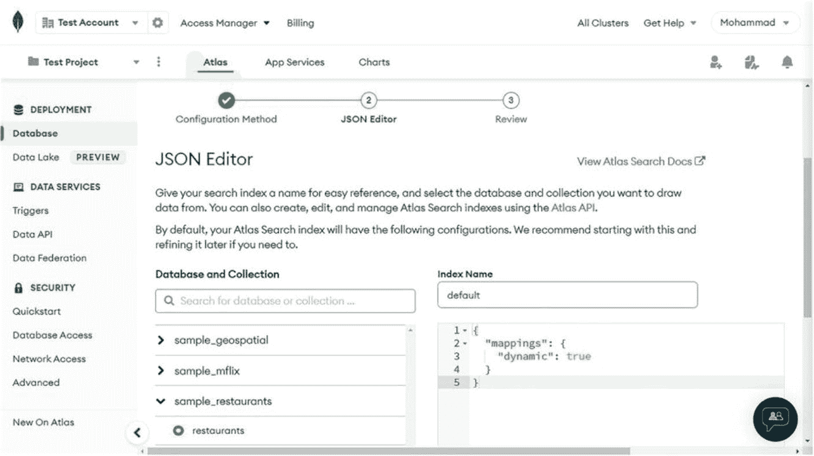

图 5-17

为数据库创建全文索引（续）

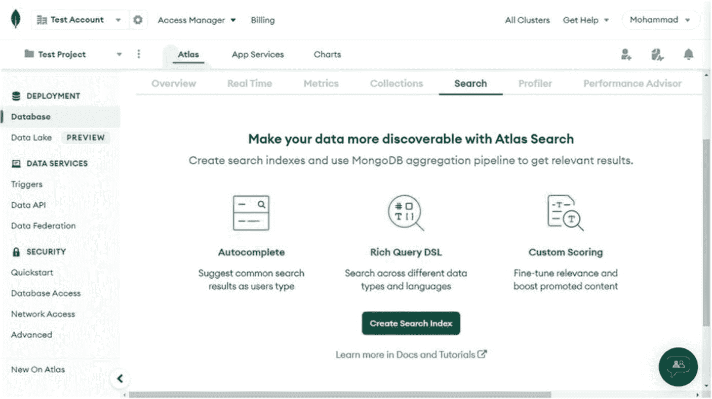

图 5-16

为数据库创建全文索引

1.  打开 *数据库* 菜单中的 *搜索* 标签页，然后点击 *创建搜索索引*，如图 5-16 所示。

2.  接下来，在 *配置方法* 标签页中选择 *JSON 编辑器*。

3.  选择要创建索引的数据库和集合，为索引命名，并输入以下索引配置，如图 5-17 所示：

    ```json
    {
      "mappings": {
        "dynamic": true
      }
    }
    ```


### 5.2.4 查询数据库

要查询 MongoDB 中已建立索引的数据库，首先应使用图 5-13 中获取的连接字符串连接到数据库。该字符串将帮助你建立客户端连接。为优化性能，建议将客户端作为一个函数调用，并使用 `@st.cache_resource` 装饰器对其进行缓存。这样，Streamlit 会在后续查询中复用缓存的客户端，而非每次建立新连接，从而节省运行时间和资源。以下示例展示了这一方法：

```python
from pymongo import MongoClient
@st.cache_resource
def create_client():
    return MongoClient('')
```

接下来，你需要创建一个*聚合管道*（Aggregation），它本质上是一个用 JSON 格式编写的多阶段过滤管道。该管道允许你在查询数据之前对其应用各种过滤和转换操作。聚合的结构取决于你想要执行的过滤和操作，它可用于相应地对查询结果进行塑形，如下例所示：

1. **使用模糊匹配进行搜索**

    在此阶段，我们需要指定之前为搜索文档而创建的索引名称。此外，我们需要通过字符串拼接来输入用户的查询。我们还必须指定路径，换句话说，即文档中要搜索的对象，例如 `borough` 和 `address.street`（嵌套元素和/或对象可以通过英文句点访问，即 `address.street`）。最重要的是，我们需要启用模糊匹配，并使用 `maxEdits` 指定将查询与令牌匹配所需的单字符编辑次数，同时还需要使用 `prefixLength` 确定每个查询开头必须与令牌匹配的字符数。

    ```json
    "$search": {
        "index": "default",
        "text": {
            "query": f"{address}",
            "path": ["borough", "address.street"],
            "fuzzy": {
                "maxEdits": 2,
                "prefixLength": 2
            }
        }
    }
    ```

2. **投射包含搜索分数的文档**

    在此阶段，我们将仅传递所需的文档对象，并使用 `searchScore` 标签计算相关性分数：

    ```json
    "$project": {
        "Name": "$name",
        "Cuisine": "$cuisine",
        "Address": "$address.street",
        "Borough": "$borough",
        "Grade": "$grades.grade",
        "Score": {
            "$meta": "searchScore"
        }
    }
    ```

3. **过滤文档**

    随后，我们将根据用户输入的菜系类型对传递的文档进行过滤。请注意，与模糊匹配不同，在此阶段，查询必须与文档中的令牌完全匹配才能成功过滤。

    ```json
    "$match": {
        "Cuisine": f"{cuisine}"
    }
    ```

4. **限制结果数量**

    最后，在此阶段，我们将把传递的结果数量限制为所需数量：

    ```json
    "$limit": 5
    ```

有关聚合管道其他选项的信息，请参阅 [`https://docs.mongodb.com/manual/reference/aggregation/`](https://docs.mongodb.com/manual/reference/aggregation/)。

### 5.2.5 在 Streamlit 中显示表格

聚合管道完成并返回查询结果后，在 Streamlit 中渲染表格之前需要进行后处理。具体来说，你需要将 MongoDB 查询结果转换为 Pandas DataFrame，并指定要保留的列。此外，还需要解析返回的任何列表（例如餐厅评级），并将其转换为纯文本，如下所示：

```python
df = pd.DataFrame(result)[['Name','Address','Grade','Score']]
df['Grade'] = [','.join(map(str, x)) for x in df['Grade']]
```

有关本节完整代码，可参见代码清单 5-4。此外，图 5-18 显示了关联的 Streamlit 应用程序，其中演示了一个模糊匹配查询的示例以及在 Streamlit 中返回的表格。

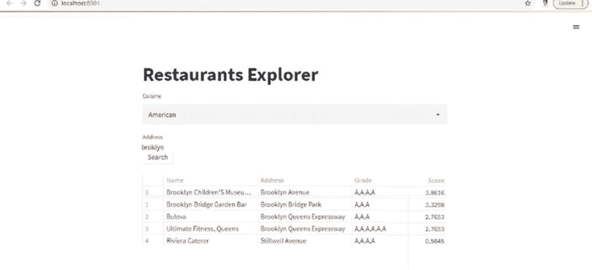

**图 5-18** 代码清单 5-4 的输出

```python
import streamlit as st
import pandas as pd
from pymongo import MongoClient

@st.cache_resource
def create_client():
    return MongoClient('')

def query(cuisine, address):
    result = create_client()['sample_restaurants']['restaurants'].aggregate([
        {
            "$search": {
                "index": "default",
                "text": {
                    "query": f"{address}",
                    "path": ["borough", "address.street"],
                    "fuzzy": {
                        "maxEdits": 2,
                        "prefixLength": 2
                    }
                }
            }
        },
        {
            "$project": {
                "Name": "$name",
                "Cuisine": "$cuisine",
                "Address": "$address.street",
                "Borough": "$borough",
                "Grade": "$grades.grade",
                "Score": {
                    "$meta": "searchScore"
                }
            }
        },
        {
            "$match": {
                "Cuisine": f"{cuisine}"
            }
        },
        {
            "$limit": 5
        }
    ])
    try:
        df = pd.DataFrame(result)[['Name','Address','Grade','Score']]
        df['Grade'] = [','.join(map(str, x)) for x in df['Grade']]
        return df
    except:
        return None

if __name__ == '__main__':
    st.title('Restaurants Explorer')
    cuisine = st.selectbox('Cuisine', ['American', 'Chinese', 'Delicatessen',
                                       'Hamburgers', 'Ice Cream, Gelato, Yogurt, Ices', 'Irish'])
    address = st.text_input('Address')
    if st.button('Search'):
        if address != "":
            st.write(query(cuisine, address))
        else:
            st.warning('Please enter an address')
```

**代码清单 5-4** `mongodb.py`

## 5.3 本章小结

在本章中，我们探讨了用于存储和检索关系型与非关系型数据库，分别用于处理结构化和非结构化数据。我们学习了如何配置 PostgreSQL 数据库，并将其与 Streamlit 应用程序集成以管理和处理结构化数据集。同样，我们了解了如何配置 MongoDB 云数据库来处理非结构化数据，存储包含不同模式、对象和元素的文档集合。我们还演示了 MongoDB 如何创建全文索引，为每个文档中的每个令牌建立索引以改进查询，以及如何对查询词条与文档令牌执行模糊匹配，以减少拼写错误的影响。最后，我们将所有这些操作——设置数据库客户端、编写聚合管道以及后处理查询结果——集成到一个 Streamlit 应用程序中，完成了本章内容。

