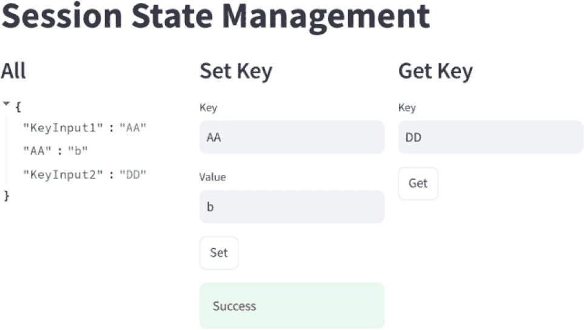
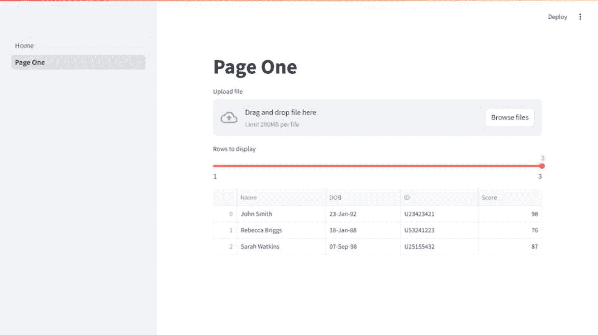
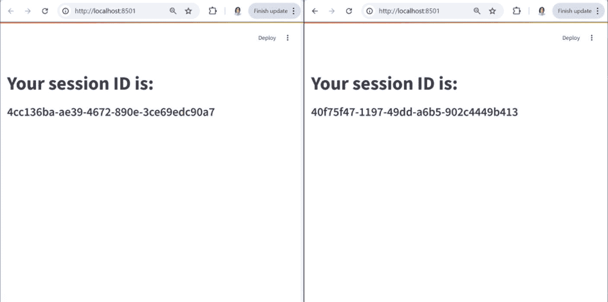
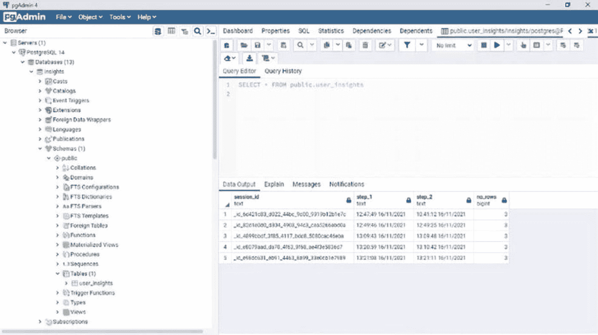
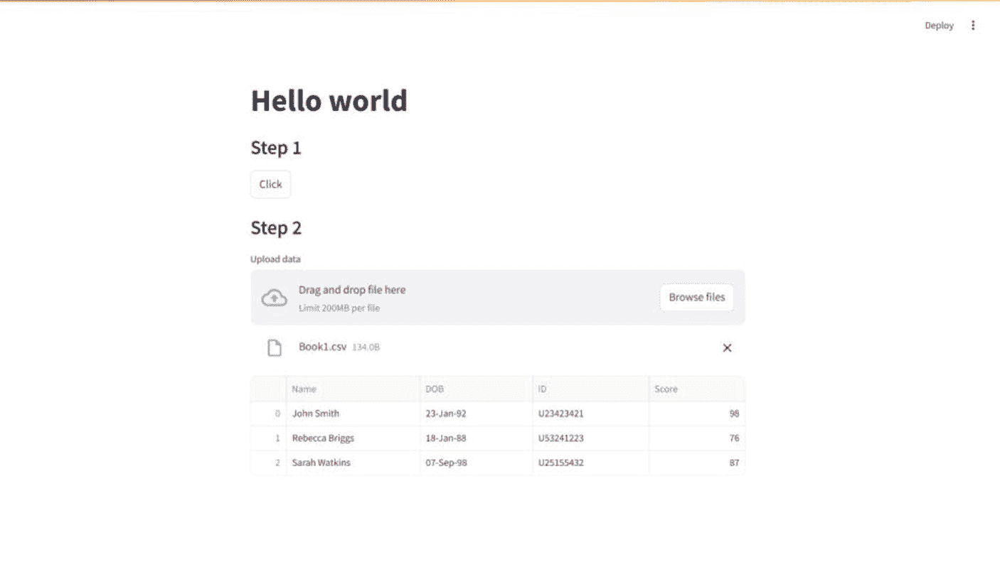
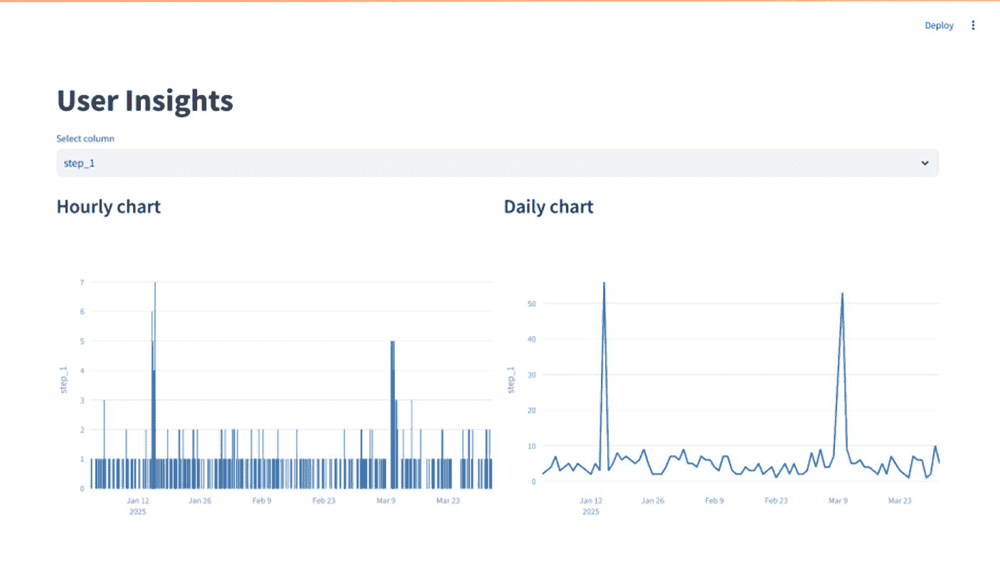
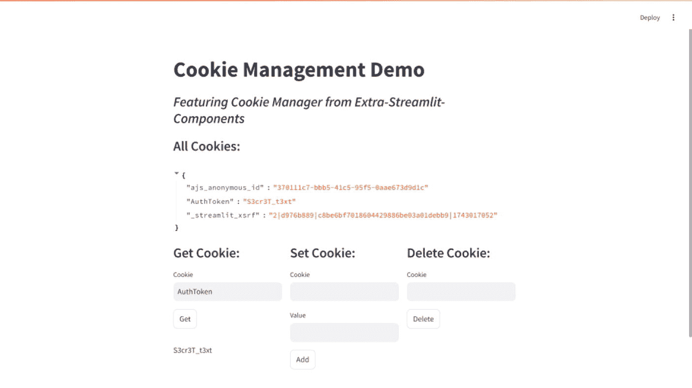
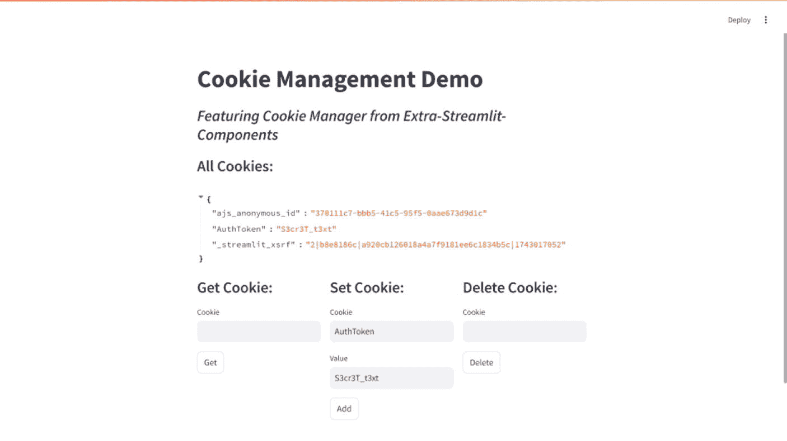

# 7. 实现会话状态

为了开发更高级的 Streamlit 应用程序，建立特定于会话的数据以提供增强的用户体验至关重要。具体来说，应用程序需要使用所谓的会话状态来保留用户的数据和输入。这些状态可以根据需要在需要时设置和访问，并且当用户触发 Streamlit 应用程序的重新运行或在页面之间导航时，它们将持久存在。此外，我们将建立一种使用 Cookie 跨多个会话存储状态的方法，这可以将数据保存在用户的浏览器中，以便他们在重新启动关联的 Streamlit 应用程序时可以访问。最后，我们将学习如何记录和可视化用户与我们应用程序交互的丰富洞察，为开发人员和产品所有者提供分析数据。

## 7.1 原生实现会话状态

自 Streamlit 0.84.1 版本起，引入了一种原生方式来存储和管理会话特定数据——包括但不限于变量、组件、文本、图像和对象。会话状态的值以字典格式存储，每个值都分配有一个唯一键用于索引。在此之前，如果没有此功能，每当用户通过与应用程序交互触发 Streamlit 脚本重新运行时，所有变量都会被重置。同样，当用户从一个页面导航到另一个页面时，组件也会重置为其默认值。然而，借助会话状态，用户可以通过访问先前在应用程序其他页面上输入的变量或条目，获得增强且更个性化的体验。例如，用户可以一次性输入用户名和密码，并在整个应用程序中继续导航，而无需被提示重新输入凭据——直到他们登出。简而言之，会话状态使我们能够开发更复杂的应用程序，这将在后续章节中详细讨论。

设置和获取会话状态数据的方法可以按清单 7-1 所示实现，相关输出如图 7-1 所示。请注意，前两个键值条目（`KeyInput1` 和 `KeyInput2`）虽然并非由用户显式创建，但它们是存在的。这些键用于存储用户修改过的组件的状态——在本例中，即已定义的文本输入组件。这意味着开发者也有能力修改任何组件的值，只要该组件在定义时被分配了唯一的键。另一个重要点是，每个会话状态在读取之前必须被初始化；否则将发生错误。为防止这种情况，请务必确保使用空值或默认值来初始化状态。



图 7-1 会话状态数据显示与操作

```python
import streamlit as st

def get_state_value(key):
    return st.session_state.get(key)

def set_state_value(key, value):
    st.session_state[key] = value

st.title('会话状态管理')

c1, c2, c3 = st.columns(3)

with c1:
    st.subheader('全部')
    st.write(st.session_state)

with c2:
    st.subheader('设置键')
    key = st.text_input('键', key='KeyInput1')
    value = st.text_input('值')
    if st.button('设置'):
        st.session_state[key] = value
        st.success('成功')

with c3:
    st.subheader('获取键')
    key = st.text_input('键', key='KeyInput2')
    if st.button('获取'):
        st.write(st.session_state.get(key))
```

清单 7-1 `session_state.py`

### 7.1.1 使用会话状态构建应用程序

为了演示会话状态的实用性，在以下示例中，我们将创建一个简单的多页面应用程序，用户可以使用状态来存储所选页面的键、上传的数据框以及滑块组件的值。如清单 7-2 所示，在我们的主页面中，我们首先初始化用于页面选择的状态，然后使用按钮将状态更改为请求页面的键。随后，被选页面的关联函数直接从会话状态中被调用以渲染页面。

在该应用程序的页面一中，如清单 7-3 所示，我们使用会话状态来存储上传的数据框以及一个滑块的值，该滑块用于过滤数据框中显示的行数。用户可以在页面之间来回导航，并且仍然可以访问之前上传的数据框，其显示行数与滑块所设置的相同，如图 7-2 所示。



图 7-2 清单 7-2 和 7-3 的输出

```python
import streamlit as st
import pandas as pd

st.title('页面一')

# 初始化数据框和滑块的会话状态
if 'df' not in st.session_state:
    st.session_state['df'] = None
if 'rows' not in st.session_state:
    st.session_state['rows'] = None

file = st.file_uploader('上传文件')

# 将数据框写入会话状态
if file is not None:
    df = pd.read_csv(file)
    st.session_state['df'] = df

if st.session_state['df'] is not None:
    # 使用会话状态中的默认值创建滑块组件
    rows = st.slider('要显示的行数',
                     value=st.session_state['rows'],
                     min_value=1,
                     max_value=len(st.session_state['df']))
    # 将滑块值写入会话状态
    st.session_state['rows'] = rows
    # 从会话状态渲染数据框
    st.write(st.session_state['df'].iloc[:st.session_state['rows']])
```

清单 7-3 `page_1.py`

```python
import streamlit as st

st.title('主页面')

# 初始化页面选择的会话状态
if 'page_state' not in st.session_state:
    st.session_state['page_state'] = '主页面'
```

清单 7-2 `main_page.py`

## 7.2 介绍会话 ID

会话 ID 是 Streamlit 会话每个新实例的唯一标识符。每当打开一个新的浏览器页面时，即使另一个连接已经处于活动状态，也会建立一个新的会话 ID。然而，服务器会将每个会话独立对待。

这些唯一的 ID 可用于为最终用户提供个性化的体验。为了实现这一点，服务器需要将每个用户的进度和更新映射到其对应的 ID。这可以通过在 Streamlit 中生成唯一的会话 ID 来完成。在清单 7-4 中，我们演示了如何生成会话 ID。输出如图 7-3 所示，其中显示了两个都在 `http://localhost:8501/` 上运行的网页。



图 7-3 两个具有不同会话 ID 的不同浏览器窗口

```python
import streamlit as st
import uuid

# 检查会话 ID 是否已存在，如果不存在，则创建一个
if 'session_id' not in st.session_state:
    st.session_state.session_id = str(uuid.uuid4())

# 访问并显示会话 ID
st.title('您的会话 ID 是：')
st.subheader(st.session_state.session_id)
```

清单 7-4 `session_id_demo.py`

## 7.3 用户洞察

# 记录与可视化用户交互洞察

记录用户与 Web 应用程序的交互能力往往至关重要。开发者和产品负责人需要获取详细且准确的数据——例如有多少用户正在访问网站、访问时间以及用户如何与之互动——以便更好地定制和改进其产品或服务。假设一个经过精心开发的电子商务 Web 应用，却无法将潜在客户转化为实际销售，而原因尚不明确。可能是界面或后端存在隐藏的漏洞，阻碍了用户操作；也可能是服务器过载，无法处理传入的流量。无论是哪种情况，准确定位问题出在哪个环节都至关重要——而这就是用户洞察变得极具价值的原因。

虽然 `Google Analytics` 在服务器层面提供了强大的洞察能力——包括访问次数、用户人口统计特征以及在不同页面上的停留时间——但它无法有效捕捉应用程序层面的交互。因此，开发者必须自行实现方法来跟踪应用内的用户行为。如清单 7-5 所示，一种简单的方法是在用户与特定代码部分交互时（例如，点击按钮或上传数据集，如图 7-4 所示）记录一个时间戳，并将这些数据存储在 `PostgreSQL` 数据库中，如图 7-5 所示。同样，也可以记录上传数据集中的行数。每个数据点都存储在表中单独的列中，主键是会话的唯一 ID。当应用程序重新启动时，会创建一个具有新会话 ID 的新行。通过使用提供的更新函数，你可以在程序的任何步骤捕获并记录任何值。



图 7-5 清单 7-5 对应的 `PostgreSQL` 数据库



图 7-4 清单 7-6 的输出

```
update_row(column, new_value, session_id, mutable, engine)
```

请注意，通过将 `mutable` 参数设置为 `True`，可以多次覆盖写入洞察数据；如果你只想在首次生成值时记录该值，则将其设置为 `False`。

```python
import streamlit as st
import uuid
from datetime import datetime
import pandas as pd
import psycopg2
from sqlalchemy import create_engine, text

def get_session_id():
    if 'session_id' not in st.session_state:
        session_id = str(uuid.uuid4()).replace('-', '_')
        st.session_state.session_id = '_id_' + session_id
    return st.session_state.session_id

def insert_row(session_id, engine):
    with engine.connect() as conn:
        result = conn.execute(text(f'SELECT session_id FROM user_insights WHERE session_id = "{session_id}"')).fetchone()
        if result is None:
            conn.execute(text(f'INSERT INTO user_insights (session_id) VALUES ("{session_id}")'))
            conn.commit()

def update_row(column, new_value, session_id, mutable, engine):
    with engine.connect() as conn:
        if mutable:
            conn.execute(text(f'UPDATE user_insights SET {column} = "{new_value}" WHERE session_id = "{session_id}"'))
            conn.commit()
        else:
            result = conn.execute(text(f'SELECT {column} FROM user_insights WHERE session_id = "{session_id}"')).fetchone()
            if result and result[0] is None:
                conn.execute(text(f'UPDATE user_insights SET {column} = "{new_value}" WHERE session_id = "{session_id}"'))
                conn.commit()

if __name__ == '__main__':
    engine = create_engine('postgresql://:@localhost:/')
    session_id = get_session_id()
    with engine.connect() as conn:
        conn.execute(text('CREATE TABLE IF NOT EXISTS user_insights (session_id text, step_1 text, step_2 text, no_rows bigint)'))
        conn.commit()
    insert_row(session_id, engine)
    st.title('Hello world')
    st.subheader('Step 1')
    if st.button('Click'):
        st.write('Some content')
        update_row('step_1', datetime.now().strftime('%H:%M:%S %d/%m/%Y'), session_id, True, engine)
    st.subheader('Step 2')
    file = st.file_uploader('Upload data')
    if file is not None:
        df = pd.read_csv(file)
        st.write(df)
        update_row('step_2', datetime.now().strftime('%H:%M:%S %d/%m/%Y'), session_id, False, engine)
        update_row('no_rows', len(df), session_id, True, engine)
```

### 7.3.1 可视化用户洞察

既然我们已经确定了如何从 `Streamlit` 应用程序中捕获洞察并将其存储在 `PostgreSQL` 数据库中，下一步就是按需将数据可视化。首先，我们可以使用代码清单 7-6 将洞察表提取到 `Pandas` 数据帧中，并且，如果你希望创建自己的自定义图表，还可以选择将其作为 Excel 电子表格保存在本地。或者，我们可以使用代码清单 7-7 直接可视化数据。在这种方法中，我们将之前生成的 Excel 电子表格导入到 `Pandas` 数据帧中，将时间戳转换为小时和天级别的数值，对落在同一小时或天内的行数进行分组和求和，最后使用 `Plotly` 图表将其可视化，如图 7-6 所示。此外，我们还可以通过使用 `st.selectbox` 组件允许用户从洞察表中选择一列，从而实现过滤功能。



图 7-6 代码清单 7-7 的输出

## 7.4 Cookie 管理

我们已经讨论了如何使用原生方法和变通方法在会话中存储和管理数据。但是，可能缺少的是跨会话管理数据的能力。例如，存储一个计数器来追踪按钮被点击的次数，或者更有用的是，防止用户在每次启动新会话时都必须重新登录。为了实现这一点，我们需要利用 cookies。虽然 Streamlit 已经实现了自己的原生 cookie 管理甚至认证命令（`st.context` 和 `st.login`），但在本书中，我们将重点放在第三方组件上，因为它们提供了原生尚未涵盖的额外功能。

Cookies 可用于跨多个网站追踪用户的操作，或存储个人信息，例如身份验证令牌。它们存储在用户端并由用户端管理，特别是在浏览器中，这意味着默认情况下服务器无法直接访问其内容。要查看任何 Web 应用程序上的 cookies，只需打开浏览器中的开发者工具并进入控制台选项卡。然后，输入 `document.cookie` 来显示 cookies，如图 7-7 所示。


图 7-7 一个网页 cookie

在典型的 Streamlit 应用程序中，可能还存在其他 cookies——除了图 7-7 中所示的那个——用于广告追踪等目的。这些 cookies 可能需要根据开发者采用的 cookie 政策进行删除。在其他情况下，开发者可能希望添加额外的 cookies 来增强应用程序的用户体验。无论哪种情况，都需要一种在任何 Web 应用程序中管理 cookies 的方法。

为了在 Streamlit 应用程序中操作 cookies，我们需要使用一个第三方模块或库。对于这个示例，我们将使用 `Extra-Streamlit-Components`，它可以通过 `pip install extra-streamlit-components` 安装，并使用别名 `stx` 导入。别名中的 `X` 代表该库为标准 Streamlit 应用程序带来的额外功能。这个库包含一个名为 `Cookie Manager` 的模块，它将作为我们管理 cookies 的工具。代码清单 7-8 演示了一个简单的 Streamlit 应用程序，它能够设置、获取和删除 cookies。这些控件可以根据开发者的需求进行自定义。例如，可以为任何新 cookie 设置过期日期，一旦到达设定的日期，该 cookie 将自动被删除。图 7-8 和图 7-9 分别展示了添加和检索身份验证令牌的示例。



图 7-9 获取一个 AuthToken cookie



图 7-8 添加一个 AuthToken cookie

```python
import streamlit as st
import extra_streamlit_components as stx

st.title('Cookie Management Demo')
st.subheader('_Featuring Cookie Manager from Extra-Streamlit-Components_')

cookie_manager = stx.CookieManager()

st.subheader('All Cookies:')
cookies = cookie_manager.get_all()
st.write(cookies)

c1, c2, c3 = st.columns(3)

with c1:
    st.subheader('Get Cookie:')
    cookie = st.text_input('Cookie', key='0')
    clicked = st.button('Get')
    if clicked:
        value = cookie_manager.get(cookie)
        st.write(value)

with c2:
    st.subheader('Set Cookie:')
    cookie = st.text_input('Cookie', key='1')
    val = st.text_input('Value')
    if st.button('Add'):
        cookie_manager.set(cookie, val)

with c3:
    st.subheader('Delete Cookie:')
    cookie = st.text_input('Cookie', key='2')
    if st.button('Delete'):
        cookie_manager.delete(cookie)

# 清单 7-8：cookie_management.py
```

```python
import streamlit as st
import pandas as pd
import plotly.express as px
st.set_page_config(layout='wide')
st.title('User Insights')
df = pd.read_excel('C:/Users/.../user_insights.xlsx')
column_selection = st.selectbox('Select column', df.columns[1:-2])
df = df[column_selection]
df = pd.to_datetime(df,format='%H:%M:%S %d/%m/%Y')
df_1h = df.copy()
df_1d = df.copy()
col1, col2 = st.columns(2)
with col1:
    st.subheader('Hourly chart')
    df_1h = df_1h.dt.strftime('%Y-%m-%d %I%p')
    df_1h = pd.DataFrame(df_1h.value_counts())
    df_1h.index = pd.DatetimeIndex(df_1h.index)
    df_1h = df_1h.sort_index()
    fig = px.bar(df_1h, x=df_1h.index, y=df_1h[column_selection])
    st.write(fig)
with col2:
    st.subheader('Daily chart')
    df_1d = df_1d.dt.strftime('%Y-%m-%d')
    df_1d = pd.DataFrame(df_1d.value_counts())
    df_1d.index = pd.DatetimeIndex(df_1d.index)
    df_1d = df_1d.sort_index()
    fig = px.line(df_1d, x=df_1d.index, y=df_1d[column_selection])
    st.write(fig)
# 代码清单 7-7
# plot_user_insights.py
```

```python
import pandas as pd
import psycopg2
from sqlalchemy import create_engine
def read_data(name,engine):
    try:
        return pd.read_sql_table(name,engine)
    except:
        return pd.DataFrame([])
if __name__ == '__main__':
    # 创建 PostgreSQL 引擎
    engine = create_engine('postgresql://:@localhost:'
                           '/')
    df = read_data('user_insights',engine)
    df.to_excel('C:/Users/.../user_insights.xlsx',index=False)
# 代码清单 7-6
# read_user_insights.py
```

请注意，图 7-8 和图 7-9 中的“所有 Cookies”部分以结构良好的 JSON 格式显示，出于隐私原因，部分 Cookies 已被遮盖。同样重要的是，这个使用新引入模块的 `Streamlit` 应用并不包含可视化组件。这是因为该模块被归类为服务——因此得名 *Cookie Manager*。然而，这并不意味着所有其他 `Streamlit` 兼容库都具有相同的行为；有些库可能确实将可视化元素作为其功能的一部分。

## 7.5 总结

在本章中，我们探讨了如何原生地使用 `Streamlit` 存储和访问会话状态。会话状态在许多情况下都至关重要，并将在后续章节中广泛应用于开发高级应用。此外，读者还了解了会话 ID——即与每个 `Streamlit` 应用新实例相关联的唯一标识符——并学习了如何记录和可视化用户洞察。最后，我们涵盖了如何在浏览器中存储和检索 Cookies，这对于在同一个浏览器上维护 `Streamlit` 应用的多个会话之间的状态至关重要。这一点在用户希望自动登录而无需重新输入凭据的场景下尤为有用。
