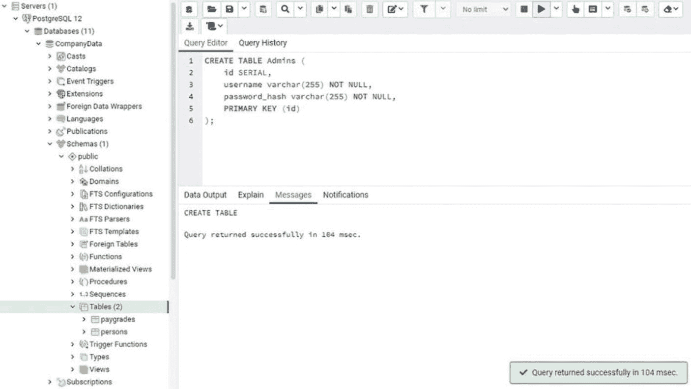
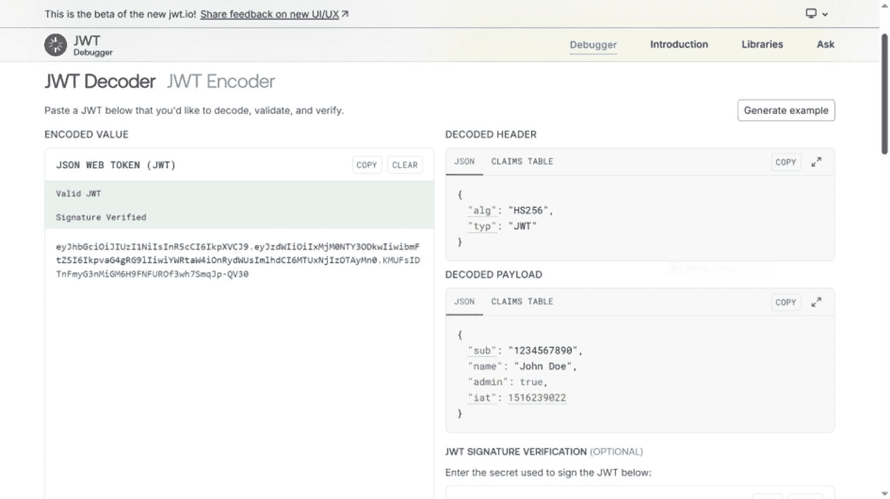
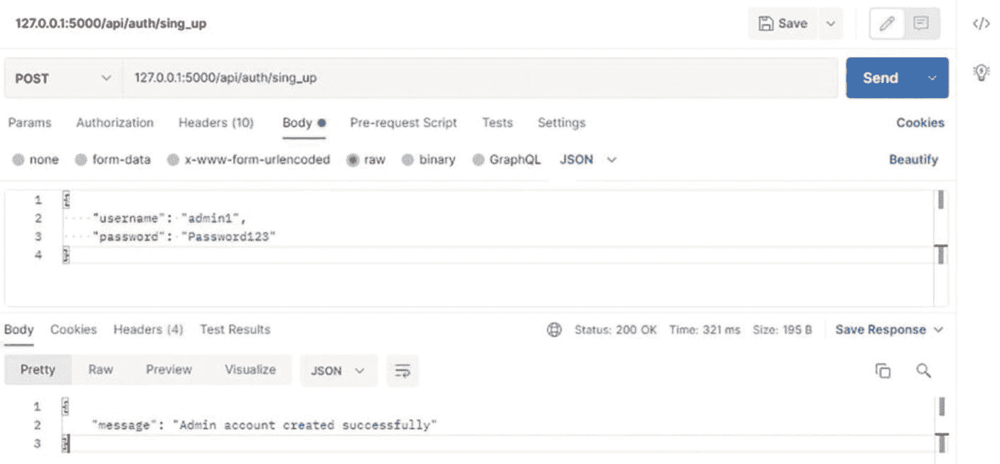
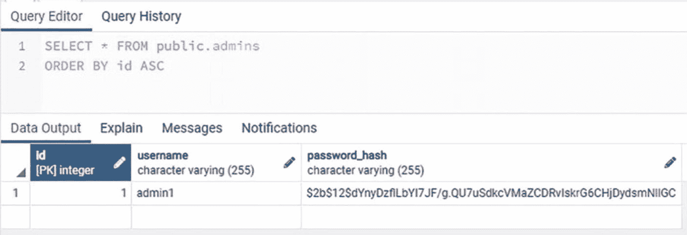
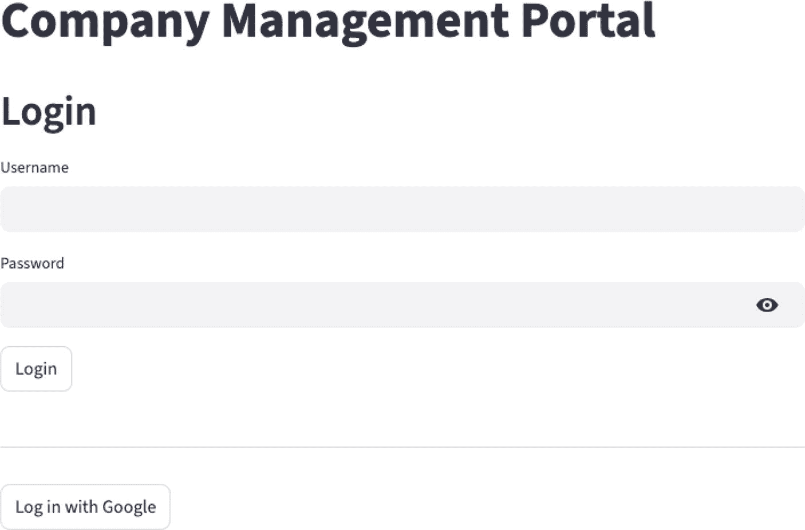
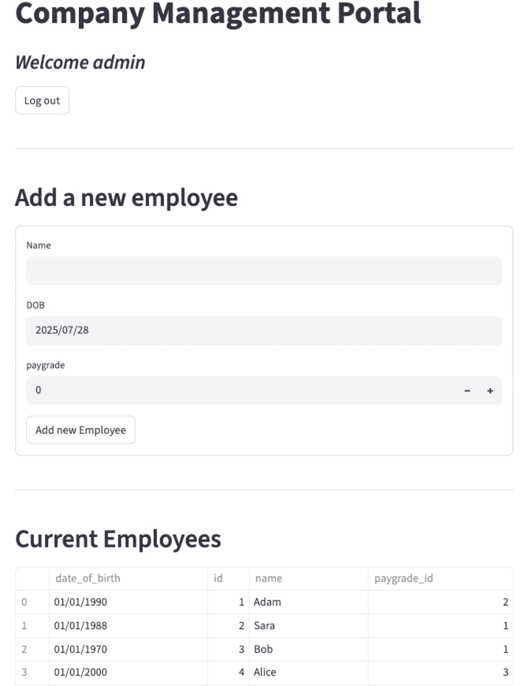

# 8. 用户认证与应用安全

在熟悉了一个结构良好的 Streamlit Web 应用的基本构建模块之后，我们现在需要一个额外的功能来部署一个可用于生产环境的应用：一个安全的用户认证服务。一旦所有请求访问该应用的用户都通过认证，我们就能确保一个安全的用户体验，其中私有数据保持安全，任何不受欢迎或恶意的请求都会被有效拒绝。在本章中，我们将学习如何建立用户账户、验证用户操作，以及实施任何称职的软件工程师都应掌握的其他维护措施。

## 8.1 开发用户账户

在本章中，我们将基于第 5 章和第 6 章的示例进行扩展，引入能够查看和添加员工及其薪资等级的人力资源管理员。假设有指定的管理员负责这些操作，且公司会频繁更换或指派新的管理员。在这种情况下，我们的应用需要支持创建多个管理员账户，并相应地为他们授权。

由于这些操作需要授权人员执行，我们需要实现三个主要功能：在数据库中添加一个管理员表、启用管理员账户创建、以及授权具有管理员权限的用户访问服务的相关部分。

### 8.1.1 哈希处理

要向数据库添加新表，我们将遵循与之前类似的过程，如图 8-1 所示。请注意，我们为每位管理员存储了两项关键信息：用户名和密码哈希值。我们没有保存密码本身，而是存储了一个哈希值——即密码的一种不可猜测的表示形式。这种方法有助于在数据泄露时保护用户隐私和凭据。如果发生此类泄露，攻击者需要花费数十亿年的时间暴力破解哈希值，才能找出单个用户的实际密码。哈希本质上是一种不可逆的数据单向转换。



**图 8-1** — 使用 `Flask/create_admins_table.sql` 的内容创建用于存储管理员凭据的新表

创建新表后，我们需要定义一个相应的 Python 类来为 SQLAlchemy 创建 ORM 模型，如清单 8-1 所示。密码哈希可以使用多种算法执行，例如 `MD5`、`SHA256`、`SHA512` 等。然而，现代系统中最常用的算法是 `Bcrypt`。事实上，`Bcrypt` 是许多 Linux 环境中保护用户密码的默认选择。在深入了解 `Bcrypt` 的工作原理之前，我们首先需要理解用于使哈希更安全的方法。

如前所述，哈希转换数据。例如，文本

```bash
Password123
```

使用 `MD5` 映射为

```bash
42f749ade7f9e195bf475f37a44cafcb
```

然而，即使对原始明文进行微小的修改，也可能导致哈希输出显著不同，如下所示：

```bash
MD5(Password1239) -> abd7fdbb048a611ea0a0937265765404
```

### 8.1.2 加盐

在密码中包含额外的字节——也称为添加盐值——会产生完全不同的哈希。这在用户在不同网站重复使用密码，且其中某个网站被攻破的情况下尤其有用。通过对密码加盐，攻击者将无法判断同一密码是否在多个域名中使用，从而大大增加了破解难度。然而，如果攻击者知道盐值及其应用方式，这种方法的效果就会降低。而 `Bcrypt` 的突出之处在于，它引入了一种加密方法，将随机生成的盐值存储于哈希本身之中。因此，可以使用 `Bcrypt` 库中的抽象函数来验证某个 `Bcrypt` 哈希是否由给定的明文生成，如清单 8-2 所示。

```python
import bcrypt

class HashingService:
    def __init__(self, bcrypt_gen_salt: int = 12):
        self.gen_salt = bcrypt_gen_salt

    def hash_bcrypt(self, plain_text: bytes) -> bytes:
        return bcrypt.hashpw(plain_text, bcrypt.gensalt(self.gen_salt))

    def check_bcrypt(self, plain_text: bytes, hashed_password: bytes) -> bool:
        try:
            return bcrypt.checkpw(plain_text, hashed_password)
        except:
            return False
# 清单 8-2：Flask/Services/HashingService.py
```

```python
from sqlalchemy import Column, Integer, String
from .Base import Base

class Admins(Base):
    __tablename__ = 'admins'
    id = Column(Integer, primary_key=True)
    username = Column(String)
    password_hash = Column(String, default=True)

    def to_dict(self):
        return {
            'id': self.id,
            'username': self.username,
            'password_hash': self.password_hash
        }
# 清单 8-1：Flask/DataBase/Admins.py
```

## 8.2 验证用户凭证

现在我们拥有了管理密码所需的服务和存储机制，可以着手重构后端，为每条路由提供身份验证支持。这意味着我们需要拦截每个发往服务器的请求，并判断其是否经过身份验证。换言之，我们需要一个独立的软件组件，位于客户端请求与访问控制器之间。后端开发人员通常将这种组件称为*中间件*。

身份验证过程必须检查请求中服务器可信任的特定标识符。该标识符被称为*身份验证令牌*，或简称*令牌*。令牌应由服务器签发，且必须是可验证的。

令牌通常分为两类：自定义会话 ID 或 `JWT`。在本示例中，我们将使用 `JWT`，因为它们无需服务器端存储，属于无状态令牌。`JWT` 由三部分组成，采用 `Base64` 编码，并以句点分隔。第一部分包含签名算法的元数据，第二部分保存原始载荷，第三部分则是使用第一部分中指定的哈希算法对载荷创建的受密码保护的签名。该结构在 `jwt.io` 网站的图 8-2 中有更详细的说明。



**图 8-2** JSON Web 令牌（`JWT`）内容

当收到新请求时，我们将检查请求头中是否包含令牌。令牌的载荷经过签名，我们会将该签名与传入令牌中的签名进行比较。如果两者匹配，即可确认该令牌是由服务器签发的。为了增强安全性，防止攻击者窃取合法令牌，我们还将设置一个过期时间（*默认自签发起 30 天*），过期后用户需要重新登录。由于此过程涉及多个逻辑步骤，最好将其隔离为一个专用于管理令牌的服务，如代码清单 8-3 所示。

# JWT 服务与中间件集成

## JWT 服务实现

```python
from jwt import PyJWT
from time import time
from typing import Union

class JWTService:
    expires_in_seconds = 2592000
    signing_algorithm = 'HS256'
    
    def __init__(self, signing_key: str, expires_in_seconds: int = 2592000):
        self.signing_key = signing_key
        self.expires_in_seconds = expires_in_seconds
    
    def generate(self,
                 data: dict,
                 expires_in_seconds: int = expires_in_seconds) -> Union[str, None]:
        try:
            instance = PyJWT()
            curr_unix_epoch = int(time())
            data['iat'] = curr_unix_epoch
            if isinstance(expires_in_seconds, int):
                data['exp'] = curr_unix_epoch + expires_in_seconds
            token = instance.encode(
                payload=data,
                key=self.signing_key,
                algorithm=self.signing_algorithm)
            if type(token) == bytes:
                token = token.decode('utf8')  # 某些版本的 PyJWT 需要此步骤
            return token
        except BaseException as _:
            return None
    
    def is_valid(self, token: str, verify_time: bool = True) -> bool:
        try:
            payload = self.get_payload(token)
            if payload is None:
                return False
            if verify_time and 'exp' in payload and payload['exp'] < int(time()):
                return False
            return True
        except:
            return False
    
    def get_payload(self, token: str):
        try:
            instance = PyJWT()
            payload = instance.decode(
                jwt=token,
                key=self.signing_key,
                algorithms=[self.signing_algorithm])
            return payload
        except Exception as e:
            return None
```

**代码清单 8-3** `Flask/Services/JWTService.py`

现在我们有了签发和验证令牌的方法，可以将此逻辑集成到我们的中间件类中，如代码清单 8-4 所示。该类包含一个函数，负责检查请求的路由是否需要身份验证。如果需要验证，中间件将验证提供的 JWT 是否有效。如果令牌无效或缺失，它将返回标准的 401 错误，表示*未授权*。否则，它将返回*None*，表示请求可以继续执行后端代码的下一步——在本例中，即控制器。

如第 8 行所示，我们指定登录和注册路由（这两者将在后面介绍）无需身份验证。这是因为成功登录后，系统会向用户签发一个令牌。注册路由同理，不过我们稍后会引入额外的保护层，以防止外部行为者在无人监管的情况下滥用创建账户。

## 中间件实现

```python
from flask import Request
from Services.JWTService import JWTService
from werkzeug import exceptions

class Middleware:
    def __init__(self, jwt_service: JWTService):
        self.unauthenticated_route_names = {'/api/auth/login', '/api/auth/sing_up'}
        self.jwt_service = jwt_service
    
    def auth(self, request: Request):
        is_route_unauthenticated = request.path in self.unauthenticated_route_names
        if is_route_unauthenticated:
            return None
        if 'token' in request.headers:
            token = request.headers['token']
            is_valid = self.jwt_service.is_valid(token)
            if is_valid:
                return None
            else:
                return exceptions.Unauthorized()
        return exceptions.Unauthorized()
```

**代码清单 8-4** `Flask/Middleware/Middleware.py`

## 主应用与路由定义

最后，我们需要初始化之前创建的服务，并定义三个额外的路由，分别用于登录、注册和检查登录状态。最后一个路由是必需的，以便前端判断是否应显示登录页面。服务器的主文件应如代码清单 8-5 所示。

如清单所示，密钥和机密信息从一个外部的 YAML 文件中读取并解析。其中一个机密用于确保只有知道该机密的人才能创建新账户，如图 8-3 和图 8-4 中使用 Postman 工具演示的那样。



**图 8-4** 创建管理员账户，步骤 2：设置新账户的凭据


**图 8-3** 创建管理员账户，步骤 1：添加注册密钥

```
from flask import Flask, request
from DataBase import Employees, Admins
from DataBase.Connection import session_manager
from Services import JWTService, HashingService
from Middleware import Middleware
from werkzeug import exceptions
import yaml

app = Flask(__name__)

with open(".streamlit/secrets.toml") as f:
    yaml_dict = yaml.safe_load(f)

sing_up_key = yaml_dict['sing_up_key']
jwt_secret = yaml_dict['jwt_secret']

jwt_service = JWTService(jwt_secret)
middleware = Middleware(jwt_service)
hashing_service = HashingService()

app.before_request(lambda: middleware.auth(request))

@app.route('/api/employees')
def get_all_employees():
    with session_manager() as session:
        employees = session.query(Employees).all()
        employees = [employee.to_dict() for employee in employees]
        return {"data": employees}

@app.route('/api/employee', methods=["POST"])
def add_employee():
    body = request.json
    with session_manager() as session:
        session.add(Employees(**body))
        session.commit()
        return {"message": "New employee added successfully"}

@app.route('/api/auth/login', methods=["POST"])
def log_in():
    username, password = request.json['username'], request.json['password']
    with session_manager() as session:
        admin_account = session.query(Admins).filter(
            Admins.username == username).first()
        print(1)
        if admin_account is None:
            # 用户名不存在。但不要告知客户端，以免其用于暴力破解有效用户名
            return exceptions.Unauthorized(
                description="Incorrect username/password combination")
        print(2)
        # 检查该密码是否能生成这样的哈希值
        is_password_correct = hashing_service.check_bcrypt(
            password.encode("utf8"), admin_account.password_hash.encode("utf8"))
        print(3)
        if not is_password_correct:
            return exceptions.Unauthorized(
                description="Incorrect username/password combination")
        print(4)
        token_payload = {"username": username}
        token = jwt_service.generate(token_payload)
        print(5)
        if token is None:
            return exceptions.InternalServerError(description="Login failed")
        print(6)
        return {"token": token}

@app.route('/api/auth/sing_up', methods=["POST"])
def sign_up():
    username, password = request.json['username'], request.json['password']
    if request.headers.get("sing_up_key") != "sing_up_key":
        exceptions.Unauthorized(description="Incorrect Key")
    with session_manager() as session:
        password_hash = hashing_service.hash_bcrypt(
            password.encode("utf-8")).decode("utf-8")
        admin = Admins(username=username, password_hash=password_hash)
        session.add(admin)
        session.commit()
        return {"message": "Admin account created successfully"}

@app.route('/api/auth/is_logged_in')
def is_logged_in():
    # 如果到达此控制器，意味着认证中间件识别了传入的令牌
    return {"message": "Token is valid"}

app.run()
```

代码清单 8-5 `Flask/flask_main.py`

创建账户后，我们可以手动检查数据库以验证新凭证是否已存储。如图 8-5 所示，其中用户名与提供的用户名匹配，另一列则包含所提供密码的有效 Bcrypt 哈希值。



图 8-5 数据库中创建的账户详情

现在我们已经设置了管理员账户，可以继续下一步之前，使用 `Postman` 测试登录流程。通过向相应路由发送 POST 请求，以 JSON 格式提交注册时使用的相同用户名和密码，我们将在响应中收到一个令牌，如图 8-6 所示。


图 8-6 使用图 8-4 中的凭证通过 `Postman` 登录

进入 Streamlit 端的下一开发阶段，我们将从重构代码清单 8-6 开始，使其支持使用认证令牌进行初始化。该令牌随后将包含在每个请求中——登录请求除外，因为此时令牌尚不可用。还需注意，`is_logged_in` 函数用于快速检查当前令牌（若已提供）的有效性。

# API 与前端集成

## 代码清单 8-6 与 8-7 `Streamlit/API.py`

```python
import requests

class API:
    def __init__(self, base_url: str, token: str):
        self.base_url = base_url
        self.base_headers = {'token': token}

    def add_employee(self, name, dob, paygrade):
        try:
            data = {
                'name': name,
                'date_of_birth': dob,
                'paygrade_id': paygrade
            }
            response = requests.post(self.base_url + '/employee',
                                     json=data, headers=self.base_headers)
            if response.status_code == 200:
                return True
        except:
            return False

    def get_employees(self):
        try:
            response = requests.get(self.base_url + '/employees',
                                    headers=self.base_headers)
            return response.json()['data']
        except:
            return None

    def login(self, username, password):
        try:
            response = requests.post(self.base_url + '/auth/login', json={
                'username': username,
                'password': password
            })
            body = response.json()
            token = body.get('token') if type(body) == dict else None
            return token
        except:
            return None

    def is_logged_in(self):
        return requests.get(self.base_url + '/auth/is_logged_in', headers=self.base_headers).status_code == 200
```

我们的 API 现已适配为使用认证令牌，如代码清单 8-7 所示。接下来，我们可以进入前端开发，通过实现 Cookie 支持来存储这些令牌并按需使用，如代码清单 8-8 所示。每当 Streamlit 渲染时，它会检查本地 Cookie 中是否存在认证令牌。如果令牌有效，应用程序将显示管理门户，并附带个性化的欢迎信息，如图 8-8 所示。否则，它将提示用户登录，如图 8-7 所示。

## 代码清单 8-8 `Streamlit/streamlit_main.py`

```python
import streamlit as st
from Views import AddEmployee, DisplayEmployees, Login
from API import API
import extra_streamlit_components as stx
import base64, json

cookie_manager = stx.CookieManager()
cookies = cookie_manager.get_all()
authentication_token = cookies.get("token")\
    if type(cookies) == dict else cookies
api = API("http://127.0.0.1:5000/api", authentication_token)

def get_username_from_token(auth_token):
    b64 = str(auth_token).split(".")[1]
    b64 = b64 + "=" * (4 - (len(b64) % 4))
    data = base64.b64decode(b64).decode("utf8")
    username = json.loads(data)['username']
    return username

def manage_login(username, password):
    token = api.login(username, password)
    cookie_manager.set("token", token)
    return token is not None

st.title("公司管理门户")
if st.user.is_logged_in or api.is_logged_in():
    st.subheader(f"_ 欢迎 "
                 f"**{get_username_from_token(authentication_token)}**_")
    if st.button("登出"):
        cookie_manager.delete("token")
    st.write("_____")
    AddEmployee(api.add_employee)
    st.write("___")
    DisplayEmployees(api.get_employees)
else:
    Login(manage_login)
```

### 图 8-7 登录页面



### 图 8-8 添加和查看已认证员工列表



仔细观察 Streamlit 端的代码，我们可以看到它遵循了与后端类似的编码模式——即依赖注入。这种方法有助于保持整个代码库的一致性。本质上，API 动作被传递到视图层，这些视图被抽象为一个类，如代码清单 8-9、8-10 和 8-11 所示。

```markdown
## 8.3 密钥管理

既然我们已经讨论过如何保护 Streamlit 应用程序的密钥凭据免受外部访问，现在我们介绍另一种方法——在 Flask 中常用，同样可以应用于 Streamlit 场景。本质上，我们需要一个文件来存储这些密钥。这包括 JWT 签名密钥和注册头部密钥，应将它们保存在磁盘上，然后在运行时加载到应用程序的内存中。虽然存储密钥和秘钥的方式有多种，但最用户友好的选项之一是使用 YAML 文件，如代码清单 8-12 所示。这些文件可以轻松解析并转换为 Python 字典。

为了支持使用其他一键登录方式（如 Google 或 Microsoft）进行登录，您需要将必要的凭据添加到以下文件中，以允许您的应用程序使用这些登录方式。有关如何设置的更多详细信息，请访问 `https://docs.streamlit.io/develop/api-reference/user/st.login`。

### 代码清单 8-12

`Flask/secrets.yaml`

```yaml
jwt_secret: "此处填写随机文本"
sign_up_key: "此处填写另一段随机文本"
auth:
redirect_uri: "http://localhost:8501/oauth2callback"
cookie_secret: "xxx"
client_id: "xxx"
client_secret: "xxx"
server_metadata_url: "https://accounts.google.com/.well-known/openid-configuration"
```

## 8.4 使用 SQLAlchemy 的防 SQL 注入措施

作为最终通过代码实现的保护措施，我们旨在通过防止意外操作来保护后端的 SQL 查询。首先，我们需要识别什么是 SQL 注入。它通常发生在用户控制的输入改变了 SQL 命令行为的时候。例如，假设我们要支持搜索姓名以最终用户提供的字符串开头的员工。这可能会导致如下查询：`SELECT * FROM Employees WHERE name = 'input%'`。然而，如果输入是 `OR 1=1 --`，这会改变最终查询为：`SELECT * FROM Employees WHERE name = '%' OR 1=1 --`。

这会导致数据库返回所有员工，而不是将输入视为搜索字符串。

为了防止这个问题，我们使用参数化，这是一种将 SQL 命令与变化的变量分离开的技术。因此，在上面的例子中，查询将如下所示：`SELECT * FROM Employees WHERE name = '@name%'`，其中 `@name` 是在提交查询之前初始化的 SQL 变量。作为开发者，这似乎是为了确保更安全的 SQL 而做的额外工作。但是，库和包可以为我们处理这件事。为此，我们使用 SQLAlchemy，它是一个连接多种数据库的库，并根据数据库架构、来源和版本调整 SQL 命令格式。它遵循直观的 API，在 `docs.sqlalchemy.org` 上有完善的文档。

## 8.5 配置 Git 忽略变量

在大型项目中使用 Git 这类版本控制系统追踪所有文件至关重要，因为它能简化重要文件及其修改历史的管理。然而，并非所有文件都应被追踪，尤其是那些可能带来安全风险的文件。如果代码库是公开的，或者私有仓库遭到入侵，追踪文件中的机密信息就会变得脆弱。因此，开发者广泛认可的做法是不在版本控制中追踪机密文件。相反，应将机密信息存储在可通过多种认证方法访问的安全保管库中。

虽然这种做法增加了额外的安全层，但可能会对代码可读性造成负面影响，尤其是当不熟悉项目的开发者开始工作时。为了解决这个问题，我们可以添加一个名为 `Flask/secrets.example.yaml` 的文件，其内容与实际机密文件相似，但将敏感键值替换为模糊占位符，如清单 8-13 所示。这为开发者提供了示例，同时不会暴露真实机密信息。

接下来，我们可以通过更新 `.gitignore` 文件来将实际机密文件排除在 Git 追踪之外，如清单 8-14 所示。如有必要，可以根据指定语法忽略或排除与 `.gitignore` 处于同一目录下的任何文件或文件夹。

### 清单 8-14

`Flask/.gitignore`

```
Secrets.example.toml
```

### 清单 8-13

`Flask/secrets.example.toml`

```
jwt_secret = ""
sing_up_key = ""
[auth]
redirect_uri = "http://localhost:8501/oauth2callback"
cookie_secret = "xxx"
client_id = "xxx"
client_secret = "xxx"
server_metadata_url = "https://accounts.google.com/.well-known/openid-configuration"  # fmt: skip
```

## 8.6 总结

作为任何 Web 应用公开化的一部分，通过验证每个用户的授权级别来管理所服务的资源至关重要。在本章中，我们解释了如何创建和管理用户账户，并利用它们进行身份认证。我们介绍了关键的安全机制，例如生成 JSON Web Token、对密码进行哈希处理，以及将安全签名嵌入到 Cookie 中。此外，我们还介绍了防止 SQL 注入攻击的技术，确保未经授权的用户无法访问数据库。最后，我们探讨了如何在部署过程中保护应用密钥和机密信息，以及如何将它们排除在版本控制系统（如 Git）的提交之外。

### 代码清单 8-11

`Streamlit/Views/Login.py`

```python
import streamlit as st
from typing import Callable
class Login:
def __init__(self, on_login: Callable[[str, str], bool]):
st.header("登录")
username = st.text_input("用户名")
password = st.text_input("密码",type="password")
if st.button("登录"):
success = on_login(username, password)
if success:
st.success("登录成功")
else:
st.error("用户名和密码组合不正确")
st.write("___")
if st.button("使用 Google 登录"):
st.login()
```

### 代码清单 8-10

`Streamlit/Views/DisplayEmployees.py`

```python
import streamlit as st
from typing import Callable
class DisplayEmployees:
def __init__(self, get_employees: Callable[[], list]):
st.header('当前员工')
employees = get_employees()
if employees is None:
st.error('获取员工列表时出错')
else:
st.table(employees)
```

### 代码清单 8-9

`Streamlit/Views/AddEmployee.py`

```python
import streamlit as st
from typing import Callable
import datetime
class AddEmployee:
def __init__(self, on_submit: Callable[[str, str, int], bool]):
st.header('添加新员工')
form = st.form('new_employee')
name = form.text_input('姓名')
dob = str(form.date_input('出生日期',
min_value=datetime.datetime(year=1920, day=1, month=1)))
paygrade = form.number_input('薪资等级', step=1)
if form.form_submit_button('添加新员工'):
success = on_submit(name, dob, paygrade)
if success:
st.success('新员工已添加')
else:
st.error('员工未添加')
```
