# 9. 本地部署与云端部署

随着 Streamlit 应用开发阶段接近尾声，它即将首次“面世”。换句话说，你已经准备好部署应用并与全世界分享你的成果。为此，你需要一台能够持续、稳健且弹性地运行应用的机器。虽然你可以将本地机器临时用作服务器，但更好的做法是将应用部署到强大的云端——使用 Amazon Web Services、Microsoft Azure、Google Cloud Platform，或者同样重要的 Streamlit 自身的平台。

在本章中，我们将逐步介绍将本地应用部署到网络的必要步骤，更重要的是，如何利用 Linux 容器、Windows Server 以及 Streamlit 的专属云服务 `Streamlit Cloud` 在远程服务器上部署应用。到本章结束时，你将掌握在局域网内以及万维网上为用户提供服务的技术知识。

## 9.1 将 Streamlit 暴露于万维网

用 Streamlit 构建应用后，你可以通过在浏览器中访问环回地址 `http://127.0.0.1:8501` 来查看其运行情况。此外，你还可以与本地网络中的其他人和设备共享该应用，本地网络通常分配以 `192.168.*`、`172.(16-31).*` 或 `10.*` 开头的 IP 地址。要从同一网络中的任何设备访问正在运行的 Streamlit 应用，只需在 IP 地址前加上 `http://`，并附加 `:8501` 或 Streamlit 正在监听的端口即可。然而，如果没有从 ISP 租用静态公共 IP 或从主要提供商处租赁云服务器，就没有直接的方法可以临时向任何地方的任何人展示你的 Streamlit 应用。在本节中，我们将探索免费且易于配置的方法，让你无需额外成本即可在全球范围内展示你的应用。

### 9.1.1 通过网络网关进行端口转发

几乎每个家庭都有一个宽带设备，它充当着通往互联网的网关。然而，家庭网络和设备并不直接暴露在互联网上；相反，它们的互联网请求通过宽带设备进行路由。该设备使用 NAT（网络地址转换）将私有 IP 地址映射到公共 IP 地址。但反向操作——从互联网访问设备——默认情况下是行不通的，除非进行显式配置。大多数宽带设备都有一个内置的 Web 服务器，用于控制各种网络设置。通常，网络中的第一个 IP 地址属于宽带设备。在浏览器中输入此 IP 通常会打开一个配置页面，如图 9-1 所示。虽然不同设备的界面可能有所不同，但大多数都提供了配置 *端口转发* 或 *端口映射* 的选项。在该页面上，我们想要将一个内部 IP 和端口映射到宽带设备面向公众的某个端口上。理想情况下，我们会将 Streamlit 的默认端口 `8501` 映射到 HTTP 的默认端口 `80`。

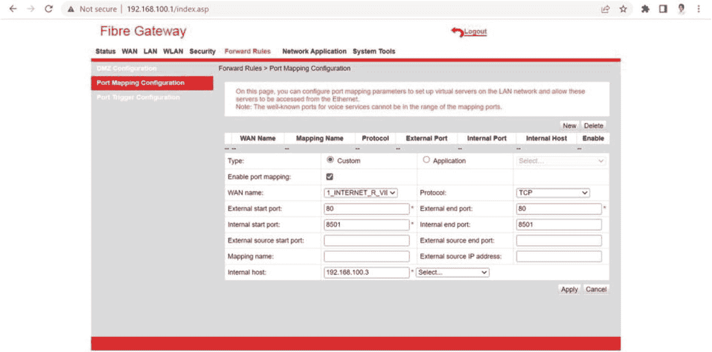

图 9-1 宽带设备的配置网站

下一步是找出网关的公共 IP 地址。一种简单的方法是直接通过谷歌搜索，如图 9-2 所示。基本上，你访问的任何网站都能检测到你的公共 IP 并显示给你。一旦获得这个 IP，你可以将其粘贴到浏览器的地址栏中——如果一切配置正确——你将看到你的 Streamlit 应用。


图 9-2 主机的公共 IP 地址

值得注意的是，公共 IP 由你的 ISP 分配，它通常会在一个 IP 地址池中为其客户轮换分配。这意味着你的公共 IP 最终会发生变化——可能每小时一次，或者当网络重新连接时。除非你专门向 ISP 请求一个静态 IP，否则这种动态行为会持续下去。静态 IP 能确保即使你的网络暂时离线，宽带设备也始终被分配相同的 IP 地址。

### 9.1.2 使用 NGROK 进行 HTTP 隧道传输

隧道传输的概念类似于在两台设备之间建立 VPN 连接，即使它们相距甚远且不在同一网络中。`NGROK` 利用隧道技术，使私有网络设备能够在短时间内（通常为两小时）被公共网络访问。它通过在其服务器上分配一个临时子域名来实现这一点，该子域名将请求转发到你的服务，并代表你将其暴露出来。简而言之，一个运行在 `http://127.0.0.1:8501` 的 Streamlit 应用可以通过一个特定的 ngrok URL 进行访问，该 URL 遵循以下格式：

```
http://<subdomain>.ngrok-free.app
```

一旦 Ngrok 用户发起隧道命令，连接就会建立，并会提供 Ngrok URL。用户随后可以将此 URL 分享给任何人，以便他们在接下来的几个小时内访问其本地的 Streamlit 应用程序。在你的计算机上安装 Ngrok 后，你可以通过在 CMD 或终端中输入以下命令来运行它：

```
ngrok http <port_to_tunnel_to>
```

其中，`<port_to_tunnel_to>` 块可以替换为 `8501`，以建立隧道连接到正在运行的 Streamlit 应用程序。清单 9-1 展示了一个简单的 Streamlit 应用程序，它使用 iframe 来显示用户的公网 IP 地址。在 CMD 中运行 ngrok 并监听 `8501` 端口后，用户会看到分配的子域名，如图 9-3 所示。Ngrok 提到该子域名的位置列为美国。然而，当访问一个公网 IP 网站时，它并未显示来源是美国，如图 9-4 所示。相反，显示的 IP 是用户来自卡塔尔的原始 IP，尽管 ngrok 的隧道是通过美国路由的。这是因为 ngrok 不是一个 VPN，而是一个网络，对页面的请求是通过 Streamlit 宿主机器路由的。

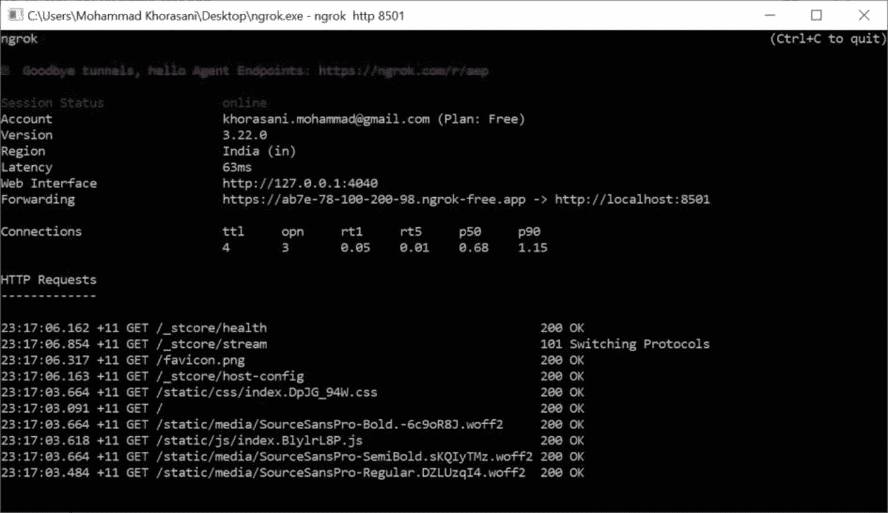

图 9-3 Ngrok 在建立到 `8501` 端口的隧道后显示的控制面板

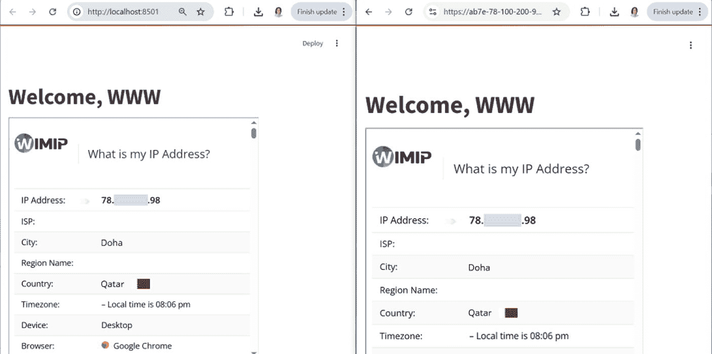

图 9-4 两个浏览器窗口，一个由本地提供服务，另一个由 ngrok 提供服务，均显示相同的客户端 IP

```python
import streamlit as st
st.title('欢迎，WWW')
url = 'https://www.whatismyip-address.com'
script = f"""
<iframe src="{url}" width="400" height="300"></iframe>
"""
st.write(script, unsafe_allow_html=True)
st.write(f'查看你的 公网 IP')
```

**清单 9-1** `main.py`

## 9.2 部署到 Streamlit Community Cloud

在云上部署 Web 应用程序可能是一项艰巨的任务，具体取决于你的云服务提供商。有些提供商，如 `Heroku`，已经将其简化为连接你的 `GitHub` 仓库、安装构建包、配置应用程序并启动它。其他提供商则需要你处理整个过程，包括设置虚拟机、创建容器、配置端口转发、负载均衡以及自行路由请求。无论如何，部署到云端至少需要对云计算概念有基本的了解——毕竟，这就是我们有 DevOps 工程师的原因。

然而，Streamlit 正在使这最后一公里变得大众化，让部署几乎成为一键式流程。借助 `Streamlit Cloud`，你只需连接你的 `GitHub` 仓库并点击部署即可。Streamlit 会自动配置应用程序及其所有必需的依赖项，并在你每次推送新版本的源代码时进行更新。无需开发人员进行额外干预。此外，如果你需要多个私有应用程序、额外的计算资源或企业级功能，你可以升级到 Streamlit 的高级套餐。

### 9.2.1 一键部署

在将你的第一个应用程序部署到 `Streamlit Cloud` 之前，你应该创建一个 `GitHub` 账户并将你的脚本推送到一个仓库。完成此操作后，你可以按照以下步骤进行部署：

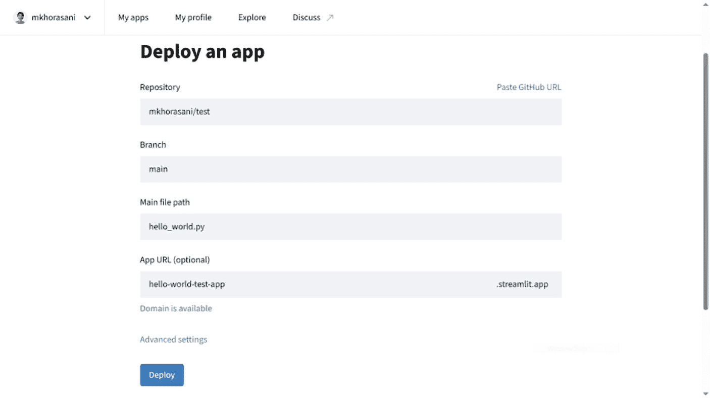

**图 9-5**

将应用程序部署到 Streamlit Cloud（第 1 步）

1.  导航至 `share.streamlit.io`，使用你的 GitHub 账户登录，然后点击 `新建应用`。

2.  选择存放你源代码的仓库、分支和文件。然后点击 `部署！`，如图 9-5 所示。

![截图显示部署界面。左侧是一个面包图标，下方文字为"您的应用正在准备中"。右侧是一个日志面板，显示消息："[20:43:12] 正在配置机器..."、"[20:43:12] 正在准备系统..."和"[20:43:12] 正在启动管理进程..."。底部显示文件路径："main mkhorasani/test/main/hello_world.py"。](images/523242_2_En_9_Chapter/523242_2_En_9_Fig6_HTML.jpg)

**图 9-6**

将应用程序部署到 Streamlit Cloud（第 2 步）

1.  当 Streamlit Cloud 配置你的应用程序时，请放松一下，如图 9-6 所示。

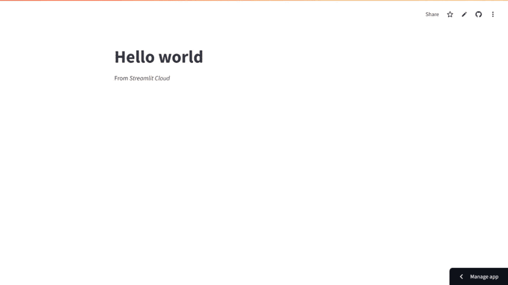

**图 9-7**

将应用程序部署到 Streamlit Cloud（第 3 步）

1.  好了，你的第一个应用程序已成功部署到 Streamlit Cloud，如图 9-7 所示。

## 9.2.2 Streamlit 机密管理

使用 Streamlit Cloud 的另一个好处是，你可以将私有数据安全地存储在 Streamlit 的服务器上，并在应用程序中轻松访问它。此功能对于存储用户凭据、数据库连接字符串、API 密钥和其他密码特别有用——无需担心它们在代码中以明文形式暴露（你在任何情况下都不应这样做）。相反，你可以按照以下步骤，使用 Streamlit 的机密管理功能来存储和访问私有数据。


图 9-10

在 Streamlit Cloud 应用程序中使用机密

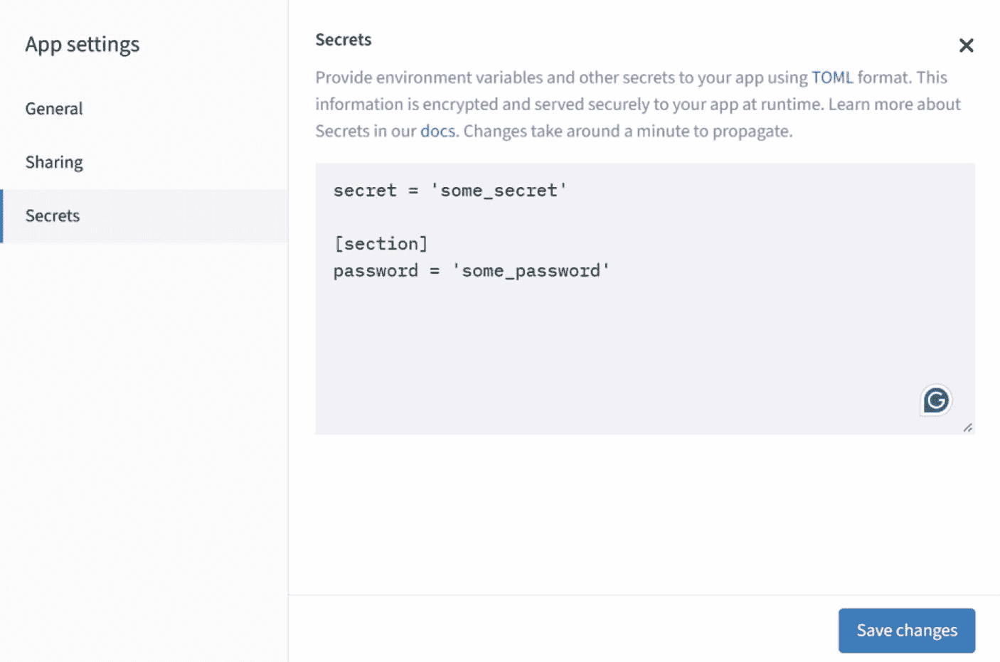

图 9-9

向 Streamlit Cloud 的机密管理中添加机密（2）

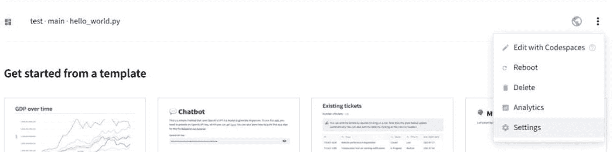

图 9-8

向 Streamlit Cloud 的机密管理中添加机密（1）

1. 导航到 `share.streamlit.io`，打开你想要添加机密的应用程序的设置，如图 9-8 所示。

2. 以 TOML 文件的形式添加你的机密，如图 9-9 所示。

3. 在脚本中使用 `st.secrets` 命令访问你的机密，如下所示及图 9-10 所示：

    ```
    import streamlit as st
    st.write('**Secret:**',st.secrets['secret'])
    st.write('**Password:**',st.secrets['section']['password'])
    ```

4. 如果你希望在本地服务器上复制机密管理功能，只需在根目录的 `.streamlit` 文件夹中添加同名的 `secrets.toml` 文件即可。请确保将此文件夹添加到你的 `.gitignore` 文件中，以确保此类文件不会包含在 Git 提交中。

## 9.3 部署到 Linux

大多数云服务提供商专门为企业及个人提供虚拟机租赁服务，用于在 Linux 环境中运行服务和应用程序。Linux 的优势在于其极简的内核层，能够以更高的速度进行处理并更好地利用计算机资源。这些因素使 Linux 成为云虚拟机的首选操作系统。

### 9.3.1 在 Linux 机器上原生部署

如果你能访问一台 Linux 机器，例如在 Windows 上运行的 Ubuntu WSL（Windows Subsystem for Linux），你可以通过命令行界面运行 Streamlit，如图 9-11 所示。

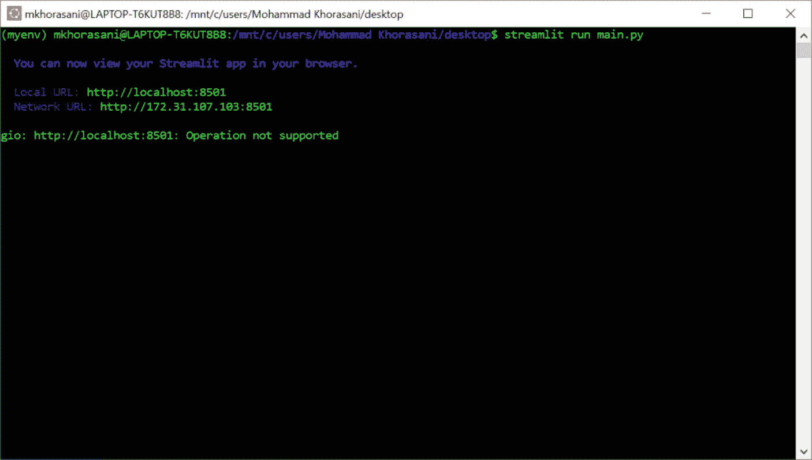

图 9-11

在终端中运行代码清单 9-2

代码清单 9-2 中 Streamlit 应用程序的输出可以在图 9-12 中看到。

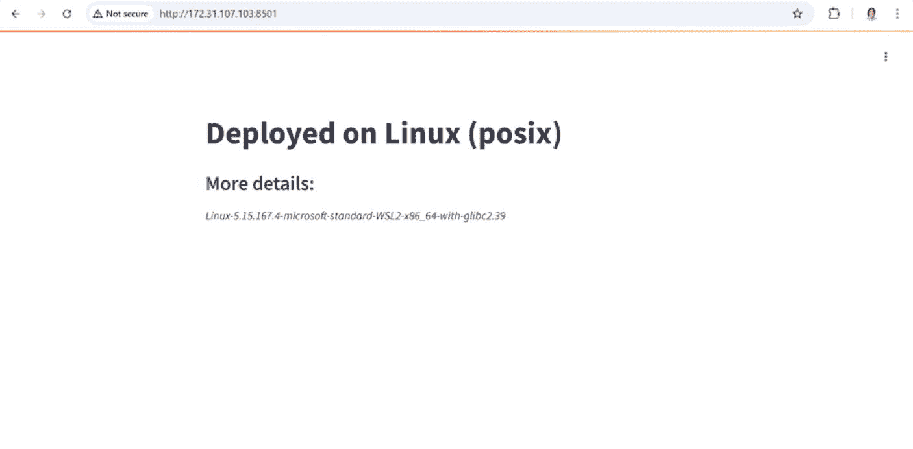

图 9-12

代码清单 9-2 的输出，显示操作系统为 Linux

要显示运行中的系统平台，可以运行代码清单 9-2 中所示的脚本。

```
import os
import platform
import streamlit as st
st.title(f'Deployed on {platform.system()} ({os.name})') st.subheader('More details: ') st.write(f'_{platform.platform()}_')
```

代码清单 9-2
`main.py`

### 9.3.2 使用 Linux Docker 容器部署

为了避免以特定方式运行 Streamlit 应用程序的麻烦——并提高安全性——你可以使用 Docker 容器来运行它。Docker 允许你在任何操作系统环境中托管应用程序，并拥有其自身的变量、应用程序和服务，同时让你能够控制它可以访问的计算机资源。此外，如果应用程序遭到恶意攻击者入侵，只要容器配置正确，他们就不太可能突破 Docker 容器并进一步危害主机。

既然我们已经了解了在容器化环境中部署服务的好处，接下来可以继续创建 Docker 的主文件，如代码清单 9-3 所示。假设 Docker 已经安装，此文件会启动一个预装了 Python 3.8 的 Linux 环境，然后创建一个文件夹来存放你的 Streamlit/Python 文件。接着，它会将你现有的 `requirements.txt` 文件（如代码清单 9-4 所示）复制到 Docker 的工作目录中，依赖项将在该目录下安装。一旦 Streamlit 安装完成，Docker 容器将被指示暴露端口 `8501` 以允许从容器外部访问——这是 Streamlit 的默认端口。最后，你的 Streamlit 文件会被复制到工作目录并执行。

```
streamlit==1.41.1 # 编写本书时的最新版本
```

代码清单 9-4
`requirements.txt`

# 9.4 部署到 Windows Server

鉴于企业界对微软的偏爱，如果你要在公司服务器上部署 Streamlit 应用程序，你很有可能会使用 Windows Server。幸运的是，配置应用程序的过程简单直接。虽然本节重点介绍 Windows Server，但这些步骤同样适用于在标准 Windows 操作系统上进行部署。不过，在继续之前，我们将做一些假设：你的公司服务器位于远程位置，并且你只能访问本地内部网络，没有互联网连接。因此，需要额外的步骤来克服这些限制，这些步骤将在后续章节中说明。

## 9.4.1 建立远程桌面连接

如前所述，你的服务器可能位于远程位置，连接它的最可能方式是通过远程桌面协议（RDP）。RDP 提供图形用户界面，让你能够通过网络连接访问远程服务器。微软的 RDP 客户端是远程桌面连接，如图 9-17 所示。要建立连接，请在`计算机`字段中输入远程服务器的 IP 地址，如有必要，在`用户名`字段中以`域名/用户名`格式追加域信息。然后，点击`连接`，系统将提示你输入密码以登录服务器。

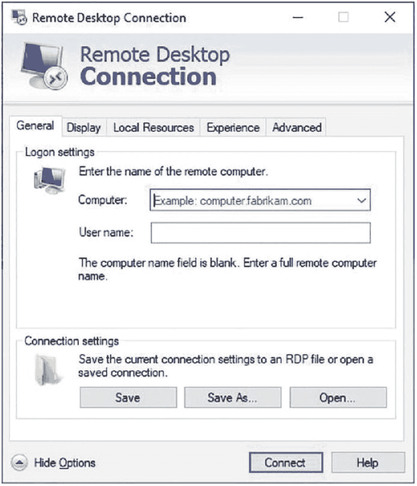

图 9-17 建立与远程服务器的 RDP 连接

由于你的远程服务器可能无法访问互联网，你可以通过在`本地资源`选项卡中选择`驱动器`复选框，使用 RDP 将文件从本地磁盘传输到服务器，如图 9-18 所示。此功能还允许你在需要时将其他本地资源（如 I/O 设备和外围设备）提供给服务器使用。

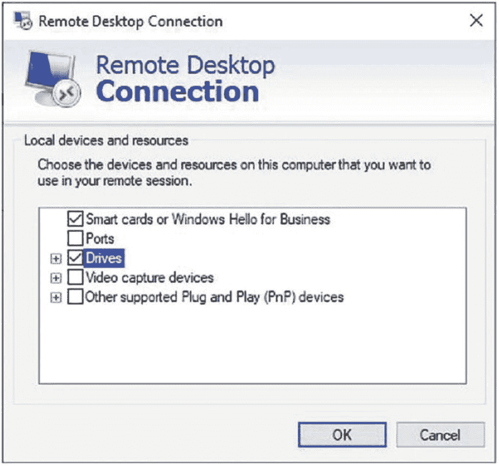

图 9-18 将本地资源传输到远程服务器

## 9.4.2 开放 TCP/IP 端口

在继续之前，请确保服务器上所有相关的入站和出站 TCP/IP 端口均已开放，以便 Streamlit 应用程序能够在本地网络上转发。

1. 打开`具有高级安全性的 Windows Defender 防火墙`。
2. 在左窗格中选择`入站规则`或`出站规则`。
3. 在右窗格中点击`新建规则`，打开`新建规则向导`窗口。
4. 选择`端口`选项，然后点击下一步，如图 9-19 所示。

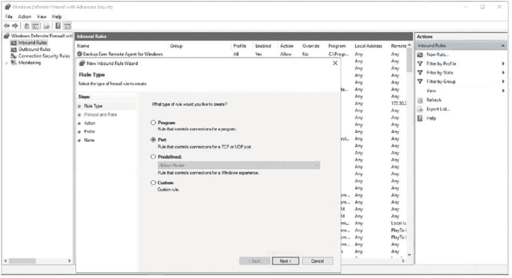

图 9-19 开放 TCP/IP 端口（1）

5. 选择`TCP`，并输入你的 Streamlit 应用程序将要提供服务的端口号，例如`8501`，如图 9-20 所示。

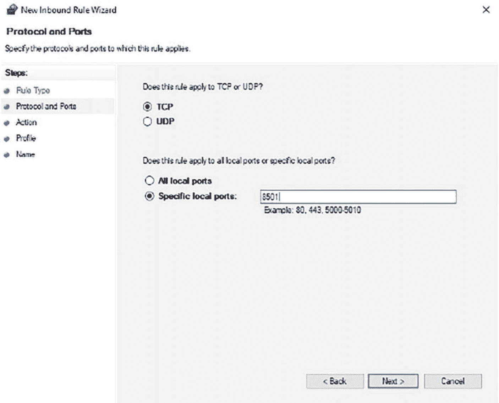

图 9-20 开放 TCP/IP 端口（2）

准备好文件后，我们需要从项目中构建一个自定义的 Docker 镜像——类似于图 9-13 所示——方法是在项目的根文件夹（`Dockerfile` 应位于此处）中运行代码清单 9-5 中的命令。

```
FROM python:3.10
# 设置工作目录
WORKDIR /app
# 安装依赖项
COPY requirements.txt ./requirements.txt
RUN pip install --no-cache-dir -r requirements.txt
# 暴露 Streamlit 端口
EXPOSE 8501
# 复制应用程序文件
COPY . /app
# 添加一个简单的健康检查（每 30 秒尝试 curl 访问 Streamlit 应用程序）
HEALTHCHECK --interval=30s --timeout=10s --start-period=30s --retries=3 \
CMD curl -f http://localhost:8501/_stcore/health || exit 1
# 显式入口点，绑定主机地址
ENTRYPOINT ["streamlit", "run", "main.py", "--server.address=0.0.0.0"]
```

代码清单 9-3 Dockerfile


图 9-13 构建镜像并验证其存在

```
docker build -t <镜像名称>:latest .
```

代码清单 9-5 构建 Docker 镜像

运行镜像的方法是执行代码清单 9-6 中所示的代码；`-d` 选项用于将进程与命令行分离，类似于 Linux 中的 `disown` 命令。图 9-14 展示了进程未分离时的情形——因此它会占用同一个命令行窗口。现在，我们有一个正在运行的容器，用自己的端口覆盖了当前机器的 8501 端口，这意味着可以通过本地主机访问 Streamlit 应用程序，如图 9-15 所示。


图 9-14 运行 Docker 镜像

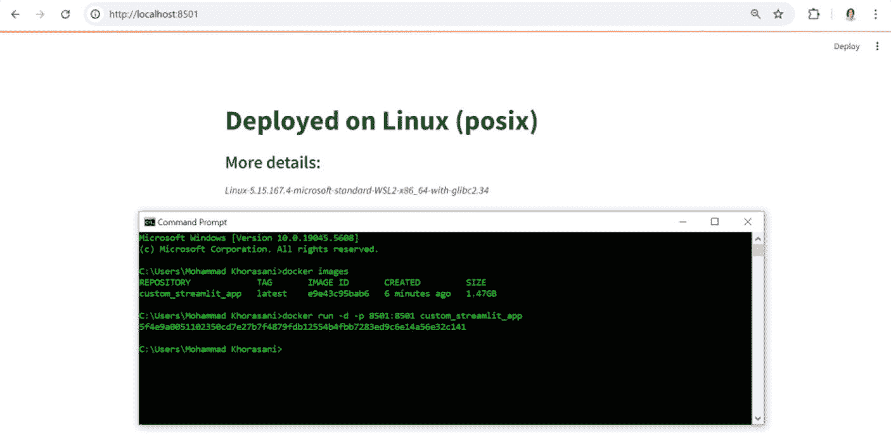

图 9-15 从 Docker 容器运行的 Streamlit 应用程序

```
docker run -d -p 8501:8501 <镜像名称>:latest
```

代码清单 9-6 从 Docker 镜像创建容器

最后，我们可以通过运行代码清单 9-8 来销毁容器，而不会影响镜像。首先，我们需要通过运行代码清单 9-7 来获取容器 ID，然后应用停止操作，如图 9-16 所示。


图 9-16 检查活动容器并关闭特定容器

```
docker ps
```

代码清单 9-7 显示所有正在运行的 Docker 容器元数据

```
docker stop <容器 ID>
```

代码清单 9-8 停止特定的 Docker 容器

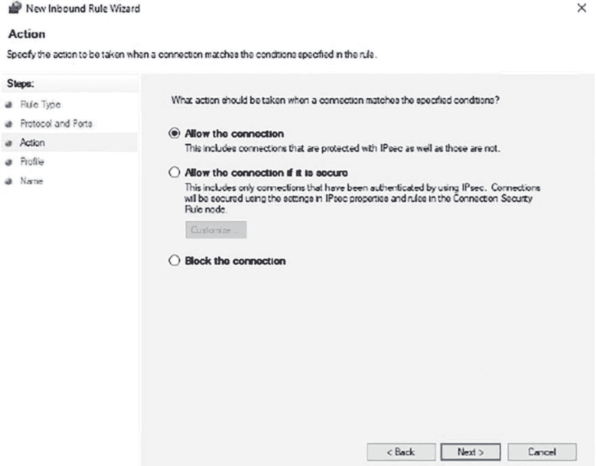

图 9-21

开放 TCP/IP 端口（3）

1. 选择`允许连接`以向所有用户开放此端口，或者选择`如果连接是安全的则允许连接`以向特定用户开放此端口，如图 9-21 所示。

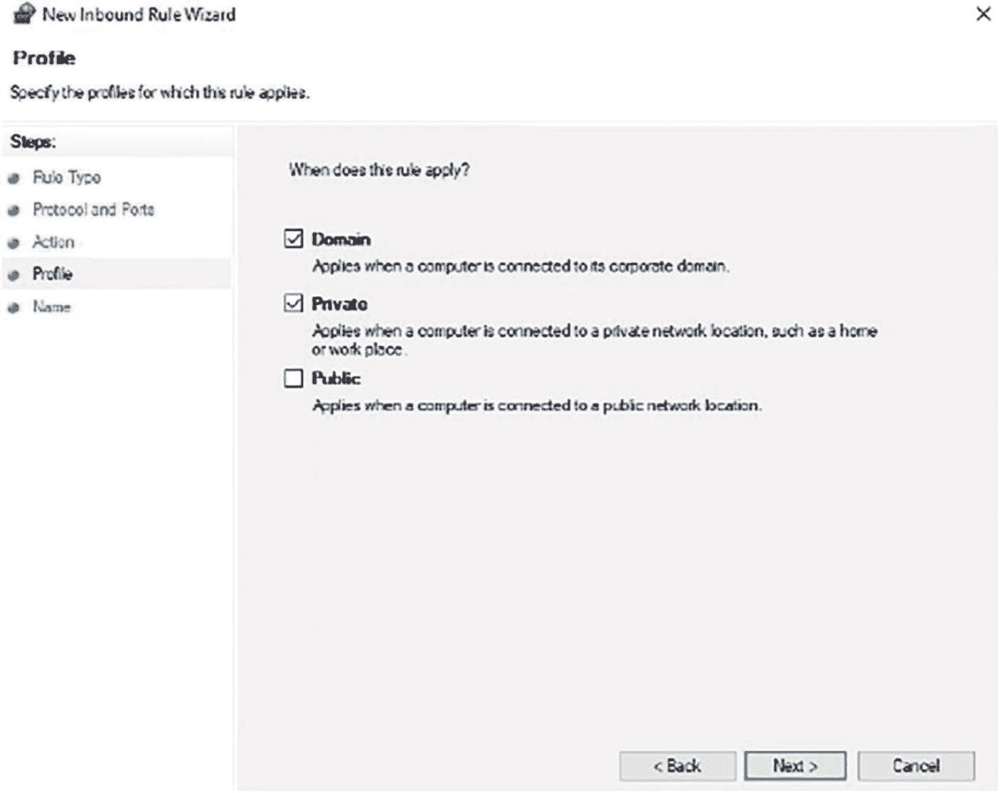

图 9-22

开放 TCP/IP 端口（4）

1. 接下来，选择`域`和`专用`，以便向安全网络开放此端口，如图 9-22 所示。

2. 最后，为你的规则输入一个名称，并按照相同步骤为入站和出站通信开放同一个端口。

### 9.4.3 Anaconda 离线包安装

由于你的服务器可能无法访问互联网，你将无法像往常一样使用 Pip 安装 Python 包及其依赖项。相反，你需要按照以下步骤执行离线安装：

1. 在一台可以访问互联网的计算机上打开 Anaconda Prompt。

2. 要下载所需的 Python 包及其所有相关依赖项，请键入以下命令，并指定保存该包的文件路径：

```
pip download -d <路径>
```

3. 下载完成后，将这些文件压缩，并使用 RDP 或任何其他可用方法将其传输到服务器。

4. 解压缩文件，然后在服务器的 Anaconda Prompt 中键入以下命令，将根目录更改为存储该包的位置：

```
cd <路径>
```

5. 在 Anaconda Prompt 中输入以下命令，以启动所需包的离线安装：

```
pip install <包名> -f ./ --no-index
```

### 9.4.4 将 Anaconda 添加到系统路径

为了将你的 Streamlit 应用作为可执行的批处理文件运行（将在下一节中解释），你首先需要将 Anaconda 或你选择的任何其他 Python 解释器添加到 Windows 的系统路径中。请遵循以下步骤：

1. 通过在 Anaconda Prompt 中输入以下命令来确定 `Anaconda.exe` 的位置：

```
where anaconda
```

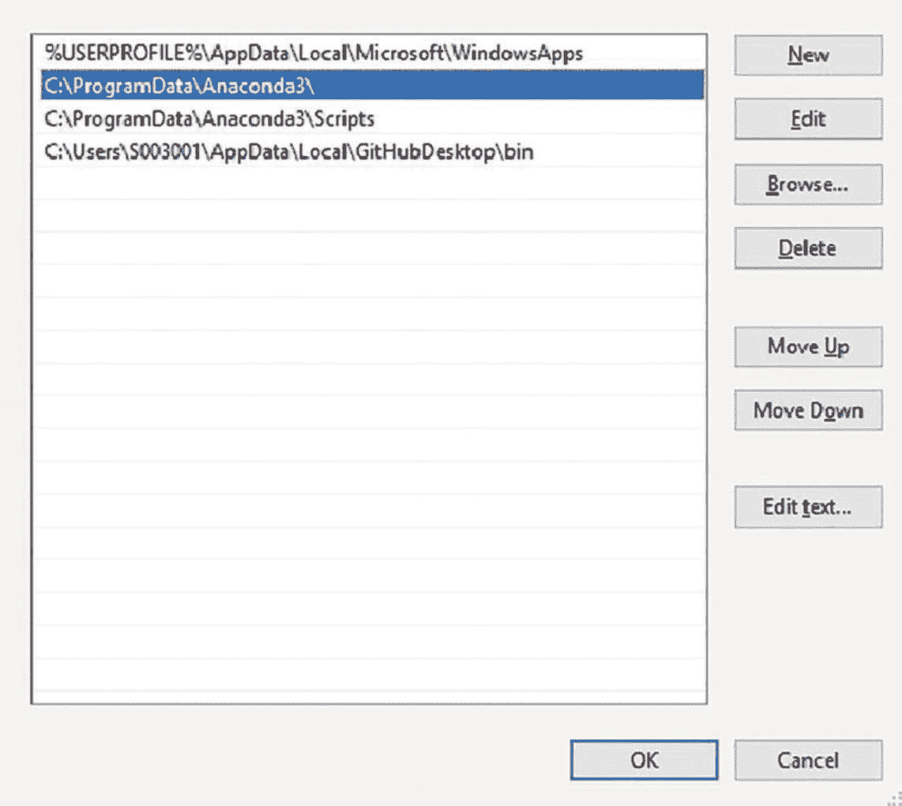

图 9-23 将 Anaconda 添加到系统路径

2. 打开 Windows 搜索栏，选择 *编辑系统环境变量*。

3. 一旦 *系统属性* 窗口打开，点击 *高级* 选项卡，然后选择 *环境变量*。

4. 接着，高亮选中 *Path*，点击 *编辑* 以添加 Anaconda 的路径，如图 9-23 所示。

5. 如果必要的路径尚不存在，请通过输入以下两个路径来添加步骤 1 中找到的路径：

```
C:\...\Anaconda3\
```

和

```
C:\...\Anaconda3\Scripts\
```

6. 为了验证 Anaconda 已成功添加到系统路径，请打开 Windows 命令提示符并输入 `anaconda`。如果 Anaconda 尚未添加，将会出现错误。否则，你应该能够使用任何 Anaconda 命令，例如 `conda list`。

### 9.4.5 将应用程序作为可执行批处理文件运行

为了将你的 Streamlit 应用作为 Windows 服务运行（将在下一节中解释），你首先需要创建一个可执行的批处理文件。批处理文件类似于 `.exe` 文件，可以通过双击运行，就像任何其他应用程序一样。请遵循以下步骤为你的 Streamlit 应用创建一个批处理文件：

1. 打开记事本或你选择的任何其他文本编辑器。

2. 在单独的行中输入以下命令：

```
call activate 
cd 
streamlit run 
pause
```

3. 使用 `.bat` 扩展名保存文件以创建批处理文件。

4. 运行该批处理文件以确保应用程序按预期启动。

### 9.4.6 将应用程序作为持久化 Windows 服务运行

为在 Windows Server 上部署做准备的最后一步是将你的 Streamlit 应用作为持久化 Windows 服务运行。虽然你仍然可以像对待任何普通 Streamlit 应用一样为其提供服务，但将其作为 Windows 服务运行具有以下几个好处：

1. 你的应用程序将在后台运行，无需打开控制台。

2. 应用程序将独立于 RDP 会话，确保即使在 RDP 连接终止时也能继续运行。

3. 你可以安排你的应用程序在 Windows 启动时或基于任何其他触发器运行。

为了获得一个健壮的配置，考虑使用像 NSSM (非吸吮式服务管理器) 这样的工具。NSSM 允许你将任何可执行文件（例如运行你的 Streamlit 应用的 `python.exe`）作为 Windows 服务运行。它提供了对日志记录、进程优先级和自动重启的更好控制，使你的部署更加可靠且易于管理。

要将你的应用配置为持久化 Windows 服务，请遵循以下步骤：

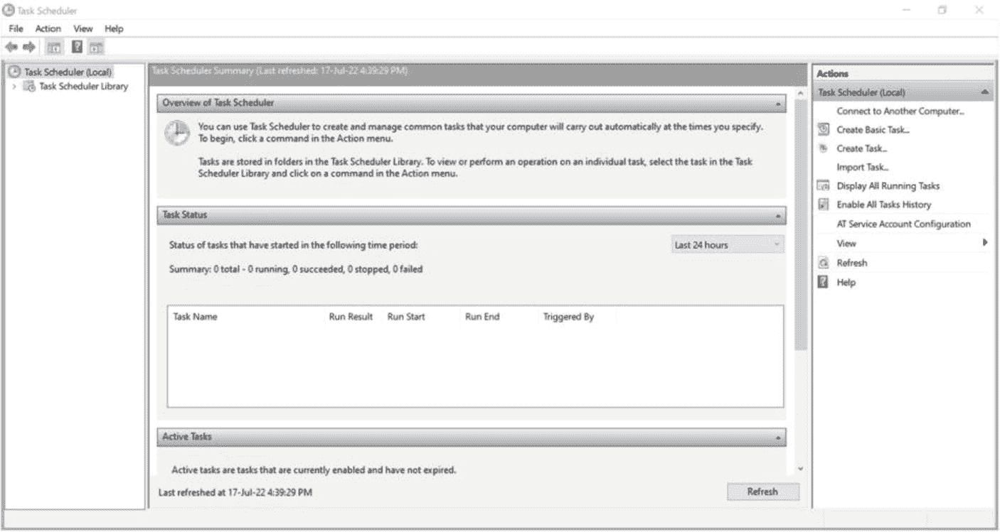

图 9-24 将应用程序作为持久化 Windows 服务运行 (1)

1. 打开 *Windows 任务计划程序*，并在右侧窗格中点击 *创建任务*，如图 9-24 所示。

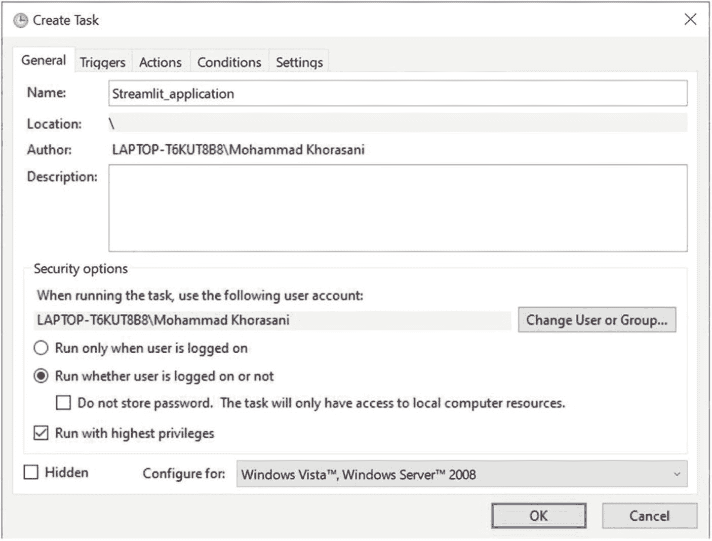

图 9-25 将应用程序作为持久化 Windows 服务运行 (2)

2. 为任务输入一个名称，然后选择 *无论用户是否登录都运行* 和 *使用最高权限运行* 选项，如图 9-25 所示。

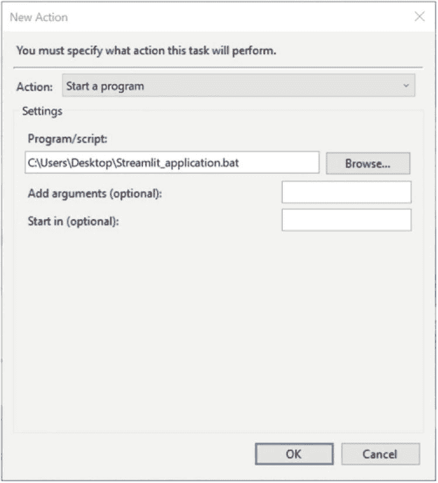

图 9-26 将应用程序作为持久化 Windows 服务运行 (3)

3. 导航到 *操作* 选项卡，从操作菜单中选择 *启动程序*，然后浏览到你为 Streamlit 应用创建的批处理文件的位置（在上一节中解释），如图 9-26 所示。

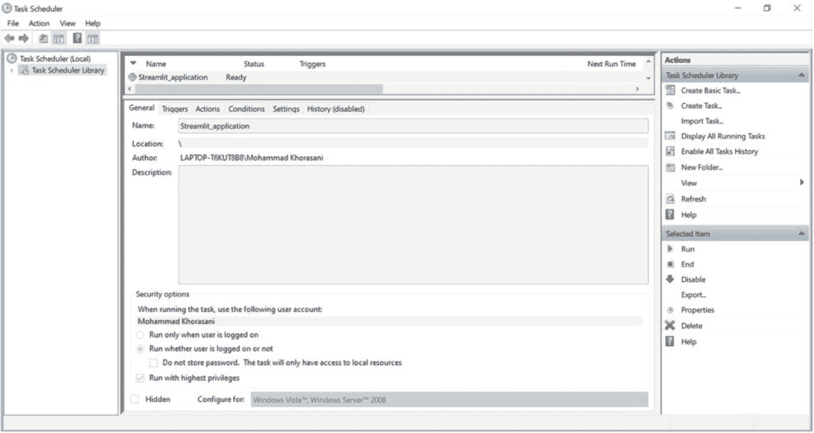

图 9-27 将应用程序作为持久化 Windows 服务运行 (4)

4. 打开左侧窗格中的 *任务计划程序库*，在列表中选择你创建的任务，然后在右侧窗格中选择 *运行*，如图 9-27 所示。

5. 为了验证你的 Windows 服务任务已成功配置，请终止 RDP 会话。然后，在本地网络中的另一台设备上打开浏览器，导航到你 Streamlit 应用的网络 URL，检查它是否正在运行。

## 9.5 总结

## 本章小结

在本章中，我们探讨了如何通过网络网关进行端口转发，以及利用 `ngrok` 进行 HTTP 隧道，将我们的 Streamlit 应用暴露到互联网。然后我们介绍了 Streamlit 的云平台 `Streamlit Cloud`，它简化了部署过程。借助 `Streamlit Cloud`，开发者只需连接他们的 GitHub 仓库，点击一下即可部署他们的应用。此外，我们学习了如何使用 Streamlit 的 `Secrets Management` 功能，在本地和云端安全地将私有数据集成到我们的应用中。最后，我们涵盖了将应用程序部署到 Linux 容器和 Windows Server 的过程，它们是全球大多数远程服务器的基础。至此，我们完成了 Streamlit 应用从开发到部署的整个生命周期。