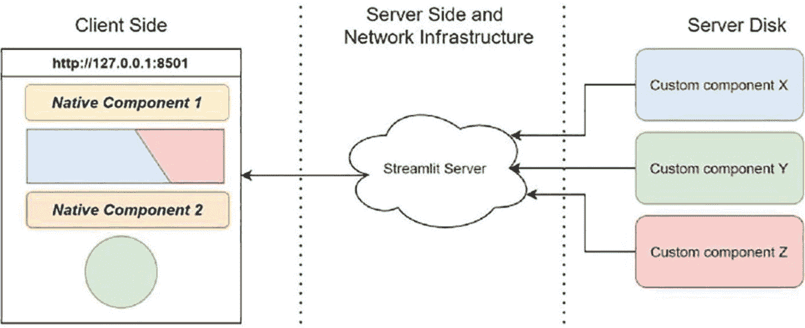
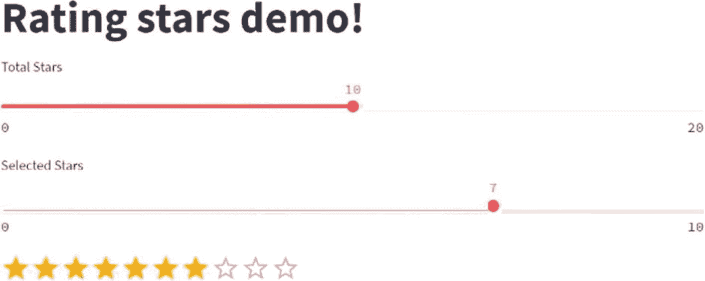
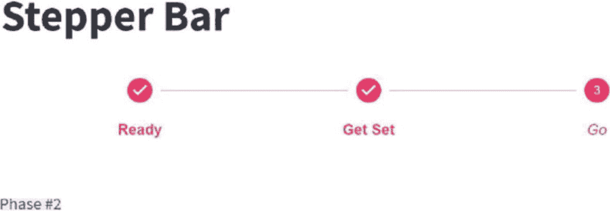
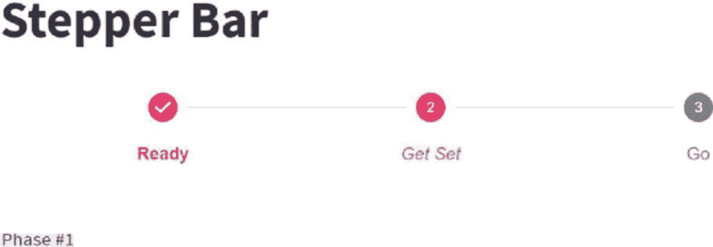
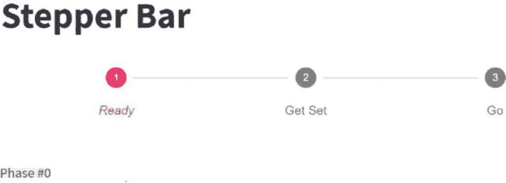
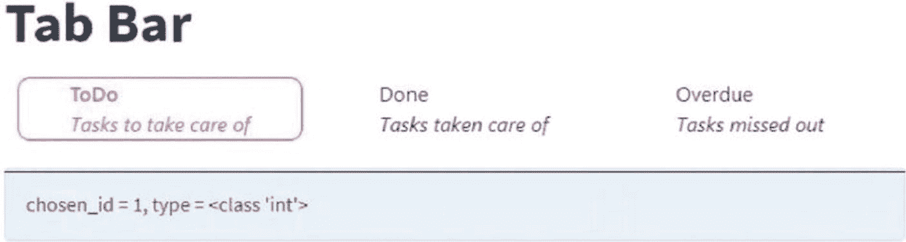
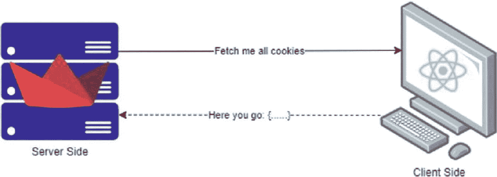
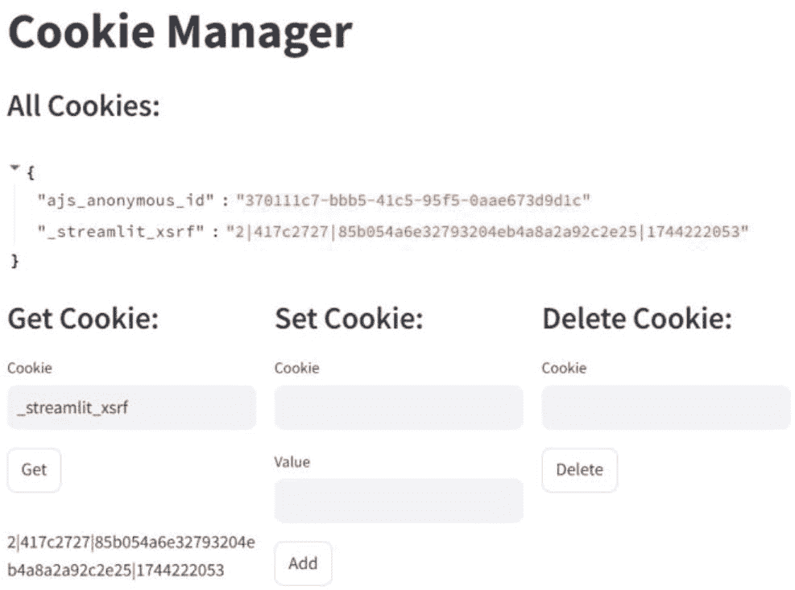

# 10. 构建 Streamlit 组件

Streamlit 持续扩展其功能集，使开发者仅需几行代码就能获得新能力。然而，有时开发者需要自定义应用程序以满足特定用户需求。无论是修改用户界面还是提供定制化的用户体验，Streamlit 都允许开发者根据需要创建自定义组件。此外，Streamlit 支持使用 `ReactJS` 构建组件，这些组件既可以作为实时 Web 服务器运行，也可以部署为生产级代码。在本章中，我们将指导你创建自定义 Streamlit 组件、将其集成到 `Python` 上下文中，并与更广泛的社区分享。

## 10.1 Streamlit 自定义组件简介

从根本上说，Streamlit 充当后端服务器，使用 `DG` 向客户端浏览器提供网页更新。虽然 `HTML` 和 `JavaScript` 可以由各种 Web 框架生成，但 Streamlit 能够支持来自任何 Web 应用框架的组件。例如，`ReactJS` 等框架允许开发者使用 `JSX` 进行编码，然后将其编译为可从磁盘提供的静态文件组合。在生产环境中，强烈建议从磁盘提供静态文件，如图 10-1 所示。不过，Streamlit 也支持本地托管的组件。这里需要权衡的是，当组件被导入到 Streamlit 应用中时，其行为可能会有所不同。例如，如果你从自定义组件中打印当前 URL，它不会反映 Streamlit 应用所托管的同一 URL。



图 10-1 自定义组件如何通过 Streamlit 提供服务

## 10.2 使用 ReactJS 创建 Streamlit 自定义组件

在本节中，我们将演示如何创建一个基于 `ReactJS` 的组件，用于 Streamlit。此外，我们还将展示如何促进 Streamlit 与组件之间的双向数据共享。此功能可用于发送初始值、触发用户操作，甚至将样式主题和颜色传递给自定义组件。

### 10.2.1 制作 ReactJS 组件

首先，你需要从 `NodeJS.org` 安装 `Node.js` 和 `npm`。之后，我们将使用 Streamlit 的官方 `GitHub` 模板来创建自定义组件。在本小节中，我们将逐步讲解构建 `ReactJS` 组件的过程。在此示例中，我们将使用 `ReactJS` 创建一个评分星形小部件，如图 10-2 所示。`ReactJS` 开发者社区远大于其他框架，因此在此生态系统中创建组件是一项有价值的投入。


图 10-2 Material UI 的交互式评分星形视图

通过将 `component-template/template/my_component` 的内容复制到我们的工作目录中，我们将设置一个 `ReactJS` 应用，其单个文件模块位于 `src/MyComponent.tsx`。这是我们为创建评分星形组件需要修改的文件。对此文件所做的更改将生成如代码清单 10-1 所示的代码。

```tsx
import {
Streamlit,
StreamlitComponentBase,
withStreamlitConnection,
}  from 'streamlit-component-lib'
import React, { ReactNode } from 'react'
interface State {}
class MyComponent extends StreamlitComponentBase {
public state = {}
public render = (): ReactNode => {
return (

)
}
}
export default withStreamlitConnection(MyComponent)
```

代码清单 10-1 `stars_demo/rating_stars/frontend/src/CleanedTemplate.tsx`

使用以下命令安装 `Material UI` 库：

```bash
npm i @mui/material
```

然后运行以下命令安装 `package.json` 文件中的其他包：

```bash
npm i
```

运行这两个命令后，请确保将 `package.json` 中的名称更改为你的组件在 Streamlit 中的引用名称，如代码清单 10-2 所示。

```json
{
"name": "rating_star",
"version": "0.1.0",
"private": true,
"dependencies": {
"@mui/material": "ˆ5.0.6",
...
},
"scripts": ...,
"eslintConfig": ...,
"browserslist": ...,
"homepage": ". "
}
```

代码清单 10-2 更新后的 `package.json`

在拥有必要的包并具备 `JavaScript`/`TypeScript` 基础知识（或者稍微谷歌一下）后，我们就可以开始创建第一个用作 Streamlit 自定义组件的 `ReactJS` 模块了。我们将修改代码清单 10-1 以显示评分星形，如 `Material UI` 网站上所述。最终结果将是代码清单 10-3 所示的内容，该文件应位于 `frontend/src/` 中。另外，别忘了更新文件以在 `index.tsx` 中运行。

```tsx
import {
Streamlit,
StreamlitComponentBase,
withStreamlitConnection,
}  from 'streamlit-component-lib'
import React, { ReactNode } from 'react'
import { Rating } from '@mui/material';
interface State {}
class RatingStar extends StreamlitComponentBase {
public state = {}
public render = (): ReactNode => {
return (

)
}
}
export default withStreamlitConnection(RatingStar)
```

代码清单 10-3 `RatingStar.tsx` 的初始版本

### 10.2.2 在 Streamlit 中使用 ReactJS 组件

要准备 `React` 应用，请运行以下命令。如果出现关于缺失软件包的错误，请使用之前提供的命令安装它们。

```bash
npm start
```

现在，在 Streamlit 这边，我们将通过使用 Streamlit 用于引入外部组件的 `API`，将正在运行的 `ReactJS` 应用作为一个组件集成进来。在此之前，我们需要填充 `__init__.py` 文件，如代码清单 10-4 所示。

```python
import os
import streamlit.components.v1 as components
IS_RELEASE = False
if IS_RELEASE:
absolute_path = os.path.dirname(os.path.abspath(__file__))
build_path = os.path.join(absolute_path, 'frontend/build')
_component_func = components.declare_component('rating_stars', path=build_path)
else:
_component_func = components.declare_component('rating_stars', url='http://localhost:3001')
def rating_stars():
_component_func()
```

代码清单 10-4 `__init__.py` 的初始版本

前面的代码片段使用了一个在本地 `3001` 端口上运行的实时组件，在本例中，这个组件指的是 `ReactJS` 应用。然后它暴露了一个供任何其他 `Python` 源码使用的函数，使其能够作为一个 Streamlit 模块运行。使用 Streamlit 的 `CLI` 工具运行代码清单 10-5 将产生如图 10-3 所示的输出。


图 10-3 第一个自定义组件！

```
import streamlit as st
from rating_stars import rating_stars
st.title('Rating stars demo! ')
rating_stars()
```
代码清单 10-5 `main.py` 的初始版本

完成上述操作后，我们成功地在 `Streamlit` 环境中展示了一个实时的 `ReactJS` 应用。然而，随着我们更具创意并开发更多的自定义组件，在启动 `Streamlit` 应用之前，导航到每个组件的文件夹并将其作为 `ReactJS` 应用运行可能会变得很繁琐。这种方法也可能导致端口耗尽，因为每个自定义组件都需要自己唯一的本地 URL。为了克服这一点，我们可以在开发完成后通过运行以下命令将 `ReactJS` 应用构建成静态文件：
```
npm run build
```
一旦你运行了 `build` 命令，一个名为 `build` 的新文件夹将会出现在 `frontend` 文件夹内。该文件夹将包含 `Streamlit` 将组件加载到应用程序所需的 `JavaScript`、`CSS` 和 `HTML` 文件。构建好组件的静态版本后，你需要将 `IS_RELEASE` 设置为 `True`，这将指示 `Streamlit` 从 `frontend/build/` 文件夹加载自定义组件。此过程如图 10-1 所示。

### 10.2.3 将数据发送到自定义组件

至此，我们可以在 `Streamlit` 上下文中显示 `ReactJS` 应用了，不过前端和后端之间还没有通信机制。在下一节中，我们将演示如何将动态数据从 `Streamlit` 发送到 `ReactJS`，从而能够在每次重新渲染时传输信息。这将允许 `Streamlit` 在应用更新时将数据发送到 `ReactJS` 应用。

为了增强我们的星级评定自定义组件的功能，我们将添加对设置总星数和已选星数的支持，所有这些都通过 `Streamlit` 的 `Python` 代码来实现。首先，理解 `Streamlit` 将从 `Python` 传递的参数（通过 `_component_func`）转换为 `ReactJS` 中的属性这一点非常重要。因此，我们的目标是重构组件的 `__init__.py` 文件以接受这些新参数，如代码清单 10-6 所示，然后在 `RatingStar.tsx` 中读取它们，并将它们赋值给视图的属性，如代码清单 10-7 所示。

```
import {
Streamlit,
StreamlitComponentBase,
withStreamlitConnection,
}  from 'streamlit-component-lib'
import React, { ReactNode } from 'react'
import { Rating } from '@mui/material'
interface State {}
class RatingStar extends StreamlitComponentBase {
public state = {}
public render = (): ReactNode => {
const {selected, stars_count} = this.props.args
return 
}
}
export default withStreamlitConnection(RatingStar)
```
代码清单 10-7 `RatingStar.tsx` 的第二个版本

```
import os
import streamlit.components.v1 as components
IS_RELEASE = False
if IS_RELEASE:
absolute_path = os.path.dirname(os.path.abspath(__file__))
build_path = os.path.join(absolute_path, 'frontend/build')
_component_func = components.declare_component('rating_stars', path=build_path)
else:
_component_func = components.declare_component('rating_stars', url='http://localhost:3001')
def rating_stars(stars_count: int, selected: int):
_component_func(stars_count=stars_count, selected=selected)
```
代码清单 10-6 `__init__.py` 的第二个版本

为了应用此更新，我们将创建一个 `Streamlit` 应用，如代码清单 10-8 所示，该应用并排展示了原生组件和自定义组件。图 10-4 展示了我们新创建的可配置组件与 `Streamlit` 提供的默认组件之间的无缝集成。



图 10-4 使用原生组件和自定义组件

```
import streamlit as st
from rating_stars import rating_stars
st.title('Rating stars demo! ')
total_stars = st.slider(label='Total Stars', min_value=0, max_value=20, value=10, step=1) selected_stars = st.slider(label='Selected Stars', min_value=0, max_value=total_stars, step=1) rating_stars(total_stars, selected_stars)
```
代码清单 10-8 `main.py` 的第二个版本

### 10.2.4 从自定义组件接收数据

在尝试使用滑块来配置我们的自定义评分组件后，很明显，`Streamlit` 应用程序的视图会变得杂乱，因为多了仅用于控制另一个视图行为的小组件。理想情况下，用户只需悬停并点击星星，就能设置选中的星星数量。然而，要实现这一点，`Streamlit` 应用程序需要知道选中的值——而这正是从自定义组件检索数据发挥作用的地方。

`Streamlit` 不仅提供了嵌入 `ReactJS` 应用程序的 `API`，还实现了 `Streamlit` 与这些组件之间的双向通信。将数据从 `ReactJS` 发送回 `Streamlit` 可以使用组件模板的 `package.json` 中已经包含的一个库来实现。虽然这个库提供了几种特定于 `ReactJS` 的操作，但我们将重点介绍 `Streamlit.setComponentValue` 函数。此函数允许我们根据传递给它的参数，在 `Streamlit` `Python` 上下文中设置组件的返回值。

为了实现这一点，我们将在 `ReactJS` 的评分组件回调中添加函数调用，如清单 10-9 所示。然后，我们将相应地更新 `__init__.py` 文件，将返回值传播回正在运行的 `Streamlit` 脚本，如清单 10-10 所示。

```
import os
import streamlit.components.v1 as components

IS_RELEASE = False

if IS_RELEASE:
    absolute_path = os.path.dirname(os.path.abspath(__file__))
    build_path = os.path.join(absolute_path, 'frontend/build')
    _component_func = components.declare_component('rating_stars', path=build_path)
else:
    _component_func = components.declare_component('rating_stars', url='http://localhost:3001')

def rating_stars(stars_count: int):
    stars_selected = _component_func(stars_count=stars_count)
    if stars_selected is None:
        stars_selected = 0
    return stars_selected
```
清单 10-10：`__init__.py` 的最终版本

```
import { Streamlit, StreamlitComponentBase, withStreamlitConnection } from 'streamlit-component-lib'
import React, { ReactNode } from 'react'
import { Rating } from '@mui/material'

interface State {}

class RatingStar extends StreamlitComponentBase<State> {
    public state = {}

    public render = (): ReactNode => {
        const { selected, stars_count } = this.props.args
        return (
            <Rating
                name="rating-stars"
                value={selected}
                max={stars_count}
                onChange={(event, newValue) => {
                    Streamlit.setComponentValue(newValue)
                }}
            />
        )
    }
}

export default withStreamlitConnection(RatingStar)
```

清单 10-9：`RatingStar.tsx` 的最终版本

在我们主要的 Streamlit 文件中，我们移除了用于选择星星数量的滑块，并用我们自定义组件的输出替换它。最后，我们在应用程序上显示选中的星星数量，如清单 10-11 所示，输出结果如图 10-5 所示。


图 10-5：与自定义 Streamlit 组件来回通信的结果

```
import streamlit as st
from rating_stars import rating_stars

st.title('Rating stars demo!')
total_stars = st.slider(label='Total Stars', min_value=0, max_value=20, value=10, step=1)
selected_stars = rating_stars(total_stars)
st.write(str(selected_stars) + ' star(s) have been selected')
```

清单 10-11：`main.py`，要运行的 Streamlit 文件

## 10.3 将组件作为 Pip 包发布

一旦您创建了第一个自定义组件，您很可能会像许多开发者一样，希望与朋友分享或将其贡献给开源社区。仅仅发送源代码的 zip 文件或将组件上传到像 GitHub 这样的版本控制服务，可能不是触及大量开发者的最可扩展的解决方案。这种方法会给其他人带来不必要的运行和设置负担。

一种对开发者更友好、更专业的共享 Python 包的方法是将其压缩成 pip wheel 格式。这种格式可以很容易地通过运行以下命令安装到 Python 解释器中：

```
pip install .whl
```

继续本章的示例，我们不需要安装任何额外的包来实现这一点，因为 Python 原生支持 wheel 构建。目标是将 `rating_stars/` 文件夹打包成一个文件，然后该文件可以像本地包一样被安装并从任何脚本中引用。

构建 pip 文件只需运行以下命令：

```
python setup.py sdist bdist_wheel
```

在创建 pip wheel 之前，请确保自定义组件的 ReactJS 部分已经构建好，因为它不会在用户端实时运行。相反，它应该为新的组件提供无缝的即插即用体验。为此，请导航到 `rating_stars/frontend/` 目录并运行：

```
npm run build
```

然而，wheel 构建器需要额外的信息，例如要打包的确切文件夹和其他元数据，包括版本号和描述。无需明确指定要打包的文件夹，因为 Python 会自动查找当前目录中的所有 Python 包。一个文件夹要被识别为 Python 包，它必须包含一个 `__init__.py` 文件，我们已经有了。但是，默认情况下，wheel 构建器不会包含非 Python 文件和文件夹，除非它们包含至少一个 Python 文件。在我们的案例中，这成为了一个问题，因为我们的组件依赖于 `ReactJS build` 文件夹，其中包含必要的静态 Web 文件。为了解决这个问题，我们需要在项目的根目录中添加一个新文件，如清单 10-12 所示。这将确保包含 `build` 文件夹及其内容。

```
recursive-include rating_stars/frontend/build *
```

清单 10-12：`MANIFEST.in`

现在我们拥有了创建 pip wheel 所需的一半条件，我们可以通过创建一个包含清单 10-13 所示内容的 `setup.py` 文件来解决最后一部分。此文件应放置在与 `MANIFEST.in` 相同的文件夹中。`setup.py` 文件将包含您的自定义组件的版本号、描述以及其他详细信息，例如，如果包上传到 `pypi.org`，则包含 pip 下载名称。

```
import setuptools

setuptools.setup(
    name='rating_stars',
    version='0.1',
    author='YOUR-NAME',
    author_email='YOU-EMAIL@DOMAIN.com',
    description='INSERT-DESCRIPTION-HERE',
    long_description='INSERT-LONGER-DESCRIPTION-HERE',
    packages=setuptools.find_packages(),
    include_package_data=True,
    classifiers=[
        'Programming Language :: Python :: 3',
        'License :: OSI Approved :: MIT License',
        'Operating System :: OS Independent',
    ],
    keywords=['Python', 'Streamlit', 'React', 'JavaScript', 'Custom'],
    python_requires='>=3.6',
    install_requires=[
        'streamlit >= 0.86',
    ],
)
```

清单 10-13：`setup.py`

并且为了更好的依赖管理和 Streamlit Cloud 集成，我们需要创建一个 `pyproject.toml` 文件，如清单 10-14 所示。

```yaml
[build-system]
requires = ["setuptools", "wheel"]
build-backend = "setuptools.build_meta"

[project]
name = "rating_stars"
version = "0.1"
authors = [{name = "你的名字", email = "你的邮箱@域名.com"}]
description = "在此处填写描述信息"
requires-python = ">=3.6"
dependencies = [
"streamlit>=0.86",
]
classifiers = [
"编程语言 :: Python :: 3",
"许可证 :: OSI 认证 :: MIT 许可证",
"操作系统 :: 独立于操作系统",
]
keywords = ["Python", "Streamlit", "React", "JavaScript", "自定义"]
```

> 代码清单 10-14 — `pyproject.toml`

运行 Python 包命令后，项目的根目录下会出现三个新文件夹，如图 10-6 所示。我们关注的文件是第二个文件夹中的 `rating_stars-0.1-py3-none-any.whl`。只要满足包的依赖要求，这个文件就可以发送给其他人并轻松安装。其他创建的文件夹也有各自的用途。例如，`dist/` 文件夹可供 `twine` 使用，这是用于将 pip 轮子上传到全局 pip 仓库的工具。如果您希望将包分享给公众，请在 `pypi.org` 上注册，然后运行以下命令：

```
python -m twine upload dist/* --verbose
```

在构建轮子后上传即可。


> 图 10-6 — 构建自定义组件后生成的新文件夹

## 10.4 核心组件：Extra-Streamlit-Components

`Streamlit` 作为一个框架，正在不断发展。然而，它可能无法始终提供生产级 Web 应用程序所需的某些定制功能。例如，应用路由、多视图的自定义 URL 或在浏览器端保存用户相关数据等功能可能不被原生支持。此外，您可能希望为应用程序提供独特的视觉风格，或添加尚未纳入 `Streamlit` 标准库的小部件。在组件方面，可能性是无限的。在本章中，我们将介绍 *Extra-Streamlit-Components（STX）*，这是一个包含多种复杂 `Streamlit` 组件和服务的开源集合。我们还将深入探讨每个子组件如何从 `Streamlit` 和 `ReactJS` 两个角度构建，希望能激发有创意的开发者构建自己独特的组件。

### 10.4.1 步进条

该组件的灵感来源于 `Material UI` 的 `Stepper`。如前所述，`ReactJS` 的开发者社区提供了大量有用的组件，可以无缝集成到 `Streamlit` 生态系统中。步进条尤其适用于大多数 `Streamlit` 应用程序，特别是那些涉及数据科学工作流程中顺序步骤的应用程序。它允许用户按特定顺序浏览各个阶段。步进器是一个简单的组件，用于返回用户当前到达的阶段索引，如图 10-7、10-8 和 10-9 所示。作为开发者，您不仅限于三个阶段。您可以提供一个标签名称列表，组件将返回所选项目的索引，如代码清单 10-15 所示。编号和动画效果已为您处理完毕。



> 图 10-9 — 步进条阶段 3



> 图 10-8 — 步进条阶段 3



> 图 10-7 — 步进条阶段 3

在 `ReactJS` 端，需要通过 `npm` 安装步进器包，然后导入到源文件中，如代码清单 10-15 和 10-16 所示。该文件负责检测用户点击，返回当前步骤对应的索引，并根据用户在序列中的位置管理每个步骤的主题。

```
import os
import streamlit.components.v1 as components
from streamlit.components.v1.components import CustomComponent
from typing import List
from extra_streamlit_components import IS_RELEASE
if IS_RELEASE:
absolute_path = os.path.dirname(os.path.abspath(__file__))
build_path = os.path.join(absolute_path, 'frontend/build')
_component_func = components.declare_component('stepper_bar', path=build_path)
else:
_component_func = components.declare_component('stepper_bar', url='http://localhost:3001')
def stepper_bar(steps: List[str]) -> CustomComponent:
component_value = _component_func(steps=steps, default=0)
return component_value
```

> 代码清单 10-16 — `StepperBar/__init__.py`

### 10.4.2 弹跳图片

该组件为图片提供了带有弹跳效果的缩放动画。它可以在加载过程中或作为启动画面时发挥作用。虽然它可能不是一个频繁使用的组件，但在需要时，动画持续时间、控制开关和尺寸等参数对其功能至关重要，如代码清单 10-17 所示。ReactJS 端的实现比 Python 端略为复杂，因为它需要管理动画周期，并在每个周期将组件状态反馈给 Streamlit。尽管 JavaScript 并非本书重点，但代码清单 10-18 的内容应相对易于理解。最终效果将类似于图 10-10 所示。


图 10-10 弹跳图片演示（缩放动画的快照）

代码清单 10-15 — `StepperBar/frontend/src/StepperBar.jsx`

```javascript
import {
  Streamlit,
  StreamlitComponentBase,
  withStreamlitConnection,
} from 'streamlit-component-lib'
import React from 'react'
import { withStyles, createStyles } from '@material-ui/core/styles'
import Stepper from '@material-ui/core/Stepper'
import Step from '@material-ui/core/Step'
import StepLabel from '@material-ui/core/StepLabel'

const styles = createStyles((theme) => ({
  root: {
    width: '100%',
    backgroundColor: 'transparent',
  },
  icon: {
    color: 'grey',
    cursor: 'pointer',
    '&$activeIcon': {
      color: '#f63366',
    },
    '&$completedIcon': {
      color: '#f63366',
    },
  },
  activeIcon: {},
  completedIcon: {},
}))

class StepperBar extends StreamlitComponentBase {
  state = { activeStep: 0, steps: [] }

  componentDidMount() {
    this.setState((prev, state) => ({
      steps: this.props.args.steps,
      activeStep: this.props.args.default,
    }))
  }

  onClick = (index) => {
    const { activeStep } = this.state
    if (index == activeStep + 1) {
      this.setState(
        (prev, state) => ({
          activeStep: activeStep + 1,
        }),
        () => Streamlit.setComponentValue(this.state.activeStep)
      )
    } else if (index < activeStep) {
      this.setState(
        (prev, state) => ({
          activeStep: index,
        }),
        () => Streamlit.setComponentValue(this.state.activeStep)
      )
    }
  }

  getLabelStyle = (index) => {
    const { activeStep } = this.state
    const style = {}
    if (index == activeStep) {
      style.color = '#f63366'
      style.fontStyle = 'italic'
    } else if (index < activeStep) {
      style.color = '#f63366'
    }
    return style
  }

  render = () => {
    let { classes } = this.props
    const { activeStep } = this.state
    const steps = this.state.steps
    return (
      <div className={classes.root}>
        <Stepper activeStep={activeStep} alternativeLabel>
          {steps.map((label, index) => (
            <Step key={label}>
              <StepLabel
                className={classes.icon}
                onClick={() => this.onClick(index)}
                style={this.getLabelStyle(index)}
              >
                {label}
              </StepLabel>
            </Step>
          ))}
        </Stepper>
      </div>
    )
  }
}

export default withStreamlitConnection(withStyles(styles)(StepperBar))
```

代码清单 10-18 — `BouncingImage/frontend/src/BouncingImage.jsx`

```javascript
import {
  Streamlit,
  StreamlitComponentBase,
  withStreamlitConnection,
} from 'streamlit-component-lib'
import React from 'react'
import { withStyles, createStyles } from '@material-ui/core/styles'
import Grow from '@material-ui/core/Grow'
import CardMedia from '@material-ui/core/CardMedia'

const styles = createStyles((theme) => ({
  root: {
    height: 180,
  },
  container: {
    display: 'flex',
  },
  paper: {
    margin: 1,
  },
  svg: {
    width: 100,
    height: 100,
  },
  polygon: {
    fill: 'white',
    stroke: 'red',
    strokeWidth: 1,
  },
}))

class BouncingImage extends StreamlitComponentBase {
  state = {
    animationTimeRoundTrip: 1750,
    isAnimating: true,
    keepAnimating: false,
  }

  constructor(props) {
    super(props)
  }

  componentDidMount() {
    const { animation_time, animate } = this.props.args
    Streamlit.setComponentValue(animate)
    this.setState(
      () => ({
        animationTimeRoundTrip: animation_time,
        keepAnimating: animate,
      }),
      () =>
        setInterval(
          () =>
            this.state.keepAnimating &&
            this.setState(
              () => ({
                isAnimating:
                  !this.state.isAnimating && this.state.keepAnimating,
              }),
              () => Streamlit.setComponentValue(this.state.keepAnimating)
            ),
          this.state.animationTimeRoundTrip / 2
        )
    )
  }

  render = () => {
    const isAnimating = this.state.isAnimating
    let {
      classes,
      args: { image, height, width },
    } = this.props
    return (
      <div className={classes.root}>
        <div className={classes.container}>
          <Grow in={isAnimating} timeout={this.state.animationTimeRoundTrip / 2}>
            <CardMedia
              component="img"
              className={classes.paper}
              image={image}
              style={{ height: height, width: width }}
            />
          </Grow>
        </div>
      </div>
    )
  }
}

export default withStreamlitConnection(withStyles(styles)(BouncingImage))
```

```python
import os
import streamlit.components.v1 as components
from extra_streamlit_components import IS_RELEASE

if IS_RELEASE:
    absolute_path = os.path.dirname(os.path.abspath(__file__))
    build_path = os.path.join(absolute_path, 'frontend/build')
    _component_func = components.declare_component('bouncing_image', path=build_path)
else:
    _component_func = components.declare_component('bouncing_image', url='http://localhost:3001')
```

def `bouncing_image`(`image_source`: str, `animate`: bool, `animation_time`: int, `height`: float, `width`: float):

`_component_func`(`image`=`image_source`, `animate`=`animate`, `animation_time`=`animation_time`, `height`=`height`, `width`=`width`)

代码清单 10-17

`BouncingImage/__init__.py`

### 10.4.3 标签栏

与其使用 Streamlit 的列组件来承载多个按钮作为标签栏，不如利用这个自定义组件。它以清晰且结构化的方式组织每个按钮的标题、描述和 ID。此外，当标签数量超过窗口宽度时，它会提供水平滚动视图，确保无缝的用户体验。图 10-11 和图 10-12 演示了点击标签按钮时的行为以及在 Streamlit 中的输出结果。要创建这些标签，你需要传递一个包含特定 Python 对象的列表，如代码清单 10-20 所示。这些对象随后会被转换为 JSON，并由代码清单 10-19 中的 TypeScript ReactJS 组件处理。


图 10-12 标签栏，已选择第一个元素



图 10-11 标签栏，已选择第一个元素

```python
import os

import streamlit.components.v1 as components

from dataclasses import dataclass

from typing import List

from extra_streamlit_components import IS_RELEASE

if IS_RELEASE:

    absolute_path = os.path.dirname(os.path.abspath(__file__))

    build_path = os.path.join(absolute_path, 'frontend/build')

    _component_func = components.declare_component('tab_bar', path=build_path)

else:

    _component_func = components.declare_component('tab_bar', url='http://localhost:3001')

@dataclass(frozen=True, order=True, unsafe_hash=True)

class TabBarItemData:

    id: int

    title: str

    description: str

    def to_dict(self):

        return {'id': self.id, 'title': self.title, 'description': self.description}

def tab_bar(data: List[TabBarItemData], default=None, return_type=str, key=None):

    data = list(map(lambda item: item.to_dict(), data))

    component_value = _component_func(data=data, selectedId=default, key=key, default=default)

    try:

        if return_type == str:

            return str(component_value)

        elif return_type == int:

            return int(component_value)

        elif return_type == float:

            return float(component_value)

    except:

        return component_value
```

代码清单 10-20

`TabBar/__init__.py`

```typescript
import {

    Streamlit,

    StreamlitComponentBase,

    withStreamlitConnection,

}  from 'streamlit-component-lib'

import React, { ComponentProps, ReactNode } from 'react'

import ScrollMenu from 'react-horizontal-scrolling-menu'

interface State {

    numClicks: number

    selectedId: number

}

interface MenuItem {

    id: number

    title: string

    description: string

}

class TabBar extends StreamlitComponentBase {

    public state = { numClicks: 0, selectedId: 1, list: [] }

    constructor(props: ComponentProps) {

        super(props)

        this.state.list = this.props.args['data']

        this.state.selectedId = this.props.args['selectedId']

    }

    MenuItem = ({ item, selectedId }: { item: MenuItem; selectedId: number }) => {

        return (

            <div>

                <h3>{item.title}</h3>

                <p>{item.description}</p>

            </div>

        )

    }

    Menu(list: Array<MenuItem>, selectedId: number) {

        return list.map((item) => (

            <this.MenuItem item={item} selectedId={selectedId} />

        ))

    }

    Arrow = ({ text, className }: { text: string; className: string }) => {

        return <div className={className}>{text}</div>

    }

    ArrowLeft = this.Arrow({ text: '←', className: 'arrow-next' })

    public render = (): ReactNode => {

        return (

            <ScrollMenu

                arrowLeft={this.ArrowLeft}

                data={this.Menu(this.state.list, this.state.selectedId)}

                onSelect={this.onSelect}

            />

        )

    }

    onSelect = (id: any) => {

        this.setState(

            (state, props) => {

                return { selectedId: id }

            },

            () => Streamlit.setComponentValue(id)

        )

    }

}

export default withStreamlitConnection(TabBar)
```

代码清单 10-19

`TabBar/frontend/src/TabBar.tsx`

### 10.4.4 Cookie 管理器

这个概念在前一章中作为一个黑盒被引入，它仅仅在客户端浏览器上存储数据。然而，`CookieManager` 不仅是一个自定义组件，它还充当着一个 Python 服务。它在 Python 的上下文环境中处理数据管理，并在基于 ReactJS 的组件上执行增删改查操作。如果你是 Web 开发者，你很可能熟悉在客户端设置 cookie 的方法，这很简单直接。幸运的是，在 `Streamlit` 中，我们可以在同一个脚本里编写服务器端和客户端的代码。通过创建一个 React 自定义组件，我们可以在浏览器上执行它，并设置它来控制客户端的 cookie，如图 10-13 所示。



**图 10-13** 使用 `Streamlit` 控制客户端数据

通过利用本章介绍的知识，我们可以在 `Streamlit` 的服务器端和运行在客户端浏览器上的自定义 ReactJS 组件之间建立双向通信。这使我们能够指示组件在浏览器上收集、删除或添加 cookie，甚至监听任何返回值。从 ReactJS 端开始，如代码清单 10-21 所示，我们首先读取预期的参数，例如所需的操作和要处理的数据。基于这些输入，我们使用 npm 包 `universal-cookie` 对 cookie 执行必要的操作，最后，我们发回一个响应，指示操作的状态。

在 Python 端，代码清单 10-22 封装了与浏览器组件的整个通信方法。它还会在初始化后将所有 cookie 存储在内存中，以减少网络流量。然而，如果类的构造函数在首次运行后未被缓存，它将不会提供任何附加价值，因为它会在每次 `Streamlit` 重新运行时都被执行。因此，建议在实现 `CookieManager` 时使用代码清单 10-23 中的代码片段。图 10-14 演示了这个自定义组件的实际应用。



**图 10-14** Extra-Streamlit-Components 中的 Cookie 管理器演示

```python
@st.cache_resource
def get_manager():
    return stx.CookieManager()

cookie_manager = get_manager()
```

**代码清单 10-23** 如何初始化并使用 `CookieManager`

```python
import os
import streamlit.components.v1 as components
import datetime
from extra_streamlit_components import IS_RELEASE

if IS_RELEASE:
    absolute_path = os.path.dirname(os.path.abspath(__file__))
    build_path = os.path.join(absolute_path, 'frontend/build')
    _component_func = components.declare_component('cookie_manager', path=build_path)
else:
    _component_func = components.declare_component('cookie_manager', url='http://localhost:3001')

class CookieManager:
    def __init__(self, key='init'):
        self.cookie_manager = _component_func
        self.cookies = self.cookie_manager(method='getAll', key=key, default={})

    def get(self, cookie: str):
        return self.cookies.get(cookie)

    def set(self, cookie, val,
            expires_at=datetime.datetime.now() + datetime.timedelta(days=1), key='set'):
        if cookie is None or cookie == '':
            return
        expires_at = expires_at.isoformat()
        did_add = self.cookie_manager(method='set', cookie=cookie, value=val, expires_at=expires_at, key=key, default=False)
        if did_add:
            self.cookies[cookie] = val

    def delete(self, cookie, key='delete'):
        if cookie is None or cookie == '':
            return
        did_add = self.cookie_manager(method='delete', cookie=cookie, key=key, default=False)
        if did_add:
            del self.cookies[cookie]

    def get_all(self, key='get_all'):
        self.cookies = self.cookie_manager(method='getAll', key=key, default={})
        return self.cookies
```

**代码清单 10-22** `CookieManager/__init__.py`

```javascript
import {
    Streamlit,
    ComponentProps,
    withStreamlitConnection,
} from 'streamlit-component-lib'
import React, { useEffect, useState } from 'react'
import Cookies from 'universal-cookie'

let last_output = null
const cookies = new Cookies()

const CookieManager = (props: ComponentProps) => {
    const setCookie = (cookie, value, expires_at) => {
        cookies.set(cookie, value, {
            path: '/',
            samesite: 'strict',
            expires: new Date(expires_at),
        })
        return true
    }

    const getCookie = (cookie) => {
        const value = cookies.get(cookie)
        return value
    }

    const deleteCookie = (cookie) => {
        cookies.remove(cookie, { path: '/', samesite: 'strict' })
        return true
    }

    const getAllCookies = () => {
        return cookies.getAll()
    }

    const { args } = props
```

```markdown
const method = args['method']
const cookie = args['cookie']
const value = args['value']
const expires_at = args['expires_at']
let output = null

switch (method) {
    case 'set':
        output = setCookie(cookie, value, expires_at)
        break
    case 'get':
        output = getCookie(cookie)
        break
    case 'getAll':
        output = getAllCookies()
        break
    case 'delete':
        output = deleteCookie(cookie)
        break
    default:
        break
}

if (output && JSON.stringify(last_output) != JSON.stringify(output)) {
    last_output = output
    Streamlit.setComponentValue(output)
    Streamlit.setComponentReady()
}

useEffect(() => Streamlit.setFrameHeight())
return null
}

export default withStreamlitConnection(CookieManager)
```

**代码清单 10-21** `CookieManager/frontend/src/CookieManager.tsx`

## 10.5 总结

当你读到本章结尾时，你已经掌握了为 `Streamlit` 创建创新且令人兴奋的自定义组件所需的知识。通过使用简化版的 ReactJS 模板并参考在线资源，你不仅可以在 `Streamlit` 中复制 ReactJS 的 Material UI 视图，还可以控制浏览器功能，将原生 Web 应用的用户体验集成到你的应用中。本章还介绍了如何自定义 `Streamlit` 用户界面的各个方面，为你的应用增加多功能性和独特性。分享构建此库过程中所使用的技术，任何开发者都可以将其进行扩展和调整，以满足广泛的用途。最后，重要的是要记住，任何组件如果不与开源社区分享，就无法发挥其全部潜力；在社区中，它可以通过其他开发者的反馈和建议不断迭代改进。
