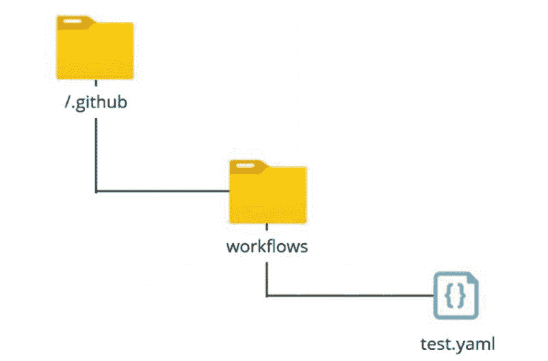
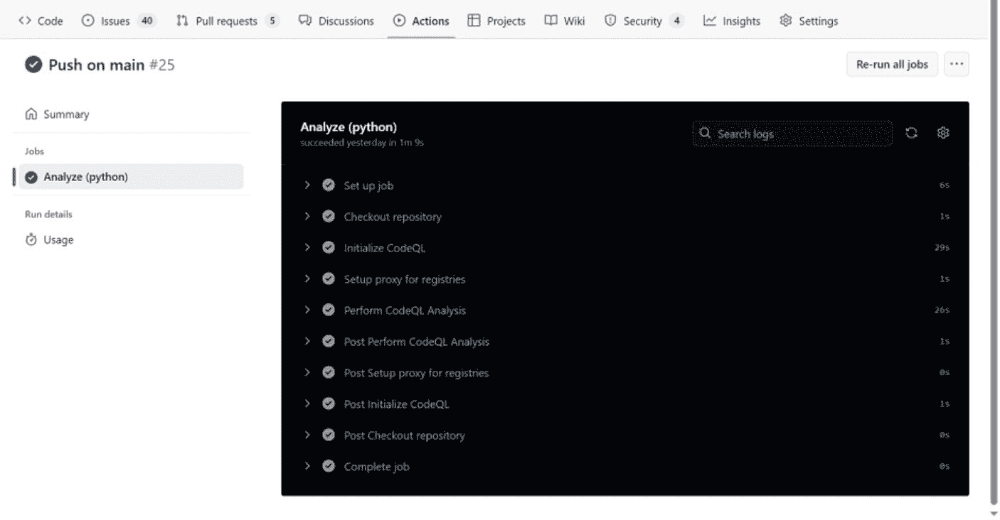

# 12. Streamlit 中的测试

测试是一个至关重要的质量保证过程，它验证软件功能，及早发现缺陷，并确保可靠性。通过验证需求和推广最佳实践，测试能够增强软件的稳定性、可维护性和用户满意度——尤其是在像 Streamlit 这样的动态平台中。

## 12.1 测试原则

测试是验证和确认软件按预期运行的过程，旨在开发周期的早期发现缺陷、错误或缺失的需求。它涉及创建测试用例，将代码的输出与预期结果进行比对，以确保跨场景的可靠性和一致性。测试不仅仅是发现错误，它还确认软件满足需求并遵循最佳实践，有助于提升软件的健壮性和可维护性。在像 Streamlit 这样快速原型设计和交互功能常见的平台上，彻底的测试对于确保准确可靠的功能至关重要。最终，测试是质量保证的一个关键方面，支撑着软件的稳定性和用户满意度。

### 12.1.1 什么是测试？

测试，其核心是验证和确认软件是否按预期运行。它是一种系统性的方法，用于识别代码中的缺陷、错误或缺失的需求。与仅在部署后依赖手动观察或用户反馈不同，代码测试旨在开发周期的早期揭示问题。这种主动策略能显著降低生产环境中出现代价高昂且具有破坏性错误的风险。

从理论角度来看，代码测试可以看作是为软件的正确性和可靠性建立信心的过程。它涉及创建一组条件，即测试用例，通过比较实际输出与预期结果来评估代码的不同方面。其目标是确保代码在各种场景下都能可预测且一致地运行。

重要的是要认识到，测试不仅仅是关于发现错误。它还涉及验证代码是否满足指定的需求并遵守最佳实践。一个经过良好测试的应用能体现出健壮性、可维护性以及更高的用户满意度。在支持数据驱动型 Web 应用快速原型设计和部署的 Streamlit 上下文中，彻底的测试有助于确保分析洞察和交互元素保持准确可靠。

最终，代码测试是质量保证的一个关键组成部分，为软件的功能和稳定性提供了切实的证据。无论应用的复杂程度如何，它都是开发过程中必不可少的一部分。

### 12.1.2 测试的益处

将代码测试纳入您的通用开发工作流程（不仅仅是在 Streamlit 项目中）至关重要，并能显著提升应用程序的质量和持久性。它有助于及早发现错误，使您能在问题扩散到整个系统并变得更复杂、更难以解决之前发现并修复它们。这减少了调试的时间和精力，从而加快了开发周期。此外，编写测试能鼓励开发者编写更干净、更模块化且更易于维护的代码。

创建测试用例也能促进对代码功能及潜在边界情况更深入的理解，从而做出更好的设计决策。在与其他开发者协作时，编写良好的测试能让新人快速理解代码的行为，从而更容易在现有组件的基础上进行构建。这样，测试便充当了一种额外的文档形式。

测试还能提升可靠性。经过良好测试的代码在生产环境中失败的可能性更小，从而最大限度地减少停机时间并减少用户困扰。这对于通常涉及关键数据分析与可视化的 Streamlit 应用尤其重要。彻底的测试能确保交互元素和视觉输出在不同浏览器和用户输入下都能如预期般工作——当您的应用面向广大受众时，这是一个关键因素。

### 12.1.3 测试的类型

代码测试有许多类型，每种类型服务于特定目的，并针对软件系统的不同方面。对于 Streamlit 应用，有两个基本类别尤其相关：单元测试和集成测试。

单元测试侧重于孤立地验证代码的单个组件或单元。一个单元通常是应用中最小的可测试部分，例如一个函数或方法。其目标是确保每个单元都能独立于系统的其他部分正确执行其预期任务。在 Streamlit 的上下文中，这可能涉及到测试处理数据、生成图表或处理用户输入的函数。单元测试通常自动化，并在开发期间频繁运行，为单个代码单元的正确性提供快速反馈。

另一方面，集成测试研究不同的单元或组件如何相互作用。它验证这些组件之间的接口是否正常工作，以及当各部分组合在一起时应用是否按预期运行。对于 Streamlit 应用，集成测试可能涉及检查输入小部件和输出显示之间的交互，或确保应用与外部数据源或 API 之间的无缝通信。集成测试有助于确认应用作为一个连贯的整体运行，而不仅仅是一堆孤立的部件。

除了这两种类型，还有其他测试方法——例如系统测试，它根据指定的需求评估整个应用；以及验收测试，它确认应用满足用户期望。然而，就本章范围而言，扎实理解单元测试和集成测试为构建健壮可靠的 Streamlit 应用奠定了坚实的基础。

通过理解代码测试的原则、益处和不同类型，开发者可以构建出不仅功能完善，而且可靠、可维护且用户友好的 Streamlit 应用。本章将探索在您的 Streamlit 项目中实施有效测试策略的实用示例和技术。

## 12.2 为什么要在 Streamlit 中进行测试？

Streamlit 应用已超越演示用途，能够支持实际生产场景。随着其应用范围扩大，全面的测试变得至关重要。一个结构良好、模块化的代码库——包含 API、逻辑和工具函数的独立文件夹——能够确保可靠的用户体验。基于这种模块化特性，每个组件都可以且应该通过单元测试进行独立验证。

### 12.2.1 行为与逻辑测试

Streamlit 应用不再局限于演示目的——它们现在可以发展以支持实际生产用例。随着应用范围的扩大，测试其底层组件以确保最终用户获得正确且无缝的体验变得越来越重要。

由于 Streamlit 应用不仅仅是 UI 组件（如前几章所述），一个结构良好的 Streamlit 项目应遵循可扩展且模块化的文件夹组织方式。这通常包括用于 API 调用、逻辑组件和工具函数的目录。这些模块直接影响应用的行为和用户体验，因此全面的测试至关重要。

考虑到这些组件的模块化特性，每个文件都可以——也应当——使用单元测试进行单独测试。这能确保系统的每个部分在隔离环境中功能正常，从而提升应用的整体可靠性和可维护性。

### 12.2.2 用户界面测试

当应用被渲染并呈现给用户后，确保用户界面按预期工作至关重要。这包括验证按钮点击等操作是否被正确注册，以及文本输入是否能够正确地更新输出以反映用户交互。

这一过程被称为应用测试，是一种专注于用户界面组件的特定测试类型。它对于自定义组件尤其有用，可以确保用户界面按预期运行。例如，这可以应用于 `Extra-Streamlit-Components` 包中的 Tab Bar。由于该组件是使用 React 构建并封装后用于 Streamlit 的（而非内置功能），因此它是应用测试的良好候选，以确认其行为符合用户预期。

## 12.3 测试 Streamlit 应用

Streamlit 通过提供其原生应用测试框架 `streamlit.testing.v1` 来简化测试过程。这使得开发者能够构建并运行无头测试，而无需在浏览器中渲染应用。它甚至可以用于模拟用户输入并检查渲染输出。该框架可以使用 `PyTest` 运行，甚至可以在 GitHub Actions 等 CI 环境中实现自动化。

### 12.3.1 设置测试环境

首先，我们需要一个待测试的应用。清单 12-1 和 12-2 展示了一个简易计算器应用的代码，该应用支持两个数字之间的基本数学运算。图 12-1 展示了本次测试对应的应用界面。

```python
import streamlit as st
from utility import calculate

st.title('Simple Calculator')

num1 = st.number_input('Enter first number', value=0.0, key='INPUT_1')
num2 = st.number_input('Enter second number', value=0.0, key='INPUT_2')
operation = st.selectbox('Select operation', ['+', '-', '*', '/'], key='OPERATION')

result = None
if st.button('Calculate', key='BUTTON'):
    result = calculate(operation, num1, num2)
```

if `result` is `None`:

`st.error('Error: Cannot divide by zero')`

else:

`st.write(f'Result: {result}')`

```

清单 12-1 `main.py`

```

def `calculate`(`operation`: str, `num1`: float, `num2`: float):

if `operation` == '+':

return `num1` + `num2`

elif `operation` == '-':

return `num1` - `num2`

elif `operation` == '*':

return `num1` * `num2`

elif `operation` == '/':

if `num2` != 0:

return `num1` / `num2`

return `None`

```

清单 12-2 `utility.py`


图 12-1 简易计算器应用

为了测试该应用，我们需要安装一个名为 `PyTest` 的 Python 包，它将帮助我们构建单元测试。你可以使用命令 `pip install pytest` 进行安装。

### 12.3.2 编写测试

像代码清单 12-4 中展示的测试通常应放在项目根目录下的一个独立文件夹中，例如 `my_project/tests/`。它们应遵循以 `test_` 为前缀的命名规范，以便 `PyTest` 等测试工具能够识别并执行它们。下面是一个实用方法测试文件的示例。这是一个单元测试，因为它根据预期的用例，针对应用程序代码的特定部分进行测试。

由于主应用程序中将该实用文件作为模块使用，我们需要通过添加代码清单 12-3 来将其暴露在测试文件夹中。

```python
import utility
```

代码清单 12-3 `tests/__init__.py`

```python
import pytest
from utility import calculate

@pytest.mark.parametrize(
    'operation, num1, num2, expected',
    [
        ('+', -2, 7, 5),
        ('+', 5.5, 2.5, 8.0),
        ('-', 10, 4, 6),
        ('-', 0, 0, 0),
        ('*', 2, 6, 12),
        ('*', -3, 4, -12),
        ('*', 2.5, 4, 10.0),
        ('/', 1, 2, 0.5),
        ('/', 10.0, 2.0, 5.0),
    ],
)
def test_calculate_basic_operations(operation, num1, num2, expected):
    assert calculate(operation, num1, num2) == expected

@pytest.mark.parametrize(
    'operation, num1, num2',
    [
        ('/', 1, 0),
        ('/', 10.0, 0),
        ('/', 0, 0),
    ],
)
def test_division_by_zero(operation, num1, num2):
    assert calculate(operation, num1, num2) is None
```

# 测试非法操作

```python
@pytest.mark.parametrize(
    'operation, num1, num2',
    [
        ('%', 5, 3),
        ('abc', 5, 3),
    ],
)
def test_invalid_operations(operation, num1, num2):
    assert calculate(operation, num1, num2) is None
```

代码清单 12-4 `tests/test_utility.py`

另一种测试类型是应用测试，它用于验证整个应用对用户交互的响应是否符合预期。这个测试包是 Streamlit 默认包含的，因此无需额外安装包。应用测试应涉及操作数值输入、点击按钮以及验证输出是否包含预期结果。下面的代码清单 12-5 是一个应用测试的示例。

```python
from streamlit.testing.v1 import AppTest

def test_main():
    at = AppTest.from_file('../main.py').run()
    at.number_input[0].set_value(10).run()
    at.number_input[1].set_value(4).run()
    at.selectbox[0].set_value('-').run()
    at.button[0].click().run()
    assert at.markdown[0].value == 'Result: 6.0'

    at.number_input[0].set_value(2).run()
    at.number_input[1].set_value(6).run()
    at.selectbox[0].set_value('*').run()
    at.button[0].click().run()
    assert at.markdown[0].value == 'Result: 12.0'

    at.number_input[0].set_value(10).run()
    at.number_input[1].set_value(2).run()
    at.selectbox[0].set_value('/').run()
    at.button[0].click().run()
    assert at.markdown[0].value == 'Result: 5.0'

    at.number_input[0].set_value(10).run()
    at.number_input[1].set_value(0).run()
    at.selectbox[0].set_value('/').run()
    at.button[0].click().run()
    assert at.error

    at.number_input[0].set_value(-5).run()
    at.number_input[1].set_value(3).run()
    at.selectbox[0].set_value('+').run()
    at.button[0].click().run()
    assert at.markdown[0].value == 'Result: -2.0'
```

代码清单 12-5 `tests/test_main.py`

要运行这些测试，打开终端会话并输入 `pytest`。`PyTest` 将自动开始在测试文件夹中查找以 `test_` 为前缀的文件，同时忽略 `__init__.py` 文件。然后它会执行同样以 `test_` 为前缀的方法，确保只运行实际的测试，而不运行辅助方法。

值得注意的是，截至 Streamlit 1.47.x 版本，`AppTest` 在控制特定原生组件方面存在局限性，并且并非所有组件都支持。像 `st.data_editor` 和 `st.dialog` 这类组件在此种测试类型中不受支持。

对于单元测试，`PyTest` 将使用参数化测试，即使用不同的输入多次调用测试方法并进行结果比较。对于应用测试，只会运行一个方法，模拟单个会话中的交互。这些测试也会被 IDE 识别，方便您通过点击绿色三角形轻松运行。但是，如果您选择从终端运行测试，其输出将如图 12-2 所示。


图 12-2 `PyTest` 输出

## 12.4 使用 GitHub Actions 进行自动化测试

可以使用 GitHub Actions 自动化测试 Streamlit 应用程序，确保每当向远程仓库推送代码时，自动化测试都会执行并立即显示结果。这确保了所有推送都符合您的测试要求，同时也省去了手动进行此类测试的需要。您也可以使用第 12.2 节详述的、通过 `PyTest` 和 Streamlit 测试框架创建的相同测试脚本。使用 GitHub Actions 实现自动化测试的步骤将在以下各节中详述。

### 12.4.1 设置工作流

要通过仓库实现 GitHub Action，您必须先创建一个工作流。这可以通过创建图 12-3 所示的文件夹结构来完成。然后，您必须创建一个 `test.yaml` 文件，该文件将告诉 GitHub 如何执行第 12.4.2 节中描述的测试。最后，您必须在根目录中放置一个 `requirements.txt` 文件，列出 Streamlit 应用程序所需的所有依赖项。



图 12-3 GitHub Actions 工作流文件夹结构

### 12.4.2 创建测试脚本

要配置 GitHub Actions，您需要创建一个 `test.yaml` 脚本，告诉 GitHub 如何执行测试。此文件必须放置在第 12.4.1 节详述的文件夹结构中。请注意，在 `test.yaml` 文件中，您必须包含两个文件的路径，即 Streamlit 应用程序（即 `tests/app.py`）和 PyTest 文件（即 `tests/test.py`）。您可以使用代码清单 12-6 中所示的测试脚本作为示例。

```yaml
name: Streamlit Testing

on:
  push:
    branches:
      - main
  pull_request:
    branches:
      - main

jobs:
  test:
    runs-on: ubuntu-latest
    steps:
      - name: Checkout repository
        uses: actions/checkout@v4
      - name: Set up Python
        uses: actions/setup-python@v5
        with:
          python-version: '3.9'
      - name: Install dependencies
        run: |
          python -m pip install --upgrade pip
          pip install -r requirements.txt
          pip install pytest
      - name: Run Streamlit app and tests
        run: |
          nohup streamlit run  &
          pytest  --maxfail=1 --disable-warnings -q
```

代码清单 12-6 `test.yaml`

随后，当您向仓库的主分支进行推送时，将自动进行测试，并在 GitHub 仓库的 "Actions" 选项卡中显示结果。如果测试失败，您可以访问日志，如图 12-4 所示。


图 12-4 GitHub Actions 自动化测试选项卡

### 12.5 总结

本章强调了测试在 Streamlit 开发中的关键作用，从简单的演示到健壮的应用程序，我们逐步深入。我们涵盖了核心测试原则，重点关注早期漏洞检测、代码质量和可靠性。我们特别探讨了与 Streamlit 最相关的单元测试和集成测试。我们强调了在 Streamlit 应用程序中测试行为、逻辑和 UI 渲染的重要性。文中提供了实际示例，演示如何设置测试环境以及编写有效的单元测试和 `App` 测试。我们使用 `PyTest` 进行单元测试，同时引入了 `streamlit.testing.v1` 来模拟用户交互，并通过参数化测试提高效率。`及早测试、频繁测试` 是关键的要点。通过使用 GitHub Actions 将测试集成到 CI/CD 流水线中，可以确保 Streamlit 应用程序保持可靠和可维护。我们鼓励进一步探索测试工具并完善策略，尤其是在更复杂的项目中。本章为通过持续测试构建高质量的 Streamlit 应用程序奠定了基础。
