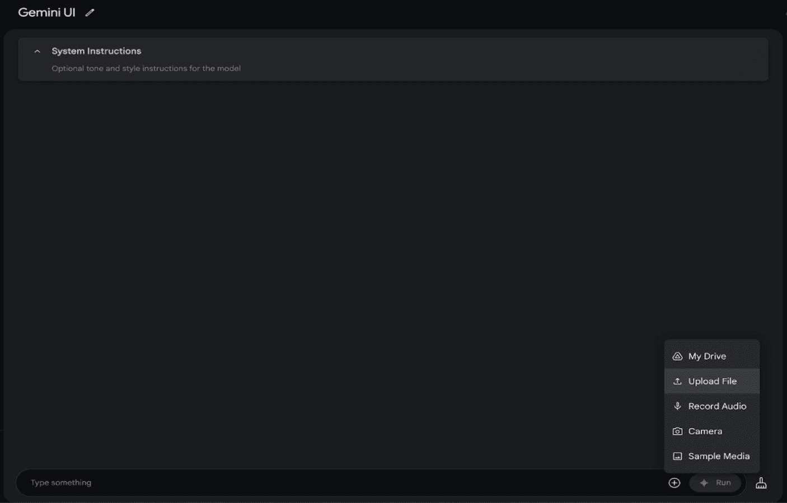
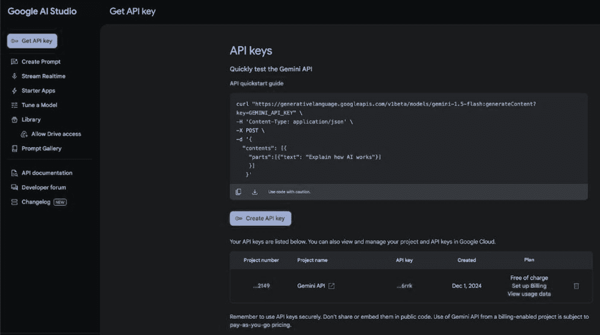
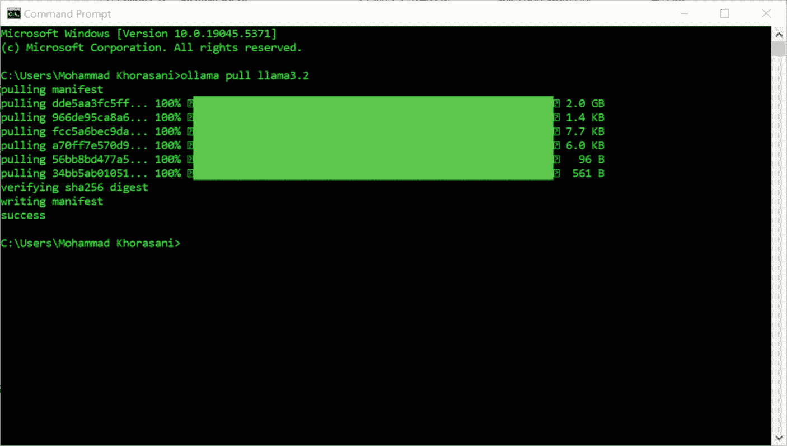
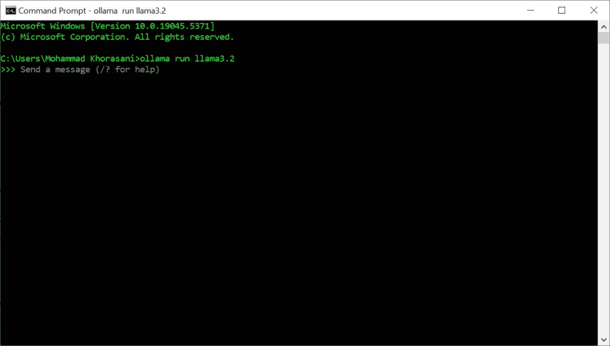
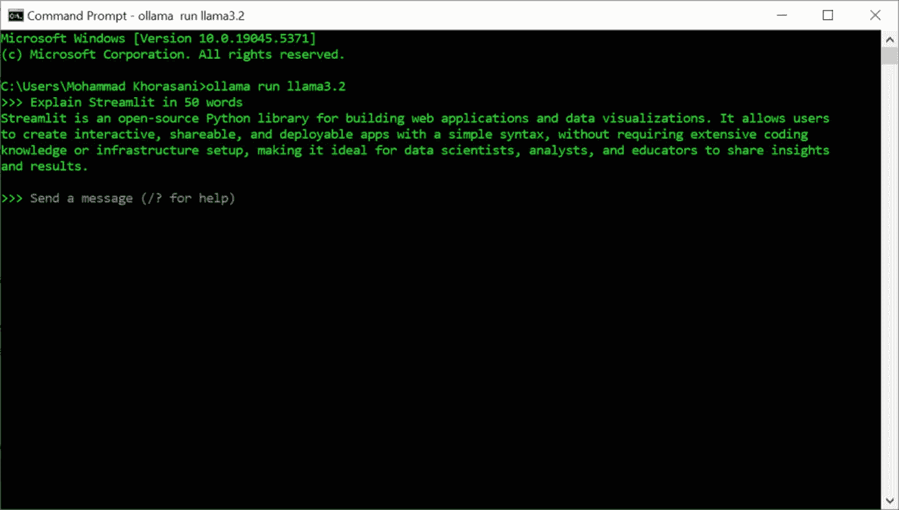
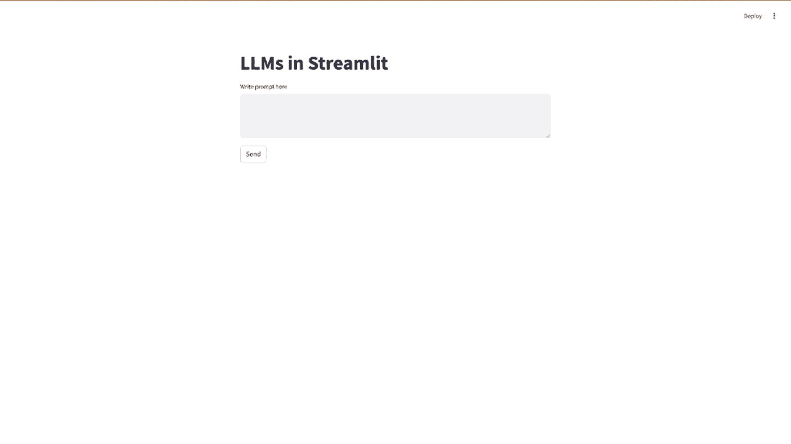
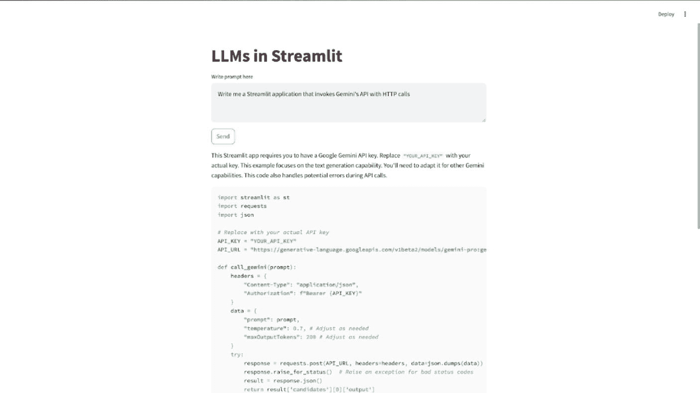
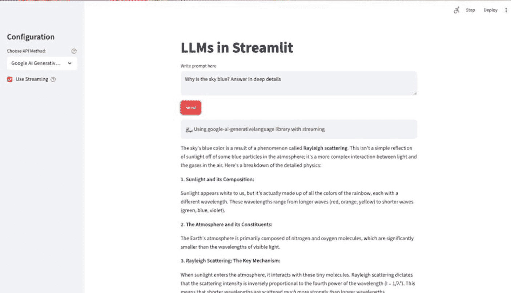

# 13. Streamlit 与人工智能

Streamlit 作为一个 Web 框架的特性，为 Web 开发者打开了将其用于任何业务或技术场景的大门。人工智能，尤其是生成式领域——包括大型语言模型（LLM）和检索增强生成（RAG）模型——现在比以往任何时候都更容易使用。各大公司和企业正通过 API 提供种类繁多的 LLM，竞相交付更好、更快且更易于访问的模型。这种方法让最终用户无需仅仅依赖官方门户，就能利用 LLM 的强大能力。在本章中，我们将探索 LLM，学习如何以编程方式使用它们，并构建一个作为个人网络信息助手的 Streamlit 演示应用程序。

## 13.1 什么是 LLM，它们有什么用处？

LLM 是大型深度学习模型，通常包含数十亿个参数。它们的目标不局限于单一任务；可以应用于各种不同的用例。LLM 基于来自不同领域的大量数据进行训练，因此具备了跨越众多领域的广泛通用智能。从根本上说，LLM 是预测模型，这意味着它们的输出取决于所训练数据的性质和质量。

LLM 基于“令牌（tokens）”这个概念运作。令牌是句子的基本构建块，可以包括单词、数字或符号。一个序列的令牌作为输入提供给 LLM，然后 LLM 会生成一个输出令牌序列。输入令牌在 LLM 内部建立了一个关于特定话题的上下文。基于其训练所用的数据，输出令牌是统计生成的，反映了模型先前获得的知识。

LLM 的架构通常始于一个 Transformer 层，它处理输入文本并将其转换为上下文的数学表示。这意味着，无论 LLM 看起来多么复杂，其性能最终都取决于模型的大小、架构以及训练数据的质量和数量。反之，低质量数据——无论是误导性的、表述不佳的还是不准确的——都可能对输出产生负面影响，导致最终结果出现语法错误、拼写错误甚至事实性错误。

LLM 的实际用例范围很广，从独立使用模型到将其与其他软件集成以协助执行特定任务。一些示例如下。

### 13.1.1 摘要

LLM 中大量的参数从根本上以统计关系和模式的形式存储了它们所训练的信息。这使得它们能够总结在训练期间接触到的信息。由于在训练数据中，相同的话题可能以不同形式出现在不同来源中，因此当被问及这些话题时，LLM 可以充当数据摘要器。

例如，我们询问 Gemini 1.5 Flash 为什么天空是蓝色的，它提供了以下输出：

> 天空之所以是蓝色的，是由于一种称为瑞利散射的现象。太阳光由彩虹的所有颜色组成。当太阳光进入地球大气层时，会与微小的空气分子（主要是氮气和氧气）发生碰撞。这些分子比可见光的波长小得多。

这个输出很可能受到了模型训练数据的影响，因为输入仅包含一个问题，没有任何额外细节。此外，预训练的 LLM 可以根据其架构接受不同大小的输入。通常来说，更大的模型有更强的能力处理更大的输入而不会丢失太多关键上下文。这使得 LLM 能够建立对输入的详细理解，然后可用于诸如改写或摘要等任务。例如，我们将第 3 章作为输入提示提供给 Gemini 1.5 Flash，并要求其用少于 80 个词进行摘要。以下是摘要：

> 第 3 章详细介绍了 Streamlit 的 UI 架构。它解释了如何使用代码和配置文件定制界面（主题、颜色、布局）。本章涵盖了使用侧边栏、列和展开器组织页面的方法，并展示了如何创建多页面和子页面应用程序。还演示了如何使用占位符和进度条动态显示内容，以及模块化应用开发的最佳实践。

我们可以观察到，LLM 的摘要主要从该章的摘要和概述部分提取信息。这是因为这些部分通常包含与输入提示最相关的信息。我们也可以尝试使用不同类型的输入，来获取 LLM 对同一章节特定方面的总结性意见。以下输入提示提供给了同一个模型：

> 以下是一本关于 Streamlit 的书籍中的章节。那一章中讨论的哪个 UI 组件对大多数应用程序最有用，为什么？
>
> 第 [3 章内容]

而输出是这样的：

> 根据第 3 章，对大多数 Streamlit 应用程序最有用的 UI 组件是占位符（`st.empty` 或 `st.sidebar.empty`）。原因是它在处理动态内容方面的多功能性和强大功能。该章重点介绍了它的用途：按需或无序显示内容：这对于需要异步或基于用户交互更新信息而无需完全重新加载页面的应用程序至关重要。这能显著提高响应速度和用户体验。创建动态元素：实时时钟的示例演示了如何使用占位符在循环中重复更新内容，从而创建动态可视化。这扩展到任何动态元素，例如随新数据更新的图表或显示长时间运行任务状态的进度条。虽然侧边栏、列和展开器等其他组件对于页面组织和结构很重要，但占位符处理动态更新的能力使其成为一种独特而有价值的工具，适用于从简单仪表板到复杂交互式工具的各种 Streamlit 应用程序。其他组件增强了数据的呈现方式；而占位符则处理数据本身的动态更新。

模型围绕整个章节建立了一个上下文，并对特定的 Streamlit 组件提出了自己的看法，强调由于其多功能性而成为最有用的组件。它还提供了示例来支持这一观点。

### 13.1.2 内容生成

我们已看到一些例子，其中使用大型输入来生成较小输出，且大多为文本形式。这是因为大型语言模型（LLM）从根本上基于词元（token）运作。然而，通过额外的组件以及对文本之外内容类型的微调，模型可以生成新内容，从而获得`生成式 LLM` 的标签。可生成的内容不仅限于图像，还取决于用于微调模型的训练数据。LLM 可以被修改和微调，以生成视频、音频或特定类型的文本，例如诗歌或代码。

其生成内容的质量将与输入数据的质量保持一致。机器学习领域中常被引用的著名概念`垃圾进，垃圾出`同样适用于 LLM。LLM 在图像和视频生成中应用更广泛的原因之一是高质量视觉内容的丰富性。此外，人们对生成的图像和视频的标准相对较低，这些输出通常能被大多数人接受。

LLM 无疑可以通过生成重复或众所周知的代码片段来加快编码速度，为开发者节省时间。然而，它们仍然缺乏编写复杂、高质量代码的能力。部分原因在于，开源领域中可用的代码大多未达到特定标准，并且由于用于训练 LLM 的大量低质量代码，质量往往偏向较低端。

### 13.1.3 检索增强生成

LLM 本身具有强大的能力。允许 LLM 访问其他软件和数据存储以执行操作，可以显著扩展其能力。这从根本上使 LLM 能够在输出词元生成过程之前和期间，对来自各种来源（无论是互联网还是本地数据）的实时数据进行交叉验证。这种在内容生成过程中检索和增强信息的内置能力被称为检索增强生成（RAG）。并非每个 LLM 都是 RAG 模型，但那些以此方式扩展的模型，具备比标准 LLM 更强、更准确的能力。`LlamaIndex` 和 `LangChain` 都支持 RAG 系统。`LlamaIndex` 简化了搜索和检索，而 `LangChain` 是一个模块化平台，支持众多用例。流行的 RAG 平台包括带有 `Pinecone` 向量数据库的 `Langchain` 和 `LlamaIndex`（它包含自己的向量数据库），这些已成为开发者构建知识增强型 AI 应用的重要工具。RAG 代表的是一种架构模型而非单一产品，在从客户支持到金融分析等跨行业的实际应用中，它不可或缺且错综复杂。

## 13.2 与 LLM 交互的不同方式

根据你的用例、预算和所需的隐私级别，可以通过多种方式访问 LLM。其中一些方法包括：与模型的官方网页交互、通过互联网调用 API，甚至在单台机器或集群上自行托管模型以实现本地访问。

### 13.2.1 官方网页

LLM 的创建者通常会构建网页，让人们使用他们的模型。他们根据其提供的模型能力定制用户界面（UI），向用户明确表示他们可以输入各种内容类型，而不仅仅是文本提示。图 13-1 展示了 Gemini 的提示窗口，演示了附加语音、图像或视频作为提示一部分的能力。这些附加内容有助于形成整体上下文，并可能影响最终输出。


图 13-1 Google AI Studio 上的 Gemini 提示

### 13.2.2 应用程序编程接口

一般用户通常与最终产品交互，但通过网页访问的 LLM 可能无法满足某些人的需求，例如开发者。那些希望将 LLM 的强大功能集成到其软件产品中的人（无论是按使用量付费还是免费），可以利用向开发者开放 LLM 的 API。

无论使用何种媒介，这些模型的调用方式保持不变——通过词元。使用 API 时，它们可以扩展以处理数十亿次调用，这使得免费使用 LLM 变得不可持续。这就是词元监控和计费发挥作用的地方。LLM 托管方通过根据使用的 API 密钥对使用情况进行分组来跟踪 API 调用。然后，LLM 处理的总输入和输出词元可用于计算账单（如果适用）。一种新的成本效益机制——`每瓦特每美元词元数`——有助于评估使用特定电量处理给定词元的财务可行性。

LLM 的 API 也可以由那些通过网页提供 LLM 服务的提供商创建。例如，谷歌允许在 [`https://aistudio.google.com/app/apikey`](https://aistudio.google.com/app/apikey) 创建 API 密钥，这些密钥可用于调用 Gemini 模型。下图展示了如何创建多个 API 密钥，并在 `Curl` 命令中使用它们，以向 Gemini 1.5 Flash 发出 HTTP 调用，输入示例如下图 13-2 所示。


图 13-2 Google API Studio API 密钥生成

### 13.2.3 自托管与部署

通过 API 和网页与 LLM 交互，意味着在调用 LLM 本身之前，需要先将你的提示词提交到服务器。对于大多数用例来说，这很方便，因为它省去了自行管理和托管 LLM 的麻烦。然而，如果隐私是核心要求，最安全的选择则是将 LLM 部署在你自己的基础设施上。自托管 LLM 也有其自身的成本，例如硬件的初始投资、确保可靠的能源供应，以及管理机器集群以支持模型的高流量负载。

许多 LLM 都可供下载并在你自己的机器上运行。一个例子是由 Meta 创建的 Llama。开始使用 Llama 的一个简单方法是从 [`ollama.com/download`](https://ollama.com/download) 下载它，这会安装一个桌面应用程序，该程序进而会安装用于管理不同 Llama 模型并运行它们的命令行工具，如图 13-3 所示。

下面的图 13-4 和图 13-5 展示了在 MacBook Pro i9 上安装 Llama 3.2 的过程。性能可能因机器而异，但参数少于 30 亿的较小模型甚至可以在手机上运行。


图 13-3 安装 Llama3.2


图 13-4 运行 Llama3.2


图 13-5 提示 Llama3.2

如果你想以编程方式向模型发送提示，可以通过调用本地主机上的端点来实现，该端点在模型通过终端运行时暴露。更多信息，请访问 [`github.com/ollama/ollama/blob/main/docs/api.md`](https://github.com/ollama/ollama/blob/main/docs/api.md)。

## 13.3 将 LLM 与 Streamlit 集成

Streamlit 是一个 Web 框架，而 LLM 通常被部署为独立服务，以避免与其他软件紧密耦合。这意味着 LLM 可以在 Streamlit 中像任何其他服务一样被使用，其调用方式可以通过网络调用来完成。无论 Streamlit 服务器和 LLM 服务器是在同一台机器还是不同的机器上，这种设置都适用。

以下步骤概述了如何复制 LLM 网站的行为：用户提供提示词，使用提示词调用 LLM，等待响应，然后以流式 UI 格式渲染输出。

### 13.3.1 构建用户输入界面

一个基本的 LLM 网站通常需要三个主要的 UI 组件：一个文本输入框、一个发送按钮和一个输出区域。清单 13-1 接收一个输入，并在点击发送按钮时显示虚拟文本，如图 13-6 所示。

# 在Streamlit中构建LLM应用

```python
import streamlit as st

st.title('LLMs in Streamlit')

text = st.text_area('在此处编写提示词')

sent = st.button('发送')

if sent:

    output = '虚拟输出' # 替换为 LLM 调用

    st.text(output)
```

**清单 13-1** `sample_text_input.py`



**图 13-6** LLM 示例文本输入用户界面（清单 13-1 的输出）

## 13.3.2 设置 HTTP 连接

出于演示目的，我们将通过 API 使用一个 LLM。我们可以基于 Gemini 的 API 进行构建，为此我们之前生成了一个 API 密钥。首先，让我们使用本章前面部分提到的步骤生成密钥。由于 API 密钥是敏感数据，不应硬编码到你的应用程序中。相反，我们将把密钥添加到我们的环境变量中。这可以通过将清单 13-2 添加到一个名为 `.env` 的文件中来实现，该文件与你的 Streamlit 应用程序的主文件位于同一目录下。

```
API_KEY=
```

**清单 13-2** `.env`

然后可以在 Python 中读取 API 密钥，如清单 13-3 所示。首先，你需要通过运行 `pip install python-dotenv` 来安装 `python-dotenv` 包，以便使用一个名为 `load_env` 的方法。该方法会读取 `.env` 文件，并将键值对添加到系统环境中，使其可以从代码中轻松访问。

```python
import os

from dotenv import load_dotenv

load_dotenv()

API_KEY = os.getenv('API_KEY')

print(f'{API_KEY=}')
```

**清单 13-3** `read_variables.py`

在此示例中，我们使用来自 Google AI Studio 的 Gemini API。API 密钥生成页面上提供的 `curl` 命令更适合在终端或 CMD 中使用。为了在 Python 中重新创建它，我们可以应用前几章学到的知识，并使用 Python 中的 `requests` 包，如下面的清单 13-4 所示。

```python
import os

import requests

import json

API_KEY = os.getenv('API_KEY')

URL = 'https://generativelanguage.googleapis.com/v1beta/models/gemini-1.5-flash-latest:generateContent'

def call_llm(text: str) -> str:

    body = {

        'contents': [{

            'parts': [{'text': text}]

        }]

    }

    response = requests.post(

        URL, params={'key': API_KEY}, headers={'Content-Type': 'application/json'},

        data=json.dumps(body)

    )

    return response.json().get('candidates', [{}])[0].get('content', {}).get('parts', [{}])[0].get('text')
```

**清单 13-4** `gemini_input.py`

## 13.3.3 创建流式效果

现在我们有了在代码中调用 LLM 的方法，我们需要一种方式来呈现其输出。对于我们的 API 用例，只有 HTTP 方法，而没有 WebSocket 方法。WebSocket 可以逐个令牌地将 LLM 的输出流式传输到我们的 Streamlit 应用，从而允许我们逐字渲染输出，并创造出著名的 LLM 流式输出体验。

由于情况并非如此，我们可以绕过这一限制并模拟我们自己的流式效果。这是可行的，因为 Streamlit 有一个名为 `write_stream` 的方法，它接受一个字符串的可迭代对象，并以流式方式渲染输出。幸运的是，我们不仅可以将 LLM 的块输出转换为字符串的可迭代对象，还可以调整每个字符串在可迭代对象中出现的速度。

首先，我们需要创建一个方法，该方法接受一个字符串并返回一个字符串的可迭代对象。该可迭代对象应该在每个元素之间引入延迟，以模拟 LLM 流式输出的行为。这可以通过将 Python 解释器暂停几毫秒来实现。如下列清单 13-5 所示的方法实现了这一点。

```python
import time

from typing import Iterable

def yield_text(text: str) -> Iterable:

    for word in text.split(' '):

        yield  word + ' '

        time.sleep(0.01)
```

**清单 13-5** `string_iterable_converter.py`

## 13.3.4 使用 Streamlit 构建 LLM 应用

为整合所有内容，本节将结合前几节的概念，构建一个功能完备的 LLM Streamlit 应用。该应用接收用户输入的文本，调用 Gemini 1.5 Flash API，并以流式方式显示输出。清单 13-6 展示了应用的完整代码。

```python
import os

import time

import requests

import json

import streamlit as st

from dotenv import load_dotenv

from typing import Iterable

def call_llm(text: str) -> str:

    """Call LLM using direct requests to Google API"""

    body = {

        'contents': [{

            'parts': [{'text': text}]

        }]

    }

    try:

        response = requests.post(

            URL,

            params={'key': API_KEY},

            headers={'Content-Type': 'application/json'},

            data=json.dumps(body),

            timeout=30

        )

        response.raise_for_status()  # Raise an exception for bad status codes

        response_data = response.json()

        response_text = response_data.get('candidates', [{}])[0].get('content', {}).get('parts', [{}])[0].get('text', '')

        if not response_text:

            return "No response generated. Please try again."

        return response_text

    except requests.exceptions.RequestException as e:

        return f"Error calling API: {str(e)}"

    except (KeyError, IndexError) as e:

        return f"Error parsing response: {str(e)}"

def yield_text(text: str) -> Iterable[str]:

    """Yield text word by word for streaming effect"""

    for word in text.split(' '):

        yield word + ' '

        time.sleep(0.02)  # Slightly slower for better readability

def main():

    load_dotenv()
```


清单 13-6 `streamlit_llm_application.py`

输出结果符合预期：我们可以用任意文本提示模型，并以流式效果查看显示结果。请对比图 13-7 和图 13-8 之间的差异。


**图 13-7** 渲染过程中的 LLM 流式响应



**图 13-8** 渲染完成后的 LLM 响应

调用托管 LLM 模型的另一种方式是通过官方的 `pip` 包，如清单 13-7 所示。在我们之前的示例中，这可以通过使用 `google` 库的 `pip` 包中的 `genai` 模块来实现。这带来了多项好处，例如将 HTTP 调用封装在一行代码中，以及支持直接从 Gemini 实时地逐 token——或逐批次——流式传输响应，而无需等待整个响应生成完毕后再接收。使用这种方式将提供更吸引人的用户体验，如下图 13-9 所示。



**图 13-9** LLM 响应流式传输

# STREAMLIT 应用代码示例

```python
import os
import time
import requests
import json
import streamlit as st
from dotenv import load_dotenv
from typing import Iterable
from google import genai

def call_llm_requests(text: str) -> str:
    """使用直接的 HTTP 请求调用 Google API"""
    body = {
        'contents': [{
            'parts': [{'text': text}]
        }]
    }
    response = requests.post(
        URL, params={'key': API_KEY}, headers={'Content-Type': 'application/json'},
        data=json.dumps(body)
    )
    response_text = response.json().get('candidates', [{}])[0].get('content', {}).get('parts', [{}])[0].get('text')
    return response_text

def call_llm_genai(text: str) -> str:
    """使用 google-ai-generativelanguage 库调用 LLM"""
    try:
        # 创建客户端
        client = genai.Client(api_key=API_KEY)
        # 生成内容
        response = client.models.generate_content(
            model='gemini-1.5-flash-latest',
            contents={'parts': [{'text': text}]}
        )
        return response.candidates[0].content.parts[0].text
    except Exception as e:
        return f"使用 google-ai-generativelanguage 调用 LLM 时出错: {str(e)}"

def call_llm_genai_stream(text: str) -> Iterable[str]:
    """使用 google-ai-generativelanguage 库并启用流式传输调用 LLM"""
    try:
        # 创建客户端
        client = genai.Client(api_key=API_KEY)
        # 使用流式传输生成内容
        response = client.models.generate_content_stream(
            model='gemini-1.5-flash-latest',
            contents={'parts': [{'text': text}]}
        )
        for chunk in response:
            if chunk.candidates and chunk.candidates[0].content.parts:
                text_chunk = chunk.candidates[0].content.parts[0].text
                if text_chunk:
                    yield text_chunk
                    time.sleep(0.01)  # 为了视觉效果的短暂延迟
    except Exception as e:
        yield f"使用流式传输调用 LLM 时出错: {str(e)}"

def yield_text(text: str) -> Iterable[str]:
    """逐词生成文本以实现流式传输效果"""
    for word in text.split(' '):
        yield word + ' '
        time.sleep(0.01)

def main():
    load_dotenv()
    st.title('Streamlit 中的 LLM')
    # API 方法选择
    st.title('LLM Chat with Streamlit')

    # Main interface
    st.write("Enter your prompt below and click Send to get a response from Gemini.")

    text = st.text_area(
        'Your prompt:',
        height=120,
        placeholder="Ask me anything..."
    )

    sent = st.button('Send', type="primary")

    # Handle submission
    if sent:
        response_text = call_llm(text)
        st.write_stream(yield_text(response_text))

if __name__ == '__main__':
    API_KEY = os.getenv('API_KEY')
    URL = 'https://generativelanguage.googleapis.com/v1beta/models/gemini-1.5-flash-latest:generateContent'
    main()
```


```python
st.sidebar.title("配置")

api_options = ["直接请求", "Google AI GenerativeLanguage 库"]

api_method = st.sidebar.selectbox(
    "选择 API 方法:",
    api_options,
    help="选择调用 Google Gemini API 的方式"
)

# 适用于 google-ai-generativelanguage 的流式传输选项
use_streaming = False
if api_method == "Google AI GenerativeLanguage 库":
    use_streaming = st.sidebar.checkbox(
        "使用流式传输",
        value=True,
        help="实时流式传输响应（仅适用于 google-ai-generativelanguage 库）"
    )

# 主界面
text = st.text_area('在此处编写提示词', height=100)
sent = st.button('发送', type="primary")

if not sent or not text.strip():
    return

if not API_KEY:
    st.error("未找到 API_KEY。请在您的 .env 文件中设置它。")
    return

# 显示正在使用的方法
if api_method == "直接请求":
    st.info(" 使用直接 HTTP 请求调用 Google API")
    with st.spinner("正在生成响应..."):
        response_text = call_llm_requests(text)
        st.write_stream(yield_text(response_text))
elif api_method == "Google AI GenerativeLanguage 库":
    st.info(" 使用 google-ai-generativelanguage 库并启用流式传输")
    st.write_stream(call_llm_genai_stream(text))
else:
    st.error("所选 API 方法不可用。请安装所需库或选择其他方法。")

if __name__ == '__main__':
    API_KEY = os.getenv('API_KEY')
    URL = 'https://generativelanguage.googleapis.com/v1beta/models/gemini-1.5-flash-latest:generateContent'
    main()
```

```
清单 13-7 `streamlit_llm_streaming_application.py`

## 13.4 总结

LLM 因其提供的独特优势，已成为技术社区的新焦点。使用 LLM 可以作为最终解决方案，但并非总是如此。人工智能可以作为创造更卓越产品的工具，例如 Streamlit。LLM 和 Streamlit 可以协同工作，以增强优秀产品，使其变得更好。在本章中，我们学习了 LLM 的概述及其运作方式，以及与之交互的各种方法。然后，我们使用其中一种交互方法，构建了一个通用 AI 助手的克隆版本，该助手接收文本输入并提供文本输出。我们在本章构建的产品的优点在于其模块化。作为开发者，您可以试验甚至并行运行来自不同 API 提供商的不同类型的模型，或者选择自行托管的解决方案。
