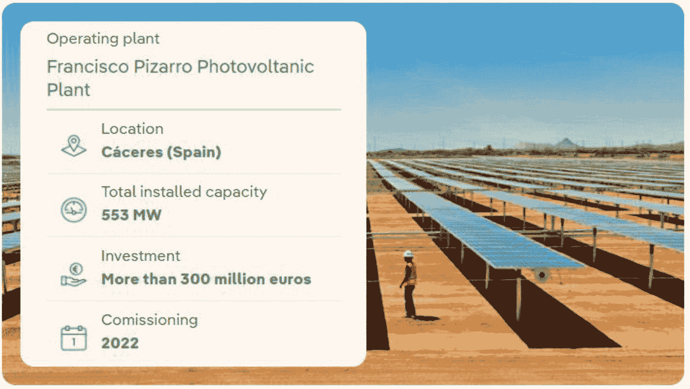
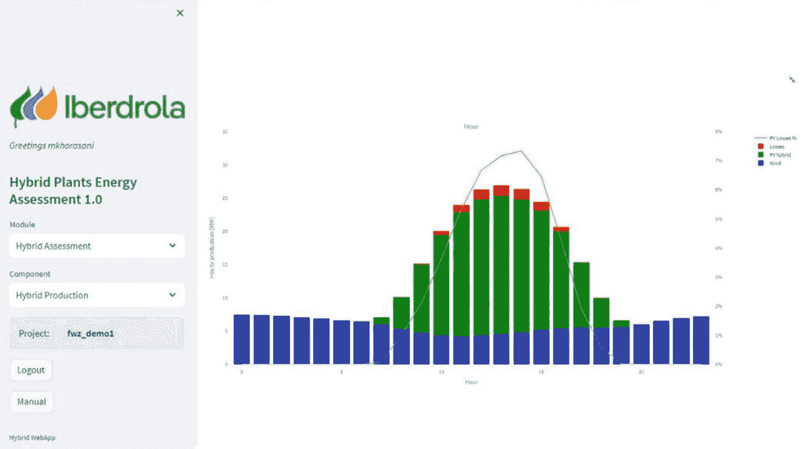
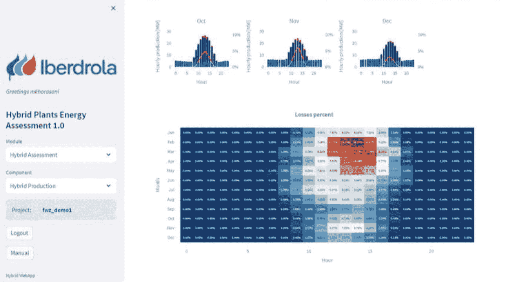
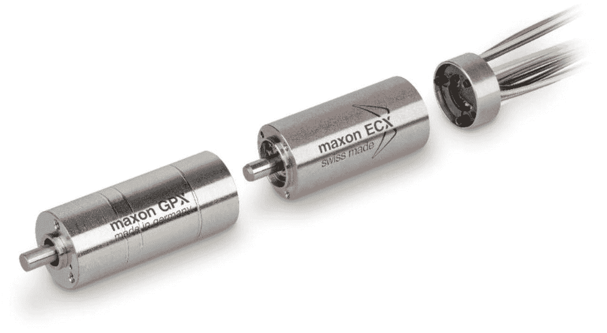
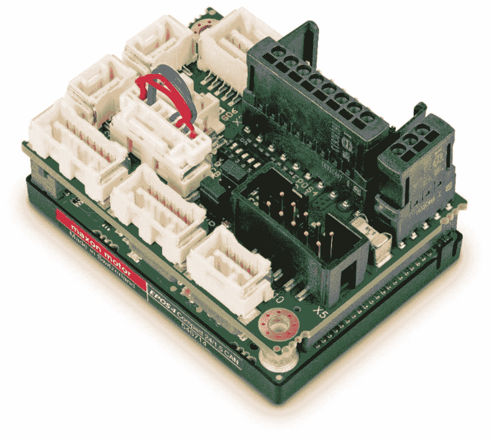
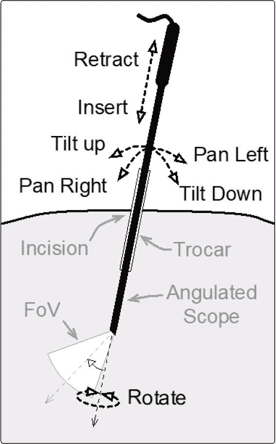
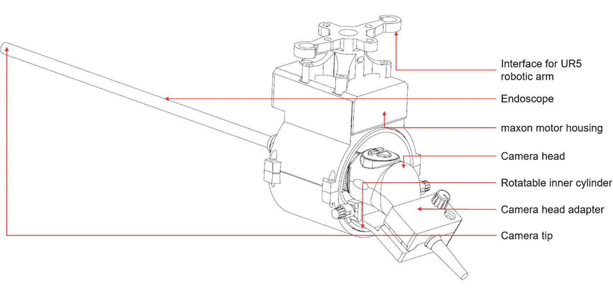
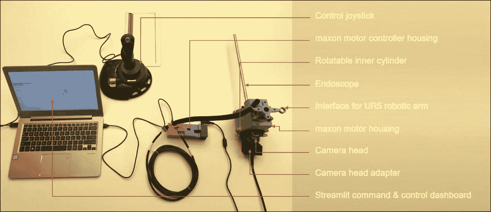
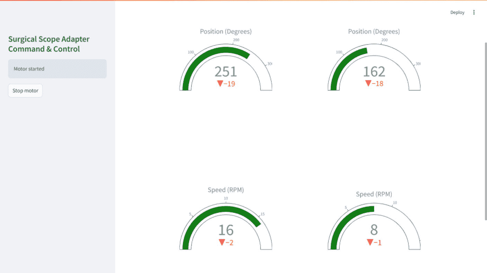

# 14. Streamlit 在工作中的应用

本章最后呈现了两个真实世界的案例，展示了 Streamlit 的使用。第一个案例重点介绍了由可再生能源公司 Iberdrola 为太阳能发电厂开发的分析工具。该工具评估光伏电站的运行条件，加深对当前光伏电站的理解，并为未来的开发决策提供信息。第二个案例考察了 Streamlit 在工业环境中的应用，涉及高精度电子电机制造商 maxon Group。Streamlit 被用于创建一个指挥与控制仪表板应用，实现了对外科内窥镜适配器系统中 maxon 电机的本地和远程管理。

## 14.1 Streamlit 在清洁能源领域的应用：Iberdrola

Iberdrola 是一家全球性的电力公司，业务遍及 30 多个国家。自成立以来，该公司通过可再生能源投资，优先采用清洁可靠的商业模式，按装机容量计算，已成为全球最大的可再生能源运营商之一。可持续发电是 Iberdrola 的关键业务部门，与电网和零售解决方案并列 [参考文献：[现在的 Iberdrola 集团是一家全球能源领导者——Iberdrola](https://www.iberdrola.com/about-us) ]。

该公司通过风能（陆上和海上）、水力、光伏等清洁能源发电。未来三年，Iberdrola 计划在可再生能源及其他项目上投资 410 亿欧元 [参考文献：[Iberdrola 2024-2026 年战略计划——Iberdrola](https://www.iberdrola.com/about-us/iberdrola-strategic-plan)]。其中，155 亿欧元将分配给可再生能源，目标容量为 60 GW。到 2030 年，该公司预计其可再生能源装机容量将达到 95 GW [参考文献：[可再生能源——Iberdrola](https://www.iberdrola.com/about-us/our-company/renewable-energies)]。要了解与某个太阳能发电厂相关的数据概况，请参见图 14-1。

图 14-1

Francisco Pizarro 光伏电站 [参考文献：[`https://www.iberdrola.com/about-us/what-we-do/solar-photovoltaic-energy/francisco-pizarro-photovoltaic-plant`](https://www.iberdrola.com/about-us/what-we-do/solar-photovoltaic-energy/francisco-pizarro-photovoltaic-plant) ]。

好的，作为一名高级文档工程师和翻译员，我将遵循您的指示，在保留格式和代码符号的同时，准确翻译给定的英文文本。

### 14.1.1 太阳能电站运行性能可视化

来自能源资源部的 Nuria Sanchez、Daniel Paredes 和 Brenno Teixeira Martins 花费多年时间开发了用于分析 Iberdrola 太阳能和风电场的算法及定制软件。这里重点介绍的是一个用于评估光伏电站性能并识别运营损失的软件工具。该程序从现场设备、各种数据库和模型中收集数据，以计算发电厂的效率和损耗。这些信息随后被用于研究电站及其组件，以及检测偏差。

为了满足运营性能分析的需求，我们开发了一款创新的内部软件解决方案。该软件能够自动化和简化原本需要手动完成的计算工作。该工具最初以一系列 Python 脚本的形式创建，有效地满足了运营分析需求，但在可扩展性、可访问性以及与其他系统的交互方面存在局限。因此，迁移到基于云的部署将能增强其潜力，并为最终用户启用附加功能和集成。由于所有算法都已使用 Python 实现，因此需要一个 Web 框架来与浏览器进行交互。`Streamlit` 因其纯粹的 Python 特性而被选中，这只需极少的学习成本，且无需了解 HTML 或 CSS 知识。

在与专注于智能电网和分布式可再生能源集成的 Iberdrola 中东创新中心合作下，该太阳能分析工具被重新设计，其功能也得到了增强。以下章节将讨论 Iberdrola 的太阳能工程师所使用的一些基于 `Streamlit` 的图形化表示。

### 14.1.2 风能与太阳能联合发电

结合了风能和太阳能发电的混合电站是最大化可再生能源输出的流行方法。这些电站利用了风能和太阳能资源的互补性：风能在夜间和冬季通常更强，而太阳能在白天和夏季则很充足。通过整合这两种能源，混合电站可以提供更稳定、持续的电力供应，减少对化石燃料的依赖，并增强电网稳定性。

图 14-2 展示了一个混合电站的每小时发电曲线，使用合成数据生成，以突出显示一天中风能和太阳能之间的动态交互。Y 轴表示以兆瓦为单位的每小时发电量，X 轴表示一天中的小时数。

在图表中，风能发电用蓝色表示，显示了风力在一天中的波动情况，通常在夜间和清晨达到峰值。光伏发电用绿色表示，说明了随着太阳在天空中升高，太阳能发电量增加，在中午达到峰值，并在傍晚逐渐减少。

用红色表示的光伏损失，指明了由于互连点限制而未能捕获的潜在太阳能。黄色曲线代表光伏损失的百分比，直观地显示了这些损失与光伏发电水平之间的相关性。值得注意的是，光伏损失百分比往往会随着光伏发电量的增加而增加，这主要是由于互连点限值限制了可以馈入电网的能量。

这种详细的可视化有效地展示了混合电站中风能和太阳能的互补特性，突出了这些可再生能源如何协同工作，以在一天中提供更稳定、持续的电力供应。

图 14-2

混合电站的每小时发电曲线

### 14.1.3 热力图

热力图是一种可视化工具，它使用颜色来表示数据值，从而更容易识别模式和趋势。图 14-3 中的热力图显示了模拟混合电站发电量中光伏损失的百分比以及超出互连点限值的概率，并按月份和小时进行了细分。在此热力图中，红色单元格表示更高的光伏损失百分比和更大的超出互连点限值的概率，而蓝色单元格则表示无发电时段。这种可视化让工程师能够全面了解能量损失模式，这对于优化可再生能源系统的规模和尺寸至关重要。

此外，这些数据对于将电池存储集成到混合电站中非常宝贵。例如，热力图显示二月和三月的光伏损失较高。此外，从二月到七月，上午 10 点到下午 3 点之间超出互连点限值的概率普遍更高。这些见解可以指导电池存储系统的战略布局和容量规划，有助于减轻能量损失并提高整体效率。通过理解这些模式，工程师可以就能源结构以及存储解决方案的实施做出明智的决策，最终提升混合电站的性能和可靠性。

图 14-3

按月份和小时统计的混合电站发电量中光伏损失百分比的热力图

### 14.1.4 结束语

除了其可视化能力之外，`Streamlit` 还展现了对 Iberdrola Renewables 来说非凡的多功能性。其主要优势之一是能够按需渲染多个数据集。用户可以通过交互式界面轻松选择要显示的数据，无需在源代码中进行手动编程。此功能极大地提升了用户体验和效率。

`Streamlit` 的另一个宝贵方面是它支持使用纯 Python 与图表进行双向通信。此功能实现了动态和交互式的数据可视化，使用户能够更有效地与数据交互。此外，`Streamlit` 还能够将图表以 HTML 格式渲染到网站上。这意味着图表可以变得可交互，并与其它小部件集成，从而提供无缝的用户体验。与在没有第三方交互的情况下本地运行应用程序相比，这是一项重大改进，因为它为数据呈现提供了更大的灵活性和交互性。总的来说，`Streamlit` 的特性使其成为 Iberdrola Renewables 不可或缺的工具，促进了先进的数据可视化、用户交互以及与网络平台的无缝集成。

> *本文由 Iberdrola S.A. 支持，作为其创新部门研究的一部分。其内容仅代表作者的观点，不一定代表 Iberdrola 集团的官方立场。*

## 14.2 工业中的 Streamlit：maxon 集团

`maxon Group` 是一家瑞士公司，为高精度和高级应用制造并分销工业级电子马达。其产品广泛应用于医疗、航空航天、汽车和包装等多个行业。多样化的产品、卓越的制造质量和出色的客户服务，使开发人员能够满足并超越严苛的性能要求，无论是在地球上还是太空中。`maxon` 的产品系列包括有刷、无刷、交流和直流马达，以及可通过 `RS232`、`USB`、`CANopen` 和 `EtherCAT` 通信协议运行的减速箱、编码器、霍尔效应传感器和马达控制器。此外，`maxon` 还提供广泛的定制选项，能够精确调整尺寸、机械接口、电缆、轴承及其他驱动特性，以满足特定需求。`maxon` 开发的无刷马达和马达控制器示例，请参见图 14-4 和图 14-5。

图 14-4

`maxon GPX Speed 13` 减速箱、`ECX Speed 13M` 无刷马达和 `ENX13` 编码器的布局

图 14-5

`maxon EPOS4 Compact 24/1.5 CAN` 马达控制器

### 14.2.1 开发用于微创腹腔镜手术的新型手术内窥镜适配器系统

腹腔镜手术是一种微创手术，正日益成为腹部手术的首选方法。该技术通过做小切口，使患者恢复更快、并发症风险更低。目前，这些手术是手动进行的，由一名手术助理负责握持和操控插入腹腔的内窥镜，为手术区域提供实时视觉影像，如图 14-6 所示。这种设置要求操作者具备极佳的灵巧度和手眼协调能力，因为即使是微小的不准确也可能导致手术中出现失误。[参考文献： [`https://onlinelibrary.wiley.com/doi/10.1002/rcs.2475`](https://onlinelibrary.wiley.com/doi/10.1002/rcs.2475)]

图 14-6

插入腹腔的内窥镜示意图

为了解决反馈回路中有人类操作者的局限性，Nikhil Navkar 博士和 Mohammad Khorasani 开发并制作了一种创新型内窥镜适配器原型（如图 14-7 和 14-9 所示）。在该设计中，内窥镜及其摄像头头被安装在一台提供六个自由度的 `UR5` 机械臂上，并由其控制。此外，适配器本身还提供两个额外的自由度，允许内窥镜和摄像头头绕其轴线旋转以及内窥镜末端角度调整。

旋转机构由一台 `maxon ECX` 无刷马达驱动，而角度调整则由一台 `maxon 有刷 DCX` 马达提供动力。每个马达都配有一个减速箱，旋转和角度调整的最高速度分别可达 20 RPM 和 16 RPM。此外，还使用了一个三通道光学编码器，旋转和角度调整的分辨率分别达到每转 4,096 步和每转 2,048 步。

手术内窥镜适配器的其他优点包括：

*   兼容各种内窥镜、摄像头头和机械臂。
*   可通过多种输入方式操作，例如操纵杆或跟踪外科医生头部的光学标记。
*   可编程，以最大程度减少人为错误并防止意外移动。
*   消除了手动握持内窥镜的需要，减轻了操作者的压力和疲劳感。

图 14-7

由 `maxon` 驱动的手术内窥镜适配器的工程图

### 14.2.2 Streamlit 命令与控制仪表盘

在完成手术内窥镜适配器的机械原型后，开发了一个 `Streamlit` 应用程序，用于显示实时仪表盘，展示旋转和角度调整马达的速度与位置（如图 14-8 所示）。该应用程序还与一个三轴操纵杆集成，能够精确控制每个 `maxon` 马达（如图 14-9 所示）。此外，通过对 `Streamlit` 应用程序进行端口转发，实现了通过互联网远程控制马达。这一功能对于远程手术尤其有价值，它使得操作者无需亲临医院也能参与手术。但需要注意的是，长距离远程控制可能会引入延迟，从而影响设备的性能。

图 14-9

带有 `Streamlit` 命令与控制仪表盘的手术内窥镜适配器原型

图 14-8

用于手术内窥镜适配器的 `Streamlit` 命令与控制仪表盘

### 14.2.3 结束语

尽管 `Streamlit` 被定位为机器学习和数据科学应用的框架，但它具有足够的通用性，可用于各种目的。正如本案例所示，`Streamlit` 被有效地用于将多个非平凡子系统集成为一个连续系统。具体来说，`Streamlit` 被用于将 `maxon` 电机与操纵杆连接，支持通过局域网和互联网进行远程控制，并提供一个实时仪表盘来显示电机的位置和速度，所有这一切仅需几行代码即可实现。

> *本研究得到卡塔尔国家研究基金会（卡塔尔基金会成员）的国家优先研究计划（NPRP）奖项（NPRP13S-0116-200084）以及哈马德医疗公司（HMC）医学研究中心（MRC）的 IRGC-04-JI-17-138 奖项的资助。本研究中的所有观点、发现、结论或建议均为作者本人立场，并不一定反映我们的资助方的观点。*

## 14.3 总结

在本最后一章中，我们探讨了 `Streamlit` 在商业和工业活动中被有效利用的两个真实案例。第一个案例展示了可再生能源公司 Iberdrola 如何使用 `Streamlit` 为其风电场创建企业数据管理应用程序，以估算生产过程中的电力损耗。第二个案例则深入介绍了一个工业用例，即通过 `Streamlit` 应用程序控制由 `maxon Group` 制造的高精度电子电机，用于手术范围适配器系统。这两个案例都突显了 `Streamlit` 为企业界及更广泛领域所提供的实用价值。
