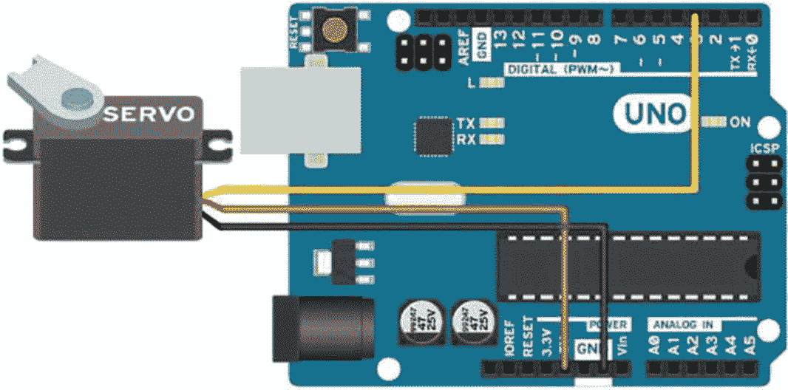
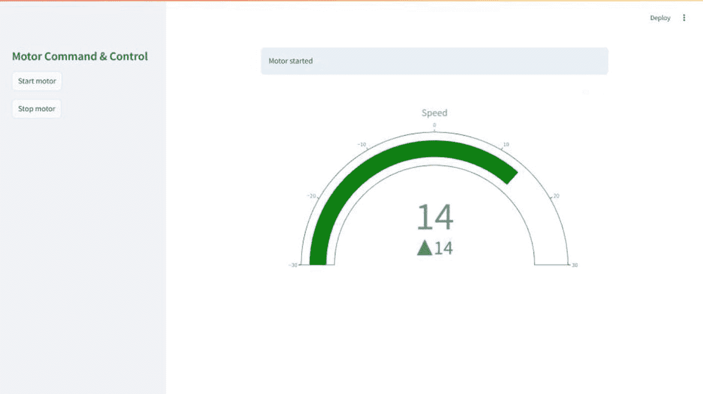

# 在当前日期时间小于指定结束时间时持续记录数据

```python
while recording and (datetime.now() < datetime.combine(end_date, end_time)):
    temperature = float(arduino.readline().decode().strip())
    temperature_record = pd.concat([temperature_record, pd.DataFrame({'时间': [datetime.now()], '温度 (摄氏度)': [temperature]})], ignore_index=True)
    temperature_gauge(temperature, previous_temperature, gauge_placeholder)
    temperature_chart(temperature_record, chart_placeholder)
    previous_temperature = temperature
    time.sleep(1)

arduino.close()

if len(temperature_record) > 0:
    st.write(temperature_record)
    st.download_button(
        label='下载数据',
        data=temperature_record.to_csv(index=False).encode('utf-8'),
        file_name='temperature_record.csv',
        mime='text/csv',
    )
else:
    st.warning('请选择未来的结束日期和时间')
```

*清单 11-2*
*temperature_data_recorder_app.py*

## 11.1.2 电机指令与控制应用

电机在众多工业及非工业应用中扮演着关键角色——从工厂车间的控制阀操作，到遥控飞机的飞行姿态调整。鉴于其多功能性，开发者经常需要能同时实现电机控制与性能可视化的仪表盘，这些仪表盘通常借助各种仪表控件来呈现。

在本示例中，我们将使用一个 USB 游戏手柄和一块 Arduino UNO 微控制器来控制电机的转速与方向。本次演示选用的电机是`SM-S3317SR`，一款紧凑型连续旋转舵机，其连接方式如图 11-4 所示。游戏手柄和微控制器均通过 USB 与运行 Streamlit 服务器的主机进行通信。首先，请使用`Arduino IDE`将代码清单 11-3 中的程序上传至微控制器。该脚本旨在通过串行接口从 Streamlit 应用程序接收转速和方向指令，并相应地执行。



图 11-4

Arduino 微控制器与舵机接线示意图[20]

```cpp
#include <Servo.h>

Servo motor;
String input;
int target_speed;

void setup() {
  motor.attach(3);
  Serial.begin(9600);
}

void loop()
{
  if(Serial.available()) // 检查串口是否有数据可用
  {
    input = Serial.readStringUntil('\n'); // 读取数据直至换行符
    target_speed = input.toInt();
    motor.write(target_speed);    // 以目标转速驱动电机
  }
}
```

代码清单 11-3

`Arduino_motor_control.ino`

首先，您可以使用`Arduino IDE`或计算机的设备管理器，来识别与微控制器关联的串行 COM 端口。在创建 Streamlit 应用程序中的串行客户端时，请务必使用相同的端口，并利用 Python 库`pySerial`，如代码清单 11-4 所示。在此脚本中，我们还将集成`Pygame`库来与游戏手柄控制器进行交互。游戏手柄的前后摇杆轴值将用于控制舵机的转速和方向。此外，游戏手柄上的一个按钮将充当急停开关，用于立即停止电机。为了持续更新电机的目标转速，Streamlit 的占位符中会显示一个 Plotly 仪表盘可视化控件，如图 11-5 所示。这种方法可以轻松扩展，用于连接并同时可视化和控制其他电机、执行器、传感器及外设，非常适合应用于更复杂的系统。



图 11-5

代码清单 11-4 的输出结果

*请注意：不建议在没有显示器的应用中使用* *Pygame* *与游戏手柄交互，因为* *Pygame* *需要初始化视频系统，这可能导致错误或不必要的开销。对于无头设置或运行在无屏幕设备上的应用，最好使用像* *hidapi* *这样现代、轻量级且跨平台的库来直接获取控制器输入。*

```python
import serial
import pygame as pg
import streamlit as st
import plotly.graph_objects as go
import time
```