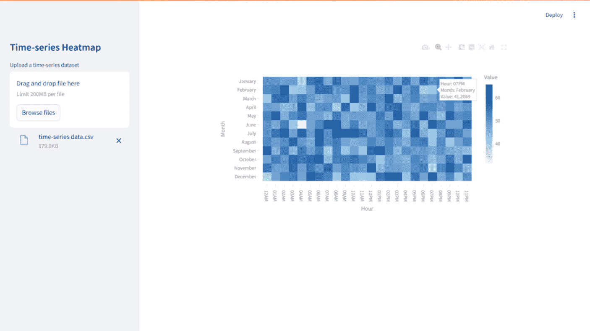

# Plotly 时间序列可视化函数

代码清单 11-5 `datetime_filter.py`

```python
def timeseries_chart(df, datetime_col, value_col):
    df[datetime_col] = df[datetime_col].dt.strftime(' %H:%M on %B %-d, %Y')
    df = df.sort_values(by=datetime_col)
    fig = px.line(df, x=datetime_col, y=value_col, hover_data={datetime_col: '|%d/%m/%Y %H:%M'})
    st.write(fig)

if __name__ == '__main__':
    st.sidebar.title('日期时间筛选器')
    uploaded_file = st.sidebar.file_uploader('上传时间序列数据集')
    if uploaded_file is not None:
        df = pd.read_csv(uploaded_file)
        df_filtered = datetime_filter('datetime', df, '%d/%m/%Y %H:%M')
        st.header('筛选图表')
        timeseries_chart(df_filtered, 'datetime', 'value')
        st.download_button(
            label='下载筛选后的数据',
            data=df_filtered.to_csv(index=False).encode('utf-8'),
            file_name='filtered_data.csv',
            mime='text/csv',
        )
```

### 11.2.2 时间序列热力图应用

另一种常用的时间序列数据可视化形式是月度-小时热力图。这些可视化方式允许将数据点按每个月每个小时分组求平均值，为时间序列分析提供有价值的见解。例如，你可能希望追踪一年内的平均温度，或测量一年时间段内的网站流量。

在此应用中，我们首先将日期时间列（格式为 `DD/MM/YYYY HH:MM`）解析为两个单独的列：一个用于月份（例如，一月），另一个用于小时（例如，上午 12 点）。使用 Pandas 的 `groupby` 命令，我们将数据聚合成整个数据集在每月和每小时的平均值。最后，我们在 Streamlit 应用中使用 Plotly 的热力图对聚合后的数据进行可视化，如代码清单 11-6 和图 11-7 所示。



图 11-7 代码清单 11-6 的输出

```python
import pandas as pd
import streamlit as st
from datetime import datetime
import plotly.express as px
```