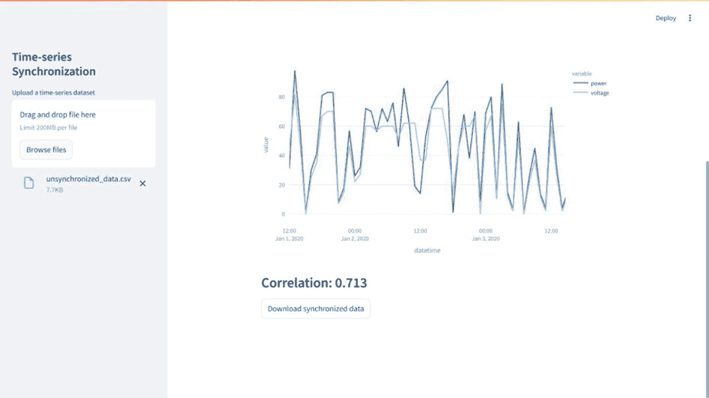
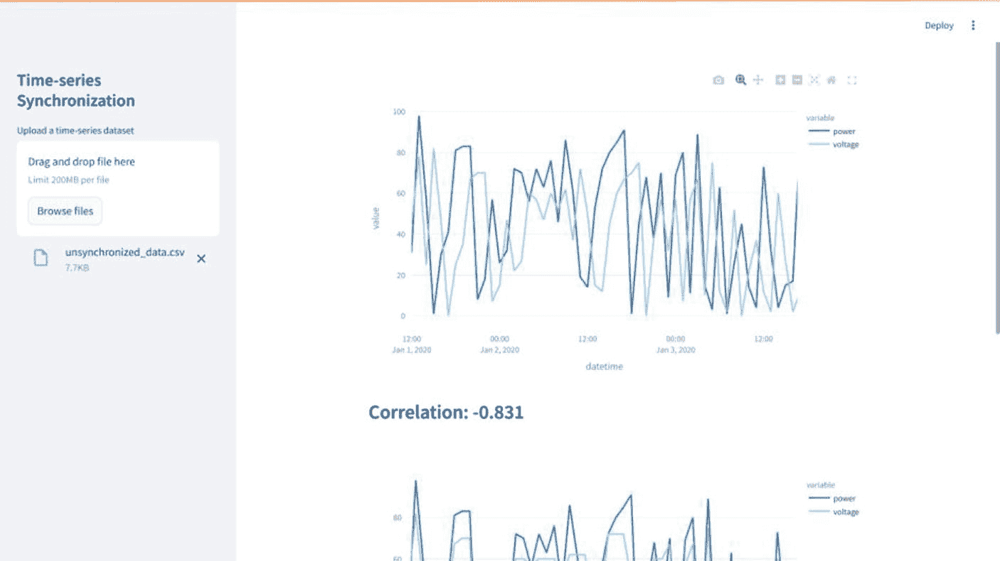

# Plotly 热力图可视化
def heatmap(df, month_hours, value_col):
    for i in range(len(df)):
        month_hours[df.iloc[i][0]][df.iloc[i][1]] = df.loc[i][value_col]
    data_rows = list(month_hours.values())
    data = []
    for i in range(0,len(data_rows)):
        data.append(list(data_rows[i].values()))
    fig = px.imshow(data,
                    labels=dict(x='小时', y='月份', color='数值'),
                    x=['12AM','01AM','02AM','03AM','04AM','05AM','06AM','07AM',
                       '08AM','09AM','10AM','11AM',
                       '12PM','01PM','02PM','03PM','04PM','05PM','06PM','07PM',
                       '08PM','09PM','10PM','11PM'],
                    y=['一月','二月','三月','四月','五月','六月','七月',
                       '八月','九月','十月','十一月','十二月'])
    st.write(fig)

if __name__ == '__main__':
    st.sidebar.title('时间序列热力图')
    uploaded_file = st.sidebar.file_uploader('上传时间序列数据集')
    if uploaded_file is not None:
        month_hours = month_hours_dict()
        df = pd.read_csv(uploaded_file)
        df_aggregate = aggregate(df, 'datetime', '%d/%m/%Y %H:%M')
        heatmap(df_aggregate, month_hours, 'value')

代码清单 11-6
timeseries_heatmap.py
```


### 11.2.3 时间同步应用

处理时间序列数据时，一个经典挑战是数据集之间缺乏同步性。即使两个数据集表示同一时刻的相同信息，它们也可能拥有不同的时间戳，从而引发各种意料之外的问题。这些差异可能源于多种因素，例如不同的时区——某个时区实行夏令时而另一个不实行——或者 SCADA 系统在数据记录过程中出现的错误。无论原因如何，同步时间序列数据集对于确保数据的准确分析和解读至关重要。

为了解决这一问题，可以采用一种称为*动态时间规整*（DTW）的技术。DTW 通过在需要的地方应用动态时间偏移来最大化两个数据集之间的相关性，从而同步错位的数据集。这种方法的优势在于，它能够根据需要调整时间偏移，以实现每个时间点上的最高可能相关性。此外，DTW 还可以应用于不同长度的数据集。唯一的条件是，在执行 DTW 之前必须填充缺失值，以避免出错。

在本示例中，我们将创建一个 Streamlit 应用，用于同步一个功率与电压读数的数据集，其中电压数据存在两小时的偏差。如清单 11-7 所示，我们将定义 `power` 列作为参考数据集，用于同步目标数据集 `voltage` 列。同步函数将接收未同步的数据（如图 11-8 所示），并对目标数据的时间戳应用时间偏移，最终得到如图 11-9 所示的同步后数据。



图 11-9
清单 11-7 的输出（已同步数据集）



图 11-8
清单 11-7 的输出（未同步数据集）

```python
import numpy as np
import pandas as pd
import streamlit as st
from fastdtw import *
import plotly.express as px
from sklearn.metrics import r2_score
from scipy.spatial.distance import *
