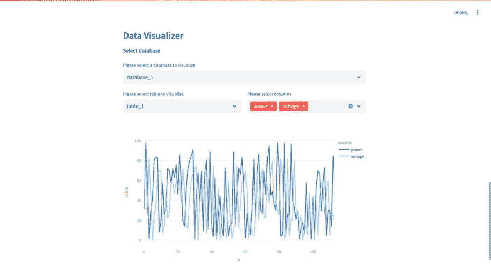
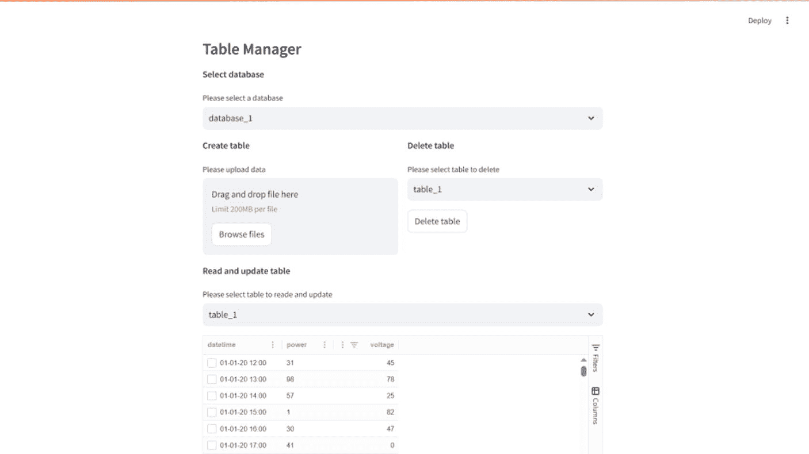
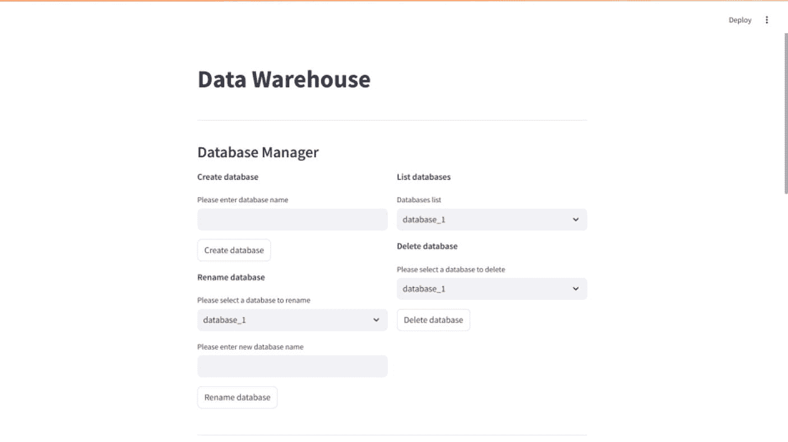

# Function to render a line chart for the selected table

```python
def chart(df, columns):
    if len(columns) > 0:
        fig = px.line(df.sort_index(), df.index, columns)
        st.write(fig)
```

**代码清单 11-9**：`warehouse_utils.py`

```python
username = ""
password = ""
port = ""
```

**代码清单 11-8**：`config.py`

最后，你可以使用代码清单 11-10 来渲染你的数据仓库应用的前端界面。该脚本的输出（如图 11-10、11-11 和 11-12 所示）分为三个部分：

1. **数据库管理器**：此部分允许用户创建、读取、重命名和删除数据库。
2. **表管理器**：在此部分，用户可以上传 CSV 格式的表，使用交互式 CRUD 组件更新表，以及删除表。
3. **数据可视化器**：此部分允许用户通过选择一个或多个列，并将其显示在基于范围索引的折线图中，从而实现任意数值表的可视化。



**图 11-12**：代码清单 11-10 的输出（续 2）



**图 11-11**：代码清单 11-10 的输出（续 1）



**图 11-10**：代码清单 11-10 的输出

```python
from warehouse_utils import *
import config # 凭证文件
```