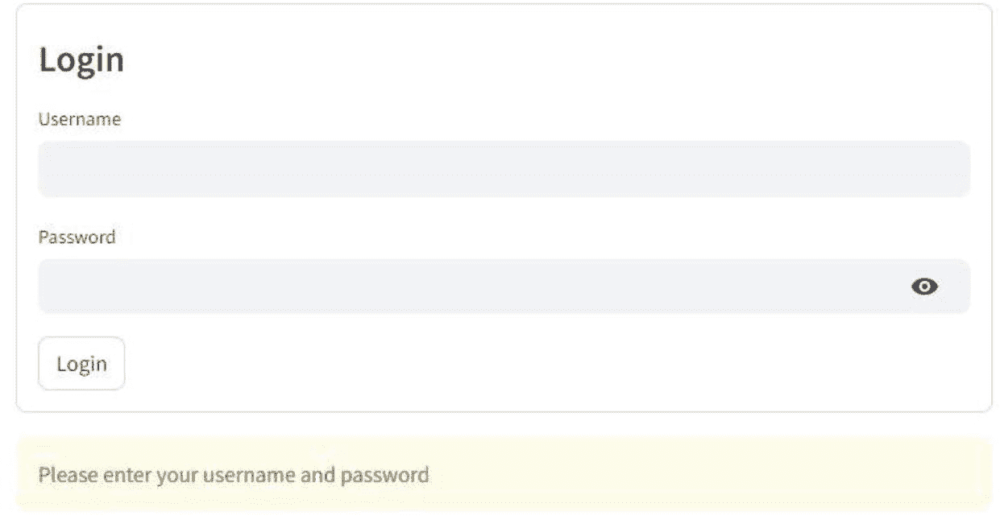

# warehouse_app.py
```

### 11.3.2 高级应用开发：机器学习即服务

本章最后一个用例是一个*机器学习即服务*（MLaaS）应用程序。此示例将整合本书中涉及的许多关键概念，展示如何在`Streamlit`中结合数据库、缓存、会话状态、用户认证、流量洞察、数据可视化、子页面、模块化及其他功能，以构建一个高级的、生产就绪的 Web 应用程序。

在深入细节之前，有必要先说明此应用程序的功能。本质上，它允许用户在上传的数据集上训练一个逻辑回归模型，然后使用训练好的模型对测试数据集进行分类。虽然核心功能看似简单，但实现将充分利用`Streamlit`、`PostgreSQL`、`Pandas`、`Plotly`及其他技术的能力。这个用例也具有高度的可扩展性，已被扩展以支持其他分类器，如决策树、支持向量机、`朴素贝叶斯`和`K-近邻`。


# 无需后端服务器的用户认证

在第 8 章中，我们讨论了如何借助后端服务器实现用户认证。然而，使用 Streamlit 组件 *Streamlit-Authenticator*，在没有服务器的情况下也能实现认证。尽管 Streamlit 本身拥有名为 `st.login` 的原生认证命令，可提供 OIDC 认证，但 *Streamlit-Authenticator* 组件提供了一个轻量级的本地认证服务，并具备许多额外功能，例如：

*   用户注册
*   找回遗忘的用户名
*   重置遗忘的密码
*   使用 OAauth2 进行认证
*   双重认证

因此，本章将使用此组件来演示认证功能。

使用 *Streamlit-Authenticator* 的第一步是创建一个 `config.yaml` 文件，用于存储用户的凭据以及其他认证配置参数，如清单 11-11 所示。请注意，除非另有指定，明文密码将被自动哈希化。接下来，你需要将凭据提供给 `stauth.Authenticate`，并使用 `login` 命令创建一个登录小部件，如清单 11-12 所示。每次用户输入其明文密码（如图 11-13 所示）时，系统都会对其进行哈希化，并与之前存储的哈希密码进行比较，以验证用户身份。

此外，你可以通过在 `stauth.Authenticate` 命令中使用 `cookie_expiry_days` 参数来启用无密码重新认证。这将在用户的浏览器上存储一个安全的 *JWT*（JSON Web Token），允许用户在令牌过期前的指定天数内保持认证状态。你可以在应用程序的任意位置通过访问 `st.session_state['authentication_status']` 来检查用户的认证状态。更多信息，请参考 [`https://github.com/mkhorasani/Streamlit-Authenticator`](https://github.com/mkhorasani/Streamlit-Authenticator)。



图 11-13

清单 11-12 的输出

```
import streamlit as st
import streamlit_authenticator as stauth
import yaml
from yaml.loader import SafeLoader
with open('../config.yaml') as file:
config = yaml.load(file, Loader=SafeLoader)
authenticator = stauth.Authenticate(
config['credentials'],
config['cookie']['name'],
config['cookie']['key'],
config['cookie']['expiry_days']
)
try:
authenticator.login()
except Exception as e:
st.error(e)
if st.session_state.get('authentication_status'):
authenticator.logout()
st.write(f'Welcome *{st.session_state.get("name")}*')
st.title('Some content')
elif st.session_state.get('authentication_status') is False:
st.error('用户名/密码错误')
elif st.session_state.get('authentication_status') is None:
st.warning('请输入您的用户名和密码')
清单 11-12
Streamlit-Authenticator.py
```

```
cookie:
expiry_days: 30
key: # 需填入任意字符串
name: # 需填入任意字符串
credentials:
usernames:
jsmith:
email: jsmith@gmail.com
failed_login_attempts: 0 # 将被自动管理
first_name: John
last_name: Smith
logged_in: False # 将被自动管理
password: abc # 将被自动哈希化
roles: # 可选
- admin
- editor
- viewer
rbriggs:
email: rbriggs@gmail.com
failed_login_attempts: 0 # 将被自动管理
first_name: Rebecca
last_name: Briggs
logged_in: False # 将被自动管理
password: def # 将被自动哈希化
roles: # 可选
- viewer
清单 11-11
config.yaml
```

# 工具脚本

模块化应用开发是一种良好实践，有助于组织和精简代码库。常用的类、函数、数据库连接以及其他对象应迁移到一个共享文件中，通常命名为 `Utils.py`。在我们的案例中，我们将把用于查询用户洞察表、生成会话 ID、创建文件上传小部件以及建立 PostgreSQL 连接的函数都放在这个文件中，如清单 11-13 所示。此外，一个有价值的优化技巧是使用 `st.cache_resource` 命令来缓存数据库连接对象。这将在每次调用数据库时节省大量时间，从而提高应用的整体性能。

```
import pandas as pd
from sqlalchemy import create_engine, text
import streamlit as st
import uuid
