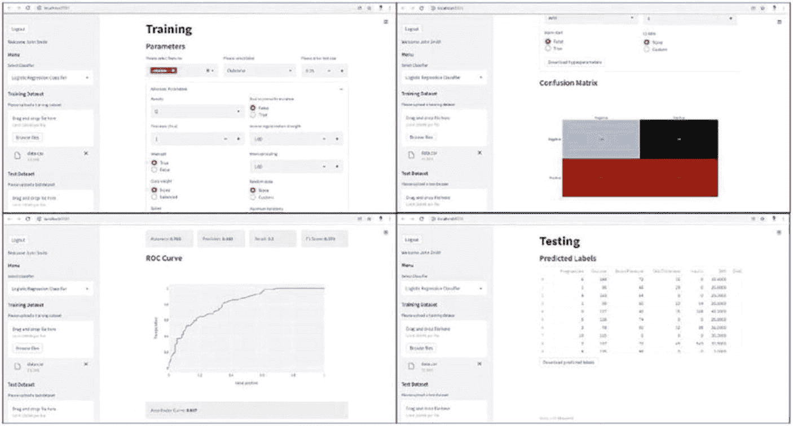

# 显示登录栏
try:
authenticator.login()
except Exception as e:
st.error(e)
if st.session_state['authentication_status']:
authenticator.logout('退出', 'main')
st.write(f'欢迎 *{st.session_state["name"]}*')
main(engine)
elif st.session_state['authentication_status'] == False:
st.sidebar.error('用户名/密码错误')
elif st.session_state['authentication_status'] == None:
st.sidebar.warning('请输入您的用户名和密码')
代码清单 11-15
main.py
```

# 逻辑回归分类器

最后，也是毫无疑问最关键的步骤，是为我们的逻辑回归分类器页面创建脚本。如前所述，该应用程序将提供机器学习即服务，使用户能够在上传的训练数据集上训练逻辑回归模型，然后使用训练好的模型对测试数据集进行分类。此类应用程序的妙处在于其即插即用特性，用户无需安装任何库或管理服务器。为了实现此功能，我们有一组函数，如代码清单 11-16 所示，将提供以下功能：

1.  可视化混淆矩阵：显示混淆矩阵以评估模型性能，展示真正例、假正例、真负例和假负例的结果。

2.  可视化 ROC 曲线：生成并可视化接收者操作特征曲线，以评估模型在不同阈值下的分类性能。

3.  创建可展开的模型超参数输入表单：允许用户通过可展开的表单自定义逻辑回归模型的超参数，使模型更加灵活和适应性强。

4.  训练逻辑回归模型：使用上传的训练数据集训练模型，并使用`st.cache_resource`缓存函数，以优化后续运行时的性能。

5.  使用训练好的模型分类测试数据：使用训练好的逻辑回归模型对提供的测试数据进行分类。

6.  可视化分类数据的准确率指标：显示各种准确率指标，以评估模型在测试数据上的性能。

除了核心的机器学习功能外，我们还将集成一个流量洞察功能，用于在应用程序的每个步骤跟踪和记录用户交互。具体来说，当用户完成应用程序的各个阶段时，将记录以下操作：

1.  跟踪用户进度：在应用程序的每个步骤，将调用从`Utils.py`文件导入的流量洞察函数，记录用户到达特定步骤的确切日期和时间。这将有助于深入了解用户行为和对应用程序的参与度。

2.  数据大小记录：将记录上传数据集的大小。此信息有助于理解用户处理数据的规模，并优化未来的数据处理策略。

3.  将洞察保存到 PostgreSQL 数据库：所有记录的洞察信息都将保存到 PostgreSQL 数据库中。这些信息以后可用于分析或改进应用程序的性能。

4.  下载超参数和预测结果：完成模型训练和预测步骤后，用户可以选择下载其模型超参数和预测数据。这将使用户能够在平台外部保留并进一步利用其机器学习模型。

从上传数据集到查看结果和下载预测结果的各个步骤，如图 11-14 所示，提供了工作流程的概览。



图 11-14

代码清单 11-16 的输出，使用皮马印第安人糖尿病训练数据集[21]


```python
import streamlit as st
import pandas as pd
from sklearn.model_selection import train_test_split
from sklearn.linear_model import LogisticRegression
from sklearn import metrics
import plotly.express as px
import plotly.graph_objects as go
import plotly.figure_factory as ff
from datetime import datetime
from Utils import *
