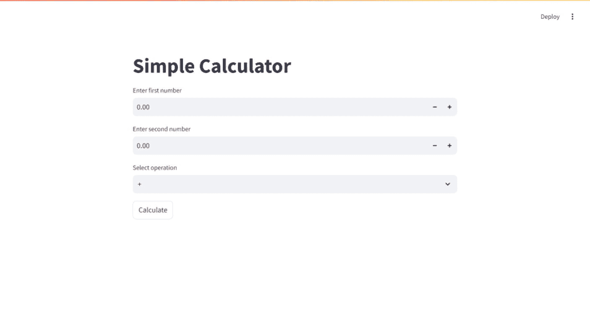

# 预测统计函数
def stats(y_test, y_pred):
    accuracy = metrics.accuracy_score(y_test, y_pred)
    precision = metrics.precision_score(y_test, y_pred)
    recall = metrics.recall_score(y_test, y_pred)
    f1 = metrics.f1_score(y_test, y_pred)
    col2_1, col2_2, col2_3, col2_4 = st.columns(4)
    with col2_1:
        st.info(f'准确率：**{round(accuracy, 3)}**')
    with col2_2:
        st.info(f'精确率：**{round(precision, 3)}**')
    with col2_3:
        st.info(f'召回率：**{round(recall, 3)}**')
    with col2_4:
        st.info(f'F1 分数：**{round(f1, 3)}**')
def lr_main(engine):
    _, session_id = get_session()
    insert_row(session_id, engine)
    update_row('lr1', datetime.now().strftime('%H:%M:%S %d/%m/%Y'), session_id, engine)
    if st.session_state['df_train'] is not None:
        df = st.session_state['df_train']
        update_row('data1_rows', len(df), session_id, engine)
        update_row('lr2', datetime.now().strftime('%H:%M:%S %d/%m/%Y'), session_id, engine)
        st.title('训练')
        st.subheader('参数')
        col1, col2, col3 = st.columns((3, 3, 2))
        with col1:
            feature_cols = st.multiselect('请选择特征', df.columns)
        with col2:
            label_col = st.selectbox('请选择标签', df.columns)
        with col3:
            test_size = st.number_input('请输入测试集比例', 0.01, 0.99, 0.25, 0.05)
        (penalty, tol, fit_intercept, class_weight, solver, multi_class,
         warm_start, dual, C, intercept_scaling, random_state, max_iter, verbose,
         l1_ratio) = lr_hyperparameters()
        try:
            x_train, x_test, y_train, y_test, y_pred, logreg = log_train(df, feature_cols, label_col, test_size,
                                                                          penalty, tol, fit_intercept, class_weight, solver,
                                                                          multi_class, warm_start, dual, C, intercept_scaling,
                                                                          random_state, max_iter, verbose, l1_ratio)
            st.subheader('混淆矩阵')
            confusion_matrix_plot(y_test, y_pred)
            st.subheader('评估指标')
            stats(y_test, y_pred)
            st.subheader('ROC 曲线')
            roc_plot(x_test, logreg, y_test)
            update_row('lr3', datetime.now().strftime('%H:%M:%S %d/%m/%Y'), session_id, engine)
            if st.session_state['df_real'] is not None:
                try:
                    df_real = st.session_state['df_real']
                    st.title('测试')
                    update_row('data2_rows', len(df_real), session_id, engine)
                    st.subheader('预测标签')
                    x_pred_real = log_real(logreg, df_real, feature_cols, label_col)
                    st.write(x_pred_real)
                    update_row('lr4', datetime.now().strftime('%H:%M:%S %d/%m/%Y'), session_id, engine)
                    st.download_button(
                        label='下载预测标签',
                        data=pd.DataFrame(x_pred_real).to_csv(index=False).encode('utf-8'),
                        file_name='预测标签.csv',
                    )
                except:
                    st.warning('请上传一个与训练数据集具有相同特征集的测试数据集')
            elif st.session_state['df_real'] is None:
                st.sidebar.warning('请上传测试数据集')
        except:
            st.warning('请至少选择一个特征、一个合适的二元标签以及适当的超参数')
    elif st.session_state['df_train'] is None:
        st.title('欢迎')
        st.subheader('请使用左侧面板上传您的数据集')
        st.sidebar.warning('请上传训练数据集')
```


## 11.4 本章小结

在本章接近尾声、也即将完成整本书之际，您会越发清楚地认识到 Streamlit 在解决实际问题方面是多么的多才多艺且富有成效。起初，它只是一个用于创建 Web 应用的简单 Python 工具，如今已发展成为一个强大的框架，能够应对各种不同的用例。从数据可视化和时间序列分析，到像 SCADA 数据记录器和电机控制仪表盘这样的专业应用，Streamlit 证明了其灵活性。它能够与外部系统（如 Arduino 微控制器、传感器及其他外设）集成，这展示了其扩展到嵌入式系统的潜力，在实际应用中弥合了软件与硬件之间的鸿沟。本章一个关键的收获是认识到 Streamlit 并不仅限于某一种应用或行业。它是一个高度适应的工具，能够满足多样化的需求——无论是用于数据仓库、机器学习即服务，还是像工业自动化和物联网系统这样更专业的领域。

归根结底，Streamlit 的强大程度取决于开发者的创造力以及他们所选的技术栈。随着您继续使用 Streamlit 进行探索和构建，可能性是无穷无尽的，而本章仅仅触及了您所能完成工作的皮毛。祝贺您走到这一步！您现在拥有了使用 Streamlit 应对广泛现实挑战的工具和知识。您创建高效、有影响力的 Python Web 应用的旅程才刚刚开始。

# 12. Streamlit 中的测试

测试是一个至关重要的质量保证过程，它验证软件功能，及早发现缺陷，并确保可靠性。通过验证需求和推广最佳实践，测试能够增强软件的稳定性、可维护性和用户满意度——尤其是在像 Streamlit 这样的动态平台中。

## 12.1 测试原则

测试是验证和确认软件按预期运行的过程，旨在开发周期的早期发现缺陷、错误或缺失的需求。它涉及创建测试用例，将代码的输出与预期结果进行比对，以确保跨场景的可靠性和一致性。测试不仅仅是发现错误，它还确认软件满足需求并遵循最佳实践，有助于提升软件的健壮性和可维护性。在像 Streamlit 这样快速原型设计和交互功能常见的平台上，彻底的测试对于确保准确可靠的功能至关重要。最终，测试是质量保证的一个关键方面，支撑着软件的稳定性和用户满意度。

### 12.1.1 什么是测试？

测试，其核心是验证和确认软件是否按预期运行。它是一种系统性的方法，用于识别代码中的缺陷、错误或缺失的需求。与仅在部署后依赖手动观察或用户反馈不同，代码测试旨在开发周期的早期揭示问题。这种主动策略能显著降低生产环境中出现代价高昂且具有破坏性错误的风险。

从理论角度来看，代码测试可以看作是为软件的正确性和可靠性建立信心的过程。它涉及创建一组条件，即测试用例，通过比较实际输出与预期结果来评估代码的不同方面。其目标是确保代码在各种场景下都能可预测且一致地运行。

重要的是要认识到，测试不仅仅是关于发现错误。它还涉及验证代码是否满足指定的需求并遵守最佳实践。一个经过良好测试的应用能体现出健壮性、可维护性以及更高的用户满意度。在支持数据驱动型 Web 应用快速原型设计和部署的 Streamlit 上下文中，彻底的测试有助于确保分析洞察和交互元素保持准确可靠。

最终，代码测试是质量保证的一个关键组成部分，为软件的功能和稳定性提供了切实的证据。无论应用的复杂程度如何，它都是开发过程中必不可少的一部分。

### 12.1.2 测试的益处

将代码测试纳入您的通用开发工作流程（不仅仅是在 Streamlit 项目中）至关重要，并能显著提升应用程序的质量和持久性。它有助于及早发现错误，使您能在问题扩散到整个系统并变得更复杂、更难以解决之前发现并修复它们。这减少了调试的时间和精力，从而加快了开发周期。此外，编写测试能鼓励开发者编写更干净、更模块化且更易于维护的代码。

创建测试用例也能促进对代码功能及潜在边界情况更深入的理解，从而做出更好的设计决策。在与其他开发者协作时，编写良好的测试能让新人快速理解代码的行为，从而更容易在现有组件的基础上进行构建。这样，测试便充当了一种额外的文档形式。

测试还能提升可靠性。经过良好测试的代码在生产环境中失败的可能性更小，从而最大限度地减少停机时间并减少用户困扰。这对于通常涉及关键数据分析与可视化的 Streamlit 应用尤其重要。彻底的测试能确保交互元素和视觉输出在不同浏览器和用户输入下都能如预期般工作——当您的应用面向广大受众时，这是一个关键因素。

### 12.1.3 测试的类型

代码测试有许多类型，每种类型服务于特定目的，并针对软件系统的不同方面。对于 Streamlit 应用，有两个基本类别尤其相关：单元测试和集成测试。

单元测试侧重于孤立地验证代码的单个组件或单元。一个单元通常是应用中最小的可测试部分，例如一个函数或方法。其目标是确保每个单元都能独立于系统的其他部分正确执行其预期任务。在 Streamlit 的上下文中，这可能涉及到测试处理数据、生成图表或处理用户输入的函数。单元测试通常自动化，并在开发期间频繁运行，为单个代码单元的正确性提供快速反馈。

另一方面，集成测试研究不同的单元或组件如何相互作用。它验证这些组件之间的接口是否正常工作，以及当各部分组合在一起时应用是否按预期运行。对于 Streamlit 应用，集成测试可能涉及检查输入小部件和输出显示之间的交互，或确保应用与外部数据源或 API 之间的无缝通信。集成测试有助于确认应用作为一个连贯的整体运行，而不仅仅是一堆孤立的部件。

除了这两种类型，还有其他测试方法——例如系统测试，它根据指定的需求评估整个应用；以及验收测试，它确认应用满足用户期望。然而，就本章范围而言，扎实理解单元测试和集成测试为构建健壮可靠的 Streamlit 应用奠定了坚实的基础。

通过理解代码测试的原则、益处和不同类型，开发者可以构建出不仅功能完善，而且可靠、可维护且用户友好的 Streamlit 应用。本章将探索在您的 Streamlit 项目中实施有效测试策略的实用示例和技术。


## 12.2 为什么要在 Streamlit 中进行测试？

Streamlit 应用已超越演示用途，能够支持实际生产场景。随着其应用范围扩大，全面的测试变得至关重要。一个结构良好、模块化的代码库——包含 API、逻辑和工具函数的独立文件夹——能够确保可靠的用户体验。基于这种模块化特性，每个组件都可以且应该通过单元测试进行独立验证。

### 12.2.1 行为与逻辑测试

Streamlit 应用不再局限于演示目的——它们现在可以发展以支持实际生产用例。随着应用范围的扩大，测试其底层组件以确保最终用户获得正确且无缝的体验变得越来越重要。

由于 Streamlit 应用不仅仅是 UI 组件（如前几章所述），一个结构良好的 Streamlit 项目应遵循可扩展且模块化的文件夹组织方式。这通常包括用于 API 调用、逻辑组件和工具函数的目录。这些模块直接影响应用的行为和用户体验，因此全面的测试至关重要。

考虑到这些组件的模块化特性，每个文件都可以——也应当——使用单元测试进行单独测试。这能确保系统的每个部分在隔离环境中功能正常，从而提升应用的整体可靠性和可维护性。

### 12.2.2 用户界面测试

当应用被渲染并呈现给用户后，确保用户界面按预期工作至关重要。这包括验证按钮点击等操作是否被正确注册，以及文本输入是否能够正确地更新输出以反映用户交互。

这一过程被称为*应用测试*，是一种专注于用户界面组件的特定测试类型。它对于自定义组件尤其有用，可以确保用户界面按预期运行。例如，这可以应用于 *Extra-Streamlit-Components* 包中的 Tab Bar。由于该组件是使用 React 构建并封装后用于 Streamlit 的（而非内置功能），因此它是应用测试的良好候选，以确认其行为符合用户预期。

## 12.3 测试 Streamlit 应用

Streamlit 通过提供其原生应用测试框架 `streamlit.testing.v1` 来简化测试过程。这使得开发者能够构建并运行无头测试，而无需在浏览器中渲染应用。它甚至可以用于模拟用户输入并检查渲染输出。该框架可以使用 `PyTest` 运行，甚至可以在 GitHub Actions 等 CI 环境中实现自动化。

### 12.3.1 设置测试环境

首先，我们需要一个待测试的应用。清单 12-1 和 12-2 展示了一个简易计算器应用的代码，该应用支持两个数字之间的基本数学运算。图 12-1 展示了本次测试对应的应用界面。

```
import streamlit as st
from utility import calculate
st.title('Simple Calculator')
num1 = st.number_input('Enter first number', value=0.0, key='INPUT_1')
num2 = st.number_input('Enter second number', value=0.0, key='INPUT_2')
operation = st.selectbox('Select operation', ['+', '-', '*', '/'], key='OPERATION')
result = None
if st.button('Calculate', key='BUTTON'):
result = calculate(operation, num1, num2)
if result is None:
st.error('Error: Cannot divide by zero')
else:
st.write(f'Result: {result}')
```

清单 12-1 `main.py`

```
def calculate(operation: str, num1: float, num2: float):
if operation == '+':
return num1 + num2
elif operation == '-':
return num1 - num2
elif operation == '*':
return num1 * num2
elif operation == '/':
if num2 != 0:
return num1 / num2
return None
```

清单 12-2 `utility.py`



图 12-1 简易计算器应用

为了测试该应用，我们需要安装一个名为 `PyTest` 的 Python 包，它将帮助我们构建单元测试。你可以使用命令 `pip install pytest` 进行安装。


### 12.3.2 编写测试

像代码清单 12-4 中展示的测试通常应放在项目根目录下的一个独立文件夹中，例如 `my_project/tests/`。它们应遵循以 `test_` 为前缀的命名规范，以便 `PyTest` 等测试工具能够识别并执行它们。下面是一个实用方法测试文件的示例。这是一个单元测试，因为它根据预期的用例，针对应用程序代码的特定部分进行测试。

由于主应用程序中将该实用文件作为模块使用，我们需要通过添加代码清单 12-3 来将其暴露在测试文件夹中。

```python
import utility
代码清单 12-3
tests/__init__.py
```

```python
import pytest
from utility import calculate
@pytest.mark.parametrize(
'operation, num1, num2, expected',
[
('+', -2, 7, 5),
('+', 5.5, 2.5, 8.0),
('-', 10, 4, 6),
('-', 0, 0, 0),
('*', 2, 6, 12),
('*', -3, 4, -12),
('*', 2.5, 4, 10.0),
('/', 1, 2, 0.5),
('/', 10.0, 2.0, 5.0),
],
)
def test_calculate_basic_operations(operation, num1, num2, expected):
    assert calculate(operation, num1, num2) == expected
@pytest.mark.parametrize(
'operation, num1, num2',
[
('/', 1, 0),
('/', 10.0, 0),
('/', 0, 0),
],
)
def test_division_by_zero(operation, num1, num2):
    assert calculate(operation, num1, num2) is None
