# 测试非法操作
@pytest.mark.parametrize(
'operation, num1, num2',
[
('%', 5, 3),
('abc', 5, 3),
],
)
def test_invalid_operations(operation, num1, num2):
    assert calculate(operation, num1, num2) is None
代码清单 12-4
tests/test_utility.py
```

另一种测试类型是应用测试，它用于验证整个应用对用户交互的响应是否符合预期。这个测试包是 Streamlit 默认包含的，因此无需额外安装包。应用测试应涉及操作数值输入、点击按钮以及验证输出是否包含预期结果。下面的代码清单 12-5 是一个应用测试的示例。

```python
from streamlit.testing.v1 import AppTest
def test_main():
    at = AppTest.from_file('../main.py').run()
    at.number_input[0].set_value(10).run()
    at.number_input[1].set_value(4).run()
    at.selectbox[0].set_value('-').run()
    at.button[0].click().run()
    assert at.markdown[0].value == 'Result: 6.0'
    at.number_input[0].set_value(2).run()
    at.number_input[1].set_value(6).run()
    at.selectbox[0].set_value('*').run()
    at.button[0].click().run()
    assert at.markdown[0].value == 'Result: 12.0'
    at.number_input[0].set_value(10).run()
    at.number_input[1].set_value(2).run()
    at.selectbox[0].set_value('/').run()
    at.button[0].click().run()
    assert at.markdown[0].value == 'Result: 5.0'
    at.number_input[0].set_value(10).run()
    at.number_input[1].set_value(0).run()
    at.selectbox[0].set_value('/').run()
    at.button[0].click().run()
    assert at.error
    at.number_input[0].set_value(-5).run()
    at.number_input[1].set_value(3).run()
    at.selectbox[0].set_value('+').run()
    at.button[0].click().run()
    assert at.markdown[0].value == 'Result: -2.0'
代码清单 12-5
tests/test_main.py
```

要运行这些测试，打开终端会话并输入 `pytest`。`PyTest` 将自动开始在测试文件夹中查找以 `test_` 为前缀的文件，同时忽略 `__init__.py` 文件。然后它会执行同样以 `test_` 为前缀的方法，确保只运行实际的测试，而不运行辅助方法。

值得注意的是，截至 Streamlit 1.47.x 版本，`AppTest` 在控制特定原生组件方面存在局限性，并且并非所有组件都支持。像 `st.data_editor` 和 `st.dialog` 这类组件在此种测试类型中不受支持。

对于单元测试，`PyTest` 将使用参数化测试，即使用不同的输入多次调用测试方法并进行结果比较。对于应用测试，只会运行一个方法，模拟单个会话中的交互。这些测试也会被 IDE 识别，方便您通过点击绿色三角形轻松运行。但是，如果您选择从终端运行测试，其输出将如图 12-2 所示。


图 12-2
PyTest 输出

## 12.4 使用 GitHub Actions 进行自动化测试

可以使用 GitHub Actions 自动化测试 Streamlit 应用程序，确保每当向远程仓库推送代码时，自动化测试都会执行并立即显示结果。这确保了所有推送都符合您的测试要求，同时也省去了手动进行此类测试的需要。您也可以使用第 12.2 节详述的、通过 `PyTest` 和 Streamlit 测试框架创建的相同测试脚本。使用 GitHub Actions 实现自动化测试的步骤将在以下各节中详述。

### 12.4.1 设置工作流

要通过仓库实现 GitHub Action，您必须先创建一个工作流。这可以通过创建图 12-3 所示的文件夹结构来完成。然后，您必须创建一个 `test.yaml` 文件，该文件将告诉 GitHub 如何执行第 12.4.2 节中描述的测试。最后，您必须在根目录中放置一个 `requirements.txt` 文件，列出 Streamlit 应用程序所需的所有依赖项。

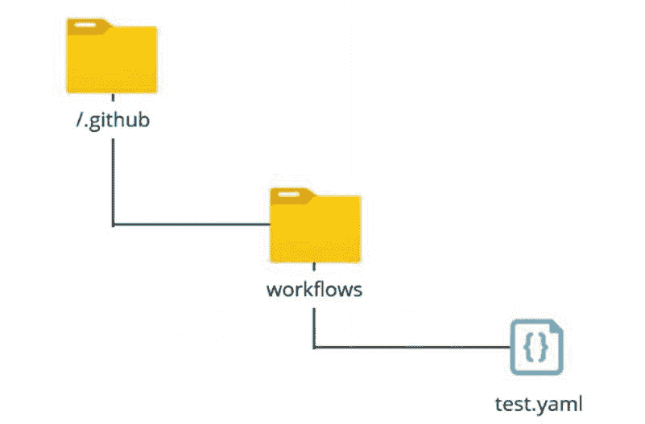

图 12-3
GitHub Actions 工作流文件夹结构

### 12.4.2 创建测试脚本

要配置 GitHub Actions，您需要创建一个 `test.yaml` 脚本，告诉 GitHub 如何执行测试。此文件必须放置在第 12.4.1 节详述的文件夹结构中。请注意，在 `test.yaml` 文件中，您必须包含两个文件的路径，即 Streamlit 应用程序（即 `tests/app.py`）和 PyTest 文件（即 `tests/test.py`）。您可以使用代码清单 12-6 中所示的测试脚本作为示例。

```yaml
name: Streamlit Testing
on:
  push:
    branches:
      - main
  pull_request:
    branches:
      - main
jobs:
  test:
    runs-on: ubuntu-latest
    steps:
      - name: Checkout repository
        uses: actions/checkout@v4
      - name: Set up Python
        uses: actions/setup-python@v5
        with:
          python-version: '3.9'
      - name: Install dependencies
        run: |
          python -m pip install --upgrade pip
          pip install -r requirements.txt
          pip install pytest
      - name: Run Streamlit app and tests
        run: |
          nohup streamlit run  &
          pytest  --maxfail=1 --disable-warnings -q
代码清单 12-6
test.yaml
```

随后，当您向仓库的主分支进行推送时，将自动进行测试，并在 GitHub 仓库的 "Actions" 选项卡中显示结果。如果测试失败，您可以访问日志，如图 12-4 所示。

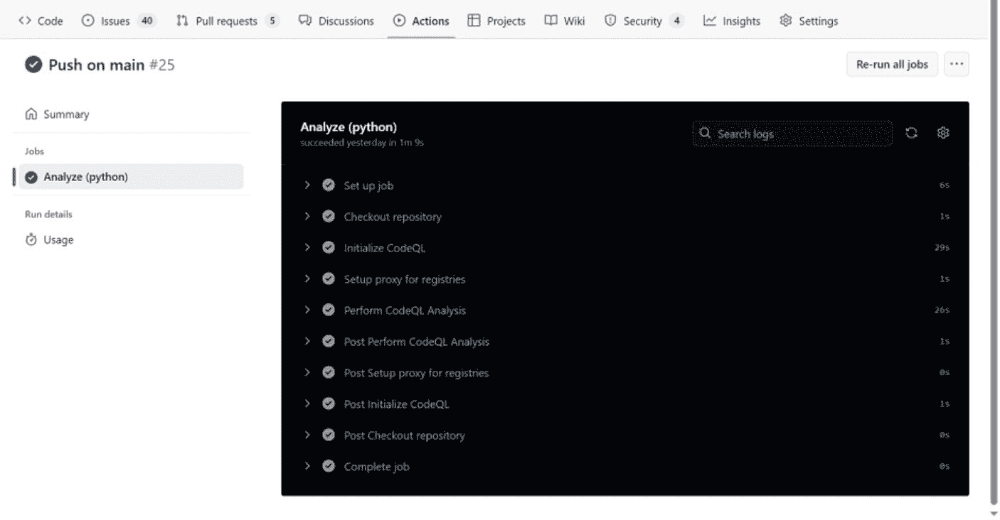

图 12-4
GitHub Actions 自动化测试选项卡


### 12.5 总结

本章强调了测试在 Streamlit 开发中的关键作用，从简单的演示到健壮的应用程序，我们逐步深入。我们涵盖了核心测试原则，重点关注早期漏洞检测、代码质量和可靠性。我们特别探讨了与 Streamlit 最相关的单元测试和集成测试。我们强调了在 Streamlit 应用程序中测试行为、逻辑和 UI 渲染的重要性。文中提供了实际示例，演示如何设置测试环境以及编写有效的单元测试和 `App` 测试。我们使用 `PyTest` 进行单元测试，同时引入了 `streamlit.testing.v1` 来模拟用户交互，并通过参数化测试提高效率。*及早测试、频繁测试* 是关键的要点。通过使用 GitHub Actions 将测试集成到 CI/CD 流水线中，可以确保 Streamlit 应用程序保持可靠和可维护。我们鼓励进一步探索测试工具并完善策略，尤其是在更复杂的项目中。本章为通过持续测试构建高质量的 Streamlit 应用程序奠定了基础。

# 13. Streamlit 与人工智能

Streamlit 作为一个 Web 框架的特性，为 Web 开发者打开了将其用于任何业务或技术场景的大门。人工智能，尤其是生成式领域——包括大型语言模型（LLM）和检索增强生成（RAG）模型——现在比以往任何时候都更容易使用。各大公司和企业正通过 API 提供种类繁多的 LLM，竞相交付更好、更快且更易于访问的模型。这种方法让最终用户无需仅仅依赖官方门户，就能利用 LLM 的强大能力。在本章中，我们将探索 LLM，学习如何以编程方式使用它们，并构建一个作为个人网络信息助手的 Streamlit 演示应用程序。

## 13.1 什么是 LLM，它们有什么用处？

LLM 是大型深度学习模型，通常包含数十亿个参数。它们的目标不局限于单一任务；可以应用于各种不同的用例。LLM 基于来自不同领域的大量数据进行训练，因此具备了跨越众多领域的广泛通用智能。从根本上说，LLM 是预测模型，这意味着它们的输出取决于所训练数据的性质和质量。

LLM 基于“令牌（tokens）”这个概念运作。令牌是句子的基本构建块，可以包括单词、数字或符号。一个序列的令牌作为输入提供给 LLM，然后 LLM 会生成一个输出令牌序列。输入令牌在 LLM 内部建立了一个关于特定话题的上下文。基于其训练所用的数据，输出令牌是统计生成的，反映了模型先前获得的知识。

LLM 的架构通常始于一个 Transformer 层，它处理输入文本并将其转换为上下文的数学表示。这意味着，无论 LLM 看起来多么复杂，其性能最终都取决于模型的大小、架构以及训练数据的质量和数量。反之，低质量数据——无论是误导性的、表述不佳的还是不准确的——都可能对输出产生负面影响，导致最终结果出现语法错误、拼写错误甚至事实性错误。

LLM 的实际用例范围很广，从独立使用模型到将其与其他软件集成以协助执行特定任务。一些示例如下。

### 13.1.1 摘要

LLM 中大量的参数从根本上以统计关系和模式的形式存储了它们所训练的信息。这使得它们能够总结在训练期间接触到的信息。由于在训练数据中，相同的话题可能以不同形式出现在不同来源中，因此当被问及这些话题时，LLM 可以充当数据摘要器。

例如，我们询问 Gemini 1.5 Flash 为什么天空是蓝色的，它提供了以下输出：

> *天空之所以是蓝色的，是由于一种称为瑞利散射的现象。太阳光由彩虹的所有颜色组成。当太阳光进入地球大气层时，会与微小的空气分子（主要是氮气和氧气）发生碰撞。这些分子比可见光的波长小得多。*

这个输出很可能受到了模型训练数据的影响，因为输入仅包含一个问题，没有任何额外细节。此外，预训练的 LLM 可以根据其架构接受不同大小的输入。通常来说，更大的模型有更强的能力处理更大的输入而不会丢失太多关键上下文。这使得 LLM 能够建立对输入的详细理解，然后可用于诸如改写或摘要等任务。例如，我们将第 3 章作为输入提示提供给 Gemini 1.5 Flash，并要求其用少于 80 个词进行摘要。以下是摘要：

> *第 3 章详细介绍了 Streamlit 的 UI 架构。它解释了如何使用代码和配置文件定制界面（主题、颜色、布局）。本章涵盖了使用侧边栏、列和展开器组织页面的方法，并展示了如何创建多页面和子页面应用程序。还演示了如何使用占位符和进度条动态显示内容，以及模块化应用开发的最佳实践。*

我们可以观察到，LLM 的摘要主要从该章的摘要和概述部分提取信息。这是因为这些部分通常包含与输入提示最相关的信息。我们也可以尝试使用不同类型的输入，来获取 LLM 对同一章节特定方面的总结性意见。以下输入提示提供给了同一个模型：

> *以下是一本关于 Streamlit 的书籍中的章节。那一章中讨论的哪个 UI 组件对大多数应用程序最有用，为什么？*
>
> *第 [3 章内容]*

而输出是这样的：

> *根据第 3 章，对大多数 Streamlit 应用程序最有用的 UI 组件是占位符（`st.empty` 或 `st.sidebar.empty`）。原因是它在处理动态内容方面的多功能性和强大功能。该章重点介绍了它的用途：按需或无序显示内容：这对于需要异步或基于用户交互更新信息而无需完全重新加载页面的应用程序至关重要。这能显著提高响应速度和用户体验。创建动态元素：实时时钟的示例演示了如何使用占位符在循环中重复更新内容，从而创建动态可视化。这扩展到任何动态元素，例如随新数据更新的图表或显示长时间运行任务状态的进度条。虽然侧边栏、列和展开器等其他组件对于页面组织和结构很重要，但占位符处理动态更新的能力使其成为一种独特而有价值的工具，适用于从简单仪表板到复杂交互式工具的各种 Streamlit 应用程序。其他组件增强了数据的呈现方式；而占位符则处理数据本身的动态更新。*

模型围绕整个章节建立了一个上下文，并对特定的 Streamlit 组件提出了自己的看法，强调由于其多功能性而成为最有用的组件。它还提供了示例来支持这一观点。


### 13.1.2 内容生成

我们已看到一些例子，其中使用大型输入来生成较小输出，且大多为文本形式。这是因为大型语言模型（LLM）从根本上基于词元（token）运作。然而，通过额外的组件以及对文本之外内容类型的微调，模型可以生成新内容，从而获得*生成式 LLM* 的标签。可生成的内容不仅限于图像，还取决于用于微调模型的训练数据。LLM 可以被修改和微调，以生成视频、音频或特定类型的文本，例如诗歌或代码。

其生成内容的质量将与输入数据的质量保持一致。机器学习领域中常被引用的著名概念*垃圾进，垃圾出*同样适用于 LLM。LLM 在图像和视频生成中应用更广泛的原因之一是高质量视觉内容的丰富性。此外，人们对生成的图像和视频的标准相对较低，这些输出通常能被大多数人接受。

LLM 无疑可以通过生成重复或众所周知的代码片段来加快编码速度，为开发者节省时间。然而，它们仍然缺乏编写复杂、高质量代码的能力。部分原因在于，开源领域中可用的代码大多未达到特定标准，并且由于用于训练 LLM 的大量低质量代码，质量往往偏向较低端。

### 13.1.3 检索增强生成

LLM 本身具有强大的能力。允许 LLM 访问其他软件和数据存储以执行操作，可以显著扩展其能力。这从根本上使 LLM 能够在输出词元生成过程之前和期间，对来自各种来源（无论是互联网还是本地数据）的实时数据进行交叉验证。这种在内容生成过程中检索和增强信息的内置能力被称为检索增强生成（RAG）。并非每个 LLM 都是 RAG 模型，但那些以此方式扩展的模型，具备比标准 LLM 更强、更准确的能力。`LlamaIndex` 和 `LangChain` 都支持 RAG 系统。`LlamaIndex` 简化了搜索和检索，而 `LangChain` 是一个模块化平台，支持众多用例。流行的 RAG 平台包括带有 `Pinecone` 向量数据库的 `Langchain` 和 `LlamaIndex`（它包含自己的向量数据库），这些已成为开发者构建知识增强型 AI 应用的重要工具。RAG 代表的是一种架构模型而非单一产品，在从客户支持到金融分析等跨行业的实际应用中，它不可或缺且错综复杂。

## 13.2 与 LLM 交互的不同方式

根据你的用例、预算和所需的隐私级别，可以通过多种方式访问 LLM。其中一些方法包括：与模型的官方网页交互、通过互联网调用 API，甚至在单台机器或集群上自行托管模型以实现本地访问。

### 13.2.1 官方网页

LLM 的创建者通常会构建网页，让人们使用他们的模型。他们根据其提供的模型能力定制用户界面（UI），向用户明确表示他们可以输入各种内容类型，而不仅仅是文本提示。图 13-1 展示了 Gemini 的提示窗口，演示了附加语音、图像或视频作为提示一部分的能力。这些附加内容有助于形成整体上下文，并可能影响最终输出。

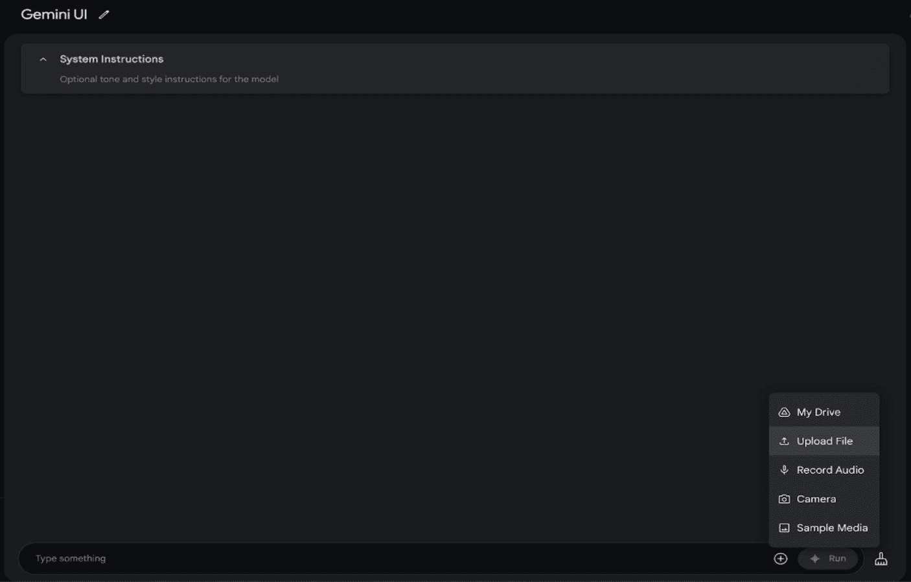

图 13-1
Google AI Studio 上的 Gemini 提示

### 13.2.2 应用程序编程接口

一般用户通常与最终产品交互，但通过网页访问的 LLM 可能无法满足某些人的需求，例如开发者。那些希望将 LLM 的强大功能集成到其软件产品中的人（无论是按使用量付费还是免费），可以利用向开发者开放 LLM 的 API。

无论使用何种媒介，这些模型的调用方式保持不变——通过词元。使用 API 时，它们可以扩展以处理数十亿次调用，这使得免费使用 LLM 变得不可持续。这就是词元监控和计费发挥作用的地方。LLM 托管方通过根据使用的 API 密钥对使用情况进行分组来跟踪 API 调用。然后，LLM 处理的总输入和输出词元可用于计算账单（如果适用）。一种新的成本效益机制——*每瓦特每美元词元数*——有助于评估使用特定电量处理给定词元的财务可行性。

LLM 的 API 也可以由那些通过网页提供 LLM 服务的提供商创建。例如，谷歌允许在 [`https://aistudio.google.com/app/apikey`](https://aistudio.google.com/app/apikey) 创建 API 密钥，这些密钥可用于调用 Gemini 模型。下图展示了如何创建多个 API 密钥，并在 `Curl` 命令中使用它们，以向 Gemini 1.5 Flash 发出 HTTP 调用，输入示例如下图 13-2 所示。

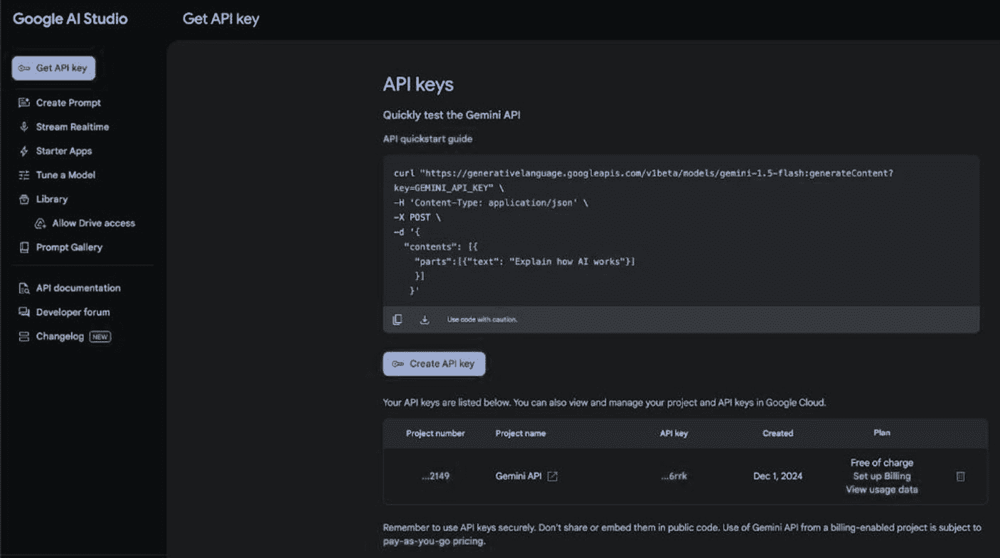

图 13-2
Google API Studio API 密钥生成


### 13.2.3 自托管与部署

通过 API 和网页与 LLM 交互，意味着在调用 LLM 本身之前，需要先将你的提示词提交到服务器。对于大多数用例来说，这很方便，因为它省去了自行管理和托管 LLM 的麻烦。然而，如果隐私是核心要求，最安全的选择则是将 LLM 部署在你自己的基础设施上。自托管 LLM 也有其自身的成本，例如硬件的初始投资、确保可靠的能源供应，以及管理机器集群以支持模型的高流量负载。

许多 LLM 都可供下载并在你自己的机器上运行。一个例子是由 Meta 创建的 Llama。开始使用 Llama 的一个简单方法是从 [`ollama.com/download`](https://ollama.com/download) 下载它，这会安装一个桌面应用程序，该程序进而会安装用于管理不同 Llama 模型并运行它们的命令行工具，如图 13-3 所示。

下面的图 13-4 和图 13-5 展示了在 MacBook Pro i9 上安装 Llama 3.2 的过程。性能可能因机器而异，但参数少于 30 亿的较小模型甚至可以在手机上运行。

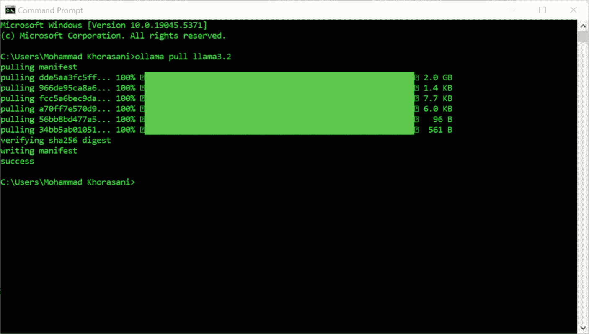

**图 13-3** 安装 Llama3.2

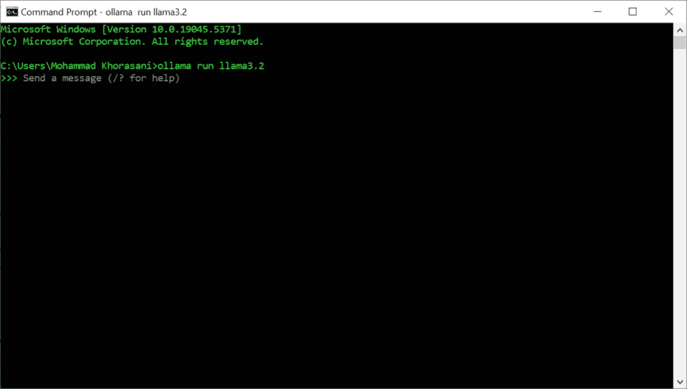

**图 13-4** 运行 Llama3.2

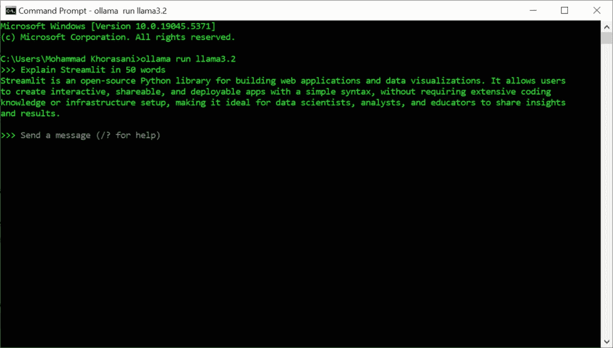

**图 13-5** 提示 Llama3.2

如果你想以编程方式向模型发送提示，可以通过调用本地主机上的端点来实现，该端点在模型通过终端运行时暴露。更多信息，请访问 [`github.com/ollama/ollama/blob/main/docs/api.md`](https://github.com/ollama/ollama/blob/main/docs/api.md)。

## 13.3 将 LLM 与 Streamlit 集成

Streamlit 是一个 Web 框架，而 LLM 通常被部署为独立服务，以避免与其他软件紧密耦合。这意味着 LLM 可以在 Streamlit 中像任何其他服务一样被使用，其调用方式可以通过网络调用来完成。无论 Streamlit 服务器和 LLM 服务器是在同一台机器还是不同的机器上，这种设置都适用。

以下步骤概述了如何复制 LLM 网站的行为：用户提供提示词，使用提示词调用 LLM，等待响应，然后以流式 UI 格式渲染输出。

### 13.3.1 构建用户输入界面

一个基本的 LLM 网站通常需要三个主要的 UI 组件：一个文本输入框、一个发送按钮和一个输出区域。清单 13-1 接收一个输入，并在点击发送按钮时显示虚拟文本，如图 13-6 所示。

```
import streamlit as st
st.title('LLMs in Streamlit')
text = st.text_area('在此处编写提示词')
sent = st.button('发送')
if sent:
    output = '虚拟输出' # 替换为 LLM 调用
    st.text(output)
```

**清单 13-1** `sample_text_input.py`

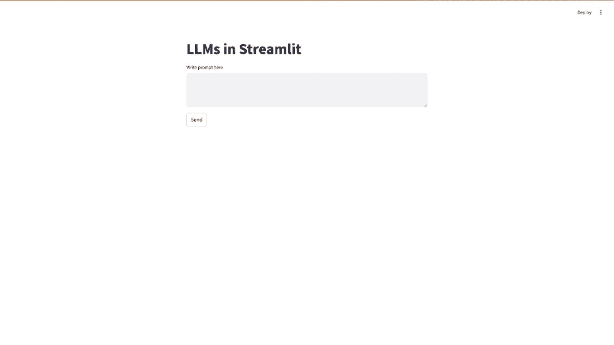

**图 13-6** LLM 示例文本输入用户界面（清单 13-1 的输出）

### 13.3.2 设置 HTTP 连接

出于演示目的，我们将通过 API 使用一个 LLM。我们可以基于 Gemini 的 API 进行构建，为此我们之前生成了一个 API 密钥。首先，让我们使用本章前面部分提到的步骤生成密钥。由于 API 密钥是敏感数据，不应硬编码到你的应用程序中。相反，我们将把密钥添加到我们的环境变量中。这可以通过将清单 13-2 添加到一个名为 `.env` 的文件中来实现，该文件与你的 Streamlit 应用程序的主文件位于同一目录下。

```
API_KEY=
```

**清单 13-2** `.env`

然后可以在 Python 中读取 API 密钥，如清单 13-3 所示。首先，你需要通过运行 `pip install python-dotenv` 来安装 `python-dotenv` 包，以便使用一个名为 `load_env` 的方法。该方法会读取 `.env` 文件，并将键值对添加到系统环境中，使其可以从代码中轻松访问。

```
import os
from dotenv import load_dotenv
load_dotenv()
API_KEY = os.getenv('API_KEY')
print(f'{API_KEY=}')
```

**清单 13-3** `read_variables.py`

在此示例中，我们使用来自 Google AI Studio 的 Gemini API。API 密钥生成页面上提供的 `curl` 命令更适合在终端或 CMD 中使用。为了在 Python 中重新创建它，我们可以应用前几章学到的知识，并使用 Python 中的 `requests` 包，如下面的清单 13-4 所示。

```
import os
import requests
import json
API_KEY = os.getenv('API_KEY')
URL = 'https://generativelanguage.googleapis.com/v1beta/models/gemini-1.5-flash-latest:generateContent'
def call_llm(text: str) -> str:
    body = {
        'contents': [{
            'parts': [{'text': text}]
        }]
    }
    response = requests.post(
        URL, params={'key': API_KEY}, headers={'Content-Type': 'application/json'},
        data=json.dumps(body)
    )
    return response.json().get('candidates', [{}])[0].get('content', {}).get('parts', [{}])[0].get('text')
```

**清单 13-4** `gemini_input.py`

### 13.3.3 创建流式效果

现在我们有了在代码中调用 LLM 的方法，我们需要一种方式来呈现其输出。对于我们的 API 用例，只有 HTTP 方法，而没有 WebSocket 方法。WebSocket 可以逐个令牌地将 LLM 的输出流式传输到我们的 Streamlit 应用，从而允许我们逐字渲染输出，并创造出著名的 LLM 流式输出体验。

由于情况并非如此，我们可以绕过这一限制并模拟我们自己的流式效果。这是可行的，因为 Streamlit 有一个名为 `write_stream` 的方法，它接受一个字符串的可迭代对象，并以流式方式渲染输出。幸运的是，我们不仅可以将 LLM 的块输出转换为字符串的可迭代对象，还可以调整每个字符串在可迭代对象中出现的速度。

首先，我们需要创建一个方法，该方法接受一个字符串并返回一个字符串的可迭代对象。该可迭代对象应该在每个元素之间引入延迟，以模拟 LLM 流式输出的行为。这可以通过将 Python 解释器暂停几毫秒来实现。如下列清单 13-5 所示的方法实现了这一点。

```
import time
from typing import Iterable
def yield_text(text: str) -> Iterable:
    for word in text.split(' '):
        yield  word + ' '
        time.sleep(0.01)
```

**清单 13-5** `string_iterable_converter.py`


### 13.3.4 使用 Streamlit 构建 LLM 应用

为整合所有内容，本节将结合前几节的概念，构建一个功能完备的 LLM Streamlit 应用。该应用接收用户输入的文本，调用 Gemini 1.5 Flash API，并以流式方式显示输出。清单 13-6 展示了应用的完整代码。

```python
import os
import time
import requests
import json
import streamlit as st
from dotenv import load_dotenv
from typing import Iterable

def call_llm(text: str) -> str:
    """Call LLM using direct requests to Google API"""
    body = {
        'contents': [{
            'parts': [{'text': text}]
        }]
    }
    try:
        response = requests.post(
            URL,
            params={'key': API_KEY},
            headers={'Content-Type': 'application/json'},
            data=json.dumps(body),
            timeout=30
        )
        response.raise_for_status()  # Raise an exception for bad status codes
        response_data = response.json()
        response_text = response_data.get('candidates', [{}])[0].get('content', {}).get('parts', [{}])[0].get('text', '')
        if not response_text:
            return "No response generated. Please try again."
        return response_text
    except requests.exceptions.RequestException as e:
        return f"Error calling API: {str(e)}"
    except (KeyError, IndexError) as e:
        return f"Error parsing response: {str(e)}"

def yield_text(text: str) -> Iterable[str]:
    """Yield text word by word for streaming effect"""
    for word in text.split(' '):
        yield word + ' '
        time.sleep(0.02)  # Slightly slower for better readability

def main():
    load_dotenv()
    st.title('LLM Chat with Streamlit')
    # Main interface
    st.write("Enter your prompt below and click Send to get a response from Gemini.")
    text = st.text_area(
        'Your prompt:',
        height=120,
        placeholder="Ask me anything..."
    )
    sent = st.button('Send', type="primary")
    # Handle submission
    if sent:
        response_text = call_llm(text)
        st.write_stream(yield_text(response_text))

if __name__ == '__main__':
    API_KEY = os.getenv('API_KEY')
    URL = 'https://generativelanguage.googleapis.com/v1beta/models/gemini-1.5-flash-latest:generateContent'
    main()
```

**清单 13-6**  
`streamlit_llm_application.py`

输出结果符合预期：我们可以用任意文本提示模型，并以流式效果查看显示结果。请对比图 13-7 和图 13-8 之间的差异。


**图 13-7** 渲染过程中的 LLM 流式响应

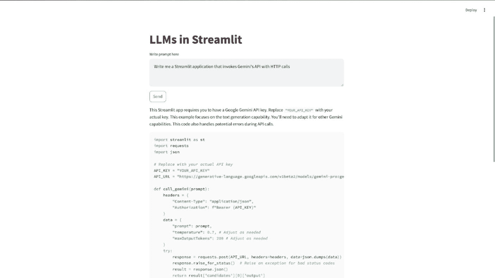

**图 13-8** 渲染完成后的 LLM 响应

调用托管 LLM 模型的另一种方式是通过官方的 `pip` 包，如清单 13-7 所示。在我们之前的示例中，这可以通过使用 `google` 库的 `pip` 包中的 `genai` 模块来实现。这带来了多项好处，例如将 HTTP 调用封装在一行代码中，以及支持直接从 Gemini 实时地逐 token——或逐批次——流式传输响应，而无需等待整个响应生成完毕后再接收。使用这种方式将提供更吸引人的用户体验，如下图 13-9 所示。

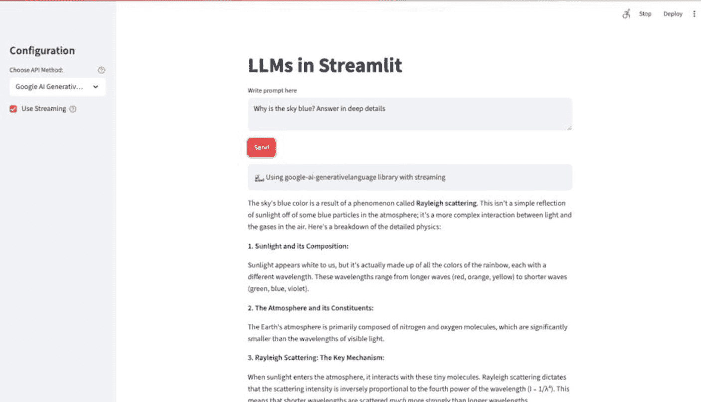

**图 13-9** LLM 响应流式传输


# STREAMLIT 应用代码示例

```python
import os
import time
import requests
import json
import streamlit as st
from dotenv import load_dotenv
from typing import Iterable
from google import genai

def call_llm_requests(text: str) -> str:
    """使用直接的 HTTP 请求调用 Google API"""
    body = {
        'contents': [{
            'parts': [{'text': text}]
        }]
    }
    response = requests.post(
        URL, params={'key': API_KEY}, headers={'Content-Type': 'application/json'},
        data=json.dumps(body)
    )
    response_text = response.json().get('candidates', [{}])[0].get('content', {}).get('parts', [{}])[0].get('text')
    return response_text

def call_llm_genai(text: str) -> str:
    """使用 google-ai-generativelanguage 库调用 LLM"""
    try:
        # 创建客户端
        client = genai.Client(api_key=API_KEY)
        # 生成内容
        response = client.models.generate_content(
            model='gemini-1.5-flash-latest',
            contents={'parts': [{'text': text}]}
        )
        return response.candidates[0].content.parts[0].text
    except Exception as e:
        return f"使用 google-ai-generativelanguage 调用 LLM 时出错: {str(e)}"

def call_llm_genai_stream(text: str) -> Iterable[str]:
    """使用 google-ai-generativelanguage 库并启用流式传输调用 LLM"""
    try:
        # 创建客户端
        client = genai.Client(api_key=API_KEY)
        # 使用流式传输生成内容
        response = client.models.generate_content_stream(
            model='gemini-1.5-flash-latest',
            contents={'parts': [{'text': text}]}
        )
        for chunk in response:
            if chunk.candidates and chunk.candidates[0].content.parts:
                text_chunk = chunk.candidates[0].content.parts[0].text
                if text_chunk:
                    yield text_chunk
                    time.sleep(0.01)  # 为了视觉效果的短暂延迟
    except Exception as e:
        yield f"使用流式传输调用 LLM 时出错: {str(e)}"

def yield_text(text: str) -> Iterable[str]:
    """逐词生成文本以实现流式传输效果"""
    for word in text.split(' '):
        yield word + ' '
        time.sleep(0.01)

def main():
    load_dotenv()
    st.title('Streamlit 中的 LLM')
    
    # API 方法选择
    st.sidebar.title("配置")
    api_options = ["直接请求", "Google AI GenerativeLanguage 库"]
    api_method = st.sidebar.selectbox(
        "选择 API 方法:",
        api_options,
        help="选择调用 Google Gemini API 的方式"
    )
    
    # 适用于 google-ai-generativelanguage 的流式传输选项
    use_streaming = False
    if api_method == "Google AI GenerativeLanguage 库":
        use_streaming = st.sidebar.checkbox(
            "使用流式传输",
            value=True,
            help="实时流式传输响应（仅适用于 google-ai-generativelanguage 库）"
        )
    
    # 主界面
    text = st.text_area('在此处编写提示词', height=100)
    sent = st.button('发送', type="primary")
    
    if not sent or not text.strip():
        return
    
    if not API_KEY:
        st.error("未找到 API_KEY。请在您的 .env 文件中设置它。")
        return
    
    # 显示正在使用的方法
    if api_method == "直接请求":
        st.info(" 使用直接 HTTP 请求调用 Google API")
        with st.spinner("正在生成响应..."):
            response_text = call_llm_requests(text)
            st.write_stream(yield_text(response_text))
    elif api_method == "Google AI GenerativeLanguage 库":
        st.info(" 使用 google-ai-generativelanguage 库并启用流式传输")
        st.write_stream(call_llm_genai_stream(text))
    else:
        st.error("所选 API 方法不可用。请安装所需库或选择其他方法。")

if __name__ == '__main__':
    API_KEY = os.getenv('API_KEY')
    URL = 'https://generativelanguage.googleapis.com/v1beta/models/gemini-1.5-flash-latest:generateContent'
    main()
```

清单 13-7 `streamlit_llm_streaming_application.py`

## 13.4 总结

LLM 因其提供的独特优势，已成为技术社区的新焦点。使用 LLM 可以作为最终解决方案，但并非总是如此。人工智能可以作为创造更卓越产品的工具，例如 Streamlit。LLM 和 Streamlit 可以协同工作，以增强优秀产品，使其变得更好。在本章中，我们学习了 LLM 的概述及其运作方式，以及与之交互的各种方法。然后，我们使用其中一种交互方法，构建了一个通用 AI 助手的克隆版本，该助手接收文本输入并提供文本输出。我们在本章构建的产品的优点在于其模块化。作为开发者，您可以试验甚至并行运行来自不同 API 提供商的不同类型的模型，或者选择自行托管的解决方案。

# 14. Streamlit 在工作中的应用

本章最后呈现了两个真实世界的案例，展示了 Streamlit 的使用。第一个案例重点介绍了由可再生能源公司 Iberdrola 为太阳能发电厂开发的分析工具。该工具评估光伏电站的运行条件，加深对当前光伏电站的理解，并为未来的开发决策提供信息。第二个案例考察了 Streamlit 在工业环境中的应用，涉及高精度电子电机制造商 maxon Group。Streamlit 被用于创建一个指挥与控制仪表板应用，实现了对外科内窥镜适配器系统中 maxon 电机的本地和远程管理。

## 14.1 Streamlit 在清洁能源领域的应用：Iberdrola


Iberdrola 是一家全球性的电力公司，业务遍及 30 多个国家。自成立以来，该公司通过可再生能源投资，优先采用清洁可靠的商业模式，按装机容量计算，已成为全球最大的可再生能源运营商之一。可持续发电是 Iberdrola 的关键业务部门，与电网和零售解决方案并列 [参考文献：[现在的 Iberdrola 集团是一家全球能源领导者——Iberdrola](https://www.iberdrola.com/about-us) ]。

该公司通过风能（陆上和海上）、水力、光伏等清洁能源发电。未来三年，Iberdrola 计划在可再生能源及其他项目上投资 410 亿欧元 [参考文献：[Iberdrola 2024-2026 年战略计划——Iberdrola](https://www.iberdrola.com/about-us/iberdrola-strategic-plan)]。其中，155 亿欧元将分配给可再生能源，目标容量为 60 GW。到 2030 年，该公司预计其可再生能源装机容量将达到 95 GW [参考文献：[可再生能源——Iberdrola](https://www.iberdrola.com/about-us/our-company/renewable-energies)]。要了解与某个太阳能发电厂相关的数据概况，请参见图 14-1。

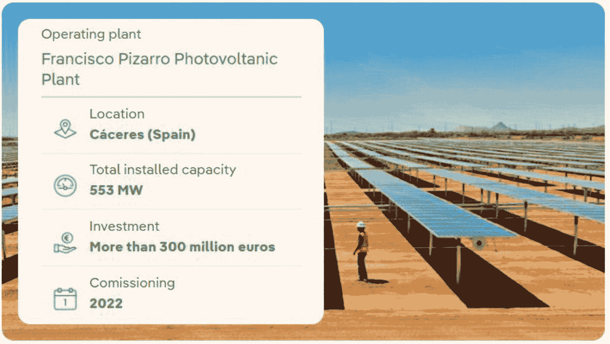

图 14-1

Francisco Pizarro 光伏电站 [参考文献：[`https://www.iberdrola.com/about-us/what-we-do/solar-photovoltaic-energy/francisco-pizarro-photovoltaic-plant`](https://www.iberdrola.com/about-us/what-we-do/solar-photovoltaic-energy/francisco-pizarro-photovoltaic-plant) ]。


好的，作为一名高级文档工程师和翻译员，我将遵循您的指示，在保留格式和代码符号的同时，准确翻译给定的英文文本。


### 14.1.1 太阳能电站运行性能可视化

来自能源资源部的 Nuria Sanchez、Daniel Paredes 和 Brenno Teixeira Martins 花费多年时间开发了用于分析 Iberdrola 太阳能和风电场的算法及定制软件。这里重点介绍的是一个用于评估光伏电站性能并识别运营损失的软件工具。该程序从现场设备、各种数据库和模型中收集数据，以计算发电厂的效率和损耗。这些信息随后被用于研究电站及其组件，以及检测偏差。

为了满足运营性能分析的需求，我们开发了一款创新的内部软件解决方案。该软件能够自动化和简化原本需要手动完成的计算工作。该工具最初以一系列 Python 脚本的形式创建，有效地满足了运营分析需求，但在可扩展性、可访问性以及与其他系统的交互方面存在局限。因此，迁移到基于云的部署将能增强其潜力，并为最终用户启用附加功能和集成。由于所有算法都已使用 Python 实现，因此需要一个 Web 框架来与浏览器进行交互。`Streamlit` 因其纯粹的 Python 特性而被选中，这只需极少的学习成本，且无需了解 HTML 或 CSS 知识。

在与专注于智能电网和分布式可再生能源集成的 Iberdrola 中东创新中心合作下，该太阳能分析工具被重新设计，其功能也得到了增强。以下章节将讨论 Iberdrola 的太阳能工程师所使用的一些基于 `Streamlit` 的图形化表示。

### 14.1.2 风能与太阳能联合发电

结合了风能和太阳能发电的混合电站是最大化可再生能源输出的流行方法。这些电站利用了风能和太阳能资源的互补性：风能在夜间和冬季通常更强，而太阳能在白天和夏季则很充足。通过整合这两种能源，混合电站可以提供更稳定、持续的电力供应，减少对化石燃料的依赖，并增强电网稳定性。

图 14-2 展示了一个混合电站的每小时发电曲线，使用合成数据生成，以突出显示一天中风能和太阳能之间的动态交互。Y 轴表示以兆瓦为单位的每小时发电量，X 轴表示一天中的小时数。

在图表中，风能发电用蓝色表示，显示了风力在一天中的波动情况，通常在夜间和清晨达到峰值。光伏发电用绿色表示，说明了随着太阳在天空中升高，太阳能发电量增加，在中午达到峰值，并在傍晚逐渐减少。

用红色表示的光伏损失，指明了由于互连点限制而未能捕获的潜在太阳能。黄色曲线代表光伏损失的百分比，直观地显示了这些损失与光伏发电水平之间的相关性。值得注意的是，光伏损失百分比往往会随着光伏发电量的增加而增加，这主要是由于互连点限值限制了可以馈入电网的能量。

这种详细的可视化有效地展示了混合电站中风能和太阳能的互补特性，突出了这些可再生能源如何协同工作，以在一天中提供更稳定、持续的电力供应。

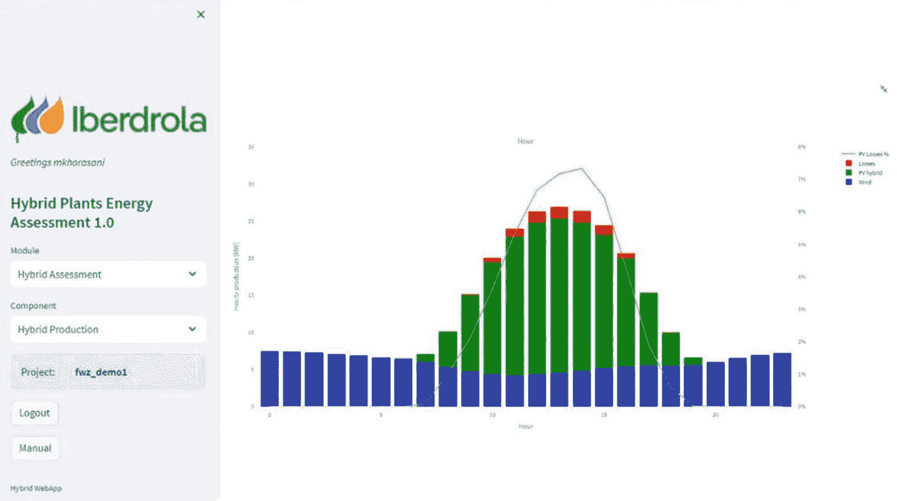

图 14-2

混合电站的每小时发电曲线

### 14.1.3 热力图

热力图是一种可视化工具，它使用颜色来表示数据值，从而更容易识别模式和趋势。图 14-3 中的热力图显示了模拟混合电站发电量中光伏损失的百分比以及超出互连点限值的概率，并按月份和小时进行了细分。在此热力图中，红色单元格表示更高的光伏损失百分比和更大的超出互连点限值的概率，而蓝色单元格则表示无发电时段。这种可视化让工程师能够全面了解能量损失模式，这对于优化可再生能源系统的规模和尺寸至关重要。

此外，这些数据对于将电池存储集成到混合电站中非常宝贵。例如，热力图显示二月和三月的光伏损失较高。此外，从二月到七月，上午 10 点到下午 3 点之间超出互连点限值的概率普遍更高。这些见解可以指导电池存储系统的战略布局和容量规划，有助于减轻能量损失并提高整体效率。通过理解这些模式，工程师可以就能源结构以及存储解决方案的实施做出明智的决策，最终提升混合电站的性能和可靠性。

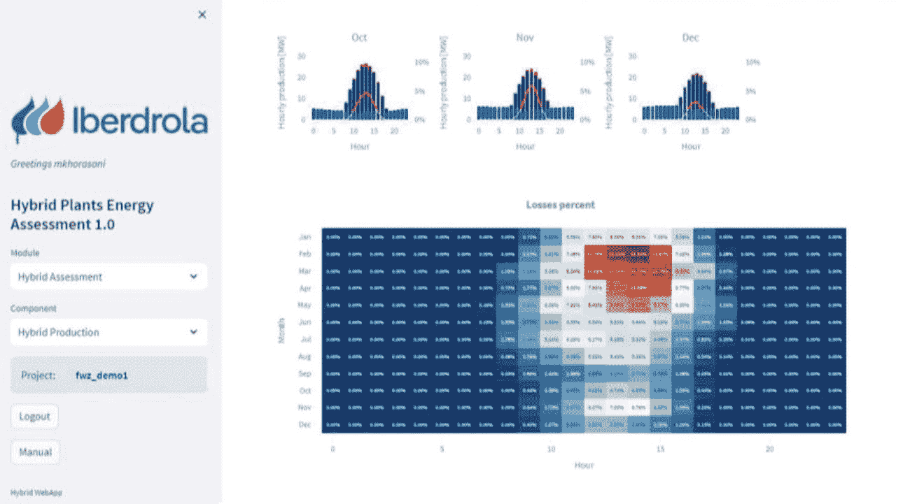

图 14-3

按月份和小时统计的混合电站发电量中光伏损失百分比的热力图

### 14.1.4 结束语

除了其可视化能力之外，`Streamlit` 还展现了对 Iberdrola Renewables 来说非凡的多功能性。其主要优势之一是能够按需渲染多个数据集。用户可以通过交互式界面轻松选择要显示的数据，无需在源代码中进行手动编程。此功能极大地提升了用户体验和效率。

`Streamlit` 的另一个宝贵方面是它支持使用纯 Python 与图表进行双向通信。此功能实现了动态和交互式的数据可视化，使用户能够更有效地与数据交互。此外，`Streamlit` 还能够将图表以 HTML 格式渲染到网站上。这意味着图表可以变得可交互，并与其它小部件集成，从而提供无缝的用户体验。与在没有第三方交互的情况下本地运行应用程序相比，这是一项重大改进，因为它为数据呈现提供了更大的灵活性和交互性。总的来说，`Streamlit` 的特性使其成为 Iberdrola Renewables 不可或缺的工具，促进了先进的数据可视化、用户交互以及与网络平台的无缝集成。

> *本文由 Iberdrola S.A. 支持，作为其创新部门研究的一部分。其内容仅代表作者的观点，不一定代表 Iberdrola 集团的官方立场。*


# 工业中的 Streamlit：maxon 集团


`maxon Group` 是一家瑞士公司，为高精度和高级应用制造并分销工业级电子马达。其产品广泛应用于医疗、航空航天、汽车和包装等多个行业。多样化的产品、卓越的制造质量和出色的客户服务，使开发人员能够满足并超越严苛的性能要求，无论是在地球上还是太空中。`maxon` 的产品系列包括有刷、无刷、交流和直流马达，以及可通过 `RS232`、`USB`、`CANopen` 和 `EtherCAT` 通信协议运行的减速箱、编码器、霍尔效应传感器和马达控制器。此外，`maxon` 还提供广泛的定制选项，能够精确调整尺寸、机械接口、电缆、轴承及其他驱动特性，以满足特定需求。`maxon` 开发的无刷马达和马达控制器示例，请参见图 14-4 和图 14-5。

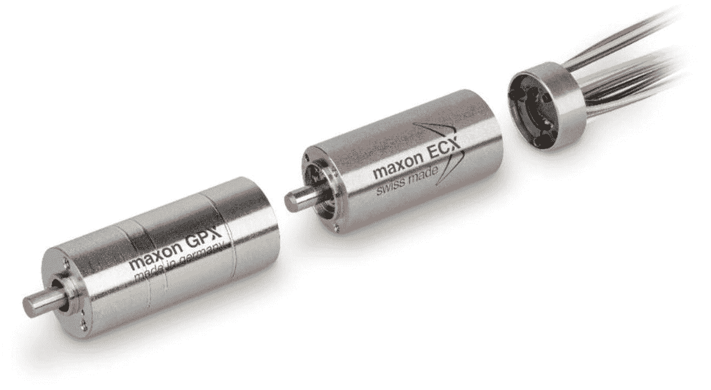

图 14-4

`maxon GPX Speed 13` 减速箱、`ECX Speed 13M` 无刷马达和 `ENX13` 编码器的布局


图 14-5

`maxon EPOS4 Compact 24/1.5 CAN` 马达控制器

## 开发用于微创腹腔镜手术的新型手术内窥镜适配器系统

腹腔镜手术是一种微创手术，正日益成为腹部手术的首选方法。该技术通过做小切口，使患者恢复更快、并发症风险更低。目前，这些手术是手动进行的，由一名手术助理负责握持和操控插入腹腔的内窥镜，为手术区域提供实时视觉影像，如图 14-6 所示。这种设置要求操作者具备极佳的灵巧度和手眼协调能力，因为即使是微小的不准确也可能导致手术中出现失误。[参考文献： [`https://onlinelibrary.wiley.com/doi/10.1002/rcs.2475`](https://onlinelibrary.wiley.com/doi/10.1002/rcs.2475)]

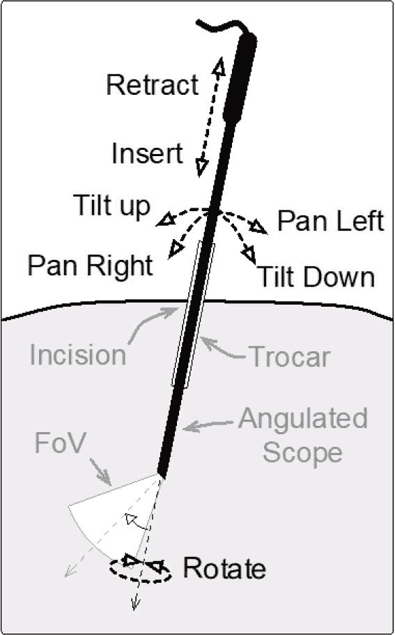

图 14-6

插入腹腔的内窥镜示意图

为了解决反馈回路中有人类操作者的局限性，Nikhil Navkar 博士和 Mohammad Khorasani 开发并制作了一种创新型内窥镜适配器原型（如图 14-7 和 14-9 所示）。在该设计中，内窥镜及其摄像头头被安装在一台提供六个自由度的 `UR5` 机械臂上，并由其控制。此外，适配器本身还提供两个额外的自由度，允许内窥镜和摄像头头绕其轴线旋转以及内窥镜末端角度调整。

旋转机构由一台 `maxon ECX` 无刷马达驱动，而角度调整则由一台 `maxon 有刷 DCX` 马达提供动力。每个马达都配有一个减速箱，旋转和角度调整的最高速度分别可达 20 RPM 和 16 RPM。此外，还使用了一个三通道光学编码器，旋转和角度调整的分辨率分别达到每转 4,096 步和每转 2,048 步。

手术内窥镜适配器的其他优点包括：

*   兼容各种内窥镜、摄像头头和机械臂。
*   可通过多种输入方式操作，例如操纵杆或跟踪外科医生头部的光学标记。
*   可编程，以最大程度减少人为错误并防止意外移动。
*   消除了手动握持内窥镜的需要，减轻了操作者的压力和疲劳感。

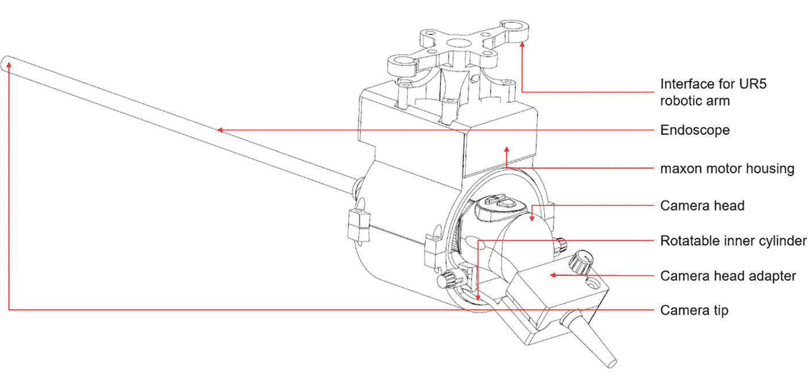

图 14-7

由 `maxon` 驱动的手术内窥镜适配器的工程图

## Streamlit 命令与控制仪表盘

在完成手术内窥镜适配器的机械原型后，开发了一个 `Streamlit` 应用程序，用于显示实时仪表盘，展示旋转和角度调整马达的速度与位置（如图 14-8 所示）。该应用程序还与一个三轴操纵杆集成，能够精确控制每个 `maxon` 马达（如图 14-9 所示）。此外，通过对 `Streamlit` 应用程序进行端口转发，实现了通过互联网远程控制马达。这一功能对于远程手术尤其有价值，它使得操作者无需亲临医院也能参与手术。但需要注意的是，长距离远程控制可能会引入延迟，从而影响设备的性能。

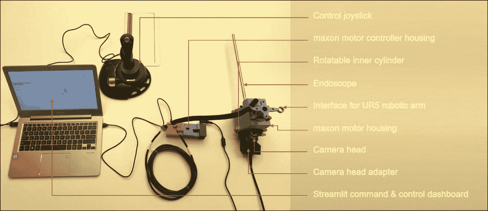

图 14-9

带有 `Streamlit` 命令与控制仪表盘的手术内窥镜适配器原型

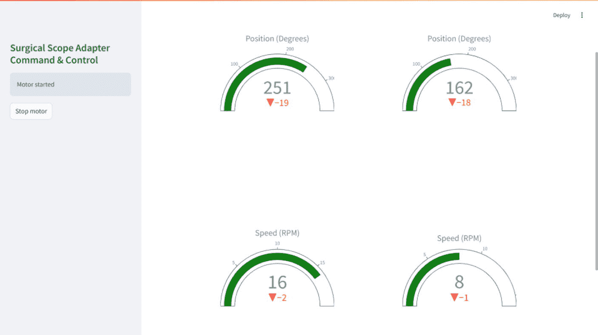

图 14-8

用于手术内窥镜适配器的 `Streamlit` 命令与控制仪表盘


### 14.2.3 结束语

尽管 `Streamlit` 被定位为机器学习和数据科学应用的框架，但它具有足够的通用性，可用于各种目的。正如本案例所示，`Streamlit` 被有效地用于将多个非平凡子系统集成为一个连续系统。具体来说，`Streamlit` 被用于将 `maxon` 电机与操纵杆连接，支持通过局域网和互联网进行远程控制，并提供一个实时仪表盘来显示电机的位置和速度，所有这一切仅需几行代码即可实现。

> *本研究得到卡塔尔国家研究基金会（卡塔尔基金会成员）的国家优先研究计划（NPRP）奖项（NPRP13S-0116-200084）以及哈马德医疗公司（HMC）医学研究中心（MRC）的 IRGC-04-JI-17-138 奖项的资助。本研究中的所有观点、发现、结论或建议均为作者本人立场，并不一定反映我们的资助方的观点。*

## 14.3 总结

在本最后一章中，我们探讨了 `Streamlit` 在商业和工业活动中被有效利用的两个真实案例。第一个案例展示了可再生能源公司 Iberdrola 如何使用 `Streamlit` 为其风电场创建企业数据管理应用程序，以估算生产过程中的电力损耗。第二个案例则深入介绍了一个工业用例，即通过 `Streamlit` 应用程序控制由 `maxon Group` 制造的高精度电子电机，用于手术范围适配器系统。这两个案例都突显了 `Streamlit` 为企业界及更广泛领域所提供的实用价值。

# 索引

## A

*   聚合 120，153，158，162
*   `AgGrid()` 命令 117
*   动画条形图 133
*   动画气泡地图 132
*   反 SQL 注入 220
*   应用程序
    *   条件流程 35，37
    *   设计
        *   页面配置 68–70
        *   页面组织 83–89
        *   主题和配色方案 79–83
    *   管理与调试错误 37–41
    *   用户输入表单 32–34
*   Arduino IDE296，297，302，303
*   Arduino 微控制器与红外温度计接线示意图 297
*   认证
    *   用户账户开发 197–200
    *   用户凭证验证 201–218

## B

*   后端服务器
    *   API 构建 168–172
    *   API 测试 172–173
    *   环境 163
    *   Streamlit 连接 163
*   Bcrypt 哈希 199，209
*   弹跳图像 278–282
*   宽带配置网站 225
*   按钮 13，25，32，33，94，119，182，185，191，282，303，353，358，375

## C

*   缓存大数据 112–114
*   缓存对象 109
*   图表显示
    *   折线图、面积图和条形图 53–59，64，125–127，130，132，133，307，317，323
    *   地图 53，60–61，89，131，132，169，184，199，224，393
    *   Plotly6，57，58，60，64，109，124–134，189，303，307，310，328
    *   Vega-Lite124
*   复选框 64，118，241
*   云计算 1–4，30，228
*   云数据库 147–151，161
*   条件流程 31，35–37，66
*   控制台命令 16–18
*   Content-Type 标头值 165
*   Cookie 管理 191–194
*   Cookie 管理器 192，195，287–292
*   Curl165，372，377
*   自定义组件
    *   作为 pip 包 267–271
    *   ReactJS 应用程序 256–267
    *   接收数据 264–267
    *   发送数据 262–264
*   自定义页脚 72–73，79


## D

- Dash，30
- 数据展示
    - 数据框，111
    - JSON，146, 166, 178
    - 指标，338
    - 表格，110, 115, 117, 136, 146, 185, 317
- 数据框演示应用，22, 62, 65
- 数据框，22, 31, 41–54, 56, 57, 60, 62, 64, 65, 109, 111–115, 117, 118, 125, 129, 130, 133, 134, 144, 181, 182, 189, 335
- 数据管理
    - 高级交互式数据变更，117–123
    - 缓存大数据，112–114
    - 缓存数据，112
    - 缓存函数，133
    - 缓存对象，112
    - 数据变更，114–116
    - 处理字节数据，110–112
- 数据变更，108, 115–123
- 数据可视化
    - 动画可视化，132–133
    - 柱状图，127, 132
    - 图表布局，128
    - 地理空间图表，131
    - 折线图，125–126
    - 饼图，127
    - 渲染 `plotly`，124
    - 散点图，126
    - 统计图表，129–130
    - 时间序列图表，130–131
- 数据仓库应用，317–328
- 日期时间筛选应用，307–309
- Delta 生成器，26
- 部署
    - Linux Docker 容器，235–239
    - 原生 Linux 机器，233–235
- 直接 pip 安装，15
- Django，1, 6, 7, 30, 167
- 动态内容展示，89–93, 108, 367
- 动态时间规整（DTW），313

## E

- 使用 Anaconda 安装环境
    - 图形化方式，12–14
    - 编程方式，10–12
- Extra-Streamlit-Components
    - 弹跳图像，278–282
    - Cookie 管理器，287–292
    - 步进器，272–278
    - 标签栏，282–287, 353

## F

- Flask，1, 5, 6, 30, 167, 169, 170, 173–175, 178, 200, 202, 205, 206, 219, 221
- 文件夹结构，106–107, 360, 361
- 外键，138, 139
- 表单，31–35, 66, 151, 231, 307, 310, 338, 351, 366, 369, 397
- 前后端通信，164–166
- 全文索引，135, 147, 151–152

## G

- 地理空间图表，60, 131
- Git，220–222, 233
- GitHub 仓库，228, 254, 362

## H

- 汉堡菜单，68, 71–72, 79
- 哈希，198–199, 201, 222
- 热力图，393–394
- 主机的公网 IP 地址，225
- HTTP 方法，101, 165–166, 169, 378
- HTTP 隧道，NGROK，226–228


## I

- 伊维尔德罗拉公司（Iberdrola）
    - 热力图 393–394
    - 可再生能源业务 389
    - 风力发电场 390
- 标识符（Identifiers）137, 164, 165, 183, 195, 201
- 输入表单（Input form）31–34
- 输入控件
    - 按钮 32, 33, 282
    - 复选框 64, 118
    - 日期输入 33
    - 文件上传器 332, 335
    - 表单 33
    - 多选框 75
    - 数字输入 39
    - 单选按钮 33, 75
    - 选择框 75, 85, 189
    - 滑块 33, 80
    - 文本输入 33
- 集成开发环境（IDE）7, 25, 37, 296, 297, 302, 303, 359
- 集成测试 20, 351, 352, 363
- 交互式地理空间地图 60
- 交互式折线图 57–59
- 交互式控件
- 接口 5–7, 30, 31, 62, 67, 142, 172, 185, 224, 295, 298, 302, 303, 317, 322, 352, 367, 371, 391, 394, 395, 401

## J, K

- JSON57, 146, 152, 153, 164–167, 170, 173, 178, 195, 210, 222, 282
- JSON Web Token (JWT)201–203, 219, 222, 330

## L

- Lambda 函数 48
- 腹腔镜检查 397–399
- 逻辑回归分类器 337–347

## M

- 机器学习即服务
    - 配置脚本（Config Script）334
    - 主脚本（Main Script）335–337
    - 无需后端服务器的用户认证 329–332
    - 工具脚本 332–334
- Markdown72
- Matplotlib 图表 54, 56
- maxon 集团
    - 配置（disposition）396
    - 高精度与前沿应用 395
    - 新型手术内窥镜适配器系统 397–399
    - Streamlit 命令与控制仪表板 399–400
- 中间件 102, 201, 204, 205
- MongoDB135, 146–147, 149–151, 153, 158, 161
- 电机命令与控制应用 301–306
- 多媒体 31, 66, 109–111, 133
- 多页面 Streamlit 应用 95, 97
- 多进程 174–176, 178
- 多线程 174–176, 178
- 数据修改（Mutating data）66, 114–117, 120
- 修改 Pandas 数据框
    - 排列（arrange）45–47
    - 过滤（filter）42–43
    - 分组（group by）49–50
    - 合并（merge）51–52
    - 变换（mutate）47–49
    - 选择（select）43–45

## N, O

- 原生数据修改 115–116
- Ngrok226–228, 254
- 非关系型数据库
    - 云数据库 147–151
    - 显示表 158–161
    - 全文索引 151–152
    - MongoDB146–147
    - 查询 153–158
- 数字输入控件 32


## P

- 页面配置 68–70, 73–79
- 页面组织
  - 列 67, 84–85
  - 容器 67, 85
  - 扩展器 67, 84
  - 占位符 67, 88
  - 侧边栏 67, 84
- 页面创建 67, 94–95
- 页面结构
  - 列 67
  - 容器 67
  - 扩展器 67
  - 占位符 67
  - 侧边栏 67
- 分页与可扩展性 93
- Pandas 数据框 41, 43, 45, 47, 49, 52–57, 60, 112, 117, 125, 130, 144, 158, 189, 335
- 持久化 Windows 服务 250–254
- 占位符 67, 68, 88, 89, 108, 221, 296, 303, 367, 368
- Plotly 图表 58, 124, 189
- 端口转发 224–226, 228, 254, 399
- 端口映射 224
- PostgreSQL110, 135, 138–144, 161, 185, 186, 189, 317, 328, 332, 339
- 主键 137–139, 185
- 进度条 67, 92–93, 367, 368
- PyCharm20–25
- Python Web 框架 1, 7–8, 30

## Q

- 查询参数 169

## R

- 单选按钮 33
- ReactJS 组件 29, 257–261, 282, 288
- 实时进度条 92–93
- 关系型数据库
  - 显示表格 144–146
  - PostgreSQL 数据库连接 138–144
  - SQL136–138
- 远程桌面连接 (RDP)240–242, 247, 250, 254

## S


## S

- 密钥与机密 205, 219
- 机密管理 219, 231–233, 254
- 会话 ID183–185, 195, 201, 332
- 会话状态
  - 应用 180–183
  - 数据显示与操作 181
  - 实现
    - 原生的 179–183, 195
  - 值 179
- 会话状态变量
  - 访问 180
  - 初始化 180, 181
- 滑块 33, 181, 182, 264, 266
- 社交网络应用 99–105
- SQLAlchemy142, 169, 170, 199, 220
- SQL 查询 142, 169, 220, 317
- 静态柱状图 54–55, 57
- 静态折线图 56–57
- 统计图表 129–130
- 状态与进度显示
  - 异常 37, 40
  - 消息 37, 40, 212
  - 进度条 67, 92–93, 367, 368
- 步进条 272–278
- Streamlit
  - 学术意义 8
  - 架构 27–28, 100, 367
  - 控制台命令 16–18
  - 数据框演示应用 22, 62, 65
  - 演示应用 19–21, 365
  - 下载与安装 15–16
  - 本地与云端 2
  - 绘图演示应用 21
  - 技术要求 8–9
- Streamlit-Authenticator329, 335
- Streamlit Cloud
  - 部署 228–233
  - 机密 231–233
- Streamlit 地理空间地图 25
- 字符串与文本 110
- 结构化查询语言 (SQL)135–140, 142, 144, 145, 165, 169, 220, 222, 317
- 子页面创建 67
- 手术视野适配器 389, 397–401
- 系统要求 8

## T

- TCP/IP 端口 242–246
- 温度数据记录应用 296–301
- 文本显示
  - Markdown72
  - 标题、页眉和副页眉 68, 94
- 主题颜色设置 80
- 主题定制
  - 自定义组件 82–83
  - 图形化 79–81
  - 程序化 79, 81–82
- 时间序列应用
  - 日期时间过滤器应用 307–309
  - 时间同步应用 313–316
- 时间序列图表 64, 130–131
- 时间序列热图应用 310–313
- 时间同步应用 313–316
- 令牌 78, 147, 151, 154, 157, 160, 162, 164, 192, 201, 202, 204, 210–212, 330, 366, 369, 371, 378, 383
- 隧道技术 226–228, 254

## U

- 单元测试 20, 351, 363
- URL 路径 97–98
- 用户账户
  - 哈希处理 198–199
  - 加盐处理 199–200
- 用户凭据验证 201–218
- 用户洞察
  - 可变参数 186
  - 记录 185, 186, 191
  - 更新函数 185
  - 可视化 189–191
- 用户界面 (UI)5, 62–108, 255, 293, 353, 363, 367, 368, 370, 375–376
- 工具


## V、W、X、Y、Z

- `Web2Py`7、30
- Python 中的 Web 框架
    - `Dash`6、30
    - `Django`1、6、7、30、167
    - `Flask`1、5、6、30、167、169、170、173–175、178、219
    - `Web2Py`7、30
- 风力发电场 390、401
- Windows Server 部署
    - Anaconda 离线包安装 246–247
    - 应用运行
        - 可执行批处理文件 247、249
        - 持久化 Windows 服务 250–254
    - 远程桌面连接 240–242
    - 系统路径 247–249
    - TCP/IP 端口 242–246
