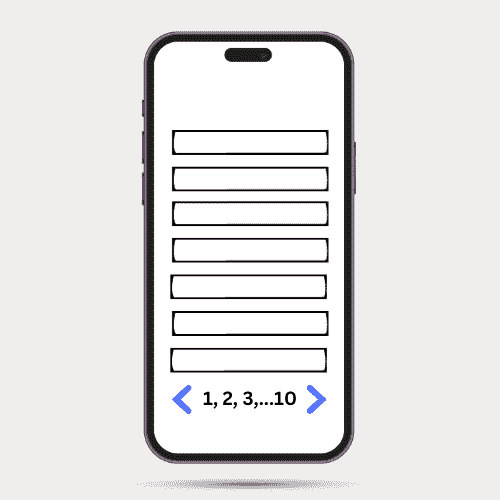

# 7

## 那么，究竟什么是分页？

分页是指将网站内容划分到多个页面的做法。你在新闻网站、博客、论坛以及电商领域的几乎任何地方都见过它。



分页就像是网站内容分发的基础，但并非总是完美无缺。正确实施分页对搜索引擎优化（SEO）至关重要。

关键在于：分页设置的质量决定了搜索引擎如何索引你的页面及其包含的内容——链接、文章、产品等等。

我们来看一个分页示例。在这个例子中：该系列标题为“精彩食谱系列”，并关联了 URL 和图片。它包含“第 1 页”和“第 2 页”两个页面，每个页面都有自己的 URL 和名称。你可以通过复制结构并递增元标签中的`position`和`content`属性来添加更多页面。分页元数据指定共有 10 页，从第 1 页开始，到第 10 页结束，并且当前页面是第 1 页。

```
<div itemscope itemtype="http://schema.org/Series">
  <span itemprop="name">精彩食谱系列</span>
  <link itemprop="url" href="https://example.com/awesome-recipes">
  <link itemprop="image" href="https://example.com/awesome-recipes-thumbnail.jpg">

  <!-- 第 1 页 -->
  <div itemprop="hasPart" itemscope itemtype="http://schema.org/WebPage">
    <a itemprop="url" href="https://example.com/awesome-recipes/page/1">
      <span itemprop="name">精彩食谱 - 第 1 页</span>
    </a>
    <meta itemprop="position" content="1">
  </div>

  <!-- 第 2 页 -->
  <div itemprop="hasPart" itemscope itemtype="http://schema.org/WebPage">
    <a itemprop="url" href="https://example.com/awesome-recipes/page/2">
      <span itemprop="name">精彩食谱 - 第 2 页</span>
    </a>
    <meta itemprop="position" content="2">
  </div>

  <!-- 在此处添加更多页面 -->

  <!-- 分页元数据 -->
  <meta itemprop="numberOfPages" content="10">
  <meta itemprop="pageStart" content="1">
  <meta itemprop="pageEnd" content="10">
  <meta itemprop="currentPage" content="1">
</div>
```

