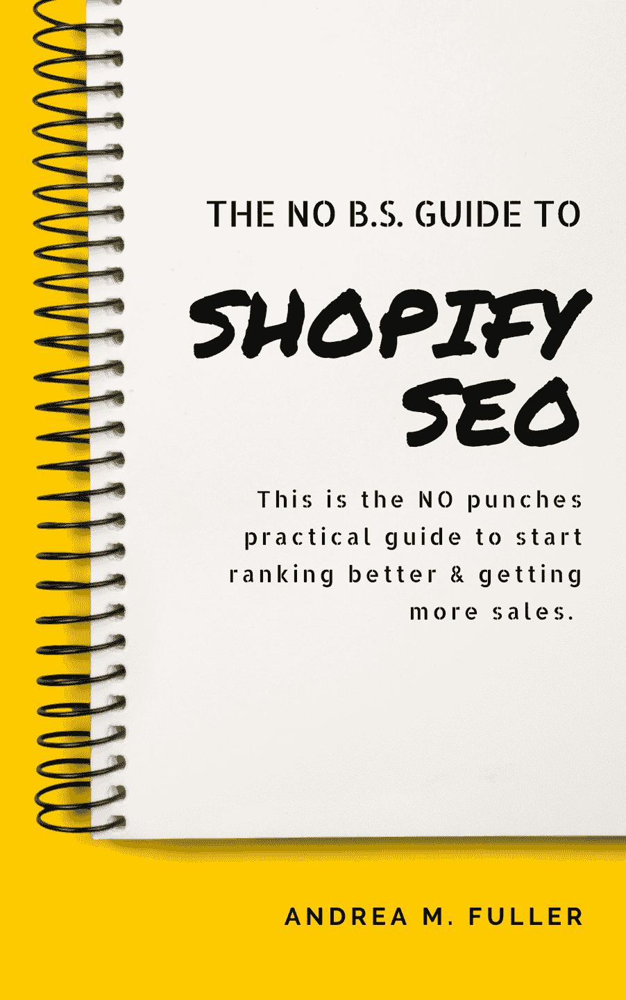

# 10


### 开发者应对无限滚动加载指南

如果你倾向采用无限滚动方案，请记住它通常基于 AJAX 技术实现。

搜索引擎可能会遗漏部分内容，因为这些内容需待用户滚动或点击后才能加载。

以下 JavaScript 代码片段供你参考：

```
window.onscroll = function() {
  // 检查用户是否已滚动至页面底部
  if (window.innerHeight + window.scrollY >= document.body.offsetHeight) {
    // 当前已到达页面底部，在此处加载更多内容
    // 这里应发起 AJAX 请求以获取额外内容
    // 新内容加载完成后，可将其追加到页面现有内容中
    // 别忘了按需实现错误处理和加载指示器
  }
};
```

代码说明：

- `window.onscroll` 是一个事件监听器，当用户滚动时会触发相关函数。
- `window.innerHeight` 表示浏览器视口的高度。
- `window.scrollY` 指示页面垂直滚动的距离。
- `document.body.offsetHeight` 返回文档的总高度。

当 `window.innerHeight` 与 `window.scrollY` 之和大于或等于 `document.body.offsetHeight` 时，说明用户已滚动至页面底部，此时可触发额外内容的加载。

请记得将注释“// 在此处加载更多内容”替换为实际加载并追加新内容的代码。

此外，建议添加防抖或节流机制，避免对滚动事件的过度调用，从而提升性能。

同时，我们需要讨论如何将内容切分为便于管理的部分。这样能确保即使禁用 JavaScript 也能保持无障碍访问，并维护 URL 的完整性。

具体拆解如下：

#### 1. 拆分内容以实现无障碍访问

在实现无限滚动时，务必将内容拆解为更小、更易访问的部分。这能确保禁用 JavaScript 的用户仍可顺畅访问和浏览内容。避免重复创建这些部分。参考以下示例：

- 示例 1：`site.com/stickers&page=1`

此 URL 结构表示“贴纸”分类下的第一个内容页面。

- 示例 2：`site.com/stickers?lastid=123`

使用像 `lastid` 这样的唯一标识符有助于保持 URL 的唯一性，允许用户直接访问特定部分。

- 示例：`site.com/stickers#1`

虽然使用 URL 片段标识符（`#`）对 SEO 不理想，但仍能提供一定的可访问性。不过，尽可能使用查询参数或简洁 URL 是更优选择。

#### 2. 确保 URL 的唯一性与功能性

你的 URL 需要既唯一又具备功能性。它们应独立于用户 cookies 或浏览历史也能正常工作，这能保证流畅的用户体验以及搜索引擎的合理索引。

这里的关键示例包括：

- 唯一且功能性的 URL：`site.com/stickers&page=2`

此 URL 指向“贴纸”分类下的第二个内容页面，既唯一又具备功能性。

- 避免 URL 片段标识符：

不要仅依赖像 `site.com/stickers#1` 这样的片段标识符，因为它们在功能性和索引方面可能不够可靠。

#### 3. 利用 `replaceState` 和 `pushState` 提升用户体验

根据用户在网站上的行为，考虑使用 `replaceState` 和 `pushState` 进一步改善用户体验：

- `replaceState`：在用户操作（如点击或滚动）类似于鼠标点击时使用此方法。它会替换浏览器历史中的当前 URL，但不会创建新记录。
- `pushState`：当希望用户能轻松返回之前滚动过的内容时使用此方法。它会在浏览器历史中添加一条新记录。

以下是一个快速示例：

```
// 使用 pushState
history.pushState({ page: 'scroll' }, '已滚动内容', '/teams/giraffes?page=2');

// 使用 replaceState
history.replaceState({ page: 'scroll' }, '已滚动内容', 'teams/giraffes?page=3');
```

通过策略性地应用这些方法，可以在实现无限滚动时提供更无缝、更友好的用户体验。

总而言之，在优化无限滚动时，需考虑可访问性、URL 结构以及通过状态管理提升用户体验。

这种方式能确保包括禁用 JavaScript 用户在内的所有人都能有效浏览内容，同时改善 SEO 和用户参与度。

### 应避免的常见分页错误

最后，请避开以下常见分页陷阱：

- 使用 `noindex` 标签而非规范标签，会阻止搜索引擎正确索引你的页面。
- 避免使用静态 URL 进行分页，应采用包含动态参数的 URL。
- 确保当前分类不存在的页面返回 404 错误。

### 简而言之

不当分页的核心问题在于限制了内容的可访问性。为避免这个陷阱，请牢记以下黄金法则：

- 为分页使用爬虫可访问的用户友好型 `href` 链接。
- 仅优化序列中的首页，并从分页 URL 中移除任何特定于 SEO 的内容。
- 请记住，Google 爬虫无法滚动或点击，因此要确保所有内容即使在没有 JavaScript 的情况下也能访问。
- 在 Google Search Console 中仔细检查页面 URL 的可访问性。

请明智地进行分页设计，你的网站 SEO 会因此受益！


### 关于作者

**Andrea M. Fuller** 是一位经验丰富的数字营销与 SEO 专家，在从初创企业到全球公关公司等多个行业拥有超过 20 年的从业经验。

Andrea 对技术平台的深刻理解以及对策略的热情，使她能够为客户制定并执行独特且有效的方案。作为第四代企业家，她热衷于利用线上空间在企业/组织与其客户/选民之间建立真实互动，助力企业成功。

她拥有 **Fuller Digital Strategy, LLC**（一家提供全方位服务的数字营销机构）和 **SEO Handy Woman**（一所在线学院，教授 DIY 网站所有者如何自行执行顶级 SEO 策略）。

- 您可以通过以下方式联系我：
  - https://fullerdigitalstrategy.com
  - https://www.seohandywoman.com
- 订阅我的通讯：
  - https://fuller-digital-strategy-llc.ck.page/3b2de93afd

### Andrea M. Fuller 的其他作品



#### Shopify SEO 终极指南（无废话版）

任何希望将在线商店提升至新水平的 Shopify 企业家必读之作。

本书由知名 SEO 专家兼企业家 Andrea Fuller 撰写，已在超过 5 个国家销售，揭示了真正能推动销售的 SEO 秘诀。

您将学到内部策略和技巧，帮助您优化商店以迎合搜索引擎，提升排名，从而带来更多流量和销量。
