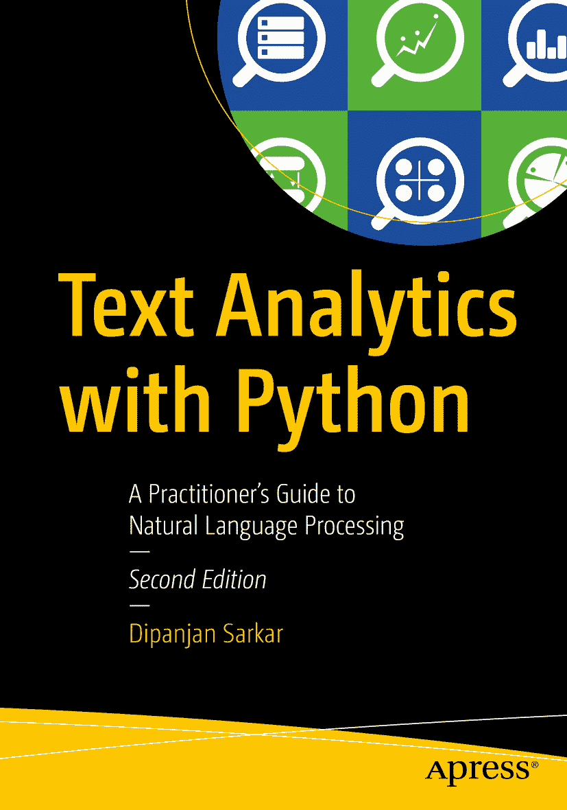

`ISBN 978-1-4842-4353-4` `e-ISBN 978-1-4842-4354-1` [`doi.org/10.1007/978-1-4842-4354-1`](https://doi.org/10.1007/978-1-4842-4354-1) © Dipanjan Sarkar 2019 本书受版权保护。版权所有者为出版商，涉及材料的全部或部分内容，特别是翻译、重印、插图再利用、朗诵、广播、微缩胶片复制或其他任何物理形式的复制、传输或信息存储与检索、电子改编、计算机软件，或目前已知或未来开发的类似或不同方法。本书中可能出现商标名称、徽标和图像。对于每个商标名称、徽标或图像，我们并非每次都使用商标符号，而是仅以编辑方式使用这些名称、徽标和图像，以维护商标所有者的权益，无意侵犯商标。本书中对商品名称、商标、服务标记及类似术语的使用，即使未明确标识，也不应被视为对其是否受所有权保护的立场表达。尽管本书中的建议和信息在出版时被认为是真实准确的，但作者、编辑和出版商均不对任何可能存在的错误或遗漏承担法律责任。出版商对本书所含材料不作任何明示或默示的担保。本书通过 Springer Science+Business Media New York 在全球范围内发行，地址：233 Spring Street, 6th Floor, New York, NY 10013。电话：1-800-SPRINGER，传真：(201) 348-4505，电子邮件：`orders-ny@springer-sbm.com`，或访问 `www.springeronline.com`。Apress Media, LLC 是加利福尼亚州的有限责任公司，其唯一成员（所有者）是 Springer Science + Business Media Finance Inc (SSBM Finance Inc)。SSBM Finance Inc 是一家特拉华州公司。

*本书献给亲爱的读者、伴侣、宠物、朋友、家人和祝福者。*

*——Dipanjan Sarkar*