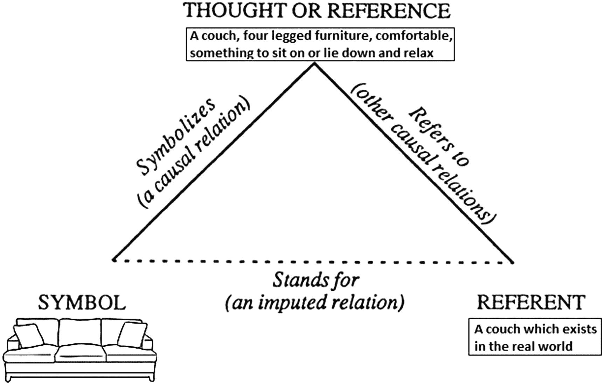
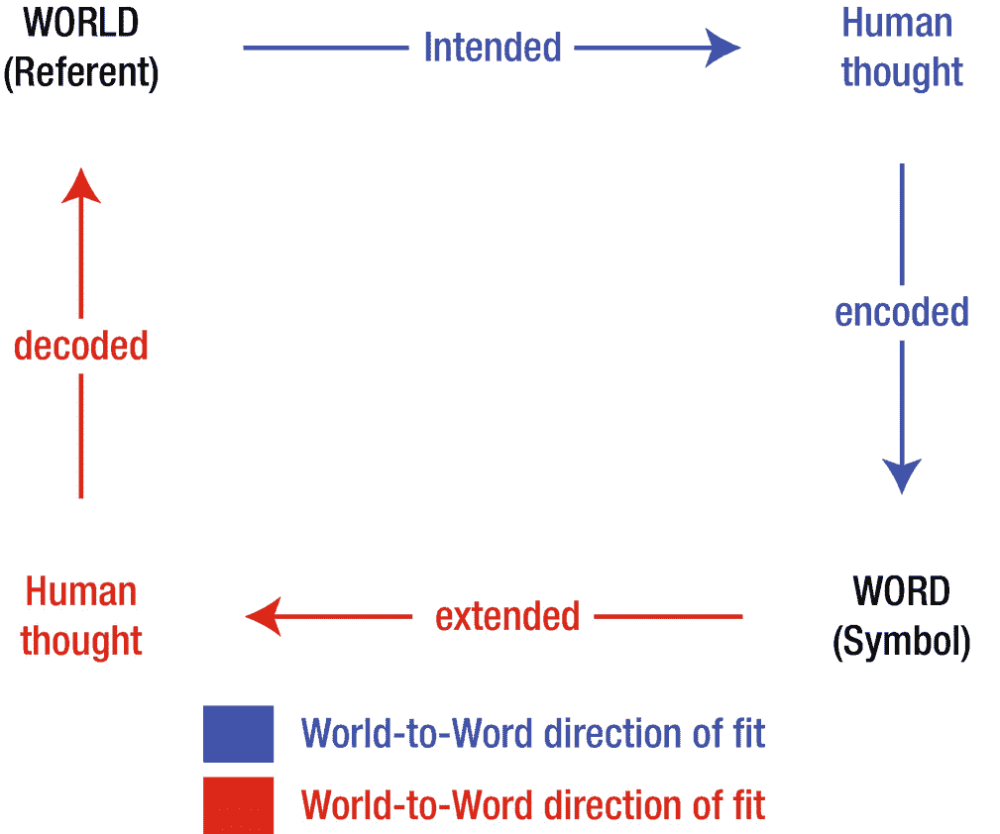

# 第 1 章 自然语言处理基础

我们已进入大数据时代，各组织和企业正疲于管理各类系统、流程和交易产生的海量数据。然而，由于对数据“3V”——即体量（volume）、多样性（variety）和速度（velocity）的定义模糊，"大数据"一词常被误用。有时很难量化什么样的数据才算“大”。有些人可能认为数据库中的十亿条记录就是“大数据”，但相较于各类传感器或社交媒体生成的 PB 级数据，这个数字显得微不足道。一个共同特征是，无论所属领域，所有组织中都存在着大量非结构化文本数据。例如，社交媒体上以推文、状态消息、话题标签、文章、博客、维基等形式呈现的海量数据。即使是零售和电商商店也会产生大量文本数据，从新产品信息和元数据到客户评论和反馈，不一而足。

与文本数据相关的主要挑战有两方面。第一重挑战涉及如何有效存储和管理这类数据。文本数据通常是非结构化的，不遵循关系型数据库所采用的任何特定预定义数据模型或模式。不过，根据数据语义，你可以将其存储在基于 SQL 的数据库管理系统（如`SQL Server`和`MySQL`）中，基于 NoSQL 的系统（如`MongoDB`和`CouchDB`）中，以及更近期的、基于信息检索的数据存储（如`ElasticSearch`和`Solr`）中。

拥有海量文本数据集的组织通常求助于数据仓库和基于文件的系统，如`Hadoop`，它们将所有数据转储到 Hadoop 分布式文件系统（`HDFS`）中，并根据需要访问。这是数据湖的主要原则之一。

第二重挑战涉及分析这些数据并从中提取有意义的模式和可操作的洞察。尽管我们掌握大量的机器学习和数据分析技术，但其中大多数是为处理数值数据而优化的。因此，我们必须借助自然语言处理、专门的技术、转换和模型来分析文本数据，或更具体地说，分析自然语言。这与结构化数据和易于机器理解的常规编程语言截然不同。请记住，文本数据高度非结构化，因此它不遵循结构化或规则的语法和模式。因此，我们不能直接使用统计或机器学习模型来分析此类数据。

非结构化数据——尤其是文本、图像和视频——蕴含了丰富的信息。然而，由于处理和分析这类数据固有的复杂性，人们往往不愿从结构化数据集转向分析这些可能蕴含金矿的非结构化数据源。自然语言处理（NLP）正是利用工具、技术和算法来处理和理解基于自然语言的数据，这些数据通常是非结构化的（如文本、语音等）。本书涵盖了 NLP 的基本概念和技术。但在深入探讨分析文本数据的特定技术或算法之前，我们先介绍一些与自然语言和非结构化文本相关的核心概念与原理。其主要目的是让你熟悉与自然语言处理和文本分析相关的概念和领域。

本书主要使用`Python`编程语言来访问和分析文本数据。作为修订版，我们重点关注`Python 3.x`和最新的前沿开源框架进行我们的分析。本章的示例将非常直接明了，易于掌握。不过，如果你想在阅读本章之前先预习`Python`、关键框架和结构，也可以快速浏览第[2]章“用于自然语言处理的 Python”。

在本章中，我们将介绍与自然语言、语言学、文本数据格式、句法、语义和语法相关的概念（这些本身都是 NLP 的主要组成部分），然后再转向更高级的主题，如文本语料库、自然语言处理、深度学习和文本分析。本章展示的所有代码示例均可在本书的官方 GitHub 仓库中找到，你可以通过[`https://github.com/dipanjanS/text-analytics-with-python/tree/master/New-Second-Edition`](https://github.com/dipanjanS/text-analytics-with-python/tree/master/New-Second-Edition)访问。

## 自然语言

文本数据是非结构化数据，但它通常属于遵循特定句法和语义的特定语言。所有文本数据，如一个简单的词、句子或文档，都与某种自然语言相关联。在本节中，我们将探讨自然语言的定义、语言哲学、语言习得以及语言的使用。

### 什么是自然语言？

要理解文本分析和自然语言处理，我们需要了解是什么让一种语言成为“自然语言”。简单来说，自然语言是人类通过自然使用和交流而发展和演变出来的语言，而不是像计算机编程语言那样人工构建和创造的语言。

各种人类语言，如英语、日语或梵语，都可以称为自然语言。自然语言可以通过不同的方式进行交流，包括口语、书面语，甚至使用手势。关于语言起源、本质和哲学的理解一直备受关注。我们将在下一节简要讨论这一点。

### 语言哲学

现在我们已经了解了何为自然语言。但请思考以下问题：语言的起源是什么？是什么让英语成为“英语”？单词`“fruit”`的意义是如何产生的？人类如何通过语言进行交流？这些无疑是相当深奥的哲学问题。

我们现在来探讨语言哲学，它主要涉及以下四个问题。

-   语言意义的本质

-   语言的使用

-   语言认知

-   语言与现实的关系

语言意义的本质关注的是语言的语义学以及意义本身的本质。在此，语言哲学家或语言学家试图弄清楚实际上“有意义”意味着什么，即任何单词或句子的意义是如何产生的，以及一种语言中的不同单词如何互为同义词并形成关联。另一个重要方面是，语言中的结构和句法如何为语义学铺平道路，或者更具体地说，具有自身意义的单词是如何被组织在一起形成有意义的句子的。`语言学`是对语言进行的科学研究，是一个专门处理其中一些问题的领域。

句法、语义学、语法和解析树是解决这些问题的一些方法。意义的本质在语言学中可以在两个人（特别是发送者和接收者）之间体现。从非语言学的角度来看，肢体语言、先前经验和心理效应等因素都是语言意义的促成因素，每个人在感知或推断意义时都会结合自身的方式，并考虑其中一些因素。

语言的使用更关注语言如何在各种场景和人类交流中被用作一种实体。这包括分析言语以及说话时的语言使用情况，包括说话者的意图、语气、内容以及表达信息时所涉及的行为。这在语言学中通常被称为`“言语行为”`。更高级的概念，如语言创造和人类认知活动（例如研究语言学习和使用的语言习得），也是主要关注点。

`语言认知`则专门关注人类大脑的认知功能如何负责理解与诠释语言。以典型的发送者和接收者为例，从信息传递到诠释涉及许多行为。认知试图弄清楚大脑如何将特定单词组合并关联成句子，进而形成有含义的信息，以及语言与发送者和接收者在用语言交流信息时的思维过程之间存在何种关系。

`语言与现实的关系`探讨了源自语言的表达的真实性程度。语言哲学家试图衡量这些表达有多么符合事实，以及它们如何与我们世界中某些真实的事件相关联。这种关系可以通过多种方式表达，我们来探讨其中几种。

最著名的模型之一是`“指称三角”`，它用于解释单词如何在接收者脑海中传达意义和想法，以及该意义如何与现实世界中的实体或事实相关联。指称三角由查尔斯·奥格登和艾沃·理查兹在他们的著作《意义的意义》一书中提出，如图 1-1 所示。



图 1-1

指称三角模型

指称三角模型也被称为意义的意义模型。图 1-1 展示了一个真实例子：一个人正在感知一张沙发。符号被表示为一种语言符号，如一个单词或物体，能在人的脑海中唤起思考。在此例中，符号是沙发，它唤起了诸如“沙发是什么？它是一种可以坐、躺、休息的家居用品，能给我们带来舒适感”之类的想法。这些想法被称为指称，通过这个指称，这个人能够将其与现实世界中存在的某个事物（被称为指称对象）联系起来。在此例中，指称对象就是这个人感知到存在于他面前的那张沙发。

确定语言与现实关系的第二种方式被称为`“拟合方向”`，我们在此讨论两个主要方向。“词到世界”的拟合方向讨论的是语言的使用能够反映现实的情况。这表明使用词语来匹配或关联现实世界中正在发生或已经发生的事情。例如，句子“埃菲尔铁塔真的很大”强调了一个现实中的事实。另一个拟合方向被称为“世界到词”，讨论的是语言的使用能够改变现实的情况。这里的例子是句子“我打算去游泳”，其中你通过游泳改变了现实，并在你正在交流的句子中描述了这一事实。图 1-2 展示了两种拟合方向之间的关系。



图 1-2

拟合方向表示图

基于从现实世界中感知到的指称对象，一个人可以形成符号或单词形式的表征，并进而将其传达给另一个人。这就基于接收到的符号形成了现实世界的一种表征，从而形成一个循环。

### 语言习得与使用

到目前为止，我们已经了解了自然语言的含义，以及语言背后的概念、本质、意义和使用。在本节中，我们将进一步详细讨论人类如何利用认知能力来感知、理解和学习语言。最后，我们将以言语行为作为我们之前简要讨论过的语言使用的主要形式来结束讨论。理解自然语言所表示的内容固然重要，但理解人类如何解释、学习和使用语言也同样关键。这有助于我们在尝试从文本数据中提取见解时，在算法和技术中模拟这些概念。你们中的许多人可能已经看到了基于这些原理的最新进展，包括深度学习、序列建模、生成模型和认知计算。

#### 语言习得与认知学习

# 语言习得

语言习得被定义为人类利用其认知能力、知识和经验，在听知觉的基础上理解语言，从而能够开始使用单词、短语和句子与他人进行交流的过程。简而言之，获取和产生语言的能力被称为`语言习得`。

语言习得的历史可以追溯到几个世纪前，当时哲学家和学者们试图推理和理解语言习得的起源，并提出了几种理论，例如认为这是一种代代相传的天赋能力。也有像柏拉图这样的学者指出，一种词义映射的形式可能是语言习得的原因。现代理论则由众多学者和哲学家提出，其中一些著名的理论，最著名的是伯尔赫斯·斯金纳的理论，指出语言的知识、学习和使用在本质上更偏向行为主义。

任何语言中的符号都基于特定的刺激，并根据对其使用的重复反应，在幼儿的记忆中得到强化。这一理论基于操作性条件反射，这是一种条件性学习，其中特定行为或反应的强度会根据其后果（如奖励或惩罚）而改变，这些后果性刺激有助于强化或控制行为和学习。

举个例子：一个孩子会通过父母反复使用某个特定声音组合来学习它构成一个单词，或者当他正确说出这个词时受到表扬作为奖励，或者在说错时得到纠正。这种重复的条件作用最终强化了该词在孩子记忆中的实际含义和理解。总而言之，儿童主要通过行为方式，即通过倾听和模仿成人来学习和使用语言。

然而，这一行为主义理论受到了著名语言学家诺姆·乔姆斯基的质疑，他声称儿童不可能仅仅通过模仿成人的一切来学习语言。以下例子可以证明这一假设的有效性。虽然像`go`和`give`这样的词是有效的，但儿童在使用过去式时，常常会使用`goed`或`gived`这种无效的词形，而不是`went`或`gave`。我们知道他们的父母并没有在他们面前说过这些词，因此基于斯金纳之前的理论，儿童是不可能学会这些词的。因此，乔姆斯基提出，儿童不仅是在模仿他们听到的词语，而且还在从相同的语言结构中提取模式、句法和规则，这一过程与仅仅利用基于行为的通用认知能力是分开的。

考虑到乔姆斯基的观点，认知能力连同语言特有的知识和能力（如句法、语义、词性和语法）共同构成了他所谓的`语言习得机制`。这赋予了人类`语言习得`的能力。除了认知能力，语言学习中最独特和重要的是语言本身的句法，这在他著名的句子`Colorless green ideas sleep furiously`中得到了强调。这个句子没有意义，因为无色不能与绿色关联，想法既不能与绿色关联，也不能狂怒地睡觉。然而，这个句子的语法是正确的。

乔姆斯基恰恰想以此说明，句法和语法所呈现的信息独立于词语的意义和语义。因此，他提出学习与辨识语言句法是人类相对于其他认知能力的一种独立能力。这个提出的假设也被称为`句法自主性`。当然，这些理论在学者和语言学家中仍存在广泛争议，但考虑人类心智如何习得和学习语言是有益的。现在我们来看一下语言通常被使用的一些典型模式。

## 语言使用

在上一节中，我们讨论了言语行为以及方向契合模型如何用于关联词语和符号与现实。在本节中，我们将介绍一些与言语行为相关的概念，这些概念凸显了语言在交际中使用的不同方式。言语行为主要分为三类。其中包括`言内行为`、`言外行为`和`言后行为`。

*   `言内行为`主要关注句子在人与人之间通过口头交流时的实际表达。
*   `言外行为`侧重于所交流句子的实际语义和意义。
*   `言后行为`指的是交流对其接收者产生的效果，这种效果更多是心理上的或行为上的。

一个简单的例子是父亲对孩子说的短语：`去桌上把书给我拿来`。父亲说出这个短语构成了言内行为。这个句子的意义是一条指令，告诉孩子去桌上把书拿来，这就构成了言外行为。孩子听到后采取的行动，即，如果他把书从桌上拿来交给父亲，就构成了言后行为。我们确实提到过，这里的言外行为是一个指令。根据哲学家约翰·塞尔的观点，言外行为共有五类：

*   断言类
*   指令类
*   承诺类
*   表达类
*   宣告类

`断言类`言语行为是传达世界万物早已如何存在的交流行为。发送者试图断言一个在现实世界中可以为`真`或`假`的命题时，就会说出这类言语。这些断言可以是陈述或声明。一个简单的例子是`地球围绕太阳转`。这些信息代表了前面讨论过的词到世界的方向契合。

`指令类`言语行为是发送者向接收者传达，要求或指示他/她去做某事的行为。这代表了接收者在收到发送者的指令后，未来可能采取的一种自愿行为。指令可以被遵从，也可以不被遵从。这些指令可以是简单的请求，甚至可以是命令。指令类言语行为的例子是`去桌上把书给我拿来`，我们在讨论言语行为类型时已经详细分析过这一点。

`承诺类`言语行为是使说出句子的发送者或说话人承诺未来某一自愿行为或行动的行为。像诺言、誓言、保证和誓约这些行为都属于承诺类，其方向契合可以是双向的。承诺类言语行为的例子是`我保证明天会出席典礼`。

`表达类`言语行为揭示了说话人或发送者对某个特定命题的态度和看法，他/她通过信息来传达这些。这可以是各种形式的表达或情感，如祝贺、讽刺等等。表达类言语行为的例子是`恭喜你以班级第一名的成绩毕业！`

`宣告类`是强有力的言语行为，因为它们有能力根据说话人/发送者所传达信息中宣告的命题来改变现实。通常的方向契合是世界到词，但也可能反过来。宣告类言语行为的例子是`我在此宣告他所有罪名成立`。

这些言语行为是人类使用和交流语言的主要方式。甚至在毫无察觉的情况下，你每天都会使用成百上千次这样的行为。现在我们来看看语言学及其相关的一些主要研究领域。

## 语言学

我们已经了解了自然语言的含义、语言的学习和使用方式，以及语言习得的起源。事实上，其中许多内容都是由被称为`语言学家`的研究人员和学者在语言学领域进行正式研究和探讨的。从形式上讲，语言学被定义为对语言的科学研究，包括语言的形式和句法、语言使用所描绘的意义和语义，以及使用语境。语言学的起源可以追溯到公元前 4 世纪，当时印度学者兼语言学家波你尼将梵语描述进行了形式化。`语言学`这一术语大约在 1847 年首次被用来指代对语言的科学研究，在此之前，`语文学`一词被用来表示相同含义。虽然文本分析并不需要对语言学进行详细探索，但了解语言学的不同领域是有用的，因为其中一些领域在自然语言处理和文本分析算法中被广泛使用。语言学下的主要研究领域列举如下。

*   **语音学：** 研究人类发声器官在言语过程中产生的声音的声学特性。这包括研究声音的产生方式以及人类如何感知这些声音特性。人类言语的最小独立单位称为`音素`，它通常特定于某种语言，而区别于一个更通用的术语——`音子`。
*   **音系学：** 研究人类心智如何解读声音模式，并以此区分不同音素。通常每次针对一种特定语言，详细研究音素的结构、组合和解读。英语包含大约 45 个音素。音系学通常不仅限于研究音素，还包括重音、语调和音节结构等。
*   **句法学：** 通常研究句子、短语、单词及其结构。这包括研究单词如何按语法规则组合成短语和句子。短语或句子中单词的句法顺序很重要，因为顺序可以完全改变意义。
*   **语义学：** 涉及对语言中意义的研究，可进一步细分为词汇语义学和组合语义学。
    *   **词汇语义学：** 涉及利用形态学和句法学来研究单词和符号的意义。
    *   **组合语义学：** 涉及研究词与词之间的关系以及词语组合，并理解短语和句子的意义及其相互关联方式。
*   **形态学：** 根据定义，`语素`是语言中具有独特意义的最小单位。这包括单词、前缀、后缀等具有自身独特意义的部分。形态学是对语言中这些独特单位或语素的结构和意义的研究。语素的组合方式受到特定的规则和句法约束。
*   **词汇学：** 研究语言中使用的单词和短语的属性，以及它们如何构建该语言的词汇。这包括研究哪些声音与单词的意义相关联，单词所属的词性，以及它们的形态形式。
*   **语用学：** 研究语言因素和非语言因素（如语境和场景）如何影响信息或话语表达的意义。这包括试图推断交流中是否存在任何隐藏或间接的含义。
*   **话语分析：** 分析人类对话中通过句子形式进行的语言和信息交换。这些对话可以是口语、书面语，甚至是手语。
*   **文体学：** 研究语言，重点关注写作风格，包括语气、口音、对话、语法和语态类型。
*   **符号学：** 研究符号、象征及符号过程，以及它们如何传达意义。这方面涵盖了类比、隐喻和象征主义等内容。

虽然这些是主要的研究领域，但语言学是一个巨大的领域，其范围远不止于此。然而，语言句法和语义学是其中一些最重要的概念，并且常常构成自然语言处理（NLP）的基础。因此，我们将在下一节更详细地探讨它们。我们将通过动手示例来展示一些概念，以便更好地理解。你也可以在我的 GitHub 仓库中查看第 1 章的 Jupyter notebook（网址：[`https://github.com/dipanjanS/text-analytics-with-python/tree/master/New-Second-Edition`](https://github.com/dipanjanS/text-analytics-with-python/tree/master/New-Second-Edition)），如果你想要跟着操作并亲自运行这些示例的话。在你的 Python 环境中加载以下依赖项来开始。关于安装和设置 Python 及特定框架的详细说明，请参见第 2 章。

```
import nltk
import spacy
import numpy as np
import pandas as pd
# 以下行是可选的，用于自定义词汇表安装
# 你可以使用 nlp = spacy.load('en')
nlp = spacy.load('en_core', parse=True, tag=True, entity=True)
```