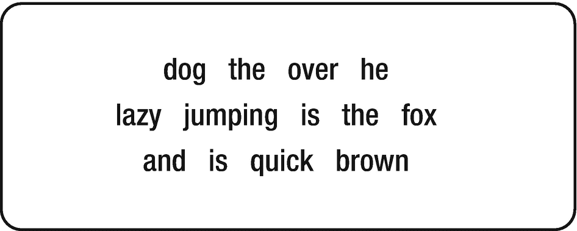
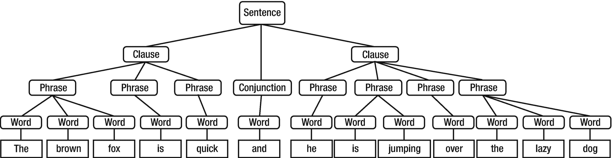
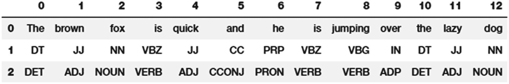
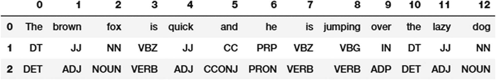
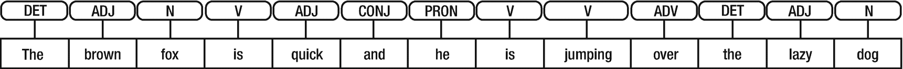
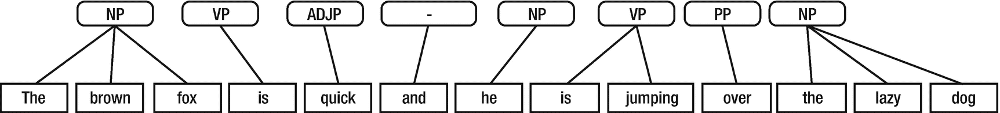
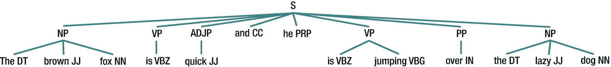
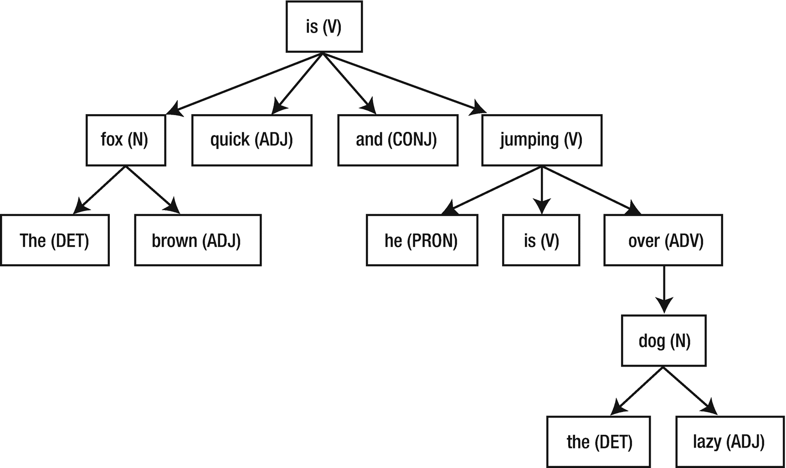
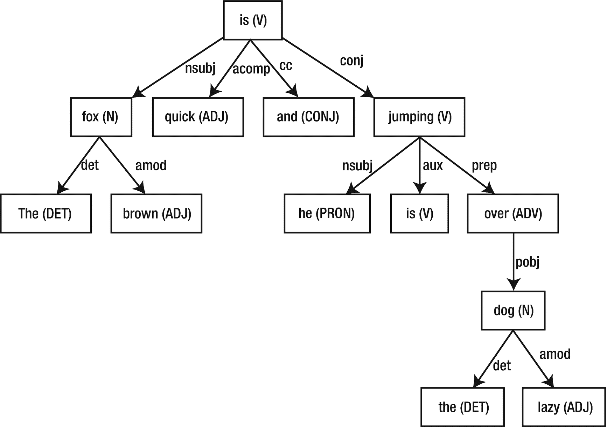
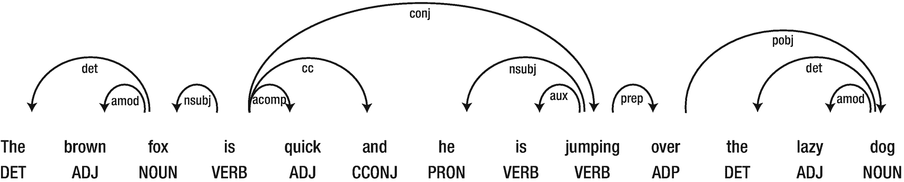

# 语言句法与结构

我们已经了解了语言句法和结构的概念。句法与结构通常相辅相成，由一系列特定规则、惯例和原则来规定词汇如何组合成短语，短语组合成从句，从句组合成句子。本节将专门讨论英语的句法和结构，因为本书处理的是属于英语的文本数据。不过，这些概念中的许多内容也可以扩展到其他语言。了解语言的结构和句法在文本处理、标注和解析（以便进行文本分类或摘要等后续操作）等诸多领域都很有帮助。

在英语中，词汇组合形成其他构成单位。这些构成单位包括词汇、短语、从句和句子。所有构成单位在任何信息中都同时存在，并以层级结构相互关联。此外，句子是一种结构化格式，代表词汇的集合，前提是这些词汇遵循语法等特定句法规则。让我们以示例句子“The brown fox is quick and he is jumping over the lazy dog”为例。以下代码片段展示了该句子在 Python 中的呈现方式。

```
sentence = "The brown fox is quick and he is jumping over the lazy dog"
sentence
'The brown fox is quick and he is jumping over the lazy dog'
```

语法和词汇顺序确实赋予了句子意义。如果我们打乱词汇顺序，句子还能表达意义吗？

```
words = sentence.split()
np.random.shuffle(words)
print(words)
['quick', 'is', 'fox', 'brown', 'The', 'and', 'the', 'is', 'he', 'dog', 'lazy', 'jumping', 'over']
```

如图 1-3 所示，这组无序的词汇显然很难理解，不是吗？



图 1-3

一组无任何关联或结构的词汇集合

从图 1-3 的词汇集合中，我们很难确定它试图传达什么。事实上，语言并不仅仅是由一堆无结构的词汇组成的。具有适当句法的句子不仅有助于我们构建合理的结构并关联词汇，还能帮助词汇根据顺序或位置来传达意义。考虑到之前提到的层级关系：*句子* → *从句* → *短语* → *词汇*，我们可以使用*浅层解析*（一种常用于确定句子构成单位的技术）来构建如图 1-4 所示的层级结构句法树。



图 1-4

遵循层级句法的结构化句子

从图 1-4 的层级结构树中，我们得到了句子“The brown fox is quick and he is jumping over the lazy dog”，这是一个具有结构和意义的句子。我们可以看到，该树的叶节点由词汇组成（此处是最小的单位），词汇的组合形成短语，短语进而形成从句。从句通过各种填充词或连词等词汇连接起来，最终形成句子。在下一节中，我们将更详细地探讨这些构成单位，并学习如何分析它们以及确定主要的句法类别。

## 词汇

词汇是语言中最小的单位；它们具有独立性，并且有自身的含义。虽然词素是语言中具有意义的最小单位，但它们并不像词汇那样独立。一个词汇可以由多个词素组成。对词汇进行标注和标记，然后将其分析为词性，有助于我们了解主要的句法类别。在此，我们涵盖各种词性标签的主要类别和重要性；不过，我们将在第 3 章中更详细地审视它们，并探讨以编程方式生成词性标签的方法。词汇通常属于以下主要类别之一：

*   **N（名词）：** 通常指代描述某些对象或实体的词汇，这些实体可以是生物或非生物。例如：fox（狐狸）、dog（狗）、book（书）等。名词的词性标签符号为 `N`。

*   **V（动词）：** 动词是用于描述某些动作、状态或事件的词汇。还有多种进一步的子类别，如助动词、反身动词、及物动词等。动词的一些典型例子有：running（跑步）、jumping（跳跃）、read（阅读）、write（写作）。动词的词性标签符号为 `V`。

*   **ADJ（形容词）：** 形容词是用于描述或限定其他词汇（通常是名词和名词短语）的词汇。短语“beautiful flower”（美丽的花）中，名词（`N`）“flower”（花）被形容词（`ADJ`）“beautiful”（美丽的）描述或限定。形容词的词性标签符号为 `ADJ`。

*   **ADV（副词）：** 副词通常用作其他词汇（包括名词、形容词、动词或其他副词）的修饰语。短语“very beautiful flower”（非常美丽的花）中，副词（`ADV`）“very”（非常）修饰形容词（`ADJ`）“beautiful”（美丽的），表明花美丽的程度。副词的词性标签符号为 `ADV`。

除了这四大词性类别外，英语中还有其他经常出现的类别，包括代词、介词、感叹词、连词、限定词等。每个词性标签（如名词 `N`）可以进一步细分为各种子类别，例如单数名词（`NN`）、单数专有名词（`NNP`）和复数名词（`NNS`）。我们在第 3 章处理、解析文本数据并实现词性标注器进行文本标注时，会进一步详细探讨词性标签。考虑到前面的示例句子“The brown fox is quick and he is jumping over the lazy dog”，我们可以利用 Python 中的 `NLTK` 或 `spaCy` 来为其标注词性标签。见图 1-5。



图 1-5

使用 NLTK 标注了词性标签的词汇

```
pos_tags = nltk.pos_tag(sentence.split())
pd.DataFrame(pos_tags).T
```

我们将在第 3 章详细讨论每个词性标签的含义。不过，你现在仍然可以利用 `spaCy` 来理解每个标签注释的顶层语义。见图 1-6。



图 1-6

使用 spaCy 标注了词性标签的词汇

```
spacy_pos_tagged = [(word, word.tag_, word.pos_) for word in nlp(sentence)]
pd.DataFrame(spacy_pos_tagged).T
```

有趣的是，根据图 1-6 显示的输出，两个框架的标签注释是匹配的。它们在内部都使用宾州树库词性标注法。回到我们的讨论，使用基本词性标签对我们的句子进行简单注释，结果如图 1-7 所示。



图 1-7

标注了词性标签的词汇


从这个示例中，你可能会看到一些未知的标签。标签 `DET` 代表限定词，用于描述冠词，如 a、an、the 等。标签 `CONJ` 表示连词，通常用于连接分句以构成句子。而 `PRON` 标签代表代词，指代或代替名词的词。`N`、`V`、`ADJ` 和 `ADV` 标签是典型的开放类词性，代表属于开放词汇表的词。开放类词性由无限数量的词组成，并且通常允许向词汇表中添加新词。新词通常通过形态派生、基于用法的创新以及创建复合词干等方式加入开放类词性。一些已添加的流行名词包括“互联网”和“多媒体”。封闭类词性则由一个封闭且有限的词集组成，不接受新词的加入。代词就属于封闭类词性。接下来，我们将探讨层级结构的下一个级别：短语。

### 短语

如前所述，词语有其自身的词法属性，如词性。利用这些词语，我们可以按特定顺序排列它们，使每个词获得相应的意义，并让每个词属于某个短语类别，且其中一个词是中心词或核心词。在层级树中，单词组构成短语，短语是语法树的第三层。根据原则，考虑到层级次序为 *单词* ⟵ *短语* ⟵ *分句* ⟵ *句子*，短语通常至少包含两个或更多词。然而，根据短语在分句或句子中的语法和位置，短语也可以是单个词或词的组合。例如，句子“Dessert was good”只有三个词，每个词都向上构成三个短语。单词“dessert”既是名词也是一个名词短语，“is”表示动词以及一个动词短语，而“good”则表示形容词以及一个形容词短语，用来描述前述的甜点。短语有五大主要类别，如下所述：

*   **名词短语 (NP):** 这类短语中，名词充当中心词。名词短语充当动词的主语或宾语。名词短语可以是一组词，这些词可以被代词替换，而不会导致句子或分句语法不正确。例如“dessert”、“the lazy dog”和“the brown fox”。

*   **动词短语 (VP):** 这些短语是词汇单元，其中动词充当中心词。动词短语通常有两种形式。一种形式包含动词成分以及作为宾语一部分的其他实体，如名词、形容词或副词。这里的动词被称为限定动词。它在层级树中作为一个单元，并可在分句中充当根节点。这种形式在成分语法中很常见。另一种形式是限定动词充当整个分句的根节点，这在依存语法中很常见。动词短语的另一种衍生形态严格由动词成分组成，包括主动词、助动词、不定式和分词。以下句子“He has started the engine”可用于说明这两类动词短语。根据讨论的两种形式，它们分别是“has started the engine”和“has started”。

*   **形容词短语 (ADJP):** 这类短语的中心词是形容词。其主要作用是描述或限定句子中的名词和代词，并且通常置于名词或代词的前后。句子“The cat is too quick”中包含一个形容词短语“too quick”，用于限定名词短语“the cat”。

*   **副词短语 (ADVP):** 这些短语的作用如同副词，因为副词是短语的中心词。副词短语用作名词、动词或副词的修饰语，通过提供更多细节来描述或限定它们。以句子“The train should be at the station pretty soon”为例，其中的副词短语是“pretty soon”，因为它描述了火车到达的时间。

*   **介词短语 (PP):** 这类短语通常包含一个介词作为中心词，以及其他的词汇成分，如名词、代词等。它们像形容词或副词一样，用于描述其他词或短语。句子“Going up the stairs”中包含一个介词短语“up”，描述了楼梯的方向。

这五大句法短语类别可以通过多种规则从单词生成，其中一些规则我们已经讨论过，例如利用不同类型的句法和语法。我们将在后续章节探讨一些流行的语法。浅层句法分析是一种流行的自然语言处理技术，用于从句子中提取这些构成成分，包括词性标注和短语。对于我们的句子“The brown fox is quick and he is jumping over the lazy dog”，使用浅层句法分析表示的一种方式是将其分为七个短语，如图 1-8 所示。



图 1-8 – 浅层句法分析中带有标签的注解短语

这些短语标签属于我们之前讨论的类别；不过单词“and”是一个连词，用于连接分句。有没有更好的处理方法？或许有！你可以自定义短语规则，然后使用类似 `NLTK` 的 `RegexpParser` 这样的基于查找的解析器来进行浅层句法分析或组块分析。它是一种基于语法的组块解析器，使用一组正则表达式模式（即定义的语法规则）来指定解析器的行为。以下代码展示了我们句子中的实际应用！同时请见图 1-9。



图 1-9 – 使用 NLTK 进行浅层句法分析时带有标签的注解短语

```
grammar = '''
NP: {??}
ADJP: {}
ADVP: {}
PP: {}
VP: {?+}
'''
pos_tagged_sent = nltk.pos_tag(sentence.split())
rp = nltk.RegexpParser(grammar)
shallow_parsed_sent = rp.parse(pos_tagged_sent)
print(shallow_parsed_sent)
(S
(NP The/DT brown/JJ fox/NN)
(VP is/VBZ)
(ADJP quick/JJ)
and/CC
he/PRP
(VP is/VBZ jumping/VBG)
(PP over/IN)
(NP the/DT lazy/JJ dog/NN))
# 可视化浅层句法树
shallow_parsed_sent
```

基于图 1-9 的输出，我们可以看到基于简单规则的组块分析器在识别主要短语和句子结构方面的强大功能。在接下来的部分，我们将探讨分句、其主要类别，以及一些用于从句子中提取分句的约定和句法规则。


### 从句

从句本质上既可以充当独立句子，也可以将多个从句组合起来构成一个句子。从句是一组相互关联的词语，通常包含主语和谓语。有时主语可能不出现，而谓语带有动词短语或动词加宾语。通常，你可以将从句分为两大类：主句和从句。主句也被称为独立从句（independent clause），因为它本身就能构成一个句子，同时兼具句子和从句的功能。从属从句或依赖从句（subordinate/dependent clause）无法独立存在，它需要依靠主句来表达含义。这类从句通常借助从属连词等从属词与其他从句连接。

由于我们正在大量讨论语言的句法特性，从句可以根据句法进一步细分为多个类别。具体说明如下。

*   **陈述从句：** 这类从句出现频率极高，表示不带特定语气的陈述。它们只是以中性语气陈述的常规陈述，可以是事实性或非事实性的。例如：“草是绿的”。
*   **祈使从句：** 这类从句通常以请求、命令、规则或建议的形式出现。其语气表现为一个人向一个或多个人发出指令，要求执行命令、请求甚至指示。例如：“请不要在课堂上讲话”。
*   **关系从句：** 对关系从句最简单的解释是，它们是从属从句，因此依赖句子的另一部分。这部分通常包含一个词、短语甚至一个从句。该成分通常充当关系从句中某个词的前行词（antecedent），并与该词相关联。一个简单的例子是：“约翰刚才说他想要一杯苏打水”。前行词是专有名词“约翰”，它在关系从句“他想要一杯苏打水”中被提及。
*   **疑问从句：** 这类从句通常以问题的形式出现。问题类型可以是肯定式或否定式。例如：“你收到我的邮件了吗？”和“你没去上学吗？”。
*   **感叹从句：** 这类从句用于表达震惊、惊讶甚至赞美。所有这些表达都属于感叹范畴，且从句通常以感叹号结尾。例如：“多么精彩的比赛啊！”

大多数从句都表现为上述句法形式之一；不过，从句类别的这份列表并不详尽，还可以进一步细分为其他几种形式。以我们的例句“那只棕色的狐狸跑得很快，它正跳过那只懒狗”为例，如果你还记得句法树，并列连词（and）将句子分成了两个从句。它们分别是“那只棕色的狐狸跑得很快”和“它正跳过那只懒狗”。你能猜出它们可能属于哪个类别吗？（提示：回顾一下陈述从句和关系从句的定义。）

### 语法

语法有助于实现语言中的句法和结构。它主要包括一套规则，用于确定在自然语言中构建句子时如何安排词语、短语和从句的位置。语法不仅限于书面文字，也用于口头表达。这些规则可能特定于某个地区、语言或方言，也可能具有某种普遍性，例如主谓宾（SVO）模型。语法的起源有着丰富的历史，始于印度的梵语。在西方，语法的研究起源于希腊人，最早的作品是狄俄尼索斯·特拉克斯（Dionysius Thrax）所著的《语法艺术》（*Art of Grammar*）。拉丁语法模型是在希腊模型的基础上发展起来的，并逐渐跨越多个时代，开始为各种语言创建语法模型。直到 18 世纪，语法才被视为语言学领域的一个严肃候选方向。

语法随时间推移而发展，并不断演变，从而催生了更新的语法类型。因此，语法并非一套固定的规则，而是根据语言在时间推移中的使用情况而演变。以前面的英语为例，语法有几种分类方式。我们首先讨论两大主要类别，大多数流行的语法框架都可以归入其中，然后进一步探讨这些语法框架如何表征语言。基于对话言句法和结构的表征方式，语法可分为两大类。具体如下：

*   依存语法（Dependency grammar）
*   成分语法（Constituency grammar）


### 依存语法

这是一类特别不关注成分（与成分语法不同）如单词、短语和从句的语法，而是更强调单词本身。因此，这类语法也被称为基于单词的语法。要理解依存语法，我们首先需要知道在这个语境下“依存”的含义。此处的依存指的是带有标签的词与词之间的关系或连接，通常是不对称的。一个单词根据其在句子中的位置，与另一个单词产生关系或依存于该单词。因此，依存语法假设短语和从句的进一步成分是由单词之间的这种依存结构推导出来的。依存语法的基本原理是，在该语言的任何句子中，除了一个单词外，所有其他单词都与句子中的其他单词存在某种关系或依存。那个没有依存关系的单词被称为句子的*根*。在大多数情况下，动词被视为句子的根。所有其他单词都通过称为依存的连接直接或间接地与根动词相关联。虽然没有短语或从句的概念，但通过观察句法以及单词与其依存词之间的关系，我们可以确定句子中必要的成分。

依存语法与句子中的每个单词始终具有一一对应关系。这种语法表示包含两个方面。一是句子的句法或结构，二是通过单词之间表示的关系获得的语义。单词的句法或结构及其相互连接可以使用句子句法或解析树来展示，类似于我们在前一小节中描述的那样。以我们的句子“The brown fox is quick and he is jumping over the lazy dog”为例，如果我们想为其绘制依存句法树，我们将得到如图 1-10 所示的结构。



图 1-10

带词性标注的基于依存语法的句法树

图 1-10 向我们展示了依存关系形成了一棵树，或者更准确地说，形成了一张覆盖句子中所有单词的图。这张图是连通的，其中每个单词至少有一条出边或入边。该图也是有向的，因为每两个单词之间的边都指向一个特定的方向。因此，依存树是一个有向无环图（DAG）。树中的每个节点（根节点除外）最多只有一条入边。由于这是一张有向图，依存树本质上并不描述句子中单词的顺序。其重点更多地放在句子中单词之间的关系上。我们的句子在图 1-10 中用我们之前讨论过的相关词性标注进行了标注，并显示了表示依存关系的有向边。

现在，如果你还记得，我们之前讨论过使用依存语法表示句子有两个方面。每条有向边都代表一种特定类型的有意义关系（也称为句法功能），我们可以进一步标注句子，显示单词之间具体的依存关系类型。如图 1-11 所示。



图 1-11

标注了依存关系类型的基于依存语法的句法树

这些依存关系各有其含义，并且是通用依存类型列表的一部分。这部分内容源自原始论文《[Universal Stanford Dependencies: A Cross-Linguistic Typology](http://nlp.stanford.edu/pubs/USD_LREC14_paper_camera_ready.pdf)》（de Marneffe 等人，2014 年）。你可以在[`http://universaldependencies.org/u/dep/index.html`](http://universaldependencies.org/u/dep/index.html)查看详尽的依存类型列表及其含义。spaCy 框架利用了这一通用依存方案以及另一种名为`CLEAR`的依存方案。如果你有兴趣了解所有这些依存关系的重要性，可以在[`https://emorynlp.github.io/nlp4j/components/dependency-parsing.html`](https://emorynlp.github.io/nlp4j/components/dependency-parsing.html)获取有关可能依存的详细信息。如果我们观察其中一些依存关系，理解它们并不太难。我们详细分析一下图 1-11 句子中使用的几个依存标签。

*   依存标签 `det` 表示名词性中心词与其限定词之间的限定关系。通常，带有词性标签 `DET` 的单词也会具有 `det` 关系。例如（`fox -> the`）和（`dog -> the`）。
*   依存标签 `amod` 代表形容词修饰语，指代任何修饰名词含义的形容词。例如（`fox -> brown`）和（`dog -> lazy`）。
*   依存标签 `nsubj` 代表在从句中充当主语或施动者的实体。例如（`is -> fox`）和（`jumping -> he`）。
*   依存关系 `cc` 和 `conj` 是与通过并列连词连接的单词相关的链接。例如（`is -> and`）和（`is -> jumping`）。
*   依存标签 `aux` 表示从句中的助动词或次要动词。例如（`jumping -> is`）。
*   依存标签 `acomp` 代表形容词补语，充当句子中动词的补语或宾语。例如（`is -> quick`）。
*   依存标签 `prep` 表示介词修饰语，通常修饰名词、动词、形容词甚至介词的含义。这种表示法用于带有名词或名词短语补语的介词。例如（`jumping -> over`）。
*   依存标签 `pobj` 用于表示介词的对象。这通常是句子中介词后跟名词短语的中心词。例如（`over -> dog`）。

这些标签在我们的示例句子中被广泛用于标注单词之间的各种依存关系。既然你现在对依存关系有了更好的理解，最好记住，在表示句子的依存语法时，通常不必创建带有线性顺序的树，你还可以使用普通的图来表示，因为依存语法中没有单词顺序的概念。我们可以利用 spaCy 为我们的示例句子构建这个依存树/图（见图 1-12）。



图 1-12

使用 spaCy 为我们的示例句子标注的依存语法图

```
from spacy import displacy
displacy.render(nlp(sentence), jupyter=True,
options={'distance': 100,
'arrow_stroke': 1.5,
'arrow_width': 8})
```

图 1-12 展示了我们带依存标签标注的句子，基于我们之前的讨论，这应该对你来说很清晰了。当我们接下来讨论基于成分的语法时，你会观察到，与相应的成分语法相比，依存语法中的节点数量会少得多。目前存在多种基于依存语法的语法框架。一些流行的包括代数句法和运算符语法。接下来，我们来看一下成分语法的概念及其表示方法。


