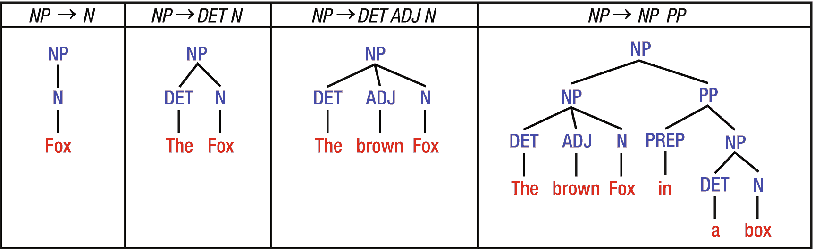
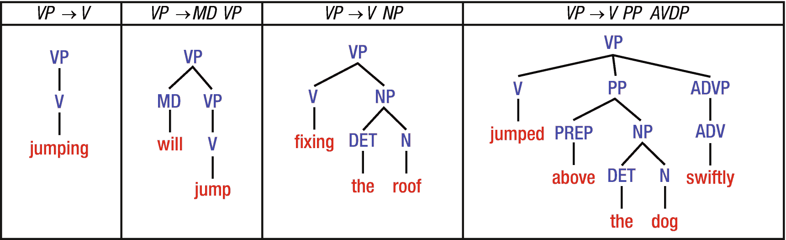
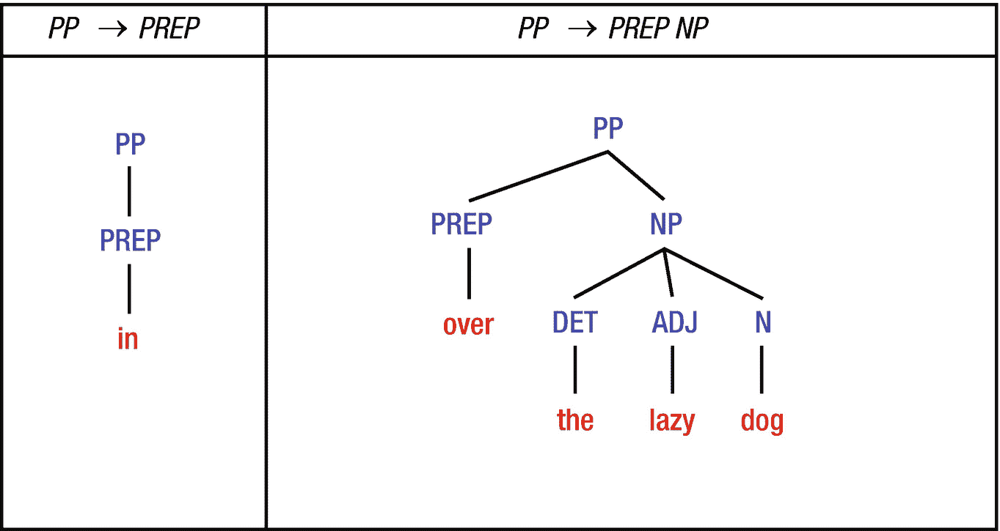
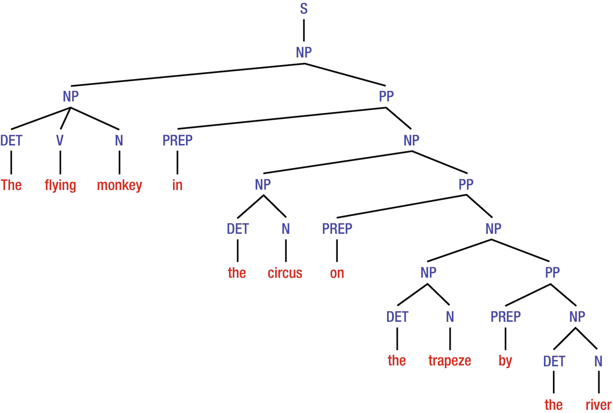
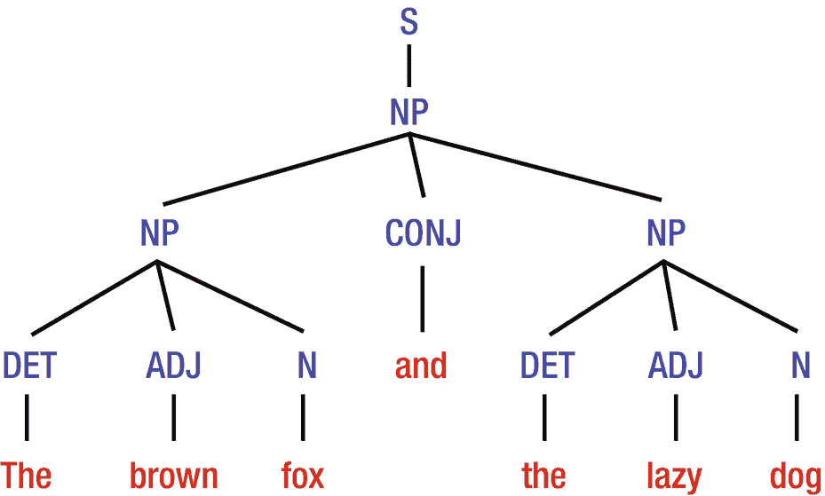
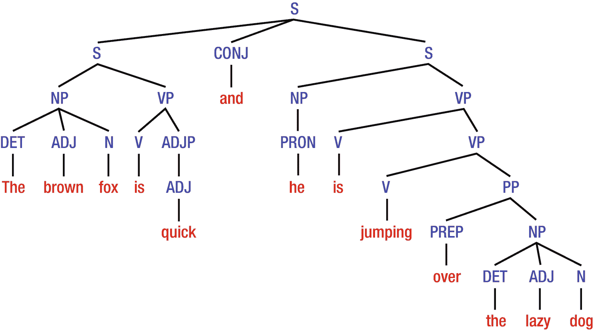
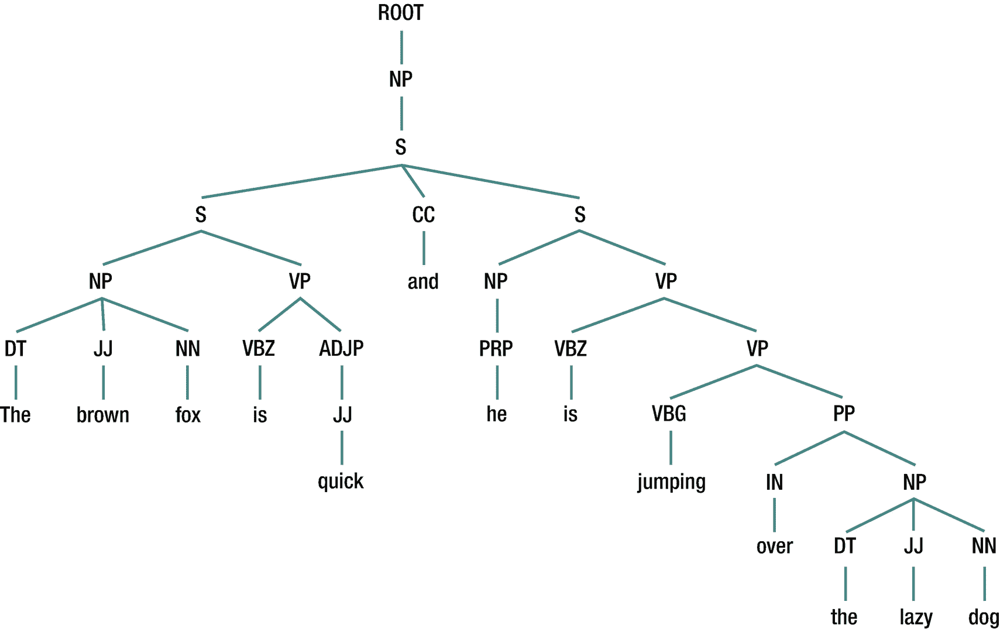
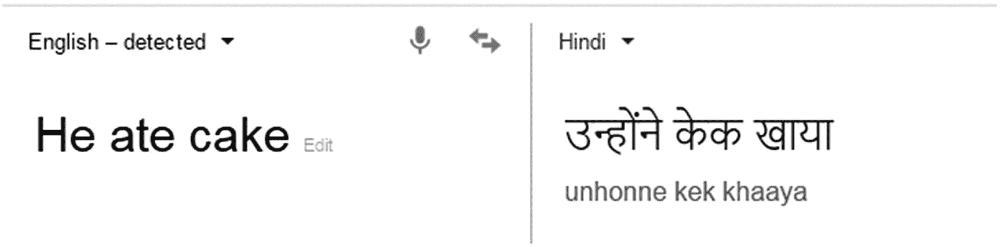

# 成分语法

这类语法建立在这样一个原则上：一个句子可以由其派生的若干成分来表示。这类语法可用于根据各成分的层次有序结构来建模或表示句子的内部结构。每个词都属于特定的词汇范畴，并构成不同短语的中心词。这些短语是基于称为短语结构规则的规则形成的。因此，成分语法也被称为*短语结构语法*。短语结构语法由诺姆·乔姆斯基在 20 世纪 50 年代提出。

## 成分的概念

要理解成分语法，我们必须清楚了解成分的含义。我们在本章前面多次提到过，但为了唤起你的记忆，成分是指具有特定含义、能够作为一个从属或独立单元共同起作用的单词或词组。它们还可以组合起来，形成句子中更高层次的结构。这包括短语和从句。

## 短语结构规则

短语结构规则构成了成分语法的核心，因为它们涉及句法和规则，这些规则支配着句子中各种成分的层级和顺序。这些规则主要服务于两个目的。首先也是最重要的，这些规则决定了用什么词来构建短语或成分；其次，这些规则决定了我们需要如何排列这些成分。如果我们要分析短语结构，就应该了解短语结构规则的典型模式。短语结构规则的通用表示为：

```
S → A B
```

它表示结构 `S` 由成分 `A` 和 `B` 构成，并且顺序是 `A` 后接 `B`。

短语结构规则有多种，我们逐一探讨，以理解如何准确地提取和排列句子中的成分。最重要的规则描述了如何划分一个句子或从句。短语结构规则将一个句子或从句表示为二进制划分：

```
S → NP VP
```

其中 `S` 是句子或从句，它被划分为主语（由名词短语 `NP` 表示）和谓语（由动词短语 `VP` 表示）。当然，我们可以应用其他规则来进一步分解每个成分，但层级的顶层是以 `NP` 和 `VP` 开始的。

## 名词短语规则

表示名词短语的规则形式为：

```
NP → [DET][ADJ]N [PP]
```

其中方括号 `[...]` 表示该部分是可选的。一个名词短语通常由一个名词（`N`）作为中心词，并且可以可选地包含（`DET`）限定词和（`ADJ`）形容词来描述该名词，以及右侧的介词短语（`PP`）在句法树中。因此，一个名词短语可能包含另一个名词短语作为其组成成分。图 1-13 展示了一些受上述名词短语规则支配的例子。



*图 1-13* — 展示名词短语结构规则的成分句法树

这些句法树向我们展示了名词短语通常包含的各种成分。如前所述，由产生式左侧的 `NP` 表示的名词短语也可能出现在产生式的右侧，如最后一个示例所示。这是一种称为*递归*的属性，我们将在本节末尾讨论它。

## 动词短语规则

现在我们来看表示动词短语的规则。其规则形式为：

```
VP → V | MD [VP][NP][PP][ADJP][ADVP]
```

其中中心词通常是动词（`V`）或情态动词（`MD`）。情态动词本身是助动词，但我们赋予其不同的表示，只是为了将其与普通动词区分开。其后可选地跟随着另一个动词短语（`VP`）或名词短语（`NP`）、介词短语（`PP`）、形容词短语（`ADJP`）或副词短语（`ADVP`）。当我们使用二分法规则拆分句子时，动词短语总是第二部分，而名词短语则是第一部分。图 1-14 展示了一些典型可构建的不同类型动词短语的例子及其句法树表示。



*图 1-14* — 展示动词短语结构规则的成分句法树

正如我们之前所描述的，这些句法树向我们展示了动词短语中各种成分的表示，并且利用递归属性，一个动词短语内部也可能包含另一个动词短语，正如我们在第二棵句法树中看到的那样。我们还看到层级关系得到了维护，尤其是在第三和第四棵句法树中，`NP` 和 `PP` 本身是 `VP` 下的进一步成分，并且它们可以进一步分解为更小的成分。

## 介词短语规则

既然我们在前面的例子中看到了大量使用的介词短语，让我们来看看表示介词短语的产生式规则。基本规则形式为：

```
PP → PREP [NP]
```

其中 `PREP` 表示充当中心词的介词，其后可选地跟着一个名词短语（`NP`）。图 1-15 展示了一些介词短语的表示及其对应的句法树。



*图 1-15* — 展示介词短语结构规则的成分句法树

这些句法树向我们展示了介词短语的几种不同表示。

## 递归属性

现在我们讨论递归的概念。递归是语言固有的属性，它允许成分嵌入到其他成分中，这通过出现在产生式规则两侧的不同短语类别来体现。这使得我们能够从句子中创建出长的基于成分的句法树。一个简单的例子是句子“The flying monkey in the circus on the trapeze by the river”的表示，如图 1-16 中的成分句法分析树所示。



*图 1-16* — 展示成分之间递归属性的成分句法树

如果仔细观察图 1-16 中的语法树，你会发现它仅由名词短语和介词短语构成。然而，由于介词短语本身可以包含名词短语，而名词短语也可以包含名词短语和介词短语这一固有的递归属性，其层级结构中包含了多个`NP`和`PP`。如果你回顾一下名词短语和介词短语的生成规则，就会发现图 1-16 中的树形结构组成完全遵循这些规则。

## 连词规则

现在我们来简单谈谈连词，因为连词用于连接从句和短语，是语言句法的重要组成部分。通常，单词、短语甚至从句都可以通过连词组合起来。其生成规则可以表示为：

```
S → S conj S ∀ S ∈ {S, NP, VP}
```

其中两个成分可以通过规则中记为`conj`的连词连接。一个简单的例子是句子“The brown fox and the lazy dog”，它由一个名词短语构成，而该名词短语本身是由两个名词短语和一个连词组合而成的。图 1-17 中的成分句法树展示了这一生成规则的遵循情况。



图 1-17：展示由连词连接的名词短语的成分句法树

图 1-17 向我们表明，顶层的名词短语本身就是一个句子，它包含两个名词短语作为其组成成分。这两个名词短语由一个连词连接，从而满足了我们之前提到的生成规则。如果我们想用一个连词连接两个句子或从句呢？我们可以将所有规则和约定结合起来，为我们示例句子“The brown fox is quick and he is jumping over the lazy dog”生成基于成分的句法树。这将得到我们句子的句法表示，如图 1-18 所示。



图 1-18：示例句子的成分句法树

从图 1-18 中，你可以推断出我们的句子包含两个主要从句或成分（我们之前讨论过），它们由一个并列连词（and）连接。此外，基于成分语法的生成规则将顶层成分进一步分解为由短语及其单词构成的子成分。查看该句法树，你会发现它确实展示了句子中单词的顺序，并且更像是一个具有无向边的层级树状结构。因此，这与基于依存语法的、具有无序单词和有向边的句法树/图有很大不同。有几种流行的语法框架都源于成分语法中的概念。这些框架包括短语结构语法、弧对语法、词汇功能语法，甚至还有广泛应用于形式语言描述的著名上下文无关语法。我们可以利用 NLTK 中基于 Stanford Core NLP 的解析器，对我们的示例句子进行成分分析。



图 1-19：使用 NLTK 和 Stanford Core NLP 解析我们的示例句子得到的成分句法树

# 自然语言处理基础

```python
from nltk.parse.stanford import StanfordParser
scp = StanfordParser(path_to_jar='E:/stanford/stanford-parser-full-2015-04-20/stanford-parser.jar', path_to_models_jar='E:/stanford/stanford-parser-full-2015-04-20/stanford-parser-3.5.2-models.jar')
result = list(scp.raw_parse(sentence))
print(result[0])
(ROOT
(NP
(S
(S
(NP (DT The) (JJ brown) (NN fox))
(VP (VBZ is) (ADJP (JJ quick))))
(CC and)
(S
(NP (PRP he))
(VP
(VBZ is)
(VP
(VBG jumping)
(PP (IN over) (NP (DT the) (JJ lazy) (NN dog)))))))))
# 可视化成分树
result[0]
```

我们可以看到，图 1-19 中描绘的成分树与图 1-18 中的树具有相同的层级结构。

### 语序类型学

语言学中的*类型学*是一个专门研究如何根据句法、结构和功能对语言进行分类的领域。分类方式有多种，其中最常见的模型之一是根据其主导语序进行分类，这也被称为*语序类型学*。我们感兴趣的主要语序出现在包含主语、动词和宾语的从句中。当然，并非所有从句都会使用主语、动词和宾语的格式，而且在某些语言中，主语和宾语也并非必需。然而，存在几种不同的语序类别，可用于对多种多样的语言进行分类。Russell Tomlin 于 1986 年进行了一项调查，表 1-1 展示了其分析得出的一些见解。

**表 1-1**：Russell Tomlin 在 1986 年调查的基于语序的语言分类

| 序号 | 语序 | 语言出现频率 | 示例语言 |
| --- | --- | --- | --- |
| 1 | 主语-宾语-动词 | 180 (45%) | 梵语、孟加拉语、哥特语、印地语、拉丁语 |
| 2 | 主语-动词-宾语 | 168 (42%) | 英语、法语、普通话、西班牙语 |
| 3 | 动词-主语-宾语 | 37 (9%) | 希伯来语、爱尔兰语、菲律宾语、阿拉姆语 |
| 4 | 动词-宾语-主语 | 12 (3%) | Baure 语、马尔加什语、Aneityan 语 |
| 5 | 宾语-动词-主语 | 5 (1%) | Apalai 语、Hixkaryana 语、Arecua 语 |
| 6 | 宾语-主语-动词 | 1 (0%) | Warao 语 |

从这张表中，我们可以观察到共有六大主要语序类别，像英语这样的语言遵循主语-动词-宾语的语序类别。一个简单的例子是句子“He ate cake”，其中“He”是主语，“ate”是动词，“cake”是宾语。表 1-1 中的大多数语言遵循主语-宾语-动词语序。在这种情况下，如果将这些语言翻译过来，句子“He cake ate”才是正确的。英语到印地语对同一句子的翻译（如图 1-20 所示，由谷歌翻译提供）就说明了这一点。



图 1-20：英语到印地语的翻译改变了句子的语序类别

即使你不懂印地语，通过谷歌提供的英语注释也能理解：在印地语翻译下方的文本中，表示“蛋糕”的词“kek”移到了句子的中间，而表示动词“吃”的“khaaya”移到了句尾，从而使语序类别变为主语-宾语-动词，这正是印地语的正确形式。这向我们表明了语序的重要性，以及信息表达在不同语言中可能在语法上存在差异。至此，我们关于语言句法和结构的讨论就结束了。接下来，我们来看看围绕语言语义的一些概念。