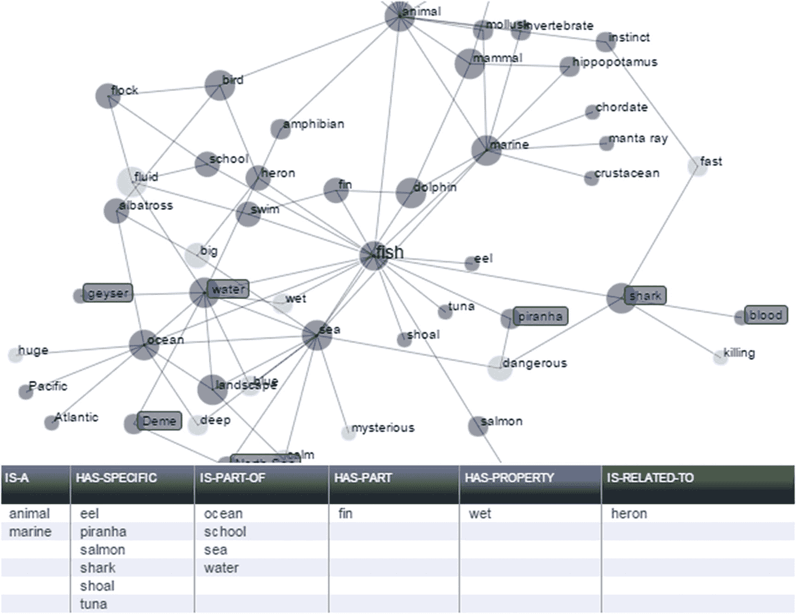
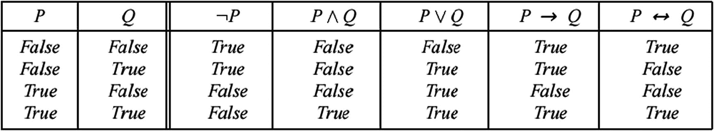

# 语言语义学

`语义学`的定义是对意义的研究。语言学有其自身的子领域——语言语义学，专门研究语言中的意义，包括词语、短语和符号之间的关系。它研究这些语言单位所指示、表达以及代表的知识。简言之，语义学更关注面部表情、标志、符号、肢体语言以及在信息传递过程中从一个实体转移到另一个实体的知识。如何通过形式化规则或惯例来表示语义，一直是语言学中的挑战。不过，有多种方法可以表示从语言中获得的意义和知识。在下一节中，我们将探讨语言词汇单位（主要是词语和短语）之间的关系，并研究围绕知识和意义形式化表示的几个概念。

## 词汇语义关系

词汇语义学旨在识别语言中词汇单位之间的语义关系，以及这些关系如何与语言的句法和结构相关联。词汇单位通常由语素表示，语素是语言中最小且句法正确的有意义单位。词语本质上是这些语素的一个子集。每个词汇单位都有其自身的句法、形式和意义，同时它们也从短语、从句和句子中的周围词汇单位获取意义。`词汇表`是这些词汇单位的完整词汇集合。本节我们将探讨围绕词汇语义学的一些概念。

### 词元与词形

`词元`也被称为一组词语的标准形式或引用形式。词元通常是一组词语的基础形式，这组词语被称为`词位`。词元是代表该词位的特定基础形式或主词。词形是词元的屈折变化形式，它们是词位的一部分，并且可以作为词位中的某个词语出现在文本中。一个简单的例子是词位 {eating, ate, eats}，这些是词形，而它们的词元是单词“eat”。

这些词根据其在句子中其他词之间的位置具有特定的含义。这也被称为词的“义项”或词义。`词义`为我们提供了词语意义不同方面的具体表示。考虑以下句子中的单词“fair”：“They are going to the annual fair（他们要去参加年度集市）”和“I hope the judgment is fair to all（我希望判决对所有人都是公平的）”。尽管单词“fair”在两个句子中相同，但其含义会根据周围的词和上下文而变化。

### 同形同音异义词、同形异义词与同音异义词

`同形同音异义词`被定义为拼写或发音相同但含义不同的词。另一种定义将条件限制为拼写相同。这些词之间的关系称为同形同音异义关系。同形同音异义词通常被认为是同形异义词和同音异义词的超集。同形同音异义词的一个例子可以通过以下句子来展示：“The bat hangs upside down from the tree（蝙蝠倒挂在树上）”和“That baseball bat is really sturdy（那个棒球棒非常结实）”，其中的单词是“bat”。

`同形异义词`被定义为书写形式或拼写相同但含义不同的词。几种替代的定义认为它们的发音也可以不同。同形异义词的一些例子包括单词“lead”，如“I am using a lead pencil（我正在用一支铅笔）”和“Please lead the soldiers to the camp（请带领士兵们去营地），以及单词“bass”，如“Turn up the bass for the song（把这首歌的低音调大）”和“I just caught a bass today while I was out fishing（我今天出去钓鱼时刚钓到一条鲈鱼）”。注意，对于单词“lead”的情况，拼写保持不变，但发音会根据句子中的上下文而变化。

`同音异义词`被定义为发音相同但含义不同，并且拼写可以相同或不同的词。例如单词“pair”（意思是“一对”）和“pear”（意思是“梨”），它们发音相同但含义和书写形式不同。这些词在自然语言处理中会引发问题，因为使用机器智能很难确定实际的上下文和含义。

### 同形异音异义词与同音形异义词

`同形异音异义词`被定义为书写形式或拼写相同，但发音和含义不同的词。从性质上讲，它们是同形异义词的一个子集。它们也常被称为同音异形词，意为“不同的发音”。同形异音异义词的例子包括单词“lead”（金属，指挥）和“tear”（撕开，眼泪）。

`同音形异义词`被定义为发音相同，但含义和拼写都不同的词。从性质上讲，它们是同形同音异义词的一个子集。它们的书写形式可能不同，但听起来非常相似，或者通常在口语中完全相同。一些例子包括单词“to”、“too”和“two”，它们发音相似，但拼写和含义不同。

### 多义词

`多义词`被定义为书写形式或拼写相同，但含义不同且相互关联的词。虽然这听起来很像同形同音异义现象，但区别是主观的，取决于上下文，因为这些词彼此相关。一个很好的例子是单词“bank”，它可以表示（1）金融机构，（2）河岸，（3）属于该金融机构的建筑，或者（4）甚至作为动词，意思是“依赖”。现在所有这些例子都使用了同一个单词“bank”，并且它们属于同形同音异义词。但只有（1）、（3）以及（4）（代表信任和安全，这正是金融机构所象征的）是多义词，并代表一个共同的主题。

### 大小写异义词

`大小写异义词`被定义为书写形式或拼写相同，但在大写时含义不同的词。这些词可能有或没有不同的发音。一些例子包括单词“march”（“March”表示三月，“march”描绘步行的动作）和“may”（“May”表示五月，“may”描绘一个情态动词）。

#### 同义词与反义词

`同义词`被定义为发音和拼写不同，但在某些或所有语境下具有相同含义的词语。如果两个单词或词素是同义词，它们可以在各种语境中相互替代，这表明它们具有相同的命题意义。互为同义词的词语被称为彼此`同义`，这种同义状态称为`同义关系`。完全的同义关系几乎不存在。原因在于同义关系更多是义项之间的关系，并具有语境含义，而不仅仅是词语本身。例如，“big”、“huge”和“large”这三个词互为同义词。它们在类似“那杯奶昔真的（big/large/huge）”这样的句子中相互关联且完全合理。然而，如果我们考虑句子“Bruce is my big brother”，将“big”替换为“huge”或“large”则不成句。这是因为此处的“big”具有表示“年长的”这一语境或义项，而另外两个同义词缺乏此义项。同义词可以存在于所有词类中，包括名词、形容词、动词、副词和介词。

`反义词`被定义为表示二元对立关系的成对词语。这些词表示彼此完全相反的具体含义和意义。反义词的状态称为`反义关系`。反义词有三种类型——分级反义词、互补反义词和关系反义词。分级反义词是在连续尺度上衡量时具有某种等级或水平的反义词，如（*胖*，*瘦*）这对词。互补反义词是意义相反但无法在任何等级或尺度上衡量的词对。互补反义词的一个例子是（*分裂*，*联合*）。关系反义词是其之间存在某种关系的词对，语境中的反义关系正是由这种关系所体现。关系反义词的一个例子是（*医生*，*病人*）。

### 下义词与上义词

`下义词`是其他词的下位类词语。在这种情况下，下义词通常是相对于其上位类词语而言，具有非常具体含义和语境的词语。`上义词`则是作为下义词上位类的词语，相较于下义词具有更通用的含义。例如，“fruit”这个词是上义词，而“mango”、“orange”和“pear”是其可能的下义词。这些词语之间体现的关系通常被称为上下义关系。

## 语义网络与模型

我们已经看到几种形式化词语之间关系及其含义或意义的方法。考虑到词汇语义学，有确定每个词汇单位的含义和意义的方法，但如果我们想要表示某个概念或理论的意义，而该概念或理论涉及将这些词汇单位关联起来，并根据它们的意义在它们之间建立联系，那该怎么办？语义网络旨在通过使用网络或图形来解决这种知识和概念的表示问题。语义网络的基本单元是一个实体或一个概念。概念可以是像想法这样有形或抽象的事物。一组概念彼此之间存在某种关系，并可以用有向或无向边来表示。每条边表示两个概念之间的一种特定关系类型。

假设我们在讨论“鱼”这个概念。我们可以根据它们与鱼的关系，围绕鱼形成不同的概念。例如，鱼“是一种”动物，鱼“是”海洋生物的“一部分”。这些关系被描绘为`is-a`关系。还可以有各种其他关系，如`has-a`、`part-of`、`related-to`等，具体取决于语境和语义。这些概念和关系构成了一个语义网络，你甚至可以在线浏览几个这样的语义模型，在那里你会找到涵盖不同概念的庞大知识库。图 1-21 展示了与鱼相关概念的一种可能表示。此模型由 Nodebox 提供，网址为[`https://www.nodebox.net/perception/`](https://www.nodebox.net/perception/)。你可以在此网站搜索各种概念并查看相关概念。

**图 1-21** 围绕“鱼”概念的语义网络

从图 1-21 所示的网络中，我们可以看到之前讨论的围绕“鱼”的一些概念，以及特定的鱼类，如鳗鱼、鲑鱼、鲨鱼等。这些可以是概念“鱼”的下义词。这些语义网络通过使用图形结构的语义数据模型进行正式表示，其中概念或实体是节点，边表示关系。语义网是万维网的扩展，它使用语义元数据注释和嵌入，以及诸如资源描述框架（`RDF`）和网络本体语言（`OWL`）等数据建模技术。在语言学中，我们拥有一个丰富的词汇语料库和数据库，称为`WordNet`，它包含了根据语义相似性（如同义词）分组到`synsets`（同义词集）中的不同词汇实体的详尽列表。这些`synsets`之间以及由此产生的各种词汇之间的语义关系可以在`WordNet`中探究，使其本质上成为一种语义网络。我们将在后面讨论文本语料库的部分，更详细地介绍`WordNet`。

## 语义的表示

到目前为止，我们已经看到如何基于词汇单位表示语义，以及如何通过利用语义网络将它们相互连接起来。如果我们考虑通过消息进行交流的常规形式，无论是书面还是口头，如果一个实体向另一个实体发送消息，并且该实体根据消息采取某些特定行动，那么就可以说该实体理解了该消息所传达的含义。

可能出现的一个问题是，我们如何正式表示一个简单句子所传达的含义或语义？虽然理解所传达的含义对我们来说可能极其容易，但正式表示语义并不像看起来那么简单。考虑以下例子：“把桌上那本书拿给我”。这个句子本质上是一个指令，它指示听者去做某事。理解这个句子所传达的含义，除了实际从桌上取书的行为外，还可能涉及语用学知识，例如“哪本书？”以及“哪张桌子？”。尽管人类思维具有直觉性，但正式表示各个组成部分的含义和关系是一个挑战。然而，我们可以使用多种技术来做到这一点，例如命题逻辑和一阶逻辑。利用这些表示，我们可以表示不同句子所指示的含义，并从中进行推理。我们甚至可以根据语义发现一个句子是否蕴含另一个句子。语义的表示对于执行各种自然语言处理操作特别有用，目的是通过适当的表示让机器理解消息背后的语义，因为机器缺乏人类的认知能力。

### 命题逻辑

命题逻辑，又称句子逻辑或陈述逻辑，被定义为研究命题、陈述和句子的逻辑学科。这包括研究命题与陈述之间的逻辑关系和属性，将多个命题组合成更复杂的命题，以及观察命题的真值如何根据其组成部分和逻辑运算符发生变化。命题或陈述通常是陈述性的，并且能够具有二元真值（真或假）。通常，陈述更具体且与语言相关，而命题更倾向于陈述所传达的思想或概念。一个简单的例子是这两个陈述——“火箭比飞船快”和“飞船比火箭慢”——它们不同但传达了相同的含义或命题。然而，在命题逻辑中，“陈述”和“命题”这两个术语往往可以互换使用。

命题逻辑的主要焦点是研究不同的命题，并观察如何通过逻辑运算符组合各种命题来改变整个命题的语义。这些逻辑运算符更多地被用作连接词或并列连词。运算符包括诸如“与”、“或”和“非”这样的术语，它们可以单独改变一个命题的含义，或在多个命题组合时发挥作用。一个简单的例子是两个命题——“地球是圆的”和“地球围绕太阳公转”。它们可以用逻辑运算符“与”组合，得到命题“地球是圆的，*并且*它围绕太阳公转”，这告诉我们，“与”运算符两侧的两个命题必须都为真，组合后的命题才为真。

命题逻辑的一个优点是每个命题都有其自身的真值，并且它不关心进一步将命题细分为更小的部分并验证逻辑特征。每个命题都被视为一个不可分割的整体单位，拥有自身的真值。逻辑运算符可以应用于它以及其他几个命题。这里不考虑细分命题的组成部分，如从句或短语。为了表示命题逻辑的各种基本构建块，我们使用一些约定和符号。像`P`和`Q`这样的大写字母用于表示单个陈述或命题。所使用不同的运算符及其对应符号如表 1-2 所示，按优先级顺序排列。

**表 1-2**

逻辑运算符及其符号与优先级

| 序号 | 运算符符号 | 运算符含义 | 优先级 |
| --- | --- | --- | --- |
| 1 | `¬` | 非 | 最高 |
| 2 | `∧` | 与 |   |
| 3 | `∨` | 或 |   |
| 4 | `→` | 如果-那么 |   |
| 5 | `↔︎` | 当且仅当 | 最低 |

从表 1-2 可以看出，总共有五个运算符，其中`非`运算符的优先级最高，`当且仅当`运算符的优先级最低。逻辑常量被表示为真或假。常量和符号被称为原子单位，而所有其他单位，更具体地说，句子和陈述，是复杂单位。字面量通常是一个原子语句或应用`非`运算符后的否定。我们用一个简单的例子来展示两个句子`P`和`Q`，并对它们应用各种运算符。让我们考虑以下表示：

`P`: 他饿了

`Q`: 他会吃一个三明治

表达式`P ∧ Q`翻译为“他饿了，并且他会吃一个三明治”。这表达了该操作的结果本身也是一个句子或命题。这是一个合取操作，其中`P`和`Q`是合取项。只有当`P`和`Q`都为真时，这个句子的结果才为真。

表达式`P ∨ Q`翻译为“他饿了，或者他会吃一个三明治”。这表达了该操作的结果也是由析取操作形成的另一个命题，其中`P`和`Q`是析取项。当`P`或`Q`中有一个为真，或者两者都为真时，这个句子的结果为真。

表达式`P → Q`翻译为“如果他饿了，那么他会吃一个三明治”。这是一个蕴含操作，它确定`P`是前提或前件，而`Q`是后件。这就像一个规则，规定只有当`P`已经发生或为真时，`Q`才会发生。

表达式`P ↔︎ Q`翻译为“当且仅当他饿了，他才会吃一个三明治”，这基本上是表达式“如果他饿了，那么他会吃一个三明治”（`P → Q`）和“如果他会吃一个三明治，那么他饿了”（`Q → P`）的组合。这是一个双条件或等价操作，当且仅当我们描述的这两个蕴含操作的结果都为真时，它才会评估为真。

表达式`¬P`翻译为“他不饿”，这描述了否定操作，当且仅当`P`评估为假时，它才会评估为真。

这让我们了解了命题之间的基本操作以及更复杂的操作，这些操作可以通过多个逻辑连接词和添加更多命题来实现。一个简单的例子是以下这些陈述：

`P`: 我们会踢足球

`Q`: 体育场开放

`R`: 今天会下雨

它们可以组合起来表示为`Q ∧ ¬R → P`，以描述这个复杂的命题：“如果体育场开放且今天不下雨，那么我们会踢足球”。最终命题的真值或结果的语义可以根据各个命题的真值和运算符来评估。不同运算符的真值各种结果如图 1-22 所示。

**图 1-22**

各种逻辑连接词的真值

因此，利用图 1-22 中的表格，我们可以通过将更复杂的命题分解为更简单的二元操作，计算这些操作的真值，并逐步组合它们，来评估这些命题。除了这些结果之外，还有其他属性，如结合律、交换律和分配律，它们有助于评估复杂命题的结果。检查每个操作和命题的有效性并最终评估结果的行为也称为`推理`。

然而，除了始终计算庞大的真值表之外，我们还可以使用多种推理规则来得出最终结果或结论。这样做的主要原因在于，随着命题数量的增加，包含各种操作的真值表的大小会呈指数级增长。此外，推理规则更容易理解且经过充分验证，在它们的核心，实际上应用了相同的真值表，但我们不必操心其内部机制。一系列推理规则在被应用后，通常会得出一个结论，这常被称为`逻辑证明`。推理规则通常的形式是`P ⊢ Q`，它表示`Q`可以从`P`所表示的一组陈述中通过某些推理操作推导出来。范葫芦符（`⊢`）表明`Q`是`P`的某个逻辑推论。最流行的推理规则如下：

- **假言推理（Modus ponens）：** 这是最常用的推理规则，也称为蕴含消去规则。它可以表示为`{P → Q, P}` ⊢ `Q`，意指如果`P`蕴含`Q`且`P`被断言为真，则可推断出`Q`也为真。你也可以用表达式`(P → Q) ∧ P) → Q`来表示，该表达式可通过真值表轻松求值。一个简单的例子是语句“如果天气晴朗，我们就去踢足球”，表示为`P → Q`。现在如果我们说“天气晴朗”，这表明`P`为真，因此自动推断出`Q`为真，即表示“我们将去踢足球”。

- **拒取式（Modus tollens）：** 这与前一条规则非常相似，其形式化表示为`{P → Q, ¬Q}` ⊢ `¬P`。这表明如果`P`蕴含`Q`且`Q`实际上被断言为假，则可推断出`P`也为假。你也可以用表达式`(P → Q) ∧ ¬Q) → ¬P`来表示，该表达式可通过真值表轻松求值。一个示例命题是“如果他是单身汉，他就没有结婚”，表示为`P → Q`。现在如果我们提出“他已经结婚”，表示为`¬Q`，则可推断出`¬P`，即“他不是单身汉”。

- **析取三段论：** 这也被称为析取消去规则，其形式化表示为`{P ∨ Q, ¬P}` ⊢ `Q`。这表明如果`P`或`Q`为真，且`P`为假，则`Q`为真。一个简单的例子是语句“他要么是奇迹创造者，要么是骗子”，表示为`P ∨ Q`。而“他不是奇迹创造者”表示为`¬P`，因此我们可以推断出“他是骗子”，即`Q`。

# 推理规则

- `假言三段论`：这通常被称为演绎链式规则，其形式化表示为`{P → Q, Q → R}` ⊢ `P → R`。这表明如果`P`蕴含`Q`且`Q`蕴含`R`，则可推断出`P`蕴含`R`。一个非常有趣的例子是理解语句“如果我生病了，我就不能去上班”，表示为`P → Q`，以及“如果我不能去上班，大楼的施工就无法完成”，表示为`Q → R`。然后我们可以推断出“如果我生病了，大楼的施工就无法完成”，即表示为`P → R`。

- `构造性二难推理`：这一推理规则是假言推理的析取版本，其形式化表示为`{(P → Q) ∧ (R → S), P ∨ R}` ⊢ `Q ∨ S`。这表明如果`P`蕴含`Q`且`R`蕴含`S`，并且`P`或`R`为真，则可推断出`Q`或`S`为真。考虑以下命题：“如果我努力工作，我就会成功”，表示为`P → Q`，以及“如果我中彩票，我就会变得富有”，表示为`R → S`。现在我们可以提出“我努力工作*或*我中彩票”为真，这表示为`P ∨ R`。然后我们可以推断出“我会成功或者我会变得富有”，即表示为`Q ∨ S`。这一规则的互补形式是`破坏性二难推理`，它是拒取式的析取版本。

这应该能让你清楚了解推理规则有多么直观，并且使用它们远比通过多个真值表来尝试确定复杂命题的结果要容易得多。我们从推理中得出的解释，赋予了语句或命题的语义。一个有效的语句是指在所有解释下都为真的语句，无论其内部的逻辑运算或各种语句如何。这通常被称为`重言式`。重言式的互补形式是`矛盾`或非一致语句，它在所有解释下都为假。请注意，上述列表仅是指示性的最常用推理规则，远非详尽无遗。感兴趣的读者可以进一步阅读关于推理和命题演算的内容，以了解除这里所涵盖的规则之外的其他规则和公理，从而对该主题有更深入的理解。接下来我们将探讨一阶逻辑，它试图解决命题逻辑中存在的一些不足。

## 一阶逻辑

一阶逻辑（FOL），也广泛称为谓词逻辑和一阶谓词演算，被定义为一组定义良好的形式系统，广泛用于演绎、推理和知识表示。FOL 允许我们在句子中使用量词和变量，这使我们能够克服命题逻辑的一些局限性。如果我们要考量命题逻辑（PL）的优缺点，就其有利点而言，PL 是陈述性的，并允许我们使用结构良好的语法轻松表示事实。PL 还允许复杂的表示，例如合取、析取和否定式的知识表示。这本质上使得 PL 具有组合性，其中复合或复杂的命题由作为其组成部分的简单命题以及逻辑连接词构建而成。然而，PL 在几个方面存在不足。在 PL 中表示事实显然不容易，因为对于每个可能的原子事实，我们都需要一个独特的符号表示。因此，由于这个限制，PL 的表达能力非常有限。因此，FOL 背后的基本思想是不将命题视为原子实体。

与 PL 相比，FOL 拥有更丰富的语法和必要的组成部分。FOL 的基本组成部分如下：

- **对象：** 这些是具有个体独特标识的特定实体或项，例如人、动物等。

- **关系：** 这些也称为谓词，通常存在于对象或对象集之间，并表示某种形式的关系或联系，例如 `is_man`、`is_brother` 和 `is_mortal`。关系通常对应于动词。

- **函数：** 这些是关系的一个子集，对于某个给定的输入，总是只有一个输出值或对象。例子包括 `height`、`weight` 和 `age_of`。

- **属性：** 这些是对象的特定属性，有助于将它们与其他对象区分开来，例如圆形、巨大等。

- **连接词：** 这些是逻辑连接词，与 PL 中的类似，包括非 (¬)、与 (∧)、或 (∨)、蕴含 (→) 和当且仅当 (↔)。

- **量词：** 这包括两种量词——全称量词 (∀) 代表“对于所有”或“所有”，以及存在量词 (∃) 代表“存在”或“有”。它们用于在逻辑或数学表达式中量化实体。

- **常量符号：** 这些用于表示世界中的具体实体或对象。例子包括 John、King、Red 和 7。

- **变量符号：** 这些用于表示变量，例如 x、y 和 z。

- **函数符号：** 这些用于将函数映射到结果。例子包括 `age_of(John)` = 25 或 `color_of(Tree)` = Green。

- **谓词符号：** 这些根据结果将特定实体以及它们之间的关系或函数映射到一个真值。例子包括 `color(sky, blue)` = True。

这些是构成 FOL 逻辑表示和语法的主要组成部分。通常，对象由各种项表示，这些项可以是函数、变量或常量，具体取决于不同的组成部分。这些项不需要定义，也不返回值。各种命题通常使用谓词和项，借助谓词符号来构建。一个 n 元谓词由一个作用于 n 个项的函数构建而成，其结果要么为真，要么为假。一个原子语句可以用一个 n 元谓词表示，其结果为真或假取决于该语句的语义，即由项表示的对象是否具有由谓词指定的正确关系。一个`复合语句`或陈述是由几个原子语句和逻辑连接词构成的。一个`量化语句`则是在语句中添加了前面提到的量词。

量词是 FOL 相对于 PL 的优势之一，因为它们使我们能够表示关于整个对象集的陈述，而无需用不同的名称来表示和枚举每个对象。`全称量词` (∀) 断言一个特定的关系或谓词对于与特定变量关联的所有值都为真。表示 `∀x F(x)` 表明 F 对于与 x 关联的域中 x 的所有值都成立。一个例子是 `∀x cat(x) → animal(x)`，这表明所有的猫都是动物。全称量词与`蕴含` (→) 连接词一起使用来构成规则和陈述。需要记住的一个重要点是，全称量词几乎从不与合取 (∧) 连接词一起用于陈述中，来表示世界上每个实体都存在某种关系。一个例子是表示 `∀x dog(x) ∧ eats_meat(x)`，这实际上意味着世界上的每个实体都是一条狗，并且它们都吃肉。这显然听起来很荒谬！`存在量词` (∃) 断言一个特定的关系或谓词对于与特定变量关联的至少某些值成立。表示 `∃x F(x)` 表明 F 对于与 x 关联的域中 x 的某些值成立。一个例子是 `∃x student(x) ∧ pass_exam(x)`，这表明至少有一个学生通过了考试。这个量词为 FOL 提供了强大的能力，因为我们可以对对象或实体做出陈述，而无需具体命名它们。

存在量词通常与`合取` (∧) 连接词一起使用来构成规则和陈述。你应该记住，存在量词几乎从不与`蕴含` (→) 连接词一起用于陈述中，因为其指示的语义通常是错误的。一个例子是 `∃x student(x) → knowledgeable(x)`，这告诉我们，如果你是一名学生，你就知识渊博。真正的问题在于，如果你问，那些不是学生的人呢，他们就不知识渊博吗？

考虑到量词嵌套的范围，多个量词的顺序是否重要取决于所使用的量词类型。对于多个全称量词，交换顺序不会改变语句的含义。这可以用 `(∀x)(∀y) brother(x,y) ↔ (∀y)(∀x) brother(x,y)` 来表示，这表明两个人是兄弟，无论顺序如何。类似地，你也可以交换存在量词的顺序，例如 `(∃x)(∃y) F(x,y) ↔ (∃y)(∃x) F(x,y)`。在句子中交换混合量词的顺序确实会改变该句子的解释。这在以下在 FOL 中非常流行的例子中可以更清楚地解释。

- `(∀x)(∃y) loves(x, y)` 意味着世界上的每个人都至少爱一个人。

- `(∃y)(∀x) loves(x, y)` 意味着世界上有某个人被所有人爱着。

- `(∀y)(∃x) loves(x, y)` 意味着世界上的每个人都至少有一个爱他们的人。

- `(∃x)(∀y) loves(x, y)` 意味着世界上至少有一个人爱着所有人。

从这些例子中，你可以看到这些语句看起来几乎相同，但量词的顺序会显著改变含义。还有一些其他性质展示了量词之间的关系。我们列出一些流行的量词恒等式和性质如下。

- `(∀x) ¬F(x) ↔ ¬(∃x) F(x)`

- `¬(∀x) F(x) ↔ (∃x) ¬F(x)`

- `(∀x) F(x) ↔ ¬(∃x) ¬F(x)`

- `(∃x) F(x) ↔ ¬(∀x) ¬F(x)`

- `(∀x) (P(x) ∧ Q(x)) ↔ ∀x P(x) ∧ ∀x Q(x)`

- `(∃x) (P(x) ∨ Q(x)) ↔ ∃x P(x) ∨ ∃x Q(x)`