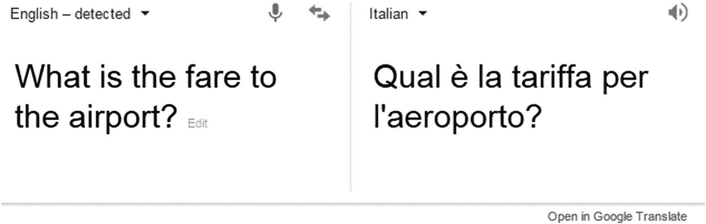

# 谓词逻辑变换规则

在谓词逻辑中，还有其他几个关于变换规则的重要概念。这些包括实例化和泛化。全称实例化，也称为全称消去，是一条涉及全称量词的推理规则。它告诉我们，如果 `(∀x) F(x)` 为真，那么 `F(C)` 也为真，其中 `C` 是 `x` 域中存在的任何常量项。这里的变量符号可以被任何基础项替换。说明此规则的一个例子是 `(∀x) drinks(John, x)` → `drinks(John, Water)`。

全称泛化，也称为全称引入，是一条推理规则，告诉我们如果 `F(A) ∧ F(B) ∧ F(C) ∧ …` 等都为真，那么我们可以推断 `(∀x) F(x)` 也为真。

存在实例化，也称为存在消去，是一条涉及存在量词的推理规则。它告诉我们，如果给定的表示 `(∃x) F(x)` 存在，我们可以推断出 `F(C)` 成立，其中 `C` 是一个新的常量或变量符号。这假定在此规则中引入的常量或变量项 `C` 是一个新的常量，在此前的证明或我们现有的知识库中从未出现过。此过程也称为`斯科伦化`，常量 `C` 被称为`斯科伦常量`。

存在泛化，也称为存在引入，是一条推理规则，告诉我们假定 `F(C)` 为真（其中 `C` 是一个常量项），那么我们可以由此推断出 `(∃x) F(x)`。这可以通过表示式 `eats_fish(Cat)` → `(∃x) eats_fish(x)` 来体现，该式可翻译为“猫吃鱼，因此至少存在某个东西或某个人吃鱼”。

现在我们来看一些关于如何使用一阶逻辑表示自然语言陈述以及如何从自然语言陈述转换为一阶逻辑的示例。表 1-3 中的示例展示了一阶逻辑表示自然语言陈述的典型用法。

**表 1-3** 使用一阶逻辑表示自然语言陈述

| 序号 | 一阶逻辑表示 | 自然语言陈述 |
| --- | --- | --- |
| 1 | `¬ eats(John, fish)` | 约翰不吃鱼。 |
| 2 | `is_hot(pie) ∧ is_delicious(pie)` | 这个派又热又美味。 |
| 3 | `is_hot(pie) ∨ is_delicious(pie)` | 这个派要么是热的，要么是美味的。 |
| 4 | `study(John, exam) → pass(John, exam)` | 如果约翰复习了考试，他就会通过考试。 |
| 5 | `∀x student(x) → pass(x, exam)` | 所有学生都通过了考试。 |
| 6 | `∃x student(x) ∧ fail(x, exam)` | 至少有一名学生考试不及格。 |
| 7 | `(∃x student(x) ∧ fail(x, exam) ∧ (∀y fail(y, exam) → x=y))` | 恰恰有一名学生考试不及格。 |
| 8 | `∀x (spider(x) ∧ black_widow(x)) → poisonous(x)` | 所有黑寡妇蜘蛛都是有毒的。 |

这让我们对一阶逻辑的各种组成部分以及它相对于命题逻辑所提供的实用性和优势有了很好的了解。然而，一阶逻辑也有其自身的局限性。就其本质而言，它允许我们对变量和对象进行量化，但不能对属性或关系进行量化。高阶逻辑则允许我们对关系、谓词和函数进行量化。更具体地说，`二阶逻辑`使我们能够对谓词和函数进行量化，而`三阶逻辑`则使我们能够对谓词的谓词进行量化。尽管它们表达能力更强，但要判定高阶逻辑中所有语句的有效性却极其困难。至此，我们关于语义表示的讨论就结束了。下一节我们将讨论文本语料库。

## 文本语料库

文本语料库是“text corpus”的复数形式，可以定义为大型且结构化的文本或文本数据集合。它们通常由书面或口述文本的主体构成，通常以电子形式存储。这包括将古老的历史文本语料库从物理形式转换为电子形式，以便于分析和处理。文本语料库的主要目的是利用它们进行语言学和统计分析，并将其用作构建自然语言处理工具的数据。

单语语料库仅包含一种语言的文本数据，而多语语料库则包含多种语言的文本数据。要理解文本语料库的重要性，我们必须了解语料库的起源及其背后的原因。这一切都始于语言学的兴起以及人们为研究语言特性和结构而收集与语言相关的数据。在 20 世纪 50 年代，人们使用统计和定量方法来分析收集到的数据。然而，由于缺乏大量文本数据来有效应用统计方法，这种方法很快就走到了尽头。除此之外，认知学习和行为科学也获得了大量关注。这促使杰出的语言学家`诺姆·乔姆斯基`构建并制定了一个复杂的、基于规则的语言模型，该模型为构建、标注和分析大规模文本语料库奠定了基础。

### 语料库标注与实用工具

文本语料库都带有丰富的元数据标注，这在利用语料库进行自然语言处理和文本分析以获得有价值的见解时极为有用。文本语料库常见的标注包括词性标注、词干、词元等等。我们来看看一些最常用的文本语料库标注方法和技术。

-   **词性标注：** 这主要用于为每个单词标注一个词性标签，指示其关联的词性。
-   **词干：** 词的词干是词的一部分，可以附加各种词缀。
-   **词元：** 词元是一组词的规范形式或基本形式，也称为`主词`。
-   **依存语法：** 包括找出句子中各成分之间的各种关系并标注这些依存关系。
-   **成分语法：** 用于根据句子成分（包括短语和从句）为句子添加句法标注。
-   **语义类型和角色：** 句子的各种成分，包括单词和短语，都会被标注上特定的语义类型和角色，这些类型和角色通常来自知识本体，用以指示它们的功能。这些包括地点、人物、时间、组织、施事、受事、主题等。

高级的标注形式包括为文本添加句法和语义结构。这些是基于依存语法和成分语法的句法分析树。这些专门的语料库也称为`树库`，被广泛用于构建词性标注器、句法分析器和语义分析器。语言学家也广泛使用语料库来创建新的词典和语法规则。诸如搭配、搭配关系和频率计数等特性，使他们能够找到词汇信息、模式、词法句法信息，并用于语言学习。除了语言学领域，语料库还被广泛应用于开发各种自然语言处理工具，如文本标注器、语音识别、机器翻译、拼写和语法检查器、文本转语音和语音转文本合成器、信息检索、实体识别和知识抽取。

### 流行语料库

以下是一些随着时间推移而构建并不断发展的著名文本语料库资源。本节列举了部分最流行的语料库，旨在激发你的兴趣，你可以进一步查找并深入了解那些吸引你眼球的文本语料库的更多细节。下面列表描述了一些随时间构建的流行文本语料库。

*   **关键词索引：** `KWIC` 是一种诞生于 19 世纪 60 年代的方法论，但在 20 世纪 50 年代左右被语言学家广泛用于索引文档和创建索引语料库。
*   **布朗语料库：** 这是第一个百万词级的英语语料库，由 Kucera 和 Francis 于 1961 年发布；它也被称为“当代美国英语标准语料库”。该语料库包含来自各种来源和类别的文本。
*   **LOB 语料库：** 兰开斯特-奥斯陆-卑尔根（`LOB`）语料库是 20 世纪 70 年代由兰开斯特大学、奥斯陆大学和卑尔根挪威人文计算中心合作编纂的。该项目的主要动机是为布朗语料库提供一个对应的英式英语版本。该语料库同样是一个百万词级的语料库，包含来自各种来源和类别的文本。
*   **柯林斯语料库：** 柯林斯伯明翰大学国际语言数据库（`COBUILD`）于 1980 年在伯明翰大学建立，由柯林斯出版商资助，构建了一个大型的当代英语文本电子语料库，并为后来的语料库如“英语语料库银行”和“柯林斯 COBUILD 英语词典”铺平了道路。
*   **CHILDES：** 儿童语言数据交换系统（`CHILDES`）是由 Brian 和 Catherine 于 1984 年创建的语料库，作为语言习得数据的存储库，包含来自超过 130 个不同语料库的 26 种语言的转录文本、音频和视频。它最近与一个更大的名为 Talkbank 的语料库合并。它被广泛用于分析幼儿的语言和言语。
*   **WordNet：** 该语料库是一个面向语义的英语词汇数据库。它于 1985 年在乔治·阿米蒂奇的指导下于普林斯顿大学创建。该语料库包含单词和常被称为 `synsets` 的同义词集。除此之外，它还包含单词定义、关系以及使用单词和同义词集的示例。总的来说，它结合了词典和同义词词典的功能。
*   **宾夕法尼亚树库：** 该语料库包含经过词性标注和句法分析的英语句子，包括 `POS` 标签和基于语法的分析树，这些在树库中很常见。它也可以被定义为语言树库，由宾夕法尼亚大学创建。
*   **BNC 语料库：** 英国国家语料库（`BNC`）是最大的英语语料库之一，包含超过 1 亿个来自各种来源的口语和书面文本样本。该语料库是 20 世纪末英国英语口语和书面语的代表性样本。
*   **ANC 语料库：** 美国国家语料库（`ANC`）是一个大型的美式英语文本语料库。它包含自 20 世纪 90 年代以来的超过 2200 万个口语和书面文本样本。其数据来源广泛，包括一些新兴来源，如电子邮件、推文和网站，这些在 `BNC` 中是不存在的。
*   **COCA 语料库：** 当代美式英语语料库（`COCA`）是最大的美式英语文本语料库，包含超过 4.5 亿个单词，包括来自不同类别和来源的口语转录文本和书面文本。

### 文本语料库

*   **Google N-gram 语料库：** Google N-gram 语料库包含来自书籍、网页等多种来源的超过一万亿个单词。该语料库包含每种语言最高至 5-gram 的 n-gram 文件。
*   **路透社语料库：** 该语料库是路透社新闻文章和报道的合集，于 2000 年发布，专门用于自然语言处理和机器学习研究。
*   **网页、聊天、电子邮件、推文：** 这些是随着社交媒体的兴起而变得重要的全新形式的文本语料库。我们可以从各种来源获取它们，包括 Twitter、Facebook、聊天室等。

这让我们了解了一些最流行的文本语料库及其随时间演变的情况。在下一节中，我们将讨论如何借助 Python 和自然语言工具包（`NLTK`）平台来访问其中的一些文本语料库。

## 访问文本语料库

我们已经了解了什么是文本语料库，并查看了当今存在的一些流行文本语料库的列表。在本节中，我们利用 `NLTK` 来连接并访问其中一些文本语料库。我们将在下一章更详细地介绍 `NLTK` 和 Python，所以如果某些语法或代码看起来有点吃力，请不要担心。本节的主要目的是让你了解如何轻松访问和利用文本语料库来满足你的自然语言处理和分析需求。我们还会用到自然语言工具包（`nltk`）库，你可以访问 [`http://www.nltk.org/`](http://www.nltk.org/) 了解更多关于该项目的详细信息，该网站告诉我们 `NLTK` 是一个用于访问文本资源（包括用于各种自然语言处理和机器学习能力的语料库和库）的完整平台和框架。

首先，请确保你已经安装了 Python。你可以单独安装 Python，或者从 Anaconda 官网 [`https://www.anaconda.com/download`](https://www.anaconda.com/download) 下载流行的 Anaconda Python 发行版，该发行版附带了一套完整的分析包，包括 `NLTK`。如果你想了解更多关于 Python 的细节，并确定哪种发行版最适合你，可以前往第 2 章快速浏览一下，我们将在那里更详细地介绍这些主题。

假设你现在已经安装了 Python，如果你安装了 Anaconda 发行版，那么你已经安装了 `NLTK`。请注意，我们在本书中全程使用 Python 3，我们建议每个人都使用最新版本的 Python，最好是 Python 3.5 或更高版本。如果你没有安装 Anaconda 发行版但安装了 Python，你可以打开终端或命令提示符，运行以下命令来安装 `NLTK`。

```
$ pip install nltk
```

这将安装 `nltk` 库，你就可以使用它了。然而，`NLTK` 的默认安装并不包含本书所需的所有组件。要安装 `NLTK` 的所有组件和资源，你可以启动 Python shell 并输入以下命令。你会看到 `NLTK` 的各种依赖项正在被下载；以下代码片段展示了部分输出。

```
In [1]: import nltk
In [2]: nltk.download('all', halt_on_error=False)
[nltk_data] Downloading collection u'all'
[nltk_data]    |
[nltk_data]    | Downloading package abc to
[nltk_data]    |     C:\Users\DIP.DIPSLAPTOP\AppData\Roaming\nltk_data
[nltk_data]    |     ...
[nltk_data]    |   Package abc is already up-to-date!
[nltk_data]    | Downloading package alpino to
[nltk_data]    |     C:\Users\DIP.DIPSLAPTOP\AppData\Roaming\nltk_data
[nltk_data]    |     ...
```

该命令将下载 `NLTK` 所需的所有资源。如果你不想下载所有内容，也可以使用 `nltk.download()` 命令从图形用户界面（`GUI`）中选择必要的组件。一旦必要的依赖项下载完成，你现在就可以开始访问文本语料库了！

## 访问布朗语料库

我们之前已经简单讨论过布朗语料库，该语料库于 1961 年在布朗大学开发。该语料库包含来自 500 个来源的文本，并被划分为多个类别。以下代码片段将布朗语料库加载到系统内存中，并展示其各个类别。

```python
# 加载布朗语料库
from nltk.corpus import brown
# 总类别数
print('总类别数:', len(brown.categories()))
总类别数: 15
# 打印类别
print(brown.categories())
['adventure', 'belles_lettres', 'editorial', 'fiction', 'government', 'hobbies', 'humor', 'learned', 'lore', 'mystery', 'news', 'religion', 'reviews', 'romance', 'science_fiction']
```

上述输出告诉我们，该语料库共有 15 个类别，包括新闻、悬疑、传说等。以下代码片段将进一步深入探索布朗语料库的悬疑类别。

### 访问路透社语料库

路透社语料库包含来自大约 90 个不同类别的 10,788 篇路透社新闻文档，并被划分为训练集和测试集。在机器学习术语中，训练集用于训练模型，测试集用于测试该模型的性能。以下代码片段向我们展示了如何访问路透社语料库的数据。

```python
# 分词后的句子
brown.sents(categories='mystery')
[['There', 'were', 'thirty-eight', 'patients', 'on', 'the', 'bus', 'the', 'morning', 'I', 'left', 'for', 'Hanover', ',', 'most', 'of', 'them', 'disturbed', 'and', 'hallucinating', '.'], ['An', 'interne', ',', 'a', 'nurse', 'and', 'two', 'attendants', 'were', 'in', 'charge', 'of', 'us', '.'], ...]
# 词性标注后的句子
brown.tagged_sents(categories='mystery')
[[('There', 'EX'), ('were', 'BED'), ('thirty-eight', 'CD'), ('patients', 'NNS'), ('on', 'IN'), ('the', 'AT'), ('bus', 'NN'), ('the', 'AT'), ('morning', 'NN'), ('I', 'PPSS'), ('left', 'VBD'), ('for', 'IN'), ('Hanover', 'NP'), (',', ','), ('most', 'AP'), ('of', 'IN'), ('them', 'PPO'), ('disturbed', 'VBN'), ('and', 'CC'), ('hallucinating', 'VBG'), ('.', '.')], [('An', 'AT'), ('interne', 'NN'), (',', ','), ('a', 'AT'), ('nurse', 'NN'), ('and', 'CC'), ('two', 'CD'), ('attendants', 'NNS'), ('were', 'BED'), ('in', 'IN'), ('charge', 'NN'), ('of', 'IN'), ('us', 'PPO'), ('.', '.')], ...]
# 获取自然形式的句子
sentences = brown.sents(categories='mystery')
sentences = [' '.join(sentence_token) for sentence_token in sentences]
sentences[0:5] # 查看前 5 个句子
['There were thirty-eight patients on the bus the morning I left for Hanover , most of them disturbed and hallucinating .',
'An interne , a nurse and two attendants were in charge of us .',
"I felt lonely and depressed as I stared out the bus window at Chicago's grim, dirty West Side.",
'It seemed incredible , as I listened to the monotonous drone of voices and smelled the fetid odors coming from the patients , that technically I was a ward of the state of Illinois , going to a hospital for the mentally ill .',
'I suddenly thought of Mary Jane Brennan , the way her pretty eyes could flash with anger , her quiet competence , the gentleness and sweetness that lay just beneath the surface of her defenses .']
```

从前面的代码片段和输出中，我们可以看到悬疑类体裁的书面内容，以及句子如何以分词和注释格式提供。假设我们想查看悬疑类体裁中的顶级名词？我们可以使用以下代码片段来获取它们。请记住，名词的词性标注中通常包含`NN`或`NP`，用以表示名词的不同形式。我们将在第 3 章更详细地介绍词性标注。

```python
# 获取带词性标注的单词
tagged_words = brown.tagged_words(categories='mystery')
# 从带词性标注的单词中获取名词
nouns = [(word, tag) for word, tag in tagged_words if any(noun_tag in tag
for noun_tag in ['NP', 'NN'])]
nouns[0:10] # 查看前 10 个名词
[('patients', 'NNS'), ('bus', 'NN'), ('morning', 'NN'), ('Hanover', 'NP'), ('interne', 'NN'),
('nurse', 'NN'), ('attendants', 'NNS'), ('charge', 'NN'), ('bus', 'NN'), ('window', 'NN')]
# 构建名词的频率分布
nouns_freq = nltk.FreqDist([word for word, tag in nouns])
# 查看出现频率最高的前 10 个名词
nouns_freq.most_common(10)
[('man', 106), ('time', 82), ('door', 80), ('car', 69), ('room', 65),
('Mr.', 63), ('way', 61), ('office', 50), ('eyes', 48), ('Mrs.', 46)]
```

前面的代码片段和输出展示了出现频率最高的前十个名词，包括诸如 `man`、`time`、`room` 等词汇。我们使用了一些高级结构和技巧，如列表推导式、可迭代对象和元组。在下一章中，我们将介绍使用 Python 结构处理文本的核心概念。目前，你只需要知道我们根据词性标注从所有其他单词中过滤出名词，然后计算它们的频率，从而得到语料库中出现频率最高的名词。

## 自然语言处理

我们在本章中多次提到了*自然语言处理*（NLP）这个术语。到现在为止，你可能已经对 NLP 的含义有了一些概念。NLP 被定义为计算机科学与工程以及人工智能的一个专业领域，其根源在于计算语言学。它主要关注设计和构建能够实现机器与人类创造的自然语言之间交互的应用程序和系统。这也使得 NLP 与人机交互（HCI）领域相关联。NLP 技术使计算机能够处理和理解人类的自然语言，并进一步利用它来提供有用的输出。接下来，我们将讨论 NLP 的一些主要应用。

### 机器翻译

机器翻译或许是 NLP 中最令人向往、最受追捧的应用之一。它被定义为一种有助于在任意两种语言之间提供句法、语法和语义正确翻译的技术。这或许是 NLP 中第一个主要的研究和开发领域。简单来说，机器翻译就是由机器执行的自然语言翻译。默认情况下，机器翻译过程的基本构建块涉及将单词从一种语言简单替换为另一种语言，但在这种情况下，我们会忽略诸如语法和短语结构一致性之类的问题。因此，随着时间的推移，更复杂的技术已经发展起来，包括将大量的文本语料库资源与统计和语言学技术相结合。最流行的机器翻译系统之一就是谷歌翻译。图 1-23 展示了谷歌翻译对句子“What is the fare to the airport?”从英语到意大利语的成功机器翻译操作。



`图 1-23` 谷歌翻译执行的机器翻译

随着时间的推移，机器翻译系统在您对着应用程序说话或输入时实时提供翻译方面变得越来越好。

### 语音识别系统

### 访问 WordNet 语料库

WordNet 语料库或许是使用最广泛的语料库之一，因为它包含大量词汇以及每个词语在语义上相连的同义词集。我们在此探讨 WordNet 语料库的一些基本特性，包括同义词集和访问语料库数据的方法。有关 WordNet 功能的更深入分析和全面介绍，可参考第 3 章，其中涵盖了同义词集、词元、下位词、上位词以及我们在前面语义学部分讨论的其他几个概念。以下代码片段向我们展示了如何访问 WordNet 语料库数据和同义词集。

```python
# 加载 WordNet 语料库
from nltk.corpus import wordnet as wn
word = 'hike' # 将 hike 作为我们感兴趣的词
# 获取词语的同义词集
word_synsets = wn.synsets(word)
word_synsets
# 获取同义词集中每个同义词的详细信息
for synset in word_synsets:
    print(('同义词集名称: {name}\n'
           '词性标签: {tag}\n'
           '定义: {defn}\n'
           '示例: {ex}\n').format(name=synset.name(),
                                      tag=synset.pos(),
                                      defn=synset.definition(),
                                      ex=synset.examples()))
```

这段代码展示了一个关于单词 `hike` 及其同义词集的有趣示例，其中包括作为名词和动词且具有不同含义的同义词。WordNet 使得在语义上将单词与同义词关联起来、轻松检索各种单词的含义和示例变得更加容易。这个示例告诉我们，“hike”既可以指一次长途步行，也可以指工资/租金的上涨。请随意尝试不同的单词，并确定它们的同义词集、定义、示例和关系。

除了这些流行的语料库外，还有大量可用的文本语料库，你只需查看 `nltk.corpus` 模块即可找到它们，该模块可用于访问这些语料库中的任何一个。因此，你可以看到，借助 Python 和 NLTK，访问和使用来自任何文本语料库的数据是多么容易。至此，我们关于文本语料库的讨论就结束了。在下一节中，我们将介绍有关自然语言处理和文本分析的一些基本概念。

```python
# 加载路透社语料库
from nltk.corpus import reuters
# 总类别数
print('总类别数:', len(reuters.categories()))
总类别数: 90
# 打印类别
print(reuters.categories())
['acq', 'alum', 'barley', 'bop', 'carcass', 'castor-oil', 'cocoa', ..., 'yen', 'zinc']
# 获取住房和收入类别的句子
sentences = reuters.sents(categories=['housing', 'income'])
sentences = [' '.join(sentence_tokens) for sentence_tokens in sentences]
sentences[0:5]  # 查看前 5 个句子
["YUGOSLAV ECONOMY WORSENED IN 1986 , BANK DATA SHOWS National Bank economic data for 1986 shows that Yugoslavia ' s trade deficit grew , the inflation rate rose , wages were sharply higher , the money supply expanded and the value of the dinar fell .",
'The trade deficit for 1986 was 2 . 012 billion dlrs , 25 . 7 pct higher than in 1985 .',
'The trend continued in the first three months of this year as exports dropped by 17 . 8 pct , in hard currency terms , to 2 . 124 billion dlrs .',
'Yugoslavia this year started quoting trade figures in dinars based on current exchange rates , instead of dollars based on a fixed exchange rate of 264 . 53 dinars per dollar .',
"Yugoslavia ' s balance of payments surplus with the convertible currency area fell to 245 mln dlrs in 1986 from 344 mln in 1985 ."]
# 基于文件 ID 的访问
print(reuters.fileids(categories=['housing', 'income']))
['test/16118', 'test/18534', 'test/18540', ..., 'training/7006', 'training/7015', 'training/7036', 'training/7098', 'training/7099', 'training/9615']
print(reuters.sents(fileids=[u'test/16118', u'test/18534']))
[['YUGOSLAV', 'ECONOMY', 'WORSENED', 'IN', '1986', ',', 'BANK', 'DATA', 'SHOWS', 'National', 'Bank', 'economic', 'data', 'for', '1986', 'shows', 'that', 'Yugoslavia', "'", 's', 'trade', 'deficit', 'grew', ',', 'the', 'inflation', 'rate', 'rose', ',', 'wages', 'were', 'sharply', 'higher', ',', 'the', 'money', 'supply', 'expanded', 'and', 'the', 'value', 'of', 'the', 'dinar', 'fell', '.'], ['The', 'trade', 'deficit', 'for', '1986', 'was', '2', '.', '012', 'billion', 'dlrs', ',', '25', '.', '7', 'pct', 'higher', 'than', 'in', '1985', '.'], ...]
```

这让我们了解了如何使用类别和文件标识符来访问语料库数据。接下来，我们将介绍如何访问 WordNet 语料库。

这或许是 NLP 中最困难的应用。人工智能系统真正智能的主要且也许是最困难的测试之一就是图灵测试。该测试指出，如果用户向计算机和人类提出一个问题，它将无法区分所获得的回答。随着时间的推移，通过使用语音合成、分析、句法分析和上下文推理等技术，该领域已经取得了很大进展。然而，语音识别系统的一个主要限制仍然是它们具有很强的领域特异性，如果用户稍微偏离系统所需的预期脚本输入，系统就无法正常工作。语音识别系统现在广泛应用于从计算机、手机到虚拟辅助系统等众多地方。

## 问答系统

问答系统（QAS）是基于利用 NLP 和信息检索（IR）技术进行问答的原理构建的。QAS 主要关注构建稳健且可扩展的系统，这些系统能够为用户以自然语言形式提出的问题提供答案。想象一下，在一个完全陌生的国家，你用纯自然语言向你手机中的个性化助手提问，并得到类似的回复。这正是研究人员和技术人员日复一日努力追求的的理想状态。通过像 Siri 和 Cortana 这样的个性化助手，我们在这个领域取得了一些成功，但它们的范围仍然有限，因为它们只能理解整个人类自然语言中的一小部分关键子句和短语。

要构建一个成功的 QAS，你需要一个包含各个领域数据的巨大知识库。QAS 将利用对该知识库的高效查询系统来提供自然语言形式的问题答案。创建和维护一个可查询的庞大知识库极其困难，因此你会发现 QAS 在食品、医疗、电子商务等利基领域兴起。聊天机器人是广泛使用 QAS 的新兴趋势之一。