# 搭建一个稳健的 Python 环境

现在你已经了解了 Python，并对这门语言的功能、实现方式和版本有了更多认识，本节将介绍一些关于如何搭建开发环境以及处理包管理和虚拟环境的基本要点。本节将为后续学习本书中的各种动手实践示例做好充分准备。

## 选择哪个 Python 版本？

我们之前讨论过两个主要的 Python 版本：`2.x` 系列和 `3.x` 系列。这两个版本非常相似；然而，`3.x` 版本中存在一些不向后兼容的更改，这导致 `2.x` 和 `3.x` 的使用者之间产生了巨大的分歧。大多数遗留代码以及 PyPI 上的绝大部分 Python 包都是用 `Python 2.7.x` 开发的，包所有者没有时间或意愿将其所有代码库移植到 `Python 3.x`。`3.x` 中的一些更改如下：

- 所有文本字符串默认均为 Unicode
- `print` 和 `exec` 现在都是函数，不再是语句
- 一些方法（如 `range()`）返回内存高效的迭代器，而不是列表
- 类的风格发生了变化
- 库和名称因约定俗成和风格违规而改变
- 更多特性、模块和增强功能

要了解更多关于 `Python 3.x` 引入的变化，请查看 [`https://docs.python.org/3/whatsnew/3.7.html`](https://docs.python.org/3/whatsnew/3.7.html)，这是列出这些更改的官方文档。这应该能让你清楚地了解，如果你将代码从 `Python 2` 移植到 `Python 3`，哪些更改可能导致代码出现问题。

现在回到选择版本的问题上，我们强烈建议始终使用 `Python 3`。其主要原因是 Python 核心团队最近发布的一则公告，其中提到对 `Python 2` 的支持将于 2020 年结束，并且不会向 `Python 2` 推送任何新特性或增强功能。我们建议查看 `PEP 373` [`https://legacy.python.org/dev/peps/pep-0373/`](https://legacy.python.org/dev/peps/pep-0373/)，该文档对此问题有更详细的说明。但是，如果你正在处理一个大型的基于 `Python 2.x` 的遗留代码库，你可能需要坚持使用它，直到将其移植到 `Python 3` 成为可能。本书中使用的是 `Python 3.x`，并建议你也这样做。对于 `Python 2.x` 的代码，你可以根据需要参考本书的先前版本。

## 选择哪个操作系统？

市面上有几种流行的操作系统，每个人都有自己的偏好。Python 的美妙之处在于它可以毫无障碍地在任何操作系统上无缝运行。Python 支持的一些不同操作系统包括：

- Windows
- Linux
- macOS（也称为 OS X）

你可以选择任何你喜欢的操作系统并跟着示例操作。我们使用 Linux 和 Windows 的组合作为我们的操作系统平台。Python 的外部包通常易于在基于 UNIX 的操作系统（如 Linux 和 macOS）上安装。然而，有时在 Windows 上安装它们会遇到主要问题，因此我们会强调此类情况并加以处理，以便我们的 Windows 读者也能轻松执行任何代码片段和示例。在随本书学习示例时，我们非常欢迎你使用任何你喜欢的操作系统！

## 集成开发环境

集成开发环境是一种软件产品，通过提供编写、管理和执行代码所必需的整套工具和功能，使开发人员能够高效工作。IDE 的常见组件包括源代码编辑器、调试器、编译器、解释器以及重构和构建工具。它们还具有其他功能，如代码补全、语法高亮、错误高亮和检查、对象和变量浏览器。IDE 可用于管理整个代码库，远优于在简单的文本编辑器中编写代码，后者耗时更长。然而，经验更丰富的开发人员经常使用简单的纯文本编辑器来编写代码，尤其是在服务器环境中工作时。链接 [`https://wiki.python.org/moin/IntegratedDevelopmentEnvironments`](https://wiki.python.org/moin/IntegratedDevelopmentEnvironments) 提供了一个专门用于 Python 的 IDE 列表。我们使用 PyCharm、Spyder、Sublime Text 和 Jupyter notebook 的组合。本书中的代码示例大多在 Jupyter notebook 上演示，而 Jupyter notebook 是随 Anaconda Python 发行版一起安装的，用于编写和执行代码。

## 环境搭建

在本节中，我们将详细说明如何以最小的精力搭建你的 Python 环境以及所需的主要组件。你可以前往 Python 官方网站，从 [`https://www.python.org/downloads/`](https://www.python.org/downloads/) 下载 `Python 3.7`，或者从 Anaconda（原名 Continuum Analytics）下载一个完整的 Python 发行版，该发行版包含数百个专为数据科学和人工智能构建的包，即 Anaconda Python 发行版。这能带来诸多优势，尤其对 Windows 用户而言，因为安装 `NumPy` 和 `SciPy` 等包有时会引发重大问题。你可以访问 [`https://www.anaconda.com`](https://www.anaconda.com) 获取更多关于 Anaconda 及其出色工作的信息。Anaconda 附带 `conda`（一个开源的包和环境管理系统）以及 Spyder（科学 Python 开发环境），后者是一个用于编写和执行代码的集成开发环境。

要开始环境搭建，你可以按照 [`https://docs.anaconda.com/anaconda/install/windows`](https://docs.anaconda.com/anaconda/install/windows) 上针对 Windows 的说明进行操作，或者使用你选择的其他操作系统的说明。前往 [`https://www.anaconda.com/download/`](https://www.anaconda.com/download/) 并根据你的操作系统版本下载适用于 Windows 的 64 位或 32 位 `Python 3` 安装程序。对于其他操作系统，你可以在网站上查看相关说明。启动可执行文件，并通过在每个阶段单击“下一步”按钮来按照屏幕上的说明进行操作。务必设置好合适的安装位置，如图 2-1 所示。

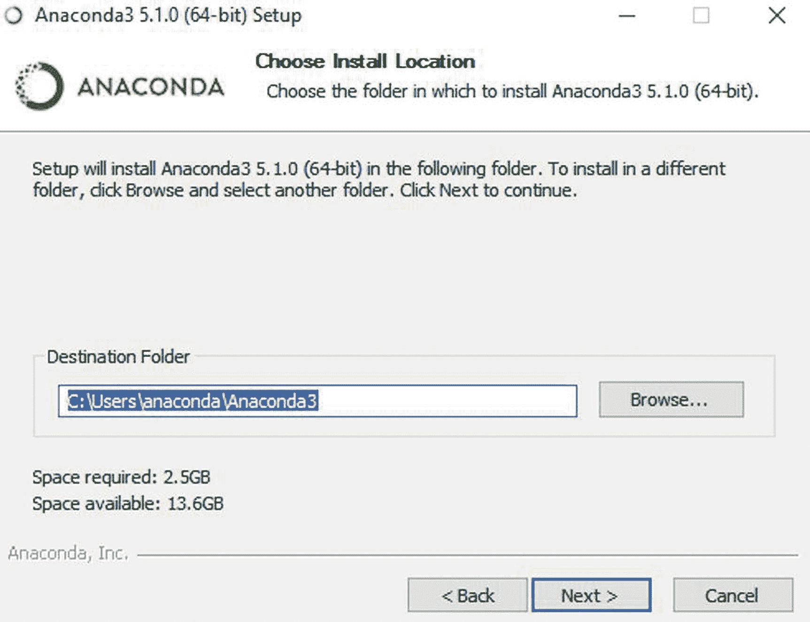

图 2-1：安装 Anaconda Python 发行版——设置安装位置

在开始实际安装之前，务必勾选图 2-2 中显示的两个选项。

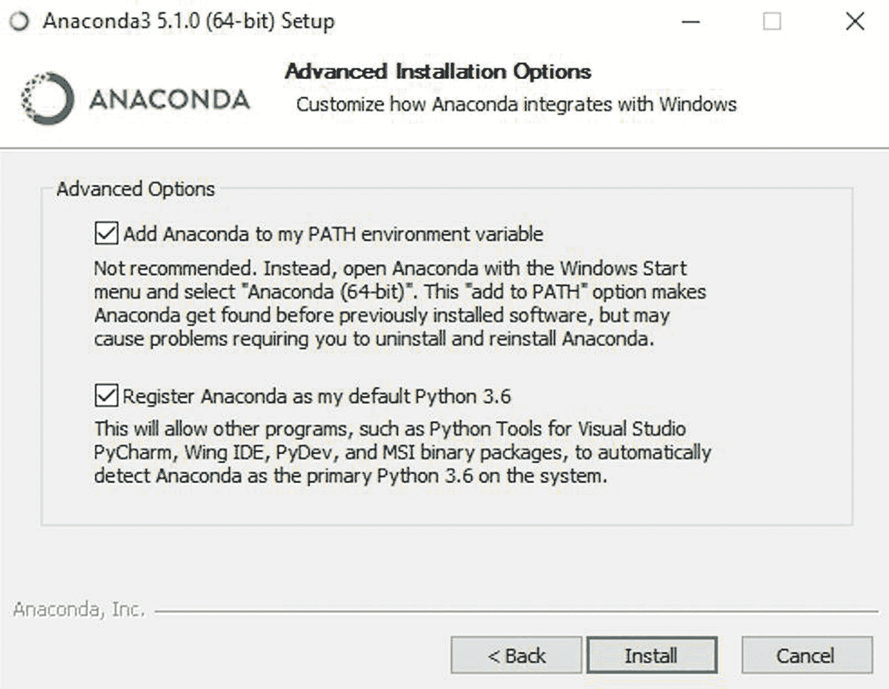

图 2-2：安装 Anaconda Python 发行版——添加到系统路径

安装完成后，你可以通过双击相关图标启动 Spyder，或者从命令提示符启动 Python 或 IPython 终端。要启动 Jupyter notebook，只需在终端或命令提示符中输入 `jupyter notebook` 即可。Spyder 为你提供了一个完整的集成开发环境，用于在常规 Python 和 IPython 终端中编写和执行代码。图 2-3 展示了如何启动 Jupyter notebook。

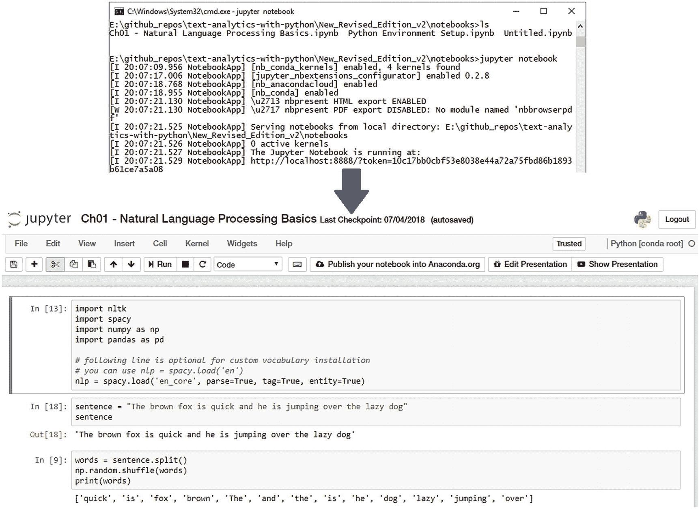

图 2-3：启动 Jupyter notebook

这应该能让你了解在 Jupyter notebook 中以交互方式展示代码和输出是多么容易。我们通常通过这些 notebook 来展示代码。要测试 Python 是否安装正确，只需在终端甚至在 notebook 中输入 `python --version` 即可，如图 2-4 所示。

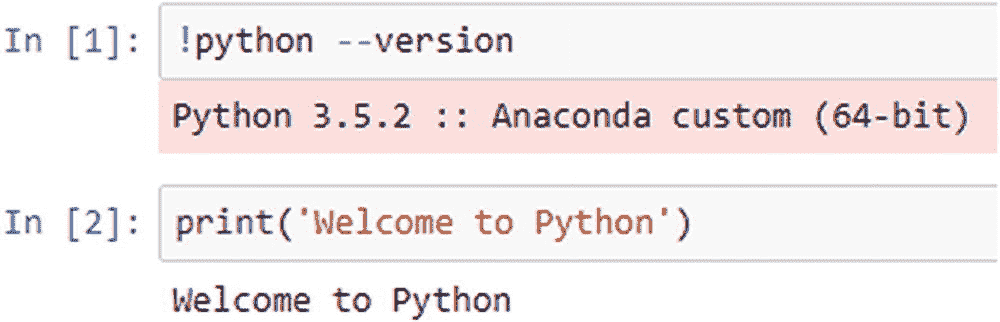

图 2-4：检查你的 Python 安装

## 包管理

我们现在简要介绍包管理。你可以使用 `pip` 或 `conda` 命令来安装、卸载和升级包。下面的 shell 命令展示了通过 `pip` 安装 pandas 库。你可以使用 `pip freeze <package_name>` 命令检查包是否已安装，并使用 `pip install <package_name>` 命令安装包，如图 2-5 所示。如果你已经安装了一个包/库，可以使用 `--upgrade` 标志。

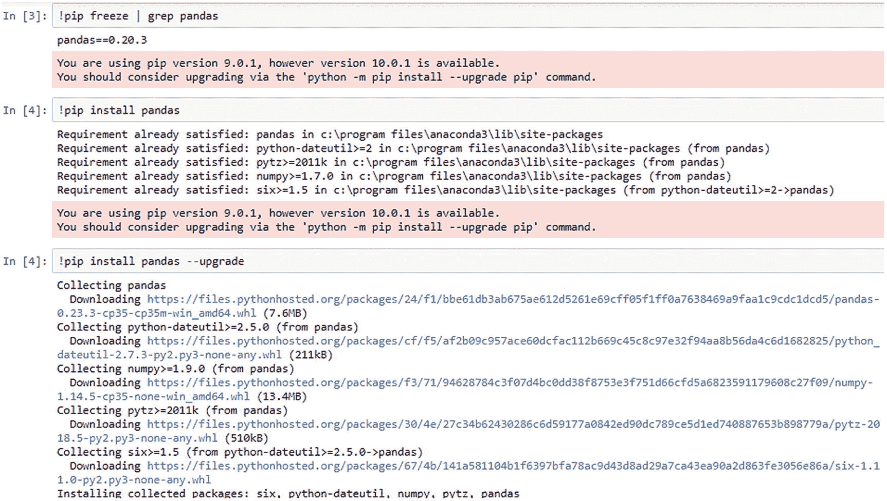

图 2-5：使用 `pip` 进行 Python 包管理

`conda` 包管理器在几个方面优于 `pip`，因为它能提供关于安装过程中将升级哪些依赖项、具体版本及其他细节的整体视图。`pip` 在 Windows 上经常无法安装某些包；然而，`conda` 在安装过程中通常没有此类问题。图 2-6 展示了如何使用 `conda` 安装和管理包。

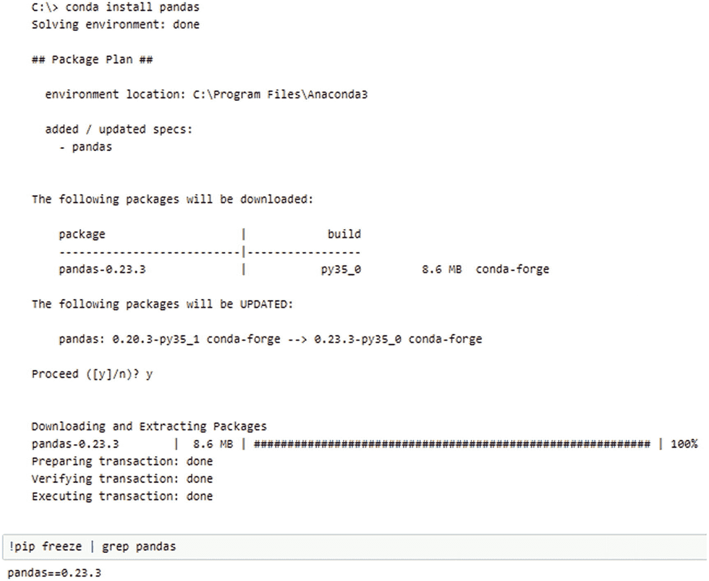

图 2-6：使用 `conda` 进行 Python 包管理

现在，你对于如何在 Python 中安装外部包和库有了更清晰的认识。当你日后需要在环境中安装外部 Python 包时，这将非常有用。你的 Python 环境现在应该已经搭建好并可以执行代码了。在我们深入探讨 Python 中处理文本数据的技术之前，我们以对虚拟环境的讨论作为本章的结束。

### 虚拟环境

虚拟环境（亦称为 `venv`）是一个完全独立的 Python 环境，拥有自己的 Python 解释器、库、模块和脚本。该环境是一个独立环境，与其他虚拟环境以及系统默认的 Python 环境相隔离。当你有多个项目或代码库依赖同一软件包或库的不同版本时，虚拟环境会非常有用。例如，如果我的项目 `TextApp1` 依赖 NLTK 2.0，而另一个项目 `TextApp2` 依赖 NLTK 3.0，那么在同一系统上运行这两个项目是不可能的。因此，我们需要虚拟环境来提供完全隔离的环境，这些环境可以根据需要激活和停用。

要搭建虚拟环境，你需要 `virtualenv` 软件包。我们创建一个新目录来存放虚拟环境，并按如下方式安装 `virtualenv`：

```
E:\>mkdir Apress
E:\>cd Apress
E:\Apress>pip install virtualenv
Collecting virtualenv
Installing collected packages: virtualenv
Successfully installed virtualenv-16.0.0
```

软件包安装完成后，你就可以创建一个虚拟环境了。这里我们创建一个名为 `test_proj` 的新项目目录，并在其中创建虚拟环境：

```
E:\Apress>mkdir test_proj && chdir test_proj
E:\Apress\test_proj>virtualenv venv
Using base prefix 'c:\\program files\\anaconda3'
New python executable in E:\Apress\test_proj\venv\Scripts\python.exe
Installing setuptools, pip, wheel...done.
```

既然你已经成功安装了虚拟环境，让我们试着观察一下全局系统 Python 环境与我们的虚拟环境之间的主要区别。如果你还记得，我们在上一节中将全局系统 Python 的 pandas 软件包版本更新到了 0.23。我们可以使用以下命令进行验证。

```
E:\Apress\test_proj>echo 'This is Global System Python'
'This is Global System Python'
E:\Apress\test_proj>pip freeze | grep pandas
pandas==0.23.3
```

现在假设我们想要在虚拟环境中使用旧版本的 pandas，但又不希望影响全局系统 Python 环境。我们可以通过激活虚拟环境并安装 pandas 来实现。

```
E:\Apress\test_proj>venv\Scripts\activate
(venv) E:\Apress\test_proj>echo 'This is VirtualEnv Python'
'This is VirtualEnv Python'
(venv) E:\Apress\test_proj>pip install pandas==0.21.0
Collecting pandas==0.21.0
100% |################################| 9.0MB 310kB/s
Collecting pytz>=2011k (from pandas==0.21.0)
Collecting python-dateutil>=2 (from pandas==0.21.0)
Collecting numpy>=1.9.0 (from pandas==0.21.0)
Collecting six>=1.5 (from python-dateutil>=2->pandas==0.21.0)
Installing collected packages: pytz, six, python-dateutil, numpy, pandas
Successfully installed numpy-1.14.5 pandas-0.21.0 python-dateutil-2.7.3 pytz-2018.5 six-1.11.0
(venv) E:\Apress\test_proj>pip freeze | grep pandas
pandas==0.21.0
```

对于其他操作系统平台，你可能需要使用命令 `source venv/bin/activate` 来激活虚拟环境。一旦虚拟环境被激活，你可以看到 `(venv)` 标识，如前面代码输出所示，并且你安装的任何新软件包都将被放置在 `venv` 文件夹中，与全局系统 Python 环境完全隔离。

从之前的代码片段中，你可以看到同一台机器上 pandas 软件包的不同版本——全局 Python 为 0.23.3，而虚拟环境 Python 为 0.21.0。因此，这些隔离的虚拟环境可以在同一系统上无缝运行。当你在虚拟环境中完成工作后，可以按如下方式再次停用它。

```
(venv) E:\Apress\test_proj>venv\Scripts\deactivate
E:\Apress\test_proj>pip freeze | grep pandas
pandas==0.23.3
```

这将使你回到系统的默认 Python 版本及其所有已安装的库，并且正如预期那样，pandas 版本是我们之前安装的较新版本。这让我们很好地了解了虚拟环境的实用性和优势，一旦你开始处理多个项目，绝对应该考虑使用它。要了解更多关于虚拟环境的信息，请查看 [`http://docs.python-guide.org/en/latest/dev/virtualenvs/`](http://docs.python-guide.org/en/latest/dev/virtualenvs/)，这是 `virtualenv` 软件包的官方文档。至此，我们的安装和设置活动告一段落。接下来，在通过动手实例深入探讨如何使用 Python 处理文本数据之前，我们先了解一些关于 Python 语法和结构的基本概念。

## Python 语法与结构

我们简要讨论一下在为应用程序和系统编写 Python 代码时所遵循的基本语法、结构和设计理念。Python 代码有明确的层级语法，你在编写代码时应牢记这一点。任何大型 Python 应用程序或系统都是由多个模块构建而成，而这些模块本身又由 Python 语句组成。每条语句就像一条命令或指令，指示系统应执行哪些操作。这些语句由表达式和对象组成。Python 中万物皆对象，包括函数、数据结构、类型、类等等。这种层级结构可以更直观地通过图 2-7 来理解。

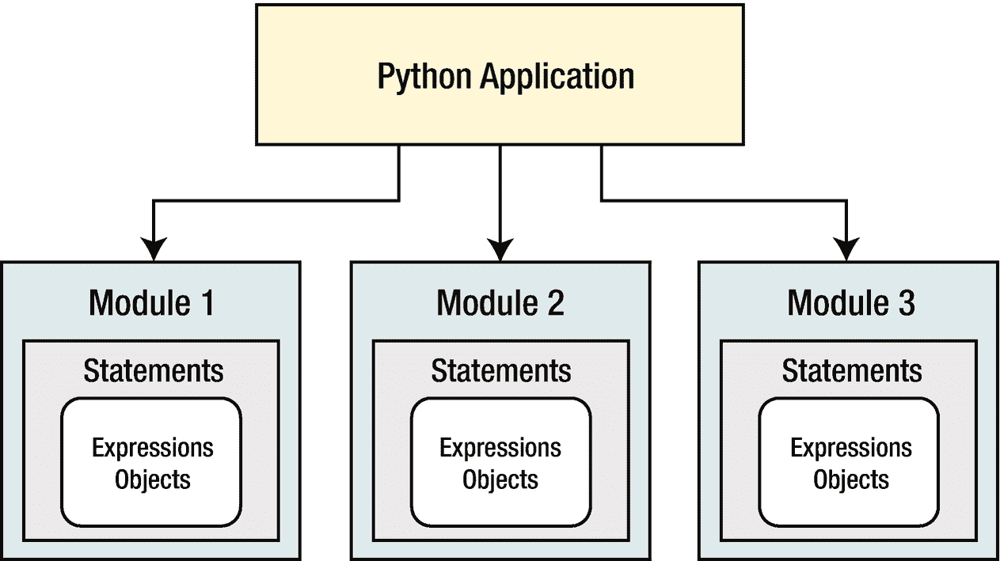

图 2-7

Python 程序结构层级关系

基本语句由对象和表达式组成（表达式使用对象并对其进行处理和操作）。对象可以是简单数据类型和结构，也可以是复杂对象，包括具有特定角色的函数和保留字。Python 有大约 30 多个关键字或保留字，均有各自指定的角色和功能。我们假设你对基本编程结构有一定了解，但如果你没有，也不要气馁！在下一节中，我们将通过详细的动手实例来展示如何处理文本数据。

## 处理文本数据

在本节中，我们将简要介绍专门用于处理文本数据的数据类型，以及这些数据类型及其相关工具、函数和方法如何在后续章节中发挥作用。Python 中处理文本数据的主要数据类型是字符串。这些可以是普通字符串、存储二进制信息的字节串或 Unicode。默认情况下，Python 3.x 中所有字符串都是 Unicode 编码，但 Python 2.x 中并非如此。在不同 Python 发行版中处理文本时，这一点你一定要牢记。

# Python 字符串

Python 中的字符串是字符序列，类似于数组和代码，带有一组属性和方法，可以轻松地利用它们来操作和处理文本数据。这使得 Python 在许多场景下成为文本分析的首选语言。我们将讨论多种类型的字符串，并在下一节中给出若干示例。

## 字符串字面量

如前所述，字符串有多种类型。下面的 BNF（巴克斯-诺尔范式）给出了生成字符串的一般词法定义，这些定义与 Python 官方文档中的一致。

```
stringliteral   ::=  stringprefix
stringprefix    ::=  "r" | "u" | "ur" | "R" | "U" | "UR" | "Ur" | "uR"
                     | "b" | "B" | "br" | "Br" | "bR" | "BR"
shortstring     ::=  "'" shortstringitem* "'" | '"' shortstringitem* '"'
longstring      ::=  "'''" longstringitem* "'''" | '"""' longstringitem* '"""'
shortstringitem ::=  shortstringchar | escapeseq
longstringitem  ::=  longstringchar | escapeseq
shortstringchar ::=  
longstringchar  ::=  
escapeseq       ::=  "\" 
```

这些规则告诉我们，存在不同类型的字符串前缀，它们可以与不同的字符串类型结合使用以生成字符串字面量。简单来说，最常用的字符串字面量类型如下：

-   **短字符串：** 这类字符串通常用单引号 (`'`) 或双引号 (`"`) 包围字符。例如 `'Hello'` 和 `"Hello"`。

-   **长字符串：** 这类字符串通常用三个单引号 (`'''`) 或三个双引号 (`"""`) 包围字符。例如 `"""Hello, I'm a long string"""` 或 `'''Hello I\'m a long string'''`。注意 (`\'`) 表示一个转义序列，我们稍后将讨论。

-   **字符串中的转义序列：** 这类字符串通常包含转义序列，其规则以反斜杠 (`\`) 开头，后跟任意 ASCII 字符。因此，它们执行退格插值。常见的转义序列包括 (`\n`)（表示换行符）和 (`\t`)（表示制表符）。

-   **字节串：** 用于表示创建字节数据类型对象的字节串。这些字符串可以通过 `bytes('...')` 或使用 `b'...'` 符号创建。例如 `bytes('hello')` 和 `b'hello'`。

-   **原始字符串：** 这类字符串最初是为正则表达式（regex）和正则模式专门创建的。它们可以使用 `r'...'` 符号创建，并保持字符串的原始或原生形式。因此，它们不执行任何退格插值，也会关闭转义序列。例如 `r'Hello'`。

-   **Unicode 字符串：** 这类字符串支持文本中的 Unicode 字符，通常是 ASCII 字符序列。它们使用 `u'...'` 符号表示。然而，在 Python 3.x 中，所有字符串字面量通常都用 Unicode 表示。除了字符串符号之外，还有几种特定方法可以表示字符串中的特殊 Unicode 字符。通常包括格式为 `'\xVV'` 的十六进制字节值转义序列。除此之外，我们还有 `'\uVVVV'` 和 `'\uVVVVVVVV'` 形式的 Unicode 转义序列，其中第一种形式使用四个十六进制数字编码 16 位字符，第二种使用八个十六进制数字编码 32 位字符。一些示例包括 `u 'H\xe8llo'` 和 `u 'H\u00e8llo'`，它们都表示字符串 `'Hèllo'`。

现在我们已经了解了字符串字面量的主要类型，接下来看看表示字符串的方法。

## 表示字符串

字符串是用于存储和表示文本数据的字符序列或集合，这也是本书大多数示例中首选的数据类型。字符串可用于将文本和字节作为信息存储。字符串有各种各样的方法可用于处理和操作字符串，这将在后续章节中看到。需要记住的一个重要点是，字符串是不可变的，对字符串执行的任何操作都会创建一个新的字符串对象（可以使用 `id` 函数检查），而不仅仅是更改现有字符串对象的值。让我们看一些基本的字符串表示。

```
new_string = "This is a String"  # 存储一个字符串
print('ID:', id(new_string))  # 显示对象标识符（地址）
print('Type:', type(new_string))  # 显示对象类型
print('Value:', new_string)  # 显示对象值
ID: 1907471142032
Type: 
Value: This is a String
# 简单字符串
simple_string = 'Hello!' + " I'm a simple string"
print(simple_string)
Hello! I'm a simple string
```

表示多行字符串也非常简单，可以按如下方式操作：

```
# 多行字符串，注意自动创建的 \n（换行）转义字符
multi_line_string = """Hello I'm
a multi-line
string!"""
multi_line_string
"Hello I'm\na multi-line\nstring!"
print(multi_line_string)
Hello I'm
a multi-line
string!
```

现在让我们看看如何以原生格式表示转义序列和原始字符串，而不包含任何转义序列。

```
# 包含转义序列的普通字符串导致文件路径错误！
escaped_string = "C:\the_folder\new_dir\file.txt"
print(escaped_string)  # 如果尝试在此处打开文件将导致错误
C: he_folder
ew_dirile.txt
# 原始字符串保留反斜杠的原始形式
raw_string = r'C:\the_folder\new_dir\file.txt'
print(raw_string)
C:\the_folder\new_dir\file.txt
```

让我们看看如何利用 Unicode 表示非 ASCII 字符，这也可用于表示像表情符号这样的符号。

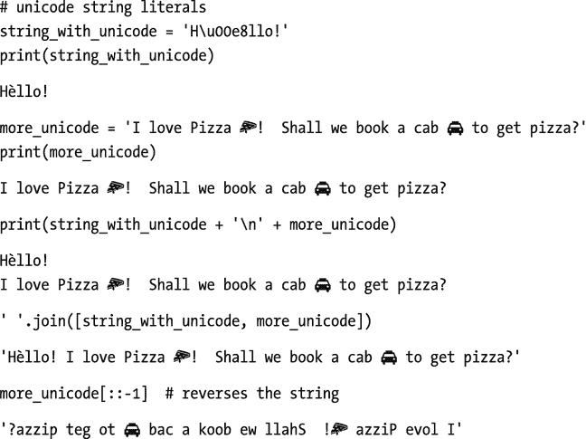

## 字符串操作和方法

字符串是可迭代序列，因此可以对它们执行许多操作。这在将文本数据处理和解析为易于使用的格式时尤其有用。可以对字符串执行多种操作。我们将其分为以下几类。

-   基本操作

-   索引和切片

-   方法

-   格式化

-   正则表达式

这些涵盖了处理字符串最常用的技术，构成了我们入门所需的基础。在下一章中，我们将基于前两章学到的概念来理解和处理文本数据。

### 基本操作

你可以对字符串执行几种基本操作，包括连接、检查子字符串、字符和长度。我们从一些连接字符串的基本示例开始。

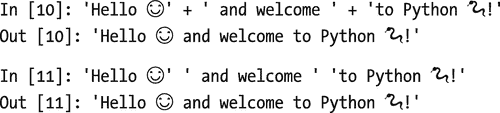

现在让我们看看在处理字符串时连接变量和字面量的一些方法。

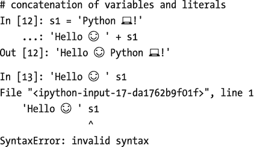

接下来我们看看更多连接字符串的方法。

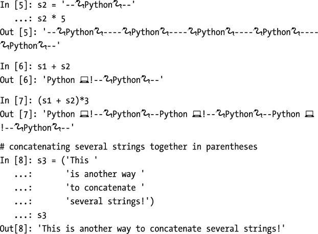

以下是一些更基本的操作，比如检查子字符串和查找典型字符串的长度。

```
In [9]: 'way' in s3
Out[9]: True
In [10]: 'python' in s3
Out[10]: False
In [11]: len(s3)
Out[11]: 51
```

### 索引与切片

如前所述，字符串是字符序列，也是可迭代对象。因此，它们可以像列表等其他可迭代对象一样被索引、切片和迭代。每个字符在字符串中都有一个特定的位置，称为其索引。通过索引，我们可以访问字符串的特定部分。使用特定位置或索引访问字符串中的单个字符称为*索引*，而使用起始和结束索引访问字符串的一部分（即子串）称为*切片*。Python 支持两种类型的索引：一种从 `0` 开始，每增加一个字符索引加 `1`，直到字符串末尾；另一种从字符串末尾的 `-1` 开始，每向字符串开头移动一个字符索引减 `1`。图 2-8 描述了字符串 `'PYTHON'` 的两种索引类型。

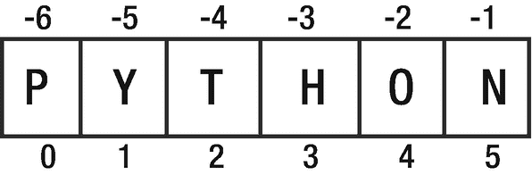

**图 2-8** 字符串索引语法

让我们从一些基本的字符串索引开始，以便你了解如何访问字符串中的特定字符。

```
# 创建一个字符串
In [12]: s = 'PYTHON'
...: s, type(s)
Out[12]: ('PYTHON', str)
# 展示字符串索引
In [13]: for index, character in enumerate(s):
...:     print('Character ->', character, 'has index->', index)
Character -> P has index-> 0
Character -> Y has index-> 1
Character -> T has index-> 2
Character -> H has index-> 3
Character -> O has index-> 4
Character -> N has index-> 5
# 字符串索引
In [14]: s[0], s[1], s[2], s[3], s[4], s[5]
Out[14]: ('P', 'Y', 'T', 'H', 'O', 'N')
In [15]: s[-1], s[-2], s[-3], s[-4], s[-5], s[-6]
Out[15]: ('N', 'O', 'H', 'T', 'Y', 'P')
```

很明显，你可以像访问列表一样，通过索引访问特定的字符串元素。现在，让我们通过一些动手示例来看看切片字符串的有趣方法！

```
# 字符串切片
In [16]: s[:]
Out[16]: 'PYTHON'
In [17]: s[1:4]
Out[17]: 'YTH'
In [18]: s[:3], s[3:]
Out[18]: ('PYT', 'HON')
In [19]: s[-3:]
Out[19]: 'HON'
In [21]: s[:3] + s[-3:]
Out[21]: 'PYTHON'
In [22]: s[::1]  # 无偏移
Out[22]: 'PYTHON'
In [24]: s[::2]  # 每隔一个字符打印一次
Out[24]: 'PTO'
```

前面的代码片段应该能让你很好地了解如何从给定字符串中切片并提取特定的子串。如前所述，这与列表非常相似。然而，关键的区别在于字符串是不可变的。让我们在以下示例中尝试理解这个概念。

```
# 字符串是不可变的，因此赋值会报错
In [27]: s[0] = 'X'
Traceback (most recent call last):
File "", line 1, in 
s[0] = 'X'
TypeError: 'str' object does not support item assignment
# 创建一个新字符串
In [28]: print('Original String id:', id(s))
...: # 创建一个新字符串
...: s = 'X' + s[1:]
...: print(s)
...: print('New String id:', id(s))
Original String id: 2117246774552
XYTHON
New String id: 2117246656048
```

基于前面的示例，你可以清楚地看到字符串是不可变的，不支持以任何形式对原始字符串进行赋值或修改。即使你使用同一个变量并对其执行某些操作，也会得到一个全新的字符串。

### 方法

Python 基础库中内置了大量可用的字符串方法，你可以使用它们来执行各种转换、处理和操作。详细讨论每一个方法超出了当前的范围；然而，官方 Python 文档中的这个有用链接 [`https://docs.python.org/3/library/stdtypes.html#string-methods`](https://docs.python.org/3/library/stdtypes.html#string-methods) 提供了你需要的关于每个方法的所有信息，包括语法和定义。方法非常有用，能提高你的生产力，因为你无需花费额外的时间编写样板代码来处理和操作字符串。我们在以下代码片段中展示了一些流行的字符串方法示例。

```
s = 'python is great'
### 大小写转换
In [33]: s.capitalize()
Out[33]: 'Python is great'
In [34]: s.upper()
Out[34]: 'PYTHON IS GREAT'
In [35]: s.title()
Out[35]: 'Python Is Great'
# 字符串替换
In [36]: s.replace('python', 'NLP')
Out[36]: 'NLP is great'
# 数字检查
In [37]: '12345'.isdecimal()
Out[37]: True
In [38]: 'apollo11'.isdecimal()
Out[38]: False
# 字母检查
In [39]: 'python'.isalpha()
Out[39]: True
In [40]: 'number1'.isalpha()
Out[40]: False
# 字母数字检查
In [41]: 'total'.isalnum()
Out[41]: True
In [42]: 'abc123'.isalnum()
Out[42]: True
In [43]: '1+1'.isalnum()
Out[43]: False
```

以下代码片段展示了基于不同动手示例的分割、连接和去除字符串的方法。

```
# 字符串分割与连接
In [44]: s = 'I,am,a,comma,separated,string'
...: s.split(',')
Out[44]: ['I', 'am', 'a', 'comma', 'separated', 'string']
In [45]: ' '.join(s.split(','))
Out[45]: 'I am a comma separated string'
# 基本字符串去除空白
In [46]: s = '   I am surrounded by spaces    '
...: s
Out[46]: '   I am surrounded by spaces    '
In [47]: s.strip()
Out[47]: 'I am surrounded by spaces'
# 更多组合
In [48]: sentences = 'Python is great. NLP is also good.'
...: sentences.split('.')
Out[48]: ['Python is great', ' NLP is also good', "]
In [49]: print('\n'.join(sentences.split('.')))
Python is great
NLP is also good
In [50]: print('\n'.join([sentence.strip()
...:                      for sentence in sentences.split('.')
...:                          if sentence]))
Python is great
NLP is also good
```

这些示例仅仅触及了字符串上众多处理和操作的皮毛。欢迎尝试使用文档中提到的其他方法进行其他操作。我们在后续章节中会用到其中一些方法。

### 格式化

字符串格式化用于在字符串中替换特定的数据对象和类型。这在向用户显示文本时经常使用。字符串有两种不同的格式化类型：

-   **格式化表达式：** 这些表达式通常采用 `'...%s...%s...' %(values)` 的语法，其中 `%s` 表示一个占位符，用于替换 `values` 列表中对应的字符串。这与 C 语言的 `printf` 模型非常相似，并且自 Python 诞生之初就已存在。你可以通过 `%` 符号后跟相应的字母来替换其他类型的值，例如 `%d` 用于整数，`%f` 用于浮点数。

-   **格式化方法：** 这些字符串采用 `'...{}...{}...'.format(values)` 的形式，它使用花括号 `{}` 作为占位符，通过 `format` 方法从 `values` 中插入字符串。这种方法自 Python `2.6.x` 版本起就已存在。

以下代码片段通过几个动手示例展示了两种字符串格式化类型。

# 简单的字符串格式化表达式 - 旧式

```
In [51]: 'Hello %s' %('Python!')
Out[51]: 'Hello Python!'
In [52]: 'Hello %s %s' %('World!', 'How are you?')
Out[52]: 'Hello World! How are you?'
```

# 不同数据类型的格式化表达式 - 旧式

```
In [53]: 'We have %d %s containing %.2f gallons of %s' %(2, 'bottles', 2.5, 'milk')
Out[53]: 'We have 2 bottles containing 2.50 gallons of milk'
In [54]: 'We have %d %s containing %.2f gallons of %s' %(5.21, 'jugs', 10.86763, 'juice')
Out[54]: 'We have 5 jugs containing 10.87 gallons of juice'
```

# 使用格式方法的字符串格式化 - 新式

```
In [55]: 'Hello {} {}, it is a great {} to meet you at {}'.format('Mr.', 'Jones', 'pleasure', 5)
Out[55]: 'Hello Mr. Jones, it is a great pleasure to meet you at 5'
In [56]: 'Hello {} {}, it is a great {} to meet you at {} o\' clock'.format('Sir', 'Arthur', 'honor', 9)
Out[56]: "Hello Sir Arthur, it is a great honor to meet you at 9 o' clock"
```

# 使用字符串格式化的其他方式

```
In [57]: 'I have a {food_item} and a {drink_item} with me'.format(drink_item='soda', food_item="sandwich")
Out[57]: 'I have a sandwich and a soda with me'
In [58]: 'The {animal} has the following attributes: {attributes}'.format(animal='dog', attributes=['lazy', 'loyal'])
Out[58]: "The dog has the following attributes: ['lazy', 'loyal']"
```

从这些示例中可以看出，格式化字符串没有硬性规定，因此你可以大胆尝试不同的格式，并使用最适合你任务的格式。我们通常建议使用新式格式。

## 正则表达式

正则表达式，更广为人知的名字是 regexes，允许你创建字符串模式，并用于在文本数据中搜索和替换特定的模式匹配。Python 提供了一个名为 `re` 的丰富模块来创建和使用正则表达式。由于它易于使用但难以精通，因此已有整本书籍专门讨论这个主题。在当前范围内不可能讨论正则表达式的每一个方面，但我们通过足够的示例覆盖了主要领域，这应该足以让你入门这个主题。

正则表达式或 regexes 是特定的模式，通常使用原始字符串表示法表示。这些模式基于其表达的规则匹配一组特定的字符串。这些模式随后通常被编译成字节码，然后由匹配引擎执行以匹配字符串。`re` 模块还提供了几个标志，可以改变模式匹配的执行方式。一些重要的标志包括：

-   `re.I` 或 `re.IGNORECASE` 用于忽略大小写匹配模式。
-   `re.S` 或 `re.DOTALL` 使句点（`.`）字符匹配任何字符，包括换行符。
-   `re.U` 或 `re.UNICODE` 有助于匹配基于 Unicode 的字符（在 Python 3.x 中已弃用）。

对于模式匹配，正则表达式中有各种规则。一些常用的规则包括：

-   `.` 用于匹配单个字符
-   `^` 用于匹配字符串的开头
-   `$` 用于匹配字符串的结尾
-   `*` 用于匹配模式中 `*` 符号之前指定的正则表达式的零个或多个实例
-   `?` 用于匹配模式中 `?` 符号之前指定的正则表达式的零个或一个实例
-   `[...]` 用于匹配方括号内字符集合中的任意一个字符
-   `[^...]` 用于匹配 `^` 符号后方括号内不存在的字符
-   `|` 表示 `OR` 运算符，用于匹配其前面或后面的正则表达式
-   `+` 用于匹配模式中 `+` 符号之前指定的正则表达式的一个或多个实例
-   `\d` 用于匹配十进制数字，也可表示为 `[0-9]`
-   `\D` 用于匹配非数字字符，也可表示为 `[⁰-9]`
-   `\s` 用于匹配空白字符
-   `\S` 用于匹配非空白字符
-   `\w` 用于匹配字母数字字符；也可表示为 `[a-zA-Z0-9_]`
-   `\W` 用于匹配非字母数字字符；也可表示为 `[^a-zA-Z0-9_]`

正则表达式可以被编译成模式对象，然后与各种方法一起使用，在字符串中进行模式搜索和替换。`re` 模块为执行这些操作提供的主要方法如下：

-   `re.compile()` ：此方法将指定的正则表达式模式编译成一个正则表达式对象，该对象可用于匹配和搜索。它接受一个模式和可选的标志作为输入，这些我们在前面已经讨论过。
-   `re.match()` ：此方法用于在字符串的开头匹配模式。
-   `re.search()` ：此方法用于匹配字符串中任何位置出现的模式。
-   `re.findall()` ：此方法返回字符串中指定正则表达式模式的所有非重叠匹配项。
-   `re.finditer()` ：此方法以迭代器的形式返回字符串中从左到右扫描时特定模式的所有匹配实例。
-   `re.sub()` ：此方法用于将字符串中的指定正则表达式模式替换为替换字符串。它只替换字符串中从左数起第一个出现的模式。

以下代码片段展示了其中一些方法，并说明了它们在处理字符串和正则表达式时的典型用法。